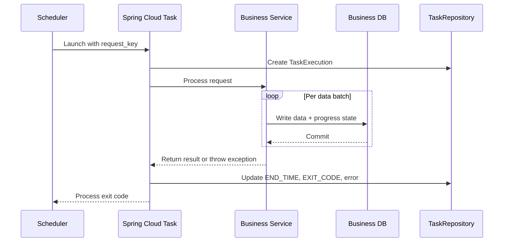
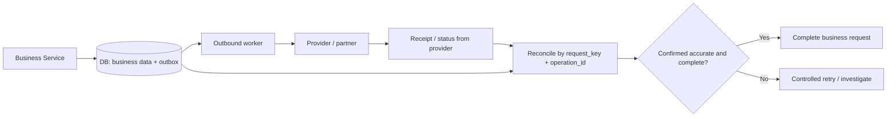

# Reconciling Execution History with Actual Outcomes

## 1. Why is a successful `TaskExecution` not enough?

**Spring Cloud Task** helps build finite-running Spring Boot applications: data imports, report exports, partner synchronization, or processing scheduled requests. With a database configured, `TaskRepository` persists each run's metadata as a **`TaskExecution`**. This metadata shows which task started when, ended when, and what exit code or error the framework recorded.

Yet the more important operational question is usually: **Was the data that was supposed to be processed actually processed completely and accurately?** This is a question about **business outcomes**, not merely process state.

Consider a task importing 1,000 orders:

- The task writes 850 orders to the database, then loses connectivity and fails. `TaskExecution` may report an error, yet **850 orders already exist**.
- The task writes all 1,000 orders and commits successfully, then the JVM is forcefully killed before updating end metadata. `END_TIME` may be null, yet **the business outcome is complete**.
- The runner catches an exception, only logs it, and returns normally. Metadata may record `EXIT_CODE = 0` while in reality **only part of the data was processed**.
- The task writes requests to send 1,000 notifications into the database and exits cleanly, yet the external messaging service has not confirmed delivering all 1,000 notifications.

Therefore, when designing **idempotent retries**, you must reconcile **execution history** against **evidence of actual outcomes** before deciding to rerun, skip, resume from a checkpoint, or investigate manually.

### Expected outcomes

After this lesson, you will be able to establish correlation keys linking multiple runs to one business request; reconcile `TASK_EXECUTION` against target data, state ledgers, and external systems; detect cases where a task reports success with missing data or reports failure despite committed business results; and propose idempotent retries and operational monitoring accordingly.

## 2. Distinguishing four layers of information

| Layer | Typical artifacts | Question answered | Limitation |
| --- | --- | --- | --- |
| **Task execution** | `TASK_EXECUTION`, `TaskExecution` | How did the task process start and end? | Does not prove all side effects completed |
| **Business request** | `request_key`, `source_hash`, processing status | What logical work must be performed? | One request may be executed multiple times |
| **Actual data** | Imported rows, reports, stored objects | Were outputs created accurately and completely? | Row counts alone do not prove data correctness |
| **External evidence** | API receipts, delivery statuses, partner confirmations | Did the receiver confirm out-of-DB side effects? | Timeouts can leave outcomes temporarily indeterminate |

Commonly confused identifiers:

| Identifier | Example | What should it be used for? |
| --- | --- | --- |
| `TASK_NAME` | `orders-import` | Grouping run history for the same job type |
| `TASK_EXECUTION_ID` | `412`, `413` | Tracing **one execution** in `TaskRepository` |
| `request_key` | `partner-a-2026-11-24` | Identifying **one business request** across retries |
| `source_hash` | SHA-256 of the input dataset | Detecting altered inputs reusing the same `request_key` |
| Business key | `(partner_id, external_order_id)` | Preventing duplicate writes for the same order in target data |
| Provider operation ID | Response ID from external system | Reconciling the outcome of an out-of-DB side effect |

**Rule:** `request_key` stays stable across retries; `TASK_EXECUTION_ID` can change across attempts. Never use `TaskRepository`'s auto-incrementing ID as an order deduplication key. If the scheduler replays the same data with an arbitrary new `request_key`, request-level idempotency can be bypassed.

## 3. Gaps between commits and metadata

Consider the conceptual sequence when a task runs:



Between these steps, network drops, timeouts, JVM kills, or power loss can happen. Updating business tables and Task metadata **does not automatically happen inside one atomic transaction**; out-of-DB side effects are even harder to guarantee.

| Failure timing | What `TaskRepository` may show | What actual outcomes may show | Appropriate decision |
| --- | --- | --- | --- |
| Before `TaskExecution` is created | No record | Unprocessed or unknown | Inspect startup logs, request, and side effects before replaying |
| After execution created, before business commit | Has `START_TIME`, not finished | No new data yet | Confirm process stopped; consider retry |
| After committing some batches | Failed or null `END_TIME` | Partial data | Resume via business key/checkpoint; avoid blind re-import |
| After committing everything, before task update | Failed or unfinished | Business work may be completely done | Reconcile, mark complete; do not repeat side effects just because metadata failed |
| After task exited with code 0 | `EXIT_CODE = 0` | Output may be incomplete or downstream still pending | Reconcile before declaring complete |

Even when `TaskExecution` has `END_TIME` and `EXIT_CODE = 0`, the final answer must still rely on **business completion criteria**. Conversely, a `TaskExecution` row missing `END_TIME` may simply result from a JVM crash after commit; never assume the task is still running forever.

## 4. Defining the source of truth and completion criteria

Before writing reconciliation SQL, answer three questions for **each task type**:

1. **What is the scope to process?** E.g., Partner A's file for Nov 24, containing 1,000 unique `external_order_id`s and the source file checksum.
2. **How is a valid outcome verified?** E.g., every valid ID must appear exactly once in the orders table; content matches the source; invalid rows have rejection records with clear reasons.
3. **What is the final source of truth?** E.g., the orders database is the source of truth for imported data; the payment provider's API is the source of truth for settled payments; object storage and checksums are the source of truth for exported files.

Never rely on a self-reported `completed = true` flag set by the runner without verifying actual data. Status flags remain useful, but they must be backed by verifiable **invariants**.

### Example invariant for an order import task

Suppose the input manifest lists the source ID set $S$, the actually imported ID set is $D$, and the validly rejected ID set is $R$. If business rules permit rejecting some records, the completion condition can be:

\[
S = D \cup R,\qquad D \cap R = \varnothing
\]

At the same time, every ID in $D$ must have a payload or hash matching the source. Checking `COUNT(*) = 1000` **is insufficient**: one record could be missing while another is duplicated. When all 1,000 records are valid with zero rejections, verify the source ID set against the target ID set and per-record checksums.

For a file-generation task, the invariant might be **file exists, checksum matches manifest, record count matches, and receiver acknowledged**. For a notification task, separate "send request persisted" from "provider accepted" and "recipient delivered" because those are distinct states.

## 5. Designing a reconciliation ledger separate from TaskRepository

The example below uses **PostgreSQL** so multiple runs share one durable store. Tables in this section are **application-managed business tables**. Never alter Spring Cloud Task's `TASK_EXECUTION` or `TASK_EXECUTION_PARAMS` structures directly.

### 5.1. Request table and imported data

```sql
-- Illustrative PostgreSQL DDL, created via controlled migrations.
CREATE TABLE import_requests (
    request_key VARCHAR(80) PRIMARY KEY,
    source_hash CHAR(64) NOT NULL,
    expected_rows INTEGER NOT NULL CHECK (expected_rows >= 0),
    status VARCHAR(20) NOT NULL
        CHECK (status IN ('PENDING', 'RUNNING', 'PARTIAL',
                         'COMPLETED', 'NEEDS_REVIEW')),
    updated_at TIMESTAMPTZ NOT NULL DEFAULT CURRENT_TIMESTAMP,
    completed_at TIMESTAMPTZ
);

CREATE TABLE imported_orders (
    source_system VARCHAR(60) NOT NULL,
    external_order_id VARCHAR(100) NOT NULL,
    request_key VARCHAR(80) NOT NULL REFERENCES import_requests(request_key),
    payload_hash CHAR(64) NOT NULL,
    amount NUMERIC(18, 2) NOT NULL,
    PRIMARY KEY (source_system, external_order_id)
);

CREATE INDEX idx_imported_orders_request
    ON imported_orders(request_key);
```

Here:

- `request_key` does not change when retrying the same request; `source_hash` prevents accidentally reusing the key with altered input content.
- `expected_rows` is the count of **valid, unique order IDs** per the example's business contract. If rows can be rejected, add a rejection ledger and adjust the reconciliation condition accordingly.
- Primary key `(source_system, external_order_id)` prevents writing duplicate orders from the same source even if another request attempts to re-import the same order. On key conflict, compare payloads and business rules; never automatically treat every `ON CONFLICT DO NOTHING` as success.
- `status` is a business milestone; transition to `COMPLETED` only after full invariant checks pass and data has committed. Crashed runs can leave `RUNNING`, requiring investigation rather than treating it as proof the process is alive.

Do not store passwords, tokens, or full sensitive payloads in reconciliation tables. Use normalized checksums/IDs, least-privilege access, and appropriate retention policies.

### 5.2. Linking one request to multiple task runs

Add a linking table (strictly a business table, not a Spring Cloud Task table):

```sql
CREATE TABLE import_task_attempts (
    task_execution_id BIGINT PRIMARY KEY,
    request_key VARCHAR(80) NOT NULL REFERENCES import_requests(request_key),
    linked_at TIMESTAMPTZ NOT NULL DEFAULT CURRENT_TIMESTAMP
);

CREATE INDEX idx_import_attempts_request
    ON import_task_attempts(request_key);
```

The application or orchestration layer must **record an exact link** between `TaskExecution.getExecutionId()` and `request_key` once the execution ID is available. You can use a Spring Cloud Task listener or orchestrator-managed correlation, but handle failures occurring before the link is written. Never link the two tables **solely by nearby start timestamps**, because multiple tasks can run concurrently, experience clock skew, or retry closely together.

In this example, `import_task_attempts` stores IDs from the same `TaskRepository` that reconciliation queries use. If task metadata resides in a separate database, avoid arbitrary cross-database foreign keys; synchronize via an explicit integration mechanism and verify consistency during reconciliation.

### 5.3. Safe batch-by-batch writing

One approach for high-volume imports is writing data in short transactions:

```text
1. Receive request_key and checksum of the source file.
2. Create/read import_requests; if request_key already exists,
   verify source_hash and input scope match the previous run.
3. For each batch:
   - check if order exists by source_system + external_order_id;
   - if it exists, compare payload_hash and update rules;
   - if not, insert order guarded by UNIQUE constraint;
   - commit the batch, writing checkpoint in the same transaction if applicable.
4. Reconcile the full imported ID/payload set against the input manifest.
5. Only when reconciliation passes, set import_requests.status = COMPLETED.
6. If rows are missing or conflicts exist, record PARTIAL or NEEDS_REVIEW.
```

Illustrative SQL to **mark completion only after verification**:

```sql
-- Illustrative: use only after ID/hash reconciliation has PASSED.
UPDATE import_requests
SET status = 'COMPLETED',
    completed_at = CURRENT_TIMESTAMP,
    updated_at = CURRENT_TIMESTAMP
WHERE request_key = 'partner-a-2026-11-24'
  AND status IN ('RUNNING', 'PARTIAL');
```

In production systems, invariant checks and `COMPLETED` updates need proper transaction/locking design so data cannot mutate between verification and status update. If multiple instances may update one request, consider row locks, optimistic locking, or dedicated coordination. A single-instance flag keyed by task name **does not protect** cases where tasks with different names modify the same order.

## 6. Practical reconciliation queries

The examples assume the tables share a PostgreSQL schema with Spring Cloud Task's default metadata schema. Verify column names, table prefixes, and Task metadata availability against your project's **framework version and configuration**.

### 6.1. Viewing execution history by task name

```sql
SELECT TASK_EXECUTION_ID,
       TASK_NAME,
       START_TIME,
       END_TIME,
       EXIT_CODE,
       EXIT_MESSAGE,
       ERROR_MESSAGE
FROM TASK_EXECUTION
WHERE TASK_NAME = 'orders-import'
ORDER BY START_TIME DESC, TASK_EXECUTION_ID DESC;
```

Read these fields before handling a retry: `EXIT_CODE = 0` usually indicates the framework recorded a successful task; non-zero indicates failure per exit-code mapping. A row with `END_TIME IS NULL` **does not prove** the task is still running; also check processes, logs, and scheduler status. Never treat the highest `TASK_EXECUTION_ID` as proof of **completion** order.

### 6.2. Reconciling imported order counts against expected counts

```sql
SELECT r.request_key,
       r.status AS declared_status,
       r.expected_rows,
       COUNT(o.external_order_id) AS actual_rows,
       (COUNT(o.external_order_id) = r.expected_rows) AS count_matches,
       r.completed_at
FROM import_requests AS r
LEFT JOIN imported_orders AS o
       ON o.request_key = r.request_key
WHERE r.request_key = 'partner-a-2026-11-24'
GROUP BY r.request_key, r.status, r.expected_rows, r.completed_at;
```

Example results:

| `declared_status` | `expected_rows` | `actual_rows` | Initial assessment |
| --- | ---: | ---: | --- |
| `COMPLETED` | 1,000 | 1,000 | **Still must** verify IDs/hashes and out-of-DB outputs before concluding complete |
| `COMPLETED` | 1,000 | 950 | Completion flag and actual data **contradict** |
| `PARTIAL` | 1,000 | 850 | Committed progress exists; retry must preserve valid data |
| `RUNNING` | 1,000 | 1,000 | May have finished writing without updating status; check process and invariants |

If per-source-ID verification is required, store a **manifest** (or source ID snapshot table) and compare ID sets using `EXCEPT` or anti-joins. `COUNT` alone misses corrupted payloads, extra rows, or swapped IDs. When full data cannot be retained, use checksums computed under clear, reliable canonicalization rules while keeping record-level traceability when discrepancies appear.

### 6.3. Joining attempts with business outcomes

```sql
SELECT a.request_key,
       t.TASK_EXECUTION_ID,
       t.START_TIME,
       t.END_TIME,
       t.EXIT_CODE,
       r.status AS business_status,
       r.expected_rows,
       COUNT(o.external_order_id) AS actual_rows
FROM import_task_attempts AS a
JOIN TASK_EXECUTION AS t
  ON t.TASK_EXECUTION_ID = a.task_execution_id
JOIN import_requests AS r
  ON r.request_key = a.request_key
LEFT JOIN imported_orders AS o
  ON o.request_key = r.request_key
WHERE a.request_key = 'partner-a-2026-11-24'
GROUP BY a.request_key, t.TASK_EXECUTION_ID, t.START_TIME,
         t.END_TIME, t.EXIT_CODE,
         r.status, r.expected_rows
ORDER BY t.START_TIME, t.TASK_EXECUTION_ID;
```

Key insight from the results: **multiple `TASK_EXECUTION_ID`s can point to the same `request_key` and final business state**. This query reveals retry history, though you cannot deduce exactly how many orders each attempt wrote from current `actual_rows` alone. If per-attempt attribution is needed, record `first_written_by_execution_id` or checkpoint events in business tables using consistent rules.

### 6.4. Finding requests marked done with mismatched counts

```sql
SELECT r.request_key, r.expected_rows,
       COUNT(o.external_order_id) AS actual_rows
FROM import_requests AS r
LEFT JOIN imported_orders AS o
  ON o.request_key = r.request_key
WHERE r.status = 'COMPLETED'
GROUP BY r.request_key, r.expected_rows
HAVING COUNT(o.external_order_id) <> r.expected_rows;
```

This is an **alerting signal**, not an auto-remediation tool. Investigate whether source data changed, writes duplicated or went missing, rows were deleted post-completion, or status transitions bugged out. Depending on business rules, missing data needs supplemental import and invalid payloads need controlled correction; never run `UPDATE status='COMPLETED'` to hide inconsistencies.

### 6.5. Identifying attempts without an end timestamp

```sql
SELECT t.TASK_EXECUTION_ID,
       t.TASK_NAME,
       t.START_TIME,
       a.request_key,
       r.status AS business_status
FROM TASK_EXECUTION AS t
LEFT JOIN import_task_attempts AS a
  ON a.task_execution_id = t.TASK_EXECUTION_ID
LEFT JOIN import_requests AS r
  ON r.request_key = a.request_key
WHERE t.TASK_NAME = 'orders-import'
  AND t.END_TIME IS NULL
ORDER BY t.START_TIME;
```

Do not automatically treat all returned rows as "orphaned": some attempts may still be running. Cross-check live pods/JVMs, orchestrator locks/leases, logs, and normal run durations before flagging them for recovery.

## 7. Java example: reconciliation task running **after** the import task

Implement reconciliation as an independent step **after the import run has finished or is confirmed stopped**. If the order-importing runner queries its own `TASK_EXECUTION` mid-run, `END_TIME` and final `EXIT_CODE` will not be written yet, leading to wrong conclusions.

The example below illustrates a **reconciliation Spring Cloud Task** named `orders-import-audit` reading business tables. It checks counts and status only as an initial signal; ID/hash verification and external side-effect checks must still be added per project contract.

### 7.1. Dependencies and configuration

In a Maven project using a Spring Cloud BOM compatible with Spring Boot, key dependencies include:

```xml
<dependencies>
    <dependency>
        <groupId>org.springframework.cloud</groupId>
        <artifactId>spring-cloud-starter-task</artifactId>
    </dependency>
    <dependency>
        <groupId>org.springframework.boot</groupId>
        <artifactId>spring-boot-starter-jdbc</artifactId>
    </dependency>
    <dependency>
        <groupId>org.postgresql</groupId>
        <artifactId>postgresql</artifactId>
        <scope>runtime</scope>
    </dependency>
</dependencies>
```

`src/main/resources/application.yml`:

```yaml
spring:
  application:
    name: orders-import-audit
  main:
    web-application-type: none
  datasource:
    url: ${TASK_DB_URL}
    username: ${TASK_DB_USER}
    password: ${TASK_DB_PASSWORD}
  cloud:
    task:
      name: orders-import-audit
      initialize-enabled: false
```

`initialize-enabled: false` assumes the `TASK_*` schema and business tables were **migrated before** running. Avoid placing passwords in source files or CLI parameters. The audit account can use read-only privileges on business tables; privileges needed for `TaskRepository` itself depend on whether a separate `DataSource`/account is configured.

### 7.2. Audit service

```java
package com.example.audit;

public record ImportAuditResult(
        String requestKey,
        String declaredStatus,
        long expectedRows,
        long actualRows) {

    public boolean countMatches() {
        return expectedRows == actualRows;
    }

    public boolean basicCheckPassed() {
        return "COMPLETED".equals(declaredStatus) && countMatches();
    }
}
```

```java
package com.example.audit;

import org.springframework.jdbc.core.JdbcTemplate;
import org.springframework.stereotype.Service;
import org.springframework.transaction.annotation.Transactional;

@Service
public class ImportAuditService {

    private final JdbcTemplate jdbc;

    public ImportAuditService(JdbcTemplate jdbc) {
        this.jdbc = jdbc;
    }

    @Transactional(readOnly = true)
    public ImportAuditResult inspect(String requestKey) {
        return jdbc.queryForObject("""
                SELECT r.request_key,
                       r.status,
                       r.expected_rows,
                       COUNT(o.external_order_id) AS actual_rows
                FROM import_requests r
                LEFT JOIN imported_orders o
                  ON o.request_key = r.request_key
                WHERE r.request_key = ?
                GROUP BY r.request_key, r.status, r.expected_rows
                """,
                (rs, rowNum) -> new ImportAuditResult(
                        rs.getString("request_key"),
                        rs.getString("status"),
                        rs.getLong("expected_rows"),
                        rs.getLong("actual_rows")),
                requestKey);
    }
}
```

`inspect` runs an aggregate query by `request_key`. If no matching request exists, `JdbcTemplate` throws an exception; in production, map this to an `UNKNOWN_REQUEST` outcome with contextual alerts. `@Transactional(readOnly = true)` declares read intent; snapshot consistency also depends on isolation level and database engine. Never make a final conclusion while another process is actively modifying data for the same request.

### 7.3. Runner accepting parameters, reporting outcomes, and failing on mismatch

```java
package com.example.audit;

import java.util.List;

import org.springframework.boot.ApplicationArguments;
import org.springframework.boot.ApplicationRunner;
import org.springframework.boot.SpringApplication;
import org.springframework.boot.autoconfigure.SpringBootApplication;
import org.springframework.context.annotation.Bean;

@SpringBootApplication
public class ImportAuditApplication {

    public static void main(String[] args) {
        SpringApplication.run(ImportAuditApplication.class, args);
    }

    @Bean
    ApplicationRunner auditOnce(ImportAuditService service) {
        return args -> {
            List<String> values = args.getOptionValues("audit.request-key");
            if (values == null || values.size() != 1 ||
                    values.get(0) == null || values.get(0).isBlank()) {
                throw new IllegalArgumentException(
                        "Required: --audit.request-key=<request-key>");
            }

            ImportAuditResult result = service.inspect(values.get(0));
            System.out.printf(
                    "request=%s status=%s expected=%d actual=%d%n",
                    result.requestKey(), result.declaredStatus(),
                    result.expectedRows(), result.actualRows());

            if (!result.basicCheckPassed()) {
                throw new IllegalStateException(
                        "Basic reconciliation failed; investigate before retry");
            }
            System.out.println("Basic reconciliation passed; proceed with ID/hash checks if needed.");
        };
    }
}
```

The example uses Java 17 or newer for `record` and text blocks (`"""`). The runner throws an exception so the **audit run** is flagged as failing the basic check; it **does not automatically rerun the import, delete data, or claim every side effect was verified**.

Assuming it is built as `target/orders-import-audit.jar` and PostgreSQL environment variables are configured, run:

```bash
# Run after the import job has finished or is confirmed completely stopped.
java -jar target/orders-import-audit.jar \
  --audit.request-key=partner-a-2026-11-24
```

With lab data `COMPLETED`, `expected_rows=3`, `actual_rows=3`, the runner prints that basic checks passed. If only two orders were imported or status remains `PARTIAL`, the audit throws an exception so the scheduler/monitoring system flags it for review.

## 8. Decision table: when to rerun?

After confirming the previous task **is no longer running**, classify using execution state and actual data:

| Last attempt metadata | Business evidence | Conclusion | Action to take |
| --- | --- | --- | --- |
| `END_TIME` populated, `EXIT_CODE=0` | All invariants pass, downstream confirmed if required | Completed | Record success; do not retry |
| `EXIT_CODE=0` | Missing IDs, checksum mismatch, or downstream unfinished | **Contradiction** between tech and business | Investigate, fix, and execute missing step; do not declare complete |
| `EXIT_CODE!=0` | All data committed, business checks pass | Likely **post-commit** error | Do not duplicate side effects; note failed run while marking request complete |
| `EXIT_CODE!=0` | Partial valid data committed | Incomplete | Resume via checkpoint/business key, bounded retry |
| `END_TIME IS NULL` | Unclear if process is still alive | Insufficient evidence | Check orchestrator, logs, timeout/lease before deciding |
| Task forcefully killed | Business tables complete, external receipt unknown | External outcome **indeterminate** | Query partner status by idempotency key; never blindly resend |
| No Task metadata | No business data visible, yet external side effects possible | Needs investigation | Inspect logs, request key, outbox/provider before replaying |

**Operational principle:** retrying is an **evidence-based decision**, not a knee-jerk reaction to `EXIT_CODE != 0`. Often you need "resume only missing items," "reconcile again in a few minutes," or "route to an investigation queue" instead of rerunning from scratch.

### Prerequisites for safe retries

1. **Stable logical key:** the scheduler re-passes the same `request_key`, `source_hash`, and processing scope; the application rejects content changes under the same key.
2. **DB-level deduplication:** unique business keys and proper upsert/conflict checks; never unguarded `SELECT ...` then `INSERT` under concurrency.
3. **Durable checkpoints:** mark completed items/batches within appropriate transactions so the next run skips committed work accurately.
4. **Prevent unintended overlap:** combine `spring.cloud.task.single-instance-enabled`, business locks, or scheduler concurrency policies; a lock by task name alone is insufficient when differently named tasks mutate the same data.
5. **Bounded retries:** backoff, max attempts, separating transient errors from invalid data, and transitioning to `NEEDS_REVIEW`.
6. **Post-retry reconciliation:** verify ID/hash sets, status, and actual side effects; do not stop just because the final runner exited 0.

## 9. When tasks produce side effects outside the database

Sending email, calling payment APIs, uploading files to object storage, or publishing messages all have a gap between "application requested" and "receiver executed." A timeout does not prove the receiver skipped it; resending can cause duplicate effects.

### Outbox and receipt model



When creating durable side effects, write **business data and outbox rows in one transaction** when sharing a database. The outbound worker sends messages with a stable **idempotency key** or operation ID and records the provider's receipt/status. Reconcile based on official receiver acknowledgments, not merely a "sent" log line.

An outbox prevents losing publish requests, yet can still redeliver messages if a worker crashes after sending and before marking sent. Thus, **the receiver or provider must also handle idempotency**. If a provider supports neither status lookups nor idempotency keys, acknowledge the possibility of "execution unknown" and maintain a manual investigation workflow.

### Time-delayed reconciliation

Many systems reach completion **after a delay**: delayed webhooks, partner batch processing, or unconfirmed object storage finalization. Define states such as `PENDING_EXTERNAL`, `CONFIRMED`, `REJECTED`, and `UNKNOWN`; bound waiting times and schedule reconciliation with backoff. Never mark a request permanently failed merely because confirmation had not arrived on the first check.

## 10. Coordinating with Spring Batch and schedules

If a task launches **Spring Batch**, there is an extra layer of evidence:

- Spring Cloud Task `TaskExecution`: **application process** state.
- Spring Batch `JobExecution` and `StepExecution`: **job/step** state, `readCount`, `writeCount`, `skipCount`, errors, and restartability keyed by job parameters.
- Business/target tables: data **actually committed**, matching expected IDs and business rules.

Do not conclude "exactly 1,000 rows processed" from `writeCount=1000` alone when skips, retries, filters, idempotent writers, multiple steps, or out-of-DB side effects exist. Batch counts aid diagnostics, yet **do not replace target-data reconciliation**. When a task triggers multiple jobs or runs jobs asynchronously, Task metadata may finish before downstream processing completes; track both jobs and overall completion criteria.

Schedulers (cron, Kubernetes CronJob, workflow engines) should trigger the audit task **after the import task completes or is confirmed stopped**, with the same `request_key`. If the request is still pending, reschedule reconciliation; only relaunch data import after evaluating the decision table in section 8. Never let multiple schedulers independently retry the same request under conflicting rules.

### Recommended monitoring and alerts

| Signal | Interpretation | Suggested response |
| --- | --- | --- |
| `EXIT_CODE=0` yet business invariants fail | False success or post-run data mutation | High-priority alert; inspect target data |
| `EXIT_CODE!=0` yet business checks pass | Post-commit failure / metadata error / post-processing failure | Record discrepancy; prevent duplicate retry |
| `END_TIME IS NULL` beyond threshold | Task running long or killed abruptly | Check process and logs before recovery |
| `PARTIAL` older than SLA | Partial data left unfinished | Resume from checkpoint or escalate for review |
| `PENDING_EXTERNAL` past timeout | Provider has not confirmed side effect | Query receipt, backoff, escalate |
| Multiple executions for same `request_key` | Retries or duplicate triggers | Verify idempotency and rerun cause |
| Missing execution/request link | Traceability gap or very early startup crash | Trace via request key/logs/orchestrator and investigate |

Set query time windows using **consistent timezones and lag tolerances**; never pair attempts merely by close timestamps. Retain logs/metadata long enough for investigation while complying with retention, access control, and sensitive-data protection policies.

## 11. Common mistakes

| Mistake | Consequence | Fix |
| --- | --- | --- |
| Seeing `EXIT_CODE=0` and assuming data is complete | Missing or corrupted outputs go unnoticed | Define invariants and reconcile target data |
| Seeing `EXIT_CODE!=0` and re-importing from scratch | Duplicates already-committed batches | Read checkpoints, business keys, and side-effect evidence |
| Using `TASK_EXECUTION_ID` as an idempotency key | Retries get new IDs and fail to recognize the same request | Use a `request_key` stable across runs |
| Comparing `COUNT(*)` only | Misses swapped IDs or altered payloads | Reconcile ID sets, checksums, and business rules |
| `ON CONFLICT DO NOTHING` on all conflicts | May hide an older row with a different payload | Compare payloads and reject contradictions |
| Assuming `RUNNING` in DB means process is alive | Row may be stranded after a crash | Verify orchestrator, leases, logs, and update timestamps |
| Immediately resending HTTP request after timeout | Provider may have processed it, duplicating transactions | Use idempotency keys and status-lookup APIs |
| Manually editing `TASK_EXECUTION` to "clean up history" | Destroys operational evidence and falsifies history | Keep framework metadata intact; record reconciliation separately |
| Running audit concurrently while import is mid-commit | Audit sees partial state and raises false alarms | Check process/transaction status; run once settled |

## 12. Self-check exercises

1. Suppose `orders-import` has two `TaskExecution`s: the first fails after committing 850/1,000 orders, and the second processes the remaining 150 orders. State the actual target record count after a proper retry, and explain why you cannot simply sum `writeCount` or rely on `EXIT_CODE` alone.
2. Create the example `import_requests` and `imported_orders` tables in a test PostgreSQL environment. Insert a request with `expected_rows=3` and two orders, run the query from section 6.2, and explain how `PARTIAL` differs from `COMPLETED`.
3. Insert the third order and verify each `external_order_id`/`payload_hash`; only once invariants pass, update business status to `COMPLETED`.
4. Simulate `TASK_EXECUTION.EXIT_CODE=0` while `import_requests.status='PARTIAL'`. How would you alert and decide on retries? Why is `TaskRepository` not the sole source of truth?
5. Simulate a task killed after committing all data but before writing `END_TIME`. Distinguish signs of a live process, an unfinished metadata record, and actual business outcomes.
6. Design a way to link `request_key` to multiple `TASK_EXECUTION_ID`s without relying on timestamps; explain how to handle attempts that fail before the link is written.
7. Describe a case where a payment API call times out even though the partner executed it. Which data fields and endpoints are needed to reconcile before resending?
8. If a task runs Spring Batch, correlate `TaskExecution`, `JobExecution`, `StepExecution`, `writeCount`, and target tables in a post-failure restart scenario.
9. Build a decision matrix for the four combinations of `EXIT_CODE` (0 / non-0) and business outcome (complete / incomplete), along with safe handling steps.

After completing these exercises, you should be able to answer **"has a request truly completed?"** with verifiable data and evidence, link multiple runs to the same request, separate framework state from business state, and build safe retry/idempotency paths for scheduled, on-demand, or Spring Batch–integrated Spring Cloud Tasks.

## 13. References

- [Spring Cloud Task Reference — Features](https://docs.spring.io/spring-cloud-task/reference/features.html): `TaskExecution`, lifecycle, and status metadata.
- [Spring Cloud Task — Task Repository Schema](https://docs.spring.io/spring-cloud-task/reference/appendix-task-repository-schema.html): `TaskRepository` metadata tables and history structure.
- [Spring Batch Reference](https://docs.spring.io/spring-batch/reference/): `JobRepository`, `JobExecution`, `StepExecution`, restarts, and processing metadata.
- [PostgreSQL Documentation — Constraints](https://www.postgresql.org/docs/current/ddl-constraints.html): unique keys and integrity constraints supporting idempotency.

In production environments, consult schemas and APIs matching your application's **exact Spring Cloud Task / Spring Batch versions**; verify business completion criteria, transactions, and partner system behavior before automating retry decisions.
