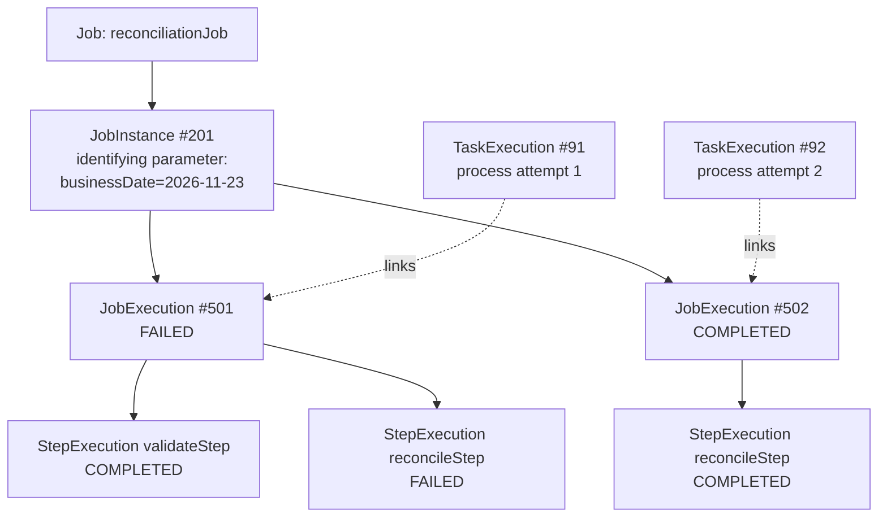
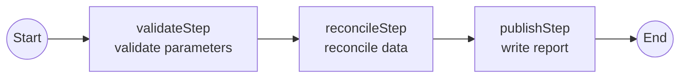
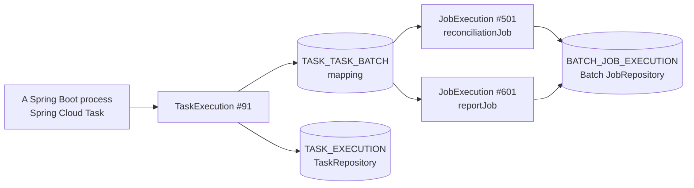

# Job, Step, JobInstance, and JobExecution in a Task Application

## Lesson Objectives

In the **Spring Batch** chapter of the **Spring Cloud Task** module, this lesson explains the Batch execution model when packaged as a finite-lived Spring Boot application. Instead of only knowing "the Task finished running," we will determine **which Job ran, which dataset it ran for, how many attempts were made, which Step succeeded or failed, and how to link the results to a TaskExecution**.

After this lesson, you will be able to:

- Accurately distinguish `Job`, `Step`, `JobInstance`, `JobExecution`, and `StepExecution`.
- Explain why **Job name + identifying JobParameters** define a JobInstance, while **each attempt** has its own JobExecution.
- Distinguish the **TaskExecution** lifecycle of Spring Cloud Task from the Job/Step lifecycle of Spring Batch.
- Configure a simple Batch Job running inside Spring Cloud Task with Spring Boot, pass parameters, and query metadata.
- Analyze restarts after failure, the difference between restarting and running a new instance, and how to avoid accidentally processing duplicate data.
- Understand the role of `TaskBatchExecutionListener`, the `TASK_TASK_BATCH` table, `fail-on-job-failure`, and how to trace results from the Task down to each Step.

## 1. The Problem: A Task Process Needs to Process Millions of Records

A payment reconciliation application runs every night with the business date `businessDate=2026-11-23`. On each launch, the JVM will:

1. Validate the date and data source.
2. Read transactions in batches and reconcile them against the partner system.
3. Write reconciliation results and summarize the number of succeeded/failed rows.
4. Exit and return an exit code to cron, Docker, or a Kubernetes Job.

**Spring Cloud Task** is well-suited for tracking **a single run of the entire application**: when it started, when it ended, its exit code, and any overall error. However, if step 2 processes 800,000 out of 1,000,000 transactions and then fails, simply knowing `TaskExecution.exitCode != 0` does not answer:

- Which step failed?
- Which records were already committed?
- When re-running for the same date, can already completed steps be skipped?
- Can processing resume from a checkpoint instead of starting over from the beginning?

**Spring Batch** provides the `Job`/`Step` model, transaction/chunk management, per-run state, and `ExecutionContext` data for restarts. When combined, **Task manages the finite-lived process; Batch manages the data processing work inside that process**.

## 2. Five Concepts That Must Not Be Conflated

| Concept | Nature | Reconciliation Example |
| --- | --- | --- |
| **`Job`** | Definition of a Batch workflow consisting of one or more Steps | `reconciliationJob` consisting of `validateStep` and `reconcileStep` |
| **`Step`** | Definition of an independent processing phase within a Job, either tasklet or chunk | `reconcileStep` reading/processing/writing transactions |
| **`JobInstance`** | **A logical unit of work** of a Job, identified by **Job name + JobParameters marked as identifying** | `reconciliationJob` for `businessDate=2026-11-23` |
| **`JobExecution`** | **A single execution attempt** of a JobInstance; has status, timestamps, errors, and exit status | Attempt #1 `FAILED`, attempt #2 `COMPLETED` |
| **`StepExecution`** | **A single execution of a Step** belonging to a JobExecution; has read/write counts, commits, rollbacks, and context | `reconcileStep` of attempt #2 read 1,000,000 rows |

In addition to the five Batch concepts, there is Spring Cloud Task's **`TaskExecution`**:

| Concept | ID and Scope |
| --- | --- |
| `TaskExecution` | ID of a single run of a **Spring Boot Task application**; one process may run one or more Batch Jobs |
| `JobInstance` | ID of a logical Batch unit of work; independent of the number of attempts |
| `JobExecution` | ID of a single Batch Job attempt; may belong to the same JobInstance as a previous failed attempt |
| `StepExecution` | ID of a Step run within a JobExecution; the same Step can have a new StepExecution upon restart |

**`TaskExecution` and `JobExecution` are not the same thing.** They have separate IDs, separate storage tables, and different lifecycles. A single Task launch can execute multiple Batch Jobs, and **the same JobInstance can be attempted across multiple different Task runs**.

### 2.1. Illustrating Two Runs for the Same Date



The IDs in the diagram are **illustrative** only. The second run uses the same *identifying* parameters, so it is still **JobInstance #201** but gets a new **JobExecution #502**. If `validateStep` already completed and the Step has appropriate default restart configuration, Spring Batch does not need to re-run that Step. The failed Step is re-executed according to the restart policy and saved checkpoint data.

If the first run was already **COMPLETED**, running again with the same Job name and the same identifying JobParameters usually results in `JobInstanceAlreadyCompleteException`; this is a mechanism to prevent accidentally re-running an already completed instance, **not** an exactly-once guarantee for external systems.

## 3. `Job`: Defining a Batch Workflow

A `Job` is an immutable definition of a workflow structure at the logical level. A Job has a name and a sequence/transition of Steps; it is not the state of a specific run.

Example:



A Job can be run for many different dates, with many JobInstances and JobExecutions. In real-world applications, a Job definition can also include conditional branching, flows, partitioning, or parallel processing. This lesson uses a linear model to clarify the data relationships.

**Spring Batch's `JobRepository`** stores Job/Step metadata, which is distinct from **Spring Cloud Task's `TaskRepository`**. You can use **the same DataSource** to store both sets of tables, but the two contracts and schemas remain separate.

## 4. `Step` and `StepExecution`: Fine-Grained Tracking Units

A `Job` consists of at least one `Step`. There are two common ways to implement a Step:

| Step Type | Function | Best Suited For |
| --- | --- | --- |
| **Tasklet Step** | Runs a single operation or a group of operations defined by the developer | Validating parameters, generating summary files, cleaning up data |
| **Chunk-oriented Step** | Read → process → write in chunks; commits periodically, supports skip/retry as appropriate | Processing large volumes of data, needing checkpoints and read/write statistics |

`Step` is the **definition**, whereas `StepExecution` is the **record of an actual execution of a Step**. A single Step can have multiple StepExecutions across restarts of the same JobInstance.

Commonly used fields of `StepExecution`:

- `status` / `exitStatus`: execution status and result code at the Step level.
- `startTime`, `endTime`: start/end timestamps.
- `readCount`, `writeCount`, `filterCount`: number of records read/written/filtered.
- `commitCount`, `rollbackCount`: transaction statistics.
- `readSkipCount`, `processSkipCount`, `writeSkipCount`: errors skipped according to policy.
- `ExecutionContext`: checkpoint/state information that needs to be persisted for resuming processing.

If `validateStep` fails before `reconcileStep` begins, there may be **no `StepExecution` for `reconcileStep`** in that attempt. Spring Batch only creates a StepExecution when the Step actually starts executing, rather than pre-creating records for all Steps in the flow.

**Chunk commits do not guarantee exactly-once by default for external HTTP APIs or message brokers.** If a Step both writes to a DB and calls another system, you must design idempotency, an outbox pattern, or appropriate compensating mechanisms.

## 5. `JobInstance`: Logical Job Identity

Core definition:

**`JobInstance = Job name + set of JobParameters marked as identifying`.**

Example:

| Job Name | Identifying parameter | Non-identifying parameter | JobInstance |
| --- | --- | --- | --- |
| `reconciliationJob` | `businessDate=2026-11-23` | `logLevel=INFO` | A |
| `reconciliationJob` | `businessDate=2026-11-23` | `logLevel=DEBUG` | Still A |
| `reconciliationJob` | `businessDate=2026-11-24` | `logLevel=INFO` | B |
| `inventoryJob` | `businessDate=2026-11-23` | `logLevel=INFO` | C |

*`A/B/C` are illustrative labels, not system IDs.*

### 5.1. What Is `JobParameters` Used For?

`JobParameters` passes data into a Job and determines the JobInstance. Spring Batch supports various value types and an **identifying** flag for each parameter. By default, many converters/builder operations mark parameters as identifying unless specified otherwise.

When launching a Job programmatically in Java, for example in Spring Batch 5.x:

```java
JobParameters parameters = new JobParametersBuilder()
        .addString("businessDate", "2026-11-23", true)
        .addString("operator", "nightly-scheduler", false)
        .toJobParameters();
```

In the snippet above, `businessDate` participates in identity, while `operator` is supplementary information. Changing `operator` does not create a new JobInstance. To restart a failed instance, identifying parameters must stay the same; with the Boot launcher, non-identifying parameters still need to be specified again as required for each run.

### 5.2. Common Mistake: Adding `run.id` on Every Retry

Suppose a system uses:

```text
businessDate=2026-11-23
run.id=1700000001
```

If `run.id` is also identifying, changing it on every retry creates a **new JobInstance**. Spring Batch then will not follow the restart path of the old JobInstance; it may run from the beginning and write duplicate data. `RunIdIncrementer` is useful when **intentionally creating a new instance**, not as a replacement for restarting a failed one.

The policy should be clear:

- **Retry/restart a failed JobInstance:** keep the Job name and identifying parameters unchanged.
- **Run for another business date:** use a different `businessDate` to create a new JobInstance.
- **Intentionally reprocess a completed date:** define an intentional data version or reprocessing key, and ensure the target data can tolerate re-running.

**Task command-line arguments are different from Batch `JobParameters`.** Spring Cloud Task can record the process's raw argument strings; Spring Batch uses converted JobParameters and the identifying flag to compute JobInstance identity.

## 6. `JobExecution`: A Single Attempt with Status and Exit Status

`JobExecution` describes **a specific execution attempt**. Each attempt has a new ID, a reference to the JobInstance, timestamps, status, error details, and an `ExecutionContext`.

| Scenario | `JobInstance` | `JobExecution` |
| --- | --- | --- |
| First run for 2026-11-23 | A | #501 — `FAILED` |
| Fix transient error and restart with same identifying parameters | Still A | #502 — `COMPLETED` |
| Run for 2026-11-24 | New B | #503 — `COMPLETED` |
| Re-run completed instance A without changing policy | A | Usually rejected with `JobInstanceAlreadyCompleteException` |

### 6.1. `BatchStatus` and `ExitStatus` Are Different

| Property | Type | Example | Meaning |
| --- | --- | --- | --- |
| `JobExecution.status` | `BatchStatus` enum | `STARTING`, `STARTED`, `COMPLETED`, `FAILED`, `STOPPED` | Control status of the Job lifecycle |
| `JobExecution.exitStatus` | `ExitStatus` object with string code | `"COMPLETED"`, `"FAILED"`, or custom code | Business/completion result published by the Job |
| `TaskExecution.exitCode` | Integer | `0`, `1`, custom code | Code recorded by Spring Cloud Task for the **entire process** |
| JVM/container exit code | Integer | `0`, `1`, `137`... | Value received by the scheduler/container |

**Spring Batch's `ExitStatus` is not an integer like `TaskExecution.exitCode`.** If a Step uses a custom `ExitStatus` to control flow, do not assume Task automatically understands this code. For failed Jobs, verify the mapping to the process exit code.

### 6.2. Restart Does Not Always Mean "Resume from the Exact Last Row"

Batch stores `ExecutionContext` and metadata to support restarts, but the actual outcome depends on how `ItemReader`, `ItemWriter`, transactions, and Step policies are implemented:

- Steps already completed within the same JobInstance are typically skipped on restart, unless configured otherwise such as with `allowStartIfComplete`.
- A failed Step can be re-executed, reading from the checkpoint if the reader/step persisted state properly.
- A simple Tasklet does not automatically know how many transactions it has already processed.
- If the data source changes between runs, inconsistent checkpoints and input identifiers can cause data loss or duplication.
- For tasks with side effects outside the DB, additional idempotency and recovery design are required.

Never claim "Spring Batch always resumes from record N+1" without verifying the reader, commit interval, and transaction boundaries.

## 7. How Does `TaskExecution` in Spring Cloud Task Link to Batch?

Spring Cloud Task creates/updates one `TaskExecution` for a **finite-lived Spring Boot process**. If the application runs one or more Spring Batch Jobs, the linkage occurs through **`TaskBatchExecutionListener`** from the `spring-cloud-task-batch` integration.

According to the official documentation, this listener is typically auto-configured when the application has:

1. A Spring Batch bean of type `Job`.
2. The `spring-cloud-task-batch` library on the classpath.
3. Task/Batch integration configuration enabled and repositories available.

The listener attaches to matching Jobs to persist the association between `JobExecution` and `TaskExecution`. This differs from Spring Cloud Task's **`TaskExecutionListener`**: the latter provides startup/failure/end callbacks at the Task process level, whereas `TaskBatchExecutionListener` serves **Batch Job association**.



In this model, a single `TaskExecution` can be linked to **multiple `JobExecution`s** if the application runs multiple Jobs. When restarting a failed JobInstance with a new JVM, there will be a **new TaskExecution** and a **new JobExecution**, while the JobInstance can remain the same.

### 7.1. Corresponding Metadata Tables

| Store | Table | Meaning |
| --- | --- | --- |
| Spring Cloud Task | `TASK_EXECUTION` | A single process run, Task name, timestamps, exit code |
| Spring Cloud Task | `TASK_EXECUTION_PARAMS` | Raw arguments attached to the Task run |
| Spring Cloud Task | `TASK_TASK_BATCH` | Bridge `TASK_EXECUTION_ID ↔ JOB_EXECUTION_ID` |
| Spring Batch | `BATCH_JOB_INSTANCE` | A JobInstance with `JOB_INST_ID` and `JOB_NAME` |
| Spring Batch | `BATCH_JOB_EXECUTION` | Each JobExecution, status, and relationship to JobInstance |
| Spring Batch | `BATCH_JOB_EXECUTION_PARAMS` | JobParameters of the run; columns depend on Batch version |
| Spring Batch | `BATCH_STEP_EXECUTION` | StepExecutions, read/write counts, commits, rollbacks |
| Spring Batch | `BATCH_JOB_EXECUTION_CONTEXT`, `BATCH_STEP_EXECUTION_CONTEXT` | Context metadata supporting processing/restarts |

**A single DataSource can hold both `TASK_` and `BATCH_` tables**, but they remain **two logical repositories**. If using multiple DataSources, you must clearly define which DB Task uses, which DB Batch uses, and where the mapping table is stored. Do not assume changing `spring.datasource.url` is sufficient if the application has customized `TaskConfigurer`, the Batch datasource, or the transaction manager.

### 7.2. Querying from Task to Job and Step

Example for the **default Spring Cloud Task and Spring Batch 5.x schema**:

```sql
SELECT
    t.TASK_EXECUTION_ID,
    t.TASK_NAME,
    t.EXIT_CODE AS TASK_EXIT_CODE,
    ji.JOB_NAME,
    je.JOB_INST_ID,
    je.JOB_EXEC_ID,
    je.STATUS AS JOB_STATUS,
    je.EXIT_CODE AS JOB_EXIT_CODE,
    se.STEP_NAME,
    se.STATUS AS STEP_STATUS,
    se.READ_COUNT,
    se.WRITE_COUNT
FROM TASK_EXECUTION AS t
JOIN TASK_TASK_BATCH AS link
    ON link.TASK_EXECUTION_ID = t.TASK_EXECUTION_ID
JOIN BATCH_JOB_EXECUTION AS je
    ON je.JOB_EXEC_ID = link.JOB_EXECUTION_ID
JOIN BATCH_JOB_INSTANCE AS ji
    ON ji.JOB_INST_ID = je.JOB_INST_ID
LEFT JOIN BATCH_STEP_EXECUTION AS se
    ON se.JOB_EXEC_ID = je.JOB_EXEC_ID
WHERE t.TASK_EXECUTION_ID = 91
ORDER BY je.JOB_EXEC_ID, se.STEP_EXEC_ID;
```

Replace `91` with the actual ID. **One JobExecution has multiple StepExecutions**, so the JOIN returns multiple rows with the same Job ID; this is expected, not duplicate Batch data. If there is no row in `TASK_TASK_BATCH` even though a JobExecution exists, check the `spring-cloud-task-batch` dependency, the linking listener, schemas, and any difference between Task/Batch DataSources.

**Spring Batch 6.x** releases introduced API and schema changes in several components. Do not blindly apply Batch 5 SQL/DDL to Batch 6 without checking the scripts and reference guide for your deployed version.

## 8. Hands-on: Running a Two-Step Job Inside a Task

The following example is written using **compatible Spring Boot 3.x + Spring Batch 5.x + Spring Cloud Task 3.x APIs**. For Spring Boot 4.x/Spring Batch 6.x, check packages, builders, schemas, and configuration according to the exact version; do not arbitrarily mix dependencies across release trains.

### 8.1. Project Creation and Dependencies

On [Spring Initializr](https://start.spring.io/), create a Maven project with Java 17 or a Java version supported by your Spring Boot version. Select **Spring Batch**, **Spring Cloud Task**, and **H2 Database**. In addition to the Batch starter and Task starter, declare **spring-cloud-task-batch** to link JobExecution with TaskExecution.

Given a compatible Spring Boot parent and Spring Cloud BOM, the core dependencies are:

```xml
<dependencies>
    <dependency>
        <groupId>org.springframework.boot</groupId>
        <artifactId>spring-boot-starter-batch</artifactId>
    </dependency>
    <dependency>
        <groupId>org.springframework.cloud</groupId>
        <artifactId>spring-cloud-starter-task</artifactId>
    </dependency>
    <dependency>
        <groupId>org.springframework.cloud</groupId>
        <artifactId>spring-cloud-task-batch</artifactId>
    </dependency>
    <dependency>
        <groupId>com.h2database</groupId>
        <artifactId>h2</artifactId>
        <scope>runtime</scope>
    </dependency>
</dependencies>
```

This is a **dependencies snippet**, not a complete `pom.xml`. Let Spring Boot manage the Batch version and the Spring Cloud BOM manage the Task version. Including both starters in the same application does not replace DataSource and schema configuration.

### 8.2. Task Bootstrap Class

```java
package com.example.batchtask;

import org.springframework.boot.SpringApplication;
import org.springframework.boot.autoconfigure.SpringBootApplication;
import org.springframework.cloud.task.configuration.EnableTask;

@SpringBootApplication
@EnableTask
public class BatchTaskApplication {

    public static void main(String[] args) {
        SpringApplication.run(BatchTaskApplication.class, args);
    }
}
```

`@EnableTask` activates the listener that tracks a Spring Cloud Task run. Spring Boot Batch auto-configuration can automatically launch **a `Job` bean** on startup (when configuration permits). This example **does not add a custom `ApplicationRunner` calling `JobLauncher`**, avoiding accidentally running the same Job twice.

### 8.3. Defining the Job and Steps

Create `ReconciliationJobConfiguration.java`:

```java
package com.example.batchtask;

import java.time.LocalDate;

import org.springframework.batch.core.Job;
import org.springframework.batch.core.Step;
import org.springframework.batch.core.job.builder.JobBuilder;
import org.springframework.batch.core.repository.JobRepository;
import org.springframework.batch.core.step.builder.StepBuilder;
import org.springframework.batch.repeat.RepeatStatus;
import org.springframework.context.annotation.Bean;
import org.springframework.context.annotation.Configuration;
import org.springframework.core.env.Environment;
import org.springframework.transaction.PlatformTransactionManager;

@Configuration(proxyBeanMethods = false)
public class ReconciliationJobConfiguration {

    @Bean
    Job reconciliationJob(
            JobRepository jobRepository,
            Step validateStep,
            Step reconcileStep) {
        return new JobBuilder("reconciliationJob", jobRepository)
                .start(validateStep)
                .next(reconcileStep)
                .build();
    }

    @Bean
    Step validateStep(
            JobRepository jobRepository,
            PlatformTransactionManager transactionManager) {
        return new StepBuilder("validateStep", jobRepository)
                .tasklet((contribution, chunkContext) -> {
                    Object rawDate = chunkContext.getStepContext()
                            .getJobParameters().get("businessDate");
                    if (rawDate == null) {
                        throw new IllegalArgumentException(
                                "Missing JobParameter businessDate");
                    }
                    LocalDate.parse(rawDate.toString());
                    return RepeatStatus.FINISHED;
                }, transactionManager)
                .build();
    }

    @Bean
    Step reconcileStep(
            JobRepository jobRepository,
            PlatformTransactionManager transactionManager,
            Environment environment) {
        return new StepBuilder("reconcileStep", jobRepository)
                .tasklet((contribution, chunkContext) -> {
                    String date = chunkContext.getStepContext()
                            .getJobParameters().get("businessDate").toString();

                    System.out.println("Reconciling " + date);

                    if (environment.getProperty(
                            "demo.fail", Boolean.class, false)) {
                        throw new IllegalStateException(
                                "Simulated error in reconcile step");
                    }

                    // Real application: call an idempotent reconciliation service.
                    System.out.println("Reconciliation completed");
                    return RepeatStatus.FINISHED;
                }, transactionManager)
                .build();
    }
}
```

Explanation:

- The `Job` named `reconciliationJob` runs `validateStep` before `reconcileStep`.
- `validateStep` reads the **Batch JobParameter** `businessDate` and validates that it is a valid date.
- `reconcileStep` illustrates data processing; the `demo.fail` flag uses the **Spring Environment** to intentionally trigger an error for learning purposes.
- Both Steps here are **Tasklet Steps**. They illustrate Step/Job state, **without chunks, row-level checkpoints, or retries yet**. To process large datasets, replace them with chunk-oriented Steps using `ItemReader`/`ItemProcessor`/`ItemWriter`.
- In Batch 5, `JobBuilder(name, jobRepository)` and `StepBuilder(name, jobRepository)` are how Jobs/Steps are built using the repository infrastructure provided by Spring Boot.

### 8.4. In-Memory H2 Demo Configuration

Create `src/main/resources/application.yml`:

```yaml
spring:
  application:
    name: reconciliation-batch-task
  main:
    web-application-type: none
  datasource:
    url: jdbc:h2:mem:batchtask;DB_CLOSE_DELAY=-1
    driver-class-name: org.h2.Driver
    username: sa
    password: ""
  batch:
    job:
      enabled: true
      name: reconciliationJob
    jdbc:
      initialize-schema: always
  cloud:
    task:
      initialize-enabled: true
      closecontext-enabled: true
      batch:
        fail-on-job-failure: true
```

**In-memory** H2 helps the demo start up in one go without managing DB files. Each new JVM has a fresh metadata store, so this configuration **is not suitable for testing restarts across two processes**. To test real restarts, switch to **PostgreSQL/file-based H2/persistent DB**, initialize both `TASK_` and `BATCH_` schemas for your version, and use migrations (in production, auto schema initialization flags are typically set to `false`/`never`).

`spring.cloud.task.batch.fail-on-job-failure=true` instructs the Task/Batch integration to reflect a `FAILED` Job as a Task failure rather than treating the Boot process as having completed normally. You may also need to check the exit code mechanism of your Spring Boot version and container.

### 8.5. Passing Parameters in the Right Format

With **Spring Boot's** automatic Batch launcher, Batch arguments are usually passed **without the `--` prefix**:

```bash
./mvnw package
java -jar target/reconciliation-batch-task-0.0.1-SNAPSHOT.jar businessDate=2026-11-23
```

Replace the JAR name with your actual `artifactId`/`version`. Note the difference:

| Syntax | How Spring Boot Interprets It | Batch JobParameters? |
| --- | --- | --- |
| `businessDate=2026-11-23` | Non-option argument for the Batch launcher | **Yes**, via Boot/Batch's converter |
| `--businessDate=2026-11-23` | `Environment` property | **Does not automatically become a JobParameter** for Boot's Batch launcher |
| `--demo.fail=true` | `Environment` property | No; only used in the example to intentionally throw an error |
| `--spring.batch.job.name=reconciliationJob` | Selects which Job to run via Boot configuration | Not an identifying parameter of the Job |

Spring Boot documentation emphasizes **not using `--` to pass Batch Job parameters** when running the default launcher. If you write your own `JobLauncher` or use a custom `JobOperator` tool, conversion rules may differ; you must follow that launcher's contract.

Run a failure scenario:

```bash
java -jar target/reconciliation-batch-task-0.0.1-SNAPSHOT.jar \
  --demo.fail=true businessDate=2026-11-23
```

When `validateStep` succeeds but `reconcileStep` throws an exception, Batch records `JobExecution=FAILED` and the corresponding `StepExecution`. Task/Batch integration with `fail-on-job-failure` makes the process reflect the failure. Because `businessDate` is an identifying parameter, if you use a **persistent store** and re-run without `--demo.fail=true`, this can be the **second attempt of the same JobInstance**.

**Do not re-run the scenario above to test restarts while still using in-memory H2**: you will create a new JobRepository store and lose the history of the previous attempt.

### 8.6. Verifying Data at Both Levels

With a persistent metadata store and default tables created:

```sql
SELECT
    JOB_INST_ID,
    JOB_NAME
FROM BATCH_JOB_INSTANCE
ORDER BY JOB_INST_ID DESC;

SELECT
    JOB_EXEC_ID,
    JOB_INST_ID,
    START_TIME,
    END_TIME,
    STATUS,
    EXIT_CODE
FROM BATCH_JOB_EXECUTION
ORDER BY JOB_EXEC_ID DESC;

SELECT
    STEP_EXEC_ID,
    JOB_EXEC_ID,
    STEP_NAME,
    STATUS,
    READ_COUNT,
    WRITE_COUNT,
    COMMIT_COUNT,
    ROLLBACK_COUNT
FROM BATCH_STEP_EXECUTION
ORDER BY STEP_EXEC_ID DESC;
```

Then inspect `TASK_EXECUTION` and `TASK_TASK_BATCH` using the query in section 7.2. Job/Step `EXIT_CODE` values are strings, while `TASK_EXECUTION.EXIT_CODE` is an integer; do not merge the two columns into a single type when displaying them on a dashboard.

## 9. Distinguishing Three Ways of Re-running

| Requirement | Action | Expected Outcome |
| --- | --- | --- |
| **Restart a failed Job** | Reuse Job name + identifying JobParameters; old Batch store intact | Old JobInstance, new `JobExecution`; Steps re-run according to restart semantics |
| **Run a new logical unit of work** | Change a meaningful identifying parameter, e.g., `businessDate` | New JobInstance; can have new JobExecutions |
| **Intentionally reprocess a completed JobInstance** | Design an explicit reprocessing strategy and key/idempotency | Must prevent duplicate writes; usually cannot simply re-run the exact `COMPLETED` instance |

### 9.1. Concurrent Launch Errors

If two schedulers simultaneously launch `reconciliationJob` for the same `businessDate` while one `JobExecution` is already running, Spring Batch may reject the second with `JobExecutionAlreadyRunningException`, depending on repository state and locking mechanisms. However, two different JobInstances can run concurrently and access the same dataset if the application is not tightly designed.

Beyond Batch's checks, you still need **business locks**, unique constraints, transactions, or appropriate scheduling to protect the system.

### 9.2. Why Job/Step Restart Is Not Equivalent to Task Restart

Spring Cloud Task creates a **new TaskExecution when a new JVM is launched**, even though internally Batch may reuse the failed JobInstance. Do not call it "Task restart" expecting the old `TaskExecutionId` to be reused. What gets restarted in terms of checkpoints is the **Batch JobInstance/Step** based on JobRepository.

Conversely, if a Job runs asynchronously and the Task process exits before the Job finishes, Task may record a final result while the Job is still running. For finite tasks and schedulers relying on exit codes, prefer synchronous execution or implement reliable completion waiting and status mapping.

## 10. Safe Monitoring and Operations

**Correlate IDs end-to-end.** In logs or dashboards, record `taskExecutionId`, `jobExecutionId`, `jobInstanceId`, `businessDate`, and the Step name. A single run can have multiple JobExecutions; do not treat one JobExecutionId as representing all Task runs.

**Durable metadata.** When restarts across multiple JVMs are needed, both **TaskRepository** and **Batch JobRepository** must use persistent storage. In-memory H2 is fine for demonstrations, but unsuitable for auditing or restarting after a process exits. Manage migrations for `TASK_` and `BATCH_` independently yet in coordinated fashion.

**Parameter safety.** Task arguments may be stored in `TASK_EXECUTION_PARAMS`; Batch also stores JobParameters in metadata. Never pass passwords/tokens as command-line arguments; use platform secrets, restrict access permissions to metadata tables, and limit logging of sensitive data.

**Business data validation.** `BatchStatus.COMPLETED` and `Task exitCode=0` indicate that the framework considers a run successful. You still need checks for transaction counts, total amounts, discrepancy reconciliation, or checksums; if data is invalid, raise errors at the right level and reflect them in Job/Task status.

**Retries and idempotency.** Schedulers may retry after network errors or when a Pod is killed. Each retry can create a new TaskExecution; Batch has mechanisms to prevent re-running a completed JobInstance, but does not guarantee exactly-once for external side effects. For imports/reconciliation, prefer business keys and constraints to avoid creating duplicate data.

**Exit codes.** Spring Cloud Task provides `spring.cloud.task.batch.fail-on-job-failure=true`; run a smoke test with an intentionally failing Job to verify that `JobExecution.status`, `TaskExecution.exitCode`, and the JVM/container exit code are consistent. `@EnableTask` or `TaskBatchExecutionListener` alone does not guarantee every Batch failure turns into a non-zero exit code.

**Parameters for multiple Jobs.** An application can contain multiple `Job` beans. Explicitly select the Job name when Spring Boot's launcher runs automatically, e.g., `spring.batch.job.name` depending on version. If you need to run multiple Jobs in one Task run, explicitly manage their order, parameters, results, and the linkage of each JobExecution.

## 11. Common Troubleshooting Table

| Symptom | What to Check | Resolution |
| --- | --- | --- |
| `TASK_EXECUTION` exists but no `BATCH_JOB_EXECUTION` | Was the Job launched? `spring.batch.job.enabled`? Job bean? | Check the Boot launcher and Job selection configuration |
| Batch JobExecution exists but `TASK_TASK_BATCH` is empty | Missing `spring-cloud-task-batch`, listener not auto-configured, or different repos | Verify `TaskBatchExecutionListener` and metadata |
| Re-running same date creates a new JobInstance | Identifying JobParameters changed (often `run.id` or timestamp) | Keep identity stable on restart; separate non-identifying operational parameters |
| Re-running a `COMPLETED` Job is rejected | Same identifying parameters → JobInstance already completed | Design a separate reprocessing workflow if truly needed |
| Job `FAILED`, Task recorded `exitCode=0` | Batch failure not mapped to Task result | Check `fail-on-job-failure` and how the launcher executes the Job |
| No `StepExecution` for the last Step | A preceding Step failed, last Step never started | Check Job flow and the status of preceding Steps |
| Restart reads from the first row again | Reader does not save checkpoint, context lost, or new JobInstance | Choose a restartable reader/step, persistent metadata, and stable identifying parameters |
| JVM died, Task missing `endTime` or Batch stuck in `STARTED` | Process killed before writing final metadata | Check container/scheduler logs and apply a metadata recovery procedure |
| SQL returns multiple rows for one JobExecution | JOIN with multiple StepExecutions | Display by Job/Step hierarchy, aggregate intentionally |
| Batch schema fails to create after upgrade | DDL/schema incompatible with version/dialect | Use migrations and official scripts for the target version |

## 12. Self-Assessment Questions

**1. A Job has three Steps, but `validateStep` fails immediately. How many StepExecutions exist?**

> Usually only the StepExecution for the Step that actually ran. Steps following `validateStep` do not necessarily have StepExecution records.

**2. Run `reconciliationJob` with the same `businessDate` twice: first `FAILED`, second `COMPLETED`. How many JobInstances exist?**

> One JobInstance if the identifying JobParameters match; there are two JobExecutions. If the two runs happened in separate JVMs, there are typically two separate TaskExecutions.

**3. Does changing `logLevel=INFO` to `DEBUG` create a new JobInstance?**

> Only if `logLevel` is marked as identifying. If non-identifying, the JobInstance identity stays the same.

**4. Why can adding a new `run.id` on retry be dangerous?**

> If `run.id` is identifying, the new attempt belongs to a new JobInstance rather than restarting the old instance, which can bypass checkpoints and duplicate business side effects.

**5. Where do you look to see which Batch Job ran inside TaskExecution #91?**

> Use `TASK_TASK_BATCH` to find the corresponding JobExecutionId, then query `BATCH_JOB_EXECUTION`, `BATCH_JOB_INSTANCE`, and `BATCH_STEP_EXECUTION`. You can use appropriate TaskExplorer/JobExplorer APIs instead of direct SQL.

**6. The Job `FAILED`, but Docker receives exit code `0`. How should you handle this?**

> Check `spring.cloud.task.batch.fail-on-job-failure` and the application's launcher/exit code path; write a smoke test measuring JobExecution, TaskExecution, and the process exit code.

**7. Why is idempotency still needed even though Spring Batch has checkpoints?**

> Batch checkpoints/transactions do not automatically control all side effects to APIs, message brokers, or already committed transactions in external systems. Safe re-execution must be designed around business keys.

## Key Takeaways

- **`Job` and `Step` are definitions; `JobExecution` and `StepExecution` are execution instances.**
- **`JobInstance = Job + identifying JobParameters`**. A single instance can have multiple JobExecutions when restarted after failure.
- **`TaskExecution` represents a single run of the Spring Cloud Task process**, not identical to JobExecution; one Task can link to multiple Batch Jobs.
- **`TaskBatchExecutionListener` and `TASK_TASK_BATCH`** enable tracing from TaskExecution to JobExecution, and then to StepExecution.
- **Batch's JobRepository and Cloud Task's TaskRepository are two separate logical metadata stores**; restarting across runs requires a persistent database/schema.
- **A `FAILED` Job does not imply a non-zero JVM exit code by default** in every configuration; verify `fail-on-job-failure` and the exit code mechanism.
- Safe restarts require **stable identifying parameters, reliable checkpoints, transactions, and idempotency**.

## References

1. [Spring Batch Reference — Domain Language: Job, Step, JobInstance, JobExecution, StepExecution](https://docs.spring.io/spring-batch/reference/domain.html)
2. [Spring Batch Reference — Running a Job and JobParameters](https://docs.spring.io/spring-batch/reference/job/running.html)
3. [Spring Boot — Batch Applications: Auto-launching Jobs, CLI Parameters, and Restarts](https://docs.spring.io/spring-boot/how-to/batch.html)
4. [Spring Cloud Task — Batch: Associating JobExecution with TaskExecution, Exit Codes](https://docs.spring.io/spring-cloud-task/reference/batch.html)
5. [Spring Cloud Task — Task Repository Schema: TASK_TASK_BATCH](https://docs.spring.io/spring-cloud-task/docs/current/reference/html/appendix-task-repository-schema.html)
6. [Spring Cloud Task — Features: TaskExecution, TaskRepository, and Configuration](https://docs.spring.io/spring-cloud-task/reference/features.html)
7. [Spring Batch 5.2 API — JobLauncher and Handling JobExecution](https://docs.spring.io/spring-batch/docs/current/api/org/springframework/batch/core/launch/JobLauncher.html)
