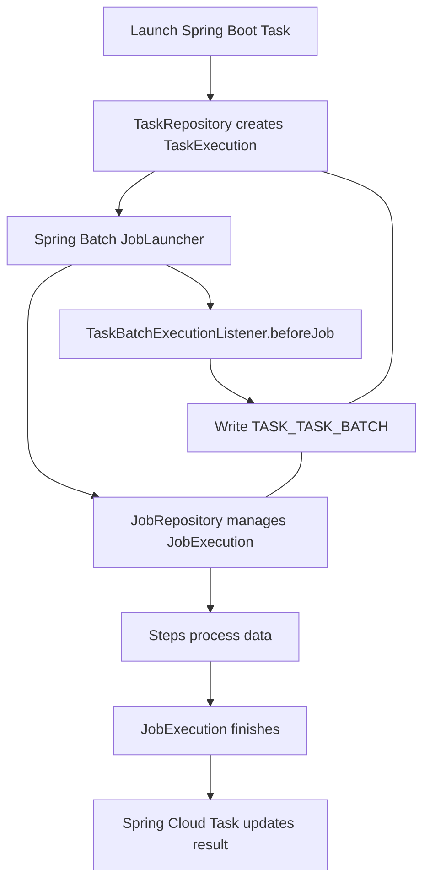

# Customizing `spring-cloud-task-batch` Integration Configuration

## 1. What Is the Purpose of Integrating Spring Cloud Task and Spring Batch?

**Spring Cloud Task** is well-suited for finite-lived Spring Boot applications: start up, execute a task, and exit. The framework uses **`TaskRepository`** to store information about each run, such as `TaskExecution`, start/end timestamps, parameters, and exit code.

**Spring Batch** operates at a finer level of granularity: a `Job` model consisting of one or more `Step`s, tracking `JobExecution`/`StepExecution` records, managing transactions, retries, and configurable restarts. Both frameworks can run together in **a single Spring Boot process**, but without linking metadata, operators struggle to answer "Which TaskExecution did this JobExecution run inside?".

The **`spring-cloud-task-batch`** library adds the mechanism to bridge these two execution levels. Specifically, `TaskBatchExecutionListener` records the association between **the Spring Cloud Task execution ID** and **the Spring Batch Job execution ID** in the `TASK_TASK_BATCH` table.

The topic of this **Spring Batch** chapter lesson is **customizing `spring-cloud-task-batch` integration configuration**. In this lesson, "customizing configuration" covers understanding auto-configuration conditions, declaring dependencies and schemas, controlling which Jobs receive the listener, selecting which Job runs at startup, and deciding the Task exit code when a Batch Job fails.

After this lesson, you will be able to:

- Add `spring-cloud-task-batch` and configure compatible Spring Boot/Cloud Task/Batch versions.
- Explain the roles of `TaskBatchExecutionListener` and `TaskBatchExecutionListenerBeanPostProcessor`.
- Associate only **selected Jobs**, instead of letting the listener attach to every Job automatically.
- Distinguish between `spring.batch.job.name`, `spring.cloud.task.batch.listener.enabled`, and `spring.cloud.task.batch.fail-on-job-failure`.
- Query the `TASK_TASK_BATCH` table to navigate from TaskExecution to JobExecution.
- Detect configuration errors, schema errors, restart issues, asynchronous execution pitfalls, and apply safe operational practices.

## 2. Two Repositories and One Bridge Table

| Level | Managing Component | Typical Metadata | Stored Content |
| --- | --- | --- | --- |
| Finite-lived application | Spring Cloud Task / `TaskRepository` | `TASK_EXECUTION` | An application run, timestamps, exit code, and error message. |
| Processing Job | Spring Batch / `JobRepository` | `BATCH_JOB_INSTANCE`, `BATCH_JOB_EXECUTION` | Job instance, identifying parameters, and individual Job executions. |
| Processing Step | Spring Batch / `JobRepository` | `BATCH_STEP_EXECUTION` | Status and statistics for each Step in a Job. |
| Two-level bridge | `spring-cloud-task-batch` / `TaskBatchExecutionListener` | `TASK_TASK_BATCH` | Pair of `TASK_EXECUTION_ID` and `JOB_EXECUTION_ID`. |

Diagram:



A single `TaskExecution` can be linked to **multiple `JobExecution`s** if the application intentionally launches multiple Jobs. Conversely, a Job re-run in a separate Task launch will get a new `JobExecution` and can be linked to a different `TaskExecution`. Therefore:

- Do not equate `TASK_EXECUTION_ID` with `JOB_EXECUTION_ID`, even if both happen to equal `1` in a fresh database.
- Do not treat `TASK_TASK_BATCH` as a business processing results table. Results such as the number of imported orders should be stored in business tables or appropriate Batch metadata.
- Create full **Task** and **Batch** metadata tables before running the application. Having `TASK_EXECUTION` while missing `BATCH_JOB_EXECUTION` or `TASK_TASK_BATCH` will cause errors.

## 3. Default Mechanism of `spring-cloud-task-batch`

According to the Spring Cloud Task 3.2 documentation, when **`spring-cloud-task-batch`** is on the classpath and the Spring context contains a Spring Batch `Job` bean alongside Task infrastructure, the framework auto-configures `TaskBatchExecutionListener` by default. This listener is injected into eligible Batch Jobs so that each Job execution within the Task scope can create an association record.

Two main components:

| Component | Function |
| --- | --- |
| `TaskBatchExecutionListener` | A listener tied to the Task and Batch Job lifecycle; when a Job starts, it records the link between the two execution IDs. |
| `TaskBatchExecutionListenerBeanPostProcessor` | Finds eligible Job beans and attaches the listener to the Job. Can be restricted via a list of **Job bean names**. |

Key conditions to understand:

1. **Correct dependency:** Have `spring-cloud-task-batch`, not just `spring-boot-starter-batch`.
2. **Presence of a Batch Job:** The context must contain a `Job`-typed bean; an application with only a plain `ApplicationRunner` will not automatically create a Batch link.
3. **Presence of Task infrastructure:** Spring Cloud Task must be enabled with its corresponding repository.
4. **Listener enabled:** `spring.cloud.task.batch.listener.enabled` defaults to `true` in this release line; set to `false` to disable automatic linking.
5. **Schema present:** `TASK_TASK_BATCH` and the Task/Batch tables must exist, and the DB account must have appropriate permissions.

**Auto-attaching the listener** is distinct from **auto-running the Job**. Spring Boot (or Spring Cloud Task's runner when relevant features are active) handles launching the Job at startup; `TaskBatchExecutionListener` only writes the link when the Job actually runs. A Job with the listener attached that has never been launched will not generate a `JobExecution` on its own.

## 4. Creating a Demo Project with Two Batch Jobs

This example uses **JDK 17**, **Spring Boot 3.4.5**, **Spring Cloud 2024.0.2**, and the Spring Batch version managed by Spring Boot. This is a matching Boot–Cloud generation pair; if working on a project with different versions, choose a compatible release train rather than manually forcing library versions.

We declare two Jobs:

- `importOrdersJob`: simulates importing orders, **needs** to be linked to TaskExecution.
- `maintenanceJob`: simulates cleaning up test data; serves as a control to verify configuring the listener only on selected Jobs.

When running the JAR, only `importOrdersJob` launches by default. You can switch Jobs via a Spring Boot property to observe the difference.

```text
task-batch-demo/
├── pom.xml
└── src/main/
    ├── java/com/example/taskbatch/
    │   ├── TaskBatchApplication.java
    │   ├── DemoBatchConfiguration.java
    │   └── TaskBatchLinkConfiguration.java
    └── resources/
        ├── application.yml
        └── application-init.yml
```

### 4.1. `pom.xml`

```xml
<?xml version="1.0" encoding="UTF-8"?>
<project xmlns="http://maven.apache.org/POM/4.0.0"
         xmlns:xsi="http://www.w3.org/2001/XMLSchema-instance"
         xsi:schemaLocation="http://maven.apache.org/POM/4.0.0 https://maven.apache.org/xsd/maven-4.0.0.xsd">
    <modelVersion>4.0.0</modelVersion>

    <parent>
        <groupId>org.springframework.boot</groupId>
        <artifactId>spring-boot-starter-parent</artifactId>
        <version>3.4.5</version>
        <relativePath/>
    </parent>

    <groupId>com.example</groupId>
    <artifactId>task-batch-demo</artifactId>
    <version>0.0.1-SNAPSHOT</version>

    <properties>
        <java.version>17</java.version>
    </properties>

    <dependencyManagement>
        <dependencies>
            <dependency>
                <groupId>org.springframework.cloud</groupId>
                <artifactId>spring-cloud-dependencies</artifactId>
                <version>2024.0.2</version>
                <type>pom</type>
                <scope>import</scope>
            </dependency>
        </dependencies>
    </dependencyManagement>

    <dependencies>
        <dependency>
            <groupId>org.springframework.cloud</groupId>
            <artifactId>spring-cloud-starter-task</artifactId>
        </dependency>
        <dependency>
            <groupId>org.springframework.cloud</groupId>
            <artifactId>spring-cloud-task-batch</artifactId>
        </dependency>
        <dependency>
            <groupId>org.springframework.boot</groupId>
            <artifactId>spring-boot-starter-batch</artifactId>
        </dependency>
        <dependency>
            <groupId>com.h2database</groupId>
            <artifactId>h2</artifactId>
            <scope>runtime</scope>
        </dependency>
    </dependencies>

    <build>
        <plugins>
            <plugin>
                <groupId>org.springframework.boot</groupId>
                <artifactId>spring-boot-maven-plugin</artifactId>
            </plugin>
        </plugins>
    </build>
</project>
```

`spring-cloud-starter-task` provides `TaskRepository` and the Task lifecycle. `spring-boot-starter-batch` provides Batch Jobs, `JobRepository`, `JobLauncher`, and core configuration. `spring-cloud-task-batch` provides the **linking listener** and Task configurations related to Batch.

### 4.2. `application.yml`: Separating Task and Batch Configuration

```yaml
spring:
  application:
    name: task-batch-demo
  main:
    web-application-type: none
  datasource:
    url: jdbc:h2:file:./data/task-batch-db;DB_CLOSE_ON_EXIT=FALSE
    driver-class-name: org.h2.Driver
    username: sa
    password: ""
  cloud:
    task:
      name: task-batch-demo
      initialize-enabled: false
      closecontext-enabled: true
      batch:
        listener:
          enabled: true
        fail-on-job-failure: true
  batch:
    job:
      enabled: true
      name: importOrdersJob
    jdbc:
      initialize-schema: never
```

Configuration breakdown:

| Property | Effect |
| --- | --- |
| `spring.cloud.task.name` | Name of a **Spring Cloud Task** run. |
| `spring.cloud.task.batch.listener.enabled` | Whether the `TaskExecution` ↔ `JobExecution` linking mechanism is allowed to auto-configure. |
| `spring.cloud.task.batch.fail-on-job-failure` | When `true`, ensures the Task exit code reflects a Job with `BatchStatus.FAILED` (instead of defaulting to success). |
| `spring.batch.job.name` | Selects **which Job is launched** when multiple Job beans exist. |
| `spring.batch.job.enabled` | Enables automatic Job execution on application startup. |
| `spring.cloud.task.initialize-enabled` | Initializes the **Task schema** when enabled. |
| `spring.batch.jdbc.initialize-schema` | Initializes the **Batch schema** when set to the appropriate mode. |

`spring.cloud.task.batch.listener.enabled` and `spring.batch.job.enabled` are independent: disabling the listener can cause the Job to still run **without being linked** to the Task; disabling auto-launch can leave the listener active yet produce **no JobExecution** if the application does not launch the Job itself.

### 4.3. `application-init.yml`: Initializing Both Schemas the First Time

```yaml
spring:
  cloud:
    task:
      initialize-enabled: true
  batch:
    jdbc:
      initialize-schema: always
```

The `init` profile is intended for a **fresh, dedicated H2 database**. When this profile is active, Task infrastructure is allowed to create Task tables and Spring Boot is allowed to create Batch tables. For applications with data that must be preserved, use version-controlled migrations and do not run table-creation DDL repeatedly.

The path `jdbc:h2:file:./data/task-batch-db` persists the database to a file, allowing data to be read after the JAR exits. Relative paths are resolved from the working directory of the launch command; two runs or a SQL client launched from different directories may connect to different databases.

### 4.4. Enabling Spring Cloud Task

Create `TaskBatchApplication.java`:

```java
package com.example.taskbatch;

import org.springframework.boot.SpringApplication;
import org.springframework.boot.autoconfigure.SpringBootApplication;
import org.springframework.cloud.task.configuration.EnableTask;

@SpringBootApplication
@EnableTask
public class TaskBatchApplication {

    public static void main(String[] args) {
        SpringApplication.run(TaskBatchApplication.class, args);
    }
}
```

Do not add `@EnableBatchProcessing` in this example. In Spring Boot 3.4, that annotation causes Boot's Batch auto-configuration to **back off**, which can prevent the automatic schema creation and automatic Job launching demonstrated here from working as expected. When full manual Batch configuration is needed, you must explicitly create `JobRepository`, launcher, transaction manager, and schema initialization yourself.

### 4.5. Declaring Two Jobs with `JobBuilder` and `StepBuilder`

Create `DemoBatchConfiguration.java`:

```java
package com.example.taskbatch;

import org.springframework.batch.core.Job;
import org.springframework.batch.core.Step;
import org.springframework.batch.core.job.builder.JobBuilder;
import org.springframework.batch.core.repository.JobRepository;
import org.springframework.batch.core.step.builder.StepBuilder;
import org.springframework.batch.repeat.RepeatStatus;
import org.springframework.beans.factory.annotation.Qualifier;
import org.springframework.context.annotation.Bean;
import org.springframework.context.annotation.Configuration;
import org.springframework.core.env.Environment;
import org.springframework.transaction.PlatformTransactionManager;

@Configuration(proxyBeanMethods = false)
public class DemoBatchConfiguration {

    @Bean
    public Step importOrdersStep(
            JobRepository jobRepository,
            PlatformTransactionManager transactionManager,
            Environment environment) {
        return new StepBuilder("importOrdersStep", jobRepository)
                .tasklet((contribution, chunkContext) -> {
                    System.out.println("[BATCH] Importing orders...");
                    boolean shouldFail = environment.getProperty(
                            "demo.fail", Boolean.class, false);
                    if (shouldFail) {
                        throw new IllegalStateException(
                                "Simulated error in importOrdersJob");
                    }
                    System.out.println("[BATCH] Orders imported");
                    return RepeatStatus.FINISHED;
                }, transactionManager)
                .build();
    }

    @Bean
    public Job importOrdersJob(
            JobRepository jobRepository,
            @Qualifier("importOrdersStep") Step step) {
        return new JobBuilder("importOrdersJob", jobRepository)
                .start(step)
                .build();
    }

    @Bean
    public Step maintenanceStep(
            JobRepository jobRepository,
            PlatformTransactionManager transactionManager) {
        return new StepBuilder("maintenanceStep", jobRepository)
                .tasklet((contribution, chunkContext) -> {
                    System.out.println("[BATCH] Maintenance completed");
                    return RepeatStatus.FINISHED;
                }, transactionManager)
                .build();
    }

    @Bean
    public Job maintenanceJob(
            JobRepository jobRepository,
            @Qualifier("maintenanceStep") Step step) {
        return new JobBuilder("maintenanceJob", jobRepository)
                .start(step)
                .build();
    }
}
```

In Spring Batch 5, `JobBuilder(String, JobRepository)` and `StepBuilder(String, JobRepository)` are the direct way to construct Jobs and Steps. A tasklet step requires a transaction manager via `tasklet(Tasklet, PlatformTransactionManager)`.

The two bean names, `importOrdersJob` and `maintenanceJob`, are deliberately named **the same as the Job names** so that selecting a Job via configuration and filtering the listener remain clear. `Environment` reads `--demo.fail=true` from Spring Boot configuration arguments to simulate an error.

## 5. Customizing Configuration: Attaching the Listener Only to Selected Jobs

If you leave auto-configuration untouched, `TaskBatchExecutionListener` is usually attached to all eligible Job beans. In an application with multiple Jobs, you may want to record links only for the group of Jobs the Task is responsible for, while omitting auxiliary Jobs.

Spring Cloud Task allows **overriding the bean** `batchTaskExecutionListenerBeanPostProcessor`. Create `TaskBatchLinkConfiguration.java`:

```java
package com.example.taskbatch;

import java.util.List;

import org.springframework.cloud.task.batch.configuration
        .TaskBatchExecutionListenerBeanPostProcessor;
import org.springframework.context.annotation.Bean;
import org.springframework.context.annotation.Configuration;

@Configuration(proxyBeanMethods = false)
public class TaskBatchLinkConfiguration {

    @Bean
    public static TaskBatchExecutionListenerBeanPostProcessor
            batchTaskExecutionListenerBeanPostProcessor() {

        TaskBatchExecutionListenerBeanPostProcessor processor =
                new TaskBatchExecutionListenerBeanPostProcessor();
        processor.setJobNames(List.of("importOrdersJob"));
        return processor;
    }
}
```

This configuration explicitly restricts the listener:

- **`importOrdersJob`:** has `TaskBatchExecutionListener` attached, so when it runs inside a task, it creates an association row in `TASK_TASK_BATCH`.
- **`maintenanceJob`:** is not in the list; if run, the Job still gets a `BATCH_JOB_EXECUTION`, but **no Task–Batch link is created by that automatic listener**.

Here `setJobNames(...)` filters by the **Job bean name** observed by the `BeanPostProcessor`, not the database table name or `TASK_NAME`. If the bean method is named `importJobBean` while the Job name is `importOrdersJob`, check and align the filtered bean name.

Because a `BeanPostProcessor` must be instantiated very early during context initialization, declaring a `@Bean static` method is the recommended pattern to avoid prematurely initializing unrelated configuration beans.

**Do not create a second `TaskBatchExecutionListener` bean just to select Jobs.** Auto-configuration already creates the necessary listener; in this case we only replace the component deciding which Jobs receive it. The `TaskBatchExecutionListenerBeanPostProcessor` API expects a matching listener in the context.

### 5.1. Configuring Three Scenarios

| Goal | Setup | Outcome |
| --- | --- | --- |
| Attach listener to all eligible Jobs | Keep auto-configuration and define no custom filter | Every Job running inside the Task is linked via the default mechanism. |
| Attach only to selected Jobs | Define `batchTaskExecutionListenerBeanPostProcessor` and call `setJobNames(...)` | Only Jobs whose bean ID is in the list receive the listener. |
| Disable all automatic linking | Set `spring.cloud.task.batch.listener.enabled=false` | Jobs can still run, but auto-configuration does not attach the linking listener. |

Wanting to control listener attachment directly via `JobBuilder` after disabling auto-configuration requires **registering the right listener type backed by `TaskBatchDao`**; do not simply write a custom `JobExecutionListener` that logs messages and expect `TASK_TASK_BATCH` rows to appear automatically. For most Job filtering needs, customizing the `BeanPostProcessor` is simpler to configure and easier to verify.

## 6. Running the Example and Verifying the Link

### 6.1. Preparing the Schema and First Run

From the `task-batch-demo` directory:

```bash
mkdir -p data
mvn clean package
```

On PowerShell, create the directory with `New-Item -ItemType Directory -Force data`.

First run on a **fresh database**:

```bash
java -jar target/task-batch-demo-0.0.1-SNAPSHOT.jar --spring.profiles.active=init run.id=1
```

`run.id=1` is a **JobParameter** passed using the Batch argument syntax without a `--` prefix. It distinguishes one `JobInstance` from another run with different identifying parameters. When passing parameters via another mechanism, understand how your Boot version's launcher converts arguments into `JobParameters`.

Expected behavior of the application:

1. Initialize Spring Cloud Task and Spring Batch metadata schemas via their respective initializers.
2. Record a new `TaskExecution`.
3. Automatically launch `importOrdersJob` due to `spring.batch.job.name`.
4. `TaskBatchExecutionListener` writes the ID pair into `TASK_TASK_BATCH`.
5. Run `importOrdersStep` successfully, complete the Batch Job, and update TaskExecution.

Illustrative business log:

```text
[BATCH] Importing orders...
[BATCH] Orders imported
```

### 6.2. Second Run Against the Existing Schema

Without activating the `init` profile:

```bash
java -jar target/task-batch-demo-0.0.1-SNAPSHOT.jar run.id=2
```

`spring.cloud.task.initialize-enabled=false` and `spring.batch.jdbc.initialize-schema=never` preserve the existing schema. A new Task run and a new JobExecution are created; the link is stored in another row of `TASK_TASK_BATCH`.

**Do not reuse the exact same JobParameters for an already completed JobInstance** and mistake `JobInstanceAlreadyCompleteException` for a listener bug. Spring Batch distinguishes JobInstances by Job name and identifying parameters; supply a new identifying value when you want to run a new processing instance. If you need to restart a failed run, follow Spring Batch's restart rules instead of arbitrarily changing parameters.

### 6.3. Running a Job Not in the Listener List

Change only the launched Job name and parameter value:

```bash
java -jar target/task-batch-demo-0.0.1-SNAPSHOT.jar --spring.batch.job.name=maintenanceJob run.id=3
```

`maintenanceJob` still runs normally and gets a `JobExecution` in Spring Batch. However, because `TaskBatchLinkConfiguration` only selects `importOrdersJob`, **do not expect a corresponding Task–Batch row to be created automatically** for `maintenanceJob`.

Selecting which Job to run (`spring.batch.job.name`) and selecting which Job to **attach the listener to** (`setJobNames(...)`) are two separate operations. They can target the same Job, but do not have to.

## 7. Inspecting Data with SQL

After the Java processes finish, use the H2 Console or a JDBC client to connect to `jdbc:h2:file:./data/task-batch-db`, user `sa`, empty password. Open the SQL client from the same working directory or use an absolute path to avoid querying the wrong H2 file.

### 7.1. Checking Metadata Tables

```sql
SELECT TABLE_NAME
FROM INFORMATION_SCHEMA.TABLES
WHERE TABLE_NAME IN (
    'TASK_EXECUTION',
    'TASK_TASK_BATCH',
    'BATCH_JOB_INSTANCE',
    'BATCH_JOB_EXECUTION',
    'BATCH_STEP_EXECUTION'
)
ORDER BY TABLE_NAME;
```

`TASK_TASK_BATCH` belongs to Spring Cloud Task's schema; `BATCH_JOB_EXECUTION` belongs to Spring Batch's schema. Both sets of tables must be present for JDBC linking to succeed.

### 7.2. Querying from TaskExecution to JobExecution

```sql
SELECT t.TASK_EXECUTION_ID,
       t.TASK_NAME,
       t.START_TIME AS TASK_START_TIME,
       t.EXIT_CODE AS TASK_EXIT_CODE,
       b.JOB_EXECUTION_ID,
       j.JOB_NAME,
       e.STATUS AS JOB_STATUS,
       e.EXIT_CODE AS JOB_EXIT_CODE
FROM TASK_TASK_BATCH b
JOIN TASK_EXECUTION t
  ON t.TASK_EXECUTION_ID = b.TASK_EXECUTION_ID
JOIN BATCH_JOB_EXECUTION e
  ON e.JOB_EXECUTION_ID = b.JOB_EXECUTION_ID
JOIN BATCH_JOB_INSTANCE j
  ON j.JOB_INSTANCE_ID = e.JOB_INSTANCE_ID
ORDER BY t.TASK_EXECUTION_ID, b.JOB_EXECUTION_ID;
```

Illustrative output after two runs of `importOrdersJob`:

| TaskExecution ID | Task name | JobExecution ID | Job name | Job status |
| ---: | --- | ---: | --- | --- |
| 1 | task-batch-demo | 1 | importOrdersJob | COMPLETED |
| 2 | task-batch-demo | 2 | importOrdersJob | COMPLETED |

These are **illustrative IDs**; actual IDs are generated by the repositories. The subsequent `maintenanceJob` run may appear in `BATCH_JOB_EXECUTION` but will not show up in this JOIN result because of the listener filter.

To check which Jobs currently **have no link**, you can run:

```sql
SELECT e.JOB_EXECUTION_ID, j.JOB_NAME, e.STATUS
FROM BATCH_JOB_EXECUTION e
JOIN BATCH_JOB_INSTANCE j
  ON j.JOB_INSTANCE_ID = e.JOB_INSTANCE_ID
LEFT JOIN TASK_TASK_BATCH b
  ON b.JOB_EXECUTION_ID = e.JOB_EXECUTION_ID
WHERE b.JOB_EXECUTION_ID IS NULL
ORDER BY e.JOB_EXECUTION_ID;
```

An unlinked Job **is not necessarily an error**: it might have been run outside Spring Cloud Task, intentionally excluded from the listener list, or failed before the listener wrote the link.

## 8. Configuring Exit Codes When a Spring Batch Job Fails

**Linking metadata** and **accurately reporting failure status** are two separate objectives.

In the default behavior of Spring Boot/Batch in this reference version line, a Job can return `BatchStatus.FAILED` while the Spring Boot application still exits with a success exit code, because a failed JobExecution does not necessarily throw an unhandled exception at the application level.

Spring Cloud Task provides the option:

```yaml
spring:
  cloud:
    task:
      batch:
        fail-on-job-failure: true
```

When enabled, the framework uses an integrated runner to evaluate the Batch Job result and make the Task exit code reflect the failed Job (commonly code `1`, or a value from an `ExitCodeGenerator` if customized). This property **does not replace** attaching `TaskBatchExecutionListener`: one setting controls **the Task–Batch association**, while the other controls **the exit code**.

Try triggering a failure in `importOrdersStep`:

```bash
java -jar target/task-batch-demo-0.0.1-SNAPSHOT.jar --demo.fail=true run.id=4
```

Now `Environment` reads `demo.fail=true`; the tasklet throws `IllegalStateException`, and Spring Batch records `JobExecution` with a failed status. Because `fail-on-job-failure=true`, the Task is expected to return a non-zero exit code. Check both tables together:

```sql
SELECT t.TASK_EXECUTION_ID,
       t.EXIT_CODE AS TASK_EXIT_CODE,
       e.JOB_EXECUTION_ID,
       e.STATUS AS JOB_STATUS,
       e.EXIT_CODE AS JOB_EXIT_CODE
FROM TASK_TASK_BATCH b
JOIN TASK_EXECUTION t ON t.TASK_EXECUTION_ID = b.TASK_EXECUTION_ID
JOIN BATCH_JOB_EXECUTION e ON e.JOB_EXECUTION_ID = b.JOB_EXECUTION_ID
ORDER BY t.TASK_EXECUTION_ID DESC;
```

**Note:** Do not conclude "the Task succeeded" solely because a Batch record has an association in `TASK_TASK_BATCH`. The listener records the link around when **the Job starts**; the Job can still fail in a later Step.

### 8.1. Asynchronous Jobs

If you provide a custom `JobLauncher` backed by an asynchronous `TaskExecutor`, the launch call may return a `JobExecution` while the Job **has not yet finished**. In that case, the runner must wait for the final result or use an appropriate status-checking mechanism if the Task's lifetime needs to span the entire Job.

Do not automatically assume every `jobLauncher.run(...)` call is synchronous. With asynchronous flows, clearly define responsibilities for waiting, timeouts, cancellation, transactions, and retries. If using the integrated `fail-on-job-failure` runner, verify the polling/status evaluation behavior of your exact Spring Cloud Task version.

### 8.2. Avoiding Two Runners Launching the Same Job

When Spring Boot/Cloud Task already creates a runner to launch a `Job` automatically, **do not add another `ApplicationRunner` that calls `jobLauncher.run(...)` for the same Job** unless you intentionally want an extra run. If you want full manual control over order and parameters:

1. Set `spring.batch.job.enabled=false` to disable the corresponding auto-launch mechanism.
2. Define an explicit runner, construct valid `JobParameters`, and call `JobLauncher`.
3. Wait for the Job to complete, inspect `BatchStatus`/`ExitStatus`, and translate required failures into the application exit code.
4. Keep the linking listener (or equivalent manual setup) if you want `TASK_TASK_BATCH` rows.

When choosing this manual configuration, inspect the runner auto-configuration conditions in your version; `spring.batch.job.enabled` and `spring.cloud.task.batch.*` properties can interact to enable or disable different runners.

## 9. Multiple `DataSource`s and Schema Management

The example uses **one H2 DataSource** for both Spring Cloud Task and Spring Batch metadata, making it straightforward to set up `TASK_TASK_BATCH` alongside the `BATCH_*` tables.

In real-world systems, you might use:

- One datasource for **Task metadata**.
- One datasource for **Batch JobRepository**.
- Another datasource for **business data**.

In this situation, do not simply mark one `@Primary DataSource` and assume both frameworks will point to the right places. For Spring Cloud Task, you can configure `TaskConfigurer`; for Spring Batch/Boot, there are mechanisms to select a batch datasource or configure a separate JobRepository. Ensure the component writing `TASK_TASK_BATCH` can access the **Task schema**, while JobRepository accesses the **Batch schema**.

Because `TASK_TASK_BATCH` only stores IDs of the two entities, a direct SQL JOIN like the example **only applies when both sets of tables reside in the same database or a suitable cross-database query mechanism exists**. If the two repositories reside in separate database systems, query them separately and correlate the data at the application layer, and design how to handle discrepancies if one write succeeds while the other fails.

In production, manage schemas with Flyway/Liquibase or a DBA pipeline, applying DDL for **the exact Task and Batch versions**, and then set:

```yaml
spring:
  cloud:
    task:
      initialize-enabled: false
  batch:
    jdbc:
      initialize-schema: never
```

Do not use startup schema initialization as a migration strategy when multiple containers start concurrently. You must also manage DDL/DML permissions, sequences, backups, metadata retention policies, and their relationship with job restarts.

## 10. Troubleshooting Integration Issues

| Symptom | Common Cause | Resolution |
| --- | --- | --- |
| Job runs but `TASK_TASK_BATCH` has no rows | Missing `spring-cloud-task-batch`, listener disabled, or Job excluded by filter | Check dependencies, `listener.enabled`, `setJobNames` list, and actual Job bean name. |
| `TASK_TASK_BATCH` not found | Task schema not created or wrong database | Apply Task DDL for the right version, check datasource URL and DB permissions. |
| `BATCH_JOB_EXECUTION` not found | Batch schema not created | Check `spring.batch.jdbc.initialize-schema` or Batch migrations. |
| Application runs but no `JobExecution` | `spring.batch.job.enabled=false`, missing Job bean, or wrong Job name config | Check `Job` beans, runner, and `spring.batch.job.name`. |
| Two Jobs exist, Spring Boot complains it doesn't know which to run | Job name not specified when multiple Jobs exist | Set `spring.batch.job.name` to the target Job; do not confuse with `setJobNames`. |
| Job `FAILED` but Task still has exit code `0` | Failure status propagation not enabled | Use `spring.cloud.task.batch.fail-on-job-failure=true` and check launcher/runner. |
| Job throws `JobInstanceAlreadyCompleteException` | Re-running same Job with already completed identifying parameters | Supply new `JobParameters` for a new run; distinguish from restart. |
| Job has link but Step hasn't finished | Asynchronous Job launcher, Task exited early | Wait for Job completion or use the appropriate integrated runner; configure timeouts. |
| Expected link for `maintenanceJob` but none exists | Filter only selects `importOrdersJob` | Add its bean ID to `setJobNames` if linking is intended. |
| Duplicate links or multiple listeners | Multiple overlapping listeners/configurations created | Keep a single configuration strategy and inspect `TaskBatchExecutionListener` beans. |
| SQL JOIN returns no data | Task and Batch use different databases or reading the wrong H2 file | Verify datasources, schemas, and query through the correct repositories. |

When troubleshooting, diagnose in order: **classpath → Job bean → launcher → listener → schema → metadata**. This helps separate "Job did not run" errors from "Job ran but has no link" errors.

A startup failure happening very early may not create complete `TaskExecution`/`JobExecution` rows to observe via SQL. Always inspect startup logs and container/scheduler events alongside metadata tables.

## 11. Limitations and Safe Operations

Spring Cloud Task **does not schedule itself**; the application can be invoked by cron, Kubernetes `Job`/`CronJob`, an API, or an orchestrator. When integrating Batch, pay attention to:

1. **Avoid overlapping business data runs:** Schedulers and Job locking/identification mechanisms must prevent duplicate processing; a single TaskExecution does not guarantee exactly-once by itself.
2. **Clear JobParameters:** Identifying parameters determine the JobInstance. Retries, restarts, and new processing runs are distinct scenarios.
3. **Accurate error handling:** Having a Task–Batch link does not mean the Job succeeded; inspect both Task's `EXIT_CODE` and Batch's `STATUS`/`EXIT_CODE`.
4. **Wait for work to actually finish:** If using an async launcher or external worker, keep the Task lifecycle open long enough or use dedicated orchestration.
5. **Secrets and parameters:** `TaskRepository` may store command-line arguments; never pass passwords, tokens, or sensitive data in JobParameters or arguments.
6. **Monitoring:** Watch for Tasks unexpectedly missing `END_TIME`, failed Batch Jobs, hung Steps, missing links, and execution duration.
7. **Permissions and schemas:** Ensure `TaskRepository`, `JobRepository`, and the bridge table have proper read/write permissions, and manage schemas with migrations and backups.
8. **Customization limits:** Replacing the `BeanPostProcessor` only applies to Job beans recognized by the framework; re-test if switching to factories, dynamically created jobs, or upgrading Spring Batch versions.

The linking feature in `spring-cloud-task-batch` is for **traceability**, not a replacement for transactions, checkpoints, and restarts in Spring Batch. When deploying tasks to production, clearly define the scope of responsibility for each framework.

## 12. Hands-on Exercises and Self-Check Questions

### Exercise 1: Customizing the Listener for a Single Job

1. Create the sample project and prepare the Task/Batch schemas on file-based H2.
2. Run `importOrdersJob` with `run.id=1` and `run.id=2`.
3. Query `TASK_TASK_BATCH` and confirm there are two links.
4. Run `maintenanceJob` with `run.id=3`; confirm Batch has a JobExecution but no corresponding Task–Batch link.
5. Add `maintenanceJob` to `setJobNames(...)` and run again with a new parameter; explain the observed change.

### Exercise 2: Exit Code on Batch Failure

1. Enable `spring.cloud.task.batch.fail-on-job-failure=true`.
2. Run `importOrdersJob` with `--demo.fail=true run.id=4`.
3. Check the `BATCH_JOB_EXECUTION` and `TASK_EXECUTION` tables, confirming the Task exit code reflects the failed Job.
4. Try disabling this feature and explain why the Job can be `FAILED` while the application still reports exit code `0` under default behavior.

### Exercise 3: Designing Production Integration

Suppose three containers share PostgreSQL for Task/Batch metadata and each container can receive commands to run an order-import Job. Propose how to prepare schemas, select the Job, limit concurrency, set identifying parameters, detect failures, and look up the TaskExecution associated with a failed JobExecution.

### Review Questions

1. What does `spring-cloud-task-batch` add compared to having only `spring-cloud-starter-task` and `spring-boot-starter-batch`?
2. How do `TaskBatchExecutionListener` and `TaskBatchExecutionListenerBeanPostProcessor` differ in role?
3. When does `TASK_TASK_BATCH` get populated? Why does having a link not prove the Job succeeded?
4. How does `spring.batch.job.name` differ from `setJobNames(...)`?
5. Why should a custom `BeanPostProcessor` be declared as `@Bean static`?
6. Does setting `spring.cloud.task.batch.listener.enabled` to false stop Batch Jobs from running?
7. Why is `spring.cloud.task.batch.fail-on-job-failure` needed when orchestrating tasks via a scheduler?
8. Why can `@EnableBatchProcessing` prevent examples that rely on Boot auto-configuration from running as expected?

**Remember:** `spring-cloud-task-batch` bridges `TaskExecution` and `JobExecution` via `TaskBatchExecutionListener`. When you want to **customize the integration scope**, use `TaskBatchExecutionListenerBeanPostProcessor.setJobNames(...)` to pick which Job beans get linked, `spring.batch.job.name` to pick which Job launches, and `spring.cloud.task.batch.fail-on-job-failure` to synchronize Task exit codes with Batch results. Each goal requires its own configuration, proper schema, and verification against execution data.

## References

- [Spring Cloud Task 3.2 — Batch](https://docs.spring.io/spring-cloud-task/reference/3.2/batch.html): `TaskBatchExecutionListener`, restricting Jobs receiving the listener, and Job exit codes.
- [Spring Cloud Task 3.2 — Task Repository Schema](https://docs.spring.io/spring-cloud-task/reference/3.2/appendix-task-repository-schema.html): `TASK_TASK_BATCH` bridge table.
- [Spring Cloud Task — TaskBatchExecutionListenerBeanPostProcessor API](https://docs.spring.io/spring-cloud-task/docs/current/apidocs/org/springframework/cloud/task/batch/configuration/TaskBatchExecutionListenerBeanPostProcessor.html): `setJobNames(List<String>)` and listener attachment.
- [Spring Boot 3.4 — Batch Applications](https://docs.spring.io/spring-boot/3.4/how-to/batch.html): Auto-launching Batch Jobs, `spring.batch.job.name`, `spring.batch.job.enabled`, and auto-configuration.
- [Spring Batch 5 — TaskletStep](https://docs.spring.io/spring-batch/reference/step/tasklet.html): Constructing a Step with `JobRepository` and a transaction manager.
