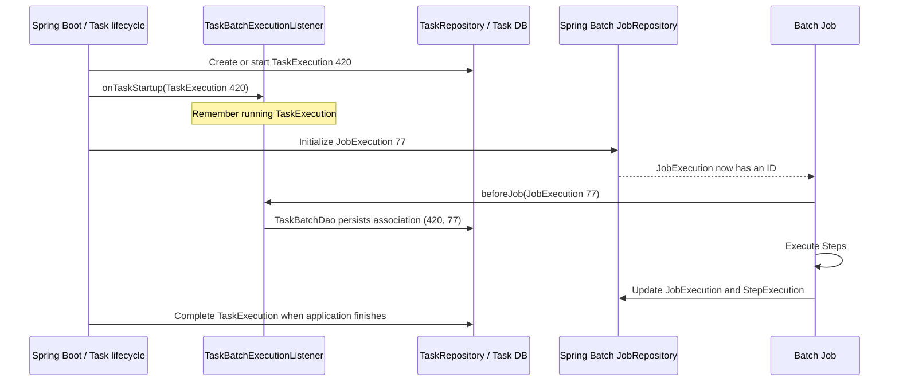
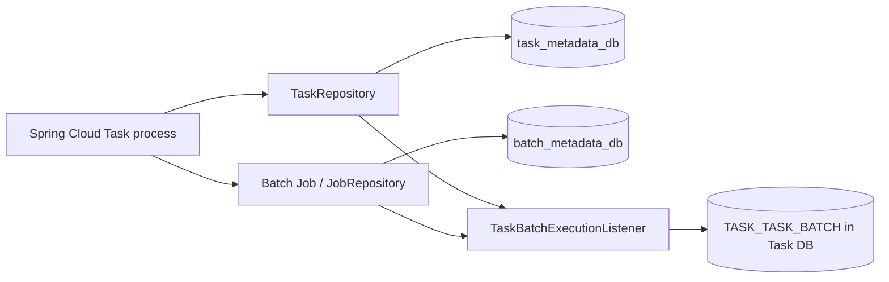

# Associating TaskExecution with JobExecution via TaskBatchExecutionListener

## Objectives

In **SPRING_CLOUD_TASK (Spring Cloud Task)**, a Spring Boot application can start on a schedule or on demand, perform a finite piece of work, and exit. Spring Cloud Task records each run in the database using `TaskRepository` and `TaskExecution`. When the application runs one or more Spring Batch Jobs, Spring Batch also separately records `JobExecution`s and `StepExecution`s. Operators need to **know which JobExecution ran inside which TaskExecution** to trace errors, reconcile results, and recover accurately.

This lesson in the **Spring Batch** chapter explains how `TaskBatchExecutionListener` automatically creates the link between these two execution types. After this lesson, you will be able to:

- Distinguish `TaskExecution`, `JobInstance`, `JobExecution`, and `StepExecution`.
- Describe the auto-configuration conditions of `TaskBatchExecutionListener` and when the link is recorded.
- Inspect links in the `TASK_TASK_BATCH` table or through `TaskExplorer`'s bidirectional lookup APIs.
- Build a Spring Cloud Task application running a Spring Batch Job with appropriate metadata configuration.
- Restrict listener attachment to desired Jobs when multiple Jobs exist in one context.
- Distinguish **metadata association** from **success/failure determination**, and manage restarts, parameters, and safe operations.

## 1. Why Connect the Two Execution Types?

Suppose `daily-report-task` launches at 02:00 to aggregate order reports. The entire Spring Boot process is a **Task execution**. Inside it, a Spring Batch Job `dailyReportJob` runs two Steps: reading data and exporting the report. If the second Step fails, we need to answer:

1. Which Task was running when the Batch Job failed?
2. Which `JobExecution` and `StepExecution` contain the stack trace, read/write item counts, and checkpoints?
3. What exit code did the Task process record, and did the orchestrator perform a retry?
4. When re-running, is this a new `JobExecution` under the same `JobInstance`, or a different job instance?

Spring Cloud Task and Spring Batch do not share a single execution ID. Having the same numeric value between the two metadata stores can only be a **coincidence** and does not prove the two records are related.

| Concept | Framework / Data Store | Meaning | Example |
| --- | --- | --- | --- |
| `TaskExecution` | Spring Cloud Task / `TaskRepository` | A single run of a Task application from startup to completion. | Task ID `420`. |
| `JobInstance` | Spring Batch / `JobRepository` | Logical identity of a Job based on Job name and **identifying JobParameters**. | `dailyReportJob` for date `2026-11-23`. |
| `JobExecution` | Spring Batch / `JobRepository` | A specific execution attempt of a `JobInstance`. | Batch Job ID `77`. |
| `StepExecution` | Spring Batch / `JobRepository` | A single execution of a Step within a `JobExecution`. | Step ID `120`. |
| `TASK_TASK_BATCH` | Spring Cloud Task metadata schema | Bridge table pairing two keys: `TASK_EXECUTION_ID` and `JOB_EXECUTION_ID`. | Pair `(420, 77)`. |

**Common relationship:** a single `TaskExecution` can link to **multiple** `JobExecution`s if one process runs multiple Jobs. For Jobs run within the same Task application, a `JobExecution` points to its enclosing `TaskExecution`. A `JobInstance` can have multiple `JobExecution`s due to retries/restarts; each `JobExecution` must be tracked by its own ID.

## 2. What Does TaskBatchExecutionListener Do?

`TaskBatchExecutionListener` resides in the package:

```java
org.springframework.cloud.task.batch.listener.TaskBatchExecutionListener
```

According to the Spring Cloud Task API, this class combines the roles of:

- **`TaskExecutionListener`:** receives the Task run info via the `onTaskStartup(TaskExecution)` callback.
- **`JobExecutionListener`:** receives Spring Batch's `JobExecution` at `beforeJob(JobExecution)`.
- **`Ordered`:** provides callback ordering among listeners when supported by the framework.

The listener's goal is to **record the relationship between the current Task and the starting Batch Job**, via `TaskBatchDao`. The default JDBC layer uses `JdbcTaskBatchDao` to write the ID pair into the `TASK_TASK_BATCH` table.

This is a **metadata-linking listener**—not a listener that generates reports, creates `JobInstance`s, or decides whether the Job succeeded. It is also distinct from `@BeforeTask`/`@AfterTask` callbacks written by developers for logging or metrics.

### Association Lifecycle



The key requirement is that **the current Task execution must be identified before the Job starts**. With standard Spring Cloud Task and Spring Boot execution, the framework coordinates the lifecycle for this case. If you manually launch a Batch Job too early—in a constructor, `@PostConstruct`, or an unsuitable initialization callback—the listener may not yet have the Task context.

The link is created **at `beforeJob` time**, when the Batch Job starts processing, so it can usually exist **even if the Job fails in a Step**. Conversely, if an error occurs **before Batch creates the `JobExecution` or before `beforeJob` runs**, you cannot assume a link will exist.

## 3. When Is the Listener Auto-Configured?

The Spring Cloud Task documentation states two core conditions:

1. `spring-cloud-task-batch` is on the classpath.
2. At least one bean of type `org.springframework.batch.core.Job` exists in the Spring `ApplicationContext`.

When these conditions are met and association configuration is enabled, `TaskBatchExecutionListener` is automatically created and attached to eligible Batch Jobs. `TaskBatchExecutionListenerBeanPostProcessor` is the component that adds the listener to Job beans of compatible implementation types (per Javadoc, `AbstractJob` beans).

| Condition | Expected Outcome |
| --- | --- |
| `spring-cloud-task-batch` + `Job` bean + valid Task metadata | Listener can be auto-attached and association saved when the Job actually runs. |
| Missing `spring-cloud-task-batch` | No automatic Task–Batch linking integration from this library. |
| Dependency present but no `Job` bean | No Job to attach the listener to; starting the Task alone produces no link. |
| `Job` bean present but Job is not executed | No new `JobExecution` to link for this Task run. |
| Linking disabled via version's configuration property | The linking listener is not activated per configuration. |
| Job created/launched outside Task context or bypassing listener attachment | Do not assume the link is created automatically. |

The property `spring.cloud.task.batch.listener.enabled` is exposed by Spring Cloud Task to control the linking mechanism (defaulting to `true` in supported versions). This setting is **separate** from `spring.cloud.task.batch.fail-on-job-failure`, which deals with the exit code when a Job fails.

**Important:** If a Job runs in a different JVM from the originating Task application, or is orchestrated directly by another system, the Task process's `TaskBatchExecutionListener` mechanism **cannot automatically link a remote Job**. In that case, you must design explicit propagation and persistence of the corresponding identifiers in your orchestrator.

## 4. Preparing Dependencies and Schema

Example Maven configuration for an application using both frameworks (versions managed by a **compatible** Spring Boot parent/BOM and Spring Cloud BOM):

```xml
<dependencies>
    <dependency>
        <groupId>org.springframework.cloud</groupId>
        <artifactId>spring-cloud-starter-task</artifactId>
    </dependency>
    <dependency>
        <groupId>org.springframework.cloud</groupId>
        <artifactId>spring-cloud-task-batch</artifactId>
    </dependency>
    <dependency>
        <groupId>org.springframework.boot</groupId>
        <artifactId>spring-boot-starter-batch</artifactId>
    </dependency>
    <dependency>
        <groupId>org.postgresql</groupId>
        <artifactId>postgresql</artifactId>
        <scope>runtime</scope>
    </dependency>
</dependencies>
```

This snippet illustrates **dependencies** only; the project still needs the appropriate parent/BOM and build plugin to package an executable JAR. Do not independently pick versions for Spring Boot, Spring Batch, and Spring Cloud Task without checking the compatibility matrix.

### What Must the Metadata Schema Contain?

When using JDBC, at minimum you need:

| Data Group | Example Tables |
| --- | --- |
| Spring Cloud Task | `TASK_EXECUTION`, `TASK_EXECUTION_PARAMS`, and ID-generation objects. |
| Task–Batch Association | `TASK_TASK_BATCH` containing `TASK_EXECUTION_ID` and `JOB_EXECUTION_ID`. |
| Spring Batch | `BATCH_JOB_INSTANCE`, `BATCH_JOB_EXECUTION`, `BATCH_JOB_EXECUTION_PARAMS`, `BATCH_STEP_EXECUTION`, execution context tables, and corresponding ID-generation objects. |

Actual table names depend on schema, table prefix, database dialect, and version; do **not** manually create a two-column table while omitting official constraints/indexes/DDL. Task and Batch metadata can reside in the same database or different databases; if separate, `TASK_TASK_BATCH` still belongs to the **Task repository**, storing Batch numeric IDs, and direct cross-database SQL `JOIN`s are only feasible if the DB infrastructure supports them.

In production, apply the appropriate DDL/migrations **before** running the Task, grant the necessary read/write privileges to the execution account, and avoid concurrent table-creation races across simultaneous Jobs.

Example JDBC configuration with pre-migrated schemas:

```yaml
# application-prod.yml
spring:
  application:
    name: daily-report-task
  main:
    web-application-type: none
  datasource:
    url: ${TASK_DB_URL}
    username: ${TASK_DB_USER}
    password: ${TASK_DB_PASSWORD}
  cloud:
    task:
      name: daily-report-task
      initialize-enabled: false
      batch:
        listener:
          enabled: true
        fail-on-job-failure: true
  batch:
    jdbc:
      initialize-schema: never
```

This example uses one database for both metadata stores. `TASK_DB_*` must be supplied via environment variables or a secret manager; never commit real passwords to Git. `spring.batch.jdbc.initialize-schema: never` is the standard Batch table initialization setting in Spring Boot 3.x; confirm the exact property name for your chosen Boot version.

## 5. Sample Application: One Task Running One Batch Job

The example below uses Spring Batch 5 / Spring Boot 3 style. A concise Job with one `Tasklet` Step demonstrates the linking process without real data processing.

```java
package com.example.report;

import org.springframework.batch.core.Job;
import org.springframework.batch.core.Step;
import org.springframework.batch.core.job.builder.JobBuilder;
import org.springframework.batch.core.repository.JobRepository;
import org.springframework.batch.core.step.builder.StepBuilder;
import org.springframework.batch.repeat.RepeatStatus;
import org.springframework.boot.SpringApplication;
import org.springframework.boot.autoconfigure.SpringBootApplication;
import org.springframework.cloud.task.configuration.EnableTask;
import org.springframework.context.annotation.Bean;
import org.springframework.transaction.PlatformTransactionManager;

@SpringBootApplication
@EnableTask
public class DailyReportTaskApplication {

    public static void main(String[] args) {
        SpringApplication.run(DailyReportTaskApplication.class, args);
    }

    @Bean
    Step createReportStep(JobRepository jobRepository,
                          PlatformTransactionManager transactionManager) {
        return new StepBuilder("createReportStep", jobRepository)
                .tasklet((contribution, chunkContext) -> {
                    System.out.println("Generating sample report");
                    return RepeatStatus.FINISHED;
                }, transactionManager)
                .build();
    }

    @Bean
    Job dailyReportJob(JobRepository jobRepository, Step createReportStep) {
        return new JobBuilder("dailyReportJob", jobRepository)
                .start(createReportStep)
                .build();
    }
}
```

In a typical Spring Boot configuration, when there is exactly one `Job` bean and Batch Job execution on startup is enabled, Spring Boot's `JobLauncherApplicationRunner` launches that Job. Spring Cloud Task is enabled for the application lifecycle, and `spring-cloud-task-batch` attaches the linking listener to the Job.

**Do not simultaneously** launch the Job manually from another `ApplicationRunner` if Boot is already running it automatically, as that can cause duplicate execution or `JobInstanceAlreadyCompleteException`. When intentionally using `JobLauncher` inside a custom runner, control `spring.batch.job.enabled=false` and map `JobParameters` yourself.

When running:

```bash
java -jar target/daily-report-task.jar \
  --spring.profiles.active=prod
```

The JAR name is illustrative. Once the Task and Job finish, you can find the two IDs (for example `TaskExecution=420`, `JobExecution=77`) and verify the row `(420, 77)` in `TASK_TASK_BATCH`. **Never infer** one ID by adding or subtracting an arbitrary offset from the Task ID.

### When Are TaskExecution and JobExecution Created?

1. `SpringApplication` prepares the `ApplicationContext`, beans, `DataSource`, `TaskRepository`, and `JobRepository`.
2. Spring Cloud Task begins tracking the run, allocating a `TaskExecution`.
3. Spring Boot or an application-controlled runner invokes `JobLauncher`. Spring Batch creates a `JobExecution`.
4. When Batch calls `beforeJob` on the attached `TaskBatchExecutionListener`, the listener persists the ID pair.
5. Batch executes Steps and updates `JobExecution` and `StepExecution`; Spring Cloud Task updates `TaskExecution` when the application finishes.

The link is designed for **traceability**; it does not wrap both repositories in a single transaction. If the Task DB connection fails at step 4, the Job may not proceed as expected and the association row may be missing.

## 6. Inspecting the TASK_TASK_BATCH Table

With the default DDL, the bridge table has two columns:

```text
TASK_TASK_BATCH
  TASK_EXECUTION_ID   BIGINT
  JOB_EXECUTION_ID    BIGINT
```

Suppose Task execution `420` executed two Batch Jobs `77` and `78`:

| `TASK_EXECUTION_ID` | `JOB_EXECUTION_ID` |
| ---: | ---: |
| 420 | 77 |
| 420 | 78 |

This does **not** mean `77` and `78` are two Steps of one Job. Each `JOB_EXECUTION_ID` identifies **a separate Job execution**. To find out which Step failed, query `BATCH_STEP_EXECUTION` by each `JOB_EXECUTION_ID`.

Query to see the Jobs inside a Task:

```sql
SELECT t.TASK_EXECUTION_ID,
       t.TASK_NAME,
       t.START_TIME AS TASK_START_TIME,
       t.END_TIME AS TASK_END_TIME,
       t.EXIT_CODE AS TASK_EXIT_CODE,
       l.JOB_EXECUTION_ID
FROM TASK_EXECUTION t
JOIN TASK_TASK_BATCH l
  ON l.TASK_EXECUTION_ID = t.TASK_EXECUTION_ID
WHERE t.TASK_EXECUTION_ID = 420
ORDER BY l.JOB_EXECUTION_ID;
```

If Task and Batch metadata share the **same** database/schema and the same account has query privileges, you can join into Batch metadata:

```sql
SELECT t.TASK_EXECUTION_ID,
       t.TASK_NAME,
       l.JOB_EXECUTION_ID,
       je.STATUS AS JOB_BATCH_STATUS,
       je.EXIT_CODE AS JOB_EXIT_CODE,
       je.START_TIME AS JOB_START_TIME,
       je.END_TIME AS JOB_END_TIME
FROM TASK_EXECUTION t
JOIN TASK_TASK_BATCH l
  ON t.TASK_EXECUTION_ID = l.TASK_EXECUTION_ID
JOIN BATCH_JOB_EXECUTION je
  ON je.JOB_EXECUTION_ID = l.JOB_EXECUTION_ID
WHERE t.TASK_NAME = 'daily-report-task'
ORDER BY t.TASK_EXECUTION_ID DESC, l.JOB_EXECUTION_ID DESC;
```

The query above is a **template for the default schema**. When Task/Batch metadata reside in different databases, query each by ID separately and join in the application or observability system. If custom table prefixes are configured, update table names accordingly; do not write cross-database `JOIN`s expecting every DBMS to support them.

**Note:** `TASK_TASK_BATCH` stores the relationship, not full Batch state. To determine whether a Job failed or was restarted, inspect `BATCH_JOB_EXECUTION`, `BATCH_STEP_EXECUTION`, and `JobRepository`/`JobExplorer`.

## 7. Bidirectional Lookup via TaskExplorer

Spring Cloud Task provides two key methods on `TaskExplorer`:

| Method | Parameter | Result |
| --- | --- | --- |
| `getJobExecutionIdsByTaskExecutionId(long taskExecutionId)` | Task execution ID | A `Set<Long>` of Batch Job execution IDs belonging to that Task. |
| `getTaskExecutionIdByJobExecutionId(long jobExecutionId)` | Batch Job execution ID | Corresponding Task execution ID, or `null` if no association exists. |

Example Spring Service reading from the Task repository:

```java
package com.example.report.monitoring;

import java.util.Set;
import org.springframework.cloud.task.repository.TaskExplorer;
import org.springframework.stereotype.Service;

@Service
public class TaskBatchLinkReader {

    private final TaskExplorer taskExplorer;

    public TaskBatchLinkReader(TaskExplorer taskExplorer) {
        this.taskExplorer = taskExplorer;
    }

    public Set<Long> findJobsOfTask(long taskExecutionId) {
        if (taskExplorer.getTaskExecution(taskExecutionId) == null) {
            throw new IllegalArgumentException(
                    "TaskExecution does not exist: " + taskExecutionId);
        }
        return taskExplorer.getJobExecutionIdsByTaskExecutionId(
                taskExecutionId);
    }

    public Long findTaskOfJob(long jobExecutionId) {
        return taskExplorer.getTaskExecutionIdByJobExecutionId(
                jobExecutionId);
    }
}
```

For example, passing `420` returns `{77, 78}` if both Job executions were linked. Conversely, passing `77` returns `420`. Receiving `null` or an empty set means **no link was recorded**, which does not by itself prove the Job never ran: check listener configuration, failure timing, and metadata stores before drawing conclusions.

If you need to read Batch details, also use `org.springframework.batch.core.explore.JobExplorer` (or the appropriate `JobRepository` API):

```java
import org.springframework.batch.core.JobExecution;
import org.springframework.batch.core.explore.JobExplorer;

// jobExplorer is injected from Spring Batch configuration.
JobExecution jobExecution = jobExplorer.getJobExecution(77L);
if (jobExecution != null) {
    System.out.println(jobExecution.getStatus());
    System.out.println(jobExecution.getExitStatus());
}
```

`JobExplorer` must connect to the right **Batch metadata repository**. Do not use `TaskExplorer` to read `StepExecution` or `ExecutionContext`, as those are Spring Batch's responsibility.

## 8. Attaching the Listener Only to Selected Batch Jobs

By default, Spring Cloud Task automatically attaches the listener to eligible Jobs in the context. In an application with multiple Jobs, sometimes only specific Jobs need linking—for example `dailyReportJob` and `monthlyBillingJob`—while `maintenanceJob` is an internal housekeeping Job.

The official documentation allows configuring the `batchTaskExecutionListenerBeanPostProcessor` bean and calling `setJobNames(…)` with **a list of Job bean names**:

```java
package com.example.report.config;

import java.util.List;
import org.springframework.cloud.task.batch.configuration.TaskBatchExecutionListenerBeanPostProcessor;
import org.springframework.context.annotation.Bean;
import org.springframework.context.annotation.Configuration;

@Configuration(proxyBeanMethods = false)
public class TaskBatchLinkSelectionConfiguration {

    @Bean(name = "batchTaskExecutionListenerBeanPostProcessor")
    static TaskBatchExecutionListenerBeanPostProcessor
            batchTaskExecutionListenerBeanPostProcessor() {

        TaskBatchExecutionListenerBeanPostProcessor processor =
                new TaskBatchExecutionListenerBeanPostProcessor();

        processor.setJobNames(List.of(
                "dailyReportJob",
                "monthlyBillingJob"));
        return processor;
    }
}
```

**Notes when applying:**

- This is an **optional** example replacing the default processor registration; do not create two competing post-processor beans.
- `dailyReportJob` and `monthlyBillingJob` here are **bean IDs**, which may differ from the Job name passed inside `new JobBuilder("…")`. Per Javadoc, `setJobNames` acts as a filter in the bean post-processor; verify the actual bean names in the context.
- Registering a bean post-processor is infrastructure configuration; using `static @Bean` helps avoid premature instantiation of dependent configuration beans. Test listener attachment in your exact Spring Cloud Task version.
- APIs can change across versions; if the project is heavily customized, prioritize checking auto-configuration and documentation for your exact release.

To disable **all** automatic linking in versions supporting this property, you can use:

```yaml
spring:
  cloud:
    task:
      batch:
        listener:
          enabled: false
```

This only disables the **Task–Batch linking** feature; it does not disable Spring Batch Jobs or user-declared `JobExecutionListener`s.

## 9. Linking Does Not Automatically Determine Task Success or Failure

A common operational mistake is assuming "if a `TASK_TASK_BATCH` link exists, the Task automatically inherits the Job's `FAILED` status." These two concerns are **independent**.

- `TaskBatchExecutionListener` records the **relationship** between TaskExecution and JobExecution.
- Spring Batch records the Job's `BatchStatus` (such as `COMPLETED`, `FAILED`) and `ExitStatus`.
- Spring Cloud Task records the **Task** exit code according to the Spring Boot lifecycle and how the application handles errors.

In default Spring Boot/Batch execution, a Batch Job can report `FAILED` while the runner that launched the Job still completes normally; consequently, the Task risks receiving exit code `0`. Spring Cloud Task provides the property:

```yaml
spring:
  cloud:
    task:
      batch:
        fail-on-job-failure: true
```

In versions supporting this property, when a Batch Job ends with `BatchStatus.FAILED`, the integration mechanism can return a non-zero exit code for the Task process (default `1` or via an appropriate `ExitCodeGenerator`). If you write a custom runner calling `JobLauncher` or run Batch asynchronously, **verify** how status and exit codes actually map; the property is not guaranteed to fix every custom launch pattern.

| Scenario | Task–Batch Association | Job Status | Task Outcome to Monitor |
| --- | --- | --- | --- |
| Job completes | Present if listener ran and persisted | `COMPLETED` | Usually succeeds if no other errors occur. |
| Step fails after `beforeJob` ran | Usually **still has association** | `FAILED` | Needs mechanism translating Job failure into appropriate Task exit code. |
| Job failed to start due to bad config/metadata | May have **no association** | May have no `JobExecution` | Inspect startup logs, scheduler, and Task status. |
| Linking listener not attached | No automatic link row | Job can still run | Fix dependency, auto-config, bean selection; do not assume Job didn't run. |
| Task abruptly killed while Batch is running | Association may exist | May still be incomplete | Reconcile `JobRepository`, Task DB, and orchestrator. |

## 10. Restarts and Multiple Jobs: One Link per JobExecution

Suppose `dailyReportJob` for `2026-11-23` runs first inside Task `420` and Batch `77`, then fails. The operator re-runs it, creating Task `421`, and Spring Batch creates `JobExecution` `78` for the same `JobInstance` when restart conditions are met.

| Attempt | TaskExecution ID | Logical JobInstance | JobExecution ID | Outcome |
| --- | ---: | --- | ---: | --- |
| First run | 420 | `dailyReportJob` + identifying `businessDate=2026-11-23` | 77 | `FAILED` |
| Restart | 421 | Same JobInstance if identifying parameters unchanged and Job is restartable | 78 | `COMPLETED` |

In `TASK_TASK_BATCH`, there will be **two associations**: `(420, 77)` and `(421, 78)`. The old association is not overwritten; the failure history of the first attempt is vital investigation data.

**JobParameters serve two responsibilities:** `identifying` parameters participate in determining the `JobInstance`; non-identifying parameters can vary without changing the JobInstance. Passing a timestamp or random value as an identifying parameter on every run causes Batch to treat each run as a new JobInstance, **not a restart** of the old JobInstance. Establish this policy based on business requirements.

When **one TaskExecution** runs two Batch Jobs—for example `loadOrdersJob` and `generateReportJob`—if both have the listener attached, the same Task ID will have two link pairs. Do not infer a parent–child relationship between Jobs merely because they share a Task; ordering and business dependencies must be configured explicitly.

### What Happens on Errors or Retries?

- Failure while writing to `TASK_TASK_BATCH` can prevent the Batch Job from launching as expected or leave an incomplete audit trail; inspect the stack trace and actual transaction behavior.
- A `JobExecution` may be left in an incomplete state if the process was killed; never manually mark it successful just to allow a restart.
- Re-running a Task **does not automatically guarantee** preventing duplicate Batch output. Use checkpoints, idempotency, unique keys, and appropriate per-Step restart logic.
- Limit concurrency via scheduling or distributed locks if two runs of the same JobInstance or same data source could conflict.

## 11. Separating TaskRepository and JobRepository with Multiple DataSources

For an application with two databases:

- `taskMetadataDataSource` stores `TASK_EXECUTION` and `TASK_TASK_BATCH`.
- `batchMetadataDataSource` stores `BATCH_JOB_INSTANCE`, `BATCH_JOB_EXECUTION`, `BATCH_STEP_EXECUTION`, and other Batch tables.
- The business database can be a third source; it does not have to reuse either metadata database.

`TaskConfigurer` selects the source for Spring Cloud Task metadata, while Spring Batch configuration determines `JobRepository`/`JobExplorer` and the corresponding transaction manager. `TaskBatchExecutionListener` still needs permission to persist the association in the Task store; the `JOB_EXECUTION_ID` value is simply a **reference ID** pointing to Batch metadata in the other store.



Because multiple data sources are involved, do not assume they automatically participate in **a single cross-database ACID transaction**. If Batch metadata commits while writing the Task–Batch link fails, you can end up with an unlinked JobExecution. Dashboards should distinguish **Job did not run** from **link was not recorded**; when manual reconciliation is needed, use logs/correlation IDs and data from both repositories.

If Task metadata uses a custom table prefix, ensure the bridge table and `JdbcTaskBatchDao`/auto-configuration use the same prefix. Changing only one property without migrating all tables is a frequent cause of link-writing errors.

## 12. Diagnosing Missing Links

| Symptom | Possible Cause | How to Check / Fix |
| --- | --- | --- |
| `TaskExecution` and `JobExecution` exist, but no `TASK_TASK_BATCH` row | Missing `spring-cloud-task-batch` or linking disabled. | Check dependencies, `spring.cloud.task.batch.listener.enabled`, and actual listener bean. |
| Job has no listener attached | Job bean incompatible with post-processor, or wrong name filter. | Check bean ID, `AbstractJob` type, and `TaskBatchExecutionListenerBeanPostProcessor` config. |
| Job launched in constructor/`@PostConstruct` | Job started before Task lifecycle established context. | Move to standard runner mechanism or orchestrate after Task startup. |
| SQL reports missing `TASK_TASK_BATCH` | Incomplete Task schema migration, wrong schema, or wrong prefix. | Deploy Task DDL and bridge table permissions for the right version. |
| `TaskExplorer` finds no link, but SQL sees it in another database | Two sides connected to different Task stores or different schemas. | Check actual connection source, schema/table prefix, and active profile. |
| Job `FAILED` but Task exit code is `0` | Batch-to-Task failure propagation not configured or not triggered. | Try `fail-on-job-failure=true` in a supported launch path; verify exit code. |
| Task killed, link exists, but Task `END_TIME` is null | Process did not execute metadata completion step. | Cross-check scheduler, Batch JobRepository, and logs; avoid assuming Job is still running. |
| Restart has a different Job ID, system thinks it's a brand-new Job | Confusing `JobExecution` with `JobInstance`. | Inspect Job name and identifying JobParameters. |
| One Task has two JobExecution IDs | Application runs multiple Jobs or retries within the same process. | Read the full ID set; do not design assuming a one-to-one mapping. |

**Version note:** The Java examples use Spring Batch 5 style, common Spring Boot 3 configuration, and documented Spring Cloud Task APIs; do not freely mix Spring Cloud Task 3.x APIs and schemas with dependency sets from a different release train. When changing versions, re-test auto-configuration, bean post-processors, properties, and migrations.

## 13. Hands-on Exercise

**Scenario:** A Spring Cloud Task runs a Batch Job calculating daily order totals. Operators want to open a Task history screen, click an execution ID, and view the JobExecutions along with per-Step statuses.

1. Prepare PostgreSQL for Task and Batch metadata, apply compatible schemas, and configure `initialize-enabled=false` for Task and `spring.batch.jdbc.initialize-schema=never`.
2. Add `spring-cloud-starter-task`, `spring-cloud-task-batch`, and `spring-boot-starter-batch`; create a `Job` bean with a `Tasklet` Step as shown in the example.
3. Run the Task successfully. Retrieve the Task ID from `TASK_EXECUTION` and Batch Job ID from `BATCH_JOB_EXECUTION`, then query `TASK_TASK_BATCH` to verify.
4. Use `TaskExplorer.getJobExecutionIdsByTaskExecutionId(taskId)` and `getTaskExecutionIdByJobExecutionId(jobId)`; confirm both directions match SQL.
5. Make the Step throw a controlled exception in a test environment; verify the link still exists if `beforeJob` succeeded, then compare Job status and Task exit code.
6. Enable `spring.cloud.task.batch.fail-on-job-failure=true`, re-run under conditions that create a new Batch execution; verify the exit code and metadata.
7. Create two Job beans, configure the post-processor to attach the listener to only one Job, then inspect the difference across the JobExecution table and bridge rows.
8. Perform a restart using valid identifying JobParameters; verify a new JobExecution ID and new TaskExecution ID without deleting prior history.
9. Optional: move Task metadata and Batch metadata into two separate DBs, test the bidirectional APIs and the limitations of cross-DB SQL queries.

**Completion criteria:** Task–Batch association matches exact IDs and repositories; bidirectional querying works; `JobInstance`/`JobExecution`/`TaskExecution` are clearly distinguished; failed Jobs no longer cause the Task to report success; and missing-link scenarios can be diagnosed systematically.

## 14. References

- [Spring Cloud Task — Batch: Associating a Job Execution](https://docs.spring.io/spring-cloud-task/reference/batch.html): auto-configuration conditions, `TaskBatchExecutionListener`, Job filtering, and exit code handling on Job failure.
- [TaskBatchExecutionListener — API](https://docs.spring.io/spring-cloud-task/docs/current/apidocs/org/springframework/cloud/task/batch/listener/TaskBatchExecutionListener.html): `TaskExecutionListener` / `JobExecutionListener` roles and `beforeJob` callback.
- [TaskBatchExecutionListenerBeanPostProcessor — API](https://docs.spring.io/spring-cloud-task/docs/current/apidocs/org/springframework/cloud/task/batch/configuration/TaskBatchExecutionListenerBeanPostProcessor.html): listener attachment mechanism and `setJobNames`.
- [TaskExplorer — API](https://docs.spring.io/spring-cloud-task/docs/current/apidocs/org/springframework/cloud/task/repository/TaskExplorer.html): `getJobExecutionIdsByTaskExecutionId` and `getTaskExecutionIdByJobExecutionId`.
- [Spring Cloud Task — Task Repository Schema](https://docs.spring.io/spring-cloud-task/docs/current/reference/html/appendix-task-repository-schema.html): `TASK_TASK_BATCH` and metadata tables.
- [Spring Batch — Reference](https://docs.spring.io/spring-batch/reference/): `JobInstance`, `JobExecution`, `JobRepository`, and restart policies.

## Key Takeaways

- `TaskBatchExecutionListener` **records the relationship** between a Task execution and a Batch Job execution; it does not launch the Job or decide whether the Job succeeded or failed.
- With `spring-cloud-task-batch` and an eligible `Job` bean, the listener is typically attached automatically; specific Jobs can be selected via `TaskBatchExecutionListenerBeanPostProcessor`.
- The `TASK_TASK_BATCH` table holds two distinct ID types; `TaskExplorer` enables **Task → Jobs** and **Job → Task** lookups.
- One Task can link to multiple JobExecutions; restarts create new execution IDs, while `JobInstance` depends on identifying JobParameters.
- `fail-on-job-failure` controls the Task failure signal based on Batch results in supported mechanisms, **separately** from metadata linking.
- When links are missing, check dependencies, Job beans, lifecycle, schemas, DataSources, and metadata write errors. Combine the Task repository, Batch repository, and orchestrator state for safe operations.
