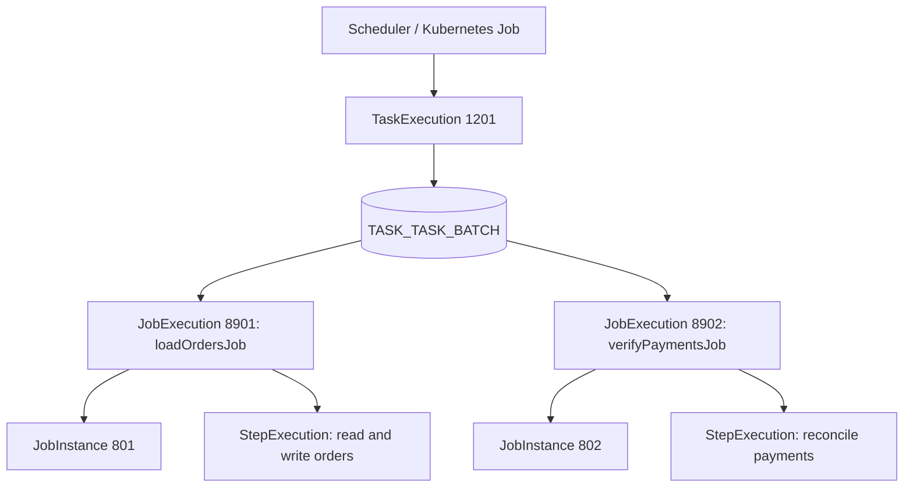
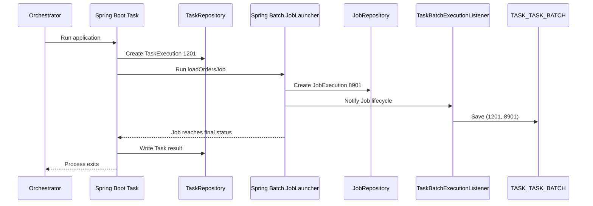
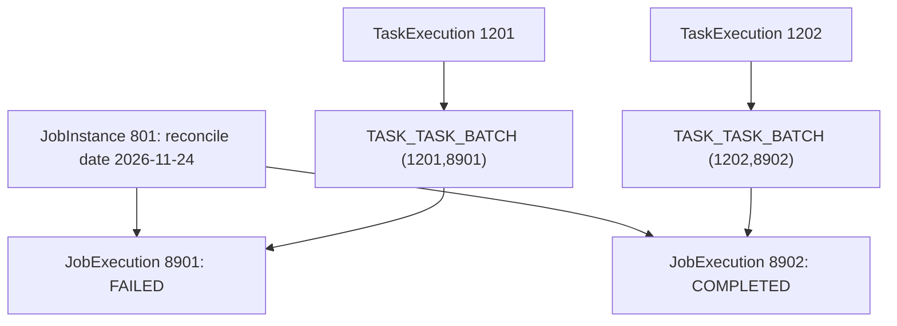

# The TASK_TASK_BATCH Bridge Table and Bidirectional Traceability

## 1. Why Connect Spring Cloud Task with Spring Batch?

In the **Spring Batch** chapter of **Spring Cloud Task**, we consider a **finite-lived Spring Boot application**: an orchestrator launches the application, the application executes one or more Batch Jobs, records results, and exits. Two distinct metadata layers exist here:

- **Spring Cloud Task** records each application run as a `TaskExecution` in `TaskRepository`.
- **Spring Batch** records job runs, steps, and processing states as `JobExecution` and `StepExecution` in `JobRepository`.

For example, suppose a Kubernetes Job launches the `nightly-reconciliation` application at 02:00, which runs `loadOrdersJob` and `verifyPaymentsJob` internally. When a dashboard only shows `TASK_EXECUTION_ID=1201`, how do you know which Batch Jobs ran? Conversely, when an alert reports that `JOB_EXECUTION_ID=8902` failed, how do you trace back to the exact application run, container, and logs?

**`TASK_TASK_BATCH`** is Spring Cloud Task's bridge table built for this need. The table stores pairs of **Task Execution ID** and **Batch Job Execution ID**. The framework provides `TaskBatchExecutionListener` to record the relationship when a Batch Job runs within the scope of a Task, while `TaskExplorer` exposes two methods for querying in both directions.

After this lesson, you will be able to:

1. Correctly interpret the two columns `TASK_EXECUTION_ID`, `JOB_EXECUTION_ID` and distinguish them from `JOB_INSTANCE_ID`.
2. Explain the conditions under which `TaskBatchExecutionListener` automatically writes association records.
3. Trace **Task → JobExecutions** and **JobExecution → Task** using `TaskExplorer` or SQL.
4. Join Task tables with Batch tables when sharing a database, or query across two repositories when using separate datasources.
5. Analyze relationships when a Task runs multiple jobs, a job is restarted, Batch fails, or linking metadata is missing.
6. Organize safe traceability and operations when applications run on schedule, on demand, and with retries.

> **Version boundary:** The APIs and table names below are presented using the common JDBC model in Spring Cloud Task and Spring Batch. Use a compatible Spring Boot/Spring Cloud Task/Spring Batch version set, and verify the schemas and Java packages of your deployed dependencies. Do not assume a SQL snippet using default table names applies verbatim to every database or table-prefix configuration.

## 2. Four Kinds of IDs That Must Be Kept Separate

| ID | Source | What Does It Identify? | Where Is It Stored? |
| --- | --- | --- | --- |
| `TASK_EXECUTION_ID` | Spring Cloud Task | **A single task application run** | `TASK_EXECUTION`; appears in `TASK_TASK_BATCH` |
| `JOB_EXECUTION_ID` | Spring Batch | **A single execution attempt of a Batch Job** | `BATCH_JOB_EXECUTION`; appears in `TASK_TASK_BATCH` |
| `JOB_INSTANCE_ID` | Spring Batch | **A logical unit of work**, typically by job name + identifying `JobParameters` | `BATCH_JOB_INSTANCE` and `BATCH_JOB_EXECUTION` |
| `STEP_EXECUTION_ID` | Spring Batch | **A single execution of a Step** within a Job Execution | `BATCH_STEP_EXECUTION` |

A single `JobInstance` can have **multiple `JobExecution`s** when restarted after failure. A single Task application run can contain **multiple JobExecutions** if it runs multiple Batch Jobs. Therefore, `TASK_TASK_BATCH` links to **JobExecution**, not JobInstance or StepExecution.

Example relationship:



The diagram shows illustrative data. Read each layer for its intended purpose: `TaskRepository` answers "which application runs happened?", `JobRepository` answers "how far did each job/step progress?", while `TASK_TASK_BATCH` only answers "**which Task run is associated with which Batch run?**".

## 3. Structure of the `TASK_TASK_BATCH` Table

According to Spring Cloud Task schema documentation, the bridge table has two primary columns:

| Column | Common Type | Meaning |
| --- | --- | --- |
| `TASK_EXECUTION_ID` | `BIGINT NOT NULL` | ID of a TaskExecution in the Task Repository |
| `JOB_EXECUTION_ID` | `BIGINT NOT NULL` | ID of a Spring Batch JobExecution |

Abbreviated DDL model to **illustrate the relationship**, not an immediately usable migration:

```sql
CREATE TABLE TASK_TASK_BATCH (
    TASK_EXECUTION_ID BIGINT NOT NULL,
    JOB_EXECUTION_ID BIGINT NOT NULL,
    CONSTRAINT TASK_EXEC_BATCH_FK
        FOREIGN KEY (TASK_EXECUTION_ID)
        REFERENCES TASK_EXECUTION(TASK_EXECUTION_ID)
);
```

Actual standard DDL may vary by database, version, or table prefix. Notably, the illustrative structure has a **foreign key to `TASK_EXECUTION`** without assuming a database foreign key to `BATCH_JOB_EXECUTION`: the two kinds of metadata can live in **two different datasources**. Do not manually add cross-database foreign keys or unique constraints without verifying the project's write paths and migrations.

**`TASK_TASK_BATCH` does not store Batch results** such as `STATUS`, `EXIT_CODE`, `STEP_NAME`, or checkpoints. To see whether a job succeeded or failed, read `BATCH_JOB_EXECUTION`; to see which step failed and how many rows were processed, read `BATCH_STEP_EXECUTION` or query via `JobExplorer`.

### How Many Association Rows Can One Task Have?

Suppose an application runs three jobs within the same Task:

| TASK_EXECUTION_ID | JOB_EXECUTION_ID |
| --- | --- |
| 1201 | 8901 |
| 1201 | 8902 |
| 1201 | 8903 |

This is a **one TaskExecution → many JobExecutions** relationship. `TaskExplorer.getJobExecutionIdsByTaskExecutionId(1201)` can return the set `{8901, 8902, 8903}`. Tracing back from a `JOB_EXECUTION_ID` usually finds the TaskExecution it ran inside, but **do not assume every version's schema enforces a unique constraint on the Job column**; if duplicate or mismatched links are discovered, inspect the data and write path before building logic that assumes uniqueness.

## 4. Who Creates the Association Record?

Spring Cloud Task includes `TaskBatchExecutionListener`, the component that integrates Batch runs with Tasks. Per official documentation, the listener is auto-configured when matching conditions coexist:

- The running application has Spring Cloud Task enabled and creates a `TaskExecution`.
- The context contains an eligible Spring Batch `Job` bean for the listener to attach to.
- The **`spring-cloud-task-batch`** JAR is on the classpath and its auto-configuration is not excluded.
- `TaskRepository`, `TaskExplorer`, the bridge table, and required datasources are properly configured.

`TaskBatchExecutionListener` is attached to eligible Batch Jobs. When a Job runs within a Task scope, it records the ID pair through the linking DAO mechanism (e.g., `TaskBatchDao.saveRelationship` in the corresponding API). You can restrict the listener to specific Jobs or disable auto-configuration if your project has a specific reason. You do not need to write manual `INSERT INTO TASK_TASK_BATCH` SQL for default integration.



The diagram shows the **logical sequence**. Exact callback/transaction commit timing and how the listener attaches to the Job depend on version and configuration. If the application is killed or loses database connectivity while saving the link, a JobExecution may exist **without a `TASK_TASK_BATCH` row**; do not treat a missing link as proof that the Job never ran.

### Integration Dependencies

For a Maven project that **already declares compatible Spring Boot and Spring Cloud BOMs**, relevant dependencies may include:

```xml
<dependencies>
    <dependency>
        <groupId>org.springframework.cloud</groupId>
        <artifactId>spring-cloud-starter-task</artifactId>
    </dependency>
    <dependency>
        <groupId>org.springframework.cloud</groupId>
        <artifactId>spring-cloud-task-batch</artifactId>
    </dependency>
    <dependency>
        <groupId>org.springframework.boot</groupId>
        <artifactId>spring-boot-starter-batch</artifactId>
    </dependency>
    <dependency>
        <groupId>org.postgresql</groupId>
        <artifactId>postgresql</artifactId>
        <scope>runtime</scope>
    </dependency>
</dependencies>
```

The XML snippet above is an **illustrative dependencies section**, not a complete `pom.xml`. `spring-cloud-task-batch` provides the linking layer; `spring-boot-starter-batch` provides Batch components in a Boot application. Do not pick versions by randomly combining the newest releases; consult the compatible release train.

### Non-Web Application Configuration

Example writing metadata to PostgreSQL with Task and Batch schemas already prepared:

```yaml
spring:
  application:
    name: nightly-reconciliation
  main:
    web-application-type: none
  datasource:
    url: jdbc:postgresql://localhost:5432/task_batch_demo
    username: task_batch_app
  cloud:
    task:
      name: nightly-reconciliation
      batch:
        listener:
          enabled: true
```

The password can be supplied via the `SPRING_DATASOURCE_PASSWORD` environment variable or another secret source. `spring.cloud.task.batch.listener.enabled` controls linking in Spring Cloud Task versions supporting this property; when omitted, the listener is typically enabled by default if auto-configuration conditions are met. Use the right DDL version, control permissions, and verify the schema contains `TASK_TASK_BATCH`.

## 5. Example: A Task Runs a Batch Job and Traces It

Assume the project already defines a `Job loadOrdersJob` bean with its Steps. An `ApplicationRunner` bean can invoke `JobLauncher` with a business date parameter:

```java
import java.time.LocalDate;
import java.util.List;

import org.springframework.batch.core.BatchStatus;
import org.springframework.batch.core.Job;
import org.springframework.batch.core.JobExecution;
import org.springframework.batch.core.JobParameters;
import org.springframework.batch.core.JobParametersBuilder;
import org.springframework.batch.core.launch.JobLauncher;
import org.springframework.beans.factory.annotation.Qualifier;
import org.springframework.boot.ApplicationRunner;
import org.springframework.context.annotation.Bean;
import org.springframework.context.annotation.Configuration;

@Configuration(proxyBeanMethods = false)
public class BatchLaunchConfiguration {

    @Bean
    ApplicationRunner launchOrders(
            JobLauncher jobLauncher,
            @Qualifier("loadOrdersJob") Job job) {
        return args -> {
            List<String> values = args.getOptionValues("business-date");
            if (values == null || values.size() != 1) {
                throw new IllegalArgumentException(
                        "Required --business-date=yyyy-MM-dd");
            }

            String businessDate = LocalDate.parse(values.get(0)).toString();
            JobParameters parameters = new JobParametersBuilder()
                    .addString("businessDate", businessDate, true)
                    .toJobParameters();

            JobExecution jobExecution = jobLauncher.run(job, parameters);
            if (jobExecution.getStatus() != BatchStatus.COMPLETED) {
                throw new IllegalStateException(
                        "Batch did not complete: " + jobExecution.getStatus());
            }
        };
    }
}
```

The example uses common Batch 5.x APIs and shows only the **launch configuration**, excluding `Job`/`Step` definitions and the `@SpringBootApplication` / `@EnableTask` main class. For other Batch versions, verify packages and API signatures before compiling.

When launching Batch explicitly via an `ApplicationRunner` like above, prevent Boot from also auto-launching the same job:

```yaml
spring:
  batch:
    job:
      enabled: false
```

This property applies in Spring Boot versions that support it. The example assumes `JobLauncher` runs **synchronously**; with an asynchronous launcher, `run(...)` may return before the job finishes, so you must wait for the final status before concluding the Task succeeded.

What needs verification is that **the listener automatically attaches to the executing Job**, regardless of whether `JobLauncher` is invoked from a custom runner or Boot's runner. If the `Job` class is not supported by auto-configuration, the listener is disabled, or the Job runs outside the Task scope, the bridge table may remain empty even though both repositories have metadata.

### Illustrative Output

After a completed run, the database may contain:

| TASK_EXECUTION | JOB_EXECUTION | TASK_TASK_BATCH |
| --- | --- | --- |
| `TASK_EXECUTION_ID=1201`, `EXIT_CODE=0` | `JOB_EXECUTION_ID=8901`, `STATUS=COMPLETED` | `(1201, 8901)` |

The IDs in the table are illustrative. Both tracing questions now have answers: **Task 1201** ran **Job 8901**, and **Job 8901** executed inside **Task 1201**.

## 6. Tracing from Task to Batch Using SQL

### 6.1. Reading Direct Associations

If you know `TASK_EXECUTION_ID`:

```sql
SELECT TASK_EXECUTION_ID, JOB_EXECUTION_ID
FROM TASK_TASK_BATCH
WHERE TASK_EXECUTION_ID = :taskExecutionId
ORDER BY JOB_EXECUTION_ID;
```

`:taskExecutionId` is a **named parameter** used with supporting clients/JDBC abstractions (such as `NamedParameterJdbcTemplate`). When running directly in a SQL client, use that client's parameter-binding syntax. Never concatenate untrusted values into SQL strings.

This query returns only **Batch execution IDs**, not job names, statuses, or step details.

### 6.2. Joining Full Task → Job History

If **Task and Batch tables reside in the same database/schema accessible over a single connection**, you can use this query:

```sql
SELECT
    t.TASK_EXECUTION_ID,
    t.TASK_NAME,
    t.START_TIME AS TASK_START_TIME,
    t.END_TIME AS TASK_END_TIME,
    t.EXIT_CODE AS TASK_EXIT_CODE,
    l.JOB_EXECUTION_ID,
    ji.JOB_INSTANCE_ID,
    ji.JOB_NAME,
    je.STATUS AS BATCH_STATUS,
    je.EXIT_CODE AS BATCH_EXIT_CODE,
    je.START_TIME AS JOB_START_TIME,
    je.END_TIME AS JOB_END_TIME
FROM TASK_EXECUTION t
LEFT JOIN TASK_TASK_BATCH l
    ON l.TASK_EXECUTION_ID = t.TASK_EXECUTION_ID
LEFT JOIN BATCH_JOB_EXECUTION je
    ON je.JOB_EXECUTION_ID = l.JOB_EXECUTION_ID
LEFT JOIN BATCH_JOB_INSTANCE ji
    ON ji.JOB_INSTANCE_ID = je.JOB_INSTANCE_ID
WHERE t.TASK_EXECUTION_ID = :taskExecutionId
ORDER BY l.JOB_EXECUTION_ID;
```

**Why `LEFT JOIN`?** A Task might only execute plain Java logic, fail before Batch launches, or lack a link due to configuration. `LEFT JOIN` preserves the Task row even when no linked Job is found. However, `NULL` on the Batch side **does not prove Batch never ran**; inspect the listener, datasource, and logs.

**Distinguishing exit codes:** Cloud Task's `TASK_EXECUTION.EXIT_CODE` is usually an **integer**; `BATCH_JOB_EXECUTION.EXIT_CODE` is a **string** containing Batch's `ExitStatus`. Do not compare the two values as the same enum or assume they always reflect the same outcome.

### 6.3. Drilling Down to Steps

Once you have `JOB_EXECUTION_ID`, inspect Step metrics:

```sql
SELECT
    JOB_EXECUTION_ID,
    STEP_EXECUTION_ID,
    STEP_NAME,
    STATUS,
    READ_COUNT,
    WRITE_COUNT,
    COMMIT_COUNT,
    ROLLBACK_COUNT,
    START_TIME,
    END_TIME
FROM BATCH_STEP_EXECUTION
WHERE JOB_EXECUTION_ID = :jobExecutionId
ORDER BY STEP_EXECUTION_ID;
```

This is **Spring Batch metadata**, not part of the `TASK_TASK_BATCH` table. Counts help evaluate progress, but do not by themselves prove that all side effects outside the database happened exactly once.

## 7. Reverse Tracing from Batch Back to Task Using SQL

Suppose a Batch dashboard reports `JOB_EXECUTION_ID=8902` in `FAILED` status. You want to find the exact Task run to open Kubernetes logs and inspect the application's exit code:

```sql
SELECT
    je.JOB_EXECUTION_ID,
    ji.JOB_INSTANCE_ID,
    ji.JOB_NAME,
    je.STATUS AS BATCH_STATUS,
    je.EXIT_CODE AS BATCH_EXIT_CODE,
    t.TASK_EXECUTION_ID,
    t.TASK_NAME,
    t.START_TIME AS TASK_START_TIME,
    t.END_TIME AS TASK_END_TIME,
    t.EXIT_CODE AS TASK_EXIT_CODE,
    t.EXTERNAL_EXECUTION_ID
FROM BATCH_JOB_EXECUTION je
JOIN BATCH_JOB_INSTANCE ji
    ON ji.JOB_INSTANCE_ID = je.JOB_INSTANCE_ID
LEFT JOIN TASK_TASK_BATCH l
    ON l.JOB_EXECUTION_ID = je.JOB_EXECUTION_ID
LEFT JOIN TASK_EXECUTION t
    ON t.TASK_EXECUTION_ID = l.TASK_EXECUTION_ID
WHERE je.JOB_EXECUTION_ID = :jobExecutionId;
```

Here `LEFT JOIN` preserves the Batch result if **no Task link exists yet**. Once `TASK_EXECUTION_ID` is found, use the Task Repository, `EXTERNAL_EXECUTION_ID` (if populated), logs/metrics, or orchestrator data to identify which container ran the job.

If the query returns **multiple rows** for one Job Execution, inspect the actual data and schema before assuming multiple rows are valid. `TaskExplorer.getTaskExecutionIdByJobExecutionId` returns a single `Long` or `null`, so duplicate or inconsistent bridge data can cause unexpected API or application behavior.

## 8. Using the `TaskExplorer` API Instead of Manual SQL

Once you have `TaskExplorer` and `JobExplorer` beans, you can query bidirectionally without manually joining metadata tables.

### Task → Set of JobExecution IDs

Spring Cloud Task API:

```java
Set<Long> jobExecutionIds =
        taskExplorer.getJobExecutionIdsByTaskExecutionId(taskExecutionId);
```

The method returns **`Set<Long>`**, reflecting that a Task can link to multiple JobExecutions; do not assume the Set's iteration order matches the job execution order.

### JobExecution ID → TaskExecution ID

```java
Long taskExecutionId =
        taskExplorer.getTaskExecutionIdByJobExecutionId(jobExecutionId);
```

If no association is found, the API may return **`null`**. Never fabricate a synthetic Task ID from `JOB_EXECUTION_ID` or `JOB_INSTANCE_ID`; they belong to separate ID namespaces.

### Bidirectional Lookup Service

Java 17+ example with **Spring Batch 5.x**:

```java
import java.util.ArrayList;
import java.util.List;
import java.util.Set;

import org.springframework.batch.core.JobExecution;
import org.springframework.batch.core.explore.JobExplorer;
import org.springframework.cloud.task.repository.TaskExecution;
import org.springframework.cloud.task.repository.TaskExplorer;
import org.springframework.stereotype.Service;

@Service
public class TaskBatchTraceService {
    private final TaskExplorer taskExplorer;
    private final JobExplorer jobExplorer;

    public TaskBatchTraceService(
            TaskExplorer taskExplorer,
            JobExplorer jobExplorer) {
        this.taskExplorer = taskExplorer;
        this.jobExplorer = jobExplorer;
    }

    public List<JobExecution> findJobsOfTask(long taskExecutionId) {
        Set<Long> ids =
                taskExplorer.getJobExecutionIdsByTaskExecutionId(taskExecutionId);
        List<JobExecution> found = new ArrayList<>();
        for (Long id : ids) {
            JobExecution execution = jobExplorer.getJobExecution(id);
            if (execution != null) {
                found.add(execution);
            }
        }
        return found;
    }

    public TaskExecution findTaskOfJob(long jobExecutionId) {
        Long taskId =
                taskExplorer.getTaskExecutionIdByJobExecutionId(jobExecutionId);
        return taskId == null ? null : taskExplorer.getTaskExecution(taskId);
    }
}
```

This is an illustrative **read service**. Enforce access control when exposing APIs to a dashboard. If the two repositories use different datasources, `TaskExplorer` reads the Task bridge table while `JobExplorer` reads Batch's `JobRepository`; looking up by ID still lets you navigate across both stores.

**Version note:** `JobExplorer` and Java packages in Spring Batch 6 changed compared to Batch 5. The imports in the example target Batch 5.x; verify your project's actual APIs before compiling. If a Job ID exists in `TASK_TASK_BATCH` yet `JobExplorer.getJobExecution(id)` returns `null`, check **the right datasource/namespace, migrations, and retention**—do not conclude the job erased itself from Task's memory.

## 9. When Task and Batch Use Two Different DataSources

There are two common deployment models:

| Model | Advantages | Considerations |
| --- | --- | --- |
| **Shared database/schema** | Can join `TASK_TASK_BATCH` with `BATCH_*` tables directly; convenient for SQL dashboards | Must coordinate schemas, versions, table prefixes, permissions, and read/write load |
| **Separate datasource or database** | Independent permissions, backups, retention, and operations | Cannot assume a direct SQL join across both sources; requires `TaskExplorer` → `JobExplorer` or an aggregation service |

Typically, `TASK_TASK_BATCH` resides alongside Task metadata in the datasource used by the linking component. It stores a **reference ID** to the Job Execution, so Batch metadata can reside in another database and still be traced via APIs. However, if you customize `TaskConfigurer`, Batch's datasource, table prefixes, or schemas, verify that the listener bean and linking DAO point to the correct data store.

### Important Transaction Boundary

Spring Batch writing `JobExecution` and Spring Cloud Task writing the `TASK_TASK_BATCH` row may **not belong to the same transaction** when the two repositories reside in different databases. A network failure can leave a Job Execution persisted while the bridge row is missing. Similarly, when migrating or purging Batch history, the Task bridge table may retain references to IDs that are no longer queryable.

When designing reports, be sure to:

- Accommodate and display states like **link not found / data not synchronized**.
- Keep Task and Batch metadata retention policies aligned with traceability needs.
- Never claim linking is "always atomic" solely because both repositories run inside one Spring Boot application.
- If operating multiple independent Batch repositories, avoid confusing colliding numeric `JOB_EXECUTION_ID`s from **different data namespaces**. When necessary, record a source/tenant/cluster ID in business audit logs.

## 10. Tracing During Task Retries and Batch Restarts

Suppose the reconciliation task for `2026-11-24` runs once and fails at the second Step. The orchestrator retries using the **same identifying `JobParameters`**.

| Attempt | TaskExecution | JobInstance | JobExecution | BatchStatus | Bridge Table |
| --- | --- | --- | --- | --- | --- |
| First run | `1201` | `801` | `8901` | `FAILED` | `(1201, 8901)` |
| Retry | `1202` | `801` | `8902` | `COMPLETED` | `(1202, 8902)` |

Because **the Task re-ran**, Spring Cloud Task creates a new `TaskExecution`. Because **Batch restarted the same JobInstance**, Spring Batch creates a new `JobExecution` while keeping `JOB_INSTANCE_ID=801`. Both link pairs are valid; the bridge table is not updated to "replace" `8901` with `8902`.



Therefore, to find **all attempts of a JobInstance**, do not look only at `TASK_TASK_BATCH` for one JobExecution ID. Query `BATCH_JOB_EXECUTION` by `JOB_INSTANCE_ID`, then trace each `JOB_EXECUTION_ID` back to `TASK_TASK_BATCH`.

Example SQL when sharing a database:

```sql
SELECT
    ji.JOB_INSTANCE_ID,
    ji.JOB_NAME,
    je.JOB_EXECUTION_ID,
    je.STATUS,
    l.TASK_EXECUTION_ID,
    t.START_TIME AS TASK_START_TIME,
    t.EXIT_CODE AS TASK_EXIT_CODE
FROM BATCH_JOB_INSTANCE ji
JOIN BATCH_JOB_EXECUTION je
    ON je.JOB_INSTANCE_ID = ji.JOB_INSTANCE_ID
LEFT JOIN TASK_TASK_BATCH l
    ON l.JOB_EXECUTION_ID = je.JOB_EXECUTION_ID
LEFT JOIN TASK_EXECUTION t
    ON t.TASK_EXECUTION_ID = l.TASK_EXECUTION_ID
WHERE ji.JOB_INSTANCE_ID = :jobInstanceId
ORDER BY je.JOB_EXECUTION_ID;
```

Using `LEFT JOIN`, the query also surfaces unlinked JobExecutions. Do not conclude `Task 1201` was the final successful run merely because a link row exists; check `STATUS` and `EXIT_CODE` in **both repositories**.

## 11. Common Pitfall: JobExecution Exists Without `TASK_TASK_BATCH`

| Symptom | Possible Cause | How to Investigate |
| --- | --- | --- |
| Missing `TASK_TASK_BATCH` table | Schema not initialized/migrated for the right version or different table prefix | Check Task Repository DDL, target schema, and table-creation privileges |
| JobExecution exists, no bridge row | Missing `spring-cloud-task-batch`, listener disabled, Job did not receive listener, or ran outside Task scope | Check classpath, Job beans, auto-configuration, JobListener logs |
| Both Task and Job have data, but trace API returns empty | TaskExplorer reads a different DB/schema/prefix than where links are written | Verify datasource, connection, migrations, table prefix |
| SQL join finds no Job despite link existing | Batch metadata in another datasource or purged | Use `JobExplorer` with the right Batch datasource or query both DBs separately |
| One Task returns multiple JobExecution IDs | Task ran multiple jobs or multiple job runs inside the app | Inspect link pairs, job names, and time windows |
| Retry has new JobExecution, expected old Task ID | Confusing retry and restart | Compare the new `TaskExecution` with the old `JobInstance` |
| Task reports `EXIT_CODE=0` while Batch is `FAILED` | Application did not propagate Batch failure to Task level | Check runner, `fail-on-job-failure`, and process exit code |
| No bridge row after process kill | Process/DB failed before listener could save or commit | Check logs, runtime, job creation timestamp, and repository state |

Never manually `INSERT` rows into the bridge table before understanding the root cause and ID sources. "Patching" a link row can distort inferred history, mask listener/datasource bugs, or misattribute a JobExecution to the wrong Task.

### Checking for Anomalous Link Data

In test environments or during data investigations, you might find an ID pair appearing multiple times:

```sql
SELECT TASK_EXECUTION_ID, JOB_EXECUTION_ID, COUNT(*) AS LINK_COUNT
FROM TASK_TASK_BATCH
GROUP BY TASK_EXECUTION_ID, JOB_EXECUTION_ID
HAVING COUNT(*) > 1;
```

This query only helps **surface suspicious records**; it does not immediately establish root cause. Check DDL/constraints, transactions, and retry flows before modifying data or adding unique indexes. To analyze unmapped JobExecutions, use a `LEFT JOIN` from `BATCH_JOB_EXECUTION`; do not automatically label every job not run inside Spring Cloud Task as a "framework bug."

## 12. Linking Does Not Unify Statuses and Exit Codes

Suppose the first Job succeeds and the second Job fails, yet application code catches the exception and exits normally:

| Layer | Metadata | Possible Observed Result |
| --- | --- | --- |
| Batch Job A | `JobExecution 8901` | `BatchStatus.COMPLETED` |
| Batch Job B | `JobExecution 8902` | `BatchStatus.FAILED` |
| Task containing both jobs | `TaskExecution 1201` | May show `EXIT_CODE=0` if error handling is flawed |
| OS / Kubernetes Job | Process exit status | May receive `0`, resulting in no retry |

`TASK_TASK_BATCH` links the executions **but does not automatically translate Batch status into a Task exit code**. For supported integrated Boot/Batch flows, Spring Cloud Task provides:

```yaml
spring:
  cloud:
    task:
      batch:
        fail-on-job-failure: true
```

This feature translates a failed Batch Job into a non-zero Task exit code according to the corresponding mechanism and version. If you **write your own runner invoking JobLauncher** or use an asynchronous launcher, explicitly inspect the finished `JobExecution` and propagate failures to the Task level; do not rely solely on the property working across every custom flow.

For safe operations, verify **BatchStatus**, **TaskExecution.EXIT_CODE**, **process exit status**, and **business outcomes**. Having a `TASK_TASK_BATCH` link does not guarantee these four layers agree.

## 13. Deployment and Operations Checklist

When configuring Spring Cloud Task + Spring Batch integration in environments with real data:

1. **Pin compatible versions** across Spring Boot, Spring Cloud Task, and Spring Batch; verify `spring-cloud-task-batch` is on the classpath.
2. **Run version-matched migrations** for Task Repository and Job Repository; verify `TASK_TASK_BATCH` and `BATCH_*` tables exist in the expected schemas.
3. **Verify datasources/table prefixes** for Task, links, and Batch; confirm `TaskExplorer`/`JobExplorer` read from the right places.
4. **Launch a small task with one Job**, verifying `TaskExecution`, `JobExecution`, and one accurate bridge pair.
5. **Run a Task with two Jobs**, verifying one TaskExecution links to multiple JobExecutions.
6. **Trigger an intentional job failure**, verifying the bridge record still traces to `BatchStatus.FAILED` and Task/OS report the failure properly.
7. **Restart with unchanged identifying JobParameters**, verifying a new TaskExecution, new JobExecution, and preserved JobInstance when eligible.
8. **Run controlled failure tests**: kill container, Task DB unreachable, missing Job metadata, wrong table prefix; observe the distinction between "not run," "no link," and "query failure."
9. **Restrict permissions and exposed info** on dashboards; avoid leaking arguments/exceptions containing secrets into public logs.
10. **Configure retention and alerts**: purge Task/Batch history consistently, monitor link-write errors, tasks missing `END_TIME`, and jobs stuck in `STARTED`.

### Self-Check Exercises

1. Why does `TASK_TASK_BATCH` store `JOB_EXECUTION_ID` instead of `JOB_INSTANCE_ID`?
2. A Task runs three Batch Jobs; what data type and how many elements can `TaskExplorer.getJobExecutionIdsByTaskExecutionId` return?
3. Given `JOB_EXECUTION_ID`, which API traces back to the Task ID, and what does it return if no link exists?
4. Why is `LEFT JOIN` helpful when querying Task history? When does a `NULL` on the Batch side fail to prove the job never ran?
5. Task and Batch use two different databases. Why is a direct SQL join usually unsuitable, and which components does a Java service need?
6. A JobInstance fails and restarts, yielding two JobExecutions linked to two different TaskExecutions. Which rows should remain in the bridge table?
7. Why can `TASK_TASK_BATCH` contain data while the Task exit code is still 0 when a Batch Job fails?
8. When a dashboard shows no link, in what order will you inspect the JAR, listener, schema, datasource, and process state?

## 14. References

- [Spring Cloud Task — Batch: Associating a Job Execution](https://docs.spring.io/spring-cloud-task/reference/batch.html).
- [Spring Cloud Task — Task Repository Schema, TASK_TASK_BATCH table](https://docs.spring.io/spring-cloud-task/docs/current/reference/html/appendix-task-repository-schema.html).
- [Spring Cloud Task — TaskExplorer API](https://docs.spring.io/spring-cloud-task/docs/current/apidocs/org/springframework/cloud/task/repository/TaskExplorer.html).
- [Spring Cloud Task — JdbcTaskBatchDao API](https://docs.spring.io/spring-cloud-task/docs/current/apidocs/org/springframework/cloud/task/batch/listener/support/JdbcTaskBatchDao.html).
- [Spring Batch — Metadata Schema](https://docs.spring.io/spring-batch/reference/schema-appendix.html).
- [Spring Batch 5 — JobExplorer API](https://docs.spring.io/spring-batch/docs/current/api/org/springframework/batch/core/explore/JobExplorer.html).

**Remember:** `TASK_TASK_BATCH` is the **TaskExecution ↔ JobExecution** mapping table with two columns: `TASK_EXECUTION_ID` and `JOB_EXECUTION_ID`. `TaskBatchExecutionListener` records the link when integration conditions are satisfied, while `TaskExplorer` enables bidirectional lookups. To know whether a run succeeded or can be retried, combine this link with **TaskRepository**, **JobRepository**, business results, and process state; the bridge table itself holds no processing outcomes.
