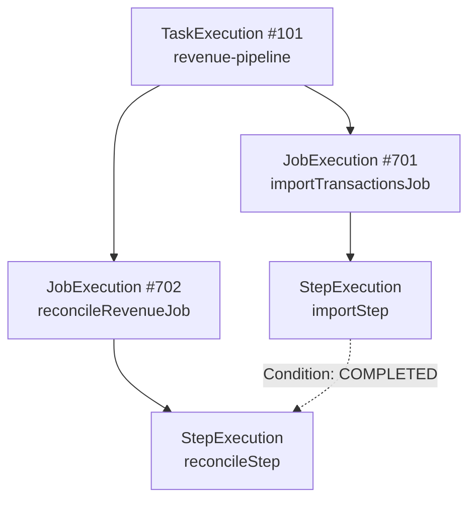
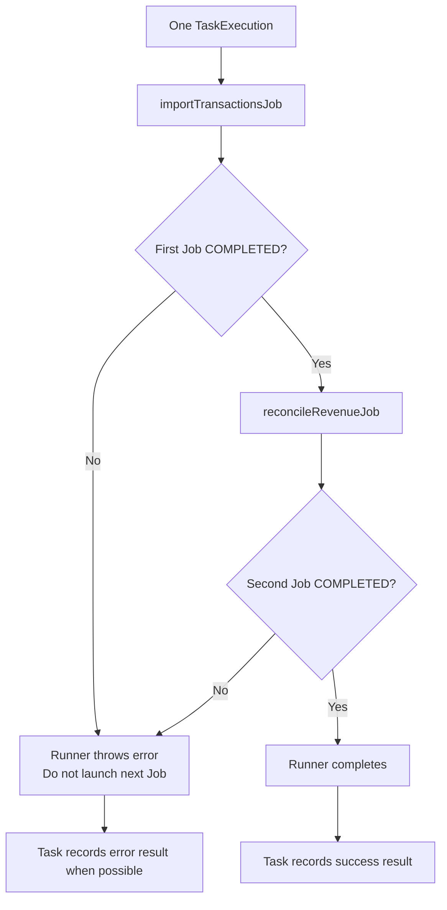

# Running Multiple Jobs Inside a Single Task

A **Spring Cloud Task** application is finite-lived: it starts up, performs work, records status via `TaskRepository`, and exits. When a problem consists of multiple stages—such as **load transactions → reconcile revenue → generate reports**—we can use **Spring Batch** to manage each batch processing stage.

In the **Spring Batch** chapter, the question is: **can a single Spring Cloud Task application launch run multiple Spring Batch `Job`s, and how are status, parameters, errors, and restarts managed?** The answer is **yes**. An `ApplicationRunner` can use `JobLauncher` to invoke multiple `Job`s synchronously in the order required by the business workflow. Spring Cloud Task tracks the lifecycle **of the application process**, while Spring Batch tracks the lifecycle **of each Job and Step**.

Lesson objectives:

- Distinguish `TaskExecution`, `JobInstance`, `JobExecution`, and `StepExecution`.
- Launch two Batch Jobs within the same application using `JobLauncher`.
- Disable automatic Batch Job startup execution when orchestrating manually.
- Run the next Job only when the preceding Job truly completes, while properly handling failed Jobs.
- Safely re-run the application using `JobParameters` and state persisted in `JobRepository`.
- Inspect execution metadata and decide when to use multiple Jobs, multiple Steps, or separate independent Tasks.

## 1. One Task, Multiple Jobs: Understanding the Levels Correctly

Suppose we run:

```bash
java -jar revenue-pipeline.jar --business-date=2026-11-24
```

The application executes two Batch Jobs:

1. `importTransactionsJob`: loads and validates transactions for a given day.
2. `reconcileRevenueJob`: aggregates revenue from the loaded transactions.

If both complete, the application exits. At the metadata level, you can observe:

| Level | Example | What Information Does It Hold? |
| --- | --- | --- |
| **Spring Cloud Task** | `TaskExecution #101` | A single run of the `revenue-pipeline` application, start/end timestamps, exit code. |
| **Spring Batch JobInstance** | `importTransactionsJob` + `businessDate=2026-11-24` | Logical identity of a Batch Job with its **identifying JobParameters**. |
| **Spring Batch JobExecution** | `JobExecution #701`, `#702` | Execution attempts or restarts of each JobInstance. |
| **Spring Batch StepExecution** | `importStep`, `reconcileStep` | Read/write counts, errors, status, and checkpoint of each step. |

Each JAR run is recorded as **one `TaskExecution`** if Spring Cloud Task starts and persists metadata successfully. Within that run, **multiple `JobExecution`s** may occur depending on how many Jobs are invoked and their prior history. Each Job can contain one or more Steps.



The dashed line represents an **orchestration rule imposed by the application**, not a built-in dependency between the two Jobs. Spring Batch does not inherently know that the second Job must wait for the first; the code calling `JobLauncher` must enforce and verify this.

### Distinguishing `JobInstance` from `JobExecution`

Spring Batch identifies a `JobInstance` by **Job name and the `JobParameters` marked as *identifying***. For example:

```text
JobInstance A = (importTransactionsJob, businessDate=2026-11-24)
JobInstance B = (reconcileRevenueJob, businessDate=2026-11-24)
```

These two Jobs share the same parameter but have **different names**, so they are two distinct JobInstances. If one Job fails and is restarted with the same identifying parameters, Spring Batch can create a **new JobExecution under the same JobInstance** according to restart rules. If a JobInstance is already `COMPLETED`, invoking the same Job with the same identifying parameters usually throws `JobInstanceAlreadyCompleteException`; **completed work is not re-run by default**.

This point is crucial because retrying **the entire Spring Cloud Task** starts a new JVM, which does not mean Spring Batch should re-run Jobs that have already succeeded.

## 2. Who Manages State and Transactions?

| Responsibility | Spring Cloud Task | Spring Batch |
| --- | --- | --- |
| Execution unit | Entire **finite application process** | A `Job` and its internal `Step`s |
| State store | `TaskRepository` | `JobRepository` |
| Core records | `TaskExecution` | `JobInstance`, `JobExecution`, `StepExecution` |
| Outcome | `exitCode` and task lifecycle metadata | `BatchStatus`, `ExitStatus`, Step metrics |
| Restart | A new launch usually gets a new `TaskExecution` | Based on `JobParameters`, JobInstance, Steps, and checkpoints |
| Coordinating units | External launcher/orchestrator | Flows/Steps inside a Job; multiple Jobs need explicit launch & check logic |

**`TaskRepository` and `JobRepository` are not the same API.** Even when both share a database, they persist different records. Metadata tables typically carry `TASK_` and `BATCH_` prefixes with schemas matching their respective versions.

Commits from Batch Steps do **not automatically** participate in a single long-running transaction spanning the entire Spring Cloud Task. If the first Job committed data and the subsequent Job fails, the Task exiting with failure does not roll back data already committed by the first Job.

## 3. Strategies for Running Multiple Jobs

There are three common ways to organize this:

| Organization | Best Suited When | Considerations |
| --- | --- | --- |
| **One Job with multiple Steps** | Steps belong to **a single Batch workflow** needing Step-level flow, checkpoints, and restarts | Usually simplest when steps are tightly coupled. |
| **One Task running multiple Jobs** | Jobs are logically independent, needing separate `JobInstance`/`JobExecution` records while running in one process | Must manually coordinate ordering, errors, and skipping completed Jobs on Task retries. |
| **Multiple Tasks, one Job per Task** | Jobs need independent scaling, permissions, schedules, and resources | Requires an external launcher/workflow orchestrator, creating multiple `TaskExecution`s. |

This lesson focuses on **the second approach**. We use an `ApplicationRunner` to run the first Job, check its status, and only then run the second Job.

### Crucial Prerequisite: Synchronous `JobLauncher`

In the example, `JobLauncher.run(...)` is assumed to **wait until the Job finishes executing** before returning the final `JobExecution`. Configuring `TaskExecutorJobLauncher` with a synchronous executor satisfies this requirement.

If the launcher is configured **asynchronously**, `run(...)` may return while the status is still `STARTING` or `STARTED`. In that case, comparing the status immediately against `COMPLETED` yields the wrong answer. You must **wait for the Job to finish**, with timeouts and error handling; if you want to run two Jobs in parallel, you need a dedicated status-aggregation mechanism before the Task closes.

## 4. Sample Application: Two Jobs in One Spring Cloud Task

The following example illustrates common syntax for **Spring Boot 3.x / Spring Batch 5.x** with a compatible Spring Cloud Task version. Spring Batch APIs and auto-configuration mechanisms can change in major releases; when targeting Spring Boot 4 / Batch 6 or other versions, verify the APIs and compatibility matrix before applying.

### 4.1. Dependencies

Create a Spring Boot Maven project with a compatible Java runtime and Spring Cloud BOM. Add to `pom.xml`:

```xml
<dependencies>
    <dependency>
        <groupId>org.springframework.cloud</groupId>
        <artifactId>spring-cloud-starter-task</artifactId>
    </dependency>
    <dependency>
        <groupId>org.springframework.boot</groupId>
        <artifactId>spring-boot-starter-batch</artifactId>
    </dependency>
    <dependency>
        <groupId>com.h2database</groupId>
        <artifactId>h2</artifactId>
        <scope>runtime</scope>
    </dependency>
</dependencies>
```

This is a **dependencies snippet**, not a complete POM. The project must have a Spring Boot parent or equivalent dependency management, the right Spring Cloud BOM version, and `spring-boot-maven-plugin` to package an executable JAR. `spring-boot-starter-batch` supplies Spring Batch components and the JDBC infrastructure needed in typical configurations.

### 4.2. Application Configuration

Create `src/main/resources/application.yml`:

```yaml
spring:
  application:
    name: revenue-pipeline-task
  main:
    web-application-type: none
  datasource:
    url: jdbc:h2:file:./revenue-pipeline-metadata
    driver-class-name: org.h2.Driver
    username: sa
    password: ""
  batch:
    job:
      enabled: false
    jdbc:
      initialize-schema: always
  cloud:
    task:
      name: revenuePipelineTask
      initialize-enabled: true
```

Intentional choices:

- `spring.main.web-application-type: none`: CLI application without starting a web server.
- `spring.batch.job.enabled: false`: **prevents Spring Boot from auto-running Batch Jobs at startup**, because our `ApplicationRunner` will explicitly select and invoke the Jobs. Omitting this property lets Boot's auto-run interfere with ordering or cause unintended executions.
- `spring.batch.jdbc.initialize-schema: always` and `spring.cloud.task.initialize-enabled: true`: enable schema creation in a **practice environment** when supported by the version/framework.
- `jdbc:h2:file:./revenue-pipeline-metadata`: persists history on disk so it can be observed across multiple launches from the **same working directory**.

In **production**, use a supported persistent database, versioned schema migrations for Spring Batch/Task, least-privilege permissions, backups, and monitoring. Never have multiple containers across machines rely on a local H2 file. Auto-initialization settings are for the example only.

### 4.3. Creating Two `Job`s

Create `src/main/java/com/example/pipeline/RevenuePipelineTaskApplication.java`:

```java
package com.example.pipeline;

import java.time.LocalDate;
import java.util.List;

import org.springframework.batch.core.BatchStatus;
import org.springframework.batch.core.Job;
import org.springframework.batch.core.JobExecution;
import org.springframework.batch.core.JobParameters;
import org.springframework.batch.core.JobParametersBuilder;
import org.springframework.batch.core.Step;
import org.springframework.batch.core.job.builder.JobBuilder;
import org.springframework.batch.core.launch.JobLauncher;
import org.springframework.batch.core.repository.JobRepository;
import org.springframework.batch.core.step.builder.StepBuilder;
import org.springframework.batch.repeat.RepeatStatus;
import org.springframework.beans.factory.annotation.Qualifier;
import org.springframework.boot.ApplicationArguments;
import org.springframework.boot.ApplicationRunner;
import org.springframework.boot.SpringApplication;
import org.springframework.boot.autoconfigure.SpringBootApplication;
import org.springframework.cloud.task.configuration.EnableTask;
import org.springframework.context.annotation.Bean;
import org.springframework.transaction.PlatformTransactionManager;

@SpringBootApplication
@EnableTask
public class RevenuePipelineTaskApplication {

    public static void main(String[] args) {
        SpringApplication.run(RevenuePipelineTaskApplication.class, args);
    }

    @Bean
    Step importStep(
            JobRepository repository,
            PlatformTransactionManager transactionManager) {
        return new StepBuilder("importStep", repository)
            .tasklet((contribution, context) -> {
                Object date = context.getStepContext()
                    .getJobParameters().get("businessDate");
                System.out.println("1. Importing transactions for date " + date);
                // TODO: Call data import/validation service.
                return RepeatStatus.FINISHED;
            }, transactionManager)
            .build();
    }

    @Bean
    Step reconcileStep(
            JobRepository repository,
            PlatformTransactionManager transactionManager) {
        return new StepBuilder("reconcileStep", repository)
            .tasklet((contribution, context) -> {
                Object date = context.getStepContext()
                    .getJobParameters().get("businessDate");
                System.out.println("2. Reconciling revenue for date " + date);

                Object simulateError = context.getStepContext()
                    .getJobParameters().get("simulateError");
                if ("true".equals(simulateError)) {
                    throw new IllegalStateException(
                        "Simulated error during reconciliation"
                    );
                }
                // TODO: Call revenue aggregation service.
                return RepeatStatus.FINISHED;
            }, transactionManager)
            .build();
    }

    @Bean
    Job importTransactionsJob(
            JobRepository repository,
            @Qualifier("importStep") Step step) {
        return new JobBuilder("importTransactionsJob", repository)
            .start(step)
            .build();
    }

    @Bean
    Job reconcileRevenueJob(
            JobRepository repository,
            @Qualifier("reconcileStep") Step step) {
        return new JobBuilder("reconcileRevenueJob", repository)
            .start(step)
            .build();
    }

    @Bean
    ApplicationRunner runPipeline(
            JobLauncher launcher,
            JobRepository repository,
            @Qualifier("importTransactionsJob") Job importJob,
            @Qualifier("reconcileRevenueJob") Job reconcileJob) {
        return args -> {
            LocalDate date = requiredBusinessDate(args);
            JobParameters parameters = new JobParametersBuilder()
                .addString("businessDate", date.toString(), true)
                .addString(
                    "simulateError",
                    Boolean.toString(args.containsOption("simulate-error")),
                    false
                )
                .toJobParameters();

            runOrSkipCompleted(launcher, repository, importJob, parameters);
            runOrSkipCompleted(launcher, repository, reconcileJob, parameters);
            System.out.println("Pipeline completed");
        };
    }

    private static void runOrSkipCompleted(
            JobLauncher launcher,
            JobRepository repository,
            Job job,
            JobParameters parameters) throws Exception {
        JobExecution last =
            repository.getLastJobExecution(job.getName(), parameters);

        if (last != null && last.getStatus() == BatchStatus.COMPLETED) {
            System.out.println(
                "Skipping completed Job: " + job.getName()
            );
            return;
        }

        JobExecution execution = launcher.run(job, parameters);
        System.out.printf(
            "Job %s: status=%s, exitStatus=%s%n",
            job.getName(),
            execution.getStatus(),
            execution.getExitStatus()
        );

        if (execution.getStatus() != BatchStatus.COMPLETED) {
            throw new IllegalStateException(
                "Job " + job.getName()
                + " did not complete: " + execution.getStatus()
            );
        }
    }

    private static LocalDate requiredBusinessDate(
            ApplicationArguments args) {
        List<String> values = args.getOptionValues("business-date");
        if (values == null || values.size() != 1
                || values.get(0) == null || values.get(0).isBlank()) {
            throw new IllegalArgumentException(
                "Expected a single --business-date=YYYY-MM-DD"
            );
        }
        return LocalDate.parse(values.get(0));
    }
}
```

**Configuration note:** In this Spring Boot 3 / Spring Batch 5 example, we **do not add `@EnableBatchProcessing`** because we want Spring Boot to auto-configure the Batch infrastructure via the starter.

Execution flow explanation:

1. Spring Cloud Task initializes `TaskExecution` metadata for the **entire application**.
2. Spring Boot invokes the `ApplicationRunner` bean named `runPipeline`.
3. The runner reads `business-date` and builds **one `JobParameters` set** shared by both Jobs.
4. `runOrSkipCompleted` checks whether the corresponding JobInstance completed earlier; if so, it **skips** it when retrying the same request.
5. If execution is needed, `JobLauncher` runs the Job. In a **synchronous** configuration, the runner waits for `JobExecution` to finish and checks for `BatchStatus.COMPLETED`.
6. Only when the first Job succeeds is the second Job invoked. If either Job fails, the runner throws an exception and halts the sequence.
7. Spring Cloud Task records the lifecycle outcome if the application and metadata connection remain healthy; external launchers observe the process exit code.

The `Tasklet`s in this example only print logs. In real applications, replace `TODO` with business data-processing services that implement proper transaction boundaries, restartability, and idempotency.

**Important bean detail:** `@Qualifier` is used to specify the two Jobs unambiguously. Injecting `Job` without specifying a name when multiple Job beans exist can fail dependency resolution.

## 5. Packaging and Running from the Terminal

For a Maven project with `artifactId=revenue-pipeline` and `version=0.0.1-SNAPSHOT`, run:

```bash
./mvnw clean package

java -jar target/revenue-pipeline-0.0.1-SNAPSHOT.jar \
  --business-date=2026-11-24
echo $?
```

On Windows PowerShell:

```powershell
.\mvnw.cmd clean package
java -jar .\target\revenue-pipeline-0.0.1-SNAPSHOT.jar --business-date=2026-11-24
$LASTEXITCODE
```

Expected business log lines:

```text
1. Importing transactions for date 2026-11-24
Job importTransactionsJob: status=COMPLETED, exitStatus=exitCode=COMPLETED;...
2. Reconciling revenue for date 2026-11-24
Job reconcileRevenueJob: status=COMPLETED, exitStatus=exitCode=COMPLETED;...
Pipeline completed
```

`ExitStatus.toString()` formatting and framework logs vary by version; what matters is observing **both Jobs completing in order** and the process exiting. On a normal successful run, the OS exit code is typically **`0`**.

### Why Disable `spring.batch.job.enabled`?

Spring Boot can automatically trigger Batch Job execution at startup when Job beans exist and configuration allows it. This is convenient for **single-Job** applications, but in a **multi-Job** example:

- We want to control the exact order in which Jobs run.
- We want to pass a validated set of parameters to both Jobs.
- We want to halt the entire pipeline if a Job does not complete.
- We want to explicitly skip already completed Jobs during a retry.

Thus, `spring.batch.job.enabled=false` prevents unintended auto-execution and delegates orchestration to `ApplicationRunner`.

## 6. What Happens When the Second Job Fails?

Try running with an **unprocessed date**, for example:

```bash
java -jar target/revenue-pipeline-0.0.1-SNAPSHOT.jar \
  --business-date=2026-11-25 \
  --simulate-error
echo $?
```

In this example:

1. `importTransactionsJob` finishes and gets a `JobExecution` in `COMPLETED` status.
2. `reconcileRevenueJob` reaches `reconcileStep` and throws `IllegalStateException`.
3. Spring Batch records the failed status on `JobExecution`/`StepExecution` when possible.
4. Because `JobLauncher.run(...)` usually **returns a `JobExecution` even when a Step fails**, the runner must **check `BatchStatus` itself** and throw an exception if the Job did not succeed.
5. The exception from the runner causes the task startup flow to fail instead of printing "Pipeline completed"; Spring Cloud Task can update failure metadata.



**Do not look solely at whether `JobLauncher.run(...)` threw an exception.** A Job launched successfully from the *launcher call* perspective can still terminate with `BatchStatus.FAILED`, `STOPPED`, or `UNKNOWN`. For pipelines requiring every Job to succeed, the runner must verify the status before proceeding.

**`BatchStatus` differs from `ExitStatus`:** `BatchStatus` describes the overall lifecycle state (such as `COMPLETED` or `FAILED`), whereas `ExitStatus` carries the Batch exit code and a customizable exit description. If business logic needs special checks based on `ExitStatus`, add explicit validation rules; the example above only checks `BatchStatus.COMPLETED`.

### If `JobLauncher` Runs Asynchronously

If the launcher returns while the Job is still `STARTING`, the immediate check breaks its assumption. There are two options:

- **Prefer a synchronous launcher** for short sequences where each Job must finish before the next starts.
- Or poll `JobExecution` via `JobExplorer`/`JobRepository` until it reaches a terminal status, with **timeouts, cancellation, and connection error handling**, before launching the next Job and letting the Task exit.

Do not let `ApplicationRunner` return while a Batch Job is still running in the background if the final outcome must reflect **the entire Job sequence**.

## 7. Re-running the Entire Task: Skipping Completed Jobs

After the `--business-date=2026-11-25 --simulate-error` run above, Batch metadata may look like:

| Job | JobInstance | Latest JobExecution | Result |
| --- | --- | --- | --- |
| `importTransactionsJob` | `businessDate=2026-11-25` | `#801` | `COMPLETED` |
| `reconcileRevenueJob` | `businessDate=2026-11-25` | `#802` | `FAILED` |

To **retry** after resolving the root cause, run again with the same identifying parameters and omit the simulation flag:

```bash
java -jar target/revenue-pipeline-0.0.1-SNAPSHOT.jar \
  --business-date=2026-11-25
```

Then:

1. Spring Cloud Task creates a **new TaskExecution** for this launch.
2. `JobRepository.getLastJobExecution(...)` indicates `importTransactionsJob` is already `COMPLETED`, so the runner **skips the first Job**.
3. `reconcileRevenueJob` has not completed. `JobLauncher` can **restart the prior JobInstance** with a new `JobExecution`, provided the Job and its Steps allow restarts.
4. Once the second Job finishes, the Task exits successfully.

In the example, `businessDate` is declared as an **identifying** parameter via:

```java
.addString("businessDate", date.toString(), true)
```

The `simulateError` flag is declared as **non-identifying** via:

```java
.addString("simulateError", value, false)
```

Therefore, toggling the simulation flag **does not create a new JobInstance** for the same date. This flag is strictly for the lab exercise. In production, identifying parameters must represent the **business data unit** and required processing version; never arbitrarily attach a new `run.id` or timestamp on every retry, because that creates a new JobInstance and bypasses intended checkpoints/restarts.

### Why Check for Completed Jobs?

If the runner always calls:

```java
launcher.run(importJob, parameters);
launcher.run(reconcileJob, parameters);
```

then once `importTransactionsJob` is `COMPLETED` for those identifying parameters, the first call can throw `JobInstanceAlreadyCompleteException`. The pipeline halts **before reaching the second Job that needs retrying**. Checking Job status beforehand is one way to avoid this.

However, the `getLastJobExecution` followed by `run` pattern still has a **race condition window** if two processes coordinate the same JobParameters concurrently. Spring Batch protects running JobInstances and raises launch exceptions, yet the application still needs **concurrency limits**, proper locks/leases, and explicit handling for `JobExecutionAlreadyRunningException`, `JobRestartException`, and `JobInstanceAlreadyCompleteException`. A pre-check does not replace database-level protection.

### When You Intentionally Need to Re-run a Completed Job

For a completed JobInstance that needs reprocessing because source data changed, define an explicit **reprocessing workflow**: use a data version, appropriate identifying parameter, or a designed regeneration mechanism. Never manually edit `BATCH_JOB_EXECUTION.STATUS` or `TASK_EXECUTION` metadata to "force" the framework to re-run, as that easily breaks consistency.

## 8. Inspecting Both Task and Batch Metadata

With schemas created for your exact version, you can inspect them separately:

**Spring Cloud Task runs:**

```sql
SELECT
    TASK_EXECUTION_ID,
    TASK_NAME,
    START_TIME,
    END_TIME,
    EXIT_CODE
FROM TASK_EXECUTION
ORDER BY TASK_EXECUTION_ID DESC;
```

**Batch Job runs:**

```sql
SELECT
    JOB_EXECUTION_ID,
    JOB_INSTANCE_ID,
    STATUS,
    EXIT_CODE,
    START_TIME,
    END_TIME
FROM BATCH_JOB_EXECUTION
ORDER BY JOB_EXECUTION_ID DESC;
```

If using the Task–Batch link integration of your deployed Spring Cloud Task version, the schema may contain the **`TASK_TASK_BATCH`** bridge table between `TASK_EXECUTION_ID` and `JOB_EXECUTION_ID`. When the table and linking mechanism are active, you can query:

```sql
SELECT
    t.TASK_EXECUTION_ID,
    t.TASK_NAME,
    t.EXIT_CODE AS TASK_EXIT_CODE,
    j.JOB_EXECUTION_ID,
    j.STATUS AS JOB_STATUS,
    j.EXIT_CODE AS JOB_EXIT_CODE
FROM TASK_EXECUTION t
JOIN TASK_TASK_BATCH link
    ON link.TASK_EXECUTION_ID = t.TASK_EXECUTION_ID
JOIN BATCH_JOB_EXECUTION j
    ON j.JOB_EXECUTION_ID = link.JOB_EXECUTION_ID
ORDER BY t.TASK_EXECUTION_ID, j.JOB_EXECUTION_ID;
```

**Do not assume the bridge table always exists or is auto-populated in every configuration.** Verify DDL, linking listener registration, and Spring Cloud Task / Batch versions. If the metadata tables live in **two separate databases**, a direct SQL `JOIN` over one connection will not apply either; in that case, build a separate query/aggregation layer using correlation IDs or supported linking metadata stores.

### Check All Three Layers When Reporting Status

| Layer | Status Source | Questions |
| --- | --- | --- |
| **Process/launcher** | JVM/container exit code, logs, Kubernetes events | Is the process still alive? Was it killed or OOM'd? |
| **Spring Cloud Task** | `TaskExecution` via `TaskExplorer` | How was the application run recorded as ending? |
| **Spring Batch** | `JobExecution`, `StepExecution`, `JobExplorer` | Which Jobs completed, which failed, which Steps need restarting? |

If the second Step fails yet the runner catches the error and returns normally, you can end up with a **failed Batch Job while the Task reports success**. Checking each Job's status inside the runner and **propagating errors** is therefore a critical design choice, especially when the orchestrator only inspects the process exit code.

## 9. Transactions, Idempotency, and Safe Operations

### No Single Transaction Spanning All Jobs

Each Job or Step can use its own transaction manager. Batch chunks commit periodically. If the first Job completes and the second Job fails, previously committed business changes **do not automatically roll back** just because the Task returns a non-zero exit code.

For example, `importTransactionsJob` loaded 10,000 transactions while `reconcileRevenueJob` failed during aggregation. On retry, you must **preserve the successfully imported data** and only process the remaining work according to business rules. That is why the runner must detect that the first Job already completed and Batch Steps must support appropriate restartability.

### Choosing the Right `JobParameters`

- Identifying parameters such as `businessDate` or `sourceVersion` determine the **JobInstance**.
- Non-identifying parameters such as diagnostic flags do not alter the JobInstance.
- A retry must keep **the same set of identifying parameters** if the goal is restarting a failed JobInstance.
- A genuinely new data run may require different identifying parameters; never use arbitrary timestamps to bypass `JobInstanceAlreadyCompleteException`.

### Protecting Business Outcomes

- Design **idempotency keys** based on data period, file ID, request ID, or source version.
- Enforce **unique constraints**, upsert/transactions, and concurrency guards where necessary.
- Do not rely solely on `TaskExecution.executionId`: this ID changes whenever the Task is relaunched.
- If a Job calls external APIs, publishes messages, or writes files, control side effects and retries (outbox, event IDs, deterministic filenames, atomic writes).
- If a workflow has multiple Jobs with complex failure recovery, consider using **one Batch Job with multiple Steps** to leverage Step-level flows, checkpoints, and restarts, or splitting Jobs into separate Tasks coordinated by an orchestrator.

### When Running on Schedule or on Demand

Cron, Kubernetes CronJob, Spring Cloud Data Flow, or a launcher service can spawn new processes. They are responsible for **when to launch, timeouts, retries, concurrency limits, and alerting**. Spring Cloud Task records application-level history; Spring Batch records Job/Step history; **neither framework guarantees on its own that an entire workflow will never be asked to run twice**.

## 10. Hands-on Self-Check

1. Package the application with Maven using `spring.batch.job.enabled=false`; run `--business-date=2026-11-24` and confirm the order of the two Step log lines.
2. Inspect `TASK_EXECUTION` and `BATCH_JOB_EXECUTION`. Explain why one Task can correspond to multiple JobExecutions.
3. Re-run for the same date when **both Jobs are already completed**; the runner should skip the completed Jobs per the example design. Observe the new TaskExecution recorded.
4. Run for a **new date** with `--simulate-error`; confirm the first Job is `COMPLETED`, the second Job is `FAILED`, and the Task receives an error.
5. Remove `--simulate-error` and retry the same date: verify the first Job is skipped, while the second Job creates a new JobExecution and completes.
6. Try removing the `getLastJobExecution` check and re-running a completed Job: explain where `JobInstanceAlreadyCompleteException` occurs.
7. Swap `JobLauncher` with an asynchronous launcher in a test environment and observe `STARTING`/`STARTED` values; design a way to wait for completion before exiting the Task.
8. Suppose the first Job committed data, but the application was killed before updating Task completion. Propose a verification and retry strategy that avoids duplicating business data.

**Review questions:**

- How many `TaskExecution`s and how many `JobExecution`s can a single `java -jar` run executing three Batch Jobs produce?
- Why does `JobLauncher.run(...)` returning normally not prove the Batch Job succeeded?
- What determines a `JobInstance`, and what happens when calling a `COMPLETED` JobInstance again?
- Why is `spring.batch.job.enabled=false` needed in an application that wants to orchestrate multiple Jobs manually?
- When the second Job fails, should you re-run the already succeeded first Job? When is a dedicated reprocessing workflow needed?
- Do Spring Cloud Task and Spring Batch store results in the same metadata or in two repositories with distinct responsibilities?

**Remember:** A Spring Cloud Task can **run multiple Spring Batch Jobs within the same process**, yet **each Job retains its own JobInstance/JobExecution/StepExecution**. For safe operations, disable automatic Job launching when orchestrating manually, verify the preceding Job completes before launching the next, and design retries around JobParameters, Batch metadata, and business idempotency. Spring Cloud Task provides the application-level view; Spring Batch provides Job/Step granularity and restartability.
