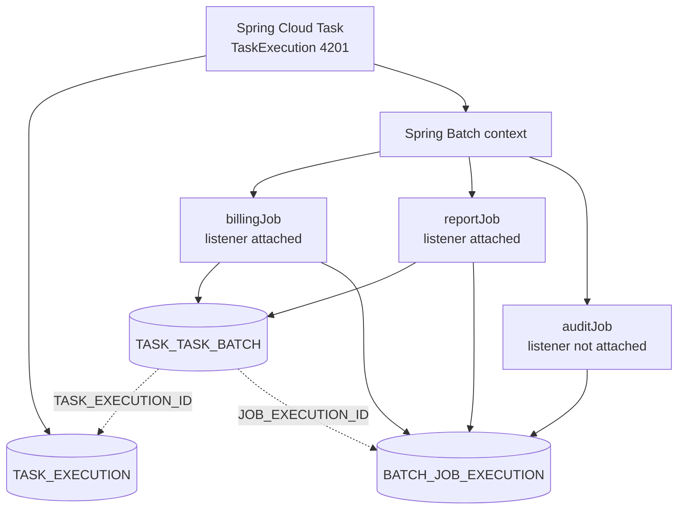

# Customizing the Scope of `TaskBatchExecutionListener`

## Learning Objectives

After this lesson, you will be able to:

- Explain the role of `TaskBatchExecutionListener` when Spring Cloud Task runs one or more Spring Batch `Job`s.
- Describe the default mechanism for attaching the listener to eligible Jobs and recognize the scope of `TaskBatchExecutionListenerBeanPostProcessor`.
- Restrict automatic listener attachment to **specified Jobs** using the `batchTaskExecutionListenerBeanPostProcessor` bean and `setJobNames(...)`.
- Distinguish the **bean ID** used to select Jobs receiving the listener, the **logical Job name**, and the configuration determining **which Job is actually launched**.
- Understand the impact of completely disabling Task–Batch linking, separately from Batch event emission and application outcome/exit codes.
- Verify behavior using `TASK_EXECUTION`, `TASK_TASK_BATCH`, `BATCH_JOB_EXECUTION`, and test success, failure, and retry paths.

> **Context:** This lesson belongs to the **Spring Batch** chapter of the **SPRING_CLOUD_TASK** module. Spring Cloud Task tracks finite-lived Spring Boot applications, recording timestamps, status, and outcomes of each run in `TaskRepository`. Spring Batch organizes processing by Job/Step and writes metadata to `JobRepository`. `TaskBatchExecutionListener` connects **a Batch Job run** to **the enclosing Task run**. Customizing listener scope is especially necessary when an application declares multiple Jobs but only wants a subset tracked under the Task–Batch relationship.

## 1. The Problem: One Task with Multiple Batch Jobs

Consider the `finance-nightly-task` application invoked on schedule or on demand. Within the same `ApplicationContext`, the application registers three Spring Batch beans:

| Bean ID | Illustrative Job Name | Purpose | Attach Task–Batch Link? |
| --- | --- | --- | --- |
| `billingJob` | `billingJob` | Settle transactions and calculate billing. | Yes. |
| `reportJob` | `reportJob` | Aggregate periodic reports. | Yes. |
| `auditJob` | `auditJob` | Independent internal audit/analysis. | No, per example requirements. |

Suppose Task run `4201` executes both `billingJob` and `auditJob`. With the default listener, if both Jobs are eligible and run, the Task–Batch bridge table can contain two associations. However, the business goal here is to automatically record links only for `billingJob` and `reportJob`; `auditJob` still runs normally and gets a `JobExecution` in the Batch repository, just without being linked by this listener.

The distinctions to keep clear:

1. **Job registered:** the `Job` bean exists in the Spring context.
2. **Job has listener attached:** configuration chooses to add `TaskBatchExecutionListener` to that Job.
3. **Job actually runs:** the Job is started by a launcher or Spring Boot, producing a `JobExecution`.
4. **Link persisted:** the executed Job's listener writes the Task–Batch ID pair to the bridge table.

A Job with the listener attached that **does not run** will not produce a new `JobExecution` just because of the listener. Conversely, a Job that runs **without the listener attached** still writes Batch metadata, yet normally will not create a `TASK_TASK_BATCH` row through this mechanism.

## 2. What Does `TaskBatchExecutionListener` Do?

A Spring Cloud Task execution is identified by `TaskExecution.executionId`. A Spring Batch Job execution is identified by `JobExecution.id`. These two numbers are generated by **two separate metadata systems** and should never be assumed equal.

`TaskBatchExecutionListener` hooks into the Job lifecycle to record the association between the two execution entities. When Task–Batch integration is properly configured and repositories are available, the association is saved in `TASK_TASK_BATCH` with the keys:

- `TASK_EXECUTION_ID`: Task execution ID.
- `JOB_EXECUTION_ID`: Batch Job execution ID.



The diagram illustrates listener attachment scope. Arrows into `TASK_TASK_BATCH` only produce rows when the corresponding Job **is executed** and the listener/repository operate properly.

### Distinguishing from Other Components

| Component | Responsibility | Decides Which Job Runs? |
| --- | --- | --- |
| `TaskBatchExecutionListener` | Observes and links `JobExecution` with `TaskExecution`. | No. |
| `TaskBatchExecutionListenerBeanPostProcessor` | Attaches the listener to eligible Job beans; can filter by bean name list. | No. |
| `TaskRepository` / `TaskExplorer` | Writes and reads Task lifecycle metadata. | No. |
| Spring Batch `JobRepository` | Writes JobInstance, JobExecution, StepExecution, parameters, and Batch status. | No. |
| `JobLauncher` or Spring Boot's auto-runner | Launches a Job with `JobParameters`. | Yes. |
| `spring.batch.job.name` / `spring.batch.job.enabled` | Controls Spring Boot's automatic Job launch behavior, depending on release. | Yes. |

**Do not treat the listener as a scheduler, JobLauncher, or Job orchestrator.** Likewise, restricting the listener does not delete Jobs, prevent Jobs from running, or automatically change Step/transaction structures.

## 3. Conditions and Default Behavior

According to the Spring Cloud Task–Batch integration mechanism documented by Spring Cloud Task, the listener is typically auto-configured when:

1. The context contains a Spring Batch `Job` bean.
2. The classpath includes the `spring-cloud-task-batch` module.
3. Task–Batch integration auto-configuration is enabled and required infrastructure beans are created successfully.

In the default configuration, `TaskBatchExecutionListener` is attached to **eligible Jobs** in the context. The bean post-processor handling this is `TaskBatchExecutionListenerBeanPostProcessor`. The API documentation notes that the processor attaches the listener to Job beans assignable to `AbstractJob`, so check whether custom/proxied Job classes fall within the supported scope for your release.

### Reference Maven Dependencies

A Task application with Spring Batch typically needs:

```xml
<dependencies>
    <dependency>
        <groupId>org.springframework.cloud</groupId>
        <artifactId>spring-cloud-starter-task</artifactId>
    </dependency>

    <dependency>
        <groupId>org.springframework.boot</groupId>
        <artifactId>spring-boot-starter-batch</artifactId>
    </dependency>

    <dependency>
        <groupId>org.postgresql</groupId>
        <artifactId>postgresql</artifactId>
        <scope>runtime</scope>
    </dependency>
</dependencies>
```

The project needs a **compatible** Spring Boot parent/BOM and Spring Cloud BOM; the snippet leaves versions unmanaged. In many releases, `spring-cloud-starter-task` already pulls in `spring-cloud-task-batch` transitively. Inspect the dependency tree rather than assuming you must declare that artifact twice:

```bash
./mvnw dependency:tree -Dincludes=org.springframework.cloud
```

Or with Gradle:

```bash
./gradlew dependencies --configuration runtimeClasspath
```

If the integration module is missing from the **runtime classpath**, the listener will not appear even if the application has `spring-boot-starter-batch`. Conversely, having the Task–Batch library does not generate `Job` beans if the application has not declared any.

## 4. Three Ways to Choose Listener Scope

There are three typical configurations:

| Goal | Mechanism | Expected Result |
| --- | --- | --- |
| Attach listener to all eligible Jobs | Use default auto-configuration. | Any Job that runs and has the listener attached can write Task–Batch links. |
| **Attach only to a specific list of Jobs** | Declare `batchTaskExecutionListenerBeanPostProcessor` and call `setJobNames(...)`. | Only selected Job beans receive the integration listener. |
| Attach to no Jobs at all | Disable listener/auto-configuration linking at the application level, depending on version. | Task and Batch keep their own metadata; bridge table is not updated via the automatic listener. |

An important distinction: a Job **omitted from the list** can still run and write `BATCH_JOB_EXECUTION`. Restricting the listener only alters traceability from Job to Task via this mechanism.

## 5. Primary Approach: Selecting Jobs with `setJobNames(...)`

Spring Cloud Task documentation shows how to customize the bean with the **exact name** `batchTaskExecutionListenerBeanPostProcessor`. Declare that bean post-processor and supply the list of **Job bean IDs**:

```java
package com.example.financetask.config;

import java.util.List;

import org.springframework.cloud.task.batch.configuration
        .TaskBatchExecutionListenerBeanPostProcessor;
import org.springframework.context.annotation.Bean;
import org.springframework.context.annotation.Configuration;

@Configuration(proxyBeanMethods = false)
public class TaskBatchListenerScopeConfiguration {

    @Bean(name = "batchTaskExecutionListenerBeanPostProcessor")
    public static TaskBatchExecutionListenerBeanPostProcessor
            batchTaskExecutionListenerBeanPostProcessor() {

        TaskBatchExecutionListenerBeanPostProcessor postProcessor =
                new TaskBatchExecutionListenerBeanPostProcessor();

        postProcessor.setJobNames(
                List.of("billingJob", "reportJob")
        );

        return postProcessor;
    }
}
```

### Line-by-Line Explanation

- `@Bean(name = "batchTaskExecutionListenerBeanPostProcessor")` names the bean according to the extension point documented by Spring Cloud Task. Creating an arbitrary bean of the same type under another name can result in **two post-processors** or fail to replace the default mechanism, depending on the release.
- A `static` method is appropriate when declaring a `BeanPostProcessor`: it lets Spring register it early without forcing premature instantiation of other beans in the same `@Configuration` class.
- `new TaskBatchExecutionListenerBeanPostProcessor()` creates the processor used to attach the listener via the library's mechanism.
- `setJobNames(List.of("billingJob", "reportJob"))` specifies **the selected Job beans**. In this example, `auditJob` is excluded.
- In versions with this API, this selection only affects listener attachment; it does not disable Jobs or alter `JobParameters`.

**Nature of the list:** the method is named `setJobNames`, yet the official documentation specifies the input as **Job bean IDs** in the Spring container. Do not blindly populate it with `@Bean` method names, `Job#getName()`, or class names when they differ; verify the actual bean IDs and confirm at runtime.

### When the Bean ID Differs from the Logical Job Name

Example:

```java
@Bean(name = "billingJobBean")
Job billingJob(JobRepository repository, Step billingStep) {
    return new JobBuilder("dailyBillingV2", repository)
            .start(billingStep)
            .build();
}
```

In this example:

| Item to Distinguish | Value |
| --- | --- |
| Bean ID in `ApplicationContext` | `billingJobBean` |
| `Job#getName()` | `dailyBillingV2` |
| Value for listener selection list per bean ID rule | `billingJobBean` |
| Job name when selecting for launch via Spring Boot config, depending on release | `dailyBillingV2` |

By keeping this distinction clear, you avoid configuring `setJobNames(List.of("dailyBillingV2"))` only for the post-processor to miss the `billingJobBean` bean. Never assume the bean factory method name, bean alias, and logical Job name always match.

### Bean Lifecycle Considerations

A `BeanPostProcessor` runs during the phase when Spring creates Job beans. Therefore, the list must be configured **before** Jobs are instantiated/post-processed. Calling `setJobNames` after the application has started does not re-attach or detach listeners on already created Jobs.

In environments with multiple `ApplicationContext`s, a post-processor's scope is normally the beans processed within the context containing that post-processor. If a Job is manually instantiated outside Spring, or lives in a different context, do not assume auto-injection applies.

## 6. Java Example: Three Jobs and Selective Listener Scope

This is a minimal example creating three real Jobs, each with a simple Step for observation. It uses Spring Batch 5 builder APIs and must be checked for compatibility if targeting Spring Batch 6.

### 6.1. Spring Cloud Task Application

```java
package com.example.financetask;

import org.springframework.boot.SpringApplication;
import org.springframework.boot.autoconfigure.SpringBootApplication;
import org.springframework.cloud.task.configuration.EnableTask;

@SpringBootApplication
@EnableTask
public class FinanceNightlyTaskApplication {

    public static void main(String[] args) {
        SpringApplication.run(FinanceNightlyTaskApplication.class, args);
    }
}
```

### 6.2. Declaring Three Jobs

```java
package com.example.financetask.config;

import org.springframework.batch.core.Job;
import org.springframework.batch.core.Step;
import org.springframework.batch.core.job.builder.JobBuilder;
import org.springframework.batch.core.repository.JobRepository;
import org.springframework.batch.core.step.builder.StepBuilder;
import org.springframework.batch.repeat.RepeatStatus;
import org.springframework.beans.factory.annotation.Qualifier;
import org.springframework.context.annotation.Bean;
import org.springframework.context.annotation.Configuration;
import org.springframework.transaction.PlatformTransactionManager;

@Configuration(proxyBeanMethods = false)
public class FinanceJobConfiguration {

    @Bean("billingStep")
    Step billingStep(JobRepository repository,
                     PlatformTransactionManager transactionManager) {
        return new StepBuilder("billingStep", repository)
                .tasklet((contribution, context) -> {
                    System.out.println("Billing complete");
                    return RepeatStatus.FINISHED;
                }, transactionManager)
                .build();
    }

    @Bean("reportStep")
    Step reportStep(JobRepository repository,
                    PlatformTransactionManager transactionManager) {
        return new StepBuilder("reportStep", repository)
                .tasklet((contribution, context) -> {
                    System.out.println("Report complete");
                    return RepeatStatus.FINISHED;
                }, transactionManager)
                .build();
    }

    @Bean("auditStep")
    Step auditStep(JobRepository repository,
                   PlatformTransactionManager transactionManager) {
        return new StepBuilder("auditStep", repository)
                .tasklet((contribution, context) -> {
                    System.out.println("Audit complete");
                    return RepeatStatus.FINISHED;
                }, transactionManager)
                .build();
    }

    @Bean("billingJob")
    Job billingJob(
            JobRepository repository,
            @Qualifier("billingStep") Step step) {
        return new JobBuilder("billingJob", repository)
                .start(step)
                .build();
    }

    @Bean("reportJob")
    Job reportJob(
            JobRepository repository,
            @Qualifier("reportStep") Step step) {
        return new JobBuilder("reportJob", repository)
                .start(step)
                .build();
    }

    @Bean("auditJob")
    Job auditJob(
            JobRepository repository,
            @Qualifier("auditStep") Step step) {
        return new JobBuilder("auditJob", repository)
                .start(step)
                .build();
    }
}
```

When combined with `TaskBatchListenerScopeConfiguration` from section 5:

- `billingJob` and `reportJob` are in the list receiving `TaskBatchExecutionListener`.
- `auditJob` is not in the list, so it does not automatically get that listener under the filter rule.
- All three Jobs can still run, and Spring Batch continues recording Job/Step metadata into `JobRepository`.

**Creating beans does not run all three Jobs.** A `Job` bean defines work; execution is the responsibility of a launcher or auto-runner. Subsequent steps use an explicit runner to verify the results cleanly.

### 6.3. Database Configuration

Example `application.yml` when `TaskRepository` and `JobRepository` share a PostgreSQL instance with pre-prepared schemas:

```yaml
spring:
  application:
    name: finance-nightly-task
  main:
    web-application-type: none
  datasource:
    url: jdbc:postgresql://localhost:5432/taskbatchdb
    username: ${TASK_BATCH_DB_USER}
    password: ${TASK_BATCH_DB_PASSWORD}
  cloud:
    task:
      initialize-enabled: false
      batch:
        listener:
          enabled: true
  batch:
    job:
      enabled: false
    jdbc:
      initialize-schema: never
```

This example uses a single datasource for clarity; **both the Task schema and Batch schema** must be created via release-matched migrations before running. `spring.batch.job.enabled=false` disables Spring Boot's automatic Job execution; in the next section, a dedicated runner invokes the launcher. `spring.cloud.task.batch.listener.enabled=true` keeps Task–Batch linking enabled, while the **list of attached Jobs** lives in `TaskBatchListenerScopeConfiguration`.

An in-memory database configuration works for learning in a single run, but is unsuitable when you need to trace exited Tasks across multiple sessions. When Task and Batch databases differ, configure both repositories explicitly and test the linking mechanism carefully; do not assume cross-database foreign keys exist.

## 7. Selecting Jobs to Run Differs from Selecting Jobs for Listener Attachment

One way to test scope is explicitly running Jobs via a `--jobs=...` argument. The illustration below assumes `JobLauncher` runs **synchronously**, and every run receives valid parameters. The application must ensure no automatic Job launcher runs in parallel.

```java
package com.example.financetask;

import java.util.Arrays;
import java.util.List;

import org.springframework.batch.core.BatchStatus;
import org.springframework.batch.core.Job;
import org.springframework.batch.core.JobExecution;
import org.springframework.batch.core.JobParameters;
import org.springframework.batch.core.JobParametersBuilder;
import org.springframework.batch.core.launch.JobLauncher;
import org.springframework.beans.factory.annotation.Qualifier;
import org.springframework.boot.ApplicationArguments;
import org.springframework.boot.ApplicationRunner;
import org.springframework.stereotype.Component;

@Component
public class SelectedJobsRunner implements ApplicationRunner {

    private final JobLauncher launcher;
    private final Job billingJob;
    private final Job reportJob;
    private final Job auditJob;

    public SelectedJobsRunner(
            JobLauncher launcher,
            @Qualifier("billingJob") Job billingJob,
            @Qualifier("reportJob") Job reportJob,
            @Qualifier("auditJob") Job auditJob) {
        this.launcher = launcher;
        this.billingJob = billingJob;
        this.reportJob = reportJob;
        this.auditJob = auditJob;
    }

    @Override
    public void run(ApplicationArguments args) throws Exception {
        List<String> values = args.getOptionValues("jobs");
        if (values == null || values.size() != 1) {
            throw new IllegalArgumentException(
                    "Pass exactly one --jobs=billing,report,audit");
        }

        List<String> selected = Arrays.asList(values.get(0).split(","));
        String businessDate = args.getOptionValues("business-date") == null
                ? null
                : args.getOptionValues("business-date").get(0);

        if (businessDate == null || businessDate.isBlank()) {
            throw new IllegalArgumentException(
                    "Missing --business-date=yyyy-MM-dd");
        }

        for (String name : selected) {
            Job job = switch (name.strip()) {
                case "billing" -> billingJob;
                case "report" -> reportJob;
                case "audit" -> auditJob;
                default -> throw new IllegalArgumentException(
                        "Unsupported job: " + name);
            };

            JobParameters parameters = new JobParametersBuilder()
                    .addString("businessDate", businessDate, true)
                    .toJobParameters();

            JobExecution execution = launcher.run(job, parameters);

            if (execution.getStatus() != BatchStatus.COMPLETED) {
                throw new IllegalStateException(
                        "Job failed: " + job.getName()
                        + ", status=" + execution.getStatus());
            }
        }
    }
}
```

The imports in the example use common Spring Batch 5, Spring Boot 3, and Java `switch` expression APIs; verify them on other versions. The example focuses on observing linking events, whereas production code also needs:

- Date validation with `LocalDate.parse(...)`, not just a blank check.
- Deduplicating Job names in `--jobs` to avoid running the same Job twice with identical parameters.
- Designing `JobParameters` rules for re-runs: a `COMPLETED` `JobInstance` may not be re-launched with the same identifying parameters.
- Waiting for completion status if `JobLauncher` is configured asynchronously.
- Halting, reporting errors, and handling retry policies rather than running subsequent Jobs when an earlier condition is unmet.

**Two distinct filters:** `--jobs=billing,audit` selects Jobs to **execute**; `setJobNames(List.of("billingJob","reportJob"))` selects Jobs to **attach the listener to**. Hence both `billingJob` and `auditJob` produce `JobExecution`s, yet only `billingJob` is expected to have a Task–Batch link created by the listener.

## 8. Three Scenarios and Expected Metadata Outcomes

After setting up the schema and both Java configurations, you can run:

```bash
java -jar finance-nightly-task.jar \
  --jobs=billing,report \
  --business-date=2026-11-24
```

Then run another execution for `audit` or `billing,audit`. With illustrative metadata:

| Task execution | Run list | Created `JobExecution`s | Records in `TASK_TASK_BATCH` |
| ---: | --- | --- | --- |
| `4201` | `billing,report` | `6101` billing; `6102` report | Links `4201↔6101` and `4201↔6102`. |
| `4202` | `audit` | `6103` audit | No link added for `auditJob` via the filtered listener. |
| `4203` | `billing,audit` | `6104` billing; `6105` audit | Link `4203↔6104`; no link `4203↔6105` via the filtered listener. |

These numbers are illustrative. When re-running the same Job with already completed identifying `JobParameters`, Spring Batch can prevent creating a new run (`JobInstanceAlreadyCompleteException`). In practice, choose a different business date per scenario or design `JobParameters` appropriately. **Do not blindly inject random parameters** just to bypass Batch's duplicate-prevention rule if business logic forbids reprocessing.

Also never treat an empty bridge table as proof that a Job did not run; the Job may have executed normally while excluded from the listener scope.

## 9. Queries to Verify Task–Batch Associations

With default tables in a shared database:

```sql
SELECT
    t.TASK_EXECUTION_ID,
    t.TASK_NAME,
    t.START_TIME,
    t.END_TIME,
    t.EXIT_CODE AS TASK_EXIT_CODE,
    x.JOB_EXECUTION_ID,
    j.STATUS AS JOB_STATUS,
    j.EXIT_CODE AS JOB_EXIT_CODE,
    i.JOB_NAME
FROM TASK_EXECUTION t
LEFT JOIN TASK_TASK_BATCH x
    ON x.TASK_EXECUTION_ID = t.TASK_EXECUTION_ID
LEFT JOIN BATCH_JOB_EXECUTION j
    ON j.JOB_EXECUTION_ID = x.JOB_EXECUTION_ID
LEFT JOIN BATCH_JOB_INSTANCE i
    ON i.JOB_INSTANCE_ID = j.JOB_INSTANCE_ID
WHERE t.TASK_EXECUTION_ID = 4201
ORDER BY x.JOB_EXECUTION_ID;
```

`LEFT JOIN` shows the Task even when no Job is linked. `BATCH_JOB_INSTANCE.JOB_NAME` is the logical Job name in Batch metadata, which may differ from the bean ID used in the post-processor. To confirm that a Job excluded from the listener **still ran**, query the Batch tables independently:

```sql
SELECT
    j.JOB_EXECUTION_ID,
    i.JOB_NAME,
    j.START_TIME,
    j.END_TIME,
    j.STATUS
FROM BATCH_JOB_EXECUTION j
JOIN BATCH_JOB_INSTANCE i
    ON i.JOB_INSTANCE_ID = j.JOB_INSTANCE_ID
WHERE i.JOB_NAME = 'auditJob'
ORDER BY j.JOB_EXECUTION_ID DESC;
```

If `auditJob` has rows in `BATCH_JOB_EXECUTION` without corresponding rows in `TASK_TASK_BATCH`, that is the **intended filtering behavior** in this lesson. Still, before concluding so, verify that the listener attached properly to the other Jobs and no repository or transaction errors occurred.

### One-to-Many Relationship Model

One `TaskExecution` can link to **multiple** `JobExecution`s; the same Job bean can also have multiple distinct runs. Therefore:

- Never join the two tables via `TASK_EXECUTION_ID = JOB_EXECUTION_ID`; they are independent key sequences.
- Never count Task runs with `COUNT(*)` over a multi-row join result.
- Never expect every `BATCH_JOB_EXECUTION` to have a Task link: it may have run outside a Task or outside the listener scope.
- Never infer Job success merely because a `TASK_TASK_BATCH` row exists. Job status lives in `JobRepository`.

## 10. Disabling Listener Attachment Completely

If you want to **avoid attaching `TaskBatchExecutionListener` to any Job** in the application, Spring Cloud Task provides a property controlling the linking feature in supporting releases:

```properties
spring.cloud.task.batch.listener.enabled=false
```

When using this property, verify the configuration documentation and runtime behavior for your exact release. It disables Task-provided linking between Tasks and Batch Jobs, not Spring Batch Job execution itself.

Documentation also describes disabling auto-configuration using Spring Boot's exclusion mechanism. However, excluding an entire auto-configuration class can affect other related beans, so pick configuration matching the required scope and re-test after upgrades.

| Configuration | Task Lifecycle | Batch Job | Task–Batch Link via Listener |
| --- | --- | --- | --- |
| Default listener enabled | Active. | Can run. | Attached to eligible Jobs. |
| `setJobNames(...)` filter | Active. | Both listed and unlisted Jobs can run. | Only selected Jobs. |
| `spring.cloud.task.batch.listener.enabled=false` | Active if Task configured properly. | Can run. | Automatic linking disabled. |
| `spring.batch.job.enabled=false` | Active. | Not **auto-launched** by Spring Boot; can still invoke `JobLauncher` manually. | Does not change the listener list by itself. |

Do not confuse `spring.batch.job.enabled=false` with "disabling Spring Batch." It only adjusts Spring Boot's automatic Job launch; Job beans, `JobRepository`, and `JobLauncher` still exist.

## 11. Distinguishing from Spring Batch Event Emission Configuration

Spring Cloud Task also integrates with Spring Cloud Stream to **publish event messages** from Jobs/Steps/Chunks. Event-emitting listeners serve a different purpose than `TaskBatchExecutionListener`, which links execution metadata.

| Property | Purpose | Filters Jobs Receiving `TaskBatchExecutionListener`? |
| --- | --- | --- |
| `spring.cloud.task.batch.listener.enabled` | Enables/disables Task–Batch metadata linking. | Yes, all-or-nothing. |
| `batchTaskExecutionListenerBeanPostProcessor` + `setJobNames(...)` | Restricts which **Job beans** receive the linking listener. | Yes, by bean list. |
| `spring.cloud.task.batch.events.enabled` | Enables/disables Batch event publishing via Stream integration when available. | No. |
| `spring.cloud.task.batch.events.job-execution.enabled` | Enables/disables JobExecution events published via Stream when available. | No. |
| `spring.cloud.task.batch.fail-on-job-failure` | Propagates Batch Job failures to Task result/exit code via supported mechanisms. | Not used to select Job beans. |

Example:

```properties
spring.cloud.task.batch.events.enabled=false
spring.cloud.task.batch.listener.enabled=true
```

These two lines intend to **suppress Batch event emission over Stream** while **still permitting the metadata-linking listener to attach**. Stream features only take effect when appropriate dependencies/binders and configurations are present. Never assume disabling one listener type disables all callbacks in Spring Batch.

## 12. Lifecycle, Ordering, and Custom Job Cases

### 12.1. When Are Job Beans Processed?

`TaskBatchExecutionListenerBeanPostProcessor` is a Spring `BeanPostProcessor`. It participates in bean lifecycle, so listener attachment depends on **how Jobs are created**:

- Spring-managed Job beans of an implementation type supported by the post-processor: evaluated during bean creation.
- Job beans absent from `setJobNames`: skipped by this filter for listener attachment.
- Job objects created with `new` and used outside the Spring context: not automatically post-processed just because a listener bean exists in the context.
- Jobs in a different context: verify whether the post-processor belongs to the context managing that Job.
- Custom Jobs not extending `AbstractJob`: do not assume the post-processor recognizes them, as API docs specify `AbstractJob`-compatible Job beans.

### 12.2. When Other Listeners Exist

A Spring Batch Job may already have `JobExecutionListener`s for auditing, timing, or error reporting. `TaskBatchExecutionListener` is a separate listener dedicated to linking metadata. Do not try to replace the Job's entire listener list when you only want to filter Task–Batch association.

If the application requires callback ordering across listeners, check the API and registration rules of your Spring Batch release. `@Order` on `ApplicationRunner` does not determine `JobExecutionListener` callback order; those are two separate ordering mechanisms.

### 12.3. Avoiding Duplicate Attachment

When the automatic post-processor is active, avoid accidentally registering **the same `TaskBatchExecutionListener`** again via `.listener(...)` in `JobBuilder` for that same Job. Duplicate linking callbacks can cause duplicate writes or unexpected errors depending on implementation/schema.

Meanwhile, the Javadoc for `TaskBatchExecutionListenerBeanPostProcessor` notes that the context expects **a single bean of type `TaskBatchExecutionListener`**. Manually defining multiple beans of that type can make auto-wiring ambiguous. Generally, use the documented post-processor extension point rather than constructing multiple listener instances yourself.

## 13. Listener Scope Differs from Transaction Scope and Data Access Permissions

Excluding `auditJob` from the listener **does not prevent it from executing**, nor does it restrict the Job's database read/write privileges. If the goal is preventing a Job from accessing sensitive tables, enforce it via **database permissions, credential configuration, and Job execution policies**.

Keep the layers of responsibility separate:

1. **Selecting which Job runs:** runner, `JobLauncher`, or auto-run configuration.
2. **Selecting which Job links to Task:** `TaskBatchExecutionListenerBeanPostProcessor` and the listener.
3. **Step transactions:** Spring Batch's transaction manager and rollback/retry policies.
4. **Recording Task metadata:** `TaskRepository`, `TASK_*` schema.
5. **Recording Batch metadata:** `JobRepository`, `BATCH_*` schema.
6. **Scheduler operations:** Kubernetes CronJob/Job or other orchestrator controlling timing, concurrency, and retries.

**Do not treat `TASK_TASK_BATCH` as a log guaranteeing exactly-once.** A Task retry gets a new `executionId` even with identical business parameters. Spring Batch `JobParameters` govern `JobInstance` identity, while idempotency must be designed around business keys and external effects.

## 14. Error Handling and Exit Codes When Listeners Are Filtered

Filtering the linking listener does not change a Job's success criteria. If `auditJob` fails, lacking a `TASK_TASK_BATCH` link **does not mean the failure can be ignored**.

In a custom runner invoking `JobLauncher`, inspect `JobExecution.status` after the Job finishes and propagate failures:

```java
JobExecution execution = jobLauncher.run(job, parameters);

if (execution.getStatus() != BatchStatus.COMPLETED) {
    throw new IllegalStateException(
            "Batch Job failed: " + job.getName()
            + ", status=" + execution.getStatus());
}
```

With synchronous Jobs, this check prevents the runner from returning normally when the Batch Job is `FAILED`. With an asynchronous launcher, wait for the Job to finish and inspect the final status before allowing the Task to report completion.

In supporting versions, you may also consider:

```properties
spring.cloud.task.batch.fail-on-job-failure=true
```

This property configures the policy for reflecting Job failures into Task/exit code outcomes; it is not an option for selecting Jobs to attach listeners. With custom designs and filtered Jobs, **test empirically** how the setting reflects failures on those Jobs. Inspecting `JobExecution` inside your own runner is recommended so you do not rely solely on a metadata-linking callback.

When closing a finite application, the following `main` pattern can propagate Spring Boot's exit code to the JVM if `SpringApplication.run` completes normally:

```java
ConfigurableApplicationContext context =
        SpringApplication.run(FinanceNightlyTaskApplication.class, args);

int exitCode = SpringApplication.exit(context);
System.exit(exitCode);
```

If `SpringApplication.run` throws an exception before returning a context, subsequent code does not execute along the normal path; observe the actual process exit code. `TaskExecution`, `JobExecution`, and the JVM exit code can diverge if exceptions are caught/swallowed or the process is killed.

## 15. Common Pitfalls and Troubleshooting

| Symptom | Possible Cause to Check | Resolution |
| --- | --- | --- |
| Every Job gets linked despite filtering | Custom post-processor bean did not replace the default bean, wasn't created in time, or a second processor exists. | Verify exact bean name and post-processor count at runtime; check release docs. |
| Only `auditJob` is absent from `TASK_TASK_BATCH` | May match the filter list; Job still ran. | Query `BATCH_JOB_EXECUTION` to distinguish "did not run" from "was not linked." |
| Desired Job did not receive listener | `setJobNames` used logical name instead of bean ID, or Job bean is an unsupported type. | Check actual bean ID, `AbstractJob`, and integration classpath. |
| No Task–Batch records at all | `spring.cloud.task.batch.listener.enabled=false`, missing `spring-cloud-task-batch`, missing schema/Job, or listener/repository error. | Check configuration, classpath, `Job` beans, `TaskRepository`, and SQL. |
| Job doesn't run even though listener is attached | `JobLauncher` not called, auto-run disabled, or wrong Job selected in Boot config. | Check launcher and `spring.batch.job.enabled`, `spring.batch.job.name`. |
| A Job runs twice | Both Boot auto-run and manual `JobLauncher` are active. | Pick one launch mechanism, guard via JobParameters and business locks. |
| Batch Job `FAILED`, scheduler sees success | Runner didn't check `JobExecution`, exception swallowed, or exit code not propagated. | Inspect Job status, Task exit code, and JVM exit code; add failure propagation. |
| `TASK_TASK_BATCH` has multiple rows for one Task | Task ran multiple JobExecutions; one-to-many relationship. | Join on exact keys; do not count joined rows as Task count. |
| Changing filter list after startup has no effect | Job beans already passed the BeanPostProcessor phase. | Set the list before context instantiates Jobs; restart app when changing config. |
| Links disappear after upgrade | API names, auto-configuration, Job bean types, or dependencies changed. | Check release docs/Javadoc, maintain integration tests verifying `TASK_TASK_BATCH`. |
| Custom Job not recognized | Implementation does not extend `AbstractJob` or proxy hides bean type. | Inspect runtime class and Job construction; adjust wiring per supported contract. |

## 16. Testing Listener Scope

To verify after every version change, build integration tests backed by **real `TaskRepository` and `JobRepository`** instances (such as a PostgreSQL test container). Isolate test data so it never affects production history.

### Minimum Test Matrix

| Scenario | Executed Job | Expected `TASK_TASK_BATCH` Link |
| --- | --- | --- |
| Default configuration, unfiltered | `billingJob` | Present when listener works normally. |
| Filter `billingJob,reportJob` | `billingJob` | Present. |
| Filter `billingJob,reportJob` | `reportJob` | Present. |
| Filter `billingJob,reportJob` | `auditJob` | No link created by this listener. |
| Filter active, run `billingJob` and `auditJob` in same Task | Both | Only `billingJob` link. |
| Disable `spring.cloud.task.batch.listener.enabled` | `billingJob` | No automatic link. |
| `auditJob` fails | `auditJob` | No link; Task/process must still report error per policy. |

### Practice Steps

1. Prepare `TASK_*` and `BATCH_*` schemas for your exact version; use a persistent store so you can query after the process exits.
2. Launch the Task with `--jobs=billing,report`, noting `TaskExecution.executionId` from listener logs or repository queries.
3. Verify `BATCH_JOB_EXECUTION` has two JobExecutions, `TASK_TASK_BATCH` has both corresponding links, and Task metadata is complete.
4. Run a new Task with `--jobs=audit` and a different date to avoid `JobInstanceAlreadyCompleteException`; verify the Batch Job actually ran without generating an automatic Task–Batch link.
5. Run a new Task with `--jobs=billing,audit`; confirm only one of the two JobExecutions is linked.
6. Test `spring.cloud.task.batch.listener.enabled=false` in a test environment; verify Jobs still run and separate Task/Batch data still exists.
7. Force a Job failure and inspect `BatchStatus`, `TaskExecution.exitCode` (if recorded), and the process exit code.
8. If using multiple `DataSource`s, check the `TaskRepository` and `JobRepository` targets separately. Never conclude a link was filtered out just because SQL ran against the wrong database.

### Avoiding Flawed Tests

- Never rely solely on `assertThat(job).isNotNull()`: a bean existing proves neither listener attachment nor execution.
- Never check only the "Batch Job completed" log line: cross-check `BATCH_JOB_EXECUTION` and `TASK_TASK_BATCH` records.
- Do not make Job name and bean ID identical in every test: include one case where bean ID differs from `Job#getName()` to confirm the filter respects the contract.
- Do not hardcode a fixed JobExecution ID; the database assigns new IDs on each run.
- Never manually edit/delete rows in `TASK_TASK_BATCH` to make a test "pass"; run scenarios that generate real data.

## 17. Practice Exercises

**Exercise 1 — Selective listener:** Create three beans `paymentJob`, `reportJob`, and `cleanupJob`. Configure the post-processor to select only `paymentJob` and `reportJob`. Run each Job in turn, record TaskExecution IDs and JobExecution IDs, and explain the differences in `TASK_TASK_BATCH`.

**Exercise 2 — Renaming a bean:** Rename the bean ID of `paymentJob` to `paymentJobBean` while keeping `Job#getName() = "paymentJob"`. Predict what happens if `setJobNames` stays unchanged. Fix the list and re-verify the outcome.

**Exercise 3 — Running and attaching are distinct:** With `spring.batch.job.enabled=false`, create a Job bean and include it in the listener list without **calling `JobLauncher`**. Identify which tables may contain Task metadata and why no `JobExecution` exists yet.

**Exercise 4 — Disabling completely:** Set `spring.cloud.task.batch.listener.enabled=false`. Run `billingJob` to completion and use SQL to prove both TaskExecution and JobExecution exist without a link created by `TaskBatchExecutionListener`.

**Exercise 5 — Unlinked Job failure:** Have `auditJob` (excluded from the listener list) throw an exception in its Step. Check whether the runner propagates the error to the JVM. Analyze why you must not rely on `TASK_TASK_BATCH` to detect all failed Jobs.

**Exercise 6 — Upgrade readiness check:** Compare the API documentation of your running Spring Cloud Task release against your `TaskBatchExecutionListenerBeanPostProcessor` setup. Verify package names, bean name, Job bean filtering, supported Job types, and re-run integration tests after upgrading.

## Key Takeaways

- `TaskBatchExecutionListener` links **Spring Batch `JobExecution`s** to **Spring Cloud Task `TaskExecution`s**, enabling traceability from a Job back to the application run.
- By default, the listener attaches to eligible Jobs when Task–Batch integration is active.
- To **select specific Jobs**, use the `batchTaskExecutionListenerBeanPostProcessor` bean with `setJobNames(...)` containing **Job bean IDs**.
- **Attaching the listener, launching Jobs, and publishing Batch events are three separate mechanisms**. Restricting the listener neither blocks Jobs from running nor alters outcomes or exit codes by itself.
- Verify using `TASK_EXECUTION`, `TASK_TASK_BATCH`, and `BATCH_JOB_EXECUTION`, especially for included Jobs, excluded Jobs, and failed Jobs.
- Always manage dependency/schema versions, design idempotency, and propagate business errors to the Task/process so orchestrators receive the right signal.

## References

- [Spring Cloud Task — Batch: Associating a Job Execution to the Task](https://docs.spring.io/spring-cloud-task/reference/batch.html)
- [Spring Cloud Task — TaskBatchExecutionListenerBeanPostProcessor API](https://docs.spring.io/spring-cloud-task/docs/current/apidocs/org/springframework/cloud/task/batch/configuration/TaskBatchExecutionListenerBeanPostProcessor.html)
- [Spring Cloud Task — Features and TaskRepository](https://docs.spring.io/spring-cloud-task/reference/features.html)
- [Spring Cloud Task — Spring Cloud Stream Integration](https://docs.spring.io/spring-cloud-task/reference/stream.html)
- [Spring Boot — Spring Batch](https://docs.spring.io/spring-boot/reference/io/spring-batch.html)
- [Spring Batch — Configuring a Job](https://docs.spring.io/spring-batch/reference/job/configuring.html)
- [Spring Batch — Metadata Schema](https://docs.spring.io/spring-batch/reference/schema-appendix.html)
