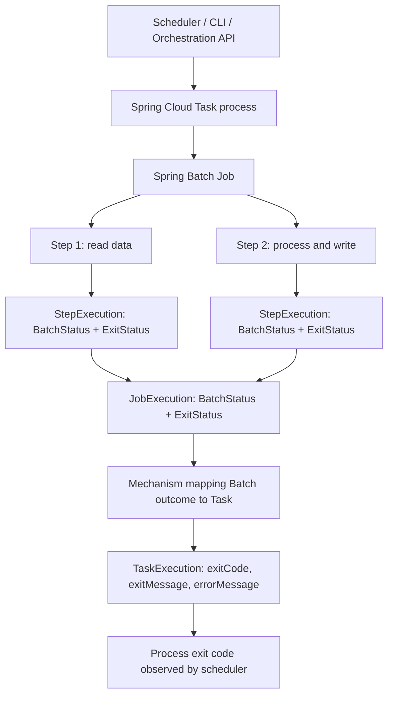

# Distinguishing BatchStatus, ExitStatus, and Task Exit Code in Spring Cloud Task

## 1. Context: One Unit of Work, Multiple Outcome Layers

**Spring Cloud Task** is used to build finite-lived Spring Boot applications—for example, nightly invoice imports, revenue aggregation, or on-demand report generation. Each Task run can be recorded in **`TaskRepository`** as a **`TaskExecution`** entry with start time, end time, and exit code.

When a Task invokes **Spring Batch**, the Batch framework also records **`JobExecution`** and **`StepExecution`** entries in **`JobRepository`**. Job/Step outcomes are represented by **`BatchStatus`** and **`ExitStatus`**. Those two statuses **do not automatically equate** to the Task's **numeric exit code**.

For example, suppose the `nightly-order-import` Task launches the `importOrders` Batch Job. At the second step, an invalid input file causes the Job to end with `BatchStatus.FAILED`. However, the runner launching the Batch Job might finish without throwing an exception outward, so Spring Boot/Spring Cloud Task may record **`TaskExecution.exitCode = 0`** under default behavior. A scheduler inspecting only the exit code would mistakenly conclude that the data import succeeded.

After this lesson in the **Spring Batch** chapter, you will be able to:

1. Interpret and distinguish **`BatchStatus`** (lifecycle state), **`ExitStatus`** (Job/Step outcome and flow-routing condition), and **`TaskExecution.exitCode`** (integer at the Task process level).
2. Explain why `FAILED` in Spring Batch does not necessarily produce a non-zero Task exit code.
3. Enable `spring.cloud.task.batch.fail-on-job-failure` or explicitly map outcomes when orchestrating manually.
4. Distinguish statuses across **Step**, **Job**, **Task**, and the process exit code observed by the orchestrator.
5. Design safe retry, restart, alerting, metadata querying, and custom status-handling policies.

## 2. Four Layers to Observe



| Layer | Tracking Unit | Key Fields | Who Uses It? |
| --- | --- | --- | --- |
| Spring Batch Step | `StepExecution` | `getStatus()`, `getExitStatus()`, read/write/skip/rollback counts | Batch flow, step-level error handling and investigation |
| Spring Batch Job | `JobExecution` | `getStatus()`, `getExitStatus()`, `getEndTime()` | JobRepository, Batch operations, and restart logic |
| Spring Cloud Task | `TaskExecution` | `getExitCode()` (numeric), `getExitMessage()`, `getErrorMessage()` | TaskRepository, dashboards, Task orchestration |
| OS / scheduler | JVM/container/Job process | **Process exit code** | Scheduling, retries, alerts, and pipeline termination |

**Key takeaway:** a single Task run can invoke **multiple Batch Jobs**; each Job has multiple Steps; each Step/Job has its own status. The system must have explicit rules deciding *which combination of outcomes* counts as Task success.

## 3. BatchStatus: Lifecycle State of a Job or Step

`BatchStatus` is a Spring Batch **enum**. It describes the **execution lifecycle**, not an arbitrary message. Both `JobExecution` and `StepExecution` expose `getStatus()`.

| Value | Meaning | Operational Guidance |
| --- | --- | --- |
| `STARTING` | Job/Step preparing to run | No final result yet |
| `STARTED` | Currently executing | Must not be treated as successful merely because a launcher returned |
| `STOPPING` | Stop request received, waiting for stop to finish | Monitor stop duration, do not launch overlapping runs |
| `STOPPED` | Stopped in a controlled manner | May need restart depending on config and state |
| `COMPLETED` | Completed according to the Job/Step flow definition | Typically cannot restart the same JobInstance after Job is `COMPLETED` |
| `FAILED` | Failed during execution | Investigate root cause; eligible for restart per Batch policy |
| `ABANDONED` | Marked abandoned, normally non-restartable | Handle per runbook; do not force re-execution |
| `UNKNOWN` | State cannot be determined clearly | Inspect metadata and logs before acting |

These values apply **at their respective entity level**. For instance, a `FAILED` Step does not automatically force the entire Job to be `FAILED` if the flow defines a special terminal branch. Conversely, a `COMPLETED` Job does not prove business data is valid if logic swallowed errors and reported success.

```java
// Reading info from a JobExecution created by Spring Batch.
BatchStatus jobStatus = jobExecution.getStatus();

if (jobStatus == BatchStatus.FAILED) {
    // Job is marked failed at the Spring Batch level.
}
if (jobStatus.isRunning()) {
    // Result is not final yet; do not label as succeeded.
}
```

`BatchStatus.isRunning()` identifies `STARTING`, `STARTED`, and `STOPPING`. Do not equate a running status in the repository with guaranteed process existence: a killed JVM can leave stale metadata behind.

## 4. ExitStatus: Customizable Result and Batch Flow Routing

`ExitStatus` is a Spring Batch **value object** containing:

- **`exitCode`**: a string, such as `"COMPLETED"`, `"FAILED"`, `"COMPLETED WITH SKIPS"`, or `"BUSINESS_WARNING"`.
- **`exitDescription`**: an optional descriptive string (which may hold error details), not the JVM's numeric exit code.

Common constants include `ExitStatus.COMPLETED`, `FAILED`, `STOPPED`, `UNKNOWN`, `EXECUTING`, and `NOOP`. Because `ExitStatus` can be constructed from custom strings, **never coerce `exitCode` to a number** or assume every value is an element of the `BatchStatus` enum.

| `BatchStatus` | Possible `ExitStatus.getExitCode()` | Explanation |
| --- | --- | --- |
| `COMPLETED` | `COMPLETED` | Normal success |
| `COMPLETED` | `COMPLETED WITH SKIPS` | Step finished but skipped records; code customized by listener/flow |
| `FAILED` | `FAILED` | Failure under normal rules |
| `FAILED` | `IMPORT_REJECTED` | Custom business code when Job/Step fails |
| `STOPPED` | `STOPPED` | Controlled stop |

Rows with custom codes are **examples of possible combinations**, not values that Spring Batch assigns automatically to every Job.

### 4.1. Flow `on(...)` Evaluates ExitStatus, Not BatchStatus

In Spring Batch's flow builder DSL, the condition:

```java
// Flow configuration excerpt, not a full @Configuration class.
.start(readStep).on("COMPLETED WITH SKIPS").to(reviewStep)
.from(readStep).on("*").to(writeStep)
.end()
```

is matched against **`readStep.getExitStatus().getExitCode()`**, not directly against `readStep.getStatus()`. That is why a Step can finish with `BatchStatus.COMPLETED` yet branch to a step handling skipped records.

Example listener marking a Step as "completed with skips":

```java
package com.example.batch;

import org.springframework.batch.core.ExitStatus;
import org.springframework.batch.core.listener.StepExecutionListener;
import org.springframework.batch.core.step.StepExecution;
import org.springframework.stereotype.Component;

@Component
public class SkipAwareStepListener implements StepExecutionListener {

    @Override
    public ExitStatus afterStep(StepExecution stepExecution) {
        if (stepExecution.getStatus() ==
                    org.springframework.batch.core.BatchStatus.COMPLETED
                && stepExecution.getSkipCount() > 0) {
            return new ExitStatus("COMPLETED WITH SKIPS");
        }
        return null; // Preserve the existing exit status.
    }
}
```

This example follows **Spring Batch 6.x APIs** (corresponding to Spring Boot 4.x) and must be **attached to the Step** when configuring the Step. `afterStep` returns an `ExitStatus` combined by Spring Batch with the current exit status; returning `null` preserves the existing value. In Spring Batch 5.x, packages for classes like `StepExecution` and `JobExecution` may differ; verify APIs against your actual BOM.

**Do not alter `BatchStatus` just to attach a warning label.** Keep `COMPLETED` when the workflow met its completion criteria; use `ExitStatus` and `skip` counts to describe completion quality.

### 4.2. Job and Step Can Have Different Outcomes

Spring Batch allows flows to use `end()`, `fail()`, or `stopAndRestart(...)` branches. For example, if a processing Step fails and the flow transitions to an `end()` branch, the Job can be marked **`BatchStatus.COMPLETED`** even though an earlier Step was `FAILED`. Once a Job is `COMPLETED`, that same JobInstance typically **cannot be restarted** in the usual way.

When configuring branches, distinguish:

- `end()`: terminates the Job with status **`COMPLETED`**, appropriate when a Step error is considered acceptable by business rules.
- `fail()`: marks the Job **`FAILED`**, allowing restart consideration per Batch rules.
- `stopAndRestart(...)`: stops the Job and specifies the resume point on restart.

Never use `end()` to "hide" unhandled errors just to turn a dashboard green. Choosing complete, fail, or stop affects both how the scheduler retries and how Spring Batch manages restarts.

## 5. Task Exit Code: An Integer Determined at the Spring Boot Level

When running Spring Cloud Task, `TaskExecution.exitCode` is an **`Integer`** and can be `null` while the Task is still running. In normal cases:

- `0` indicates normal completion when the application signals no error.
- `1` is commonly used for errors not mapped to a specific code.
- Other codes, such as `2` or `3`, follow **application-specific conventions** via Spring Boot/Spring Cloud Task exit code mechanisms.

`TaskExecution.exitMessage` holds an exit message (which can be set via `TaskExecutionListener`), while `TaskExecution.errorMessage` usually contains a stack trace for failures captured by the lifecycle. **These are not** `JobExecution.getExitStatus()` or `StepExecution.getExitStatus()`.

| Value | Type | Example | Do Not Confuse With |
| --- | --- | --- | --- |
| `JobExecution.status` | `BatchStatus` enum | `FAILED` | JVM exit code |
| `JobExecution.exitStatus.exitCode` | `String` | `"IMPORT_REJECTED"` | `TaskExecution.exitCode` |
| `StepExecution.exitStatus.exitCode` | `String` | `"COMPLETED WITH SKIPS"` | `BatchStatus.COMPLETED` |
| `TaskExecution.exitCode` | `Integer` | `1` | String `"FAILED"` |
| Process exit code | Number received by OS/scheduler | `1` | Batch `EXIT_CODE` column, which stores a **string** |

Spring Boot provides `ExitCodeGenerator` and `ExitCodeExceptionMapper` to determine exit codes in corresponding situations. When propagating outcomes to the OS, ensure the **entrypoint/launcher actually returns that code**. Especially when launching a Task with a custom runner, verify both the code stored in `TaskRepository` and the code received by the scheduler separately.

### A Frequently Confusing Flow

```text
Task starts, Batch Job runs.
Data-import Step throws error -> StepExecution.status = FAILED.
Flow does not treat it as an accepted branch -> JobExecution.status = FAILED.
Job launcher returns JobExecution (with FAILED), without necessarily throwing.
Application runner completes normally.
Spring Cloud Task may record TaskExecution.exitCode = 0 (default).
Scheduler sees only code 0 -> misinterprets as success.
```

**This is why a bridge between Batch outcomes and the Task is essential.** Do not expect `TaskExecutionListener.onTaskFailed` to automatically catch every `BatchStatus.FAILED`: if the error is only recorded as Batch status without propagating into the Task lifecycle, the Task failure callback may never fire.

## 6. Standard Approach: Enabling fail-on-job-failure in Spring Cloud Task

The official Spring Cloud Task documentation states that to make a Batch Job ending with **`BatchStatus.FAILED`** cause the Task application to return a non-zero exit code, you can enable:

```yaml
spring:
  main:
    web-application-type: none
  cloud:
    task:
      batch:
        fail-on-job-failure: true
```

Full property: **`spring.cloud.task.batch.fail-on-job-failure=true`**. The documented default is **`false`**. When enabled, Spring Cloud Task uses the appropriate Batch execution/inspection mechanism to mark the Task failed if a tracked Batch Job has `BatchStatus.FAILED`; the default failure code is typically `1` or determined by a configured `ExitCodeGenerator`.

**Prerequisites:**

1. The project genuinely integrates Batch with Spring Cloud Task. You need the **`org.springframework.cloud:spring-cloud-task-batch`** dependency alongside the corresponding Batch/Task starters.
2. `Job`s are launched by Spring Boot/Spring Cloud Task within a supported lifecycle; when managing `JobOperator` and runners yourself, understand the launch path and Task state.
3. Spring Boot, Spring Batch, and Spring Cloud Task versions must be BOM-compatible. Do not pin separate Batch or Task versions without clear justification.
4. Verify **process exit code and metadata** on your exact deployed version. Do not assume merely adding the dependency guarantees the scheduler receives the right code under all packaging setups.

Example **Maven** dependencies (`dependencies` block excerpt, assuming `pom.xml` imports the BOMs):

```xml
<dependencies>
    <dependency>
        <groupId>org.springframework.boot</groupId>
        <artifactId>spring-boot-starter-batch</artifactId>
    </dependency>
    <dependency>
        <groupId>org.springframework.cloud</groupId>
        <artifactId>spring-cloud-starter-task</artifactId>
    </dependency>
    <dependency>
        <groupId>org.springframework.cloud</groupId>
        <artifactId>spring-cloud-task-batch</artifactId>
    </dependency>
</dependencies>
```

Equivalent **Gradle Groovy DSL** example, assuming BOMs are imported:

```groovy
dependencies {
    implementation 'org.springframework.boot:spring-boot-starter-batch'
    implementation 'org.springframework.cloud:spring-cloud-starter-task'
    implementation 'org.springframework.cloud:spring-cloud-task-batch'
}
```

Dependencies alone are not enough to run a Job: you need valid `Job`/`Step` definitions, appropriate `JobRepository` and `TaskRepository`, a datasource, and prepared schemas. In production, manage schemas via migrations rather than relying on in-memory H2 for history.

### 6.1. How Does Spring Boot Auto-Launch a Batch Job?

When Spring Boot auto-configures Spring Batch and finds a `Job`, Boot can run the Job at application startup. If multiple Jobs exist, select one with `spring.batch.job.name` to avoid running the wrong Job:

```yaml
spring:
  batch:
    job:
      name: importOrders
  cloud:
    task:
      batch:
        fail-on-job-failure: true
```

Do not write an additional `ApplicationRunner` that manually launches the Job while auto-run remains enabled, as this risks **launching the Job twice** or triggering `JobInstanceAlreadyCompleteException`. If you choose manual launching, explicitly **disable auto-run** with `spring.batch.job.enabled=false` and implement your own status-translation rules (see section 7).

Spring Cloud Task documentation also mentions `spring.cloud.task.batch.fail-on-job-failure-poll-interval` (default **5000 ms**) for the polling interval inspecting JobExecutions when fail-on-job-failure is active. This is a **Batch status polling interval**, not a Job schedule, not a timeout, and not a Job retry interval.

```yaml
spring:
  cloud:
    task:
      batch:
        fail-on-job-failure: true
        fail-on-job-failure-poll-interval: 5000
```

**Scope of the property:** documentation describes mapping **`BatchStatus.FAILED`** to Task failure. Do not assume it automatically turns every custom `ExitStatus`, `STOPPED`, `UNKNOWN`, or unmonitored asynchronous Job into an application exit code according to your custom policy.

## 7. When the Application Launches Jobs Manually: Check Outcomes Before Deciding Task Status

Some Tasks accept custom arguments, select among multiple Jobs, or run Batch under custom rules. In such cases, you can **build your own bridge** from `JobExecution` to Task failure. Choose strictly **one** launch mechanism so it does not collide with auto-run.

### 7.1. Example Inspecting Status from JobOperator

The code below illustrates **Spring Batch 6.x**, using `JobOperator.start(Job, JobParameters)` (the recommended API replacing `JobLauncher`, which was deprecated in Batch 6). It assumes `JobOperator` is configured **synchronously**, so when `start` returns, `JobExecution` has already finished. If using an asynchronous `JobOperator`, wait/poll status from `JobRepository` before evaluating; do not immediately treat `STARTED` as failure.

```java
package com.example.taskbatch;

import org.springframework.batch.core.BatchStatus;
import org.springframework.batch.core.job.Job;
import org.springframework.batch.core.job.JobExecution;
import org.springframework.batch.core.job.parameters.JobParameters;
import org.springframework.batch.core.job.parameters.JobParametersBuilder;
import org.springframework.batch.core.launch.JobOperator;
import org.springframework.boot.ApplicationRunner;
import org.springframework.context.annotation.Bean;
import org.springframework.context.annotation.Configuration;

@Configuration
public class ManualBatchRunnerConfiguration {

    @Bean
    ApplicationRunner runDailyImport(JobOperator jobOperator, Job importOrders) {
        return arguments -> {
            // Illustrative only: real data must come from validated input.
            JobParameters parameters = new JobParametersBuilder()
                .addString("businessDate", "2026-11-24", true)
                .toJobParameters();

            JobExecution result = jobOperator.start(importOrders, parameters);

            // Example REQUIRES synchronous JobOperator.
            // If STARTED/STARTING/STOPPING: must wait per custom policy.
            if (result.getStatus().isRunning()) {
                throw new IllegalStateException(
                    "Job has not finished; must track final outcome"
                );
            }

            if (result.getStatus() != BatchStatus.COMPLETED) {
                throw new IllegalStateException(
                    "Batch Job did not complete: id=" + result.getId()
                    + ", batchStatus=" + result.getStatus()
                    + ", exitStatus=" + result.getExitStatus().getExitCode()
                );
            }
        };
    }
}
```

The class above is **just a runner configuration**, excluding `Job`/`Step` beans, DataSource, starters, and the main class. In `application.yml`, **disable Batch auto-run**:

```yaml
spring:
  batch:
    job:
      enabled: false
  cloud:
    task:
      batch:
        fail-on-job-failure: false
```

In this manual path, the runner throws an exception when the Job is not `COMPLETED`; Spring Boot/Spring Cloud Task receives the error signal and can record a non-zero `exitCode`. Alternatively, map errors via `ExitCodeExceptionMapper`/`ExitCodeGenerator` per application conventions. **Never enable both Batch orchestration paths simultaneously, and never catch the exception and exit normally.**

**Items to fix before real deployment:**

- `businessDate` must come from parsed/validated arguments; do not hardcode a fixed date or attach random parameters on every restart.
- If `JobOperator` is **asynchronous**, wait for the Job to complete by periodically polling `JobRepository` with timeouts and controlled cancellation. Throwing `IllegalStateException` immediately when a Job is `STARTED` is an **illustrative fail-fast policy**, not a proper monitoring strategy for async jobs.
- If multiple Jobs exist, evaluate **all** Jobs according to a documented policy (e.g., "succeed only when all are COMPLETED").
- If a Job is `COMPLETED` yet `ExitStatus` is `COMPLETED WITH SKIPS` or `BUSINESS_WARNING`, decide whether that is acceptable success or requires raising an alert/business failure. Do not blindly convert every custom ExitStatus into a Task failure.

### 7.2. Choosing a Business-Driven Success Policy

Example mapping table **defined by a team**, not framework defaults:

| Batch Job Outcome | Desired Task Outcome | Action |
| --- | --- | --- |
| `BatchStatus.COMPLETED`, `ExitStatus.COMPLETED` | Code `0` | No retry |
| `BatchStatus.COMPLETED`, `ExitStatus.COMPLETED WITH SKIPS` | Code `0` with alert, or dedicated warning code | Inspect skip count and business threshold |
| `BatchStatus.FAILED` | Code `1` or error-specific code | Investigate, controlled retry/restart |
| `BatchStatus.STOPPED` | Non-zero code per stop convention | Inspect stop history and restart point |
| `BatchStatus.UNKNOWN` / `ABANDONED` | Non-zero code, intervention required | Do not blind-retry |
| `STARTING` / `STARTED` / `STOPPING` | **No final result yet** | Monitor, enforce wait timeout |

With default `fail-on-job-failure=true`, rely only on what Spring Cloud Task **documents** (catching `FAILED`); other cases need explicit monitoring or custom mapping if your system considers them failures.

## 8. Safely Writing and Reading Custom ExitStatus Values

You can write a `StepExecutionListener` to distinguish a clean `COMPLETED` from `COMPLETED WITH SKIPS`. However:

1. `ExitStatus` is a value object, not the `BatchStatus` enum.
2. `StepExecutionListener.afterStep` can return an `ExitStatus` merged with the current status. Returning `null` leaves the exit status unchanged.
3. Flow patterns like `.on("COMPLETED WITH SKIPS")` must match **the exact code produced by the listener**.
4. The final `JobExecution.exitStatus` is determined by the **overall flow**; it can differ from an individual Step's exit status.
5. When using custom exit codes to signal a scheduler, map them to **distinct numeric codes** at the Task layer or CLI runner rather than expecting the OS to understand `"COMPLETED WITH SKIPS"`.

When persisting explanations, `ExitStatus.getExitDescription()` is Batch-level description; `TaskExecution.exitMessage` is Task-level description; `TaskExecution.errorMessage` is typically a stack trace written by the Task lifecycle on unhandled exceptions. They have **different writers and security considerations**.

## 9. Querying Jobs and Tasks in the Database

With the default JDBC schema, Spring Cloud Task manages `TASK_EXECUTION` and the bridge table `TASK_TASK_BATCH`. Spring Batch maintains its own tables, such as `BATCH_JOB_EXECUTION` and `BATCH_STEP_EXECUTION`. The bridge table traces a JobExecution back to the Task execution that invoked it when `spring-cloud-task-batch` and `TaskBatchExecutionListener` are configured.

### 9.1. Viewing Job and Task Results Together

```sql
SELECT
    t.TASK_EXECUTION_ID,
    t.TASK_NAME,
    t.START_TIME  AS TASK_START_TIME,
    t.END_TIME    AS TASK_END_TIME,
    t.EXIT_CODE   AS TASK_EXIT_CODE,
    j.JOB_EXECUTION_ID,
    j.STATUS      AS JOB_BATCH_STATUS,
    j.EXIT_CODE   AS JOB_EXIT_STATUS_CODE,
    j.EXIT_MESSAGE AS JOB_EXIT_DESCRIPTION
FROM TASK_EXECUTION t
JOIN TASK_TASK_BATCH link
  ON link.TASK_EXECUTION_ID = t.TASK_EXECUTION_ID
JOIN BATCH_JOB_EXECUTION j
  ON j.JOB_EXECUTION_ID = link.JOB_EXECUTION_ID
WHERE t.TASK_EXECUTION_ID = :taskExecutionId
ORDER BY j.JOB_EXECUTION_ID;
```

Note: **`BATCH_JOB_EXECUTION.EXIT_CODE` stores the string code** of `ExitStatus`, whereas **`TASK_EXECUTION.EXIT_CODE` stores the numeric exit code** of the Task. Identical column names do not mean identical data types. One `TASK_EXECUTION_ID` can return multiple rows if the Task ran multiple Jobs.

### 9.2. Finding a Failed Job Where the Task Reported 0

```sql
SELECT
    t.TASK_EXECUTION_ID,
    t.TASK_NAME,
    t.EXIT_CODE AS TASK_EXIT_CODE,
    j.JOB_EXECUTION_ID,
    j.STATUS AS BATCH_STATUS,
    j.EXIT_CODE AS BATCH_EXIT_STATUS
FROM TASK_EXECUTION t
JOIN TASK_TASK_BATCH link
  ON link.TASK_EXECUTION_ID = t.TASK_EXECUTION_ID
JOIN BATCH_JOB_EXECUTION j
  ON j.JOB_EXECUTION_ID = link.JOB_EXECUTION_ID
WHERE j.STATUS = 'FAILED'
  AND t.EXIT_CODE = 0;
```

If this query returns rows, first check `fail-on-job-failure`, how Jobs are launched, runner ordering, and whether exceptions were caught and ignored. In multi-Job or asynchronous systems, also verify whether the Task **waited properly for the final outcomes** of all Jobs.

### 9.3. Inspecting Steps to Find Root Cause

```sql
SELECT
    STEP_EXECUTION_ID,
    STEP_NAME,
    STATUS,
    EXIT_CODE,
    READ_COUNT,
    WRITE_COUNT,
    READ_SKIP_COUNT,
    PROCESS_SKIP_COUNT,
    WRITE_SKIP_COUNT
FROM BATCH_STEP_EXECUTION
WHERE JOB_EXECUTION_ID = :jobExecutionId
ORDER BY STEP_EXECUTION_ID;
```

These SQL queries assume default table/column names and `:...` named parameters per JDBC/framework conventions. If custom table prefixes or schemas are used, adjust names accordingly. Never run `SELECT *` exposing full error messages or parameters on public dashboards: metadata may contain internal or sensitive data.

## 10. Retries, Restarts, and Divergent Terminal States

A **Task retry** (the scheduler spawns a new process) differs from a **Batch Job restart** (Spring Batch opens a new `JobExecution` for the same `JobInstance` based on identifying JobParameters).

| Scenario | Action to Consider |
| --- | --- |
| Job `FAILED` due to transient connection error | Restart or retry with backoff; verify transactions/checkpoints |
| Job `FAILED` due to bad parameters | Fix input; do not retry with the exact bad parameters |
| Job `STOPPED` intentionally | Identify restartable point; do not treat as success |
| Job `COMPLETED` with permitted skipped records | Task may succeed alongside warning metrics |
| Job `COMPLETED` but user wants to re-run same JobParameters | Typically throws `JobInstanceAlreadyCompleteException`; understand JobInstance identity |
| Job `ABANDONED` or `UNKNOWN` | Inspect metadata; do not force restart |
| Task killed with no final result | Cross-check container/scheduler/logs and recovery procedures; do not infer solely from `endTime` |

**Never pass random parameters just to "bypass" JobInstance identity** when your goal is restarting a failed Job properly. Choose business-meaningful identifying JobParameters (e.g., report date + tenant) and use Spring Batch's restart mechanism when appropriate. If you must re-run a `COMPLETED` Job to regenerate outputs, intentionally design a new JobInstance and guarantee idempotency.

When a Task runs multiple Batch Jobs, explicitly define the aggregation rule: "all complete," "allow specific Jobs to skip," or "fail if critical Job fails." Also account for side effects like file uploads, notifications, or database writes that occur after the Batch Job finishes but before the Task process exits.

## 11. Common Pitfalls

| Symptom | Possible Cause | Where to Check |
| --- | --- | --- |
| Batch Job `FAILED` yet Task `exitCode=0` | Bridge not enabled or runner did not signal failure | Check `spring-cloud-task-batch`, `fail-on-job-failure`, and Job runner |
| Step `COMPLETED` yet `ExitStatus` carries warning | Listener produced a custom code | Check `getExitStatus().getExitCode()` and skip count |
| One Step `FAILED` yet Job `COMPLETED` | Flow handled branch via `end()` | Check `on(...)`/`end()`/`fail()` DSL and business semantics |
| Job still `STARTED` yet Task reports success | Job launched async, Task did not wait | Check `JobOperator`/TaskExecutor, polling/timeouts |
| Job runs twice on startup | Both Spring Boot auto-run and custom runner launch Job | Keep one mechanism; set `spring.batch.job.enabled=false` if launching manually |
| Scheduler sees success despite error in repository | Launcher/entrypoint did not propagate exit code properly | Check process exit code, container config, and shell script |
| Retrying Job with same params throws already complete | Previous JobInstance already `COMPLETED` | Distinguish restart from new run |
| Dashboard confuses `BATCH_JOB_EXECUTION.EXIT_CODE` and `TASK_EXECUTION.EXIT_CODE` | Same column name, different data types | Alias as `JOB_EXIT_STATUS_CODE` and `TASK_EXIT_CODE` in SQL/DTOs |

### Verifying Against Your Exact Version

A verification test plan can include:

1. Create a Job with a Step that always succeeds and a branch that throws a test error. Use a persistent datasource to observe metadata.
2. Run with `fail-on-job-failure=false`, read `JobExecution.status`, `ExitStatus`, and `TaskExecution.exitCode`. Also record the process exit code received by the scheduler.
3. Enable `fail-on-job-failure=true` and run a **new valid JobInstance**. Compare all four outcomes.
4. Add a `StepExecutionListener` producing `COMPLETED WITH SKIPS`; verify `.on(...)` matches this string code.
5. Test `STOPPED`, timeout, or asynchronous operator cases; define explicit policies instead of assuming `fail-on-job-failure` handles everything.
6. With multiple Jobs, run one succeeding Job and one failing Job; cross-check `TASK_TASK_BATCH` and the final Task outcome.

Run tests against the exact versions pinned in your Spring Boot/Spring Cloud BOM. A successful build alone does not prove the scheduler observes the right exit code or that `TaskRepository` stays complete when a JVM is killed.

## 12. Exercises and Self-Assessment

**Exercise 1 — Fill in the outcome table.** For each scenario, predict `BatchStatus`, `ExitStatus`, and the Task exit code according to policy:

| Scenario | Question |
| --- | --- |
| Step completes with no skips | How many fields carry the value `COMPLETED`? |
| Step completes but skips 3 records | Why can `BatchStatus` still be `COMPLETED`? |
| Job fails, `fail-on-job-failure` disabled | Must Task return code 1? |
| Job fails, `fail-on-job-failure` enabled | Which mechanism determines the Task code? |
| Job `STOPPED` | Why shouldn't you assume a property targeting `FAILED` handles this automatically? |

**Exercise 2 — Write a listener.** Create a `StepExecutionListener` returning `"COMPLETED WITH SKIPS"` when skip count exceeds 0. Configure a flow branching to a skip-reporting Step and inspect the final `JobExecution.exitStatus`.

**Exercise 3 — Test outcome mapping.** With a Job throwing an error, run twice on new JobInstances: first with `spring.cloud.task.batch.fail-on-job-failure` off, second with it on. Record Batch metadata, Task metadata, and OS exit code. Explain every difference.

**Exercise 4 — Restart.** Create a chunk-oriented Job that fails midway; use appropriate Batch policies to restart. Compare `JobInstance`, `JobExecution`, and `TaskExecution` across both runs, verifying no duplicate imports occur.

**Exercise 5 — Multi-Job orchestration.** A Task runs `validateOrders` and `persistOrders`; the first Job succeeds with warnings while the second fails. Propose an aggregation policy and status-reporting approach for the scheduler.

### Self-Check Questions

- Is `BatchStatus` an enum or an arbitrary user-created string? Can `ExitStatus` hold custom codes?
- Does `.on("FAILED")` in a Batch flow match against `BatchStatus` or `ExitStatus`?
- Why can `JobOperator.start(...)` return a `FAILED` `JobExecution` without throwing a business exception to the runner?
- Which cases does `spring.cloud.task.batch.fail-on-job-failure` address? Why must `STOPPED` and custom `ExitStatus` be verified separately?
- When should `spring.batch.job.enabled=false` be used?
- What is the difference between retrying with a new Task process and restarting the same Batch JobInstance?

**Completion criteria:** You can distinguish statuses across Step/Job/Task levels, correctly read `String` and `Integer` exit codes, configure failure propagation when Batch Jobs fail, reconcile actual process exit codes with metadata, and propose safe restart/retry strategies.

## Official References

- [Spring Batch — Controlling Step Flow: BatchStatus versus ExitStatus](https://docs.spring.io/spring-batch/reference/step/controlling-flow.html).
- [Spring Batch — The Domain Language of Batch](https://docs.spring.io/spring-batch/reference/domain.html): JobExecution, StepExecution, and metadata.
- [Spring Cloud Task — Batch: Batch Job Exit Codes](https://docs.spring.io/spring-cloud-task/reference/batch.html): `TaskBatchExecutionListener` and `fail-on-job-failure`.
- [Spring Cloud Task — Features / TaskExecution](https://docs.spring.io/spring-cloud-task/reference/features.html): `exitCode`, `exitMessage`, and `errorMessage`.
- [Spring Boot — Spring Batch Auto-configuration](https://docs.spring.io/spring-boot/reference/io/spring-batch.html): `spring.batch.job.enabled` and `spring.batch.job.name`.
- [Spring Batch 6 — JobOperator API](https://docs.spring.io/spring-batch/reference/api/org/springframework/batch/core/launch/JobOperator.html): launching and receiving `JobExecution`.
- [Spring Batch 6 — StepExecutionListener API](https://docs.spring.io/spring-batch/reference/api/org/springframework/batch/core/listener/StepExecutionListener.html): customizing Step `ExitStatus`.
