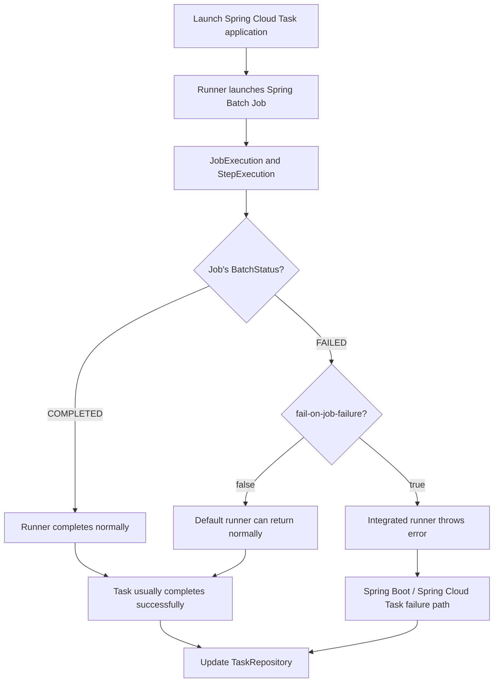
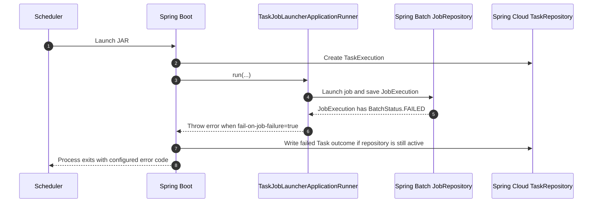

# `spring.cloud.task.batch.fail-on-job-failure`: Failing the Task When a Spring Batch Job Fails

## 1. The Problem: Batch Job Fails Yet the Task Reports Success

In the **Spring Cloud Task** module, a finite-lived Spring Boot application can launch one or more **Spring Batch jobs**. Spring Batch handles data processing by job/step, managing transactions, checkpoints, and per-run states. Spring Cloud Task tracks the **task application** lifecycle through `TaskExecution` in `TaskRepository`.

The two frameworks observe different scopes. Consequently, a situation can occur where a data-reading step fails, **`JobExecution` receives `BatchStatus.FAILED`**, yet the runner launching the job returns normally; Spring Boot finishes startup without throwing an unhandled exception outward, causing the Spring Cloud Task run to be **recorded as successful**.

This is dangerous when a scheduler or Kubernetes Job relies solely on the process exit code to decide whether to run the next step. An import job failed, yet the pipeline proceeds to reconcile, send reports, or delete source files.

To address this scenario, Spring Cloud Task provides the property:

```properties
spring.cloud.task.batch.fail-on-job-failure=true
```

When Batch/Task integration is properly configured, this property **translates a job ending in `BatchStatus.FAILED` into a failure path for the Task application**, so the Task exit code can be non-zero (typically `1` by default). This is the focus of this lesson in the **Spring Batch** chapter.

After this lesson, you will know when to enable the property, how the integrated runner works, how to apply it to a minimal batch job, how to inspect metadata across both repositories, how it differs from `ExitStatus`, and its limitations under asynchronous execution or custom job-launching logic.

## 2. Understanding the Three Status Layers

A single launch of `order-import-task` can produce the following records:

| Layer | Component | Example Status | Meaning |
| --- | --- | --- | --- |
| Spring Batch — step | `StepExecution` | `FAILED` | One step of the job failed during execution. |
| Spring Batch — job | `JobExecution` with `BatchStatus` | `FAILED` | The entire job ended in failure. |
| Spring Cloud Task | `TaskExecution` with `exitCode` | `0` or `1` | Recorded outcome of the **task application run**. |
| Operating system / orchestrator | Process exit code | `0`, non-zero | Signal received by the shell, Job, or scheduler when the JVM exits. |

Key distinctions:

- **`BatchStatus`** is Spring Batch's execution state, e.g., `STARTING`, `STARTED`, `COMPLETED`, `FAILED`, `STOPPING`, `STOPPED`, `ABANDONED`, `UNKNOWN`.
- **`ExitStatus`** is a result carrying a string code, e.g., `COMPLETED`, `FAILED`, or an application-defined value. `ExitStatus` can differ from `BatchStatus`'s perspective.
- **`TaskExecution.exitCode`** is an integer; it is not `JobExecution.getExitStatus().getExitCode()`, since Batch exit codes are typically strings.
- **Process exit code** is received by the operating system; it is commonly used for retries/alerts but can be influenced by how the JVM shuts down or how the orchestrator handles errors.

**`spring.cloud.task.batch.fail-on-job-failure` focuses on `BatchStatus.FAILED`.** It does not mean every non-`COMPLETED` `ExitStatus` or every run with skipped items automatically turns into a Task failure.



The diagram depicts the standard flow when Spring Boot auto-launches a Batch job. If the application also has custom runners, other exceptions, or a custom job-launching mechanism, verify the outcome against your actual implementation.

## 3. How Does `fail-on-job-failure` Work?

### 3.1. Default Value `false`

According to Spring Cloud Task's configuration reference, `spring.cloud.task.batch.fail-on-job-failure` defaults to **`false`**. With the default Batch/Boot runner mechanism, Batch can persist `JobExecution` as `FAILED` without necessarily throwing an exception to Spring Boot. Absent any other errors, Spring Cloud Task can record `TaskExecution.exitCode = 0`.

The reason is that **Spring Batch already recorded the job failure in `JobRepository`**, while Spring Cloud Task observes application state at the runner/lifecycle level. A job's failure record does not automatically become an application exception without an appropriate propagation mechanism.

### 3.2. Setting `true`: Turning Batch Failure into Task Failure

When the property is **`true`** and integration auto-configuration is active, Spring Cloud Task uses a Batch-aware runner to inspect the outcomes of launched jobs. If a job has `BatchStatus.FAILED`, the runner throws an error; Spring Boot handles it via its failure path and Spring Cloud Task attempts to persist a non-zero result in metadata.

Code `1` is the default failure value described in the documentation. Applications can customize exit codes via mechanisms such as `ExitCodeGenerator`/`ExitCodeExceptionMapper`, depending on the execution path and version. Do not assume every failure in every environment returns exactly `1`: **measure the process exit code and read `TaskExecution.exitCode`**.

### 3.3. Behavior Comparison Table

| Batch Job Outcome | `fail-on-job-failure=false` | `fail-on-job-failure=true` |
| --- | --- | --- |
| `BatchStatus.COMPLETED` | Task normally succeeds unless another error occurs. | Task normally succeeds unless another error occurs. |
| `BatchStatus.FAILED` due to step error while runner returns normally | Task **may** record `0` despite Batch failing. | Integrated runner signals failure; Task can record a non-zero code. |
| Context or database startup failure before job runs | Application can fail regardless of this property. | Application can fail regardless of this property. |
| Job launched entirely via custom code | Depends on custom result-checking code. | **Do not assume** the property automatically monitors every application-invoked `JobLauncher`. |
| Job `COMPLETED` with `SKIPPED` items | Depends on business policy and Batch config. | Not automatically turned into `FAILED` merely due to skipped items. |
| Job `STOPPED`/`UNKNOWN` | Depends on stop mechanism and runner. | Do not assume it is handled like `BatchStatus.FAILED`; define explicit rules. |

Most importantly: **enabling the property handles one specific error-propagation path**; it does not replace all policies defining what constitutes an acceptable business outcome.

## 4. Which Runner Performs the Batch Job Check?

In Spring Cloud Task versions integrating with Spring Boot Batch, this mechanism uses **`TaskJobLauncherApplicationRunner`** in place of Spring Boot's default `JobLauncherApplicationRunner` when job-failure reporting is enabled. The integrated runner launches jobs and checks `JobExecution`.

This explains why toggling a single property produces a clear difference without editing job code. When the runner throws an error upon seeing `BatchStatus.FAILED`, the error flows through Boot's lifecycle, where Spring Cloud Task can update `TaskExecution`.



**Version note:** current Spring Cloud Task documentation describes an `ApplicationRunner`-based runner. Some older docs reference `CommandLineRunner` and `spring.cloud.task.batch.command-line-runner-order`. When upgrading or following older examples, always cross-check the documentation for your exact Spring Boot/Spring Cloud Task release line.

### 4.1. `application-runner-order`: Runner Ordering

When multiple `ApplicationRunner` or `CommandLineRunner` beans exist, **execution order** can affect data preparation, when the Batch job runs, and the final result. For the integrated runner, the following property is documented:

```yaml
spring:
  cloud:
    task:
      batch:
        application-runner-order: 0
```

The common default is **`0`**. If you need to adjust ordering, examine the other runners and related dependencies carefully; never change it merely to mask bugs or force a job to run before data is ready.

### 4.2. `fail-on-job-failure-poll-interval`: Check Interval

Spring Cloud Task also documents the property:

```yaml
spring:
  cloud:
    task:
      batch:
        fail-on-job-failure-poll-interval: 5000
```

The unit is **milliseconds**; the documented default is **`5000`**, or roughly **5 seconds**. It controls the wait interval while the infrastructure checks for completed `JobExecution`s, which is especially relevant when using a `JobLauncher` backed by an asynchronous `TaskExecutor`.

This value is **not an overall job timeout** and **does not limit retry counts**. If a job hangs, a small poll interval will not fix it; you need timeouts, shutdown policies, and monitoring in Batch or the orchestrator.

## 5. Conditions for the Property to Take Effect

Before expecting a `BatchStatus.FAILED` to fail the entire Task, verify:

1. **Compatible Spring Boot and Spring Cloud Task versions.** Spring Cloud Task dependencies must be managed via a BOM compatible with Boot.
2. **Spring Batch on the classpath**, and the application has at least one `Job` bean launched via a Spring Boot/Task-supported mechanism.
3. **`spring-cloud-task-batch` integration present** per your version's guidance. Task–Batch linking depends on the corresponding integration library.
4. **Batch auto-launch still active.** If `spring.batch.job.enabled=false`, the job may not auto-launch; the property does not fail a job that never ran.
5. **Do not replace the integrated runner with a custom launch path that forgets to check outcomes.** When calling `JobLauncher` manually, inspect `JobExecution` and propagate errors yourself if needed.
6. **Appropriate repositories and schemas.** `TaskRepository` and `JobRepository` require metadata tables and working database connectivity.

For a simple Batch application, you can declare `spring-boot-starter-batch`, `spring-cloud-starter-task`, the version-matched `spring-cloud-task-batch` integration, and a JDBC driver. Some starters bring transitive dependencies; inspect your project's actual dependency tree to avoid duplicates or incompatible versions.

When using Spring Boot auto-configuration, do not rush to add `@EnableBatchProcessing` just to "enable Batch": in several versions, that annotation alters auto-configuration behavior. The example below lets Spring Boot create the default Batch infrastructure from the configured DataSource.

## 6. Example Task Application Configuration Running a Batch Job

Suppose we need to import daily orders. Goal: when the order-import step fails, the entire `order-import-task` run must be marked failed so the scheduler does not proceed with downstream steps.

### 6.1. `application.yml`

```yaml
spring:
  application:
    name: order-import-worker
  main:
    web-application-type: none
  cloud:
    task:
      name: order-import-task
      batch:
        fail-on-job-failure: true
        # Default 5000 ms; adjust only for operational needs.
        fail-on-job-failure-poll-interval: 5000
  batch:
    job:
      enabled: true
  datasource:
    url: ${TASK_DB_URL}
    username: ${TASK_DB_USER}
    password: ${TASK_DB_PASSWORD}
```

Key settings:

- `spring.cloud.task.name` lets you look up `TaskExecution` history under the name `order-import-task`.
- `spring.cloud.task.batch.fail-on-job-failure: true` activates failure reporting when a Batch job ends with `BatchStatus.FAILED`.
- `spring.batch.job.enabled: true` indicates that this example expects Spring Boot to auto-launch the job on startup (defaults can depend on config and version).
- `spring.datasource` points to the metadata database. If Task and Batch share one DataSource, the database requires **both the Spring Cloud Task schema and the Spring Batch schema**; they are two distinct sets of tables.

The variables `TASK_DB_URL`, `TASK_DB_USER`, and `TASK_DB_PASSWORD` are supplied from the environment or a secret manager. Never pass real passwords in launch commands or commit them to the repository. In production, create tables via controlled migrations rather than relying on DDL privileges on the runtime account.

### 6.2. Java Application with a Failure-Simulating Job/Step

The example below uses **Spring Batch 5** API style (`JobBuilder` and `StepBuilder` taking an explicit `JobRepository`); choose compatible Boot/Task versions. This is a complete Java class for the job/step portion; the project still requires the dependencies and schemas described above.

```java
import org.springframework.batch.core.Job;
import org.springframework.batch.core.Step;
import org.springframework.batch.core.job.builder.JobBuilder;
import org.springframework.batch.core.repository.JobRepository;
import org.springframework.batch.core.step.builder.StepBuilder;
import org.springframework.batch.repeat.RepeatStatus;
import org.springframework.beans.factory.annotation.Value;
import org.springframework.boot.SpringApplication;
import org.springframework.boot.autoconfigure.SpringBootApplication;
import org.springframework.cloud.task.configuration.EnableTask;
import org.springframework.context.annotation.Bean;
import org.springframework.transaction.PlatformTransactionManager;

@SpringBootApplication
@EnableTask
public class OrderImportTaskApplication {

    public static void main(String[] args) {
        SpringApplication.run(OrderImportTaskApplication.class, args);
    }

    @Bean
    Job importOrdersJob(JobRepository jobRepository, Step importOrdersStep) {
        return new JobBuilder("importOrdersJob", jobRepository)
            .start(importOrdersStep)
            .build();
    }

    @Bean
    Step importOrdersStep(
            JobRepository jobRepository,
            PlatformTransactionManager transactionManager,
            @Value("${demo.fail:false}") boolean simulateFailure) {

        return new StepBuilder("importOrdersStep", jobRepository)
            .tasklet((contribution, chunkContext) -> {
                if (simulateFailure) {
                    throw new IllegalStateException(
                        "Simulated order import error");
                }

                // TODO: replace with real order import and validation logic.
                System.out.println("Orders imported successfully");
                return RepeatStatus.FINISHED;
            }, transactionManager)
            .build();
    }
}
```

When `demo.fail=false`, the tasklet finishes normally, and the step and job can complete with `BatchStatus.COMPLETED`. When `demo.fail=true`, the exception inside the tasklet puts the step and job into `FAILED` status via the normal Batch flow.

The key point is that **Spring Batch can catch the step's exception and save the failed status into `JobRepository` before the runner returns**. Therefore, for the entire Task to report failure, something must inspect `JobExecution`. In this example, the integrated runner with `fail-on-job-failure=true` performs that step.

Do not call `System.exit(1)` inside a tasklet to simulate errors: doing so can bypass metadata persistence and resource cleanup. Throw an exception inside the tasklet and let Batch/Task execute controlled shutdown steps.

## 7. Practicing Both Success and Failure Scenarios

First, prepare a database with both metadata schemas and build the JAR. Then run each scenario separately.

### 7.1. Successful Batch Job

```bash
java -jar order-import-task.jar --demo.fail=false run.id=success-001
```

Expected: `importOrdersJob` has `BatchStatus.COMPLETED`, the Task records successful completion metadata if no other error occurs, and the process typically exits with `0`.

### 7.2. Failed Batch Job with the Property Enabled

```bash
java -jar order-import-task.jar --demo.fail=true run.id=failed-001
```

Expected: the step throws an exception, `JobExecution` is recorded as `FAILED`, the integrated runner signals failure; Spring Cloud Task attempts to record the failed execution, and the orchestrator observes a non-zero process exit code per Boot and runtime configuration.

### 7.3. Comparing with the Property Disabled

```bash
java -jar order-import-task.jar \
  --spring.cloud.task.batch.fail-on-job-failure=false \
  --demo.fail=true \
  run.id=failed-without-propagation-001
```

Under the default runner configuration and with no other uncaught exceptions escaping, Batch still records the job failure while the Task **can** finish with `exitCode=0`. This is the exact situation the property resolves.

**Parameter syntax distinction:** arguments starting with `--` (such as `--demo.fail=true`) are **Spring Boot environment properties**. Strings without `--`, like `run.id=failed-001`, can be converted by the Batch runner into **JobParameters**. Different `run.id` values create separate job instances for testing. When you want to **restart a specific failed job**, do not change all identifying parameters arbitrarily: Spring Batch distinguishes `JobInstance` by job name and identifying job parameters, and restarts follow strict rules.

To observe the process exit code on Linux/macOS, run `echo $?` **immediately after the Java command**; on PowerShell, check `$LASTEXITCODE`. Running log checks or database queries in between can make you confuse the check command's exit code with Java's exit code.

## 8. Inspecting Outcomes in Both Metadata Stores

Spring Cloud Task and Spring Batch maintain independent metadata models:

| Repository | Primary Records | What to Inspect |
| --- | --- | --- |
| `TaskRepository` | `TaskExecution` | `taskName`, `executionId`, run timestamps, `exitCode`, application errors. |
| `JobRepository` | `JobExecution`, `StepExecution` | `BatchStatus`, `ExitStatus`, step errors, read/write/skip counts, and checkpoints. |

With the standard JDBC schema, you can query task history:

```sql
SELECT TASK_EXECUTION_ID,
       TASK_NAME,
       START_TIME,
       END_TIME,
       EXIT_CODE,
       EXIT_MESSAGE,
       ERROR_MESSAGE
FROM TASK_EXECUTION
WHERE TASK_NAME = 'order-import-task'
ORDER BY TASK_EXECUTION_ID DESC;
```

And query Batch job runs:

```sql
SELECT JOB_EXECUTION_ID,
       STATUS,
       EXIT_CODE,
       EXIT_MESSAGE,
       START_TIME,
       END_TIME
FROM BATCH_JOB_EXECUTION
ORDER BY JOB_EXECUTION_ID DESC;
```

In the standard Spring Cloud Task integration schema, the **`TASK_TASK_BATCH`** table stores the relationship between `TASK_EXECUTION_ID` and `JOB_EXECUTION_ID`. If both sets of tables reside in the same database/schema and the linking listener is enabled, you can use this reference SQL:

```sql
SELECT t.TASK_EXECUTION_ID,
       t.TASK_NAME,
       t.EXIT_CODE AS TASK_EXIT_CODE,
       j.JOB_EXECUTION_ID,
       j.STATUS AS BATCH_STATUS,
       j.EXIT_CODE AS BATCH_EXIT_STATUS
FROM TASK_EXECUTION t
JOIN TASK_TASK_BATCH link
  ON link.TASK_EXECUTION_ID = t.TASK_EXECUTION_ID
JOIN BATCH_JOB_EXECUTION j
  ON j.JOB_EXECUTION_ID = link.JOB_EXECUTION_ID
WHERE t.TASK_NAME = 'order-import-task'
ORDER BY t.TASK_EXECUTION_ID DESC;
```

The SQL is illustrative: table/column names and data types must match your version's schema. If `TaskRepository` and `JobRepository` reside in **two different databases**, this JOIN may not execute directly; query each source separately and correlate via IDs recorded by the listener or orchestrator.

**Never equate `TASK_EXECUTION_ID` with `JOB_EXECUTION_ID`.** They are generated and managed by two separate repositories. Nor should you treat `TaskExecution.exitCode = 0` as proof that business output meets quality standards; always validate target data.

## 9. How Does `BatchStatus.FAILED` Differ from `ExitStatus.FAILED`?

Spring Batch has both **`BatchStatus`** (processing lifecycle state) and **`ExitStatus`** (result code for flow routing/logic). In many simple jobs, both show `FAILED` when a step throws an error. However, cases exist where they diverge:

- A job finishes with `BatchStatus.COMPLETED` while an application-assigned `ExitStatus` is `COMPLETED WITH SKIPS` to indicate skipped records.
- A step experiences errors handled by a skip policy, and the job still ends with `BatchStatus.COMPLETED` per configured rules.
- A job is requested to stop and ends as `STOPPED`, which differs from `FAILED` operationally and in restart semantics.
- An application defines a custom `ExitStatus` to drive flow branching without altering how `BatchStatus` is assigned on every step.

**The `fail-on-job-failure` property is not a data-quality validator.** It relies on the job having `BatchStatus.FAILED` within the documented integration mechanism. If business rules consider `COMPLETED WITH SKIPS` unacceptable, add explicit policy: for instance, force the job to become `FAILED` when skipped records exceed a threshold, or map the outcome to the application exit code yourself.

| Outcome | Automatically Treated as Error by Property? | Action to Consider |
| --- | --- | --- |
| `BatchStatus.FAILED` | **Yes**, when the integrated runner is active. | Inspect exception/failing step, decide on restart/retry. |
| `COMPLETED` with some skipped items | **Not necessarily.** | Check acceptance threshold and skipped records. |
| `STOPPED` due to operator request | **Not treated as `FAILED` by default.** | Build appropriate stop and restart policies. |
| `UNKNOWN` or inconsistent metadata | Requires further inspection. | Verify database, logs, process state, and business data. |

## 10. Asynchronous Batch Execution Cases

A `JobLauncher` backed by an asynchronous `TaskExecutor` can return a `JobExecution` while the job is still running. If the runner exits before the job finishes without waiting for the outcome, Spring Cloud Task can record application success **prematurely**.

In supporting versions, `TaskJobLauncherApplicationRunner` accounts for `TaskExecutor` usage by monitoring `JobExecution`s to detect failures. `fail-on-job-failure-poll-interval` tunes the frequency of these checks.

Even so, when spawning custom threads, invoking `JobLauncher` from another runner, or altering context closure, **do not assume** the property monitors every asynchronous workload. Ensure one of these strategies:

1. Configure the runner to execute jobs **synchronously** and return only after the job finishes.
2. If running asynchronously, **wait for and verify the terminal status** with an appropriate mechanism before letting the Task exit.
3. When a separate worker/process continues after the parent application exits, use an orchestrator tracking that worker directly; never equate "request submitted" with "processed successfully."

A poll interval **does not replace a deadline**: if a job hangs indefinitely, you need job timeouts, alerts, and recovery rules. Do not set a tiny interval just to detect failures faster; that creates unnecessary metadata read load.

## 11. Multiple Batch Jobs in One Task

An application might contain `importOrdersJob`, `reconcilePaymentsJob`, and `publishReportJob`. When launched by the integrated runner and one job ends with `BatchStatus.FAILED`, enabling `fail-on-job-failure` can fail the whole Task. With a synchronous runner, the first failure can stop subsequent jobs from launching; with an asynchronous mechanism, the runner may start multiple jobs and evaluate their outcomes.

This is **not** a full-featured workflow engine. If the requirement is "run B only after A succeeds," use Spring Batch job flows or an orchestrator with explicit dependencies. Do not rely on `Job` bean ordering or arbitrary runner order as a substitute for business rules.

When multiple jobs exist, specify which job is allowed to run at startup in the way supported by your Spring Boot/Batch version—such as `spring.batch.job.name` in compatible Boot releases. Not every `Job` bean needs to execute on every launch.

## 12. Safe Re-execution When a Job Fails

Enabling the property helps because the scheduler receives a failure signal. Nevertheless, **a non-zero exit code does not automatically make the next retry safe**. Distinguish two execution layers:

- **Task relaunch:** the scheduler starts a new process, and Spring Cloud Task typically creates a **new `TaskExecution`**.
- **Spring Batch restart:** a failed job can be re-run with the same **identifying `JobParameters`** to create a new `JobExecution` under the same `JobInstance`, resuming from checkpoints/state saved in the Batch repository if the job is designed to be restartable.

For example, the import task for `2026-11-23` fails at item 7,000 of 10,000. If Batch restarts from a checkpoint, already committed chunks need not be reprocessed depending on design. If the scheduler re-runs with a new `run.id`, Spring Batch treats it as a **new job instance** and starts over from the beginning. Therefore, never append a timestamp or UUID to identifying job parameters on every retry merely to "bypass" already-run errors.

The application must enforce **idempotency** on data writes: unique constraints, upserts, business-key checks, or imported-file tracking strategies. If the job sends external requests, you may need idempotency keys and post-timeout reconciliation.

Cap retries in both Spring Batch and the scheduler. A Batch step retrying four times combined with three Task relaunches can result in up to twelve attempts calling the same service, not counting HTTP client retries. Operations teams must define retryable errors, backoff, deadlines, and alert thresholds.

## 13. Common Configuration Pitfalls

| Symptom | Possible Cause | How to Check |
| --- | --- | --- |
| Job `FAILED` yet Task `exitCode=0` | Property not loaded, default runner still used, or job launched via custom path. | Check effective config, runner beans, Batch and Task logs. |
| Property enabled yet no job runs | `spring.batch.job.enabled=false`, missing `Job` bean, missing Batch dependency, or wrong job selected. | Check auto-configuration, `Job` list, and job name. |
| Missing `TaskExecution` | Context failed before TaskRepository could create a record. | Inspect startup errors, datasource, schema, and process exit code. |
| Missing `JobExecution` | Batch job never launched or `JobRepository` unavailable. | Check `BATCH_JOB_EXECUTION`, job launcher config, and Batch schema. |
| Both records exist but cannot JOIN | `TaskRepository` and `JobRepository` use different databases, or linking listener did not run. | Check `TASK_TASK_BATCH`, listener config, and DataSource separation. |
| Job `COMPLETED` yet business output falls short | Skip/exit status rules were not mapped to `BatchStatus.FAILED`. | Inspect skip counts, exit description, and data acceptance criteria. |
| Task finishes while background job still runs | Custom runner launched async and returned early. | Wait for `JobExecution` completion or monitor at the orchestrator. |
| Property enabled and Task fails because job completed earlier | Reused identical identifying `JobParameters` for an already `COMPLETED` instance. | Inspect `JobInstance`; decide between creating a new instance or restarting the failed one. |
| After upgrade, runner order property no longer works as before | Using property name from an older release line or runner changed. | Check APIs and documentation for your exact version. |
| Scheduler retries infinitely after job failure | Scheduler retry policy lacks limits or error classification. | Configure max attempts, backoff, deadlines, and alerting. |

## 14. Deployment and Observability Checklist

- [ ] `spring.cloud.task.batch.fail-on-job-failure: true` is enabled in the effective configuration of environments requiring Batch failure propagation.
- [ ] Compatible Spring Batch, Spring Cloud Task, and Batch integration modules are present.
- [ ] The integrated runner manages the job launch path, or the application explicitly checks/propagates errors on custom paths.
- [ ] Both metadata schemas (`TASK_*`, `BATCH_*`) exist in a database that persists after the process exits.
- [ ] `BatchStatus`, `ExitStatus`, `TaskExecution.exitCode`, and process exit codes are clearly distinguished.
- [ ] At least two scenarios have been tested: a succeeding job and a step throwing an exception causing the job to be `FAILED`.
- [ ] Outcomes match across `BATCH_JOB_EXECUTION`, `TASK_EXECUTION`, logs, and the shell/scheduler.
- [ ] If running asynchronously, the runner waits for job completion with an appropriate timeout.
- [ ] Batch restarts are designed with stable identifying parameters and proper checkpoints; business data duplication on retries is prevented.
- [ ] The orchestrator enforces attempt limits, error classification, and alerts when retry budgets exhaust.

### Recommended Test Matrix

| Scenario | Expected `BatchStatus` | Task Outcome to Verify |
| --- | --- | --- |
| Normal job, property `true` | `COMPLETED` | Task normally succeeds. |
| Job with tasklet throwing exception, property `true` | `FAILED` | Task fails; non-zero code if metadata update and propagation succeed. |
| Job with tasklet throwing exception, property `false` | `FAILED` | Task may still succeed when default runner throws no error. |
| Job `COMPLETED` with skips | `COMPLETED` | Property does not redefine business success. |
| Job running on a separate thread without awaiting | May still be `STARTED` | Risk of premature Task completion; add synchronization/monitoring. |
| Repository unreachable | Records may be missing | Inspect logs, exit code, and orchestrator state. |

## 15. Self-Check

**Question 1.** Why can a `JobExecution` with `BatchStatus.FAILED` still accompany a `TaskExecution.exitCode=0` when using the default runner?

**Question 2.** What is the default value of `spring.cloud.task.batch.fail-on-job-failure`? When enabled, which Batch condition causes the integrated runner to signal an error?

**Question 3.** Do `BatchStatus.FAILED` and an `ExitStatus` with code `COMPLETED WITH SKIPS` mean the same thing? Does the property automatically treat any job with skips as failed?

**Question 4.** Is `fail-on-job-failure-poll-interval=5000` a five-second maximum timeout, or the wait interval between checks?

**Question 5.** A job is already `COMPLETED` for day D's identifying parameters. Why is re-launching the exact same job with those parameters not the same as restarting a `FAILED` job?

**Question 6.** In an integrated Spring Batch and Spring Cloud Task system, can `TASK_EXECUTION_ID` alone be used to guess `JOB_EXECUTION_ID`?

**Answer hints:** (1) Batch records failure status in its repository, but the default runner may not throw an exception; (2) `false`, the documented condition is `BatchStatus.FAILED`; (3) no, and the property does not evaluate skip thresholds on its own; (4) a check interval in milliseconds, not a timeout; (5) a completed job instance cannot simply be re-run like a failed instance—appropriate job parameters/restart policies are required; (6) no, you must trace through linking metadata or tracking mechanisms.

## 16. Summary

**`spring.cloud.task.batch.fail-on-job-failure` lets Spring Batch job failures affect the outcome of the Spring Cloud Task application.** Its default is `false`; setting `true` enables the integrated runner to signal failure when a job ends with `BatchStatus.FAILED`, giving the Task a non-zero exit code instead of treating it as successful despite Batch failing.

The value of this property lies in ensuring **schedulers, dashboards, and operational workflows do not overlook a failed job**. Still, you must verify the right runner, schemas, `JobExecution` and `TaskExecution` statuses, asynchronous launch paths, OS exit codes, and retry policies. For applications with stricter data requirements than `BatchStatus.FAILED`, add explicit business validation rules rather than relying solely on a configuration flag.

**Official documentation to consult by version:**

- [Spring Cloud Task Reference — Batch Job Exit Codes](https://docs.spring.io/spring-cloud-task/reference/batch.html)
- [Spring Cloud Task API — TaskJobLauncherApplicationRunner](https://docs.spring.io/spring-cloud-task/docs/current/apidocs/org/springframework/cloud/task/batch/handler/TaskJobLauncherApplicationRunner.html)
- [Spring Cloud — Configuration Properties (defaults and poll interval)](https://docs.spring.io/spring-cloud/docs/current/reference/html/configprops.html)
- [Spring Cloud Task — Task Repository Schema](https://docs.spring.io/spring-cloud-task/docs/current/reference/html/appendix-task-repository-schema.html)
- [Spring Boot — Batch Applications](https://docs.spring.io/spring-boot/how-to/batch.html)
- [Spring Batch — Running a Job and JobParameters](https://docs.spring.io/spring-batch/reference/job/running.html)
