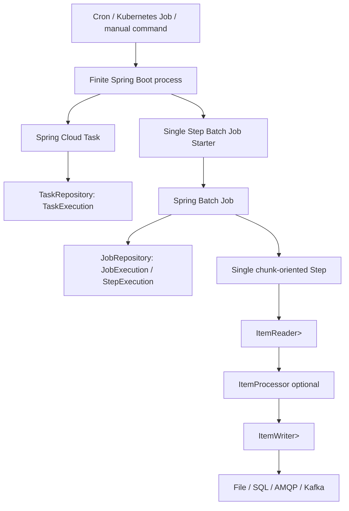
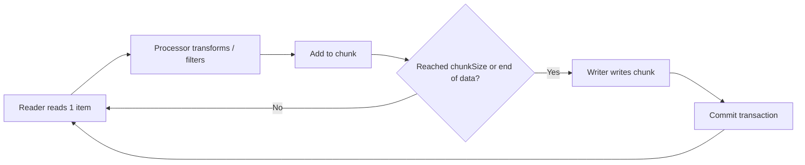

# Scope of spring-cloud-starter-single-step-batch-job

## 1. What problem does this starter solve?

**Spring Cloud Task** is used to build Spring Boot applications with a finite runtime: start up, perform work, record execution status through `TaskRepository`, and then terminate. When the work involves reading, processing, and writing a large volume of records, the application can integrate with **Spring Batch** to leverage chunk-oriented processing, transactions, statistics, restartability, and `JobRepository` metadata.

`spring-cloud-starter-single-step-batch-job` is a Spring Cloud Task starter designed for a **simple yet common use case**: a Spring Batch `Job` consisting of **a single chunk-oriented `Step`**. It pre-configures the Job/Step structure, along with supported `ItemReader` and `ItemWriter` implementations, using **properties** or application-declared beans.

For example: reading a nightly order CSV file, normalizing a few fields, and writing to another CSV file or to a database. If the flow only needs **one linear step**, this starter can significantly reduce Spring Batch boilerplate configuration code.

Lesson objectives:

- Distinguish between **Spring Cloud Task**, **Spring Batch**, and the **single-step batch starter**.
- Describe what the starter auto-configures and what parts you still need to build yourself.
- Understand the `ItemReader → ItemProcessor (optional) → ItemWriter` model, chunks, and the `Map<String, Object>` data type constraint.
- Identify the built-in readers/writers: file, JDBC, AMQP, and Kafka.
- Configure an example Job/Step, launch it, observe metadata, handle failures, and perform restarts.
- Choose when to use the starter versus switching to direct Spring Batch configuration.

> **Academic scope:** The Spring Cloud Task documentation describes this starter as a tool for configuring a **single chunk-oriented Step** Job. It is not a general-purpose mechanism for auto-generating all types of Jobs, does not replace Spring Batch, and does not automatically provide scheduling or guarantee exactly-once delivery across all external systems.

## 2. Where the starter fits in the architecture



During a run:

1. The orchestrator launches the Spring Boot JAR.
2. Spring Cloud Task records a `TaskExecution` once the repository infrastructure is ready.
3. Spring Boot and Spring Batch launch the configured Job.
4. The Job creates a `JobExecution`; the Step creates a `StepExecution`, reading and writing chunk by chunk.
5. Batch persists success/failure status and restart information.
6. Spring Cloud Task updates the run result and the application terminates according to configuration.

Three easily confused names:

| Component | What is it? | Metadata | Scope |
| --- | --- | --- | --- |
| **Spring Cloud Task** | Manages the lifecycle of a finite process | `TASK_*`, especially `TASK_EXECUTION` | The entire application execution |
| **Spring Batch** | Batch processing framework: Job, Step, chunk, retry, restart | `BATCH_*`, `JobExecution`, `StepExecution` | Batch work and internal steps |
| **Single-step starter** | Auto-configurer for a **single-Step** Job and select readers/writers | Uses Spring Batch and Task metadata | Reduces boilerplate for simple batch structures |

**One TaskExecution does not mean one StepExecution.** A Task can wrap a Job; a Job can be restarted and create a new `JobExecution`; each `JobExecution` has one or more `StepExecution` records depending on its structure. The starter focuses on a Job with only **one Step**.

## 3. What the starter provides vs. what you still do

### 3.1. Auto-configured scope

According to the official documentation, with the core properties:

| Property | Type | Default in docs | Meaning |
| --- | --- | --- | --- |
| `spring.batch.job.jobName` | `String` | `null` | Name of the `Job` created by the starter |
| `spring.batch.job.stepName` | `String` | `null` | Name of the Job's `Step` |
| `spring.batch.job.chunkSize` | `Integer` | `null` | Number of items processed per chunk/transaction |

After configuring the required properties, the starter creates a **single chunk-oriented Step Job** structure. However, **those three properties alone do not produce useful business behavior**: the Step needs an appropriate `ItemReader` and `ItemWriter`; `ItemProcessor` is optional.

You have two ways to provide these components:

1. Use the starter's **autoconfiguration** for the readers/writers listed in the documentation.
2. Declare custom reader/writer/processor beans via Spring Configuration, matching the Step's data type.

You do not necessarily need to write `Job` and `Step` beans yourself if the starter model suffices. However, choosing the components, configuring endpoints, data formats, authentication, error handling, and operational policies remain the application's responsibility.

### 3.2. How the chunk flow works



With `chunkSize=100`, the Step typically reads up to 100 items per batch, transforms them, then calls the writer for that group and commits according to the transaction policy. If the source has 230 items, they are normally split into chunks of 100, 100, and 30.

**Do not equate chunkSize with thread count, connection count, or total file size.** The starter does not process in parallel by default just because `chunkSize` is large. Committing depends on the transaction manager and participating resources; JDBC and Kafka/AMQP/files do not automatically share an atomic cross-system transaction.

### 3.3. The default data type is Map<String, Object>

An important limitation of the starter: the pre-configured readers/writers use **`Map<String, Object>`** as the input/output item type, rather than automatically inferring arbitrary POJOs.

For example, reading a line:

```csv
order_id,customer,total
101,An,250000
```

An item at the Step layer can be represented roughly as:

```java
Map<String, Object> item = Map.of(
        "order_id", "101",
        "customer", "An",
        "total", "250000"
);
```

This is a **mental model of the data type**: for CSV files, values may be strings; for JDBC, a `RowMapper` may return numbers/dates/appropriate JDBC types. Do not assume `Map.get("total")` always returns an `Integer` or `BigDecimal`. Always validate and convert before writing.

If you declare a custom processor, use the exact compatible signature:

```java
ItemProcessor<Map<String, Object>, Map<String, Object>>
```

A processor that transforms `Order` into `Invoice` will not be directly compatible with the `Map → Map` pipeline auto-configured by the starter, unless you write an adapter or switch to your own Spring Batch configuration.

## 4. Read sources supported by the starter

The Spring Cloud Task documentation describes autoconfiguration for **four readers**:

| Reader | Data source | What needs to be prepared | Notes |
| --- | --- | --- | --- |
| `FlatFileItemReader` | CSV/delimited/fixed-width file | Resource, field names, tokenizer/line mapper | Format, encoding, header, read permissions, and restart state |
| `JdbcCursorItemReader` | SQL query via JDBC | `DataSource`, SQL, possibly `RowMapper`/`PreparedStatementSetter` | Cursor, connection, deterministic ordering, fetchSize |
| `AmqpItemReader` | AMQP queue | `AmqpTemplate` and broker configuration | Must understand ack/requeue and message consumption semantics |
| `KafkaItemReader` | Kafka topic/partition | Spring Kafka and topic/partition configuration | Offsets, checkpoints, rebalancing, and message ordering |

This list describes the scope documented by the starter. If you need to read from S3, a REST API, R2DBC, or a specialized source, you may need a **custom reader** or a directly configured Job/Step, depending on the version and actual requirements.

### 4.1. FlatFileItemReader

Typical properties:

| Property | Purpose |
| --- | --- |
| `spring.batch.job.flatfileitemreader.resource` | Input resource, e.g., `file:./data/orders.csv` |
| `spring.batch.job.flatfileitemreader.name` | Stable reader name for saving `ExecutionContext` |
| `spring.batch.job.flatfileitemreader.delimited` | Enable delimiter-based field tokenization |
| `spring.batch.job.flatfileitemreader.delimiter` | Field delimiter character, usually a comma |
| `spring.batch.job.flatfileitemreader.names` | Column names used as keys in the `Map` |
| `spring.batch.job.flatfileitemreader.linesToSkip` | Number of lines to skip at the start of the file, e.g., header |
| `spring.batch.job.flatfileitemreader.saveState` | Whether to save reader progress for restart |
| `spring.batch.job.flatfileitemreader.strict` | Whether to fail if the resource does not exist |

If the file has a header, make sure you do not simultaneously skip the header and mistakenly map the first data line as header or vice versa. If the CSV file contains commas inside quoted fields, test how the tokenizer handles quoting against real data; never assume `String.split(",")` suffices for all CSVs.

### 4.2. JdbcCursorItemReader

Common properties:

```yaml
spring:
  batch:
    job:
      jdbccursoritemreader:
        name: pendingOrdersReader
        sql: "SELECT id, customer, total FROM orders WHERE status = 'PENDING' ORDER BY id"
        fetchSize: 100
        saveState: true
```

SQL must be compatible with the target database; **ORDER BY on a stable key** is critical when restartability is needed and when data changes during execution. Queries using dynamic input conditions should use bind parameters or `PreparedStatementSetter` instead of string concatenation. `fetchSize` is a hint to the JDBC driver, not a guarantee of always fetching exactly 100 rows per call.

The reader can use the default `DataSource`; when a separate source is needed, check the dedicated datasource property group for your version. Using multiple datasources simultaneously raises questions about transaction managers and consistency between read/write data and the JobRepository.

### 4.3. AmqpItemReader and KafkaItemReader

The AMQP reader is documented with the flag:

```properties
spring.batch.job.amqpitemreader.enabled=true
```

In addition to the flag, an `AmqpTemplate` or appropriate broker connection auto-configuration is required. For Kafka, the documentation describes `spring.batch.job.kafkaitemreader.topic`, `partitions`, `pollTimeOutInSeconds`, and `saveState`, along with corresponding Spring Kafka configuration.

Do not treat reading from a queue/topic like reading a static file. You must decide how to handle cases where a message is read but the writer fails, when the consumer restarts, when offsets have been committed, and when the broker redelivers messages. The starter provides basic configuration plumbing; **it does not automatically design an exactly-once mechanism for your business logic**.

## 5. Write destinations supported by the starter

| Writer | Destination | What needs to be configured |
| --- | --- | --- |
| `FlatFileItemWriter` | Text/CSV/fixed-width file | Resource, field names, delimiter/format, encoding, overwrite/append behavior |
| `JdbcBatchItemWriter` | SQL table via JDBC | SQL, parameter map/statement setter, `DataSource`, and `assertUpdates` policy |
| `AmqpItemWriter` | AMQP broker | `AmqpTemplate`, message format, delivery confirmation |
| `KafkaItemWriter` | Kafka topic | Producer config, topic, and write or delete policy |

### 5.1. FlatFileItemWriter

Example properties:

```yaml
spring:
  batch:
    job:
      flatfileitemwriter:
        name: normalizedOrdersWriter
        resource: file:./data/output/orders-normalized.csv
        delimited: true
        delimiter: ","
        names:
          - order_id
          - customer
          - total
        encoding: UTF-8
```

In the starter documentation, `delimited` and `formatted` are two distinct output modes; do not enable both simultaneously. `names` specifies the keys to extract from the `Map` when writing to the file. `resource` must point to a path where the process has write permission and the parent directory already exists.

**Note on restarts:** The writer's `shouldDeleteIfExists` property is listed in the documentation with a default of `true`, while `append` defaults to `false`. If opening an output file that already contains data from a previous run, restarting may delete/overwrite results depending on the writer's configuration and lifecycle. For production, design filenames with `runId`, temporary files + atomic rename (when the filesystem supports it), or safe state tracking; **do not simply enable `append` and assume restarts are correct**.

### 5.2. JdbcBatchItemWriter

The starter documentation supports SQL and `assertUpdates`:

```yaml
spring:
  batch:
    job:
      jdbcbatchitemwriter:
        name: orderOutputWriter
        sql: >
          INSERT INTO imported_orders(order_id, customer, total)
          VALUES (:order_id, :customer, :total)
        assertUpdates: true
```

In this example, the SQL statement uses **named parameters** corresponding to the keys of the `Map`; parameter binding must match the `ItemSqlParameterSourceProvider` supported by the actual configuration. The `imported_orders` table must exist and have write permissions before running. `assertUpdates` requires write operations to affect the expected number of rows, helping catch silent write failures, though it does not replace business validation.

When `ON CONFLICT`, `MERGE`, or upserts are needed, the SQL is database-specific. You must distinguish a record **intentionally skipped because it already exists** from an operation that was supposed to update but returned 0 rows; tune `assertUpdates` and idempotency rules accordingly.

### 5.3. AMQP/Kafka Writers

For AMQP, the documentation supports configuring `spring.batch.job.amqpitemwriter.enabled` and JSON conversion when an `AmqpTemplate` is present. For Kafka, you must specify `spring.batch.job.kafkaitemwriter.topic` and appropriate parameters, alongside producer configuration.

**A chunk commit in JobRepository is not automatically a distributed transaction spanning the database, filesystem, and broker.** If the writer sends a message successfully but the process crashes before recording the checkpoint, restarting may replay the message. Use an idempotency key, outbox pattern, or proper deduplication protocol on the receiving side.

## 6. Example: a CSV → CSV Job using properties only

The example below demonstrates the **most basic scope** of the starter: reading a CSV file, converting each line into a `Map<String,Object>`, and writing it out to a new file. The goal is to learn how to configure Job/Step/reader/writer. The program does not yet contain complex business data processing logic.

### 6.1. Project setup

The project requires Spring Boot, the appropriate Spring Cloud Task/Batch starter, and a database for metadata (e.g., PostgreSQL). With Maven and a **compatible Spring Cloud BOM** managed in the project:

```xml
<dependency>
    <groupId>org.springframework.cloud</groupId>
    <artifactId>spring-cloud-starter-single-step-batch-job</artifactId>
</dependency>

<dependency>
    <groupId>org.postgresql</groupId>
    <artifactId>postgresql</artifactId>
    <scope>runtime</scope>
</dependency>
```

This is an **additional dependency snippet**, not a complete `pom.xml`. You need a Boot parent/BOM, a compatible Spring Cloud BOM, and repositories containing the artifacts; verify which Task/Batch components the starter pulls in using the dependency tree of your **actual project**.

**Version trap:** Several official documentation pages (even ones labeled with newer releases) still illustrate the `spring-cloud-starter-single-step-batch-job` dependency at version **`2.3.0`** and legacy Gradle `compile`. Do not copy `2.3.0` into a new Spring Boot project without checking the compatibility matrix. Choose artifacts according to the release train/BOM and verify the actual API. If the starter is not managed by your project's BOM, pin a **specific compatible version** after checking release metadata; never let Maven resolve an arbitrary version.

For the application class example:

```java
import org.springframework.boot.SpringApplication;
import org.springframework.boot.autoconfigure.SpringBootApplication;
import org.springframework.cloud.task.configuration.EnableTask;

@SpringBootApplication
@EnableTask
public class OneStepCsvTaskApplication {
    public static void main(String[] args) {
        SpringApplication.run(OneStepCsvTaskApplication.class, args);
    }
}
```

You do not need to write `Job` and `Step` beans yourself in this property-only example because the starter creates the single-step structure. `@EnableTask` explicitly signals enabling Task infrastructure; depending on the starter and version supporting auto-configuration, activation may differ—verify against your actual application.

### 6.2. Preparing the input file

Create `data/input` and `data/output` directories on the machine running the JAR. File `data/input/orders.csv`:

```csv
order_id,customer,total
101,An,250000
102,Binh,320000
103,Chi,180000
```

The example file has one header line and three data lines. Before running, ensure UTF-8 encoding, read permission on the input file, and write permission on the output directory.

### 6.3. application.yml

```yaml
spring:
  application:
    name: one-step-csv-task
  main:
    web-application-type: none
  datasource:
    url: ${TASK_DB_URL:jdbc:postgresql://localhost:5432/taskdb}
    username: ${TASK_DB_USER:task_user}
    password: ${TASK_DB_PASSWORD}
  cloud:
    task:
      initialize-enabled: false
      closecontextEnabled: true
      batch:
        fail-on-job-failure: true
  batch:
    jdbc:
      initialize-schema: never
    job:
      enabled: true
      jobName: normalizeOrdersJob
      stepName: normalizeOrdersStep
      chunkSize: 2
      flatfileitemreader:
        name: ordersReader
        resource: file:./data/input/orders.csv
        encoding: UTF-8
        linesToSkip: 1
        delimited: true
        delimiter: ","
        names: [order_id, customer, total]
        saveState: true
        strict: true
      flatfileitemwriter:
        name: normalizedOrdersWriter
        resource: file:./data/output/orders-normalized.csv
        encoding: UTF-8
        delimited: true
        delimiter: ","
        names: [order_id, customer, total]
        saveState: true
```

In this sample configuration:

- `spring.batch.job.jobName`, `stepName`, and `chunkSize` belong to the **starter's** property group. `chunkSize: 2` makes it easy to observe two chunks from the three CSV lines.
- `flatfileitemreader` and `flatfileitemwriter` belong to the starter's reader/writer configuration groups.
- `spring.batch.job.enabled: true` belongs to **Spring Boot**, allowing discovered Jobs to run automatically on startup.
- `spring.cloud.task.batch.fail-on-job-failure: true` instructs the Task–Batch integration to signal failure when the Batch Job fails, rather than letting the Task report success by default in certain execution paths.
- `initialize-enabled: false` and `spring.batch.jdbc.initialize-schema: never` assume the `TASK_*` and `BATCH_*` tables have already been provisioned via DDL/migrations for the corresponding versions.
- `TASK_DB_PASSWORD` must be supplied via environment variables or a secret manager; do not pass passwords on the CLI because arguments may be recorded in metadata or logs.

**Distinguishing two similar properties:** `spring.batch.job.jobName` (the starter **defines the Job name**) and `spring.batch.job.name` (Spring Boot **selects which Job to launch** when multiple Jobs exist). They are not synonymous. If the application only has the Job created by the starter, you usually do not need to add the Job selection property; when multiple Jobs exist, use the appropriate Job selection property for your Boot version.

Because Spring Cloud Task and Spring Batch versions evolve over time, verify that the starter properties actually bind in your chosen version. If the file is not read or the writer is not created, check the troubleshooting section and inspect the auto-configuration report rather than assuming every version combination behaves identically.

### 6.4. Running and observing

After building the JAR, run (the JAR filename is just an example):

```bash
java -jar target/one-step-csv-task.jar
```

If the database/schema and auto-configuration are properly prepared, the Job launches, the reader reads three lines, and the writer outputs `data/output/orders-normalized.csv`. Since `chunkSize: 2`, there are typically two processing batches: the first two lines, then the final line.

Expected file output:

```csv
101,An,250000
102,Binh,320000
103,Chi,180000
```

In this example **there is no processor**: the output is not normalized in the sense of data transformation; the Job name `normalizeOrdersJob` is merely illustrative. To change casing, validate values, or filter records, you need to add an appropriate processor.

Note that the output file may **not** contain a header because the writer configuration does not declare a `FlatFileHeaderCallback`. Add a header callback or header-generation step if the target system requires that exact format.

## 7. Adding a custom ItemProcessor while keeping a single-step Job

`ItemProcessor` is an **optional** component. The starter can pick up a bean of exact type `ItemProcessor<Map<String, Object>, Map<String, Object>>`.

Example of normalizing customer names and validating required fields:

```java
import java.util.LinkedHashMap;
import java.util.Map;
import org.springframework.batch.item.ItemProcessor;
import org.springframework.context.annotation.Bean;
import org.springframework.context.annotation.Configuration;

@Configuration
public class OrderNormalizeProcessorConfiguration {

    @Bean
    ItemProcessor<Map<String, Object>, Map<String, Object>>
    orderNormalizer() {
        return item -> {
            Map<String, Object> result =
                    new LinkedHashMap<>(item);

            Object id = result.get("order_id");
            if (id == null || id.toString().isBlank()) {
                throw new IllegalArgumentException(
                        "Missing order_id");
            }

            Object customer = result.get("customer");
            if (customer != null) {
                result.put(
                        "customer",
                        customer.toString().trim().toUpperCase());
            }
            return result;
        };
    }
}
```

This bean accepts and returns `Map<String,Object>` to match the starter's pipeline. `LinkedHashMap` creates a copy of the item, avoiding direct mutation of the source Map provided by the reader. In the example above, `An` becomes `AN` and `Binh` becomes `BINH`.

A processor can **return `null` to filter an item** from the write path per Spring Batch rules, but you must distinguish valid filtering from data errors: silently returning `null` when required data is missing can cause the Job to report success even though critical records were dropped.

For complex business rules, multiple processors of the same type, or POJO requirements like `OrderRecord`, consider defining your Spring Batch Job/Step directly. Do not assume the starter will automatically pick the right processor when multiple matching beans exist in the context.

## 8. When is the starter no longer a good fit?

### 8.1. Limitations of the single-Step architecture

| Requirement | Good fit for single-step starter? | Implementation direction |
| --- | --- | --- |
| Read CSV and write CSV, one linear pipeline | **Very good fit** | Properties + reader/writer, processor if needed |
| Read SQL and write SQL with Map | **Suitable within supported scope** | JDBC reader/writer + transactions and idempotency |
| Read Kafka then write JDBC | **Possible**, must verify offset/transaction semantics | Test replay behavior and independent commits |
| A Job with multiple dependent Steps | **Outside primary scope** | Build Spring Batch Job manually with `JobBuilder`/`StepBuilder` |
| Conditional branching based on Step status | **Outside primary scope** | Custom Spring Batch Flow/transitions |
| Partitioning, remote chunking, parallel workers | **Not provided out-of-the-box by starter** | Configure appropriate Spring Batch/Spring Cloud Task/Deployer |
| Tasklet running a single simple command | **Not the goal of the chunk starter** | `ApplicationRunner` or Spring Batch Tasklet Step |
| POJO items with complex mapping | **Requires significant customization** | Custom reader/writer/processor or pure Spring Batch Job |
| Per-exception custom retry/skip rules | **Cannot be fully configured via the three core properties** | Build Step with appropriate fault tolerance |
| Orchestrating multiple Jobs conditionally | **Not a starter feature** | Scheduler/orchestrator or Batch Job flows |

Do not confuse the fact that the starter **accepts custom beans** with the idea that it fits every pipeline. As configurations accumulate exceptions, flow logic, listeners, or specialized resource handling, writing the Job directly is usually clearer and easier to test.

### 8.2. Difference between a Runner and a Step

An `ApplicationRunner` might simply call an API, send a report, or clear a cache and exit. This is still a **valid Spring Cloud Task** even without Spring Batch.

Conversely, a Spring Batch `Step` provides an item-oriented framework, Job/Step state, and chunk/restart handling. Wrapping a few-millisecond operation in Batch just to "use the starter" adds unnecessary schemas, configuration, and operational overhead.

Pick the tool for the need: **Runner for simple tasks**, **single-step starter for a single chunk pipeline**, **self-configured Spring Batch for complex workflows**.

## 9. Schemas and metadata when using both Task and Batch

If an application uses Spring Cloud Task together with Spring Batch, it typically needs:

| Table group | Purpose |
| --- | --- |
| `TASK_EXECUTION`, `TASK_EXECUTION_PARAMS`, and other `TASK_*` tables | Spring Cloud Task process metadata |
| `BATCH_JOB_INSTANCE`, `BATCH_JOB_EXECUTION`, `BATCH_STEP_EXECUTION`, and other Batch tables | Job/Step metadata and restart state |
| `TASK_TASK_BATCH` when integration is enabled | Links a TaskExecution to a JobExecution |

Spring Cloud Task and Spring Batch maintain **separate repositories**. A failed `JobExecution` does not roll back previously committed business transactions. Data already committed in successful chunks persists according to transaction semantics.

If using Flyway/Liquibase, prepare DDL for the **exact versions** of both Spring Cloud Task and Spring Batch. Once migrations are in place:

```yaml
spring:
  cloud:
    task:
      initialize-enabled: false
  batch:
    jdbc:
      initialize-schema: never
```

Do not create metadata tables ad-hoc from memory. If `TaskRepository` lives in DB A and `JobRepository` in DB B, explicitly configure the `DataSource`/transaction managers and how metadata is linked. Do not assume a single JDBC transaction automatically spans both databases.

### 9.1. Querying Jobs and Steps

Example SQL on the common Spring Batch JDBC schema:

```sql
SELECT
    ji.JOB_NAME,
    je.JOB_EXECUTION_ID,
    je.STATUS,
    je.EXIT_CODE,
    je.CREATE_TIME,
    je.END_TIME
FROM BATCH_JOB_EXECUTION je
JOIN BATCH_JOB_INSTANCE ji
  ON ji.JOB_INSTANCE_ID = je.JOB_INSTANCE_ID
ORDER BY je.JOB_EXECUTION_ID DESC;
```

Step details:

```sql
SELECT JOB_EXECUTION_ID, STEP_NAME, STATUS,
       READ_COUNT, WRITE_COUNT, FILTER_COUNT,
       READ_SKIP_COUNT, PROCESS_SKIP_COUNT, WRITE_SKIP_COUNT
FROM BATCH_STEP_EXECUTION
ORDER BY STEP_EXECUTION_ID DESC;
```

These queries are **examples** based on the standard Batch JDBC schema; adjust column/schema names to match your pinned Spring Batch version. `READ_COUNT`, `WRITE_COUNT`, and `FILTER_COUNT` aid data reconciliation but do not by themselves prove external systems received all side effects like emails or Kafka messages.

### 9.2. Linking Task and Job

Spring Cloud Task can link `TaskExecution` to `JobExecution` when the Batch integration module and appropriate listeners are configured. When active, the association metadata allows tracing from a process run down to the inner Job/Step.

```text
TaskExecution #401  (one-step-csv-task process)
   |
   +--> JobExecution #795 (normalizeOrdersJob)
          |
          +--> StepExecution #1320 (normalizeOrdersStep)
```

The IDs in the diagram are **illustrative**, not framework-guaranteed numbers. If the link table is empty, check the `spring-cloud-task-batch` dependency, listeners, and Job launching mechanism for your version. Do not infer links solely from Job names in environments with concurrent or repeated runs.

## 10. Job outcome and Task exit code

### 10.1. Misleading default behavior

The Spring Cloud Task documentation notes that a Spring Batch Job can end in **FAILED** while the Boot/Task process still exits with code **0** under default paths. Consequently, when a scheduler decides whether to retry based solely on process exit code, failing to map Batch errors to the Task can cause a **false positive success**.

Set:

```yaml
spring:
  cloud:
    task:
      batch:
        fail-on-job-failure: true
```

According to official documentation, this property allows the Task to return a **non-zero** exit code when the Batch Job has `BatchStatus.FAILED`; the code is usually `1` by default or governed by a configured `ExitCodeGenerator`. Verify this in practice with your deployed version and JVM/container launch setup; do not assume every failure gets written to `TaskRepository` if the process is killed before metadata updates complete.

### 10.2. Cross-layer status comparison

| Scenario | JobExecution | TaskExecution / process | Business data |
| --- | --- | --- | --- |
| Reader/processor/writer complete | `COMPLETED` | Usually succeeds, exit code 0 | Committed chunks |
| Step fails mid-way | `FAILED` | Needs `fail-on-job-failure` or proper error mapping | Prior chunks may already be committed |
| Records validly filtered | Can be `COMPLETED` | Can succeed | `WRITE_COUNT` less than `READ_COUNT` |
| App crashes before Job runs | May have no JobExecution | Process fails; TaskRepository may lack metadata | Business work may not have started |
| Process hard-killed | Metadata may be unfinished | May lack `END_TIME` | Committed chunks remain |

**Clarify business criteria:** `COMPLETED` means the Job finished according to Spring Batch rules; it does not guarantee all valid records were imported if processors/filters/skips are misdefined.

## 11. Restarting a single-step Job

### 11.1. Chunks and checkpoints

Suppose there are 250 lines, `chunkSize=100`, and the Step fails at line 230:

```text
Chunk 1: 100 lines -> committed successfully
Chunk 2: 100 lines -> committed successfully
Chunk 3: starts last 50 lines -> fails at line 230
```

When transactions properly manage the resource, committed chunks are preserved while the failing chunk typically rolls back within its scope. On restart with the same valid `JobInstance`, Spring Batch can use `ExecutionContext` metadata to resume, provided the reader/writer support saving state, the source data remains stable, and components preserve stable identifiers.

### 11.2. Distinguishing JobInstance from JobExecution

- **JobInstance** is identified by the Job name and the set of identifying `JobParameters`.
- **JobExecution** is a single execution attempt of a `JobInstance`.
- **StepExecution** is a single execution attempt of a Step belonging to a `JobExecution`.
- **TaskExecution** is a single launch of a Spring Cloud Task.

If a `JobInstance` is already `COMPLETED`, attempting to run it again with the **same identifying JobParameters** may be rejected under Spring Batch rules. If the `JobInstance` is `FAILED`, it can be restarted subject to the Job's restart policy and capabilities.

**Do not append random timestamps to JobParameters just to bypass "already complete" or restart errors.** Doing so creates a new `JobInstance` and restarts from scratch, causing duplicate data.

### 11.3. File output and restarts require dedicated testing

With `FlatFileItemWriter`, options like `append`, `saveState`, and `shouldDeleteIfExists` directly affect the file on rerun. There is no single setting that fits every requirement:

- File should only be published when the Job succeeds: consider writing to a temporary file and renaming upon completion.
- Need mid-file restart: examine how the writer tracks position/`ExecutionContext` and how to avoid duplicate lines.
- Multiple independent runs: derive output paths per run/batch identifier instead of overwriting the previous Job's file.
- Files on NFS/object storage: check specific append/rename/atomicity semantics; do not assume local filesystem behavior.

When using Kafka/AMQP, Batch checkpoints and broker offsets/acks can have different lifecycles. **Safe restarts** require idempotency in the writer or downstream consumer, beyond `JobRepository` metadata.

## 12. Parameters, Job selection, and scheduled execution

### 12.1. Job configuration vs. JobParameters

`spring.batch.job.jobName` and `chunkSize` are **Job structure configuration properties**, typically set before application startup. `JobParameters` are the **identifying inputs of a Batch run** (such as business date, batch ID, or data source).

For instance, if a user requests processing data for `2026-11-24`, and the Batch Job must be restartable per date, the application must translate that date into stable identifying `JobParameters`. Do not confuse starter properties with `JobParameters`, and do not assume all CLI arguments map identically across all Spring Boot versions.

```bash
java -jar target/one-step-csv-task.jar --spring.batch.job.name=normalizeOrdersJob
```

In this example, `--spring.batch.job.name` is **Spring Boot's Job selection property**, not a `businessDate` business parameter and not `spring.batch.job.jobName` used to name the starter-created Job.

### 12.2. The starter does not schedule Jobs

You can run the JAR via:

| Execution method | Responsibility |
| --- | --- |
| `java -jar ...` | Manual or on-demand execution |
| Cron or scheduler | Decides timing and parameters |
| Kubernetes Job/CronJob | Pod creation, timeouts, retries, and concurrency policies |
| Workflow orchestrator | Inter-step dependencies, input data, and monitoring |

The starter only creates the configured Job/Step and components inside the process; scheduling, process retries, and cross-application orchestration belong to an external layer. If a Job runs longer than one schedule interval, you need overlap-prevention policies and resource controls rather than relying solely on the Batch `JobRepository` to coordinate all processes.

## 13. AOT/native image as a special case

The starter documentation states that on the **JVM**, readers/writers can be chosen dynamically via runtime properties. However, with **AOT/native compilation**, beans must be determined during analysis and build time; if selecting a reader/writer via properties, define those selection properties **at build time**, or declare the beans explicitly.

Illustrative plugin configuration example for AOT:

```xml
<plugin>
    <groupId>org.springframework.boot</groupId>
    <artifactId>spring-boot-maven-plugin</artifactId>
    <executions>
        <execution>
            <id>process-aot</id>
            <goals>
                <goal>process-aot</goal>
            </goals>
        </execution>
    </executions>
    <configuration>
        <arguments>
            <argument>--spring.batch.job.flatfileitemreader.name=ordersReader</argument>
            <argument>--spring.batch.job.flatfileitemwriter.name=ordersWriter</argument>
        </arguments>
    </configuration>
</plugin>
```

This is an **illustrative configuration from the Spring Cloud Task AOT guide**; verify the Spring Boot plugin syntax for your version and native image build pipeline. Do not assume changing properties in a YAML file at native-image runtime will suffice to activate a new reader/writer bean that was excluded from AOT analysis.

## 14. Common configuration errors and pitfalls

| Symptom | Possible cause | Diagnosis/fix |
| --- | --- | --- |
| No `Job` is created | Missing starter, wrong version, missing core properties, auto-config not triggered | Check dependency tree, `jobName/stepName/chunkSize` binding, auto-configuration report |
| Job exists but Step reads nothing | Reader missing resource/SQL or empty file | Inspect resource, reader logs, `READ_COUNT` |
| `No qualifying bean` for reader/writer | No supported component configured or bean conflict | Add properly typed reader/writer; inspect auto-config conditions |
| Type cast error when processing Map | Reader returns value of a different type than assumed | Cast/validate inside processor |
| File written with wrong columns | Writer `names` does not match item keys | Verify name mapping, column order, and sample data |
| Previous output file overwritten | `shouldDeleteIfExists`/`append` behavior not as expected | Use run-ID-scoped output paths and test restarts |
| Job `FAILED` but scheduler sees exit code 0 | Batch failure not mapped to Task | Enable `fail-on-job-failure` where supported; verify process exit code |
| Missing `BATCH_*` or `TASK_*` table errors | Schema not migrated or wrong DDL version | Provision compatible Task and Batch schemas |
| Restart produces duplicate records | New `JobInstance` created or non-idempotent writer | Inspect `JobParameters`, checkpoints, and unique keys |
| Reading Kafka yields no messages/partitions | Wrong topic, partition, broker permissions, or poll timeout | Inspect Kafka config and consumer logs |
| Native image missing reader/writer | Bean selected only at runtime | Declare selection at build time or use explicit beans |
| Custom multiple Jobs run the wrong Job | Unclear Boot Job selection property | Use `spring.batch.job.name` appropriate for your Boot version |

When troubleshooting, avoid randomly tweaking both `jobName` and `name` at the same time. Be clear on whether you want to **name the created Job** or **select which Job to run**.

## 15. Recommended test scenarios

### 15.1. Testing the pipeline and metrics

With a three-line CSV file and `chunkSize=2`:

1. Run the Job and verify the output file contains exactly three lines.
2. Query `BATCH_STEP_EXECUTION`, expecting `READ_COUNT=3` and `WRITE_COUNT=3` when no filter is active.
3. Cross-check `TaskExecution` with `JobExecution` according to your project's Task–Batch linking setup.
4. Modify the processor to filter out one valid line, then verify `FILTER_COUNT` and the output line count.
5. Add an input line missing `order_id`, confirm the Job fails, and verify the failure propagates to the Task/process per policy.

### 15.2. Testing mid-chunk failure and restart

Create a test dataset spanning 5–10 chunks, force the writer to fail in a middle chunk, and then restart under the **same JobInstance** if state permits. Verify:

- Are previously committed chunks re-written?
- Does the file/JDBC writer produce duplicate output or wipe earlier results?
- Do `JobExecution` and `StepExecution` metrics after restart match the actual data?
- Does the orchestrator automatically inject random parameters that turn it into a new `JobInstance`?
- Do HTTP/Kafka/AMQP targets require dedicated idempotency?

### 15.3. Testing the deployment environment

- Verify input read permissions, output write permissions, and disk space.
- Confirm the database is ready with version-compatible `TASK_*`/`BATCH_*` schemas.
- Check the process exit code on success, missing file, and SQL error.
- If running multiple instances, verify concurrency behavior and duplicate-processing prevention.
- If building a native image, verify that the reader/writer are registered at build time.

These are integration checks required for real deployments; the theoretical examples above **have not been executed** against a specific Spring Boot/Batch project in this lesson.

## 16. Practice exercises

**Exercise 1 — Scoping.** An application workflow needs to: read a CSV, validate data, write to a database, and then send a summary email. Analyze which parts belong in a single-step chunk, and which require a multi-Step Job, listeners, an outbox, or Task orchestration.

**Exercise 2 — Map pipeline.** Given a CSV with `order_id`, `customer`, and `total`, write an `ItemProcessor<Map<String,Object>,Map<String,Object>>` that checks `total` is non-negative and normalizes `customer`. Explain why `total` must be converted from a string when reading a file.

**Exercise 3 — Property distinction.** Compare `spring.batch.job.jobName`, `spring.batch.job.name`, and `spring.batch.job.chunkSize`. State which controls the Job's defined name, which Job gets launched, and the item count per chunk.

**Exercise 4 — Failure outcomes.** Trigger a file-read error (missing file) and observe `JobExecution.STATUS`, `StepExecution`, `TaskExecution.EXIT_CODE`, and the shell exit code. Toggle `fail-on-job-failure` and explain the difference.

**Exercise 5 — Restart.** A Job has 230 items, `chunkSize` 100, and fails in the last chunk. Predict how many items are already committed; test restarting and verify there is no duplicate output.

**Exercise 6 — Choosing the right tool.** Classify three requirements: (a) calling a REST API once; (b) reading a CSV file and writing to PostgreSQL; (c) processing 5 Steps with conditional branches, partitioning, and multiple transaction managers. Choose between a Runner, single-step starter, or manually configured Spring Batch for each, with justification.

**Exercise 7 — Native image.** Explain why passing a property to enable `FlatFileItemReader` only at native-image runtime may be insufficient; outline a plan to supply reader/writer information during the AOT phase.

## 17. Key principles to remember

1. **`spring-cloud-starter-single-step-batch-job` specializes in single chunk-oriented Step Spring Batch Jobs**, not arbitrary Job generation.
2. **The three structural properties** are `jobName`, `stepName`, and `chunkSize`; you must still supply a reader and writer.
3. **The primary item type is `Map<String,Object>`** in auto-configured components, so processors and writers must be compatible.
4. **Built-in readers/writers cover only the documented options**; specialized logic requires custom beans or direct Spring Batch configuration.
5. **Spring Cloud Task and Spring Batch keep separate metadata**; inspect `TaskExecution`, `JobExecution`, and `StepExecution` during operations.
6. **A FAILED Batch Job does not automatically guarantee a non-zero process exit code** without proper mapping policy; verify `fail-on-job-failure`.
7. **Chunk-based restarts and transactions do not replace idempotency** for files, databases, or brokers.
8. **AOT/native images require determining which components to create at build time** or declaring explicit beans.

## References

- [Spring Cloud Task — Single Step Batch Job Starter](https://docs.spring.io/spring-cloud-task/reference/batch-starter.html): scope, supported readers/writers, properties, and AOT requirements.
- [Spring Cloud Task — Batch Integration](https://docs.spring.io/spring-cloud-task/reference/batch.html): `TaskExecution`–`JobExecution` linking, statuses, and `fail-on-job-failure`.
- [Spring Boot — Running Spring Batch Jobs](https://docs.spring.io/spring-boot/reference/io/spring-batch.html): automatic Job execution and the `spring.batch.job.name` property.
- [Spring Batch — Step and chunk-oriented processing](https://docs.spring.io/spring-batch/reference/step/chunk-oriented-processing.html): chunks, reader/processor/writer, and transactions.
- [Spring Batch — Job and JobInstance](https://docs.spring.io/spring-batch/reference/job.html): relationship between `JobInstance`, `JobExecution`, and parameters.
- [Spring Batch — ItemReader and ItemWriter](https://docs.spring.io/spring-batch/reference/readers-and-writers/): components, state, and restarts.
- [Spring Cloud Task — Task Repository Schema](https://docs.spring.io/spring-cloud-task/reference/appendix-task-repository-schema.html): `TASK_*` tables and links to Spring Batch.
