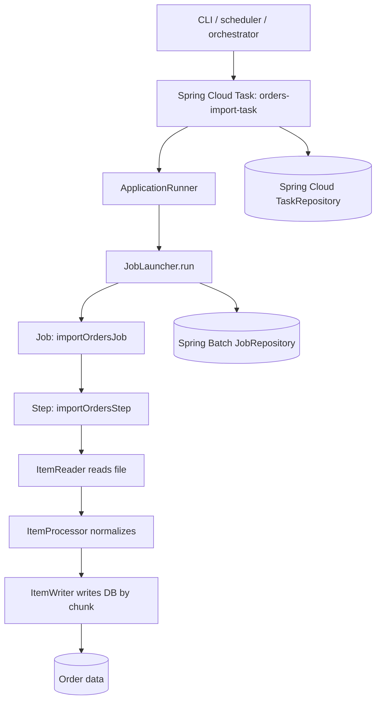
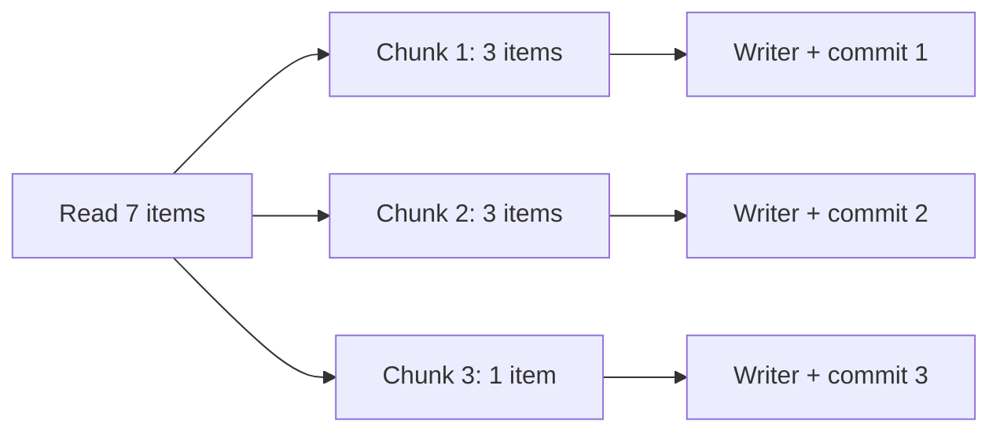

# Configuring Job Name, Step Name, and Chunk Size

## 1. What is a single-step Job in Spring Cloud Task?

**Spring Cloud Task** is used to build a Spring Boot application with a finite runtime: start up, process a unit of work, record execution metadata via `TaskRepository`, and then terminate. When the work requires reading and writing many records, committing incrementally, tracking progress, or resuming after failures, it can be combined with **Spring Batch**.

A **single-step Spring Batch Job** has exactly one `Step`. In this lesson, the Job is named `importOrdersJob`, and the Step is named `importOrdersStep`. The Step reads an orders file, normalizes the data, and writes it to a database in **chunks**. The outer Spring Cloud Task application launches the Job and tracks the process lifecycle.



The two repositories serve **two different tracking levels**. `TaskRepository` records information about the Spring Cloud Task application run; Spring Batch's `JobRepository` records job instances, job executions, step executions, parameters, and checkpoints. A single task run can launch one Job, multiple Jobs, or no Batch Job at all; never conflate the two IDs or the two statuses.

| Concept | Example | Meaning |
| --- | --- | --- |
| Task name | `orders-import-task` | Logical name of the Spring Cloud Task program |
| `TASK_EXECUTION_ID` | `80` | A single task launch tracked by the framework |
| Job name | `importOrdersJob` | Logical definition name of a Spring Batch Job |
| Job instance | `importOrdersJob` + identifying `JobParameters` | An identifiable Batch request, which may undergo multiple execution attempts |
| `JOB_EXECUTION_ID` | `201` | A single execution attempt of a Job instance, which may succeed or fail |
| Step name | `importOrdersStep` | Stable name of a step belonging to a Job |
| `STEP_EXECUTION_ID` | `302` | A single Step execution, holding read/write counts, commits, rollbacks, and status |
| Chunk size | `3` | Number of items grouped into one processing/transaction unit, under the chunk-oriented step model |

The ID values in the table are illustrative only; they are generated by their respective repositories and are **not necessarily equal**.

## 2. Naming Jobs properly

The Job name is declared when constructing the `Job` object, for example:

```java
new JobBuilder("importOrdersJob", jobRepository)
        .start(importOrdersStep)
        .build();
```

`importOrdersJob` is the **logical name stored by Spring Batch in `BATCH_JOB_INSTANCE.JOB_NAME`**. It does not have to match the `@Bean` method name or the Spring Boot application name. A Job instance is identified by the **Job name together with its set of identifying job parameters**, not by the Job name alone.

Examples:

| Job name | Identifying parameters | Meaning |
| --- | --- | --- |
| `importOrdersJob` | `businessDate=2026-11-24`, `inputFile=/data/orders-a.txt` | One Job instance |
| `importOrdersJob` | Same two values as above | **Same Job instance**, possibly a restart attempt if the previous run failed |
| `importOrdersJob` | `businessDate=2026-11-25`, `inputFile=/data/orders-b.txt` | Different Job instance |
| `reconcileOrdersJob` | Same parameters as the first row | Different Job instance because the Job name differs |

Spring Batch uses `JobParameters` to distinguish Job instances. Therefore, **do not rename a Job to retry a failed run**, and do not inject a random `run.id` every time you need a *restart*: doing so typically creates a new Job instance, losing the previous checkpoint context.

For a Job that is already `COMPLETED`, running it again with the **same identifying parameters** is normally rejected by Spring Batch with `JobInstanceAlreadyCompleteException`. This is part of the Job instance management mechanism; if you want to reprocess an already completed business request, design an explicit strategy rather than arbitrarily changing the Job name or ID.

### Job naming rules

- Use short, stable, business-meaningful names such as `importOrdersJob` or `generateMonthlyInvoiceJob`.
- Do not embed dates, timestamps, UUIDs, customer IDs, or arbitrary filenames into the **Job name**; place them in `JobParameters` with appropriate identifying flags.
- Do not reuse one Job name for two pipelines with different semantics or restart behaviors.
- If you rename a Job that is already in production, treat it as a Batch identity change: historical queries, dashboards, and restartability of older Job instances may be affected.

## 3. Naming Steps and the relationship to restarts

The Step name is declared via `StepBuilder`:

```java
new StepBuilder("importOrdersStep", jobRepository)
        .<OrderRow, OrderRow>chunk(3, transactionManager)
        .reader(reader)
        .processor(processor)
        .writer(writer)
        .build();
```

`importOrdersStep` is the **Step name in the `BATCH_STEP_EXECUTION.STEP_NAME` metadata**. When a Job is restarted after a failure, Spring Batch relies on the corresponding step's status and execution context to decide whether to re-run it and where to resume. A completed Step does not normally re-run within the same Job instance on a default restart; a failed Step can be retried from the last committed checkpoint if the reader/writer and input data support it.

> **Common pitfall:** Renaming `importOrdersStep` to `importOrdersStepV2` between a failed run and a restart causes the framework to see a Step **with a new name**. State/checkpoints saved under the old name will not be inherited as a normal continuation of that Step. Keep Step names stable for Job instances that need to be restartable; if you must change both name and behavior, plan a migration or safe data reprocessing strategy.

In a multi-Step Job, Step names distinguish the steps. In a **single-step Job**, you must still choose a meaningful name because Batch tables, logs, and monitoring tools use it. The `@Bean importOrdersStep()` method name can match for readability, but the value **passed into `StepBuilder`** is what becomes the name in Batch metadata.

## 4. What is chunk size and how does it affect execution?

In a chunk-oriented Step, Spring Batch reads items via `ItemReader`, optionally transforms/filters them via `ItemProcessor`, and then passes a group of items to `ItemWriter`. Upon successful processing, the transaction is committed and progress state is saved according to the Step's mechanism.

Example of `chunk(3, transactionManager)` with **7 valid items** and no skip/filter/retry:

| Chunk | Items read and processed | Writer receives | Expected outcome |
| --- | --- | --- | --- |
| 1 | 1, 2, 3 | 3 items | Commit batch 1 |
| 2 | 4, 5, 6 | 3 items | Commit batch 2 |
| 3 | 7 and end of input | 1 item | Commit batch 3 |



`chunk(3, transactionManager)` is generally understood as **up to 3 item reads per transaction** (commit interval), not a guarantee that `ItemWriter` always receives exactly 3 records every time. For example, `ItemProcessor` can return `null` to filter an item; skips, retries, read errors, or end-of-input also cause actual counts to differ from the simple example. Chunk size is distinct from a paging reader's `pageSize`, a JDBC cursor's `fetchSize`, parallel thread count, or the total number of records in the Job.

### How large should chunk size be?

| Size | Advantages | Trade-offs |
| --- | --- | --- |
| Small, e.g., `1`–`10` | Less data to reprocess after rollback; short transactions | More commits and metadata writes, higher I/O overhead |
| Medium, e.g., `50`–`500` | Often balances throughput and transaction overhead | Holds more data in memory; longer locks and transactions |
| Large, e.g., `1000` or more | Fewer commits for suitable workloads | Long transactions, longer rollback duration, higher contention/memory risk |

These numbers are only **starting points for load testing**, not universal standards. An optimal chunk size depends on item size, CPU work, DB latency, indexes, writer performance, rollback cost, and recovery requirements. Measure throughput, commit duration, memory usage, lock wait, and error rates to tune it.

Chunk size **does not by itself guarantee idempotency**. One chunk may have committed before the JVM stops mid-Job. On restart, the reader must recover from a valid checkpoint, and the target data store still needs business constraints/unique keys to prevent duplicate writes during abnormal recovery scenarios.

## 5. Complete example: a single-Step Job reading a file and writing to H2

The example uses the standard **Spring Batch 5** Job/Step builder APIs: `JobBuilder(String, JobRepository)` and `StepBuilder(String, JobRepository)`, passing the transaction manager explicitly to `chunk`. Choose **BOM-compatible** versions of Spring Boot, Spring Cloud Task, and Spring Batch, and check API signatures if using a different version line.

Goal of the example: a Spring Cloud Task program named `orders-import-task` **explicitly invokes a Job** named `importOrdersJob`, with a single Step `importOrdersStep` and `chunk size = 3`. The source file has 7 lines; each line becomes a row in the `IMPORTED_ORDERS` table.

### 5.1. Required Maven dependencies

```xml
<!-- The project must configure a Spring Boot parent/BOM and a compatible Spring Cloud BOM. -->
<dependencies>
    <dependency>
        <groupId>org.springframework.cloud</groupId>
        <artifactId>spring-cloud-starter-task</artifactId>
    </dependency>
    <dependency>
        <groupId>org.springframework.boot</groupId>
        <artifactId>spring-boot-starter-batch</artifactId>
    </dependency>
    <dependency>
        <groupId>com.h2database</groupId>
        <artifactId>h2</artifactId>
        <scope>runtime</scope>
    </dependency>
</dependencies>
```

`spring-boot-starter-batch` provides Spring Batch and the JDBC infrastructure needed for the example. `spring-cloud-starter-task` manages the Task application lifecycle. H2 is used for standalone testing; section 8 explains switching to a persistent store to test real restarts across runs.

### 5.2. Configuring `application.yml`

Create `src/main/resources/application.yml`:

```yaml
spring:
  application:
    name: orders-import-app
  main:
    web-application-type: none
  datasource:
    driver-class-name: org.h2.Driver
    url: jdbc:h2:mem:orders_demo;DB_CLOSE_DELAY=-1
    username: sa
    password: ""
  sql:
    init:
      mode: always
  batch:
    job:
      enabled: false
    jdbc:
      initialize-schema: always
  cloud:
    task:
      name: orders-import-task
      initialize-enabled: true
```

`spring.batch.job.enabled: false` **disables Spring Boot's automatic Job execution**, because the `ApplicationRunner` in this example will invoke `JobLauncher` explicitly. Without clarifying who launches the Job, some setups can cause the same Job to run twice or receive unintended parameters.

`spring.batch.jdbc.initialize-schema: always` initializes `BATCH_*` metadata in the **empty in-memory H2 database** on every run. `spring.cloud.task.initialize-enabled: true` handles `TASK_*` tables depending on the framework version. `spring.sql.init.mode: always` runs the business SQL schema. This is a **configuration strictly for an in-memory lab**: data disappears when the JVM exits; do not use it as-is against a persistent database where tables already exist across restarts.

Create `src/main/resources/schema.sql` so Spring Boot initializes the business table:

```sql
CREATE TABLE IMPORTED_ORDERS (
    ORDER_ID VARCHAR(40) PRIMARY KEY,
    DESCRIPTION VARCHAR(200) NOT NULL
);
```

This script manages only the business table. Do not manually create `BATCH_JOB_INSTANCE`, `BATCH_STEP_EXECUTION`, or `TASK_EXECUTION` with guessed structures: those tables are defined by the official schemas matching your **exact** Spring Batch/Spring Cloud Task versions.

### 5.3. Creating the input file

Create `orders.txt` in the **working directory** (where you run `java -jar`):

```text
OD-001,Order A
OD-002,Order B
OD-003,Order C
OD-004,Order D
OD-005,Order E
OD-006,Order F
OD-007,Order G
```

Each line has `orderId,description` with no header. The example splits on the first comma; real CSV files containing commas inside quoted strings need a CSV parser configured with proper quoting/escaping rules. Keep the file **unchanged** between restarts of the same Job instance so line-number checkpoints do not point to mismatched data.

### 5.4. Defining the data model and Batch pipeline

The Java files below belong to package `com.example.orders`; use **Java 17+** for the `record` type. First, create `OrderRow.java`:

```java
package com.example.orders;

public record OrderRow(String orderId, String description) {
}
```

Next, create `OrdersBatchConfiguration.java`:

```java
package com.example.orders;

import javax.sql.DataSource;

import org.springframework.batch.core.Job;
import org.springframework.batch.core.Step;
import org.springframework.batch.core.configuration.annotation.StepScope;
import org.springframework.batch.core.job.builder.JobBuilder;
import org.springframework.batch.core.repository.JobRepository;
import org.springframework.batch.core.step.builder.StepBuilder;
import org.springframework.batch.item.ItemProcessor;
import org.springframework.batch.item.database.JdbcBatchItemWriter;
import org.springframework.batch.item.database.builder.JdbcBatchItemWriterBuilder;
import org.springframework.batch.item.file.FlatFileItemReader;
import org.springframework.batch.item.file.builder.FlatFileItemReaderBuilder;
import org.springframework.beans.factory.annotation.Value;
import org.springframework.context.annotation.Bean;
import org.springframework.context.annotation.Configuration;
import org.springframework.core.io.FileSystemResource;
import org.springframework.transaction.PlatformTransactionManager;

@Configuration(proxyBeanMethods = false)
public class OrdersBatchConfiguration {

    @Bean
    @StepScope
    FlatFileItemReader<OrderRow> ordersReader(
            @Value("#{jobParameters['inputFile']}") String inputFile) {

        return new FlatFileItemReaderBuilder<OrderRow>()
                .name("ordersFileReader")
                .resource(new FileSystemResource(inputFile))
                .encoding("UTF-8")
                .lineMapper((line, lineNumber) -> {
                    String[] columns = line.split(",", 2);
                    if (columns.length != 2 || columns[0].isBlank()) {
                        throw new IllegalArgumentException(
                                "Invalid data line: " + lineNumber);
                    }
                    return new OrderRow(columns[0], columns[1]);
                })
                .saveState(true)
                .build();
    }

    @Bean
    ItemProcessor<OrderRow, OrderRow> ordersProcessor() {
        return row -> new OrderRow(
                row.orderId().trim(), row.description().trim());
    }

    @Bean
    JdbcBatchItemWriter<OrderRow> ordersWriter(DataSource dataSource) {
        return new JdbcBatchItemWriterBuilder<OrderRow>()
                .dataSource(dataSource)
                .sql("INSERT INTO IMPORTED_ORDERS " +
                     "(ORDER_ID, DESCRIPTION) VALUES (?, ?)")
                .itemPreparedStatementSetter((row, statement) -> {
                    statement.setString(1, row.orderId());
                    statement.setString(2, row.description());
                })
                .build();
    }

    @Bean
    Step importOrdersStep(
            JobRepository jobRepository,
            PlatformTransactionManager transactionManager,
            FlatFileItemReader<OrderRow> ordersReader,
            ItemProcessor<OrderRow, OrderRow> ordersProcessor,
            JdbcBatchItemWriter<OrderRow> ordersWriter) {

        return new StepBuilder("importOrdersStep", jobRepository)
                .<OrderRow, OrderRow>chunk(3, transactionManager)
                .reader(ordersReader)
                .processor(ordersProcessor)
                .writer(ordersWriter)
                .build();
    }

    @Bean
    Job importOrdersJob(JobRepository jobRepository, Step importOrdersStep) {
        return new JobBuilder("importOrdersJob", jobRepository)
                .start(importOrdersStep)
                .build();
    }
}
```

Three key points to observe in the code:

1. `new JobBuilder("importOrdersJob", ...)` sets the **Job name** stored in metadata. `new StepBuilder("importOrdersStep", ...)` sets the **Step name**.
2. `.chunk(3, transactionManager)` creates a Step processing groups of up to three items. The JDBC writer participates in the Step's transaction when supplied with the shared `DataSource` and appropriate transaction manager.
3. The reader is annotated with `@StepScope` to bind `inputFile` from `JobParameters` **when the Step runs**, and `.name("ordersFileReader").saveState(true)` enables saving the read position in `ExecutionContext` during checkpoints. This is part of what enables restartability; it is not an exactly-once processing guarantee in all failure scenarios.

The sample code uses a single JDBC transaction manager governing both data writes and Batch metadata on the same H2 DataSource. In a multi-`DataSource` system, choose and verify the transaction manager for each resource; do not assume data writes and checkpoints share atomicity when they reside on separate databases.

### 5.5. ApplicationRunner launching the Job once

Create `OrdersTaskApplication.java`:

```java
package com.example.orders;

import java.time.LocalDate;
import java.util.List;

import org.springframework.batch.core.BatchStatus;
import org.springframework.batch.core.Job;
import org.springframework.batch.core.JobExecution;
import org.springframework.batch.core.JobParameters;
import org.springframework.batch.core.JobParametersBuilder;
import org.springframework.batch.core.launch.JobLauncher;
import org.springframework.boot.ApplicationArguments;
import org.springframework.boot.ApplicationRunner;
import org.springframework.boot.SpringApplication;
import org.springframework.boot.autoconfigure.SpringBootApplication;
import org.springframework.cloud.task.configuration.EnableTask;
import org.springframework.context.annotation.Bean;
import org.springframework.jdbc.core.JdbcTemplate;

@EnableTask
@SpringBootApplication
public class OrdersTaskApplication {

    public static void main(String[] args) {
        SpringApplication.run(OrdersTaskApplication.class, args);
    }

    @Bean
    ApplicationRunner runBatchJob(
            JobLauncher jobLauncher,
            Job importOrdersJob,
            JdbcTemplate jdbc) {

        return args -> {
            String businessDate = required(args, "business.date");
            LocalDate.parse(businessDate);  // validate ISO yyyy-MM-dd
            String inputFile = required(args, "input.file");

            JobParameters parameters = new JobParametersBuilder()
                    .addString("businessDate", businessDate, true)
                    .addString("inputFile", inputFile, true)
                    .toJobParameters();

            JobExecution execution = jobLauncher.run(importOrdersJob, parameters);
            if (execution.getStatus() != BatchStatus.COMPLETED) {
                throw new IllegalStateException(
                        "Batch Job did not complete: " + execution.getStatus());
            }

            Long rows = jdbc.queryForObject(
                    "SELECT COUNT(*) FROM IMPORTED_ORDERS", Long.class);
            System.out.printf(
                    "Job=%s, status=%s, importedRows=%d%n",
                    execution.getJobInstance().getJobName(),
                    execution.getStatus(), rows);
        };
    }

    private static String required(ApplicationArguments args, String name) {
        List<String> values = args.getOptionValues(name);
        if (values == null || values.size() != 1 ||
                values.get(0) == null || values.get(0).isBlank()) {
            throw new IllegalArgumentException(
                    "Exactly one --" + name + " parameter is required");
        }
        return values.get(0);
    }
}
```

In this example, `JobLauncher` operates **synchronously**: when `run` returns, the Batch Job already has a completed or failed status. If a project uses an asynchronous `JobLauncher`, checking `BatchStatus` immediately after `run` is no longer valid; you must wait or reconcile results via `JobRepository` or an appropriate orchestration mechanism.

An error inside a Step can cause `JobLauncher.run(...)` to **return a `JobExecution` with status `FAILED` rather than throwing an exception**. The runner checks `BatchStatus.COMPLETED` and throws an exception otherwise so that the Spring Cloud Task run reflects the failure. For large systems, also design proper exit code mapping and error logging rather than relying solely on `System.out`.

`businessDate` is used as an identifying parameter for the Job instance in this example; the sample pipeline does not filter rows by date because the file is already selected via `inputFile`. With real data, verify that the file matches the expected business date/context and use a `sourceHash` or manifest when you need to guarantee retries do not read modified contents.

### 5.6. Test run

After building the project into an executable JAR, e.g., `target/orders-task.jar`, run from the directory containing `orders.txt`:

```bash
java -jar target/orders-task.jar \
  --business.date=2026-11-24 \
  --input.file=./orders.txt
```

In a successful run with 7 lines and chunk size `3`, expect **3 chunk writes** (3 + 3 + 1) and the runner log showing `importedRows=7`. The demo code **does not prove complete processing merely by printing a log line**; the count 7 is queried back from the business table, and in production you should also reconcile IDs, checksums, and business rules.

H2 `mem:` loses its data when the JVM exits. Running `java -jar` a second time creates **a brand-new Batch metadata repository**, so never use this lab profile to draw conclusions about cross-JVM restarts. Section 8 covers the requirements for persistent storage.

## 6. Inspecting names, statuses, and chunks in metadata

While the Batch Job is running, or while holding a database connection in the same process (or using a persistent DB), you can inspect the Spring Batch metadata tables:

```sql
SELECT ji.JOB_NAME,
       je.JOB_EXECUTION_ID,
       je.STATUS AS JOB_STATUS,
       je.EXIT_CODE AS JOB_EXIT_CODE,
       se.STEP_NAME,
       se.READ_COUNT,
       se.WRITE_COUNT,
       se.COMMIT_COUNT,
       se.ROLLBACK_COUNT
FROM BATCH_JOB_INSTANCE ji
JOIN BATCH_JOB_EXECUTION je
  ON je.JOB_INSTANCE_ID = ji.JOB_INSTANCE_ID
JOIN BATCH_STEP_EXECUTION se
  ON se.JOB_EXECUTION_ID = je.JOB_EXECUTION_ID
ORDER BY je.JOB_EXECUTION_ID DESC;
```

In the simple example, a successful `JobExecution` has one `StepExecution` named `importOrdersStep`, `READ_COUNT = 7`, `WRITE_COUNT = 7`; `COMMIT_COUNT` reflects the number of committed chunk transactions. These counts hold only when there are no errors, skips, filters, or retries. `COMMIT_COUNT` is also a technical counter, not the number of orders written.

You can inspect the business data:

```sql
SELECT ORDER_ID, DESCRIPTION
FROM IMPORTED_ORDERS
ORDER BY ORDER_ID;
```

For Spring Cloud Task, process-level metadata resides in `TASK_EXECUTION`:

```sql
SELECT TASK_EXECUTION_ID, TASK_NAME, START_TIME,
       END_TIME, EXIT_CODE
FROM TASK_EXECUTION
ORDER BY TASK_EXECUTION_ID DESC;
```

Do not assume `TASK_EXECUTION_ID = JOB_EXECUTION_ID`: these come from separate ID sequences. If the system uses Task–Batch metadata linking, an association table such as `TASK_TASK_BATCH` may exist, though you must check your framework version and configuration to confirm whether it is populated. **Do not join the two tables solely by approximate timestamps** when multiple tasks or Batch Jobs run concurrently.

### Distinguishing Job and Step statuses

| Source | Information to inspect | Meaning |
| --- | --- | --- |
| `BATCH_JOB_INSTANCE` | `JOB_NAME`, `JOB_KEY` | Job identity along with identifying parameters |
| `BATCH_JOB_EXECUTION` | `STATUS`, `EXIT_CODE`, `START_TIME`, `END_TIME` | Outcome of a single Job execution |
| `BATCH_STEP_EXECUTION` | `STEP_NAME`, `READ_COUNT`, `WRITE_COUNT`, `COMMIT_COUNT`, `ROLLBACK_COUNT` | Outcome and progress of the Step |
| `BATCH_STEP_EXECUTION_CONTEXT` | Checkpoint data | Reader/writer position usable on restart |
| `TASK_EXECUTION` | `TASK_NAME`, `EXIT_CODE`, `END_TIME` | Outcome of the Spring Cloud Task process |
| `IMPORTED_ORDERS` table | `ORDER_ID`, written contents | Actual business outcome |

If the task reports success while the Step failed, check how the launcher and runner propagate errors; the example in section 5 explicitly checks `BatchStatus`. If the Step succeeds but the business table has wrong counts or contents, reconcile using business keys and the source data.

## 7. Changing chunk size, checkpoints, and restarts

### 7.1. Where do you change the chunk size?

The primary parameter is the number passed to `.chunk(size, transactionManager)` when building the Step. For example, changing it to:

```java
return new StepBuilder("importOrdersStep", jobRepository)
        .<OrderRow, OrderRow>chunk(100, transactionManager)
        .reader(ordersReader)
        .processor(ordersProcessor)
        .writer(ordersWriter)
        .build();
```

This is a **replacement snippet** for building the Step, not adding a second Step. The Step keeps the name `importOrdersStep`; only the commit interval changes to 100. A better practice is to supply this value through validated configuration and test with realistic data volumes, rather than hard-coding it everywhere.

Example using `@Value` to read from configuration:

```java
@Bean
Step importOrdersStep(
        JobRepository jobRepository,
        PlatformTransactionManager transactionManager,
        FlatFileItemReader<OrderRow> ordersReader,
        ItemProcessor<OrderRow, OrderRow> ordersProcessor,
        JdbcBatchItemWriter<OrderRow> ordersWriter,
        @Value("${app.batch.chunk-size:100}") int chunkSize) {

    if (chunkSize <= 0) {
        throw new IllegalArgumentException("chunk-size must be greater than 0");
    }
    return new StepBuilder("importOrdersStep", jobRepository)
            .<OrderRow, OrderRow>chunk(chunkSize, transactionManager)
            .reader(ordersReader)
            .processor(ordersProcessor)
            .writer(ordersWriter)
            .build();
}
```

And in `application.yml` you can add:

```yaml
app:
  batch:
    chunk-size: 100
```

The chunk size parameter is a **Step configuration property**, not automatically an identifying `JobParameter`. If you change chunk size between restart attempts of a failed Job instance, test checkpoint compatibility and read/write behavior; sometimes it is safer to retain the previous configuration for in-flight instances.

### 7.2. When a chunk fails

Suppose the Step has committed the first two chunks of 3 items each; the third chunk fails while writing item 7. With a writer using the proper transaction manager, **the writes committed in the first two chunks remain persisted**, while uncommitted DB changes from the third chunk are rolled back. `JobRepository` stores the failed Step status and the checkpoint corresponding to the committed transactions.

When restarting **the same Job instance with the same identifying parameters**, a `FlatFileItemReader` with `saveState(true)` and a stable reader name can restore its saved position. However, correct restarts also require an **unchanged** input file, persistent `ExecutionContext` state, and idempotent writer/side-effect design.

Do not assume "chunk=100" means all 100 items are committed individually. With a JDBC writer sharing the transaction, the group of 100 items is normally committed/rolled back together at the chunk boundary. If the writer calls an external API, writes an unmanaged file, or hits a separate DB, rolling back the Step **does not automatically undo** those side effects.

### 7.3. What happens if you rename a Step before restarting?

| Change between failure and restart | Impact to consider |
| --- | --- |
| Keep Job name, Step name, identifying parameters | Metadata/checkpoint can be reused under Spring Batch's restart contract |
| Change Job name | Creates a different Job identity; does not resume the old Job instance |
| Keep Job name but change identifying parameters | Different Job instance; does not resume the old instance's checkpoint |
| Keep Job and params but change Step name | Old step is no longer matched by name as before; risk of restarting from scratch |
| Keep names but alter input file structure | Reader may resume from old offset on new data, causing missing/duplicate/corrupt records |
| Keep names and params but change chunk size | May affect processing boundaries and restart behavior; test before applying |

`spring.cloud.task.single-instance-enabled=true` (when enabled with appropriate locking infrastructure) restricts one **task by name** from running concurrently; it does not replace Spring Batch's Job instance/restart rules and does not guarantee every business write occurs only once.

## 8. Scheduled execution and using a persistent database

In-memory H2 helps you learn how Jobs/Steps/chunks work, but every `java -jar` invocation starts a fresh database. To **restart across runs** and retain execution history, persist both Batch and Task metadata in a durable database (such as PostgreSQL), along with business data or an appropriate storage backend.

Example production configuration via environment variables:

```yaml
spring:
  main:
    web-application-type: none
  datasource:
    url: ${TASK_DB_URL}
    username: ${TASK_DB_USER}
    password: ${TASK_DB_PASSWORD}
  sql:
    init:
      mode: never
  batch:
    job:
      enabled: false
    jdbc:
      initialize-schema: never
  cloud:
    task:
      name: orders-import-task
      initialize-enabled: false
```

Here, **the `TASK_*`, `BATCH_*`, and business tables must be created beforehand** using version-appropriate migrations; the application also needs the PostgreSQL JDBC driver in its dependencies. `initialize-schema: never` and `initialize-enabled: false` do not create tables automatically. Even with file-backed H2, you must ensure schema creation runs **once** and avoid re-running `CREATE TABLE` scripts when data already exists.

In scheduled or on-demand operations:

1. The scheduler/orchestrator chooses **stable `JobParameters`** for a business request and launches a Spring Cloud Task process.
2. `ApplicationRunner` invokes `JobLauncher` **once**, using the configured Job and Step names.
3. `JobRepository` persists Batch status, checkpoints, and results; `TaskRepository` persists process status.
4. On failure, confirm the old process has stopped, the input is unchanged, and inspect Step status and already committed data before deciding to restart the same Job instance.
5. Verify outcomes using `TASK_EXECUTION`, `BATCH_JOB_EXECUTION`, `BATCH_STEP_EXECUTION`, and business data; avoid concluding success solely because the JVM exited with code 0.

If you run a Spring Batch Job from an always-on web application, calling `JobLauncher` **does not automatically create a new `TaskExecution`**; that is the difference between the Spring Cloud Task lifecycle and individual Batch Job lifecycles. Design monitoring at the level that matches how you actually run the workload.

### Safe operational rules

- **Do not arbitrarily rename Jobs/Steps** once execution records and restartable checkpoints exist.
- **Do not use a random `run.id` to mask restart failures** or reprocess already committed orders.
- **Do not set chunk sizes excessively large just to reduce commits**; measure latency, memory, transaction duration, and rollback cost.
- **Do not pass passwords/tokens via CLI arguments or `JobParameters`** that may be stored in metadata or logs.
- **Do not treat transactional JDBC chunks as an exactly-once guarantee** for APIs, emails, message brokers, or data outside the transaction.
- **Always reconcile outputs**, especially when some chunks committed prior to a failure or when a scheduler retries automatically.

## 9. Common errors

| Symptom | Possible cause | What to check |
| --- | --- | --- |
| Job runs twice on application startup | Both Spring Boot auto-launch and `ApplicationRunner` invoke the Job | Set `spring.batch.job.enabled=false` when using an explicit runner |
| `BATCH_JOB_INSTANCE` / `TASK_EXECUTION` table not found | Schema not initialized or wrong DB/profile | Check initializers, JDBC URL, and version-matched migrations |
| `JobInstanceAlreadyCompleteException` | Re-running a `COMPLETED` Job with the same identifying parameters | Verify whether this business request is already complete; do not arbitrarily change `run.id` |
| Restart reads file from the beginning or wrong offset | Job/Step/reader name changed, input data changed, or `ExecutionContext` not persisted | Verify names, identifying parameters, `@StepScope`, `.saveState(true)`, and checkpoints |
| `WRITE_COUNT` differs from `READ_COUNT` | Processor filtering (`null`), skips, errors, or writer constraints | Check `FILTER_COUNT`, `SKIP_COUNT`, Step status, and actual data |
| Task reports success while Job failed | Runner ignores `JobExecution.getStatus()` or uses async launcher | Check Job outcome and throw an error / map exit code properly |
| `Duplicate key` after retry | Previously committed data re-written or new Job instance reprocessed same data | Check restart behavior, business keys, writer idempotency, and source data |
| File-backed H2 fails with `table already exists` on subsequent run | Using `initialize-schema: always` or `schema.sql` recreating tables on an existing DB | Run migrations once; disable initializers once schema exists |
| Increasing chunk size makes the job slower | Larger transactions/locks/memory pressure overloading writer or DB | Measure throughput and commit times; tune via load testing |

## 10. Self-check exercises

1. In the example, identify the exact three names: **Task name**, **Job name**, and **Step name**. Where are they declared and which metadata tables store them?
2. With `chunk(3)` and 7 valid lines, explain why there are three write batches (3 + 3 + 1). If the processor filters two lines by returning `null`, will the writer still always receive exactly three items each time?
3. Change the chunk size from `3` to `2`, then to `5` on a fresh in-memory H2 instance. Predict the number of write batches when there are no skips/retries and compare against the actual commit count.
4. Simulate an error on item 7 in the writer **in a lab environment only**. Analyze which rows committed, which chunk rolled back, and how `BATCH_STEP_EXECUTION` metadata helps diagnose it.
5. Outline the procedure to rerun **the same Job instance** after a failure on PostgreSQL: Job/Step names, identifying parameters, `JobExecution` status, checkpoint, source file stability, and business key constraints.
6. Re-run an already completed Job with the same identifying parameters against a persistent repository. Explain `JobInstanceAlreadyCompleteException` and why you should not add a random `run.id` to bypass this error.
7. Review the metadata SQL: under what circumstances can `READ_COUNT`, `WRITE_COUNT`, and `COMMIT_COUNT` differ from the actual business record count?
8. If the application runs on a schedule via Kubernetes CronJob and two runs overlap, explain the distinct roles of the scheduler concurrency policy, task locking by name, `JobRepository`, and database-level idempotency.

After this lesson, you should be able to configure **a single-Step Spring Batch Job** inside a Spring Cloud Task process, define Job/Step names properly, explain how `chunk(n, transactionManager)` defines commit boundaries, inspect metadata, and understand the prerequisites for **safe restarts** in scheduled or on-demand runs.

## 11. References

- [Spring Batch — Configuring a Job](https://docs.spring.io/spring-batch/reference/job/configuring.html): Job naming, `JobBuilder`, parameters, and Job configuration.
- [Spring Batch — Configuring a Step](https://docs.spring.io/spring-batch/reference/step/chunk-oriented-processing.html): `StepBuilder`, chunk-oriented processing, and transaction manager.
- [Spring Batch — Job Parameters](https://docs.spring.io/spring-batch/reference/domain.html): relationships between Job instance, Job execution, identifying parameters, and Step execution.
- [Spring Batch — Controlling Step Flow](https://docs.spring.io/spring-batch/reference/step/controlling-flow.html): Step execution/restart rules.
- [Spring Cloud Task Reference](https://docs.spring.io/spring-cloud-task/reference/): `TaskRepository`, task lifecycle, and Spring Batch integration.

The code snippets and commands in this lesson are educational examples. In production, choose **compatible versions**, use the framework's official schemas/migrations, test checkpoints, and verify output data before enabling automatic retries.
