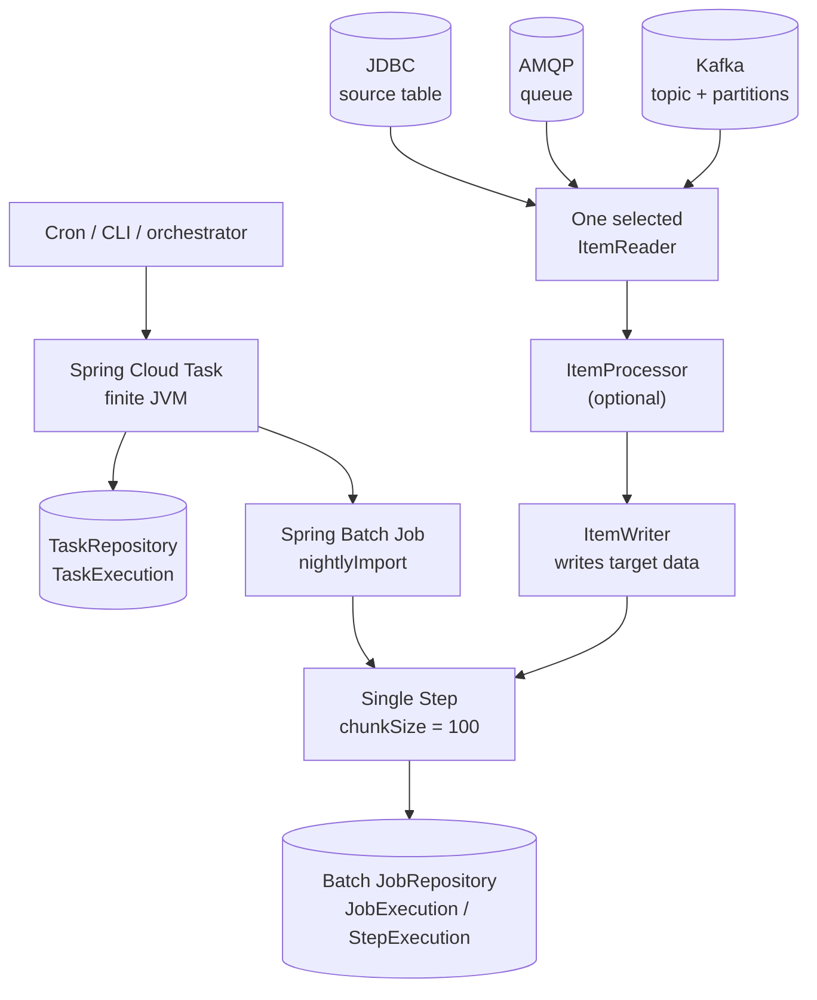
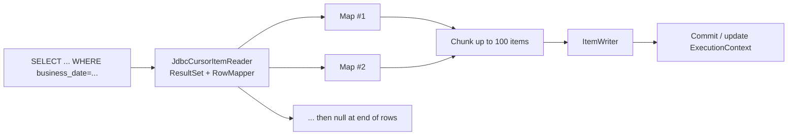
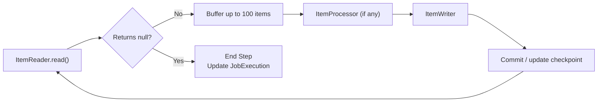

# Reading Data with JDBC, AMQP, or Kafka

## Lesson objectives

In the **Single-Step Jobs** chapter of the **Spring Cloud Task** module, we build a finite-lived Spring Boot task containing **a Spring Batch Job with one Step** to import data from a relational database, an AMQP queue, or Kafka. The focus is on **configuring `ItemReader`** with Spring Cloud Task's **Single Step Batch Job Starter**, verifying results, and understanding the operational constraints of each source.

After completing this lesson, you will be able to:

- Explain the roles of `ItemReader`, `ItemProcessor`, `ItemWriter`, `Job`, `Step`, `JobExecution`, and `TaskExecution` in a finite process.
- Use `spring-cloud-starter-single-step-batch-job` to declare a single-Step Job via properties, and distinguish it from building a Job manually in Java.
- Select and configure `JdbcCursorItemReader`, `AmqpItemReader`, and `KafkaItemReader` according to each data source's characteristics.
- Understand `read() == null`, `chunkSize`, `ExecutionContext`, and the differing restart semantics across JDBC, AMQP, and Kafka.
- Define **data boundaries** so the Task actually terminates, reducing duplicate processing, lost messages, and false-positive success states.
- Reconcile Spring Batch status, Spring Cloud Task status, and JVM/container exit codes in scheduled or on-demand operations.

## 1. Scenario: an event ingestion task with three sources

A transaction management system needs to load payment events into a summary table. Depending on the partner, input data arrives in one of three forms:

1. **JDBC:** rows in the `inbound_event` table of a database.
2. **AMQP:** messages in the RabbitMQ queue `payment-import`.
3. **Kafka:** records in the `payment-events` topic, possibly spread across multiple partitions.

Common requirement: the process is triggered at 02:00 or on demand, reads **a defined scope of data**, writes the results, updates Batch/Task metadata, returns an exit code, and terminates.

When writing a continuously running API service or Kafka consumer, the unit of monitoring is typically **a live running service**. With Spring Cloud Task, the unit of monitoring is **a single finite execution**. Spring Batch splits the run into chunks, records `JobExecution`/`StepExecution`, and provides a foundation for recovery after failures.

**Architectural note:** AMQP queues and Kafka topics are normally unbounded streams where new messages keep arriving. To use them in a finite Task, you need an explicit termination policy: read until no message arrives within a wait window, cap the count, read up to a pre-captured watermark/offset, or process a specific time range. These policies are **not equivalent** in reliability.

## 2. What can the Single Step Batch Job Starter do?

Spring Cloud Task provides a starter with the Maven artifact:

```xml
<dependency>
    <groupId>org.springframework.cloud</groupId>
    <artifactId>spring-cloud-starter-single-step-batch-job</artifactId>
</dependency>
```

This starter configures **a Spring Batch Job with one chunk-oriented Step**, instead of manually writing every `JobBuilder`, `StepBuilder`, reader, and writer bean. The official documentation lists these auto-configured readers: `AmqpItemReader`, `FlatFileItemReader`, `JdbcCursorItemReader`, and `KafkaItemReader`. This lesson focuses on the three assigned sources: **JDBC, AMQP, and Kafka**.

Core properties:

| Property | Meaning | Example |
| --- | --- | --- |
| `spring.batch.job.jobName` | Name of the **Job defined by the starter** | `nightlyImport` |
| `spring.batch.job.stepName` | Name of the single Step | `readAndStore` |
| `spring.batch.job.chunkSize` | Maximum items in a chunk before writer/commit | `100` |

The auto-configured readers and writers use **`Map<String, Object>`** as the input and output item type. If you provide a custom `ItemProcessor`, the expected type is also `ItemProcessor<Map<String, Object>, Map<String, Object>>`. A reader reads data, but **without a writer** there is no complete data-processing pipeline.



**Choose exactly one reader for one Step in this example.** Do not enable all three readers expecting the starter to guess which source to read. If you need multiple simultaneous sources, sequential steps, complex workflows, or custom partitioning, build the Job/Step in Java instead of relying on single-Step auto-configuration.

### 2.1. Distinguishing two similarly named property groups

| Property | Who uses it? |
| --- | --- |
| `spring.batch.job.jobName` | **Single Step Batch Job Starter** defines the Job name |
| `spring.batch.job.stepName` | **Single Step Batch Job Starter** defines the Step name |
| `spring.batch.job.chunkSize` | **Single Step Batch Job Starter** sets the chunk size |
| `spring.batch.job.name` | **Spring Boot Batch launcher**, used to pick which Job runs when multiple Jobs exist in the context |
| `spring.cloud.task.name` | **Spring Cloud Task**, names the `TaskExecution` |

In an example with only one Job bean, Spring Boot can usually launch the Job on application startup. When multiple Job beans exist, specify which Job to run using the API and property for your Spring Boot version. Do not confuse **defining a Job** with **selecting a Job to launch**.

### 2.2. Check versions before copying YAML

The auto-configuration properties below align with the **Spring Cloud Task 3.3.x / Single Step Batch Job Starter** documentation, matching the Spring Boot 3.x and Spring Batch 5.x ecosystem under the appropriate release train. Some starter docs still include older dependency examples pinning version `2.3.0`: **do not copy that number into a new project**. Select a compatible BOM, and verify dependencies and documentation for your exact version.

Spring Batch 6.x changes several APIs/packages. The Java examples for `JdbcCursorItemReaderBuilder`, `AmqpItemReaderBuilder`, and `KafkaItemReaderBuilder` in this lesson are based on **Spring Batch 5.2.x APIs**; when upgrading to the 6.x line, check the Javadocs and adjust imports.

## 3. Setting up the single-step Task project

Use Spring Initializr or a Maven project with a compatible Spring Boot parent and Spring Cloud BOM. The Single Step Batch Job Starter is the core dependency; add database drivers or AMQP/Kafka libraries as needed:

```xml
<dependencies>
    <!-- Creates a single-Step Job and configures reader/writer via properties -->
    <dependency>
        <groupId>org.springframework.cloud</groupId>
        <artifactId>spring-cloud-starter-single-step-batch-job</artifactId>
    </dependency>

    <!-- Demo JDBC, TaskRepository, and Batch JobRepository on H2 -->
    <dependency>
        <groupId>com.h2database</groupId>
        <artifactId>h2</artifactId>
        <scope>runtime</scope>
    </dependency>

    <!-- Add only when choosing AMQP source -->
    <dependency>
        <groupId>org.springframework.boot</groupId>
        <artifactId>spring-boot-starter-amqp</artifactId>
    </dependency>

    <!-- Add only when choosing Kafka source -->
    <dependency>
        <groupId>org.springframework.kafka</groupId>
        <artifactId>spring-kafka</artifactId>
    </dependency>
</dependencies>
```

This is a **dependencies snippet**, not a complete `pom.xml`. In real systems, split dependencies or profiles by the adapter actually required. If your chosen starter version does not bring in all desired Task/Batch integration components, inspect the dependency tree and add libraries such as `spring-cloud-task-batch` explicitly; avoid overlapping multiple versions of the same library.

Spring Boot entry point class:

```java
package com.example.importtask;

import org.springframework.boot.SpringApplication;
import org.springframework.boot.autoconfigure.SpringBootApplication;
import org.springframework.cloud.task.configuration.EnableTask;

@SpringBootApplication
@EnableTask
public class ImportTaskApplication {

    public static void main(String[] args) {
        SpringApplication.run(ImportTaskApplication.class, args);
    }
}
```

**Do not also write an `ApplicationRunner` that calls `JobLauncher`, or manually declare a duplicate Job/Step when using the single-Job auto-configuration**, as that may execute the same work twice.

### 3.1. Common configuration

```yaml
spring:
  application:
    name: payment-import-task
  main:
    web-application-type: none
  datasource:
    url: jdbc:h2:file:./data/task-and-batch
    driver-class-name: org.h2.Driver
    username: sa
    password: ""
  batch:
    job:
      enabled: true
      jobName: nightlyImport
      stepName: readAndStore
      chunkSize: 100
    jdbc:
      initialize-schema: always
  cloud:
    task:
      initialize-enabled: true
      closecontext-enabled: true
      batch:
        fail-on-job-failure: true
```

This configuration is for **local learning**. File-backed H2 preserves metadata tables across runs when pointing to the same path; production requires a durable database and proper migration scripts, with auto-schema initialization turned off. If a `Job` is created but the `DataSource` is invalid or `BATCH_`/`TASK_` tables are missing, the Task can fail before processing a single item.

### 3.2. Demo writer

To stay focused on the reader, use a Spring Bean writer that **only prints IDs/payloads**; this is a **demo** and does not persist business results:

```java
package com.example.importtask;

import java.util.Map;

import org.springframework.batch.item.ItemWriter;
import org.springframework.context.annotation.Bean;
import org.springframework.context.annotation.Configuration;

@Configuration(proxyBeanMethods = false)
public class DemoWriterConfiguration {

    @Bean
    ItemWriter<Map<String, Object>> demoWriter() {
        return chunk -> {
            for (Map<String, Object> item : chunk) {
                System.out.println("Imported: " + item);
            }
        };
    }
}
```

In a real system, replace the writer with `JdbcBatchItemWriter` or a dedicated service enforcing **unique constraints/idempotent upserts**, transactions, and result verification. A success log is not proof that data was committed. **Register only one compatible `ItemWriter`** for `Map<String, Object>` items, or explicitly select the writer in configuration rather than letting multiple beans compete.

## 4. JDBC: reading rows from a database

### 4.1. How does the reader work?

`JdbcCursorItemReader` opens a JDBC `ResultSet` and returns one row per `read()` call. Once all query rows are exhausted, `read()` returns `null`, and the Step finishes after the writer processes the final chunk. This is a **naturally finite** case when the query selects a bounded dataset.



Advantage of a cursor: rows can be streamed one by one without loading the entire table into a `List`. Trade-offs to weigh: holding a cursor/connection open throughout processing, transaction isolation levels, driver memory buffering, and dataset stability across restarts.

### 4.2. Preparing sample data

Example H2 schema (can be placed in the practice project's `schema.sql` or created before running the Job):

```sql
CREATE TABLE IF NOT EXISTS inbound_event (
    id BIGINT PRIMARY KEY,
    business_date DATE NOT NULL,
    payload VARCHAR(500) NOT NULL
);

MERGE INTO inbound_event (id, business_date, payload)
KEY (id)
VALUES (1, DATE '2026-11-23', '{"eventId":"p-1","amount":120000}');

MERGE INTO inbound_event (id, business_date, payload)
KEY (id)
VALUES (2, DATE '2026-11-23', '{"eventId":"p-2","amount":85000}');
```

`MERGE ... KEY` is **H2 syntax for the example**; for PostgreSQL/MySQL, use DDL/upsert syntax matching that database engine. The source data, `JobRepository`, and `TaskRepository` can live in separate schemas/databases; when they do, explicitly configure the reader's datasource.

### 4.3. Auto-configuring `JdbcCursorItemReader` via YAML

Add the following under `spring.batch.job` in the common configuration and pair it with the demo writer above:

```yaml
spring:
  batch:
    job:
      jdbccursoritemreader:
        name: paymentJdbcReader
        sql: SELECT id, payload FROM inbound_event WHERE business_date = DATE '2026-11-23' ORDER BY id
        fetchSize: 100
        saveState: true
```

Starter properties for the JDBC reader also include `maxItemcount`, `currentItemCount`, `maxRows`, `queryTimeout`, `ignoreWarnings`, `verifyCursorPosition`, and `driverSupportsAbsolute`. **These property names belong to the Single Step Batch Job Starter**, not as general properties for every hand-built Spring Batch Job.

In this example:

- `name` is the key identifying the reader's state in `ExecutionContext`, useful for restarts.
- `sql` defines the row set; `ORDER BY id` provides deterministic ordering if the source is unchanged.
- `fetchSize` is only a **hint to the JDBC driver**, not the commit count.
- `chunkSize=100` (from common configuration) is the number of items the Step groups for the writer before committing.
- `saveState=true` lets Batch save the reader position in `ExecutionContext` on commit.

The sample SQL hardcodes one date to keep configuration simple. When receiving `businessDate` from real requests, **never concatenate raw input strings into SQL**. Use `PreparedStatementSetter`, parameter binding, and bound the dataset using validated `JobParameters`.

Example declaring a `RowMapper<Map<String, Object>>` if you need explicit control over column keys:

```java
@Bean
org.springframework.jdbc.core.RowMapper<Map<String, Object>> eventRowMapper() {
    return (rs, rowNum) -> Map.of(
        "id", rs.getLong("id"),
        "payload", rs.getString("payload")
    );
}
```

This is an **additional bean method** inside a `@Configuration` class importing `java.util.Map`; it is not a standalone Java class. Ensure the mapping returns a `Map<String, Object>` compatible with the starter's writer.

### 4.4. When you need Java code instead of properties

For SQL depending on `JobParameter businessDate`, you can declare the reader directly in Java (Spring Batch **5.2.x** API):

```java
@Bean
@StepScope
JdbcCursorItemReader<Map<String, Object>> jdbcReader(
        DataSource dataSource,
        @Value("#{jobParameters['businessDate']}") String businessDate) {

    LocalDate parsedDate = LocalDate.parse(businessDate);

    return new JdbcCursorItemReaderBuilder<Map<String, Object>>()
            .name("paymentJdbcReader")
            .dataSource(dataSource)
            .sql("SELECT id, payload FROM inbound_event "
               + "WHERE business_date = ? ORDER BY id")
            .preparedStatementSetter(ps -> ps.setDate(
                    1, java.sql.Date.valueOf(parsedDate)))
            .rowMapper((rs, rowNum) -> Map.of(
                    "id", rs.getLong("id"),
                    "payload", rs.getString("payload")))
            .fetchSize(100)
            .saveState(true)
            .build();
}
```

Required imports:

```java
import java.time.LocalDate;
import java.util.Map;
import javax.sql.DataSource;
import org.springframework.batch.core.configuration.annotation.StepScope;
import org.springframework.batch.item.database.JdbcCursorItemReader;
import org.springframework.batch.item.database.builder.JdbcCursorItemReaderBuilder;
import org.springframework.beans.factory.annotation.Value;
import org.springframework.context.annotation.Bean;
```

**Distinguishing the two configuration paths:** this is a **custom reader bean**, usable in a manually configured Job/Step or to replace the auto-configured reader when permitted by your starter version. When switching to explicit bean declaration, remove properties that trigger competing reader beans of the same type so exactly one reader is selected.

### 4.5. When to choose `JdbcPagingItemReader`?

If the query is large and you prefer reading across multiple `LIMIT/OFFSET` or keyset-paginated queries instead of holding a long-lived cursor, consider Spring Batch's `JdbcPagingItemReader`. It requires a `PagingQueryProvider` and a **unique sort key** (typically the primary key). The persisted sort key value helps determine the next page on restart.

| Criterion | `JdbcCursorItemReader` | `JdbcPagingItemReader` |
| --- | --- | --- |
| Read mechanism | Single cursor/`ResultSet` | Multiple page-by-page queries |
| Connections | May hold cursor/connection open long | Each page is queried independently |
| Restart | Row count position in cursor and `ExecutionContext` | Typically relies on saved sort key |
| Key requirement | Stable dataset and ordering | **Unique sort key**, deterministic query |
| Auto-configured by Single Step starter in this lesson | **Yes** | **Not listed**; configure in Java |

**Do not assume JDBC paging automatically avoids duplicates if source data mutates.** If rows are inserted, deleted, or modified during execution, align snapshots, watermarks, business keys, and transaction isolation accordingly.

## 5. AMQP: reading messages from a RabbitMQ queue

### 5.1. Source characteristics

`AmqpItemReader` uses `AmqpTemplate` to invoke receive/receive-and-convert and returns each converted message as an item. When no message arrives within the receive timeout, `read()` can return `null`, causing Batch to treat it as **end of input for the current run**.

This differs from JDBC: **an empty queue at time T does not mean the queue won't receive more messages at T+1**. If the goal is to "drain currently available messages in a batch," clearly define the ingestion window and accept that later arrivals will be handled by the next run.

### 5.2. Auto-configuration setup

Alongside the AMQP dependency and Spring Boot's RabbitMQ connection settings, enable the reader under `spring.batch.job`:

```yaml
spring:
  rabbitmq:
    host: localhost
    port: 5672
    username: guest
    password: guest
  batch:
    job:
      amqpitemreader:
        enabled: true
        jsonConverterEnabled: true
```

The Single Step Batch Job Starter docs list two properties:

| Property | Default | Effect |
| --- | --- | --- |
| `spring.batch.job.amqpitemreader.enabled` | `false` | Enables auto-configuration of `AmqpItemReader` |
| `spring.batch.job.amqpitemreader.jsonConverterEnabled` | `true` | Requests the starter to register a JSON converter when appropriate |

**Not enough without a queue.** The reader consumes via `AmqpTemplate`, so ensure the template targets the **right queue** (AMQP exchanges/routing keys route messages into queues, while receive reads from a queue). Example creating a dedicated batch `RabbitTemplate`:

```java
@Bean
RabbitTemplate batchRabbitTemplate(ConnectionFactory connectionFactory) {
    RabbitTemplate template = new RabbitTemplate(connectionFactory);
    template.setDefaultReceiveQueue("payment-import");
    template.setReceiveTimeout(2000);
    return template;
}
```

Imports for the configuration method:

```java
import org.springframework.amqp.rabbit.connection.ConnectionFactory;
import org.springframework.amqp.rabbit.core.RabbitTemplate;
import org.springframework.context.annotation.Bean;
```

Timeout and queue parameters must align with your Spring AMQP/RabbitMQ version. `setReceiveTimeout(2000)` specifies the wait time **in milliseconds** in the `RabbitTemplate` API; the queue must exist and producers must send matching payloads. To decode JSON into `Map<String, Object>`, verify the message converter, payload/header types, and trusted-types policy. Never assume any JSON string converts into the expected types simply because `jsonConverterEnabled` is on.

### 5.3. Using Java for finer reader control

In Spring Batch 5.x, the basic builder looks like:

```java
@Bean
AmqpItemReader<Map<String, Object>> amqpReader(
        AmqpTemplate amqpTemplate) {
    return new AmqpItemReaderBuilder<Map<String, Object>>()
            .amqpTemplate(amqpTemplate)
            .build();
}
```

Imports:

```java
import java.util.Map;
import org.springframework.amqp.core.AmqpTemplate;
import org.springframework.batch.item.amqp.AmqpItemReader;
import org.springframework.batch.item.amqp.builder.AmqpItemReaderBuilder;
import org.springframework.context.annotation.Bean;
```

This snippet only **creates the reader bean**, not a full Job. If declaring the reader manually, disable the corresponding auto-configured reader or qualify beans explicitly to avoid collisions. The `AmqpTemplate` needs a converter returning `Map<String,Object>`.

### 5.4. ACK, transactions, and reruns

A critical question: **what if a message is popped from the queue before the writer commits?**

`AmqpItemReader` is an adapter built on `AmqpTemplate`. Receive/ACK behavior depends on `RabbitTemplate`, channel transactions, broker settings, and integration with Step transactions. You cannot conclude that `chunkSize=100` automatically binds AMQP ACKs and target database commits into one atomic transaction.

Scenario to examine:

1. Reader receives a message with `eventId=p-1`.
2. Writer tries to insert into the database and fails.
3. If the message was already ACKed, the next run may not see `p-1` again; if the broker redelivers it, the message may be processed twice.
4. Correctness depends on **transactional message reception settings** and **writer idempotency**, such as a unique constraint on `eventId`.

`AmqpItemReader` is not an `ItemStreamReader` that persists Kafka-style offsets/checkpoints. With queues, reliable restarts require ACK policies, retry/dead-letter queues, and independent deduplication tracking—not just enabling `saveState` as with a JDBC reader.

**Termination principle:** `receiveTimeout` means "no message received during the wait window," not proof that all messages for the day have arrived. When you must reconcile a complete batch, use an end-of-batch marker, a count manifest, per-batch queues, or verifiable source metadata.

## 6. Kafka: reading partitions and managing offsets

### 6.1. How does it differ from a queue?

A Kafka topic typically **retains records** according to retention policies, and consumers read by **offset** per partition. Reading a record does not delete it from Kafka. `KafkaItemReader` supports reading one or more **explicitly assigned** partitions and stores offsets in Spring Batch `ExecutionContext` for restarts.

| Aspect | AMQP queue | Kafka topic |
| --- | --- | --- |
| Read unit | Message from a queue | Record by partition/offset |
| Progress tracking | ACK/redelivery and business tracking store | Offset per partition, optionally stored in `ExecutionContext` |
| Data after reading | Normally ACKed/removed from queue by broker | Normally retained until retention expires |
| Current end-of-data condition | Queue temporarily empty / receive timeout | Poll yields no new records within timeout |
| Restart risk | Lost or duplicated messages from ACK/transaction mismatch | Re-reading or skipping records due to wrong offset/checkpoint |

`KafkaItemReader` is **not an infinitely running Kafka listener container**. To use it in a finite task, you must define partitions and a **termination point** for the read batch.

### 6.2. Configuring the Single Step Batch Job Starter

Assume the Kafka producer sends JSON objects compatible with `Map<String, Object>`. Reader configuration:

```yaml
spring:
  kafka:
    bootstrap-servers: localhost:9092
    consumer:
      group-id: payment-import-batch
      key-deserializer: org.apache.kafka.common.serialization.StringDeserializer
      value-deserializer: org.springframework.kafka.support.serializer.JsonDeserializer
      enable-auto-commit: false
      properties:
        spring.json.value.default.type: java.util.HashMap
        spring.json.trusted.packages: java.util
  batch:
    job:
      kafkaitemreader:
        name: paymentKafkaReader
        topic: payment-events
        partitions: [0, 1]
        pollTimeOutInSeconds: 5
        saveState: true
```

Starter documentation describes:

| Property | Effect |
| --- | --- |
| `spring.batch.job.kafkaitemreader.name` | Reader's dedicated state key in `ExecutionContext` |
| `spring.batch.job.kafkaitemreader.topic` | Topic to read |
| `spring.batch.job.kafkaitemreader.partitions` | List of **manually assigned partitions** |
| `spring.batch.job.kafkaitemreader.pollTimeOutInSeconds` | Poll wait timeout, **in seconds** in the starter property |
| `spring.batch.job.kafkaitemreader.saveState` | Saves offsets to `ExecutionContext` for restarts, default `true` |

`JsonDeserializer` is an illustrative option for returning a `Map`; in production, properly configure serialization schemas, type headers, trusted classes, and deserialization error handling. Never blindly set `trusted.packages=*`. `enable-auto-commit: false` avoids relying on automatic consumer group offset commits; even so, **Batch checkpoints still do not form a shared atomic transaction with the target database**.

**`partitions: [0, 1]` is valid only if the topic actually has those partitions.** The reader assigns partitions explicitly instead of relying purely on a Kafka listener container's rebalance group assignment. Do not run two readers concurrently on the same partition/offset without idempotency and coordination.

### 6.3. Configuring the reader in Java

When not using auto-configure properties, example for Spring Batch 5.2.x API:

```java
@Bean
@StepScope
KafkaItemReader<String, String> kafkaReader() {
    Properties props = new Properties();
    props.put(ConsumerConfig.BOOTSTRAP_SERVERS_CONFIG, "localhost:9092");
    props.put(ConsumerConfig.GROUP_ID_CONFIG, "payment-batch-demo");
    props.put(ConsumerConfig.KEY_DESERIALIZER_CLASS_CONFIG,
            StringDeserializer.class);
    props.put(ConsumerConfig.VALUE_DESERIALIZER_CLASS_CONFIG,
            StringDeserializer.class);
    props.put(ConsumerConfig.ENABLE_AUTO_COMMIT_CONFIG, false);

    return new KafkaItemReaderBuilder<String, String>()
            .name("paymentKafkaReader")
            .consumerProperties(props)
            .topic("payment-events")
            .partitions(0, 1)
            .pollTimeout(Duration.ofSeconds(5))
            .saveState(true)
            .build();
}
```

Imports:

```java
import java.time.Duration;
import java.util.Properties;
import org.apache.kafka.clients.consumer.ConsumerConfig;
import org.apache.kafka.common.serialization.StringDeserializer;
import org.springframework.batch.core.configuration.annotation.StepScope;
import org.springframework.batch.item.kafka.KafkaItemReader;
import org.springframework.batch.item.kafka.builder.KafkaItemReaderBuilder;
import org.springframework.context.annotation.Bean;
```

In this Java example, the reader emits **`String`**, not `Map<String,Object>`. Therefore it **cannot plug directly into the `Map`-typed Step/Writer** of the auto-configured Single Step Job. To use it, **build your own Step with `ItemReader<String>` and `ItemWriter<String>`**, or add an explicit type-converting adapter. This snippet only demonstrates API-level Kafka configuration; **do not run it alongside** a property-created Kafka reader from the starter.

### 6.4. Starting offsets, checkpoints, and restarts

According to the `KafkaItemReader` 5.2.x Javadoc:

- The reader requires `bootstrap.servers`, `group.id`, key/value deserializers, and a list of partitions.
- `partitionOffsets` can specify the starting offset for each `TopicPartition`.
- When unspecified, the API docs state the default starting offset is `0` for assigned partitions; pass an **empty Map** to use offsets stored in Kafka for the consumer group.
- When **restarting the same Spring Batch `JobInstance`**, offsets saved in `ExecutionContext` **take precedence** over externally configured offsets.
- `saveState=true` enables checkpointing; `saveState=false` disables reader-state-based restarts. Kafka consumers are **not thread-safe**; never share one reader across multiple processing threads.

A common point of confusion: **Kafka consumer group committed offsets** and **offsets inside Batch `ExecutionContext`** are two separate state stores. Do not mix them indiscriminately or assume `enable-auto-commit=true` yields exactly-once semantics.

### 6.5. Finite tasks need an explicit end point

`pollTimeOutInSeconds: 5` **does not mean "read every message of the day"**; it only caps how long a single poll waits. If producers emit steadily, the Step can keep reading for hours. If producers pause longer than the timeout, the reader may conclude there is no more data and end the Job while the batch is actually incomplete.

To **ingest all events existing as of 02:00**, a safer design is:

1. Capture the topic, partitions, **starting offset**, and **exclusive ending offset** (the offset right after the last record to include) at snapshot time.
2. Persist the `(topic, partition, startOffset, endOffset)` tuples into batch import metadata along with `businessDate`.
3. Use a **reader capable of stopping at ending offsets**, either custom-written around `KafkaConsumer` or via an appropriate batch tool. The default `KafkaItemReader` above **does not have an `endOffsets` property** in the 5.2.x builder.
4. Write target records using a unique key `(topic, partition, offset)` or business event ID, update checkpoints on commit, and verify watermarks were reached across **all partitions** before marking the Job successful.
5. On retry, reuse the captured offset range and identifying `JobParameters` to restart without mutating the batch boundaries mid-run.

This is the difference between **"reading until messages temporarily stop"** and **"reading an exact bounded snapshot"**. The property-only lab uses the first approach; payment/audit systems generally require the second.

## 7. Comparing and choosing a reader

| Criterion | JDBC | AMQP | Kafka |
| --- | --- | --- | --- |
| Primary reader | `JdbcCursorItemReader` | `AmqpItemReader` | `KafkaItemReader` |
| Data source | SQL table | RabbitMQ queue | Topic/partitions |
| Easy to bound end of batch? | **Yes**, with stable query/snapshot | **Not by default**, queue can receive new messages | **Not by default**, topic can stream continuously |
| Restart state | Read position in `ExecutionContext` | Mostly relies on ACK/redelivery and idempotency | Per-partition offsets in `ExecutionContext` |
| Main concerns | Cursor/driver overhead, mutating source rows | ACKs, transactions, dead-lettering, late arrivals | Offsets, partitions, retention, end watermarks |
| Auto-configured via Single Step starter | Yes | Yes when `enabled=true` | Yes |
| Item type in starter | `Map<String,Object>` | `Map<String,Object>` | `Map<String,Object>` |
| When to choose | Daily relational DB datasets | Work queues / message batches | Immutable event logs, bounded offset ranges |

No reader automatically guarantees "exactly-once processing" merely because the Step uses transactions. External systems and target stores require safe replay policies.

## 8. `chunkSize`, transactions, and Job status

A Step with `chunkSize=100` typically executes as follows:



This diagram is simplified; Spring Batch invokes callbacks, retry/skip logic, and transactions per actual configuration. **`chunkSize` is not synonymous with JDBC `fetchSize`, AMQP `receiveTimeout`, or Kafka `pollTimeout`**.

| Property | Unit | Purpose |
| --- | --- | --- |
| `spring.batch.job.chunkSize` | Item count | Step commit interval |
| `jdbccursoritemreader.fetchSize` | Row count hint | JDBC driver row-fetching optimization |
| `RabbitTemplate.receiveTimeout` | Milliseconds | Wait time when queue is temporarily empty |
| `kafkaitemreader.pollTimeOutInSeconds` | Seconds | Wait time for a single Kafka poll |
| `spring.batch.job.kafkaitemreader.saveState` | Boolean | Saves reader offsets in context |

### 8.1. Example of a mid-chunk failure

Suppose a Step:

1. Already committed 300 records.
2. Reads 50 more records into a new chunk.
3. Hits a network error in the writer before committing that chunk.

With a JDBC writer sharing the transaction properly, the uncommitted chunk rolls back and Batch restarts from the saved checkpoint. With AMQP/Kafka, message reception/ACKs/offsets may belong to a separate system; a DB transaction **does not automatically roll back** ACKs or offsets already sent. Thus a retry might observe **fewer or more** than 50 records if configuration is inconsistent.

For target data at risk of duplicate writes, prioritize:

- **Unique keys** such as `eventId` or `(topic, partition, offset)`.
- **Upsert/idempotent writers** instead of blind inserts.
- **Recording processing scope** such as `businessDate`, snapshot timestamp, or offset watermarks.
- **Bounding retries** and separating data errors (do not retry identical bad input) from transient errors (retryable).
- **Verifying outputs** by row counts, checksums, or monetary totals rather than only checking `BatchStatus.COMPLETED`.

### 8.2. Batch and Cloud Task metadata

When fully integrated:

| Component | What does it hold? |
| --- | --- |
| `TaskExecution` / `TASK_EXECUTION` | Single JVM launch, start/end timestamps, exit code |
| `JobExecution` / `BATCH_JOB_EXECUTION` | Single Batch Job attempt, `BatchStatus`, and `ExitStatus` |
| `StepExecution` / `BATCH_STEP_EXECUTION` | Read/write/skip counts, commit/rollback counts, Step status |
| `ExecutionContext` | Reader state/offsets/position for restarts when configured and persisted |
| `TASK_TASK_BATCH` | Links `TaskExecution` to `JobExecution` when `TaskBatchExecutionListener` integration is active |

**A scheduler retry can create a new `TaskExecution`.** Reusing the same Job name and identifying `JobParameters` against a persistent Batch repository lets Batch create a **new `JobExecution` under the same `JobInstance`**. Accidentally injecting a fresh identifying `run.id` creates a new `JobInstance` and defeats restartability.

When a Batch Job fails, verify `spring.cloud.task.batch.fail-on-job-failure=true` and measure the actual JVM/container exit code; never assume a `FAILED` Job always yields a non-zero Task exit code in every configuration.

## 9. Scheduled/on-demand execution and result verification

### 9.1. Running locally

After configuring **a single reader** and a properly typed writer, build and run:

```bash
./mvnw package
java -jar target/payment-import-task-0.0.1-SNAPSHOT.jar businessDate=2026-11-23
```

The JAR name is illustrative; replace it with your actual build artifact. With the standard Spring Boot Batch launcher, `JobParameters` arguments without `--` like `businessDate=2026-11-23` are passed as job parameters, whereas `--spring.batch.job.name=...` selects which Job to run. If the starter uses a JDBC reader with a hardcoded date in SQL, passing `businessDate` only serves as a Job identifier in the demo and **does not automatically alter the SQL query date**.

Key verification cases:

1. JDBC has 2 rows in range → demo writer prints 2 items, Step `COMPLETED`.
2. JDBC has 0 rows → Job completes under a policy permitting empty input; if business rules forbid empty runs, add explicit validation.
3. AMQP queue has 2 valid JSON messages → converter returns matching Maps, writer receives all; once queue drains and times out, Step can finish.
4. Kafka has records on partitions `0` and `1` → reader consumes records and saves checkpoints; completion depends on producers and termination policy.
5. Reader/converter fails → inspect `JobExecution.status`, `StepExecution`, Task exit code, and logs; do not just grep for `"Completed"`.

### 9.2. Querying with SQL

With the default schema, query Step metrics:

```sql
SELECT
    e.JOB_EXEC_ID,
    e.STATUS AS JOB_STATUS,
    e.EXIT_CODE AS JOB_EXIT_CODE,
    s.STEP_NAME,
    s.STATUS AS STEP_STATUS,
    s.READ_COUNT,
    s.WRITE_COUNT,
    s.COMMIT_COUNT,
    s.ROLLBACK_COUNT
FROM BATCH_JOB_EXECUTION e
JOIN BATCH_STEP_EXECUTION s
    ON s.JOB_EXEC_ID = e.JOB_EXEC_ID
ORDER BY e.JOB_EXEC_ID DESC, s.STEP_EXEC_ID DESC;
```

To inspect process status:

```sql
SELECT
    TASK_EXECUTION_ID,
    TASK_NAME,
    START_TIME,
    END_TIME,
    EXIT_CODE,
    ERROR_MESSAGE
FROM TASK_EXECUTION
ORDER BY TASK_EXECUTION_ID DESC;
```

The two results have **IDs from two separate metadata systems**. To join via `TASK_TASK_BATCH`, ensure `spring-cloud-task-batch` and `TaskBatchExecutionListener` are active. For Kafka/AMQP, **do not treat `READ_COUNT` as proof that every message in the batch arrived**; reconcile against manifests, source counts, offset snapshots, and business watermarks.

### 9.3. Running in containers

In Docker or a Kubernetes Job, the process must exit when the Step/Job completes. Use the Dockerfile exec form `ENTRYPOINT ["java", "-jar", "/app/app.jar"]` and configure Task context closing as appropriate. Monitor **the JVM/container exit code**, Kubernetes Job status, and Task/Batch metadata.

If RabbitMQ/Kafka/DB is unavailable, handle startup errors and timeouts properly. A failed run must never exit with `0` merely because a demo writer logged output or the application caught and swallowed an exception.

## 10. Troubleshooting

| Symptom | Possible cause | How to check |
| --- | --- | --- |
| Starter does not create a Job | Missing `jobName`/`stepName`/`chunkSize`, reader, or writer; wrong dependencies | Check condition evaluation report, registered Job/Step beans |
| Multiple `ItemReader` or `ItemWriter` beans | Two sources enabled or mixing manual beans with auto-configuration | Pick one setup for the Step and remove extra beans |
| JDBC reports missing table | Wrong datasource, business table or Batch schema missing | Verify `spring.datasource.*`, migrations, and SQL |
| JDBC rerun reads wrong rows | Source data mutated or non-deterministic query | Snapshot data, `ORDER BY` unique key, checkpoints |
| JDBC cursor overloads or holds connections | Large query, missing index, long transactions | Tune SQL/indexes/fetchSize or consider paging |
| AMQP reader returns `null` too early | Queue temporarily empty, short receive timeout | Inspect queue/template, batch window, and timeout |
| AMQP fails to convert payload | Wrong JSON converter, type headers, or trusted types | Inspect actual message and expected Map types |
| AMQP drops or duplicates messages | Unsynchronized ACK/transaction/DB commit | Idempotent writer, transaction config, DLQ, and auditing |
| Kafka sees no records | Wrong topic/partition, deserializer, offset, or auth | Inspect source partitions/offsets and consumer config |
| Kafka re-reads backlog from start | Starting/default offset not as intended | Inspect `partitionOffsets` and `ExecutionContext` |
| Kafka Job runs too long | Producer streams continuously with no end watermark | Capture end offsets and use a bounded-stop reader |
| Kafka Step stops while more data is incoming | Poll timeout treated as end of the entire batch | Use manifests/watermarks instead of waiting for silence |
| Job `FAILED` yet Task exits `0` | Batch status not mapped to Task | Verify `fail-on-job-failure` and actual exit code |
| Restart ignores previous checkpoint | Changed identifying `JobParameters` or lost Batch `JobRepository` | Preserve identity, use persistent store, `saveState=true` |
| Metadata contains secrets | Passwords/tokens passed in `JobParameters` or CLI | Use secret injection, restrict access and logs |

## 11. Pre-deployment design checklist

1. **Finite scope:** define SQL snapshot, AMQP batch window, or Kafka start/end offsets; know what terminates the Step.
2. **Match reader to source:** JDBC for relational tables, AMQP for queues with ACK policies, Kafka for checkpointed partitions.
3. **Consistent data types:** the starter processes `Map<String,Object>`; reader, processor, writer, and converters must align.
4. **Transactions and idempotency:** design rollback/retry behavior, unique keys, DLQs, offsets, and mid-chunk writer failure recovery.
5. **Controlled restarts:** define identifying `JobParameters`, `saveState`, `ExecutionContext`, and a persistent Batch repository.
6. **Task operations:** ensure no lingering background threads/consumers prevent exit; configure timeouts, dependency readiness, and context closing.
7. **Multi-layer observability:** reconcile `TaskExecution`, `JobExecution`, `StepExecution`, process/container exit codes, and business metrics.
8. **Security:** never store secrets in CLI arguments/`JobParameters`; enforce least privilege on DB, broker, topics, logs, and metadata.

## 12. Self-check questions

**1. Using `JdbcCursorItemReader` with `chunkSize=100` and `fetchSize=1000`—does that mean 1,000 items are committed at a time?**

> No. `chunkSize=100` controls the Step's chunk/commit interval; `fetchSize` is only a hint to the JDBC driver for fetching rows.

**2. The RabbitMQ queue was empty at 02:03 and the reader returned `null`. Can we conclude all daily transactions were imported?**

> Not yet. More messages may arrive afterward. You need an explicit batch completion policy, marker/manifest, or business-approved cutoff window.

**3. With `KafkaItemReader` and `saveState=true`, is exactly-once delivery to the target database guaranteed?**

> No. The reader saves offsets in Batch `ExecutionContext` for restarts, but Kafka offsets and target database transactions do not form a single atomic transaction by default. You still need an idempotent writer and checkpoint verification.

**4. Why can't a `KafkaItemReader<String,String>` example plug straight into the default Single Step Batch Job Starter?**

> Because the starter wires a `Map<String,Object>` pipeline. Reading `String` requires declaring a matching Step/Writer or adding an explicit adapter.

**5. How can you process a continuous Kafka topic with a finite daily Task?**

> Capture `startOffset/endOffset` per partition, persist batch metadata, and use a reader that stops at ending offsets. Simply increasing `pollTimeout` does not create a daily boundary.

**6. Why must you keep the same identifying `JobParameters` when retrying the same day?**

> Spring Batch uses Job name plus identifying parameters to identify a `JobInstance`. Changing identity creates a new instance instead of restarting the failed Job.

**7. If you configure JDBC, AMQP, and Kafka adapters simultaneously, does the starter merge all three sources into one Step?**

> No. This lesson selects one reader for one Step. Combining multiple sources requires a multi-Step Job, properly typed composite/adapters, or a dedicated data architecture.

## Takeaways

- **Single Step Batch Job Starter** configures a chunk-based Job/Step; auto-configured readers for JDBC, AMQP, and Kafka all use `Map<String,Object>`.
- **JDBC** naturally terminates over a selected row set; manage cursors, deterministic queries, and checkpoints.
- **AMQP** pulls messages via `AmqpTemplate`; a temporarily empty queue does not prove a batch is complete, and ACKs do not automatically synchronize with target commits.
- **Kafka** reads partitions by offset; `ExecutionContext` enables restarts, but `pollTimeout` is not an end watermark.
- All sources require **finite work boundaries, idempotency, a persistent `JobRepository`, and verified exit codes** to run a Spring Cloud Task safely.

## References

1. [Spring Cloud Task 3.3 — Single Step Batch Job Starter: Job/Step and auto-configured readers](https://docs.spring.io/spring-cloud-task/reference/3.3/batch-starter.html)
2. [Spring Cloud Task — Batch integration and fail-on-job-failure](https://docs.spring.io/spring-cloud-task/reference/batch.html)
3. [Spring Batch 5.2 — Database readers: JDBC cursor/paging](https://docs.spring.io/spring-batch/reference/5.2/readers-and-writers/database.html)
4. [Spring Batch 5.2 — Reader/Writer implementations: AMQP, Kafka](https://docs.spring.io/spring-batch/reference/5.2/readers-and-writers/item-reader-writer-implementations.html)
5. [Spring Batch 5.2 — Chunk-oriented Processing](https://docs.spring.io/spring-batch/reference/5.2/step/chunk-oriented-processing.html)
6. [Spring Batch 5.2 Javadoc — JdbcCursorItemReaderBuilder](https://docs.spring.io/spring-batch/docs/5.2.x/api/org/springframework/batch/item/database/builder/JdbcCursorItemReaderBuilder.html)
7. [Spring Batch 5.2 Javadoc — AmqpItemReaderBuilder](https://docs.spring.io/spring-batch/docs/5.2.2/api/org/springframework/batch/item/amqp/builder/AmqpItemReaderBuilder.html)
8. [Spring Batch 5.2 Javadoc — KafkaItemReaderBuilder](https://docs.spring.io/spring-batch/docs/5.2.x/api/org/springframework/batch/item/kafka/builder/KafkaItemReaderBuilder.html)
9. [Spring Batch 5.2 Javadoc — KafkaItemReader](https://docs.spring.io/spring-batch/docs/5.2.x/api/org/springframework/batch/item/kafka/KafkaItemReader.html)
