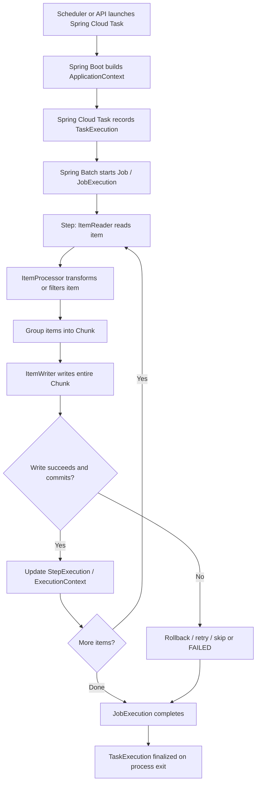

# Writing Data with Supported `ItemWriter` Implementations

## Lesson objectives and scope

A **Spring Cloud Task** application has a finite lifetime: start up, process a request, write results to a database or target system, and terminate. When the workload involves many records, **Spring Batch** provides a single-Step Job following the `ItemReader → ItemProcessor → ItemWriter` model. Within this model, `ItemWriter` is the component that writes read and processed data out to a **destination**: a file, database, or messaging system.

This lesson belongs to the **Single-Step Jobs** chapter and focuses on selecting, configuring, and testing supported `ItemWriter` implementations when building a single-step batch job in a Spring Cloud Task application. After this lesson, you will be able to:

- Explain when an `ItemWriter` is invoked during a chunk and how it relates to transactions and restarts.
- Distinguish the **4 writers auto-configured by the Spring Cloud Task Single Step Batch Job Starter** from other writers available in Spring Batch.
- Configure `AmqpItemWriter`, `FlatFileItemWriter`, `JdbcBatchItemWriter`, and `KafkaItemWriter` for the target system.
- Build a single-Step Job exporting CSV or writing via JDBC, distinguishing `Map<String,Object>` inputs in the starter from POJOs/records in manually configured Java Jobs.
- Evaluate duplicate writes, atomicity, retry/skip, `TaskExecution`, and `JobExecution` for safe operations.

> **Version note:** The property syntax for **Spring Cloud Task Single Step Batch Job Starter 5.1** aligns with the [official documentation](https://docs.spring.io/spring-cloud-task/reference/batch-starter.html). Java Job creation examples follow **Spring Batch 6.x**; when using Spring Batch 5.x, several packages/imports and DSL calls differ—consult the documentation for your chosen version. Always use compatible Java, Spring Boot, Spring Cloud Task, and Spring Batch versions rather than mixing libraries arbitrarily.

## 1. Where does `ItemWriter` fit in a single-step Job?



Spring Batch typically uses **chunk-oriented processing**. `ItemReader.read()` fetches one item at a time; `ItemProcessor.process()` transforms an item (or returns `null` to filter it out); the Step collects items into a `Chunk`. Upon reaching the chunk size or end of data, `ItemWriter.write(...)` is called to write **the entire chunk**. With a transaction manager supporting the target resource, the framework commits after a successful write. See [Spring Batch – Chunk-oriented Processing](https://docs.spring.io/spring-batch/reference/step/chunk-oriented-processing.html).

For example, with `chunkSize = 3`, the reader returns 7 records, and the processor filters none:

| Writer invocation | Items received | Expected outcome |
| --- | --- | --- |
| 1 | Records 1, 2, 3 | Write a 3-item chunk and commit |
| 2 | Records 4, 5, 6 | Write a 3-item chunk and commit |
| 3 | Record 7 | Write the final 1-item chunk and commit |

**Chunk size does not necessarily equal physical SQL row counts.** `JdbcBatchItemWriter` uses JDBC batching, while `FlatFileItemWriter` uses buffering/flushing; with AMQP or Kafka, broker message acknowledgments and DB transactions follow different rules. Never assume an entire chunk is always **atomic** across every kind of destination.

### `ItemWriter` contract and API changes across versions

In Spring Batch 6.x, the interface looks like:

```java
// Spring Batch 6.x: import org.springframework.batch.infrastructure.item.ItemWriter;
// Spring Batch 6.x: import org.springframework.batch.infrastructure.item.Chunk;
@FunctionalInterface
public interface ItemWriter<T> {
    void write(Chunk<? extends T> items) throws Exception;
}
```

This is an abbreviated signature for explanation; import the real Spring Batch class rather than redefining the interface in your app. If starting from older examples using Spring Batch 4's `write(List<? extends T>)`, update to the current version's API. Spring Batch 5 also uses `Chunk`, under package `org.springframework.batch.item`, whereas Spring Batch 6 moved item components into `org.springframework.batch.infrastructure.item`.

When writing a custom writer, you can use a lambda:

```java
ItemWriter<String> auditWriter = chunk -> {
    for (String item : chunk) {
        // Example only: do not use stdout as a production data store.
        System.out.println("write: " + item);
    }
};
```

However, **prefer framework-supported writers** when writing to JDBC, files, or message brokers: they solve many data conversion, stream state, and performance concerns.

## 2. Two categories of "supported writers" to distinguish

The phrase "single-step job" may refer to the **auto-configured starter** or a Spring Batch Job you declare manually. The scope of support differs between the two.

### 2.1. Four writers auto-configured by the Single Step Batch Job Starter

The Spring Cloud Task 5.1 documentation lists 4 autoconfiguration groups:

| Writer | Write target | Starter configuration source | Good fit for |
| --- | --- | --- | --- |
| `AmqpItemWriter` | RabbitMQ/AMQP exchange | `spring.batch.job.amqpitemwriter.*` + `AmqpTemplate` | Publishing messages from a batch to a queue |
| `FlatFileItemWriter` | CSV, text, fixed-width files | `spring.batch.job.flatfileitemwriter.*` | Exporting reports/reconciliation files |
| `JdbcBatchItemWriter` | RDBMS via JDBC batching | `spring.batch.job.jdbcbatchitemwriter.*` + `DataSource` | Persisting processed records in batches |
| `KafkaItemWriter` | Kafka topic | `spring.batch.job.kafkaitemwriter.*` + Kafka client/template | Emitting events per item |

**Important:** the documentation sometimes refers loosely to "`JdbcItemWriter`", but the actual configuration section is named **`JdbcBatchItemWriter`**. When configuring properties, use the exact namespace `spring.batch.job.jdbcbatchitemwriter.*`.

The starter builds a Job with one chunk-based Step whose default components process **`Map<String,Object>`**. If you supply a custom writer, reader, or processor for a starter-built Job, you must maintain **matching input/output types**; you cannot plug an `ItemWriter<InvoiceEntity>` into a Step passing `Map<String,Object>` and expect the framework to convert types automatically.

**Do not confuse** the *starter* properties `spring.batch.job.jobName`, `stepName`, and `chunkSize` with Spring Boot's auto-launch properties `spring.batch.job.name` or `spring.batch.job.enabled`. They serve different purposes.

### 2.2. Other Spring Batch writers for manually configured Jobs

Spring Batch also includes many `ItemWriter` implementations **built into the library** that are **not auto-configured via properties by the starter**:

| Writer | Destination / role | Additional prerequisites |
| --- | --- | --- |
| `JpaItemWriter` | JPA `EntityManager` | Entity mappings, transaction manager/JPA context |
| `RepositoryItemWriter` | Spring Data `CrudRepository` | Repository and appropriate save method |
| `MongoItemWriter` | MongoDB | `MongoOperations` / MongoDB transactions if needed |
| `JsonFileItemWriter` | JSON file | JSON marshaller, file output strategy |
| `StaxEventItemWriter` | XML | OXM marshaller, file resource |
| `JmsItemWriter` | JMS | `JmsOperations`, broker/transactions |
| `CompositeItemWriter` | Writes to **all** delegates sequentially | Multi-target transaction management and delegate `ItemStream` handling |
| `ClassifierCompositeItemWriter` | Selects writer based on item content | Classifier and properly typed delegates |
| `MultiResourceItemWriter` | Splits output across multiple files | Resource suffix and item-per-file limit |
| `ListItemWriter` | Collects items in memory | Mainly for testing; non-persistent |

This table lists **representative options**, not a guarantee that every package is on your classpath from a single starter. You must add dependencies for JPA, MongoDB, Kafka, JMS, or Jackson as needed. See [Spring Batch – Item Reader and Writer Implementations](https://docs.spring.io/spring-batch/reference/readers-and-writers/item-reader-writer-implementations.html) and [Spring Batch – Readers and Writers](https://docs.spring.io/spring-batch/reference/readersAndWriters.html).

**Selection rule:** use the single-step starter when a `Map<String,Object>` pipeline and the auto-configured options meet your needs; write a Java Job/Step when you need custom domain types, complex processing, multiple writers, custom partitioning/restarts, or features beyond the starter's properties.

## 3. Common configuration of the Single Step Batch Job Starter

Refer to the official docs for the Maven dependency:

```xml
<!-- Select artifact version via a release train/BOM compatible with the project. -->
<dependency>
    <groupId>org.springframework.cloud</groupId>
    <artifactId>spring-cloud-starter-single-step-batch-job</artifactId>
</dependency>
```

**Verify the resolved artifact and version** when creating a project: some historical doc examples show a hardcoded starter version or legacy Gradle syntax; never copy them to a different Boot/Cloud release without checking the dependency tree. In a real Spring Cloud Task project, you also need `DataSource`/metadata configuration for Task and Batch, proper permissions, and schemas.

Core properties of the starter:

| Property | Meaning | Example value |
| --- | --- | --- |
| `spring.batch.job.jobName` | Name of the single-step Job created by the starter | `invoiceExportJob` |
| `spring.batch.job.stepName` | Name of the Job's Step | `exportInvoicesStep` |
| `spring.batch.job.chunkSize` | Number of items per chunk/commit interval | `100` |

These property names match the **Single Step Batch Job Starter documentation**; in YAML you can write them in camelCase as documented or canonical relaxed binding, but verify they actually bind at runtime. A large `chunkSize` reduces transaction/call overhead, while increasing memory usage and items reprocessed after a mid-chunk failure; there is no single optimal value for all writer types.

### 3.1. A complete example: input CSV file → output CSV file

Suppose `./input/invoices.csv` contains:

```csv
invoiceId,customerId,amount
INV-001,CUS-01,150.50
INV-002,CUS-02,200.00
INV-003,CUS-03,175.25
```

`application.yml` for a **single-Step** Job using starter-configured `FlatFileItemReader` and `FlatFileItemWriter`:

```yaml
spring:
  application:
    name: invoice-export-task
  main:
    web-application-type: none
  batch:
    job:
      jobName: invoiceExportJob
      stepName: exportInvoicesStep
      chunkSize: 100

      flatfileitemreader:
        name: invoiceCsvReader
        resource: file:./input/invoices.csv
        linesToSkip: 1
        delimited: true
        delimiter: ","
        names: invoiceId,customerId,amount
        saveState: true

      flatfileitemwriter:
        name: invoiceCsvWriter
        resource: file:./output/invoices-export.csv
        delimited: true
        delimiter: ","
        names: invoiceId,customerId,amount
        encoding: UTF-8
        saveState: true
        shouldDeleteIfExists: true
```

When Spring Boot launches the starter-created Job, the reader converts each CSV line into a `Map<String,Object>`, an optional processor transforms the map, and the writer writes fields according to `names` to the target file. Since no processor is declared here, data flows directly from reader to writer. The simulated output is CSV lines **without a header** unless a `FlatFileHeaderCallback` is configured:

```csv
INV-001,CUS-01,150.50
INV-002,CUS-02,200.00
INV-003,CUS-03,175.25
```

**Sample limitations:** `./input` and `./output` directories must actually exist/be mounted with appropriate permissions; field names must match between reader and writer. With `names`, CSV values are initially read as **strings**; if you need `BigDecimal` arithmetic or monetary validation, add an `ItemProcessor<Map<String,Object>,Map<String,Object>>` or a custom mapper. A header is not generated automatically just because the reader has `linesToSkip: 1`; provide a `FlatFileHeaderCallback` if the output needs a header.

**Restart considerations:** `FlatFileItemWriter` maintains state in `ExecutionContext` and handles buffering/transactions within filesystem limits. However, **a file is not a transactional database**. If the job is interrupted, restarting requires controlling the path, existing file state, `saveState`, append/delete modes, and `JobInstance`. Do not assume `shouldDeleteIfExists=true` deletes all data on a valid restart; behavior depends on stream open state. Test crashing mid-way after partial writes.

## 4. `FlatFileItemWriter`: exporting data to files

This writer suits CSV, pipe-delimited, fixed-width, or one-line-per-item text files. It requires a target **`Resource`**, a **`LineAggregator`** (directly or via the builder) to format items into lines, and optional header/footer callbacks, encoding, and file lifecycle settings.

### Common starter properties

| Property under `spring.batch.job.flatfileitemwriter` | Effect | Notes |
| --- | --- | --- |
| `resource` | Output path | In containers, must be a writable volume |
| `delimited` / `formatted` | Selects delimited or fixed-width line formatting | Mutually exclusive modes |
| `delimiter` / `names` | Delimiter character, column order | Map keys must match `names` |
| `encoding` / `lineSeparator` | Character encoding and line endings | Must agree with downstream readers |
| `append` | Appends to an existing file | Easily causes duplicate lines on retry if misused |
| `shouldDeleteIfExists` | Controls handling of pre-existing output file | Account for restarts and new runs |
| `saveState` / `name` | Saves stream state for restarts | Unique name when multiple streams exist |
| `shouldDeleteIfEmpty` | Deletes empty output file on completion | Align with output contract |
| `forceSync` | Forces OS disk flush where supported | Adds I/O cost; does not replace atomic publishing |

Example creating a writer in Java (for Spring Batch 6.x, with a bean item having getters):

```java
@Bean
FlatFileItemWriter<InvoiceCsvRow> invoiceFileWriter() {
    return new FlatFileItemWriterBuilder<InvoiceCsvRow>()
            .name("invoiceCsvWriter")
            .resource(new FileSystemResource("./output/invoices-export.csv"))
            .encoding("UTF-8")
            .delimited()
            .delimiter(",")
            .names("invoiceId", "customerId", "amount")
            .build();
}
```

The snippet above assumes `FlatFileItemWriter`, `FlatFileItemWriterBuilder`, `FileSystemResource`, and `@Bean` are imported, along with an `InvoiceCsvRow` class exposing standard JavaBean properties. When defining a writer in Java, wire it directly into your Step instead of simultaneously enabling unwanted auto-configured writers.

For critical outputs, target paths scoped by **business key + controlled export attempt**, write to a temporary file, verify row count/checksum, and then **publish** via atomic rename/move on supported filesystems. `FlatFileItemWriter` does not turn multi-system publishing into an atomic transaction.

## 5. `JdbcBatchItemWriter`: writing relational data with JDBC batching

The JDBC writer uses `NamedParameterJdbcTemplate`/JDBC batching to execute multiple SQL statements in one chunk call. It is well suited for inserting/updating business tables when SQL and schemas are well defined. To guarantee chunk rollback, **the writer and transaction manager must coordinate over the same JDBC resource**.

### 5.1. Example: CSV → PostgreSQL using the starter's writer

Example target table:

```sql
CREATE TABLE invoice_export (
    invoice_id   VARCHAR(80) PRIMARY KEY,
    customer_id  VARCHAR(80) NOT NULL,
    amount       NUMERIC(18, 2) NOT NULL CHECK (amount >= 0)
);
```

Keep the `flatfileitemreader` config from section 3 and **replace** `flatfileitemwriter` with `jdbcbatchitemwriter`:

```yaml
spring:
  batch:
    job:
      jobName: invoiceImportJob
      stepName: writeInvoicesStep
      chunkSize: 100

      flatfileitemreader:
        name: invoiceCsvReader
        resource: file:./input/invoices.csv
        linesToSkip: 1
        delimited: true
        names: invoiceId,customerId,amount

      jdbcbatchitemwriter:
        sql: >-
          INSERT INTO invoice_export (invoice_id, customer_id, amount)
          VALUES (:invoiceId, :customerId, CAST(:amount AS NUMERIC(18,2)))
        assertUpdates: true
```

The starter allows supplying an `ItemSqlParameterSourceProvider` or `ItemPreparedStatementSetter` if needed. Since the default reader returns `Map<String,Object>`, here is an example provider turning the map into named SQL parameters:

```java
import java.util.Map;
import org.springframework.batch.infrastructure.item.database.ItemSqlParameterSourceProvider;
import org.springframework.context.annotation.Bean;
import org.springframework.jdbc.core.namedparam.MapSqlParameterSource;

@Bean
ItemSqlParameterSourceProvider<Map<String, Object>> csvSqlParameters() {
    return item -> new MapSqlParameterSource(item);
}
```

Note the package `org.springframework.batch.infrastructure.item.database.ItemSqlParameterSourceProvider` in Spring Batch 6.x; in Batch 5.x, the package typically begins with `org.springframework.batch.item.database`. To avoid multiple provider beans of the same type, configure one explicit provider for the writer and inspect the auto-configuration report if conflicts arise.

Configure the PostgreSQL `DataSource` via environment variables rather than storing passwords in code:

```yaml
spring:
  datasource:
    url: ${INVOICE_DB_URL}
    username: ${INVOICE_DB_USER}
    password: ${INVOICE_DB_PASSWORD}
  batch:
    jdbc:
      initialize-schema: never
  cloud:
    task:
      initialize-enabled: false
```

Setting `initialize-schema: never` and `initialize-enabled: false` assumes **Spring Batch schemas, Spring Cloud Task schemas, and business tables are already migrated to matching versions**. If a project uses separate `DataSource` instances for `JobRepository`, `TaskRepository`, and `invoice_export`, wire the corresponding transaction manager beans explicitly; never assume `@Transactional` on datasource A protects datasource B.

**`assertUpdates=true`** requires each write statement to affect at least one row; this is ideal for inserts/updates where modifying zero rows indicates an error. If you implement PostgreSQL `ON CONFLICT DO NOTHING` to make duplicates no-ops, a duplicate item returns an update count of 0; in that case, deliberately evaluate `assertUpdates=false` **alongside comparing existing payloads**. Never disable assertions just to hide errors without verifying business semantics.

### 5.2. Do not equate JDBC batching with `chunkSize`

- `chunkSize` controls Spring Batch's logical item/transaction commit count.
- `JdbcBatchItemWriter` can send multiple statements via JDBC batching within a single chunk.
- Actual batching efficiency depends on the driver, SQL, indexes, transactions, and database settings.
- An overly large 1,000-item chunk can increase lock contention, memory pressure, or transaction log growth; a 1-item chunk reduces pressure at the cost of more commits.

When recovering from failures, rely on business unique keys (e.g., `invoice_id`). If a run commits 4 chunks and crashes in chunk 5, restarting may replay some items depending on the checkpoint; the writer should either tolerate replay or reject duplicates per contract.

## 6. `AmqpItemWriter` and `KafkaItemWriter`: publishing events

These two writers send to a **broker**, unlike JDBC and files: a successful send call does not prove a subscriber finished processing. On network timeouts, the sender might not know whether the broker accepted the message; retries require an appropriate deduplication key.

### 6.1. Sending messages via AMQP/RabbitMQ

The starter provides two main properties:

```yaml
spring:
  batch:
    job:
      amqpitemwriter:
        enabled: true
        jsonConverterEnabled: true
```

- `enabled=true` activates the starter's AMQP writer auto-config; default is `false`.
- `jsonConverterEnabled=true` (default per docs) assists registering a JSON converter; you still need AMQP libraries and config matching your Boot version, message converter, and payload types.
- Requires an `AmqpTemplate`. Spring Boot can create one from RabbitMQ configuration when the dependency is on the classpath.
- If payloads contain sensitive data, configure exchanges/routing keys, ACLs, and retention properly; do not log full payloads.

Use AMQP when pushing work or notifications to asynchronous consumers. Do not treat a successful `ItemWriter.write` call as a guarantee of *exactly once processing* on the consumer side; consumers still need deduplication/idempotency.

### 6.2. Sending records to Kafka

The starter defines:

```yaml
spring:
  batch:
    job:
      kafkaitemwriter:
        topic: invoice-events
        delete: false
```

- `topic` specifies the output topic name.
- `delete` follows the writer's semantics (records are emitted as deletes/tombstones when enabled, depending on key/value mapping). Do not enable arbitrarily when publishing normal events.
- Requires a Kafka client/template configured by Spring Boot or the app, serializers, and key selection so consumers decode records properly.
- `KafkaItemWriter` is a Spring Batch writer, but **does not create a distributed transaction** spanning the `JobRepository` database and Kafka.

If a batch job both updates an invoices table and emits a Kafka event, consider the **transactional outbox** pattern: commit business rows + outbox rows in the same DB transaction, then have a separate publisher emit events. When the publisher retries, use a stable `eventId` so consumers can deduplicate. Calling `CompositeItemWriter` for JDBC and then Kafka **does not** make both commits atomic.

### 6.3. Comparing failure and rerun semantics

| Destination | Actual transaction boundary | Restart/retry risks |
| --- | --- | --- |
| PostgreSQL JDBC | Can roll back chunk if writer shares `DataSource`/transaction manager | Duplicates if checkpoint and DB diverge; needs `UNIQUE` |
| CSV file | Stream/buffer management; no DB transaction across filesystem | Partial writes, unwanted appends, or accidental deletion |
| RabbitMQ AMQP | Depends on publisher confirms, broker, and custom config | Duplicate sends, lost ACKs, duplicate consumer processing |
| Kafka | Depends on producer, broker, and configured transactions/idempotence | Duplicate publishes; DB + Kafka are not atomic from writer alone |


## 7. Manually configuring a single-Step Job in Java when the starter falls short

The Single Step Batch Job Starter uses `Map<String,Object>` and a fixed set of auto-configured writers. If you need custom domain types, idempotency rules, or writers outside those four groups, declare `Job`, `Step`, and `ItemWriter` in Java. The sample below uses **Spring Batch 6.x**, PostgreSQL JDBC, and Java 21.

### 7.1. Dependencies and target table

For a project with a compatible Spring Boot parent + Spring Cloud BOM, the following dependencies are typically required for the example:

```xml
<dependencies>
    <dependency>
        <groupId>org.springframework.boot</groupId>
        <artifactId>spring-boot-starter-batch</artifactId>
    </dependency>
    <dependency>
        <groupId>org.springframework.boot</groupId>
        <artifactId>spring-boot-starter-jdbc</artifactId>
    </dependency>
    <dependency>
        <groupId>org.springframework.cloud</groupId>
        <artifactId>spring-cloud-starter-task</artifactId>
    </dependency>
    <dependency>
        <groupId>org.springframework.cloud</groupId>
        <artifactId>spring-cloud-task-batch</artifactId>
    </dependency>
    <dependency>
        <groupId>org.postgresql</groupId>
        <artifactId>postgresql</artifactId>
        <scope>runtime</scope>
    </dependency>
</dependencies>
```

`spring-cloud-task-batch` provides integration linking `JobExecution` to `TaskExecution`. When a Job bean and the integration library are on the classpath, `TaskBatchExecutionListener` can be auto-configured per Spring Cloud Task docs. In this Java example, **do not also add the single-step starter if you are not using it**, to avoid two mechanisms unexpectedly creating Jobs.

Business table:

```sql
CREATE TABLE invoice_export (
    invoice_id VARCHAR(80) PRIMARY KEY,
    customer_id VARCHAR(80) NOT NULL,
    amount NUMERIC(18, 2) NOT NULL CHECK (amount >= 0)
);
```

`PRIMARY KEY(invoice_id)` prevents duplicate inserts when a scheduler retries the same request or Spring Batch restarts after failure. If an `invoice_id` already exists with different attributes, the system must define a conflict-resolution policy; the example below illustrates **ignoring duplicate inserts**.

### 7.2. Spring Boot application class

Create `src/main/java/com/example/task/InvoiceExportTaskApplication.java`:

```java
package com.example.task;

import org.springframework.boot.SpringApplication;
import org.springframework.boot.autoconfigure.SpringBootApplication;

@SpringBootApplication
public class InvoiceExportTaskApplication {
    public static void main(String[] args) {
        SpringApplication.run(InvoiceExportTaskApplication.class, args);
    }
}
```

### 7.3. Job, Step, and `JdbcBatchItemWriter`

Create `src/main/java/com/example/task/InvoiceExportJobConfig.java`:

```java
package com.example.task;

import java.math.BigDecimal;
import java.util.List;

import javax.sql.DataSource;

import org.springframework.batch.core.job.Job;
import org.springframework.batch.core.job.builder.JobBuilder;
import org.springframework.batch.core.repository.JobRepository;
import org.springframework.batch.core.step.Step;
import org.springframework.batch.core.step.builder.StepBuilder;
import org.springframework.batch.infrastructure.item.ItemReader;
import org.springframework.batch.infrastructure.item.database.JdbcBatchItemWriter;
import org.springframework.batch.infrastructure.item.database.builder.JdbcBatchItemWriterBuilder;
import org.springframework.batch.infrastructure.item.support.ListItemReader;
import org.springframework.context.annotation.Bean;
import org.springframework.context.annotation.Configuration;
import org.springframework.jdbc.core.namedparam.MapSqlParameterSource;
import org.springframework.transaction.PlatformTransactionManager;

@Configuration
public class InvoiceExportJobConfig {

    record InvoiceRow(
            String invoiceId, String customerId, BigDecimal amount) {
    }

    @Bean
    ItemReader<InvoiceRow> invoiceReader() {
        // Static data for lesson demo only; no checkpoint for restart.
        return new ListItemReader<>(List.of(
                new InvoiceRow("INV-001", "CUS-01",
                        new BigDecimal("150.50")),
                new InvoiceRow("INV-002", "CUS-02",
                        new BigDecimal("200.00")),
                new InvoiceRow("INV-003", "CUS-03",
                        new BigDecimal("175.25"))
        ));
    }

    @Bean
    JdbcBatchItemWriter<InvoiceRow> invoiceWriter(DataSource dataSource) {
        return new JdbcBatchItemWriterBuilder<InvoiceRow>()
                .dataSource(dataSource)
                .sql("""
                    INSERT INTO invoice_export (
                        invoice_id, customer_id, amount
                    ) VALUES (:invoiceId, :customerId, :amount)
                    ON CONFLICT (invoice_id) DO NOTHING
                    """)
                .itemSqlParameterSourceProvider(row ->
                        new MapSqlParameterSource()
                                .addValue("invoiceId", row.invoiceId())
                                .addValue("customerId", row.customerId())
                                .addValue("amount", row.amount()))
                // DO NOTHING can leave affected rows = 0 on replay.
                .assertUpdates(false)
                .build();
    }

    @Bean
    Step writeInvoicesStep(
            JobRepository jobRepository,
            PlatformTransactionManager transactionManager,
            ItemReader<InvoiceRow> invoiceReader,
            JdbcBatchItemWriter<InvoiceRow> invoiceWriter) {

        return new StepBuilder("writeInvoicesStep", jobRepository)
                .<InvoiceRow, InvoiceRow>chunk(2)
                .transactionManager(transactionManager)
                .reader(invoiceReader)
                .writer(invoiceWriter)
                .build();
    }

    @Bean
    Job invoiceExportJob(
            JobRepository jobRepository, Step writeInvoicesStep) {

        return new JobBuilder("invoiceExportJob", jobRepository)
                .start(writeInvoicesStep)
                .build();
    }
}
```

**Why does this code demonstrate a single-Step Job?**

- `invoiceExportJob()` has exactly one `Step`.
- `ListItemReader` returns three `InvoiceRow` objects one by one.
- `chunk(2)` triggers two writer invocations: the first writes two records, the second writes one.
- `JdbcBatchItemWriter` accepts `InvoiceRow` objects, maps them to named SQL parameters, and executes a JDBC batch.
- `ON CONFLICT DO NOTHING` combined with `PRIMARY KEY` prevents duplicate rows on reruns. `assertUpdates(false)` is intentional because replayed statements may update **0 rows**.
- `transactionManager` is bound explicitly to the chunk; when sharing one `DataSource` for business data and the Batch repository, the transaction manager must actually govern those JDBC operations.

In Spring Batch 6, `StepBuilder` supports `.<I,O>chunk(size).transactionManager(txManager)`. Avoid copying Batch 5's older `chunk(size, txManager)` syntax without checking deprecation. In other versions, the packages for `ItemReader`, `JdbcBatchItemWriter`, `Step`, and `Job` may differ.

**Limitation to remember:** `ListItemReader` is a simple demo reader that **does not support checkpointed restarts like stateful `ItemStream` readers**. If a Job fails after committing one chunk and restarts, a fresh reader may start from the beginning again; the unique key/`ON CONFLICT` keeps the example from inserting duplicate rows. For large datasets, use `JdbcPagingItemReader`, `JdbcCursorItemReader`, `FlatFileItemReader`, or another stateful reader and test restart positions.

### 7.4. Configuration and running

Assume PostgreSQL already has the business table and migrated schemas for `JobRepository`/`TaskRepository`:

```yaml
spring:
  application:
    name: invoice-export-task
  main:
    web-application-type: none
  datasource:
    url: ${TASK_DB_URL}
    username: ${TASK_DB_USER}
    password: ${TASK_DB_PASSWORD}
  batch:
    job:
      enabled: true
      name: invoiceExportJob
    jdbc:
      initialize-schema: never
  cloud:
    task:
      initialize-enabled: false
      batch:
        fail-on-job-failure: true
```

For **a single Job bean**, Spring Boot can auto-launch the Job on startup. If multiple Job beans exist, use `spring.batch.job.name` to select one. With a manually declared Java Job, you **do not need** the single-step starter's `spring.batch.job.jobName`, `stepName`, or `chunkSize`.

When an app uses both Spring Cloud Task and Spring Batch, `spring.cloud.task.batch.fail-on-job-failure=true` propagates `BatchStatus.FAILED` up to the Task status/exit code via the integration mechanism. Never assume a failed Job causes a non-zero exit code without enabling and testing this property.

After packaging the JAR with Maven/Gradle:

```bash
java -jar target/invoice-export-task.jar
```

After each test run, inspect the table:

```sql
SELECT invoice_id, customer_id, amount
FROM invoice_export
ORDER BY invoice_id;
```

Expected output: three rows for `INV-001`, `INV-002`, `INV-003`. Rerunning requires a **valid `JobInstance`** per `JobParameters`; a `COMPLETED` `JobInstance` normally cannot be relaunched as a new run with identical identifying parameters. In test environments, pass distinct `JobParameters` when triggering a fresh run while keeping `invoice_id` unchanged to test deduplication **in the business table**. Never use a random timestamp as the invoice's deduplication key; that only differentiates the `JobInstance`.

## 8. Writer failures: transactions, retries, skips, and restarts

`ItemWriter` receives an entire chunk. When writing one item fails, Spring Batch can **roll back the chunk's transaction**, and then—depending on configuration—fail immediately, retry, or skip the bad item. Rollback effectiveness depends on the target resource and transaction manager; a writer that sends emails or publishes to a broker cannot un-send messages once dispatched.

### Error-handling mechanisms

| Mechanism | Effect | When appropriate |
| --- | --- | --- |
| Default fail | Exception from writer fails the Step; transaction rolls back if managed | Severe data errors that must not be dropped |
| Bounded retry | Retries transient failures | DB deadlocks / transient network errors with an idempotent writer |
| Bounded skip | Skips a few bad items per policy | Dirty records where business rules allow skipping and logging |
| Restart | Resumes a failed `JobInstance` from state stored in `JobRepository` | Source/target have checkpoints and controlled side effects |
| Idempotency table / unique key | Prevents duplicate effects when a chunk is retried | Data pipelines and external system integrations |

In Batch 6, configure retry/skip according to the current version's API; do not copy `.retryLimit(3)`/`.skipLimit(10)` verbatim from Batch 5 without checking, as fault tolerance was refactored in some 6.x releases. See [Spring Batch – Configuring Skip Logic](https://docs.spring.io/spring-batch/reference/step/chunk-oriented-processing/configuring-skip.html) and [Spring Batch – Fault Tolerance](https://docs.spring.io/spring-batch/reference/step/chunk-oriented-processing/configuring.html).

**Diagnosing a failed chunk write**: Spring Batch can fall back to writing one item at a time when skip is configured for writer exceptions to pinpoint the failing item. Because `ItemWriter` normally receives a whole chunk, the offending record cannot be identified from a generic chunk exception alone. During retries, the processor may be re-invoked. With `JpaItemWriter`, a failed `flush` can leave entities/the persistence context unsafe to reuse; processor caching and retry policies must be verified.

### Managing `ItemStream` with stateful writers

`FlatFileItemWriter` and several file writers implement `ItemStream`: they expose `open`, `update`, and `close` callbacks to manage offsets and persist state in `ExecutionContext`. When a writer is **attached directly** to the Step and implements `ItemStream`, the framework registers the stream automatically. If the writer is a **delegate inside `CompositeItemWriter`** or another wrapper, check whether delegate streams are auto-registered or require `.stream(delegate)` on the Step builder. Missing stream registration prevents opening/updating state and breaks restarts.

### Distinguishing the two repositories

- **Spring Batch's `JobRepository`** stores `JobExecution`, `StepExecution`, `ExecutionContext`, and read/write/skip/commit counters.
- **Spring Cloud Task's `TaskRepository`** stores `TaskExecution`, timestamps, exit code, and process metadata.

If the writer writes to a different datasource than the Step/`JobRepository` transaction manager, data commits and checkpoint updates **may not be atomic**. On restart, an already committed chunk might be re-written to the target DB if `JobRepository` did not record the commit. **An idempotent writer design** is the mandatory line of defense in such architectures. See [Spring Batch – Configuring a Step](https://docs.spring.io/spring-batch/reference/step/chunk-oriented-processing/configuring.html).

## 9. Tracking write outcomes: `writeCount` and Task metadata

Returning from `write(...)` does not directly report how many physical rows were mutated in the target; Spring Batch increments **`writeCount`** by the number of items the Step considers successfully written. With `INSERT ... ON CONFLICT DO NOTHING`, a 3-item chunk still increments `writeCount` by 3 even if one item inserted nothing. Hence `writeCount` and physical database `INSERT` counts are **not always equal**.

Metrics to monitor:

| Metric | Description | Evaluation notes |
| --- | --- | --- |
| `readCount` | Items read by the reader in the Step | May differ from input count after filtering |
| `filterCount` | Items dropped by processor returning `null` | Distinguish from error skips |
| `writeCount` | Items considered written by the Step | Does not guarantee new DB rows on upserts/no-ops |
| `readSkipCount`, `processSkipCount`, `writeSkipCount` | Items skipped due to errors per phase | Must stay within business thresholds |
| `commitCount`, `rollbackCount` | Commit/rollback counts | Indicators of performance and retries |
| `BatchStatus`/`ExitStatus` | Job/Step outcome | Distinct from `TaskExecution.exitCode` |
| `TaskExecution.exitCode` | Task application exit code | Needs `fail-on-job-failure` when integrated with Batch |

For example, with a JDBC `JobRepository`, `BATCH_STEP_EXECUTION` stores the counters:

```sql
SELECT
    STEP_EXECUTION_ID,
    STEP_NAME,
    STATUS,
    READ_COUNT,
    WRITE_COUNT,
    FILTER_COUNT,
    READ_SKIP_COUNT,
    PROCESS_SKIP_COUNT,
    WRITE_SKIP_COUNT,
    COMMIT_COUNT,
    ROLLBACK_COUNT
FROM BATCH_STEP_EXECUTION
ORDER BY STEP_EXECUTION_ID DESC;
```

To verify actual business data, query `invoice_export` by business key:

```sql
SELECT COUNT(*) AS total_exported_rows
FROM invoice_export;
```

If a Job succeeds yet under-exports or duplicates data, `writeCount` alone proves nothing. Combine checksums, target row/record counts, query checks, and business totals. For files, verify checksums, size, headers, and record counts; for Kafka/AMQP, monitor producer errors and consumer-side deduplication/processing status.

## 10. Security, performance, and operations

### Common issues

| Symptom | Possible cause | Resolution |
| --- | --- | --- |
| Job creates no writer | Starter missing from classpath, misspelled property, missing resource/template | Check dependency tree, property namespaces, and auto-config |
| `FlatFileItemWriter` cannot open file | Missing directory, wrong permissions/volume, relative path vs. `WORKDIR` | Create/mount proper directory, use environment-configured paths |
| CSV columns written in wrong order | `names` mismatch or missing processor mapping | Align keys/fields, inspect header and sample data |
| JDBC writer missing named parameter | Reader returns Map missing key, or wrong provider type | Check `names` and `ItemSqlParameterSourceProvider` |
| JDBC `EmptyResultDataAccessException` / item not updated | `assertUpdates=true` with SQL returning updateCount 0 | Inspect SQL, constraints, and whether no-ops are allowed |
| Job uses database A, `TaskRepository` uses B | Multiple `DataSource` beans without explicit wiring | Declare `DataSource` and transaction managers explicitly per repo/writer |
| Duplicate writes after retry | Missing unique business key or non-idempotent writer | Enforce DB constraints, downstream idempotency keys, checkpoint management |
| Kafka/AMQP send succeeds but consumer hasn't processed | Publishing and consuming are two separate async steps | Monitor consumer/ACK status and event keys |
| `TaskExecution.exitCode=0` while Job `FAILED` | Batch failure not propagated to Task | Verify `fail-on-job-failure` and real logs/events |
| Job too slow with large chunks | DB lock contention, memory pressure, unoptimized driver batching | Measure throughput/latency; tune chunk size, pool, SQL, and indexes |

### Principles for choosing writers safely

1. **Separate input and output permissions**: grant only read permissions on input sources, and restrict writer permissions to authorized tables/topics/paths.
2. **Keep secrets off the CLI**: never pass `--spring.datasource.password=...` or broker tokens as command-line arguments; Spring Cloud Task may persist execution arguments.
3. **Externalize environment config**: DB URLs, output paths, topics, and exchanges belong to deployment config. `JobParameters` describe business scope such as date or tenant, never arbitrary infrastructure overrides.
4. **Use stable business keys**: Job restarts or scheduler retries must reuse keys identifying the same business intent.
5. **Verify files before publishing**: prevent consumers from reading partially written files; publish only after the Job/Step succeeds.
6. **Audit external writes**: for brokers and external APIs, DB transactions do not cover external side effects.
7. **Monitor both execution layers**: `JobExecution`/`StepExecution` for counts and chunk status; `TaskExecution` for process lifecycle.

## 11. Scenario exercises

**Scenario A:** A CSV export task has `Map<String,Object>` reader and writer; we want to auto-create `JpaItemWriter<Customer>` using a `spring.batch.job.jpa...` property. Will the starter create this writer automatically?

**Hint:** Not according to the Single Step Batch Job Starter's documented autoconfiguration list. `JpaItemWriter` is a Spring Batch writer; using it requires declaring the bean and Step manually with `EntityManagerFactory` and a transaction manager, while keeping item types consistent.

**Scenario B:** A Job receives 1,000 items with `chunkSize=100`. The reader filters nothing and the writer throws no errors. Roughly how many times is the writer invoked?

**Hint:** Around 10 times, once per 100-item chunk. If a processor filters items, chunks are formed by the framework's read/process loop; do not assume write count always equals output items divided by chunk size in every case.

**Scenario C:** A JDBC writer uses `ON CONFLICT DO NOTHING` and an invoice already exists. What can happen with `assertUpdates=true`?

**Hint:** The writer may treat a statement with updateCount 0 as an error. Set `assertUpdates=false` only when duplicates are intentionally defined as no-ops and payload discrepancies are handled rather than silently ignored.

**Scenario D:** A `CompositeItemWriter` writes to PostgreSQL and then emits a Kafka event. The DB commit succeeds, but the Kafka send fails. Are both systems rolled back automatically?

**Hint:** No. `CompositeItemWriter` does not establish a distributed transaction between DB and Kafka. Consider an outbox/consumer deduplication and check downstream state.

**Scenario E:** A report-exporting Job is killed halfway through writing a file. A restart creates a fresh file and writes from line 1, leaving two files with partial data. What should you inspect?

**Hint:** Check `JobInstance`/`ExecutionContext`, writer name, `saveState`, `append`, `shouldDeleteIfExists`, and temp-file/atomic-publish design; inspect both reader and writer checkpointing.

**Scenario F:** Spring Cloud Task records exit code 0, yet `BATCH_JOB_EXECUTION` shows the Job `FAILED`. Is this a contradiction?

**Hint:** These are two different result layers. Check `spring-cloud-task-batch` integration and `spring.cloud.task.batch.fail-on-job-failure`; never assume a `FAILED` Job always throws an exception to yield a non-zero Task exit code.

## 12. Pre-production checklist

- [ ] Confirmed whether the writer is one of the **4 auto-configured Single Step Batch Job Starter types** or a Spring Batch writer registered in Java.
- [ ] If using the starter, ensured reader/processor/writer share the `Map<String,Object>` contract; if using a Java Job, verified uniform generic types.
- [ ] Tuned `chunkSize` and transaction manager for the target resource; measured commit/rollback duration.
- [ ] For JDBC: verified named parameters, indexes/constraints, upsert/idempotency strategy, and schema migrations.
- [ ] For files: configured `resource`, encoding, line format, writer name, `saveState`, paths, and publishing workflow.
- [ ] For Kafka/AMQP: configured broker/template, serializers/converters, topics/exchanges, delivery confirms, retries, and consumer deduplication.
- [ ] For stateful writers, verified `ItemStream` registration even when wrapped inside composite/delegate writers.
- [ ] Tested mid-chunk failures, retries, skips, restarts, reruns with the same business key, and abnormal process termination.
- [ ] Monitored `writeCount`/`skipCount`/`rollbackCount` and reconciled against actual target records.
- [ ] With Cloud Task integration, reconciled `TaskExecution` against `JobExecution` and configured failure exit-code propagation.
- [ ] Secured secrets; kept sensitive fields out of CLI arguments, public CSVs, and message payloads.
- [ ] Established procedures for data conflicts, hung Job recovery, and external side-effect reconciliation.

## 13. Official references

1. [Spring Cloud Task 5.1 – Single Step Batch Job Starter](https://docs.spring.io/spring-cloud-task/reference/batch-starter.html): the four auto-configured `ItemWriter` types and property namespaces.
2. [Spring Batch – Item Reader and Writer Implementations](https://docs.spring.io/spring-batch/reference/readers-and-writers/item-reader-writer-implementations.html): database, file, broker, and composite writers.
3. [Spring Batch – Chunk-oriented Processing](https://docs.spring.io/spring-batch/reference/step/chunk-oriented-processing.html): chunked reader/processor/writer execution and transaction boundaries.
4. [Spring Batch – Configuring a Step](https://docs.spring.io/spring-batch/reference/step/chunk-oriented-processing/configuring.html): Job/Step builders, transaction managers, and notes when `JobRepository` differs from the writer transaction.
5. [Spring Batch – FlatFileItemWriter](https://docs.spring.io/spring-batch/reference/readers-and-writers/flat-files/file-item-writer.html): `LineAggregator`, CSV/fixed-width formatting, and stream state.
6. [Spring Batch – Database](https://docs.spring.io/spring-batch/reference/readers-and-writers/database.html): JDBC batching, JPA, and rollback/performance notes.
7. [Spring Cloud Task – Batch](https://docs.spring.io/spring-cloud-task/reference/batch.html): linking `TaskExecution` to `JobExecution` and `fail-on-job-failure`.
8. [Spring Boot – Spring Batch](https://docs.spring.io/spring-boot/reference/io/spring-batch.html): running Jobs at startup, `spring.batch.job.name`/`enabled`, and repository schemas.

**Key principle to remember:** **`ItemWriter` determines the target and write mechanism of a chunk; transactions, restarts, and idempotency determine whether that write is safe when failures happen.** With the Spring Cloud Task Single Step Batch Job Starter, the four auto-configured writers are AMQP, FlatFile, JDBC Batch, and Kafka; other Spring Batch writers must be configured and verified according to your chosen Job style.
