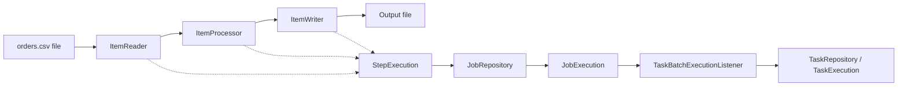

# Adding an ItemProcessor and Replacing Auto-Configured Beans

## 1. Why customize a single-step Job?

**Spring Cloud Task** helps build finite-lived Spring Boot applications and stores execution history in **`TaskRepository`**: start time, end time, exit code, and parameters. When a workload processes batch data, the application can use **Spring Batch** to read, transform, and write data in chunks, manage transactions, and track `JobExecution`/`StepExecution`. A Job may only need **one Step** if every record goes through the same processing flow.

Spring Cloud Task's **`spring-cloud-starter-single-step-batch-job`** library helps create a single-step Job through configuration. The starter constructs the `Job` and `Step` scaffold and allows configuring built-in `ItemReader` and `ItemWriter` implementations, while **`ItemProcessor`** is an optional component supplied by the application as a Spring bean. When the default components do not meet business requirements, you can **replace them with custom beans**.

For example: importing an orders CSV file, normalizing customer names, calculating tax-inclusive amounts, filtering out invalid records, and writing the results to another file. This lesson focuses on two customizations:

1. **Adding an `ItemProcessor<Map<String, Object>, Map<String, Object>>`** to a single-step Job to process data between the reader and writer.
2. **Replacing an auto-configured `ItemReader` or `ItemWriter`** from the starter with a Java bean when specialized logic is required.

After this lesson, you will be able to recognize the boundaries of auto-configuration, declare properly typed processors, unambiguously select a reader/writer bean, test success/filter/failure cases, and understand the impact on Spring Cloud Task history, restartability, and scheduled execution safety.

> In this lesson, **replacing an auto-configured bean** means explicitly supplying a bean for that role and disabling the starter's properties that create the unneeded default bean. This replaces a Job component's configuration; it does not mean enabling Spring Boot's global flag for overriding duplicate bean names.

## 2. Flow of a Job with one Step

A **chunk-oriented processing** Step reads multiple items, processes each item, and sends the entire chunk to the writer. With the starter, the configuration-driven readers and writers typically exchange items as **`Map<String, Object>`**.



| Component | Role | Result |
| --- | --- | --- |
| `ItemReader<Map<String, Object>>` | Reads records one by one from CSV/JDBC/queue | A map or `null` at end of data |
| `ItemProcessor<Map<String, Object>, Map<String, Object>>` | Validates, cleans, calculates, filters | Transformed map or `null` to skip item |
| `ItemWriter<Map<String, Object>>` | Writes a chunk of processed items | Writes to file, database, message… |
| `Step` | Coordinates read → process → write; chunk transactions | `StepExecution` and counters |
| `Job` | Wraps the Step and a Job run | `JobExecution` |
| `TaskRepository` | Tracks Spring Cloud Task application launches | `TaskExecution` |

**Important:** `ItemProcessor.process()` returning `null` means **filtering out the item**, so nothing is sent to the writer for that record. This differs from throwing an exception, which can fail the Step unless an appropriate skip/retry policy is configured.

### 2.1. A single-step Job does not mean a single-run Task

A single-step Job can still be executed many times; each run creates a `JobExecution` matching its `JobParameters` and `JobInstance` state. Likewise, each launch of the Spring Cloud Task application creates its own `TaskExecution`. The number of Steps does not dictate the number of executions.

### 2.2. Scope of auto-configuration

The **Single Step Batch Job Starter** documentation lists the foundational properties:

| Starter property | Meaning |
| --- | --- |
| `spring.batch.job.jobName` | Name of the Job built by the starter |
| `spring.batch.job.stepName` | Name of the single Step |
| `spring.batch.job.chunkSize` | Number of items per chunk |

Readers supported by starter configuration include **`AmqpItemReader`, `FlatFileItemReader`, `JdbcCursorItemReader`, and `KafkaItemReader`**. Supported writers include **`AmqpItemWriter`, `FlatFileItemWriter`, `JdbcBatchItemWriter`, and `KafkaItemWriter`**. Readers and writers can be configured via properties or Java beans.

The **starter's** `spring.batch.job.jobName` property differs from **Spring Boot's** `spring.batch.job.name`, which selects which Job to auto-launch when multiple Job beans exist. The names look similar, but their functions are different.

## 3. Rules for wiring `ItemProcessor` with the starter

According to the Spring Cloud Task 3.2 documentation, the starter looks for a Spring bean of matching type:

```java
ItemProcessor<Map<String, Object>, Map<String, Object>>
```

If a matching bean is found, the starter wires it into the Step. You do not need to build `JobBuilder`/`StepBuilder` yourself just to add a transformation.

Example of a processor normalizing customer names and calculating tax-inclusive totals:

```java
@Bean
public ItemProcessor<Map<String, Object>, Map<String, Object>>
        normalizeOrdersProcessor() {
    return item -> {
        String orderId = item.get("order_id").toString().trim();
        String customer = item.get("customer").toString().trim();
        if (customer.isBlank()) {
            return null;  // Filter out records missing customer name
        }

        BigDecimal amount = new BigDecimal(
                item.get("amount").toString().trim());

        Map<String, Object> output = new LinkedHashMap<>(item);
        output.put("order_id", orderId);
        output.put("customer", customer);
        output.put("amount", amount);
        output.put("amount_with_tax",
                amount.multiply(new BigDecimal("1.10"))
                      .setScale(2, RoundingMode.HALF_UP));
        return output;
    };
}
```

The exact generic signature lets the starter discover the bean and ensures the writer receives a `Map`. If you declare `ItemProcessor<Order, Invoice>` while the starter configures `ItemReader<Map<String, Object>>` and `ItemWriter<Map<String, Object>>`, the types will not match. In that case, build the Step yourself with the `Order`/`Invoice` model, or switch the reader/writer accordingly.

**Do not mutate the input map directly unless you are certain no other reader/component reuses that instance.** Copying via `new LinkedHashMap<>(item)` before modifying output fields prevents side effects and simplifies testing.

## 4. Sample Spring Boot and Spring Cloud Task project

The example uses **Java 17**, **Spring Boot 3.4.5**, and **Spring Cloud 2024.0.2**. With these versions, let the Spring Cloud BOM manage Task module versions and let Spring Boot manage Spring Batch. The official starter docs still have older snippets using `2.3.0`; **do not pin that old starter version** in a Boot 3.x application.

Directory layout:

```text
single-step-demo/
├── pom.xml
├── input/
│   └── orders.csv
├── output/
└── src/main/
    ├── java/com/example/singlestep/
    │   ├── SingleStepApplication.java
    │   └── OrderProcessorConfiguration.java
    └── resources/
        ├── application.yml
        └── application-init.yml
```

### 4.1. `pom.xml`

```xml
<?xml version="1.0" encoding="UTF-8"?>
<project xmlns="http://maven.apache.org/POM/4.0.0"
         xmlns:xsi="http://www.w3.org/2001/XMLSchema-instance"
         xsi:schemaLocation="http://maven.apache.org/POM/4.0.0 https://maven.apache.org/xsd/maven-4.0.0.xsd">
    <modelVersion>4.0.0</modelVersion>

    <parent>
        <groupId>org.springframework.boot</groupId>
        <artifactId>spring-boot-starter-parent</artifactId>
        <version>3.4.5</version>
        <relativePath/>
    </parent>

    <groupId>com.example</groupId>
    <artifactId>single-step-demo</artifactId>
    <version>0.0.1-SNAPSHOT</version>

    <properties>
        <java.version>17</java.version>
        <spring-cloud.version>2024.0.2</spring-cloud.version>
    </properties>

    <dependencyManagement>
        <dependencies>
            <dependency>
                <groupId>org.springframework.cloud</groupId>
                <artifactId>spring-cloud-dependencies</artifactId>
                <version>${spring-cloud.version}</version>
                <type>pom</type>
                <scope>import</scope>
            </dependency>
        </dependencies>
    </dependencyManagement>

    <dependencies>
        <dependency>
            <groupId>org.springframework.cloud</groupId>
            <artifactId>spring-cloud-starter-task</artifactId>
        </dependency>
        <dependency>
            <groupId>org.springframework.cloud</groupId>
            <artifactId>spring-cloud-starter-single-step-batch-job</artifactId>
        </dependency>
        <dependency>
            <groupId>org.springframework.boot</groupId>
            <artifactId>spring-boot-starter-batch</artifactId>
        </dependency>
        <dependency>
            <groupId>com.h2database</groupId>
            <artifactId>h2</artifactId>
            <scope>runtime</scope>
        </dependency>
    </dependencies>

    <build>
        <plugins>
            <plugin>
                <groupId>org.springframework.boot</groupId>
                <artifactId>spring-boot-maven-plugin</artifactId>
            </plugin>
        </plugins>
    </build>
</project>
```

`spring-cloud-starter-single-step-batch-job` provides the Job/Step configuration and built-in supported readers/writers. `spring-boot-starter-batch` provides Batch infrastructure, `JobRepository`, and startup auto-launch; `spring-cloud-starter-task` persists Task lifecycle records in the database.

### 4.2. Configuring `application.yml`

```yaml
spring:
  application:
    name: single-step-demo
  main:
    web-application-type: none
  datasource:
    url: jdbc:h2:file:./data/single-step-db;DB_CLOSE_ON_EXIT=FALSE
    driver-class-name: org.h2.Driver
    username: sa
    password: ""
  cloud:
    task:
      name: single-step-demo
      initialize-enabled: false
      closecontext-enabled: true
  batch:
    jdbc:
      initialize-schema: never
    job:
      enabled: true
      name: normalizeOrdersJob
      jobName: normalizeOrdersJob
      stepName: normalizeOrdersStep
      chunkSize: 2
      flatfileitemreader:
        name: ordersCsvReader
        resource: file:./input/orders.csv
        linesToSkip: 1
        delimited: true
        names: order_id,customer,amount
      flatfileitemwriter:
        name: ordersCsvWriter
        resource: file:./output/orders-normalized.csv
        delimited: true
        names: order_id,customer,amount,amount_with_tax
```

Distinguish the two groups:

- `spring.batch.job.jobName`, `stepName`, and `chunkSize` are the starter's single-step Job properties.
- `spring.batch.job.flatfileitemreader.*` and `flatfileitemwriter.*` configure the auto-configured reader and writer.
- `spring.batch.job.name` and `enabled` govern Spring Boot's Job selection and auto-launch.
- `spring.cloud.task.*` tracks execution at the application level. File-backed H2 persists `TaskExecution` and `JobExecution` across runs.

Item field names in the reader and writer must align with the keys produced by the processor. For instance, the writer expects `amount_with_tax`, so the processor must populate that key before the writer receives the item.

### 4.3. First-time schema initialization profile

Create `src/main/resources/application-init.yml`:

```yaml
spring:
  cloud:
    task:
      initialize-enabled: true
  batch:
    jdbc:
      initialize-schema: always
```

Use the `init` profile only against a **fresh practice database**. Subsequent runs should use the default `application.yml` so DDL is not re-executed. In production, manage Task and Batch schemas with version-matched migrations, backups, and proper permissions.

### 4.4. Spring Boot application

Create `SingleStepApplication.java`:

```java
package com.example.singlestep;

import org.springframework.boot.SpringApplication;
import org.springframework.boot.autoconfigure.SpringBootApplication;
import org.springframework.cloud.task.configuration.EnableTask;

@SpringBootApplication
@EnableTask
public class SingleStepApplication {

    public static void main(String[] args) {
        SpringApplication.run(SingleStepApplication.class, args);
    }
}
```

You do not need `@EnableBatchProcessing` in an example relying on Spring Boot auto-configuration. Enabling `@EnableBatchProcessing` manually can cause Boot's Batch auto-configuration to back off, leaving you responsible for configuring `JobRepository`, transaction managers, schemas, and `JobLauncher`.

## 5. Adding an `ItemProcessor` to the single-step Job

Create `OrderProcessorConfiguration.java`:

```java
package com.example.singlestep;

import java.math.BigDecimal;
import java.math.RoundingMode;
import java.util.LinkedHashMap;
import java.util.Map;

import org.springframework.batch.item.ItemProcessor;
import org.springframework.context.annotation.Bean;
import org.springframework.context.annotation.Configuration;

@Configuration(proxyBeanMethods = false)
public class OrderProcessorConfiguration {

    @Bean
    public ItemProcessor<Map<String, Object>, Map<String, Object>>
            normalizeOrdersProcessor() {

        return input -> {
            String orderId = String.valueOf(input.get("order_id")).trim();
            String customer = String.valueOf(input.get("customer")).trim();
            String rawAmount = String.valueOf(input.get("amount")).trim();

            if (orderId.isBlank() || customer.isBlank()) {
                // Spring Batch counts this item as filtered.
                return null;
            }

            BigDecimal amount = new BigDecimal(rawAmount);
            if (amount.signum() < 0) {
                throw new IllegalArgumentException(
                        "Negative amount on order " + orderId);
            }

            Map<String, Object> output = new LinkedHashMap<>(input);
            output.put("order_id", orderId);
            output.put("customer", customer);
            output.put("amount", amount.setScale(2, RoundingMode.HALF_UP));
            output.put("amount_with_tax",
                    amount.multiply(new BigDecimal("1.10"))
                            .setScale(2, RoundingMode.HALF_UP));
            return output;
        };
    }
}
```

The Spring context contains one `ItemProcessor<Map<String, Object>, Map<String, Object>>` bean. The starter inserts that bean between the reader and writer, while **the Job, Step, reader, and writer remain auto-configured by the starter**.

In this sample:

1. The `customer` and `order_id` fields are trimmed.
2. Records missing `customer` or ID are **filtered via `return null`**.
3. `amount` is parsed from a string into `BigDecimal` to avoid floating-point `double` rounding errors in currency math.
4. Negative values throw an exception, which fails the Step if no skip/retry policy is configured.
5. The output Map adds `amount_with_tax` for CSV output.

### 5.1. Sample input file

Create `input/orders.csv`:

```csv
order_id,customer,amount
ORD-001, Lan ,100.00
ORD-002,Minh,250.00
ORD-003, ,50.00
ORD-004,Hoa,25.50
```

Record `ORD-003` is filtered because the customer name is blank after trimming. The remaining records are written to `output/orders-normalized.csv` using the columns configured in the writer. Illustrative output contents:

```csv
ORD-001,Lan,100.00,110.00
ORD-002,Minh,250.00,275.00
ORD-004,Hoa,25.50,28.05
```

Actual output depends on `FlatFileItemWriter` settings (delimiter, quoting, encoding, value formatting, and field ordering). A header line does not appear automatically just because the writer specifies `names`; configure a `FlatFileHeaderCallback` if you want a header written.

### 5.2. What goes into each chunk?

With `chunkSize: 2`, Spring Batch processes up to two read items per chunk cycle, invokes the processor on each, and forwards **non-filtered** items to the writer. If an item returns `null`, the writer receives fewer items than were read.

Counters in `StepExecution` verify the outcome:

| Counter | Meaning |
| --- | --- |
| `READ_COUNT` | Number of items returned by the reader |
| `FILTER_COUNT` | Number of items filtered by `ItemProcessor` returning `null` |
| `WRITE_COUNT` | Number of items successfully written |
| `PROCESS_SKIP_COUNT` | Number of items skipped due to processing errors under a skip policy, if configured |
| `ROLLBACK_COUNT` | Number of chunk transaction rollbacks |

With four sample lines and no other errors, expect `READ_COUNT = 4`, `FILTER_COUNT = 1`, and `WRITE_COUNT = 3`. `FILTER_COUNT` differs from `PROCESS_SKIP_COUNT`: filtering via `null` is normal business behavior, whereas skipping relates to fault-tolerance error handling.

## 6. Replacing the auto-configured `ItemWriter` bean with a custom writer

Suppose requirements change: instead of exporting CSV, you need to send normalized records to an internal service or write to a table with custom duplicate checks. This is when to declare your own writer bean.

### 6.1. Step 1: remove the old writer configuration

Delete the `spring.batch.job.flatfileitemwriter` section from `application.yml`, keeping the reader and Job/Step settings. Once removed, the Spring Cloud starter is no longer asked to auto-create `FlatFileItemWriter` from those properties.

Do not keep both an auto-configured writer **and** a manually declared writer simultaneously without explicitly specifying which one to use. Having multiple matching `ItemWriter` beans causes injection ambiguity or makes the starter pick an unintended bean.

### 6.2. Step 2: declare a custom `@Bean ItemWriter`

Add a new `CustomWriterConfiguration.java` file **in your sample project** (this is lab code, not a file pre-existing in the lesson repository):

```java
package com.example.singlestep;

import java.math.BigDecimal;
import java.util.Map;

import org.springframework.batch.item.ItemWriter;
import org.springframework.context.annotation.Bean;
import org.springframework.context.annotation.Configuration;

@Configuration(proxyBeanMethods = false)
public class CustomWriterConfiguration {

    @Bean
    public ItemWriter<Map<String, Object>> ordersAuditWriter() {
        return chunk -> {
            for (Map<String, Object> item : chunk) {
                String orderId = item.get("order_id").toString();
                BigDecimal total = (BigDecimal) item.get("amount_with_tax");
                System.out.println("[AUDIT] " + orderId + " => " + total);
            }
        };
    }
}
```

In Spring Batch 5, `ItemWriter.write(Chunk<? extends T>)` receives a `Chunk`. The lambda above iterates over the chunk items and logs them. This illustrates bean selection; **a production writer should never merely print logs instead of persisting business results**.

With the new writer, the flow becomes:


Inside the starter, the auto-configured reader continues to run, the processor remains application-supplied, and the writer is now your custom bean. Note that "replacement" relies on auto-configuration conditions and existing beans; **do not enable `spring.main.allow-bean-definition-overriding=true` as a default workaround** when two beans collide on the same name. The safe approach is to remove the unneeded configuration and verify only one matching candidate exists in `ApplicationContext`.

### 6.3. Step 3: rerun and verify

With the previous input, the business log output should be:

```text
[AUDIT] ORD-001 => 110.00
[AUDIT] ORD-002 => 275.00
[AUDIT] ORD-004 => 28.05
```

Do not expect the app to create `orders-normalized.csv` anymore since the writer changed. If a file from a prior run remains on disk, do not treat its presence as evidence that the old writer still ran; check **fresh timestamps, logs, and active beans**.

## 7. Replacing the auto-configured `ItemReader` when custom input is needed

When input does not come from a built-in reader format or requires custom query rules, you can supply a custom reader bean of type `Map<String, Object>`.

First, remove `spring.batch.job.flatfileitemreader` from YAML so the starter no longer creates the previous reader. Then declare an example using `ListItemReader`:

```java
package com.example.singlestep;

import java.util.List;
import java.util.Map;

import org.springframework.batch.item.ItemReader;
import org.springframework.batch.item.support.ListItemReader;
import org.springframework.context.annotation.Bean;
import org.springframework.context.annotation.Configuration;

@Configuration(proxyBeanMethods = false)
public class CustomReaderConfiguration {

    @Bean
    public ItemReader<Map<String, Object>> ordersReader() {
        return new ListItemReader<>(List.of(
                Map.of("order_id", "ORD-011",
                       "customer", "Mai", "amount", "12.50"),
                Map.of("order_id", "ORD-012",
                       "customer", "An", "amount", "18.00")
        ));
    }
}
```

At this point, the starter still creates the single-step Job and Step; `ordersReader` is the new input, `normalizeOrdersProcessor` still transforms records, and an `ItemWriter<Map<String, Object>>` receives the results.

`ListItemReader` works well for demonstrations, yet it **does not provide persistent checkpoints** like a state-saving `ItemStreamReader`. For large datasets or exact restart requirements, pick a reader that persists read position in `ExecutionContext` and design safe replay behavior.

### 7.1. Replace one component at a time

| Setup | Reader | Processor | Writer |
| --- | --- | --- | --- |
| Baseline | Auto `FlatFileItemReader` | None or pass-through | Auto `FlatFileItemWriter` |
| Add processor | Auto `FlatFileItemReader` | Custom bean `normalizeOrdersProcessor` | Auto `FlatFileItemWriter` |
| Replace writer | Auto `FlatFileItemReader` | Custom bean | Custom bean `ordersAuditWriter` |
| Replace both reader and writer | Custom bean `ordersReader` | Custom bean | Custom bean `ordersAuditWriter` |

Stepping through changes one at a time as in the table helps isolate whether an issue lies in bean wiring, data processing, or I/O. When providing custom beans, **ensure there is only one matching candidate** if the starter expects a single reader and a single writer for the Step.

## 8. Auto-configuration conditions and exact bean selection

In Spring Boot, many auto-configurations use `@ConditionalOnMissingBean`: once a matching bean is declared, auto-configuration backs off from registering the default bean. However, exact conditions depend on the starter/version and reader/writer type; **never assume every custom bean automatically suppresses the old configuration**.

Steps to verify effective configuration:

1. Check whether `spring.batch.job.flatfileitemreader.*`, `flatfileitemwriter.*`, or `jdbcbatchitemwriter.*` properties are still enabled.
2. Verify your `@Configuration` class falls under `@SpringBootApplication`'s component scan.
3. Ensure `Map<String, Object>` generics align across reader, processor, and writer.
4. Launch with `--debug` to inspect the **Condition Evaluation Report** and see why auto-configurations matched or were skipped.
5. If multiple beans of the same type exist, specify which bean to use via name, `@Qualifier`, or explicit Job/Step wiring. `@Primary` resolves single-injection points, but does not remove other beans or guarantee the starter picks the right one if it queries a bean map/list.
6. If the starter cannot express complex requirements, **building the Job and Step manually with `JobBuilder`/`StepBuilder`** is cleaner than fighting auto-configuration.

Example inspecting context beans without executing business logic:

```java
@Bean
ApplicationRunner inspectBatchBeans(ApplicationContext context) {
    return args -> {
        System.out.println("Readers: "
                + context.getBeansOfType(ItemReader.class).keySet());
        System.out.println("Processors: "
                + context.getBeansOfType(ItemProcessor.class).keySet());
        System.out.println("Writers: "
                + context.getBeansOfType(ItemWriter.class).keySet());
    };
}
```

This is a **diagnostic snippet**; if added to an app, import `ApplicationRunner`, `ApplicationContext`, `ItemReader`, `ItemProcessor`, and `ItemWriter`. Remove diagnostic bean-dump logging before deploying to production.

### 8.1. Multiple processor beans

Suppose the application defines both `normalizeOrdersProcessor` and `maskPersonalDataProcessor` with the same generic signature. Single-Step auto-configuration may not know which bean to pick. Three ways to resolve this:

- Combine the transformations into **one processor** in an explicit order.
- Create a single `CompositeItemProcessor` chaining delegates and expose only that bean for the Step.
- Declare the Step manually and inject the exact processor with `@Qualifier`.

Conceptual composite example:

```java
@Bean
ItemProcessor<Map<String, Object>, Map<String, Object>>
        businessProcessor(
            ItemProcessor<Map<String, Object>, Map<String, Object>>
                    normalizeOrdersProcessor) {
    return normalizeOrdersProcessor;
}
```

This is **not yet** a full composite chain; registering both `businessProcessor` and `normalizeOrdersProcessor` as `@Bean`s without manual Step selection still leaves **two beans of the same type**. When you truly need a chain, build a `CompositeItemProcessor` with non-bean delegates (or explicit Step wiring) so the starter does not mistakenly pick an individual delegate.

## 9. Running, metadata, and verifying results

### 9.1. First-time preparation

From the `single-step-demo` directory, prepare folders and build:

```bash
mkdir -p input output data
mvn clean package
```

Ensure `input/orders.csv` is created as shown earlier. On Windows PowerShell, use `New-Item -ItemType Directory -Force input,output,data` to create the directories.

First run with the `init` profile:

```bash
java -jar target/single-step-demo-0.0.1-SNAPSHOT.jar --spring.profiles.active=init run.id=1
```

Expected outcome: the framework creates Task and Batch metadata schemas in the file-backed H2 database, runs the single-step `normalizeOrdersJob`, writes the output CSV if using the auto-configured writer, and exits. `run.id=1` serves as an identifying run parameter; subsequent runs should pass a new value when starting a fresh `JobInstance`.

Subsequent runs omit the `init` profile:

```bash
java -jar target/single-step-demo-0.0.1-SNAPSHOT.jar run.id=2
```

**Note:** `spring.batch.job.jobName` names the starter-created Job; `spring.batch.job.name` tells Boot which Job to auto-launch. If the application defines additional Job beans, verify the right Job is selected before running.

### 9.2. Querying Job and Step status via SQL

After the Java process exits, connect to `jdbc:h2:file:./data/single-step-db` with user `sa` and an empty password from the same working directory or using an absolute path.

```sql
SELECT e.JOB_EXECUTION_ID,
       i.JOB_NAME,
       e.STATUS,
       e.EXIT_CODE,
       e.START_TIME,
       e.END_TIME
FROM BATCH_JOB_EXECUTION e
JOIN BATCH_JOB_INSTANCE i
  ON i.JOB_INSTANCE_ID = e.JOB_INSTANCE_ID
ORDER BY e.JOB_EXECUTION_ID DESC;
```

Inspect read, filtered, and written record counts:

```sql
SELECT JOB_EXECUTION_ID,
       STEP_NAME,
       STATUS,
       READ_COUNT,
       FILTER_COUNT,
       WRITE_COUNT,
       PROCESS_SKIP_COUNT,
       ROLLBACK_COUNT
FROM BATCH_STEP_EXECUTION
ORDER BY STEP_EXECUTION_ID DESC;
```

Cross-check Spring Cloud Task history:

```sql
SELECT TASK_EXECUTION_ID,
       TASK_NAME,
       START_TIME,
       END_TIME,
       EXIT_CODE
FROM TASK_EXECUTION
ORDER BY TASK_EXECUTION_ID DESC;
```

If **`spring-cloud-task-batch`** is on the classpath and the integration listener is active, `TASK_TASK_BATCH` may store `TASK_EXECUTION_ID` ↔ `JOB_EXECUTION_ID` associations. Never assume having both repositories automatically populates the link table; it depends on the integration module and listener configuration.

### 9.3. Testing filtering and errors

Test three scenarios:

- **Valid data:** processor returns a map, writer persists the item.
- **Blank customer name:** processor returns `null`, `FILTER_COUNT` increments, `WRITE_COUNT` does not increment for that item.
- **`amount = -10` or non-numeric:** processor throws an exception; by default the Step enters `FAILED` if no skip/retry policy applies. When a run fails, never treat partial output written prior to the error as a completed batch.

**Spring Cloud Task's exit code** and Spring Batch's status are not the same concept. In some setups, a Batch Job fails while the Java process still exits with a code unexpected by the scheduler. Configure and verify how Batch status propagates to the Task, e.g., `spring.cloud.task.batch.fail-on-job-failure=true` with the appropriate integration mechanism.

## 10. When not to rely on the single-Step starter

The starter shines for standard **read → process → write** flows with its supported data types. When business requirements demand multiple Steps, branching, partitioning, complex retries, or multiple differently typed pipelines, declaring Jobs and Steps explicitly is clearer.

Example scaffold for a manually built single-Step using `JobBuilder`, `StepBuilder`, and a strongly typed processor:

```java
@Bean
Step explicitStep(
        JobRepository jobRepository,
        PlatformTransactionManager transactionManager,
        ItemReader<Map<String, Object>> reader,
        ItemProcessor<Map<String, Object>, Map<String, Object>> processor,
        ItemWriter<Map<String, Object>> writer) {

    return new StepBuilder("explicitStep", jobRepository)
            .<Map<String, Object>, Map<String, Object>>chunk(
                    100, transactionManager)
            .reader(reader)
            .processor(processor)
            .writer(writer)
            .build();
}
```

The snippet above is an **illustrative scaffold**; add imports and a `Job` calling `start(explicitStep)`. When declaring a Job/Step manually, do not simultaneously let the starter generate a Job with the same name, as that causes bean conflicts or confuses auto-launch selection. Switch to manual configuration once requirements exceed the starter, and check the corresponding auto-configuration conditions.

## 11. Operational notes and data safety

A Spring Cloud Task run via scheduler, API, or manual invocation must still report accurate execution state. When adding a processor or swapping readers/writers, evaluate these points:

| Risk | Mitigation |
| --- | --- |
| Data parse error fails the entire Job | Classify valid records to filter, malformed records to skip, and infrastructure errors to fail; configure policies deliberately. |
| Critical records filtered too silently | Monitor `FILTER_COUNT` and log metrics/filter reasons per data policy; keep sensitive data out of logs. |
| Reader lacks restart support | Use a checkpointed reader with `ExecutionContext` when mid-data restarts are required. |
| Writer causes duplicate side effects on retry | Enforce unique constraints, upserts, idempotency keys, and proper transactions. |
| Two processes write the same file | Prevent scheduler overlap, isolate output paths per run, or use proper locking. |
| Job name or parameters change unexpectedly | Manage identifying `JobParameters`, `JobInstance`, and restart history; distinguish new runs from retries. |
| Task exits before auxiliary work finishes | Await mandatory work before the runner/Job returns; handle timeouts and exceptions. |
| Missing or mismatched Task/Batch schemas | Manage DDL via migrations; never let multiple instances create tables concurrently. |
| Secrets exposed in parameters | Never pass passwords/tokens via arguments since Task/Batch metadata may record them. |

For a processor computing monetary values, explicitly define **rounding rules, tax rates, currency units, and effective dates**. `BigDecimal` gives exact decimal arithmetic, but does not replace business rules or input validation.

When running on a schedule via cron or Kubernetes Job/CronJob, `TaskRepository` tracks the application-level lifecycle while `JobRepository` tracks Job/Step state. Inspect both layers when diagnosing failures; never treat a populated `END_TIME` on a task as proof that every record was written successfully.

## 12. Common errors and fixes

| Symptom | Possible cause | Resolution |
| --- | --- | --- |
| Processor is never called | Not a Spring bean, wrong generic types, or starter did not pick it up | Verify `@Configuration`/`@Bean`, `Map → Map` signature, logs, and context beans. |
| `No qualifying bean of type ItemWriter` | No auto-configured writer and no custom bean | Enable a supported reader/writer or declare a single writer bean. |
| `NoUniqueBeanDefinitionException` | Multiple readers/processors/writers of the same type | Remove duplicate configuration or wire explicitly inside the Step. |
| Reader fails due to missing file | `FlatFileItemReader` is strict and resource does not exist | Check `file:./input/orders.csv` path and working directory. |
| Writer misses `amount_with_tax` field | Processor didn't add key or used a different name | Align `output.put(...)` keys with `flatfileitemwriter.names`. |
| `NumberFormatException` in processor | Invalid `amount` input | Inspect input data; decide fail vs. skip per requirements. |
| Fewer records written than read | Processor filtered items | Check `FILTER_COUNT` before assuming data loss. |
| `BATCH_*` tables not found | Batch schema not initialized | Run `init` profile first or apply version-matched migrations. |
| Rerunning Job with old parameters rejected | `JobInstance` already completed with same identifying parameters | Pass new identifying parameters for a new run. |
| Output file still exists after swapping writer | Leftover file from an earlier run | Check logs, file modification timestamps, and active beans. |
| Task reports success while Batch is `FAILED` | Exit code propagation not configured | Inspect Batch execution and `fail-on-job-failure` settings. |

## 13. Self-check exercises

1. Create a project with `spring-cloud-starter-single-step-batch-job`, auto-configured CSV reader/writer, and a Java processor.
2. With four sample records, run the Job and reconcile `READ_COUNT`, `FILTER_COUNT`, and `WRITE_COUNT`.
3. Change one `amount` to `-10` and identify at which phase the Step fails.
4. Remove the `flatfileitemwriter` config, provide a logging `@Bean ItemWriter<Map<String, Object>>`, and verify the new writer executes.
5. Remove `flatfileitemreader`, provide a `ListItemReader` `@Bean`, and explain its restart limitations.
6. Create two processors with the same `Map → Map` generic signature, observe the bean-selection conflict, and resolve it using either one unified processor or a manually configured Step.
7. Explain the differences between `spring.batch.job.jobName`, `spring.batch.job.name`, and `spring.cloud.task.name`.
8. Explain why setting `spring.main.allow-bean-definition-overriding=true` is not the right default fix when replacing a reader or writer.
9. Distinguish `TaskExecution`, `JobExecution`, `StepExecution`, and the `FILTER_COUNT` counter.

**Key takeaway:** A single-step Job can be assembled from starter configuration, while an `ItemProcessor<Map<String, Object>, Map<String, Object>>` bean adds custom data transformation directly inside the Step. When you need to replace a default reader or writer, supply your own bean with the matching data type, remove the properties that trigger the old auto-configuration, and verify the application uses **only the intended component**. Keep Task/Batch history tracking, error handling, and restartability explicit.

## References

- [Spring Cloud Task 3.2 — Single Step Batch Job Starter](https://docs.spring.io/spring-cloud-task/reference/3.2/batch-starter.html): Job/Step configuration, `ItemProcessor<Map<String, Object>, Map<String, Object>>`, and auto-configured readers/writers.
- [Spring Batch — Chunk-Oriented Processing](https://docs.spring.io/spring-batch/reference/step/chunk-oriented-processing.html): principles of reading, processing, writing, and chunk transactions.
- [Spring Batch — ItemProcessor](https://docs.spring.io/spring-batch/reference/processor.html): filtering with `null`, transformations, and composite processors.
- [Spring Boot 3.4 — Batch Applications](https://docs.spring.io/spring-boot/3.4/how-to/batch.html): Job auto-launching, Batch configuration, and the effect of `@EnableBatchProcessing`.
