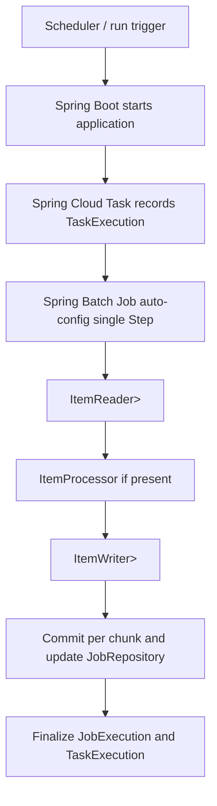
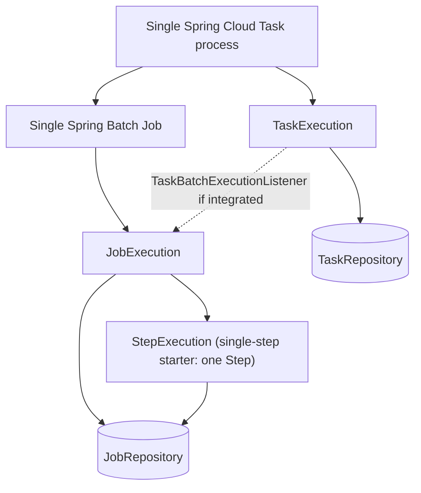

# Configuration Limits and Version-Matching the Starter

## Lesson objectives

In **SPRING_CLOUD_TASK (Spring Cloud Task)**, a Spring Boot application can run on a schedule or on demand, execute work over a finite period, and terminate. Spring Cloud Task records each run in `TaskRepository` so you can inspect timestamps, exit codes, and errors. When the workload involves reading, processing, and writing batch data, the application can integrate **Spring Batch** to use `Job`, `Step`, chunks, checkpoints, and restarts.

The **Single-Step Jobs** chapter introduces `spring-cloud-starter-single-step-batch-job`, a starter for creating a **Spring Batch Job with a single chunk-oriented Step** primarily via configuration. This lesson focuses on two easily overlooked details: **the starter has specific configuration limits**, and **documentation snippets do not replace checking actual dependency versions**.

After this lesson, you will be able to:

- Understand how the starter builds a Job/Step and the three properties `jobName`, `stepName`, and `chunkSize`.
- Recognize the **single-Step** limit and the uniform `Map<String, Object>` item type when supplying custom readers, processors, or writers.
- Choose readers/writers supported by auto-configuration, while identifying which components must be declared as Java beans.
- Cross-check Spring Cloud Task, Spring Boot, Spring Batch, and starter artifact versions before deployment.
- Understand why Spring AOT/native pipelines require selecting property-driven readers/writers at **build time**.
- Switch to explicit `Job` and `Step` configuration when requirements exceed what the starter can express.
- Verify Task metadata, Batch metadata, retries, restarts, and exit codes before putting a Job on a scheduler.

## 1. What is the Single Step Batch Job Starter?

`spring-cloud-starter-single-step-batch-job` is a module documented by Spring Cloud Task for building a `Job` with **one chunk-oriented `Step`**. Instead of always writing `JobBuilder` and `StepBuilder` yourself, you can declare the Job name, Step name, chunk size, and select among several reader/writer types via properties.

Typical processing flow:



| Component | Role | Do not confuse with |
| --- | --- | --- |
| `TaskExecution` | A single finite application execution tracked by Spring Cloud Task. | Spring Batch's `JobExecution`. |
| `Job` | Batch processing workflow, structured here as a single Step. | The JVM process or scheduler cron schedule. |
| `Step` | One chunk-processing unit: read, optional process, write. | An individual record in a file. |
| `ItemReader` | Returns the next item, typically until data ends. | A component guaranteeing every read source is transactional. |
| `ItemProcessor` | Transforms/filters an item; **optional**. | A mechanism for adding more Jobs or Steps. |
| `ItemWriter` | Writes a group of items in a chunk. | External deduplication guarantees. |
| `JobRepository` | Stores Job/Step history and execution context for restarts. | `TaskRepository` and whole-application metadata. |

The starter is **not** a scheduler, does not build multi-branch pipelines, and does not replace Spring Batch's restart/idempotency rules. It solves the need to stand up a single-Step Job quickly when your data fits the supported components.

## 2. Three foundational properties and the single-Step limit

According to the **Single Step Batch Job Starter** section of the Spring Cloud Task docs, the core configuration properties are:

| Property | Type | Default in doc table | Function |
| --- | --- | --- | --- |
| `spring.batch.job.jobName` | `String` | `null` | Name of the Job created by the starter. |
| `spring.batch.job.stepName` | `String` | `null` | Name of the single Step. |
| `spring.batch.job.chunkSize` | `Integer` | `null` | Target number of items processed per chunk transaction unit. |

Example **baseline configuration** (does not yet do useful work):

```yaml
spring:
  batch:
    job:
      jobName: copyCustomersJob
      stepName: copyCustomersStep
      chunkSize: 100
```

These three values let the starter build the **Job/Step scaffold**. To actually process data, you need an `ItemReader`, an `ItemWriter`, and an `ItemProcessor` if transformation is required. Some readers/writers can be configured via properties, while others must be declared as beans.

### What does "single Step" mean?

A chunk-oriented `Step` loops over many items and many commits until input is exhausted. **One Step does not mean one item**, and `chunkSize: 100` does not mean the Job stops after 100 records. With 250 items and no filtering, it typically processes groups of 100, 100, and 50; exact read/commit counts also depend on the reader, skips, retries, and transaction manager.

However, the starter does not offer a configuration DSL to build arbitrary structures such as:

- Jobs with multiple sequential Steps, conditional branching on `ExitStatus`, or pre-write validation steps.
- Partitioning, remote chunking, flows/splits, sub-jobs, or complex conditional workflows.
- Incompatible reader/writer data types or strongly typed generic pipelines like `Customer → ValidatedCustomer → CsvRow` without designing beans/Steps manually.
- Specialized retry/skip/chunk transaction policies beyond the properties documented by the starter.

When those requirements arise, the cleaner path is to declare `Job`/`Step` using Spring Batch Java configuration compatible with your version, while still using Spring Cloud Task to track the application lifecycle.

## 3. Data type constraint: Map<String, Object>

The starter documentation specifies that auto-configured `ItemReader`/`ItemWriter` components exchange items as `Map<String, Object>`. An `ItemProcessor` is auto-wired when the context provides a bean of exact type `ItemProcessor<Map<String, Object>, Map<String, Object>>`.

This directly shapes your Java code:

```java
import java.util.LinkedHashMap;
import java.util.Locale;
import java.util.Map;
import org.springframework.batch.item.ItemProcessor;
import org.springframework.context.annotation.Bean;
import org.springframework.context.annotation.Configuration;

@Configuration(proxyBeanMethods = false)
public class CustomerProcessorConfiguration {

    @Bean
    ItemProcessor<Map<String, Object>, Map<String, Object>>
            normalizeEmailProcessor() {
        return item -> {
            Map<String, Object> copy = new LinkedHashMap<>(item);
            Object email = copy.get("email");
            if (email != null) {
                copy.put("email",
                        email.toString().strip().toLowerCase(Locale.ROOT));
            }
            return copy;
        };
    }
}
```

This snippet illustrates only the custom processor; add it to an application using a **version-compatible** starter. If a reader returns `Customer` while the writer expects `Map`, setting properties will not magically convert generic types. You must build mappers/processors yourself and ensure end-to-end type compatibility.

### Common pitfalls with Map

| Scenario | Consequence |
| --- | --- |
| CSV column renamed from `email` to `emailAddress` | `Map.get("email")` returns `null`; failures can go silent without validation. |
| Value read as `String` but calculation needs `BigDecimal` | Must parse explicitly and handle malformed inputs. |
| Part of pipeline uses `Map`, another uses Java records | Generic types mismatch; requires conversion or a custom Step. |
| Multiple qualifying `ItemProcessor<Map, Map>` beans | Auto-wiring may be ambiguous depending on configuration; identify the exact bean and verify the context. |
| Business outputs demand strict schema validation | Harder to catch mistakes at compile time with string keys; consider Java records and explicit Spring Batch config. |

`Map<String, Object>` works well for moving data between sources with relatively dynamic, simple schemas. For critical data needing compile-time type safety or complex logic, define domain objects and explicit `ItemReader<T>`/`ItemProcessor<T, R>`/`ItemWriter<R>` beans.

## 4. Which readers/writers are auto-configured by the starter?

Per the starter docs, supported readers include:

| Reader | Data source | What you must still prepare |
| --- | --- | --- |
| `AmqpItemReader` | RabbitMQ/AMQP | `AmqpTemplate` and broker connection, converter if using JSON. |
| `FlatFileItemReader` | CSV or fixed-width file | `Resource`, delimiter/ranges, field names, parsing and bad-record handling. |
| `JdbcCursorItemReader` | SQL query and JDBC cursor | `DataSource`, SQL, `RowMapper`/`PreparedStatementSetter` as needed. |
| `KafkaItemReader` | Kafka partitions | Kafka config, topic, and list of partitions to read. |

Documented writers include:

| Writer | Data target | What you must still prepare |
| --- | --- | --- |
| `AmqpItemWriter` | AMQP exchange/queue | `AmqpTemplate`, converter, and consumer-side deduplication. |
| `FlatFileItemWriter` | Text/CSV file | Output path, field names, formatter, overwrite/append strategy. |
| `JdbcBatchItemWriter` | Relational database | SQL, `DataSource`, parameter mapping, write permissions, and business keys. |
| `KafkaItemWriter` | Kafka topic | Topic, producer, retry handling, and stream idempotency. |

**Property names are very specific**, for example:

- `spring.batch.job.amqpitemreader.enabled` and `spring.batch.job.amqpitemwriter.enabled`.
- `spring.batch.job.flatfileitemreader.resource`, `...delimited`, `...names`.
- `spring.batch.job.jdbccursoritemreader.sql`, `...fetchSize`.
- `spring.batch.job.kafkaitemreader.topic` and `...partitions`.
- `spring.batch.job.flatfileitemwriter.resource`, `...delimited`, `...names`.
- `spring.batch.job.jdbcbatchitemwriter.sql`.
- `spring.batch.job.kafkaitemwriter.topic`.

These keys under `spring.batch.job.*` belong to the documented **single-step starter**; they are **not** automatically recognized by plain Spring Boot Batch when only `spring-boot-starter-batch` is present. If you remove the dedicated starter and declare the Job manually, your application code must bind any properties it still wants to use.

### Partial configuration does not make a valid pipeline

Instantiating a Reader/Writer bean may require collaborators beyond properties. For instance, `JdbcCursorItemReader` uses `sql` but also needs a `DataSource` and compatible `RowMapper`. `KafkaItemReader` cannot read without a client/broker/topic/partitions. `FlatFileItemWriter` can write an empty or malformed file without proper `names`/formatter settings.

For every choice, verify:

1. Source/target dependencies (JDBC driver, AMQP, or Kafka).
2. Environment connection settings.
3. Item types flowing through reader, processor, and writer.
4. Restartability and `ExecutionContext` persistence.
5. Actual business output, rather than trusting `BatchStatus.COMPLETED` alone.

## 5. Configuration example: copying CSV in one Step

Suppose input file `/data/input/customers.csv` has a header and two fields:

```csv
id,email
C001,ALICE@EXAMPLE.COM
C002,BOB@EXAMPLE.COM
```

A configuration using the **property hierarchy described in the single-step starter**:

```yaml
spring:
  application:
    name: customer-file-task
  main:
    web-application-type: none
  batch:
    job:
      jobName: copyCustomersJob
      stepName: copyCustomersStep
      chunkSize: 100
      flatfileitemreader:
        name: customerFileReader
        resource: file:/data/input/customers.csv
        strict: true
        linesToSkip: 1
        delimited: true
        delimiter: ","
        names: [id, email]
      flatfileitemwriter:
        name: customerFileWriter
        resource: file:/data/output/customers.csv
        delimited: true
        delimiter: ","
        names: [id, email]
        shouldDeleteIfExists: true
```

If you add the `normalizeEmailProcessor()` bean from section 3 and the starter wires it as expected, emails are lowercased before writing. The output file **does not include a header line by default** simply because the input had one; if an output header is required, configure a writer callback or build a custom writer.

This is an **illustrative configuration format**, not a guarantee it runs verbatim across every Spring Cloud Task/Spring Batch release. Before testing:

- Lock compatible dependencies and confirm `spring-cloud-starter-single-step-batch-job` is present in the artifact.
- Prepare a writable output directory and a properly formatted input file.
- Ensure `JobRepository` and `TaskRepository` have matching schemas/drivers if using JDBC metadata.
- Test on a staging profile, compare output files against expected results, and inspect both repositories.

**Restart behavior:** `shouldDeleteIfExists: true` works when you intend to regenerate the entire file, but can cause data loss or overwrite a previous run's output. For production workflows, use temporary filenames scoped by execution or business key, write atomically, and design an explicit output publishing policy.

## 6. Configuration limits and when to leave the starter

| Requirement | Single-step starter | What to do if beyond limits |
| --- | --- | --- |
| Copy/transform data in one Step | Fits well if reader/writer are supported and item type is `Map`. | Use property configuration; verify types and file/connection settings. |
| Light key/value transformations | Can declare an `ItemProcessor<Map, Map>` bean. | Write a validating processor; test mappings and dirty data. |
| One Step requiring strongly typed `Customer → ValidatedCustomer` generics | Not the starter's default item type. | Declare the Step in Java with matching generic types. |
| Job with multiple Steps, conditions, or flows | Starter is designed for **one** chunk Step. | Use `JobBuilder`/`StepBuilder` and Spring Batch flow APIs. |
| Deep custom skip/retry/backoff/transactions | Not necessarily exposed via starter properties. | Check your version's API; configure the Step directly if needed. |
| Dynamic runtime reader/writer selection per user | Depends on auto-config bean conditions; runtime selection has limits, especially AOT. | Make selection explicit; consider multiple Jobs or custom beans. |
| Business auditing or exactly-once event publishing | Not guaranteed by the starter. | Idempotency keys, unique constraints, outbox, and downstream checks. |
| Separating Batch metadata, Task metadata, and business DB | Requires explicit datasource/transaction manager wiring outside job properties. | Use `TaskConfigurer` and version-appropriate Spring Batch config. |

**A longer config file does not expand the starter's capabilities.** It can only bind properties supported by your actual version's auto-configuration classes. If a compatible Reader/Writer bean is missing, fix dependencies, declare a bean, or switch to Java config; inventing YAML keys creates no new features.

## 7. Version-matching the starter: a mandatory step

An easy-to-miss detail is that **current Spring Cloud Task reference docs still show a Maven snippet hardcoding version `2.3.0`**:

```xml
<!-- Example from documentation; DO NOT copy this version blindly for every project -->
<dependency>
    <groupId>org.springframework.cloud</groupId>
    <artifactId>spring-cloud-starter-single-step-batch-job</artifactId>
    <version>2.3.0</version>
</dependency>
```

Meanwhile, `org.springframework.cloud:spring-cloud-starter-single-step-batch-job` also has **newer** releases (e.g., `5.0.2` on Maven Central). Therefore `2.3.0` in the doc snippet **is not a universal compatibility rule** for modern Spring Boot/Spring Cloud. Likewise, older docs show Gradle's `compile` syntax; modern Gradle uses `implementation`.

### Verification matrix before picking dependencies

| Question | What to verify |
| --- | --- |
| Which Spring Boot version is used? | Exact version and Java baseline, not just "latest". |
| Which Spring Cloud release train/BOM applies? | Consult Spring's Boot–Cloud compatibility matrix to choose the right release train. |
| Which Spring Cloud Task release line is included? | Cross-check the release train and release notes; do not guess versions from module names. |
| Does a matching single-step starter version exist? | Check Maven Central/approved repositories and the artifact's POM dependencies. |
| Which Spring Batch major version comes along? | Inspect `JobBuilder`, `StepBuilder`, reader/writer APIs, and breaking changes across Batch 4/5/6. |
| Do JAR/Native images contain the right beans and auto-config? | Use dependency reports, startup condition reports, and smoke-test a real Job. |
| Do examples contain legacy properties or Gradle syntax? | Separate conceptual illustrations from verified copy-paste snippets. |

**Do not** drop `spring-cloud-starter-single-step-batch-job:2.3.0` into a new Spring Boot app just because a reference page displays that number. An artifact from an older Spring Cloud Task line can bring incompatible APIs or auto-configuration against current Spring Boot, Spring Batch, and Spring Framework.

### Maven dependency template pinned via BOM

When a release train manages the relevant modules, prefer placing **the BOM in one place** and omitting redundant version tags on dependencies:

```xml
<!-- Illustrative POM: must declare spring-cloud.version
     compatible with the project's Spring Boot version. -->
<dependencyManagement>
    <dependencies>
        <dependency>
            <groupId>org.springframework.cloud</groupId>
            <artifactId>spring-cloud-dependencies</artifactId>
            <version>${spring-cloud.version}</version>
            <type>pom</type>
            <scope>import</scope>
        </dependency>
    </dependencies>
</dependencyManagement>

<dependencies>
    <dependency>
        <groupId>org.springframework.cloud</groupId>
        <artifactId>spring-cloud-starter-task</artifactId>
    </dependency>
    <dependency>
        <groupId>org.springframework.cloud</groupId>
        <artifactId>spring-cloud-starter-single-step-batch-job</artifactId>
    </dependency>
</dependencies>
```

**Condition to verify:** whether the chosen BOM actually **manages the version** of `spring-cloud-starter-single-step-batch-job`. If not, Maven will report a missing version; pin the version using compatibility evidence from the module's POM/release notes rather than guessing. Some auxiliary artifacts are not included in every BOM. `spring-cloud-starter-task` tracks Task lifecycle; the single-step starter supplies Batch Job configuration, and transitive dependencies must be verified too.

Inspect resolved versions:

```bash
mvn dependency:tree -Dincludes=org.springframework.cloud,org.springframework.batch,org.springframework.boot
```

To see why a version was selected or overridden elsewhere:

```bash
mvn help:effective-pom
```

If using Gradle, run `dependencyInsight` for the artifact and `runtimeClasspath`. Always verify **the final resolved version** in your build environment, as transitive dependencies or constraints can alter resolution.

### Classification by project generation

| Application generation | Evaluation approach |
| --- | --- |
| Legacy projects on Spring Cloud Task 2.x/Spring Batch 4 | Can reference `2.3.0` starter examples if **from the same library generation** and JDK; do not upgrade a single dependency in isolation without testing. |
| Projects on Spring Boot 3.x/Spring Batch 5 | Use a compatible release train and matching starter; verify `jakarta` namespaces, metadata schemas, and auto-config conditions. |
| Projects on Spring Boot 4.x/Spring Batch 6 | Verify the appropriate starter line and API/BOM changes; never copy Spring Batch 5 code without compiling/testing. |
| Apps targeting native image/AOT | Verify build-time bean selection and hints; do not treat JVM runtime property selection as proof native will work. |

This table defines a **verification workflow**, not a claim that every combination within a generation is supported. Even newly released starter versions should have their POMs and release notes checked before upgrading.

## 8. Special limitations with Spring AOT / native compilation

One strength of the single-step starter on the JVM is selecting readers and writers via different runtime properties. With **Spring AOT or native compilation**, the set of beans processed at build time can be frozen before the app runs; configurations excluded during AOT cannot appear later just by changing a runtime property.

The Spring Cloud Task documentation explicitly states that **reader/writer names must be provided at build time** if you rely on property-driven bean creation; the alternative is declaring explicit Reader/Writer beans yourself.

Maven example from the docs using `process-aot`:

```xml
<!-- Build-time conceptual example only for AOT-capable starter.
     Verify plugin configuration against your Spring Boot version. -->
<plugin>
    <groupId>org.springframework.boot</groupId>
    <artifactId>spring-boot-maven-plugin</artifactId>
    <executions>
        <execution>
            <id>process-aot</id>
            <goals>
                <goal>process-aot</goal>
            </goals>
            <configuration>
                <jvmArguments>
                    -Dspring.batch.job.flatfileitemreader.name=customerFileReader
                    -Dspring.batch.job.flatfileitemwriter.name=customerFileWriter
                </jvmArguments>
            </configuration>
        </execution>
    </executions>
</plugin>
```

Some doc pages/branches use `arguments` instead of `jvmArguments` in plugin config. Do not combine both blindly: check **exactly** how your Spring Boot plugin version forwards properties into the AOT step. The true proof is **building and running the native image**, confirming real Reader/Writer beans exist and process data end-to-end.

A sensible AOT test plan:

1. Pin the reader/writer types and configuration at build time.
2. Build the native image with version-appropriate flags/hints.
3. Inspect the startup context and verify the expected beans exist in the image.
4. Run a test Job with real input and output data.
5. Try changing runtime properties to identify which options are **no longer dynamic**, and document those deployment constraints.

Never assume "it runs on the JVM" proves the native image will dynamically instantiate new reader/writer choices at runtime.

## 9. When you need more flexibility: building Jobs and Steps in Java

When you require multiple Steps or concrete item types, Spring Batch Java configuration provides clearer architectural control. The minimal example below is an **alternative** to the single-step starter, written in **Spring Batch 5 / Spring Boot 3** style:

```java
package com.example.report;

import org.springframework.batch.core.Job;
import org.springframework.batch.core.Step;
import org.springframework.batch.core.job.builder.JobBuilder;
import org.springframework.batch.core.repository.JobRepository;
import org.springframework.batch.core.step.builder.StepBuilder;
import org.springframework.batch.repeat.RepeatStatus;
import org.springframework.context.annotation.Bean;
import org.springframework.context.annotation.Configuration;
import org.springframework.transaction.PlatformTransactionManager;

@Configuration(proxyBeanMethods = false)
public class ExplicitJobConfiguration {

    @Bean
    Step validateInputStep(JobRepository repository,
                           PlatformTransactionManager transactionManager) {
        return new StepBuilder("validateInputStep", repository)
                .tasklet((contribution, context) -> {
                    // Validate data source and business parameters.
                    return RepeatStatus.FINISHED;
                }, transactionManager)
                .build();
    }

    @Bean
    Step exportDataStep(JobRepository repository,
                        PlatformTransactionManager transactionManager) {
        return new StepBuilder("exportDataStep", repository)
                .tasklet((contribution, context) -> {
                    // Invoke idempotent business processing service.
                    return RepeatStatus.FINISHED;
                }, transactionManager)
                .build();
    }

    @Bean
    Job reportJob(JobRepository repository,
                  Step validateInputStep,
                  Step exportDataStep) {
        return new JobBuilder("reportJob", repository)
                .start(validateInputStep)
                .next(exportDataStep)
                .build();
    }
}
```

The code above illustrates **two Steps** to highlight the design difference without real read/write logic; each `Tasklet` Step simply returns `RepeatStatus.FINISHED`. You must configure `JobRepository`, a transaction manager, Spring Cloud Task, and a Job launch strategy before running. With Spring Batch 6 or other releases, builder/configuration signatures may change; check Javadocs and compile against your version.

In an application intended to run only an explicit Job, do not keep the single-step starter if it auto-generates a competing Job. Use `spring-boot-starter-batch` with the matching Spring Cloud Task starter; if you want to link `TaskExecution` and `JobExecution`, add the compatible `spring-cloud-task-batch` integration.

## 10. Metadata, exit codes, and avoiding duplicate launches

Spring Cloud Task and Spring Batch track different entities:



When `spring-cloud-task-batch` and a matching `Job` bean are present, `TaskBatchExecutionListener` can link a `TaskExecution` to `JobExecution` records via `TASK_TASK_BATCH`. However, **having a link does not prove the Job succeeded**.

Under some default Batch/Boot configurations, a Batch Job can fail while the Task process still exits with `0` if the failure is not propagated up to the Task layer. Spring Cloud Task provides:

```yaml
spring:
  cloud:
    task:
      batch:
        fail-on-job-failure: true
```

The documentation describes this property for translating Batch Job failures into an appropriate Task exit code along the integrated launch path. With custom runners or async execution, verify behavior directly. Separate three outcome layers: `JobExecution/StepExecution`, `TaskExecution`, and the scheduler's Job/Pod exit code.

**Avoid launching twice:** if Spring Boot already auto-launches the `Job` bean on startup, do not add an `ApplicationRunner` calling `JobLauncher` for the same Job unless you disable auto-run and explicitly manage `JobParameters`. In particular, an added starter might auto-create a Job bean unexpectedly.

## 11. Restarts, checkpoints, and data safety

A chunk Step can commit multiple times. When a failure occurs mid-run, Spring Batch persists metadata so it can restart if the reader, writer, and Job are properly designed. Enabling `saveState` on a reader is only **one part** of the solution:

- Input files must remain immutable or versioned across restarts.
- Writers must be idempotent or able to detect already-written records, especially when the database and data source do not share a transaction.
- AMQP/Kafka sources have their own consumption/redelivery semantics; using Spring Batch does not automatically guarantee exactly-once delivery.
- File writers need clear filename, append/overwrite, temporary file, and atomic publish policies.
- `JobParameters` must separate identifying parameters to restart the right `JobInstance`; adding a fresh timestamp on every run creates a new instance.
- When a scheduler can overlap runs, protect business keys or enforce concurrency limits.

For example, if a Job processing `businessDate=2026-11-23` fails after 2 chunks: rerunning must clarify whether it resumes from checkpoint or reprocesses data, and ensure prior outputs are not duplicated. Never rely on `TaskExecution.EXIT_CODE=0` to conclude all records were written accurately.

### Distinguishing three failure categories

| Failure | Where usually spotted | Resolution |
| --- | --- | --- |
| Unresolved starter or missing reader/writer bean | Build or context startup. | Check artifact/version, auto-configuration, and properties. |
| Job starts and Step fails | `JobRepository`, `BATCH_STEP_EXECUTION`, and Step logs. | Fix data/logic; decide between restart or a new instance. |
| Task fails updating metadata or is killed | `TaskRepository`, exit code, and orchestrator. | Inspect DB, timeouts, and process state; reconcile outputs before retrying. |

## 12. Pre-deployment starter verification checklist

| Check | How to verify | Passing signal |
| --- | --- | --- |
| Compatibility | Spring Boot–Spring Cloud matrix, POM, and release notes. | Version set pinned with no unintended overrides. |
| Dependency resolution | `mvn dependency:tree` or `gradle dependencies`/`dependencyInsight`. | Starter and transitive dependencies match expected versions. |
| Auto-configuration | Startup logs / condition report, bean list. | Only the required Job/Step/reader/writer beans exist. |
| Property binding | Verify `jobName`, `stepName`, `chunkSize`, reader/writer options. | Required properties bind; no misspelled keys. |
| Input/output types | Check generic types and sample data. | Consistent `Map<String, Object>` or explicit custom beans. |
| Metadata schemas | Version-matched Task/Batch migrations and DB permissions. | Both `TaskExecution` and `JobExecution` are readable. |
| Business outcomes | Inspect target file/database/queue. | Exact record count, accurate mapping, no drops/duplicates. |
| Failure/restart | Inject controlled failure after several chunks, then restart. | Restarts the right `JobInstance` without duplicate output. |
| Scheduler/exit code | Run one failing and one succeeding execution. | Task/Job exit codes accurately drive retry policies. |
| Native/AOT if applicable | Build and run the actual native image. | Reader/writer beans work end-to-end; runtime limits documented. |

For minor mapping changes, unit-test the processor and run a sample read/write integration test. For version or starter upgrades, run **end-to-end** tests against a production-like metadata database and representative dataset.

## 13. Guided hands-on lab

**Scenario:** build `customer-file-task` to read a customer CSV, normalize emails, and write an output CSV. The application runs nightly, supports reruns when files have errors, and must persist Task/Batch history.

1. Record your chosen Spring Boot, Spring Cloud release train, Spring Cloud Task, Spring Batch, and JDK versions. Verify the resolved starter version with your build tool.
2. Configure `jobName`, `stepName`, `chunkSize`, and reader/writer as in section 5 per your release's docs.
3. Add `ItemProcessor<Map<String, Object>, Map<String, Object>>` from section 3; create a sample CSV with uppercase emails.
4. Launch on the JVM and verify output line counts, normalized emails, and Job/Step names in metadata.
5. Test missing input file, wrong column count, null email, unwritable output directory, and database failure; document which stage fails in each case.
6. Run twice with the same input and test overwrite/deduplication policies; then inject a failure in the second chunk to test restarting.
7. Enable Spring Cloud Task–Batch integration and inspect `TaskExecution`, `JobExecution`, `StepExecution`, Task exit code, and scheduler status.
8. Modify the requirement into a Job with a pre-validation step before main processing; identify when you must transition to explicit `JobBuilder`/`StepBuilder` configuration.
9. If using native compilation, lock reader/writer at build time and verify the native image rather than only running the JAR.

**Completion criteria:** ability to pick/verify the right starter version; a single-Step Job processing real data; knowing when `Map<String, Object>` and properties fall short; queryable metadata; failures/restarts that do not corrupt outputs; and verified behavior on your actual deployment artifact.

## 14. References

- [Spring Cloud Task — Single Step Batch Job Starter](https://docs.spring.io/spring-cloud-task/reference/batch-starter.html): Job/reader/writer property tables, item types, Spring AOT, and dependency examples.
- [Spring Cloud Task — Single Step Batch Job Starter (3.3 branch)](https://docs.spring.io/spring-cloud-task/reference/3.3/batch-starter.html): cross-checking documentation per release rather than reading only a `"current"` URL.
- [Spring Cloud Task — Batch Integration](https://docs.spring.io/spring-cloud-task/reference/batch.html): Task–Batch linking and `fail-on-job-failure`.
- [Spring Cloud — Release Train Compatibility](https://spring.io/projects/spring-cloud/): Spring Cloud compatibility table with Spring Boot.
- [Spring Batch — Reference](https://docs.spring.io/spring-batch/reference/): Job/Step config, chunks, `JobRepository`, restarts, and fault tolerance.
- [Maven Central — spring-cloud-starter-single-step-batch-job](https://central.sonatype.com/artifact/org.springframework.cloud/spring-cloud-starter-single-step-batch-job): inspect published artifacts, versions, and POMs.

## Takeaways

- The single-step starter creates a **Job with one chunk-oriented Step**; `jobName`, `stepName`, and `chunkSize` only build the frame—you still need a Reader/Writer and optional processor.
- Documented starter Readers/Writers use `Map<String, Object>` items; do not force-cast them into Java records or domain entities automatically.
- **Starter `spring.batch.job.*` properties are not all standard Spring Boot Batch properties**. They apply only when the corresponding module/auto-configuration is active.
- **Do not copy `2.3.0` from `"current"` doc examples** into every project. Check release train, BOM, resolved dependencies, and Spring Batch major version before running.
- For AOT/native, selecting readers/writers via properties may need to be fixed **at build time**, unlike normal JVM execution.
- For complex Jobs, switch to explicit Java configuration; still monitor `TaskExecution`, `JobExecution`, business results, and scheduler exit codes separately.
