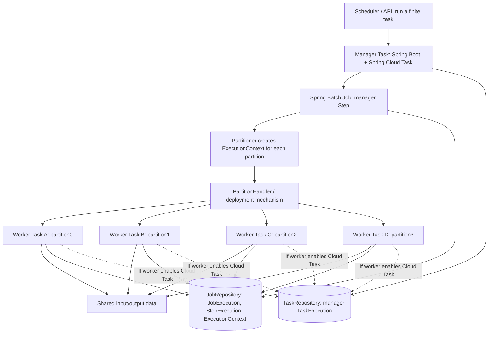
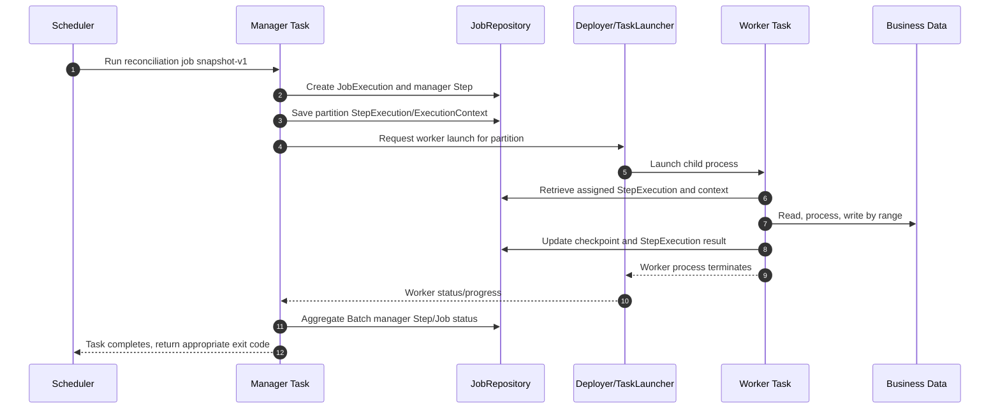

# Data Partitioning Problem and Job Management Model with Child Processes

## 1. Context: When a Single Task Cannot Process All Data in Time

In the **Remote Partitioning** chapter, we examine a **Spring Cloud Task** application triggered on a schedule or on demand to reconcile orders. The task must read millions of records, perform calculations, and write results to a database before a deadline. Running in a single process, the job can take many hours; increasing the number of threads within the same JVM is still constrained by the CPU, memory, and database connection count of a single machine.

One option is to **split the dataset into independent partitions** and distribute those portions to multiple **worker processes** running in parallel. Spring Batch provides the *partitioning* model; Spring Cloud Task can provide a finite lifecycle for worker applications, and integration with Spring Cloud Deployer supports launching workers in suitable environments.

In this model, there are two levels to observe:

- **Manager application:** plans the partitioning, launches/orchestrates workers, and aggregates the status of the Batch Job.
- **Worker application:** launches in a separate process/JVM/container, processes its assigned slice of data, and terminates; it can itself be recorded as a Spring Cloud Task `TaskExecution` when configured.

You should not assume that simply adding Spring Cloud Task makes the framework automatically distribute data. **Splitting, assigning, and aggregating work is the responsibility of Spring Batch and the orchestrator**; Spring Cloud Task tracks the finite application lifecycle and supports the deployment component when properly integrated.

### Learning Objectives

After this lesson, you will be able to:

1. Identify problems suitable for **remote partitioning** and distinguish it from multithreading, local partitioning, and remote chunking.
2. Explain the roles of the **manager**, **partitioner**, **partition handler**, **worker**, `TaskRepository`, and `JobRepository`.
3. Design non-overlapping, gap-free data ranges that can be verified and restarted.
4. Describe the manager/worker lifecycle and how job identifiers are passed to child processes.
5. Read `JobExecution`, `StepExecution`, `ExecutionContext`, and `TaskExecution` metadata without confusing them.
6. Evaluate resource limits, idempotency, worker failures, retries, and safe production operations.

## 2. Concrete Problem: Reconciling 10 Million Orders

Suppose a system needs to reconcile **10,000,000 orders** from a data snapshot. A single process reading all records sequentially takes too long. If the data allows orders to be processed independently, the manager can split the work into multiple parts.

For example, splitting by half-open ID ranges, i.e., **`[startId, endIdExclusive)`**:

| Partition | Data selection condition | Assigned worker |
| --- | --- | --- |
| `partition0` | `1 <= order_id < 2_500_001` | Worker A |
| `partition1` | `2_500_001 <= order_id < 5_000_001` | Worker B |
| `partition2` | `5_000_001 <= order_id < 7_500_001` | Worker C |
| `partition3` | `7_500_001 <= order_id < 10_000_001` | Worker D |

The ranges do not overlap and cover the entire domain `[1, 10_000_001)`. However, **counting IDs is not always the same as counting records**: IDs may have gaps, data may be skewed, or there may be additional filter conditions. Splitting by ID is only appropriate when workers can read the exact dataset via a `WHERE` clause and load skew is acceptable.

In production, you must clearly define:

- **Job scope:** business date, tenant, data snapshot/version, status filters.
- **Partitioning rules:** each record belongs to exactly one logical partition, including at boundaries.
- **Stability:** inputs do not change unexpectedly between retries; if they do, a versioning or high-water mark strategy is needed.
- **Independence:** one worker does not have to wait for another worker to update the same data in order.
- **Restartability:** a failed partition can be re-executed without duplicating side effects.

**Splitting across multiple processes does not guarantee faster execution**: workers may contend on the database, network, or data locks. If the bottleneck is a single target table, adding more workers can sometimes make it slower.

## 3. Manager and Worker Architecture



### 3.1. The Manager Is Responsible for Orchestration

The manager owns the **Batch Job** flow and a **manager Step** configured to partition a **worker Step**. The `Partitioner` creates multiple `ExecutionContext` instances, each containing parameters for one partition such as `startId` and `endIdExclusive`. Spring Batch stores step/partition metadata in `JobRepository`.

The `PartitionHandler` is responsible for dispatching partitions for processing. For remote partitioning using Spring Cloud Task/Deployer, a common component is **`DeployerPartitionHandler`** combined with Spring Cloud Deployer's **`TaskLauncher`**. The handler can request the platform to launch worker processes, monitor completion status, and aggregate results. Specific constructors, beans, and properties must be verified against the documentation for your exact version.

The manager **should not simply fire-and-forget** and exit successfully right away. It needs a policy to wait for and determine the outcome of every partition in the Batch Job, along with timeouts in case a worker loses contact or fails to complete.

### 3.2. Workers Process a Slice of Data

A worker is a Spring Boot application running in a **separate child process** or separate container. It receives the `StepExecution` identifier/information passed by the partition handler mechanism, loads the `ExecutionContext` from the shared `JobRepository`, and executes the corresponding **worker Step**. The worker reads, processes, and writes data within its partition scope, updates the `StepExecution`, and terminates.

You **should not arbitrarily invent your own parameter-passing protocol** if you are using the built-in Deployer integration: that mechanism passes the required launch arguments so the worker identifies its Step Execution. Internal CLI option names, handler configurations, and worker bootstrapping vary by version, so rely on the examples and documentation for the exact Spring Cloud Task version you are running.

A worker **does not receive a list of millions of records via the command line**. The manager passes **identifying metadata** or partition boundaries; the worker queries the data source using its assigned filters.

### 3.3. Two Repositories Store Two Types of History

| Component | Data stored | Questions answered |
| --- | --- | --- |
| `TaskRepository` | `TaskExecution` of the manager and of workers if Cloud Task is integrated | Which process started, ended, what was its exit code, and what is its external execution ID? |
| `JobRepository` | `JobInstance`, `JobExecution`, `StepExecution`, `ExecutionContext` | Which partition/step completed, failed, how much was committed, and how should it restart? |
| Infrastructure orchestrator | Job/Pod/container ID, runtime status, retries, kill/OOM reason | Is the worker still alive, was it killed, or did it run out of resources? |
| Business system | Data keys, actual results, idempotency/audit | Was the work written accurately and completely? |

**One worker TaskExecution is not equivalent to one Batch JobExecution.** A worker typically processes a single `StepExecution` belonging to the same Batch Job orchestrated by the manager. Do not assume every worker must create a new JobInstance or that relationships in the `TASK_TASK_BATCH` table automatically cover every Worker Step. Correlating IDs must be based on actual integration capabilities and audit data.

## 4. Distinguishing Four Parallel Processing Models

| Model | Who splits the work? | Where do workers run? | Suitable when |
| --- | --- | --- | --- |
| **Single-thread Batch Step** | Not partitioned | One thread/process | Small dataset, sequential logic |
| **Multi-threaded Step** | Executor inside the step | Multiple threads in one JVM | Parallel processing needed, single-machine resources suffice |
| **Local partitioning** | `Partitioner` + `TaskExecutorPartitionHandler` | Multiple worker Steps in the **same JVM** | Per-partition metadata needed, multiple containers not needed |
| **Remote partitioning** | Manager Step + remote `PartitionHandler` | Multiple independent **JVMs/containers** | Load distribution by partition needed, workers read/write data directly |
| **Remote chunking** | Manager reads/splits chunks, sends messages | Remote workers process chunks sent by the manager | Want to keep the reader on the manager, distribute chunk processing via messaging |

The decisive difference between **remote partitioning** and **remote chunking**:

- Remote partitioning distributes **ownership of a data range/StepExecution**. Workers typically read and write the data belonging to their own range.
- Remote chunking distributes **already-read chunks**; the manager typically keeps the reader and sends items/chunks to workers over messaging middleware.

Do not use the term "remote partitioning" for every system with multiple workers. You must distinguish where **partitions are created**, where **data is read**, and where **checkpoints are managed**.

## 5. Designing a `Partitioner` for Non-Overlapping ID Ranges

A `Partitioner` accepts a `gridSize` parameter (suggested number of partitions) and returns a map from **partition name** to **`ExecutionContext`**. For contiguous ID sets over a half-open interval, you can create roughly equal ranges.

Java example using the Spring Batch 5.x `Partitioner` API:

```java
package com.example.partitioning;

import java.util.LinkedHashMap;
import java.util.Map;

import org.springframework.batch.core.partition.support.Partitioner;
import org.springframework.batch.item.ExecutionContext;

public final class OrderIdRangePartitioner implements Partitioner {
    private final long fromInclusive;
    private final long toExclusive;

    public OrderIdRangePartitioner(long fromInclusive, long toExclusive) {
        if (fromInclusive < 0 || toExclusive < fromInclusive) {
            throw new IllegalArgumentException("Invalid ID range");
        }
        this.fromInclusive = fromInclusive;
        this.toExclusive = toExclusive;
    }

    @Override
    public Map<String, ExecutionContext> partition(int gridSize) {
        if (gridSize <= 0) {
            throw new IllegalArgumentException("gridSize must be positive");
        }

        long total = Math.subtractExact(toExclusive, fromInclusive);
        long each = total / gridSize;
        long extra = total % gridSize;
        long cursor = fromInclusive;

        Map<String, ExecutionContext> partitions = new LinkedHashMap<>();
        for (int i = 0; i < gridSize; i++) {
            long size = each + (i < extra ? 1 : 0);
            if (size == 0) {
                break; // Do not create empty partitions.
            }

            long end = Math.addExact(cursor, size);
            ExecutionContext context = new ExecutionContext();
            context.putLong("startId", cursor);
            context.putLong("endIdExclusive", end);
            partitions.put("partition" + i, context);
            cursor = end;
        }
        return partitions;
    }
}
```

For example, `new OrderIdRangePartitioner(1, 1001).partition(4)` creates:

| Partition name | startId | endIdExclusive | ID set |
| --- | ---: | ---: | --- |
| `partition0` | 1 | 251 | `[1,251)` |
| `partition1` | 251 | 501 | `[251,501)` |
| `partition2` | 501 | 751 | `[501,751)` |
| `partition3` | 751 | 1001 | `[751,1001)` |

**Properties to verify:** contiguous boundaries, zero overlap, total span equal to `toExclusive - fromInclusive`; empty spans do not create partitions. `gridSize` is a **hint for the number of logical partitions**, not a guarantee that the system will run that exact number of containers concurrently. The actual concurrent process count also depends on the handler, deployer limits, and platform resources.

### 5.1. Worker Queries Must Use Exact Boundaries

The Worker Step retrieves `startId` and `endIdExclusive` from `stepExecutionContext` and filters data:

```sql
SELECT order_id, customer_id, amount
FROM orders_snapshot
WHERE snapshot_version = :snapshotVersion
  AND order_id >= :startId
  AND order_id < :endIdExclusive
ORDER BY order_id;
```

`:startId`, `:endIdExclusive`, and `:snapshotVersion` are **illustrative named parameters** bound by JDBC tooling, not strings to concatenate directly from input. Two workers handling `[1,251)` and `[251,501)` will never both select `order_id=251` because the first boundary is **`< 251`** and the second is **`>= 251`**.

When configuring `JdbcPagingItemReader` or another reader, ensure a stable sort key, accurate partition filters, `@StepScope` to read each StepExecution's context, and checkpoint saving in the reader/writer if restartability is desired. Do not assume a correct SQL query alone guarantees safe restarts when the source changes.

### 5.2. When Splitting by ID Is Not Suitable

The ID range 0–1 million might contain 900,000 records while the 1–2 million range has only 500 records. If data is skewed, the first worker becomes overloaded. Alternative strategies include:

- **Partitioning by business key groups:** tenant, region, store, or existing shard.
- **Partitioning by ranges measured from the snapshot:** choose boundaries based on actual record counts, not just ID spans.
- **Partitioning by modulo/hash:** only when queries can effectively use indexes/table partitions and a fixed retry policy is in place.
- **Creating more small partitions than workers:** the handler dispatches partitions according to capacity; overhead and total `StepExecution` count must be controlled.

Each option must demonstrate **coverage**, **disjointness**, stability, and query performance. Partitioning on a condition that changes over time, such as "current status", can cause records to shift from one partition to another within the same Job; a snapshot or explicit data-locking rule is required.

## 6. How Does the Manager Step Use `PartitionHandler`?

Spring Batch lets you configure a **partitioned manager Step** with a worker Step name, `Partitioner`, and `PartitionHandler`. Here is a **configuration skeleton** following the Spring Batch 5.x API model:

```java
import org.springframework.batch.core.Step;
import org.springframework.batch.core.repository.JobRepository;
import org.springframework.batch.core.partition.support.PartitionHandler;
import org.springframework.batch.core.partition.support.Partitioner;
import org.springframework.batch.core.step.builder.StepBuilder;
import org.springframework.context.annotation.Bean;
import org.springframework.context.annotation.Configuration;

@Configuration(proxyBeanMethods = false)
class ManagerStepConfiguration {
    @Bean
    Step managerStep(
            JobRepository jobRepository,
            Partitioner orderRangePartitioner,
            PartitionHandler remotePartitionHandler) {
        return new StepBuilder("remotePartitionManager", jobRepository)
                .partitioner("workerStep", orderRangePartitioner)
                .partitionHandler(remotePartitionHandler)
                .build();
    }
}
```

This is a **partial configuration**, not a runnable application: you still need a `Job` containing the manager Step, a `Partitioner` bean, a worker Step, a repository, a launcher, and a real **remotePartitionHandler**. `StepBuilder`, `PartitionHandler`, and package/method signatures may change in Spring Batch 6; verify against your pinned version before compiling.

In the Spring Cloud Task + Spring Cloud Deployer model, `DeployerPartitionHandler` is a relevant implementation: it uses `TaskLauncher` to ask the platform to run **finite worker processes** instead of executing all partitions inside the manager JVM. How to construct the handler and provide configuration (worker artifact, step name, grid size, timeout, deployment environment, JobExplorer/TaskExplorer, etc.) must be taken from the documentation for your exact version. Do not guess constructor signatures or property names to build code that looks compilable but fails to launch workers in practice.

### Minimum Contract Between Manager and Worker

1. **Matching worker artifact version:** compatible Step contract, metadata schema, and Spring Batch library versions.
2. **Accurate identification:** each worker must receive the exact Job/Step Execution created by the manager; it must not create an independent Batch JobInstance.
3. **Shared JobRepository:** manager and workers see the same metadata, checkpoints, and partitioned StepExecution statuses.
4. **Shared input data space:** workers read the exact assigned snapshot/version and partition.
5. **Recorded outcomes:** completed/failed steps must be recorded in the repository so the manager can aggregate them.
6. **Timeouts and resource limits:** the handler and platform must have policies for when a worker fails to start, runs too long, dies mid-way, or finishes but loses connectivity.

For deployment code, distinguish `TaskLauncher` (launches a task application on a platform) from `JobLauncher` (launches a Spring Batch Job). They do not replace each other. The manager uses these components at **different layers of responsibility**.

## 7. Lifecycle of a Run with Child Processes



This is a **logical flow of events**, not a claim that callbacks or commits happen in this exact line-by-line order across every version. When multiple workers run concurrently, repository reads and writes interleave. Do not infer from a worker exiting with code 0 that `StepExecution` metadata was committed successfully, nor infer from `TaskExecution.END_TIME` that the entire Job has finished.

### Where Is the Manager Task Triggered From?

The manager can be launched via `java -jar`, a Kubernetes CronJob, a scheduler, or an orchestration API. It is **a finite Spring Cloud Task execution**. Scheduling is the responsibility of an external system; Spring Cloud Task does not create cron schedules itself.

```bash
# Illustrative command: artifact and parameters depend on your application.
java -jar reconciliation-manager.jar \
  --business-date=2026-11-24 \
  --snapshot-version=snapshot-v1
```

The manager creates stable identifying JobParameters for `business-date` and `snapshot-version` so a valid retry can resume the same `JobInstance`. Workers must never pick a different business date on their own or omit the snapshot filter.

### Role of Spring Cloud Task Metadata

The manager can create its own `TaskExecution`; each worker can also create its own `TaskExecution` if the worker application enables Cloud Task and has a TaskRepository datasource. You should not assume `parentExecutionId` or `externalExecutionId` automatically reflects partition relationships unless the ID-passing flow is properly configured. In operations, attach correlation keys such as `requestId`, `jobExecutionId`, `stepExecutionId`, `partitionName`, and `externalExecutionId` to logs/audits according to framework and platform capabilities.

## 8. Restarting Failed Partitions vs. Re-running the Entire Task

If worker B fails after committing chunks in `partition1`, a manager retry can trigger only the unfinished portions of work. However, **where execution can restart from** is decided by the **Spring Batch JobRepository**, not simply because the manager created a new TaskExecution.

| Scenario | Metadata unit | Handling approach |
| --- | --- | --- |
| Manager Task exits with error; scheduler spawns new process | New manager `TaskExecution` | Inspect JobInstance and JobExecution before re-dispatching |
| Batch Job is `FAILED` and restartable | New `JobExecution` of the **same JobInstance** when identifying parameters remain unchanged | Let Spring Batch determine which steps/partitions need to restart |
| `partition0` is `COMPLETED` | Partition's `StepExecution` | Typically skipped unless configured to re-run |
| `partition1` is `FAILED` with a valid checkpoint | `StepExecution`/`ExecutionContext` | Can resume according to reader/writer and transaction mechanisms |
| Worker was killed, StepExecution remains `STARTED` | Batch metadata does not yet reflect termination | Verify the real worker has stopped, resolve stuck state per operational procedure |
| Batch is `COMPLETED` but manager Task failed while sending report | `JobInstance` already completed | Separate post-processing/compensation; do not force Batch to re-run everything |
| Two managers launch the same JobInstance concurrently | Contention at `JobRepository` | Limit concurrency, coordinate orchestration, and handle duplicate execution errors |

**Parameter keys are the deciding factor:** adding a new **identifying** `run.id` or timestamp to JobParameters on every retry creates a **new JobInstance**, losing the ability to resume from previous checkpoints. Keep the job name and identifying `JobParameters` unchanged when you want to restart the exact same job.

### Partition Names and Boundaries Must Be Stable

Suppose the first run creates `partition0=[1,251)` and `partition1=[251,501)`. On restart, if the code re-partitions the data into 3 partitions with different names and ranges, matching prior state can behave unexpectedly. Maintain deterministic partitioning rules and stable snapshot inputs; read back the stored `ExecutionContext` rather than assuming all workers should start over with a new layout.

If you change partitioning rules, you need a policy to **restart from scratch as a new JobInstance** and ensure already-written data can be safely reprocessed, or perform a controlled migration/recovery. Do not manually edit `BATCH_STEP_EXECUTION` status columns to force Batch past inconsistencies.

## 9. Preventing Duplicate Data During Concurrent Execution or Retries

Remote partitioning only proves that read ranges are **non-overlapping in the initial plan**. Workers can still process items twice during retries, when source data changes, or when sending data to external systems before a checkpoint commits.

### 9.1. Business Keys and Upserts

Example PostgreSQL reconciliation results table:

```sql
CREATE TABLE reconciled_order (
    snapshot_version VARCHAR(80) NOT NULL,
    order_id BIGINT NOT NULL,
    reconciled_amount NUMERIC(18, 2) NOT NULL,
    PRIMARY KEY (snapshot_version, order_id)
);

INSERT INTO reconciled_order (
    snapshot_version, order_id, reconciled_amount
) VALUES (
    'snapshot-v1', 251, 120000.00
)
ON CONFLICT (snapshot_version, order_id)
DO NOTHING;
```

This is an **illustrative strategy**, valid only when the same key always represents the exact same content. If the payload changes while still using `DO NOTHING`, discrepancies are silently hidden; you must verify checksums, perform conditional updates, or raise an error per the business contract.

### 9.2. External Systems Do Not Participate in Transactions

A worker may send an HTTP request successfully but lose connection to `JobRepository` before saving its checkpoint. A restart will re-read the item and may send the request a second time. Solutions may include:

- Passing a stable **idempotency key** derived from `snapshotVersion + orderId + operation` when supported by the provider.
- Using an outbox/inbox pattern, delivery status table, or deduplication mechanism on the receiving system.
- Designing compensation logic when irreversible side effects occur.
- Limiting retries and distinguishing transient failures from invalid data errors.

Do not use a new worker's `TaskExecutionId` as a business idempotency key: that ID changes on retry, whereas the business operation needs to identify the same logical request.

### 9.3. Source Data Must Be Stabilized

If a worker queries `WHERE status='NEW'` while another worker is updating statuses, the record set can shift between scans or retries. Prefer fixed snapshots, stable ID ranges, timestamp cutoffs, or a persisted work-assignment table. If data changes continuously, you must design duplicate/late/out-of-order handling independently of partition logic.

## 10. Scalability and Resource Limits

### More Workers Does Not Always Mean Faster

Suppose there are `N` workers, each using up to `C` database connections. Total connection consumption can approach `N × C`, plus connections from the manager and other services. If the database only permits a fixed number of connections, scaling from 4 to 40 workers can slow down the system or cause connection refusals.

| Risk | Symptom | Adjustment |
| --- | --- | --- |
| Too many DB connections | Pool timeouts, DB rejecting connections | Limit concurrent workers, cap per-worker pool, optimize queries |
| Unbalanced partitions | One worker runs very long while others have finished | Partition by actual record count, increase partition count reasonably |
| Write bottleneck | Lock contention, deadlocks, dropping throughput | Separate target keys, batch writes, tune indexes and transactions |
| Container startup overhead | Manager spends time launching workers that process very little data | Merge small partitions, avoid unnecessary launches |
| Memory/OOM | Pods get OOMKilled, checkpoints unsaved | Reduce page/chunk size, allocate proper resources, reduce in-memory state |
| External system rate limiting | HTTP 429, timeouts | Limit concurrency, add backoff, apply circuit breakers per policy |
| Manager waits indefinitely | Worker loses signal or hangs | Set appropriate timeouts/polling, inspect both runtime and JobRepository |

**Grid size does not equal maximum worker count.** Partition count, deployed process count, and concurrency limit are parameters that must be tuned independently. Measure actual runtime, load skew, startup time, and infrastructure cost before scaling up.

## 11. Monitoring and Tracing Across Multiple Processes

An operations dashboard should present the **full picture of a single run**:

| Monitoring level | Correlation key | What to inspect |
| --- | --- | --- |
| Request from scheduler | `requestId`, `businessDate`, `snapshotVersion` | Who triggered it, retry policy, deadline |
| Manager Task | `TASK_EXECUTION_ID`, external execution ID | `START_TIME`, `END_TIME`, `EXIT_CODE`, logs, and container |
| Batch Job | `JOB_INSTANCE_ID`, `JOB_EXECUTION_ID` | `BatchStatus`, `ExitStatus`, restart count |
| Partition / Step | `STEP_EXECUTION_ID`, step/partition name | `READ_COUNT`, `WRITE_COUNT`, `COMMIT_COUNT`, `ROLLBACK_COUNT`, `ExecutionContext` |
| Worker Task / Pod | Worker Task ID, Pod/Job UID | Process state, resources, timeouts, kill reason |
| Business output | `snapshotVersion`, `orderId` | Count of valid, missing, duplicate, and failed records |

### SQL to Inspect Partitions from JobRepository

With the default Spring Batch JDBC schema, find the StepExecutions belonging to a JobExecution:

```sql
SELECT JOB_EXECUTION_ID,
       STEP_EXECUTION_ID,
       STEP_NAME,
       STATUS,
       READ_COUNT,
       WRITE_COUNT,
       COMMIT_COUNT,
       ROLLBACK_COUNT,
       START_TIME,
       END_TIME
FROM BATCH_STEP_EXECUTION
WHERE JOB_EXECUTION_ID = :jobExecutionId
ORDER BY STEP_EXECUTION_ID;
```

`:jobExecutionId` is an illustrative named parameter; use the parameter-binding mechanism of your SQL library. Partition step names usually include the worker Step name and partition name (e.g., `workerStep:partition0`), but confirm the actual naming for your configuration and version. The `STATUS` column reflects the **Batch StepExecution**, not the worker container exit code.

### SQL to Inspect Task History

```sql
SELECT TASK_EXECUTION_ID,
       TASK_NAME,
       START_TIME,
       END_TIME,
       EXIT_CODE,
       EXTERNAL_EXECUTION_ID
FROM TASK_EXECUTION
ORDER BY TASK_EXECUTION_ID DESC
LIMIT 30;
```

Looking at those two tables alone does not necessarily give you a **worker Task → partition Step** mapping. Log correlation IDs or write to an audit table when your integration architecture does not provide automatic mapping. Do not use the `TASK_TASK_BATCH` table to assume a one-to-one mapping between a worker TaskExecution and a StepExecution: that table links a **TaskExecution to a Batch JobExecution**, and whether links exist depends on Job/listener execution scope.

## 12. Failure Scenarios and Responses

### Worker Fails to Start

The platform may reject the image, lack quota, fail on secrets, or have network errors. In that case, the manager may have created a `StepExecution` while the worker never processed any data. Inspect deployment logs, TaskLauncher/runtime status, retry limits, and how the partition handler records failures; do not conclude a Step failed solely from the absence of a worker TaskExecution.

### Worker Writes Data and Is Then Killed

Batch metadata may only reflect committed chunks. Upon retry, the reader may re-read uncommitted items, including ones that already caused external side effects. Verify actual target data, idempotency keys, and `ExecutionContext` state before re-running.

### Manager Dies While Workers Are Still Running

Workers may continue processing for some time even if the manager process disappears, depending on the platform and handler configuration. A scheduler rushing to retry the manager could launch two flows processing the same snapshot concurrently. You need **on-demand orchestration locks**, concurrency limits, detection of active JobInstances, and worker stop/recovery procedures.

### Batch Metadata Remains `STARTED` After a Crash

If a JVM is forcibly terminated, `JobRepository` may never receive a completion callback. Batch may refuse to restart because it still sees an active execution. **Do not update the `STATUS` column directly** to force a retry; first confirm the worker/container has stopped, transactions have finished, and data is settled. Then use the Batch administrative procedure appropriate for your version and operational policy.

### One Partition Is Very Slow

The manager only completes when the partition aggregation policy allows it. One slow worker extends total runtime even after all other workers have finished. Inspect record counts, query plans, DB locks, I/O, network, chunk size, and work distribution before simply increasing timeouts.

## 13. Implementation Roadmap from Local to Remote

A safe approach is to build up layer by layer:

1. **Single sequential Step:** verify read/write business logic is correct and protected by deduplication keys.
2. **Local partitioning:** use the same `Partitioner` and worker Step inside one JVM to test boundaries, checkpoints, and how Spring Batch writes metadata.
3. **Remote worker artifact:** package the worker application with matching schema/version and the ability to load `StepExecution` from the shared `JobRepository`.
4. **Remote handler/deployer:** configure `DeployerPartitionHandler`, `TaskLauncher`, worker artifact, timeouts, and deployment environment per the docs for your version.
5. **Run a small number of partitions:** verify workers are actually spawned, receive the right context, and do not overlap.
6. **Controlled failure testing:** worker crash, manager crash, timeout, DB outage, and a partition failing mid-chunk.
7. **Verify restarts:** reuse identifying JobParameters when resuming an old JobInstance; confirm completed partitions are not re-run redundantly.
8. **Scale gradually:** measure throughput, load skew, connection counts, Pod resources, and startup overhead to pick the right concurrency.
9. **Finalize operations:** alerts, correlation IDs, logging, JobRepository/TaskRepository dashboards, and retention policies.

Example checklist before marking complete:

| Question | Required evidence |
| --- | --- |
| Does every record belong to exactly one partition? | Verify range queries, zero missing/duplicate results |
| Do workers access the right snapshot? | Same `snapshotVersion`/source and stable JobParameters |
| Does the manager know which worker failed? | `StepExecution.STATUS`, Job status, deployment logs |
| Can a killed worker retry safely? | Checkpoints, idempotency keys, and business output |
| Do new workers avoid saturating the DB? | Connection pools, query/DB metrics, concurrency limits |
| Can Task, Batch, and container logs be correlated? | Request ID, job/step execution ID, external ID |
| Were final exit statuses verified? | BatchStatus, TaskExecution.EXIT_CODE, and process exit status |

## 14. Practice Exercises

**Exercise A — Verify `Partitioner`:** use `OrderIdRangePartitioner(1, 1001)` and `gridSize=4`. Write out the four `[startId, endIdExclusive)` ranges; prove that no ID belongs to two ranges and the total number of IDs is 1000.

**Exercise B — Identify skewed load:** suppose 90% of orders lie in the first 20% of the ID range. Why can splitting numeric ranges evenly lead to a slow worker? Propose a way to determine boundaries using snapshot statistics.

**Exercise C — Distinguish remote partitioning and remote chunking:** the manager reads 100 items itself and sends batches of items over RabbitMQ to workers. Which model is this? Do workers query the source data themselves using `ExecutionContext`?

**Exercise D — Restarting a partition:** `partition1` committed 3 chunks and then crashed on the fourth chunk. Describe the conditions required for Batch to resume from the checkpoint, and why an already-succeeded HTTP call is still at risk of being invoked again.

**Exercise E — Manager killed:** workers A and B are still active, and a Kubernetes CronJob spawns a new manager with the same JobParameters. What must be checked and controlled before letting the new manager launch workers?

**Exercise F — Tracing:** given a `JOB_EXECUTION_ID`, query `BATCH_STEP_EXECUTION` to find the failed partition. Use `TaskRepository` and runtime logs to identify the associated Task/Pod; explain why a `StepExecution` does not automatically share the same ID as a `TaskExecution`.

### Self-Check Questions

1. In remote partitioning, which component creates the `ExecutionContext` and which component launches the worker?
2. Why does `gridSize=8` not mean exactly eight concurrent JVMs?
3. How does a Worker Step differ from a Batch JobInstance?
4. Why must the manager and workers share the same `JobRepository`?
5. If a worker finishes its business processing but fails to save metadata, what state might the manager observe?
6. During a restart, why must identifying `JobParameters` and partition boundaries remain stable?
7. What risks arise if multiple workers write to a table without a business unique key?
8. When `TaskExecution.END_TIME` is null, can you be sure the worker is still running?
9. When should local partitioning be preferred over remote partitioning?
10. What evidence is required to say the system completed **business-correctly** rather than just "all workers exited with code 0"?

## 15. References

- [Spring Batch — Scaling and Parallel Processing](https://docs.spring.io/spring-batch/reference/scalability.html).
- [Spring Batch — Partitioning](https://docs.spring.io/spring-batch/reference/scalability.html#partitioning).
- [Spring Batch — Restarting a Step](https://docs.spring.io/spring-batch/reference/step/chunk-oriented-processing/restart.html).
- [Spring Cloud Task — Batch and Remote Partitioning](https://docs.spring.io/spring-cloud-task/reference/batch.html).
- [Spring Cloud Deployer — TaskLauncher](https://docs.spring.io/spring-cloud-deployer/docs/current/reference/html5/).

**Key Takeaway:** Remote partitioning solves the problem of **splitting data into independent parts so multiple child processes can process them in parallel**. Spring Batch manages the `Partitioner`, `PartitionHandler`, `StepExecution`, and checkpoints in `JobRepository`; Spring Cloud Task gives manager/worker applications a finite lifecycle and can record `TaskExecution`. Speed alone is not enough to judge success: you need **no missing data, no duplicate side effects, safe restarts, and traceability across every process**.
