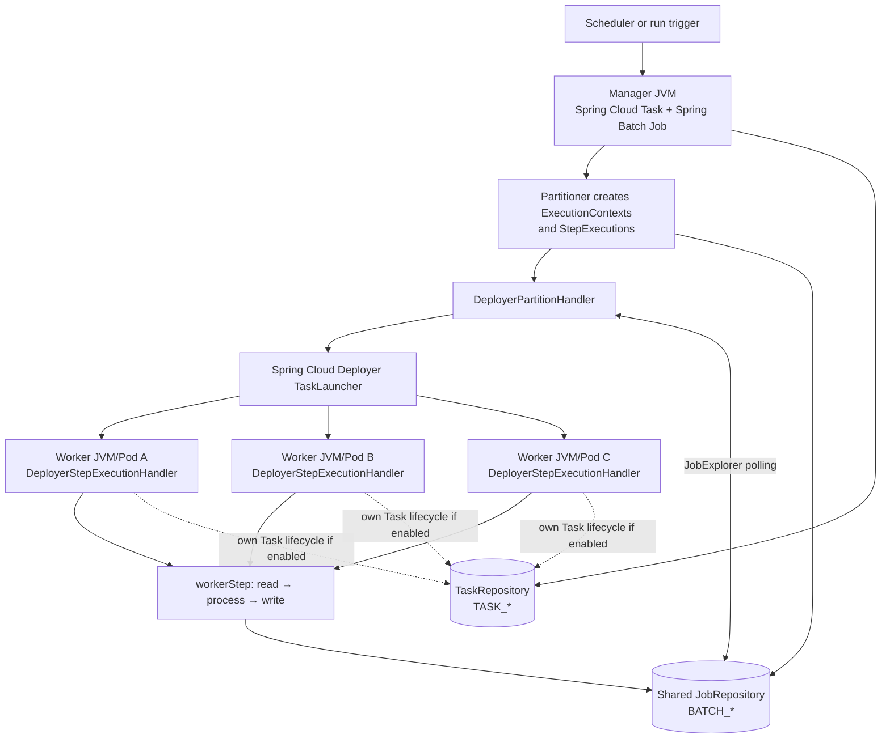
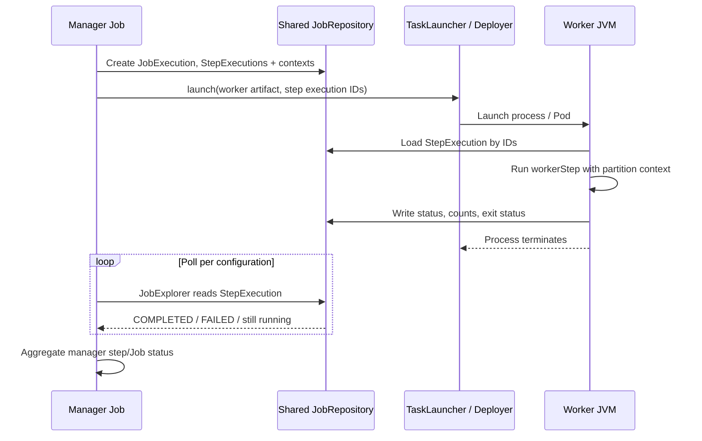

# `DeployerPartitionHandler` and Spring Cloud Deployer in Supported Branches

## Learning Objectives

After this lesson, you will be able to:

- Explain Spring Batch **remote partitioning**: a *manager step* splits work into multiple `StepExecution`s, and each worker executes a partition in a separate process.
- Distinguish the roles of `Partitioner`, `DeployerPartitionHandler`, Spring Cloud Deployer's `TaskLauncher`, `DeployerStepExecutionHandler`, `JobRepository`, and `TaskRepository`.
- Describe how the manager launches workers via Spring Cloud Deployer, passes StepExecution identifiers, polls status from a shared repository, and aggregates results.
- Read configuration tailored to a **Spring Cloud Task branch that provides this API** and avoid copying old constructors or options into releases that no longer confirm support.
- Reason about `gridSize`, `maxWorkers`, worker artifacts, deployment environments, transactions, failures, restarts, and duplicate-processing risks.
- Verify Job/Step/Task metadata, logs, exit codes, and worker health on the runtime platform for safe deployment.

> **Scope:** This lesson belongs to the **Remote Partitioning** chapter of the **SPRING_CLOUD_TASK** module. Spring Cloud Task tracks finite Spring Boot processes and writes results to a database; Spring Batch manages Jobs/Steps and restart metadata. This lesson focuses on integrating **Spring Cloud Deployer** to launch workers for remote partitioning **in branches verified to still support the relevant APIs**.

## 1. Version Note: What Does "In Supported Branches" Mean?

Never assume every Spring Cloud Task version has the same remote partitioning mechanism.

- **Spring Cloud Task 3.0.4 documentation** includes a *Remote Partitioning* section describing `DeployerPartitionHandler` and `DeployerStepExecutionHandler`. The 3.0.4 Javadoc provides the constructor `DeployerPartitionHandler(TaskLauncher, JobExplorer, Resource, String, TaskRepository)` and an overload accepting an additional `TaskExecutor`.
- **Older documentation** such as Spring Cloud Task 2.x shows examples with a **four-argument** constructor. You cannot copy those examples verbatim to compile against the 3.0.4 API.
- **Current Spring Cloud Task 5.1.0 documentation** focuses on JobExecution–TaskExecution linking and no longer documents Deployer-based remote partitioning on the Batch page. Absence from the docs is **not enough to conclude all classes were removed**, nor is it enough to assume compatibility.
- Therefore, before adopting this feature, pin a **compatible set of Spring Boot, Spring Batch, Spring Cloud Task, and Spring Cloud Deployer versions**, verify the actual classes in the dependency tree/Javadoc of your chosen artifacts, and test deployment on the target platform.

This lesson uses illustrative APIs from the **3.0.x branch, specifically the 3.0.4 docs/Javadoc**. If you are on a newer branch, re-verify support or choose an alternative remote partitioning model provided by the Spring Batch ecosystem and your platform. Do not downgrade or upgrade a single dependency just to pull back a class while ignoring compatibility across the rest of the stack.

| Reference source | What you can rely on | Limitations |
| --- | --- | --- |
| Spring Cloud Task 3.0.4 Reference | Manager/worker architecture, Spring Cloud Deployer, shared repository requirements, and configuration examples. | May contain older snippets whose constructors lag behind Javadoc. |
| Spring Cloud Task 3.0.4 Javadoc | Five-/six-argument constructors, setters, and `DeployerStepExecutionHandler` contract. | Confirms the API only for that version. |
| Spring Cloud Task 5.1.0 Reference | Features officially documented in the new release. | Cannot be used to infer that legacy remote partitioning APIs remain present. |
| Spring Batch Reference | `Partitioner`, `PartitionHandler`, `JobRepository`, retry/restart, and partitioned Steps. | Does not itself provide infrastructure to create Pods or launch processes via Deployer. |

## 2. What Is Remote Partitioning and When Is It Needed?

Suppose there are 40 million transactions to reconcile. If one Step processes all data in a single JVM, total runtime may be too long. One strategy is to split the data by ID range, tenant, region, or shard and let multiple processes work in parallel.

In Spring Batch, **partitioning** splits one logical Step into multiple `StepExecution`s. The `Partitioner` produces distinct `ExecutionContext`s, for example:

| Partition | `fromId` | `toId` | Expected worker |
| --- | ---: | ---: | --- |
| `partition0` | 1 | 250000 | Worker A |
| `partition1` | 250001 | 500000 | Worker B |
| `partition2` | 500001 | 750000 | Worker C |
| `partition3` | 750001 | 1000000 | Worker D |

Each worker reads its own range and executes the same `workerStep`. In this example, the ID ranges are partitioned without overlap. If IDs are sparse, partitioning by actual record count or shard may balance load better.

Distinguishing scaling approaches:

| Approach | Where it runs | Main mechanism | When to consider |
| --- | --- | --- | --- |
| Standard Step | Single process, single main processing flow. | Standard Job/Step. | Moderate data volume. |
| Local partitioning | One JVM, multiple threads. | `TaskExecutorPartitionHandler`. | Want to utilize CPUs/threads of a single machine. |
| **Deployer remote partitioning** | Multiple Spring Boot processes, potentially across different hosts/Pods. | `DeployerPartitionHandler` + `TaskLauncher`. | Want distributed processing and infrastructure-managed worker provisioning. |
| Spring Batch Integration remote partitioning | Multiple processes over messaging infrastructure. | `MessageChannelPartitionHandler` or equivalent integration components. | System already has suitable message broker; requires message-based design. |
| Remote chunking | Manager reads/splits *chunks* and sends them to workers. | Messaging and remote chunking components. | Want to distribute chunk processing via this pattern. |

**Remote partitioning differs from remote chunking.** In remote partitioning, each worker runs a **complete Step** with its own reader/processor/writer or Tasklet; the manager mainly divides work and aggregates status. In remote chunking, the read and data-transmission boundaries are different.

## 3. Manager, Worker, and Shared Repository Architecture



Roles:

- **Manager:** holds the `Job` and *manager step*, decides partition count/ranges, invokes `PartitionHandler`, and waits to aggregate results.
- **`Partitioner`:** returns `Map<String, ExecutionContext>`; map keys represent partition names, and values carry control parameters telling each worker which slice to process.
- **`DeployerPartitionHandler`:** implements `PartitionHandler`, uses `TaskLauncher` to launch a worker application for the `StepExecution`s, then polls their statuses from `JobRepository` via `JobExplorer`.
- **`TaskLauncher`:** an SPI in **Spring Cloud Deployer** that creates processes/Pods for a specific platform. The concrete `TaskLauncher` implementation determines how deployment happens.
- **`DeployerStepExecutionHandler`:** a `CommandLineRunner` inside the worker application. It reads identifiers supplied by the manager, loads the `StepExecution` from the shared repository, looks up the Step bean, and executes the Step.
- **`JobRepository`:** the source of truth for `JobExecution`, `StepExecution`, `ExecutionContext`, and completion/FAILED/restart status.
- **`TaskRepository`:** tracks the Spring Cloud Task lifecycle of the manager process and potentially workers. It **does not replace `JobRepository`**.

**Mandatory prerequisite:** the manager and all workers must access the **same `JobRepository` store** to load the right `StepExecution` and persist outcomes. The 3.0.4 docs also expect the manager and workers to be able to access a shared `TaskRepository` in that example. Never use an isolated in-memory H2 database per Pod, as `StepExecution` data would not be shared.

If using two separate databases for `TaskRepository` and `JobRepository`, configure both datasources explicitly on every process and verify connectivity. Do not assume a single JDBC transaction spans both databases or that Task–Batch link tables enforce cross-database foreign keys.

## 4. Lifecycle of a Remote Partitioning Run

Typical execution flow:

1. The scheduler launches the **manager Task**; Spring Cloud Task begins recording a manager `TaskExecution` once the context initializes.
2. Spring Batch opens a `JobExecution` and runs the *manager step*.
3. `Partitioner.partition(gridSize)` generates entries like `partition0`, `partition1`; each entry has an `ExecutionContext` with processing bounds.
4. `StepExecutionSplitter` and `JobRepository` manage the corresponding `StepExecution`s, assigning each partition an ID and status.
5. `DeployerPartitionHandler` asks `TaskLauncher` to start the worker artifact with `JobExecution`, `StepExecution`, and Step bean name identifiers.
6. A Spring Boot worker starts with the appropriate profile/settings; `DeployerStepExecutionHandler` retrieves its pre-created `StepExecution` via `JobExplorer`/`JobRepository` and runs `workerStep`.
7. The worker updates Batch metadata and terminates. The manager **polls `JobRepository`** to see which Steps have finished and aggregates outcomes.
8. The manager determines the result of the *manager step* and Job. When the Job finishes, the Task updates its lifecycle metadata if the repository is available.
9. If a partition fails, Spring Batch's restart policy can re-run unfinished Steps in a subsequent `JobExecution` according to rules/configuration; do not assume every error triggers immediate infinite automatic retries.



### Why Doesn't the Worker Receive "All the Data" Through the Deployer Call?

`TaskLauncher` primarily accepts an **artifact**, deployment properties, arguments, and environment variables to launch a process. The worker receives **execution identifiers** and loads its `ExecutionContext` from the shared `JobRepository`. Large business datasets should be accessed directly by workers from the data source or storage rather than stuffed onto the command line.

In the 3.0.4 Javadoc, the worker handler needs `JOB_EXECUTION_ID`, `STEP_EXECUTION_ID`, and the **Step bean name**; the framework defines the related environment variables using constants in `DeployerPartitionHandler`. Do not rename variables yourself or guess ID serialization formats; let `DeployerPartitionHandler` pass the release's exact contract.

## 5. Checking Dependencies on a Compatible Branch

**Illustrative** dependencies for a project on a branch that still supports the API:

```xml
<dependencies>
    <dependency>
        <groupId>org.springframework.cloud</groupId>
        <artifactId>spring-cloud-starter-task</artifactId>
    </dependency>
    <dependency>
        <groupId>org.springframework.boot</groupId>
        <artifactId>spring-boot-starter-batch</artifactId>
    </dependency>
    <dependency>
        <groupId>org.postgresql</groupId>
        <artifactId>postgresql</artifactId>
        <scope>runtime</scope>
    </dependency>

    <!-- Choose only the implementation matching your actual platform:
         local deployer for local; Kubernetes deployer for Kubernetes. -->
</dependencies>
```

Do not hardcode individual artifact versions here. The project must manage them through the **matching Spring Boot BOM and Spring Cloud release train**; Spring Cloud Deployer may follow its own release cadence, so check compatibility matrices and actually published releases.

Locally, developers may need the `spring-cloud-deployer-local` module; on Kubernetes, older branch docs cite `spring-cloud-starter-deployer-kubernetes`. **Add only the implementation actually needed**, avoiding accidentally bringing both local and Kubernetes `TaskLauncher`s into the same context and causing Spring bean resolution conflicts.

Inspect the runtime classpath:

```bash
./mvnw dependency:tree -Dincludes=org.springframework.cloud
```

Or with Gradle:

```bash
./gradlew dependencies --configuration runtimeClasspath
```

At minimum, you should see the appropriate classes for:

- `org.springframework.cloud.task.batch.partition.DeployerPartitionHandler`.
- `org.springframework.cloud.task.batch.partition.DeployerStepExecutionHandler`.
- `org.springframework.cloud.deployer.spi.task.TaskLauncher` and a working implementation for your target platform.
- Spring Batch `JobRepository`, `JobExplorer`, `Partitioner`, and `PartitionHandler` APIs compatible with your actual dependencies.

Do not mix Spring Batch 4 / Boot 2 examples (`JobBuilderFactory`, `StepBuilderFactory` legacy APIs) into a Spring Batch 5 / Boot 3 project without converting them. Nor should you infer Spring Cloud Task 3.0.4 constructors from an older article using four arguments.

## 6. Configuring the Manager: `DeployerPartitionHandler`

Per the 3.0.4 Javadoc, the standard constructor requires:

```java
new DeployerPartitionHandler(
    taskLauncher,
    jobExplorer,
    workerResource,
    "workerStep",
    taskRepository
);
```

Where:

| Parameter | Role |
| --- | --- |
| `taskLauncher` | SPI that executes launching the worker Task on the chosen environment. |
| `jobExplorer` | Reads `StepExecution` statuses from the shared `JobRepository`. |
| `workerResource` | `Resource` representing the deployable worker application. |
| `"workerStep"` | **Step bean name** that the worker handler will look up in the worker context. |
| `taskRepository` | Task repository per the 3.0.4 constructor contract. |

A six-argument overload adds a `TaskExecutor`, used when you want to **dispatch worker launch requests asynchronously**.

### Java Configuration Example on Branch 3.0.4

The following snippet intentionally separates `TaskLauncher` creation because its implementation and worker artifact resolution depend on local/Kubernetes/cloud platforms. It assumes `TaskLauncher` and `Resource` beans are already available.

```java
package com.example.partition;

import java.util.List;

import org.springframework.batch.core.explore.JobExplorer;
import org.springframework.batch.core.partition.PartitionHandler;
import org.springframework.cloud.deployer.spi.task.TaskLauncher;
import org.springframework.cloud.task.batch.partition.DeployerPartitionHandler;
import org.springframework.cloud.task.batch.partition.NoOpEnvironmentVariablesProvider;
import org.springframework.cloud.task.batch.partition.PassThroughCommandLineArgsProvider;
import org.springframework.cloud.task.repository.TaskRepository;
import org.springframework.beans.factory.annotation.Qualifier;
import org.springframework.context.annotation.Bean;
import org.springframework.context.annotation.Configuration;
import org.springframework.context.annotation.Profile;
import org.springframework.core.io.Resource;

@Configuration(proxyBeanMethods = false)
public class ManagerDeployerConfiguration {

    @Bean
    @Profile("manager")
    PartitionHandler deployerPartitionHandler(
            TaskLauncher taskLauncher,
            JobExplorer jobExplorer,
            TaskRepository taskRepository,
            @Qualifier("workerArtifact") Resource workerArtifact) {

        DeployerPartitionHandler handler =
                new DeployerPartitionHandler(
                        taskLauncher,
                        jobExplorer,
                        workerArtifact,
                        "workerStep",
                        taskRepository);

        handler.setApplicationName("partition-worker");
        handler.setGridSize(4);
        handler.setMaxWorkers(2);
        handler.setCommandLineArgsProvider(
                new PassThroughCommandLineArgsProvider(
                        List.of(
                                "--spring.profiles.active=worker",
                                "--spring.batch.job.enabled=false")));
        handler.setEnvironmentVariablesProvider(
                new NoOpEnvironmentVariablesProvider());

        // Depending on needs and the API's time units in this release:
        // handler.setPollInterval(...);
        // handler.setTimeout(...);
        // handler.setDeploymentProperties(...);

        return handler;
    }
}
```

**Important note:** the values in this example are `gridSize=4` and `maxWorkers=2`; this does not mean there are only two partitions. There can be four partitions with at most two workers running concurrently. Actual scope also depends on the `Partitioner`, `TaskLauncher` implementation, and environment quotas.

### Creating `workerArtifact` and `TaskLauncher`

A `Resource` bean can be registered separately from a URI or published artifact:

```java
@Bean("workerArtifact")
@Profile("manager")
Resource workerArtifact(
        @Value("${app.worker.resource-uri}") String uri,
        ResourceLoader resourceLoader) {
    return resourceLoader.getResource(uri);
}
```

This is a **configuration fragment** inside a `@Configuration` class; it requires importing `@Bean`, `@Profile`, `@Value`, `Resource`, and `ResourceLoader`. Example property:

```yaml
app:
  worker:
    resource-uri: file:/opt/tasks/partition-worker.jar
```

`file:` fits certain local setups where the worker artifact already sits at a path accessible to `TaskLauncher`. On Kubernetes or other platforms, the `Resource` format must be supported by the Deployer implementation (e.g., registry/artifact-repository resources). Do not use `file:/opt/...` simply because the file exists on the manager host and assume a remote Pod can see it.

If using a Maven artifact resource, you may need `maven://...` resolution along with repository configuration, credentials, or a private registry. Developers must ensure the **worker artifact is reachable by the deployment infrastructure**, has a pinned version, and matches the application version—avoiding `SNAPSHOT` builds that might change between runs.

`TaskLauncher` is the **infrastructure integration point**. Create the bean from the Deployer implementation matching your environment, providing platform access configuration and permissions to launch processes/Pods. `DeployerPartitionHandler` does not create a Kubernetes cluster, log into the cloud, or package JARs into Docker images on its own.

## 7. Creating a `Partitioner` with Clear Boundaries

`Partitioner` produces a `Map<String, ExecutionContext>`. Each context must carry enough information for a worker to process **a deterministic range**, while supporting reliable restarts.

Example splitting integer IDs from 1 to 1,000,000 into partitions based on `gridSize`:

```java
package com.example.partition;

import java.util.LinkedHashMap;
import java.util.Map;

import org.springframework.batch.core.partition.support.Partitioner;
import org.springframework.batch.item.ExecutionContext;
import org.springframework.context.annotation.Bean;
import org.springframework.context.annotation.Configuration;
import org.springframework.context.annotation.Profile;

@Configuration(proxyBeanMethods = false)
public class PartitionRangeConfiguration {

    @Bean
    @Profile("manager")
    Partitioner transactionRangePartitioner() {
        return gridSize -> {
            int parts = Math.max(1, gridSize);
            long total = 1_000_000L;
            long chunk = (total + parts - 1) / parts;
            Map<String, ExecutionContext> result = new LinkedHashMap<>();

            for (int i = 0; i < parts; i++) {
                long from = 1L + i * chunk;
                long to = Math.min(total, from + chunk - 1);
                if (from > to) {
                    break;
                }

                ExecutionContext context = new ExecutionContext();
                context.putLong("fromId", from);
                context.putLong("toId", to);
                result.put("partition" + i, context);
            }
            return result;
        };
    }
}
```

This example uses non-overlapping **closed** intervals `[fromId, toId]`. In real datasets, do not assume every ID from 1 to 1,000,000 exists or that load is evenly distributed. You can partition by month, tenant, shard, timestamp range, or a persisted work-item list.

When using `gridSize`, the actual result depends on the `Partitioner` implementation; this parameter is a **hint for partition count**, not a guarantee that the database holds exact `gridSize` chunks or that that many workers are running. Avoid designing workers that need to know the total number of active processes just to compute their own range.

### Criteria for Good Partition Design

- Data ranges are **non-overlapping** or backed by explicit deduplication.
- Ranges are small enough to retry/restart without excessive cost.
- Each partition has a stable identifier key; `ExecutionContext` data is minimal and serializable into `JobRepository`.
- If source data can mutate mid-run, define a snapshot, timestamp cutoff, or version to prevent missed or duplicate records.
- If workers produce side effects outside the database, use an idempotency key tied to **business work**, not to a worker PID/Pod or `TaskExecution` ID.
- Never put secrets, large personal data, or heavy business payloads into `ExecutionContext`, because metadata is persisted in the database and may be visible through admin tools.

## 8. Wiring `Partitioner` to the Manager Step and Job

With Spring Batch 5 and the corresponding `StepBuilder` syntax, the manager defines a partitioned Step:

```java
package com.example.partition;

import org.springframework.batch.core.Job;
import org.springframework.batch.core.Step;
import org.springframework.batch.core.job.builder.JobBuilder;
import org.springframework.batch.core.partition.PartitionHandler;
import org.springframework.batch.core.partition.support.Partitioner;
import org.springframework.batch.core.repository.JobRepository;
import org.springframework.batch.core.step.builder.StepBuilder;
import org.springframework.beans.factory.annotation.Qualifier;
import org.springframework.context.annotation.Bean;
import org.springframework.context.annotation.Configuration;
import org.springframework.context.annotation.Profile;

@Configuration(proxyBeanMethods = false)
public class ManagerJobConfiguration {

    @Bean("managerStep")
    @Profile("manager")
    Step managerStep(
            JobRepository jobRepository,
            Partitioner transactionRangePartitioner,
            PartitionHandler deployerPartitionHandler) {

        return new StepBuilder("managerStep", jobRepository)
                .partitioner("workerStep", transactionRangePartitioner)
                .partitionHandler(deployerPartitionHandler)
                .build();
    }

    @Bean("partitionedSettlementJob")
    @Profile("manager")
    Job partitionedSettlementJob(
            JobRepository jobRepository,
            @Qualifier("managerStep") Step managerStep) {

        return new JobBuilder("partitionedSettlementJob", jobRepository)
                .start(managerStep)
                .build();
    }
}
```

The name `"workerStep"` passed to `partitioner(...)` must match the exact Step bean name looked up by the worker handler. The `JobRepository` used by the manager must point to the same database as the workers. Declaring the `Job` with `@Profile("manager")` prevents workers from auto-running the entire manager Job when they start.

### Distinguishing Manager Step and Worker Step

`managerStep` mainly splits work and waits for outcomes; it does not run the reconciliation logic of every partition inside the same JVM. `workerStep` is the Step that executes business logic on worker processes.

A worker can be configured to handle **one** `StepExecution` for a specific partition. Do not design `workerStep` to pick a random partition from the database on its own; it must read the `ExecutionContext` attached to its assigned `StepExecution` to know its exact range.

## 9. Worker: `DeployerStepExecutionHandler` and `workerStep`

Per the 3.0.4 Javadoc, `DeployerStepExecutionHandler` implements `CommandLineRunner`. Its constructor takes:

```java
new DeployerStepExecutionHandler(
    beanFactory,
    jobExplorer,
    jobRepository
);
```

The handler uses identifiers passed by the manager to look up the `StepExecution` and Step bean and then executes that Step. The worker **does not need to create a new JobExecution** just to run a partition, nor should it launch the manager's `partitionedSettlementJob`.

### Registering the Worker Handler

```java
package com.example.partition;

import org.springframework.batch.core.explore.JobExplorer;
import org.springframework.batch.core.repository.JobRepository;
import org.springframework.beans.factory.BeanFactory;
import org.springframework.cloud.task.batch.partition.DeployerStepExecutionHandler;
import org.springframework.context.annotation.Bean;
import org.springframework.context.annotation.Configuration;
import org.springframework.context.annotation.Profile;

@Configuration(proxyBeanMethods = false)
public class WorkerHandlerConfiguration {

    @Bean
    @Profile("worker")
    DeployerStepExecutionHandler stepExecutionHandler(
            BeanFactory beanFactory,
            JobExplorer jobExplorer,
            JobRepository jobRepository) {

        return new DeployerStepExecutionHandler(
                beanFactory, jobExplorer, jobRepository);
    }
}
```

### Registering the Step Executed by Workers

```java
package com.example.partition;

import org.springframework.batch.core.Step;
import org.springframework.batch.core.configuration.annotation.StepScope;
import org.springframework.batch.core.repository.JobRepository;
import org.springframework.batch.core.step.builder.StepBuilder;
import org.springframework.batch.core.step.tasklet.Tasklet;
import org.springframework.batch.repeat.RepeatStatus;
import org.springframework.beans.factory.annotation.Value;
import org.springframework.context.annotation.Bean;
import org.springframework.context.annotation.Configuration;
import org.springframework.transaction.PlatformTransactionManager;

@Configuration(proxyBeanMethods = false)
public class WorkerStepConfiguration {

    @Bean("workerStep")
    Step workerStep(
            JobRepository jobRepository,
            PlatformTransactionManager transactionManager,
            Tasklet partitionTasklet) {

        return new StepBuilder("workerStep", jobRepository)
                .tasklet(partitionTasklet, transactionManager)
                .build();
    }

    @Bean
    @StepScope
    Tasklet partitionTasklet(
            @Value("#{stepExecutionContext['fromId']}") Long fromId,
            @Value("#{stepExecutionContext['toId']}") Long toId) {

        return (contribution, chunkContext) -> {
            if (fromId == null || toId == null || fromId > toId) {
                throw new IllegalArgumentException("Invalid partition range");
            }

            System.out.printf(
                    "Processing IDs from %d to %d%n", fromId, toId);

            // In production: service reads/writes data across [fromId, toId].
            // Implement appropriate transactions, checkpoints, and idempotency.
            return RepeatStatus.FINISHED;
        };
    }
}
```

`@StepScope` ensures parameters coming from `stepExecutionContext` are resolved only when the partition's `StepExecution` starts. Removing `@StepScope` and trying to read `stepExecutionContext` during singleton bean creation usually fails because no Step context is active yet.

`workerStep` must exist in the worker's Spring container under the **exact bean ID expected by the handler**. In practice, you can package a single JAR and toggle between `manager` and `worker` profiles, or package two separate applications while keeping Step types and metadata in sync. The examples above share one codebase for clarity.

### Application Entry Point

```java
package com.example.partition;

import org.springframework.boot.SpringApplication;
import org.springframework.boot.autoconfigure.SpringBootApplication;
import org.springframework.cloud.task.configuration.EnableTask;

@SpringBootApplication
@EnableTask
public class PartitionedSettlementApplication {

    public static void main(String[] args) {
        SpringApplication.run(PartitionedSettlementApplication.class, args);
    }
}
```

On the worker, `DeployerStepExecutionHandler` is the runner that executes the Step. On the manager, the Spring Batch Job is selected and launched via the compatible configuration mechanism (or a dedicated runner). Do not add a shared business runner active in both profiles if it could write data a second time.

## 10. Profile Configuration and Shared Database

The example below assumes a PostgreSQL database already initialized with **both Spring Batch and Spring Cloud Task metadata tables** via proper migrations:

```yaml
spring:
  application:
    name: partitioned-settlement
  main:
    web-application-type: none
  datasource:
    url: jdbc:postgresql://metadata-db:5432/batchdb
    username: ${BATCH_DB_USER}
    password: ${BATCH_DB_PASSWORD}
  cloud:
    task:
      initialize-enabled: false
      closecontext-enabled: true
  batch:
    jdbc:
      initialize-schema: never

---
spring:
  config:
    activate:
      on-profile: manager
  batch:
    job:
      enabled: true
      name: partitionedSettlementJob

---
spring:
  config:
    activate:
      on-profile: worker
  batch:
    job:
      enabled: false
```

The YAML assumes properties present in the **Spring Boot/Spring Cloud versions compatible with the example**; verify property bindings and APIs for your exact release. In Kubernetes, `metadata-db` must resolve and be reachable from both manager and workers. Credentials should generally be injected via platform Secrets/secret managers, never baked into Docker images or command lines.

**Points to note:**

1. `spring.batch.job.enabled=false` on the worker prevents unintended auto-launching of Job beans.
2. `spring.cloud.task.initialize-enabled=false` and `spring.batch.jdbc.initialize-schema=never` require metadata tables to exist before runtime; do not rely on runtime auto-migration.
3. `closecontext-enabled` helps close the Spring context after runners complete, especially when executors/threads would otherwise keep the JVM alive; check the exact property name and behavior for your branch.
4. If the worker needs a business datasource **separate** from the metadata database, configure datasources, transaction managers, and the Batch repository explicitly—avoid accidentally relying on `@Primary`.
5. If manager and worker require different DB privileges, ensure both still have appropriate access to the shared `BATCH_*` tables to read and update `StepExecution`.

Do not leave `spring.batch.job.enabled=true` on the worker and simply hope the presence of `DeployerStepExecutionHandler` stops Jobs from running. Verify through testing that **each worker executes only its assigned partition**.

## 11. `gridSize`, `maxWorkers`, Polling, Timeouts, and Executors

Configuration properties on `DeployerPartitionHandler` control different dimensions:

| API | Purpose | Pitfall |
| --- | --- | --- |
| `setGridSize(int)` | Partition granularity hint; `Partitioner` decides the final partition count. | Not directly equal to the number of concurrent Pods. |
| `setMaxWorkers(int)` | Caps the number of simultaneously executing workers. | Does not mean the Job only has that many partitions. |
| `setPollInterval(long)` | Wait interval between status checks against `JobRepository`. | Polling too fast increases DB load; polling too slowly delays completion detection. |
| `setTimeout(long)` | Wait timeout of the manager step per the API. | Timing out does not automatically roll back changes already committed by workers. |
| `setDeploymentProperties(Map<...>)` | Platform-specific deployment properties passed to `TaskLauncher`. | Local deployer properties differ from Kubernetes deployer properties. |
| `setCommandLineArgsProvider(...)` | Supplies worker CLI args, such as active profile. | Never put secrets in args; never strip internal identifiers passed by the framework. |
| `setEnvironmentVariablesProvider(...)` | Supplies extra environment variables to each worker. | Avoid leaking the manager's entire environment unnecessarily. |
| `setDefaultArgsAsEnvironmentVars(boolean)` | Passes internal default args as environment variables in supported branches. | Must test that workers receive and read IDs properly. |

The 3.0.4 docs mention a default polling interval of around **10 seconds** and an **unlimited** default timeout in the reference description. Verify the exact unit of `long` parameters, sentinel values, and worker cancellation behavior in the implementation/Javadoc of the release your project compiles against. Never blindly copy `setTimeout(10)` and assume it means 10 seconds.

### Asynchronous Worker Launching

The docs note that launching workers can block while infrastructure creates Pods/processes. With many partitions, sequential launching can introduce noticeable delay before workers start running. One solution in supported branches is using the constructor overload that accepts a `TaskExecutor`:

```java
DeployerPartitionHandler handler = new DeployerPartitionHandler(
        taskLauncher,
        jobExplorer,
        workerArtifact,
        "workerStep",
        taskRepository,
        partitionLaunchExecutor
);
```

Example executor:

```java
@Bean("partitionLaunchExecutor")
@Profile("manager")
ThreadPoolTaskExecutor partitionLaunchExecutor() {
    ThreadPoolTaskExecutor executor = new ThreadPoolTaskExecutor();
    executor.setCorePoolSize(2);
    executor.setMaxPoolSize(4);
    executor.setThreadNamePrefix("partition-launch-");
    executor.setWaitForTasksToCompleteOnShutdown(true);
    executor.initialize();
    return executor;
}
```

This is a Spring bean requiring imports for `org.springframework.scheduling.concurrent.ThreadPoolTaskExecutor`, `@Bean`, and `@Profile`. If using this overload, inject the executor into the right `PartitionHandler` bean; **do not accidentally create both `PartitionHandler` beans**.

**Distinguishing two levels of parallelism:**

- The executor on the manager helps **dispatch launch requests** for multiple workers concurrently, cutting provisioning latency.
- `setMaxWorkers` limits the number of **actively executing** workers according to handler logic.
- Kubernetes quotas, CPU/memory, database connection limits, task launcher settings, and system caps can still constrain actual worker concurrency below those settings.

`ThreadPoolTaskExecutor` can keep non-daemon threads alive. For a finite Task, shut down the context/executor at the right time so the JVM exits. However, never close the context while the manager is still waiting on partitions or workers are still running. Use timeouts, shutdown policies, and logging to handle abnormally long runs.

## 12. What Does Spring Cloud Deployer Do?

`Spring Cloud Deployer` provides an SPI to deploy/launch applications per environment. For `TaskLauncher`-based remote partitioning:

| Responsibility | Responsible component |
| --- | --- |
| Determine data range for each partition. | `Partitioner`. |
| Create/manage Job/Step metadata and decide restarts. | `JobRepository` / Spring Batch. |
| Prepare worker artifact launch requests and execution identifiers. | `DeployerPartitionHandler`. |
| Create local processes, Kubernetes workloads, or platform resources. | `TaskLauncher` implementation. |
| Read `StepExecution` metadata and run `workerStep`. | `DeployerStepExecutionHandler`. |
| Update `StepExecution` as completed/failed. | Worker + Spring Batch repository. |
| Query individual partition outcomes for manager aggregation. | `DeployerPartitionHandler` via `JobExplorer`. |

When deploying on Kubernetes, configure the namespace, service account, RBAC permissions to create Jobs/Pods per the implementation, container image/artifact, registry credentials, Secrets, resource requests/limits, and network access to the database. Older branch docs note the requirement for a **valid Kubernetes application name**, usually lowercase alphanumeric/hyphens—such as `partition-worker`.

When running locally, `TaskLauncher` spawns processes on the same host, yet they are still **separate JVMs**. Do not confuse this with `TaskExecutorPartitionHandler`, which splits work across threads within the same JVM.

### Passing Environment Variables: Share Only What Workers Need

A worker may need:

- Metadata DB URL, with username/password injected via Secrets.
- Business datasource URL and access credentials.
- The `worker` profile.
- Artifact/version info and suitable timeout settings.
- Observability data such as trace IDs/correlation IDs, without secrets.

Avoid forwarding the manager's entire environment to workers, as it may expose tokens, passwords, or excessive privileges. If using `SimpleEnvironmentVariablesProvider`, check whether the option to copy the full environment is enabled. `NoOpEnvironmentVariablesProvider` simply avoids adding custom variables from the provider; workers must still be supplied **required environment variables to reach the database** by the platform, while Step identifiers are passed by the handler per contract.

## 13. Metadata, Statuses, and Verification Queries

`JobRepository` manages tables such as:

- `BATCH_JOB_INSTANCE`: logical Job and identifying `JobParameters`.
- `BATCH_JOB_EXECUTION`: each Job execution attempt.
- `BATCH_STEP_EXECUTION`: manager and worker Step executions, including status, timestamps, item counts, and exit messages.
- `BATCH_STEP_EXECUTION_CONTEXT`: partition contexts; can store ranges like `fromId`/`toId`.
- Other Spring Batch parameter and metadata tables.

In our example, the manager step is named `managerStep`, and worker `StepExecution`s typically carry names combining `workerStep` with a partition suffix according to Spring Batch naming rules. Do not assume a Step named `workerStep` has only a single `StepExecution`.

### Querying Job and Per-Partition Status

PostgreSQL example using an actual Job ID:

```sql
SELECT
    j.JOB_EXECUTION_ID,
    j.STATUS AS JOB_STATUS,
    s.STEP_EXECUTION_ID,
    s.STEP_NAME,
    s.STATUS AS STEP_STATUS,
    s.READ_COUNT,
    s.WRITE_COUNT,
    s.COMMIT_COUNT,
    s.ROLLBACK_COUNT,
    s.START_TIME,
    s.END_TIME
FROM BATCH_JOB_EXECUTION j
JOIN BATCH_STEP_EXECUTION s
  ON s.JOB_EXECUTION_ID = j.JOB_EXECUTION_ID
WHERE j.JOB_EXECUTION_ID = 5701
ORDER BY s.STEP_EXECUTION_ID;
```

The run ID `5701` is purely illustrative. When troubleshooting failures, filter specifically for `STEP_STATUS <> 'COMPLETED'` and inspect the corresponding `EXIT_MESSAGE` and `BATCH_STEP_EXECUTION_CONTEXT`. This query tells you which partitions have not completed, not whether a worker Pod is still alive right now.

### Cross-Referencing Task Metadata

```sql
SELECT
    TASK_EXECUTION_ID,
    TASK_NAME,
    START_TIME,
    END_TIME,
    EXIT_CODE,
    ERROR_MESSAGE
FROM TASK_EXECUTION
WHERE TASK_NAME LIKE 'partition%'
ORDER BY START_TIME DESC, TASK_EXECUTION_ID DESC;
```

With Task–Batch integration configured, `TASK_TASK_BATCH` can link `TaskExecution` to `JobExecution`. **Parent–child links between a manager Task and worker Tasks**, if established, are distinct from the `JobExecution`–`TaskExecution` link. Never join directly on `TASK_EXECUTION_ID = JOB_EXECUTION_ID`: the two systems allocate IDs independently.

If a worker fails to write to `TaskRepository`, Batch Step metadata might still exist or may have failed prior to updating; check logs, worker exit status, and platform state. Similarly, if the manager lacks an `END_TIME` due to a crash, that does not mean all workers have stopped.

## 14. Error Recovery and Restarts: Never Assume Absolute Exactly-Once

Common failures:

| Issue | Possible consequence | Resolution |
| --- | --- | --- |
| Worker artifact not found | `TaskLauncher` cannot spawn workers. | Check `Resource`, registry/repository URI, and access permissions. |
| Missing permissions to create Pod/Job | Manager cannot launch partitions. | Check `TaskLauncher`, RBAC, namespace/quotas, and service account. |
| Worker cannot reach `JobRepository` | Cannot load `StepExecution`; manager hangs or fails. | Ensure shared datasource, schema, DB grants, and network reachability. |
| Worker missing `workerStep` bean | `DeployerStepExecutionHandler` cannot find Step by name. | Align bean/Step names, active profile, and artifact versions. |
| Worker runs the manager Job itself | Job auto-run was not disabled in the `worker` profile. | Check `spring.batch.job.enabled=false` and `@Profile("manager")` on the Job. |
| Worker crashes after business commit | Step metadata may not yet reflect the commit. | Idempotent retries, reconcile already-applied effects. |
| One partition fails | Job/manager step may become `FAILED`; other partitions may be `COMPLETED`. | Inspect `JobRepository`, design restarts around Step statuses. |
| Polling too fast or timeout too short | Extra DB load or premature errors while workers are still running. | Tune polling/timeouts to match infrastructure and observe real runs. |
| Worker keeps running after manager timeout | Manager loses visibility; external process may remain active. | Inspect/cancel workloads at the platform level, apply worker timeouts and cleanup procedures. |
| Two managers run the same business key | Data can be double-processed even with different `StepExecution` IDs. | Restrict schedules, use business locks, and enforce idempotency. |

### How Does Spring Batch Handle Partition Restarts?

Spring Batch tracks status metadata for each `StepExecution`. When a Job is restarted under the proper contract with matching `JobParameters`, already-completed partition Steps can be skipped while unfinished ones re-run, depending on Step configuration and restart rules.

However, a job that called a banking API and crashed **before recording `COMPLETED`** may call that API again even though the external call succeeded. Therefore:

- Use **business-stable idempotency keys**, never worker PIDs or `TaskExecution` IDs.
- Maintain clear transaction boundaries and reader/writer checkpoints.
- When an external API times out, query its status or use a receiver-side idempotency key.
- Ensure lock leases, TTLs, and scheduler concurrency policies prevent two managers from overlapping.
- Never interpret "restartable" as "no record will ever be processed twice."

## 15. Worker Exit Codes and Manager Outcomes

A worker might throw an `Exception` and exit with a non-zero code, while the manager primarily aggregates `StepExecution` statuses saved in `JobRepository`. If a worker is killed before updating the repository, the manager may have to wait until timeout or cross-reference launcher/platform details to detect the failure.

Monitor across three layers:

1. **Worker process/container:** Pod status, exit code, termination reason, logs.
2. **Spring Batch:** `StepExecution.status`, `JobExecution.status`, counts, and exit messages in `JobRepository`.
3. **Spring Cloud Task:** `TaskExecution.exitCode`/`endTime` for the manager and workers when successfully recorded.

If the Batch Job fails while the outer Task still exits normally, you need a mechanism to propagate Batch failure to the Task exit code—such as `spring.cloud.task.batch.fail-on-job-failure=true` when supported by your release. However, never rely solely on that property in custom remote partitioning flows: always verify the final `JobExecution` and actual manager process exit code.

A `TASK_EXECUTION` with `EXIT_CODE=0` does not prove all partitions succeeded: business outcomes must be verified against the Batch Job/Steps and written target data.

## 16. Scheduled and On-Demand Operations

Spring Cloud Task records process execution history; it **does not provide CronJob scheduling itself**. Systems can use:

- `java -jar` commands to run the manager on demand.
- Kubernetes Job/CronJob, Spring Cloud Data Flow, or another orchestrator to trigger the manager.
- An internal application-managed `TaskLauncher` to spawn workers after the manager Job starts.

A single manager trigger can spawn **multiple worker processes** and corresponding `TaskExecution`s. Design for:

- `concurrencyPolicy` or business locks preventing two managers from overlapping on the same data.
- Worker count limits and Pod CPU/memory budgets.
- Small enough connection pools per worker so multiplying by max workers stays within DB limits.
- Timeouts across manager, worker, and platform—not just polling timeouts.
- Cleanup of hung workloads, orphaned Pods/Jobs, and metadata missing `END_TIME`.
- Logs carrying `jobExecutionId`, `stepExecutionId`, partition name, and correlation IDs to connect layers.
- Retention policies for Task/Batch metadata, avoiding purging `BATCH_STEP_EXECUTION_CONTEXT` before restart windows expire.

### Security

Avoid putting passwords, bearer tokens, or personal data into `ExecutionContext`, `JobParameters`, or CLI arguments whenever possible; such values may be persisted in metadata or exposed in process listings. Use Secrets with least-privilege permissions per worker, encrypt DB connections, restrict the manager's Pod/Job creation rights, isolate networks, and redact logs safely.

## 17. Deployment Checklist for Supported Branches

1. **Pin versions:** choose a compatible Spring Boot, Spring Batch, Spring Cloud Task, and Spring Cloud Deployer set; verify `DeployerPartitionHandler` APIs in the actual JARs instead of copying constructors from old blog posts.
2. **Worker artifact:** packaged for the target platform, containing `DeployerStepExecutionHandler`, the `workerStep` bean, and the `worker` profile.
3. **TaskLauncher:** local/Kubernetes implementation matching the environment with permission to launch workers; resource URI format supported by the Deployer.
4. **Repositories:** manager and all workers point to the same `JobRepository` with migrated Batch schemas; `TaskRepository` properly configured if tracking Tasks.
5. **Partitioner:** builds deterministic contexts with non-overlapping ranges and clear idempotency/restart policies.
6. **Concurrency:** distinguish `gridSize`, `maxWorkers`, worker-launch executor threads, and platform quotas.
7. **Completion flow:** workers execute their Step and exit; manager polls/evaluates results; process returns the right exit code.
8. **Observability:** query `JobExecution`/`StepExecution`, `TaskExecution`, and Pod/process statuses; alert on stalled or failed partitions.
9. **Failure testing:** worker crash, manager crash, DB disconnect, missing artifact, exhausted quota, and retries on the same data.
10. **Retention and security:** schema management, DB permissions, logging, Secrets, metadata retention windows, and workload cleanup.

## 18. Practice Exercises

**Exercise 1 — Partitioning and concurrency limits:** Build a `Partitioner` splitting 1,000,000 IDs into four partitions with `gridSize=4` and `maxWorkers=2`. Draw a timeline showing two workers running concurrently; explain why partition count is not the same as active worker count.

**Exercise 2 — Manager/worker profiles:** Using the example code, define a Job active only under the `manager` profile and a `DeployerStepExecutionHandler` active only under the `worker` profile. Verify that starting a worker does not auto-run the full manager Job.

**Exercise 3 — Shared repository:** Intentionally point manager and worker to two separate metadata databases in a test environment. Describe the symptoms when the worker cannot locate `StepExecution`, then fix the configuration to share one `JobRepository`.

**Exercise 4 — Partition failure:** Force `partition2` to throw an exception after some records have committed; inspect `BATCH_STEP_EXECUTION`, restart the Job with the same identifying `JobParameters` per Spring Batch policy, and verify completed partitions are not reprocessed uncontrollably.

**Exercise 5 — Testing Deployer:** Run using a local `TaskLauncher` in a test environment, then test a Kubernetes implementation verified compatible with your branch. Compare how worker artifacts, deploy properties, secrets, worker limits, and cleanup are handled.

**Exercise 6 — API comparison:** Open the Spring Cloud Task 3.0.4 Javadoc and the Batch documentation page for your active release. Compare the presence of `DeployerPartitionHandler`, its five-argument constructor, `setMaxWorkers`, and `DeployerStepExecutionHandler`. Explain why copying a four-argument constructor example from older docs without checking will fail.

## Key Takeaways

- **`DeployerPartitionHandler`** bridges **Spring Batch partitioning** and **Spring Cloud Deployer `TaskLauncher`** to run partitions across multiple Spring Boot processes.
- **`DeployerStepExecutionHandler`** in each worker loads its `StepExecution` using passed identifiers, executes the matching Step bean, and writes status back to the **shared `JobRepository`**; the manager polls the repository to aggregate results.
- **`gridSize` is a partitioning hint**, while `maxWorkers` caps concurrency; an additional `TaskExecutor` enables asynchronous launch dispatch when needed.
- Manager and workers must share the same Batch metadata store; Task metadata aids process-lifecycle tracking but does not replace the Job/Step repository.
- Restarts depend on Step statuses and `JobParameters`; **business-level idempotency** remains mandatory whenever external side effects or failures between commit and metadata updates can occur.
- Only adopt Deployer partitioning APIs after verifying **your actual branch/version supports them**; older and newer releases differ significantly.

## References

- [Spring Cloud Task 3.0.4 — Remote Partitioning](https://docs.spring.io/spring-cloud-task/docs/3.0.4/reference/html/#_remote_partitioning)
- [Spring Cloud Task 3.0.4 — DeployerPartitionHandler Javadoc](https://docs.spring.io/spring-cloud-task/docs/3.0.4/apidocs/org/springframework/cloud/task/batch/partition/DeployerPartitionHandler.html)
- [Spring Cloud Task 3.0.4 — DeployerStepExecutionHandler Javadoc](https://docs.spring.io/spring-cloud-task/docs/3.0.4/apidocs/org/springframework/cloud/task/batch/partition/DeployerStepExecutionHandler.html)
- [Spring Cloud Task 5.1.0 — Batch](https://docs.spring.io/spring-cloud-task/reference/batch.html)
- [Spring Batch — Scaling and Parallel Processing](https://docs.spring.io/spring-batch/reference/scalability.html)
- [Spring Batch Integration — Remote Partitioning](https://docs.spring.io/spring-batch/reference/spring-batch-integration/externalizing-execution.html)
- [Spring Cloud Data Flow — Remote Partitioned Batch Job Guide](https://dataflow.spring.io/docs/feature-guides/batch/partitioning/)
