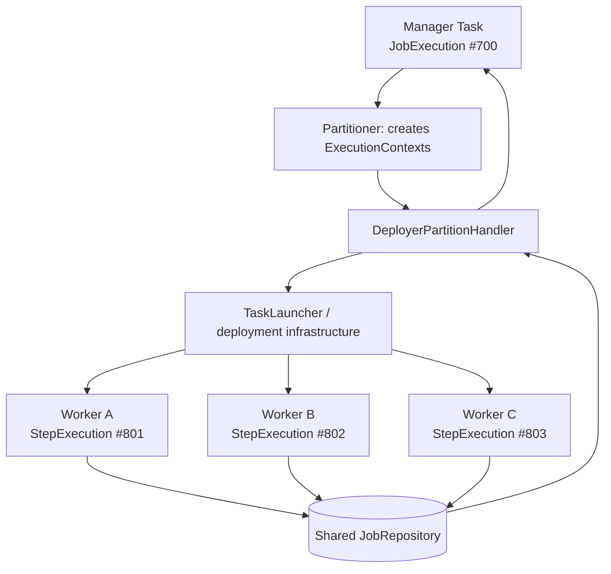
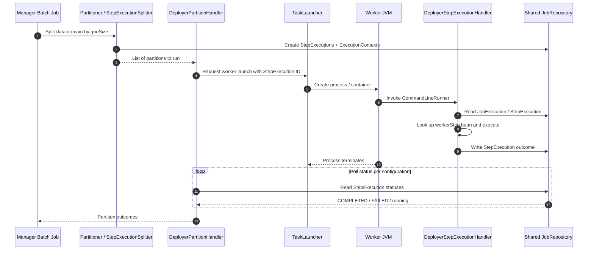
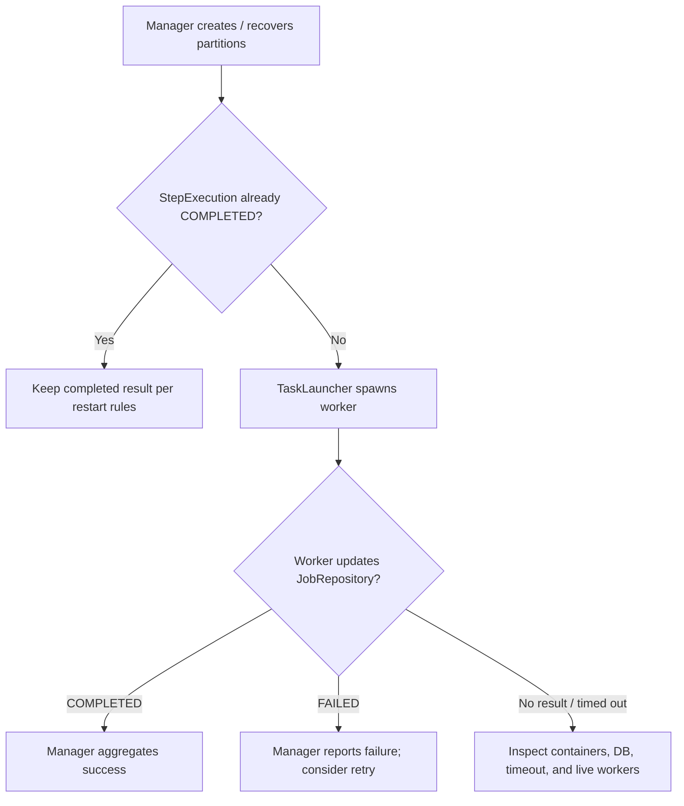

# DeployerStepExecutionHandler and Step Execution in Child Processes

In the **Remote Partitioning** chapter of **Spring Cloud Task**, the goal is to run a large Spring Batch job across multiple independent processes or containers. For example, a reconciliation process needs to handle 12 million transactions: a **manager** process splits the data domain into partitions, while **worker** processes execute those partitions. Each worker is a finite Spring Boot application that can record its lifecycle via Spring Cloud Task. Spring Batch still holds Job and Step state inside `JobRepository`.

**`DeployerStepExecutionHandler`** is the critical bridge on the **worker side**: it receives information identifying a `StepExecution` prepared by the manager, retrieves that record from the shared `JobRepository`, and **executes the corresponding `Step` bean inside the child process**. On the manager side, **`DeployerPartitionHandler`** asks **Spring Cloud Deployer `TaskLauncher`** to launch workers and monitors results through Batch metadata.

This lesson helps you understand the full path from **partitioning → launching processes → recovering StepExecution → running the Step → updating status → aggregating results**, while covering configuration, error handling, concurrency limits, and safe restarts.

## 1. Three Layers to Distinguish: Task, Job, and Step

Spring Cloud Task, Spring Batch, and Spring Cloud Deployer participate together but solve different concerns:

| Component | Managed unit | Role in remote partitioning |
| --- | --- | --- |
| **Spring Cloud Task** | `TaskExecution` of **a single application run** | Records start time, end time, and exit code of manager/worker if the app integrates Task. |
| **Spring Batch** | `JobExecution` and `StepExecution` | Stores Job status, Step partitions, checkpoints, record counts, and outcomes for restarts. |
| **Spring Cloud Deployer** | Deployed process/container | `TaskLauncher` creates workers on local runtime, Kubernetes, or supported platforms. |
| **`DeployerPartitionHandler`** | Manager side | Accepts partitions, requests the launcher to start workers, and polls `JobRepository` to aggregate outcomes. |
| **`DeployerStepExecutionHandler`** | Worker side | Runs **an assigned `StepExecution`**, using a `Step` retrieved from the worker's Spring context. |

A worker does not necessarily own a new Job. In remote partitioning, **multiple worker `StepExecution`s belong to the same `JobExecution` created by the manager**. Each worker can have its **own `TaskExecution`** because it runs in its own JVM/container. Never use these three IDs interchangeably.

### Transaction-Domain Partitioning Example

Suppose `revenueJob` has `JobExecution #700` and 12 data groups. In a condensed lab exercise, we split the ID range **1–12** into three partitions:

| Partition | `ExecutionContext` | Worker | Batch metadata |
| --- | --- | --- | --- |
| `range-0` | `minId=1`, `maxId=4` | Worker A | `StepExecution #801` |
| `range-1` | `minId=5`, `maxId=8` | Worker B | `StepExecution #802` |
| `range-2` | `minId=9`, `maxId=12` | Worker C | `StepExecution #803` |

If `maxWorkers=2` is configured, at most **two workers are allowed to run concurrently** under handler limits. Worker C can be deployed once an earlier worker finishes. All three `StepExecution`s still belong to **`JobExecution #700`**.



This is **remote partitioning**: the manager splits and distributes **`StepExecution`s**. It differs from **remote chunking**, where the manager typically reads items and sends chunks to workers over middleware; in remote partitioning, workers read and process their assigned partition's data themselves.

## 2. What Is `DeployerStepExecutionHandler`?

In Spring Cloud Task, `org.springframework.cloud.task.batch.partition.DeployerStepExecutionHandler` implements Spring Boot's **`CommandLineRunner`** interface. It is registered as a bean inside the **worker's application context**.

When a worker starts, the handler performs these core tasks:

1. Receives information identifying the `JobExecution`, `StepExecution`, and **`Step` bean name** passed by the manager via `DeployerPartitionHandler`.
2. Uses **`JobExplorer`** to retrieve the `StepExecution` stored in the **shared `JobRepository`**, including the partition's `ExecutionContext`.
3. Uses **`BeanFactory`** to look up the exact `Step` bean by the passed name, such as `workerStep`.
4. Drives Step execution against that `StepExecution` and records outcomes via Spring Batch/`JobRepository`.
5. Allows the worker process to exit once finished; the manager polls the repository to aggregate statuses.

The handler is **not** another `JobLauncher` and **does not create a new `JobInstance`** per partition. To make a Step read partition-specific parameters, read **`stepExecutionContext`** via a `@StepScope` bean or appropriate Step logic.

### Identifiers Passed to the Worker

The `DeployerPartitionHandler` API publishes constants to transmit required data, including:

| Constant | Meaning |
| --- | --- |
| `SPRING_CLOUD_TASK_JOB_EXECUTION_ID` | ID of the `JobExecution` containing the partitioned Step. |
| `SPRING_CLOUD_TASK_STEP_EXECUTION_ID` | Specific `StepExecution` ID the worker must execute. |
| `SPRING_CLOUD_TASK_STEP_NAME` | **Bean name** of the Step to look up in the worker. |
| `SPRING_CLOUD_TASK_PARENT_EXECUTION_ID` | Parent `TaskExecution` ID when parent–child Task linking is used. |
| `SPRING_CLOUD_TASK_EXECUTION_ID` | `TaskExecution` ID for Task execution tracing when present. |

Depending on version and configuration, internal data may be passed via **environment variables** or startup arguments. `DeployerPartitionHandler#setDefaultArgsAsEnvironmentVars(true)` lets you pass internal default arguments as environment variables if the platform requires it. **Never invent IDs and invoke the worker manually** like a normal Batch Job: the `StepExecution` must already exist in the manager's `JobRepository`.

**Three mandatory conditions for the handler to run:**

- The worker has a `DeployerStepExecutionHandler` bean actually invoked by Spring Boot.
- The worker has a `Step` bean with the **exact same name** declared by the manager.
- Worker and manager connect to the **same `JobRepository` store**, with compatible schema, permissions, table prefixes, and `ExecutionContext` serialization configuration.

## 3. Execution Flow from Manager to Child Process



The relative order of workers can vary; workers usually execute concurrently and status updates happen asynchronously. The diagram shows primary responsibilities and does not imply the manager receives a "result object" returned directly from `DeployerStepExecutionHandler`. Execution outcomes are **read by the manager from the shared repository**.

### Why Not Rely Solely on Container Exit Codes?

`TaskLauncher` knows whether a deployment request was accepted or reports infrastructure state; `DeployerPartitionHandler` still must check whether the `StepExecution` completed. A container exiting cleanly does not prove the Step processed successfully. Conversely, if a worker receives `SIGKILL` or loses database connectivity, `StepExecution` may never record completion; the manager needs timeouts, monitoring, and appropriate recovery policies.

## 4. Components and Dependencies to Prepare

In the lab, choose a compatible set of **Spring Boot, Spring Batch, and Spring Cloud Task**. The Java configuration examples below illustrate using **Spring Cloud Task 3.0.x APIs with Spring Batch 5.x**; other versions may change constructors or auto-configuration. Verify [DeployerStepExecutionHandler API](https://docs.spring.io/spring-cloud-task/docs/current/apidocs/org/springframework/cloud/task/batch/partition/DeployerStepExecutionHandler.html) and [DeployerPartitionHandler](https://docs.spring.io/spring-cloud-task/docs/current/apidocs/org/springframework/cloud/task/batch/partition/DeployerPartitionHandler.html) for your exact project version.

In a Maven project already configured with the Spring Boot parent, Spring Cloud BOM, and packaging plugin, consider these dependencies:

```xml
<dependencies>
    <dependency>
        <groupId>org.springframework.cloud</groupId>
        <artifactId>spring-cloud-starter-task</artifactId>
    </dependency>
    <dependency>
        <groupId>org.springframework.cloud</groupId>
        <artifactId>spring-cloud-task-batch</artifactId>
    </dependency>
    <dependency>
        <groupId>org.springframework.boot</groupId>
        <artifactId>spring-boot-starter-batch</artifactId>
    </dependency>
    <dependency>
        <groupId>org.postgresql</groupId>
        <artifactId>postgresql</artifactId>
        <scope>runtime</scope>
    </dependency>
</dependencies>
```

Beyond those dependencies, the **manager side** needs a **Spring Cloud Deployer `TaskLauncher`** bean suitable for your environment (e.g., local deployer or Kubernetes deployer), along with required artifacts/providers. Simply adding Spring Cloud Task does not automatically provide a ready-to-use `TaskLauncher` for every platform.

### Shared Schema and Connectivity

Example `application.yml` when both manager and workers connect to a shared PostgreSQL metadata database:

```yaml
spring:
  application:
    name: revenue-partition-app
  main:
    web-application-type: none
  datasource:
    url: jdbc:postgresql://db.internal:5432/batch_metadata
    username: batch_worker
    password: ${BATCH_DB_PASSWORD}
  batch:
    job:
      enabled: false
    jdbc:
      initialize-schema: never
  cloud:
    task:
      name: revenuePartitionTask
      initialize-enabled: false
      closecontextEnabled: true
```

- `spring.batch.job.enabled: false` stops Spring Boot from **auto-running Batch Jobs** in every worker. The **manager** must explicitly invoke its Job via a runner or selected mechanism, while workers only run the Step driven by `DeployerStepExecutionHandler`.
- `initialize-schema: never` and `initialize-enabled: false` assume Spring Batch and Spring Cloud Task schemas have already been created **by compatible migrations**, preventing multiple pods from racing to create tables.
- `closecontextEnabled: true` helps the Task application close its `ApplicationContext` once runners finish under supported mechanisms; this is useful if the app has executors/background beans keeping the JVM alive.
- Sharing the same database URL is **not enough** if workers use a different schema, table prefix, or permissions than the manager. Align the actual repository configuration across both.

The addresses, database names, and environment variables above are **illustrative**. Workers on separate hosts must reach the database over the network and receive secrets securely from the platform—never pass passwords on the `java -jar` command line.

## 5. Worker Side: Declaring `workerStep` and `DeployerStepExecutionHandler`

With profile-based configuration, the worker registers only Step execution logic; avoid including the manager's orchestration Job in this profile so the entire Job isn't launched a second time.

Create `src/main/java/com/example/partition/WorkerConfig.java`:

```java
package com.example.partition;

import org.springframework.batch.core.Step;
import org.springframework.batch.core.configuration.annotation.StepScope;
import org.springframework.batch.core.explore.JobExplorer;
import org.springframework.batch.core.repository.JobRepository;
import org.springframework.batch.core.step.builder.StepBuilder;
import org.springframework.batch.core.step.tasklet.Tasklet;
import org.springframework.batch.repeat.RepeatStatus;
import org.springframework.beans.factory.BeanFactory;
import org.springframework.beans.factory.annotation.Value;
import org.springframework.cloud.task.batch.partition.DeployerStepExecutionHandler;
import org.springframework.context.annotation.Bean;
import org.springframework.context.annotation.Configuration;
import org.springframework.context.annotation.Profile;
import org.springframework.jdbc.core.JdbcTemplate;
import org.springframework.transaction.PlatformTransactionManager;

@Configuration(proxyBeanMethods = false)
@Profile("worker")
public class WorkerConfig {

    @Bean
    DeployerStepExecutionHandler stepExecutionHandler(
            BeanFactory beanFactory,
            JobExplorer jobExplorer,
            JobRepository jobRepository) {
        return new DeployerStepExecutionHandler(
            beanFactory, jobExplorer, jobRepository
        );
    }

    @Bean("workerStep")
    Step workerStep(
            JobRepository jobRepository,
            PlatformTransactionManager transactionManager,
            Tasklet reconcileRangeTasklet) {
        return new StepBuilder("workerStep", jobRepository)
            .tasklet(reconcileRangeTasklet, transactionManager)
            .build();
    }

    @Bean
    @StepScope
    Tasklet reconcileRangeTasklet(
            @Value("#{stepExecutionContext['minId']}") Long minId,
            @Value("#{stepExecutionContext['maxId']}") Long maxId,
            JdbcTemplate jdbc) {
        return (contribution, chunkContext) -> {
            int updated = jdbc.update(
                "UPDATE sale_transaction " +
                "SET reconciled = TRUE " +
                "WHERE id BETWEEN ? AND ? " +
                "AND reconciled = FALSE",
                minId, maxId
            );
            System.out.printf(
                "Worker processed id %d..%d, rows = %d%n",
                minId, maxId, updated
            );
            return RepeatStatus.FINISHED;
        };
    }
}
```

**How it works:**

1. The `stepExecutionHandler` bean implements `CommandLineRunner`, so Spring Boot invokes it inside the worker on startup.
2. `BeanFactory` lets the handler locate the exact bean named `workerStep`. That string must match the `stepName` passed to `DeployerPartitionHandler` on the manager.
3. `JobExplorer` and `JobRepository` query and update the **already-created `StepExecution`**; the worker does not run a new `JobLauncher`.
4. `@StepScope` defers resolving `stepExecutionContext['minId']` and `stepExecutionContext['maxId']` until Step execution starts, pulling values specific to each partition.
5. `JdbcTemplate` updates the assigned ID range; the `reconciled = FALSE` condition illustrates **avoiding re-updating already marked records** if the same partition restarts.

For that SQL snippet to work, the business table is assumed to have `sale_transaction(id BIGINT PRIMARY KEY, reconciled BOOLEAN NOT NULL)` created beforehand. In a real reconciliation app, summing totals, transferring funds, or calling external APIs needs business-key idempotency and proper transactions; a `reconciled = FALSE` predicate alone does not cover every kind of side effect.

**Note on `@StepScope`:** If you register `@StepScope` but access the data before `StepExecution` is restored, values won't be ready yet. Never cache `minId`/`maxId` in static global variables and reuse them across workers.

### Does the Worker Need `@EnableTask`?

Depending on the Spring Cloud Task version and setup, Task behavior can be activated via auto-configuration or `@EnableTask`. In this architecture, the worker should be configured as a **finite task** so it gets its own `TaskExecution` for monitoring when needed. However, **a worker's `TaskExecution` does not replace `StepExecution`**: remote partitioning success must still be evaluated from **Spring Batch `JobRepository`**.

## 6. Manager Side: Partitioning, Launching Workers, Aggregating Results

The manager side needs a `Job` bean, manager `Step`, `Partitioner`, and `PartitionHandler`. For simplicity, the example splits IDs **1–12** into three partitions. Production workloads must derive boundaries from a stable source snapshot rather than hardcoding ranges.

Create `src/main/java/com/example/partition/ManagerConfig.java`:

```java
package com.example.partition;

import java.util.LinkedHashMap;
import java.util.List;
import java.util.Map;

import org.springframework.batch.core.Job;
import org.springframework.batch.core.Step;
import org.springframework.batch.core.explore.JobExplorer;
import org.springframework.batch.core.job.builder.JobBuilder;
import org.springframework.batch.core.partition.PartitionHandler;
import org.springframework.batch.core.partition.support.Partitioner;
import org.springframework.batch.core.repository.JobRepository;
import org.springframework.batch.core.step.builder.StepBuilder;
import org.springframework.batch.item.ExecutionContext;
import org.springframework.cloud.deployer.spi.task.TaskLauncher;
import org.springframework.cloud.task.batch.partition.DeployerPartitionHandler;
import org.springframework.cloud.task.batch.partition.PassThroughCommandLineArgsProvider;
import org.springframework.cloud.task.repository.TaskRepository;
import org.springframework.context.annotation.Bean;
import org.springframework.context.annotation.Configuration;
import org.springframework.context.annotation.Profile;
import org.springframework.core.io.Resource;
import org.springframework.core.io.ResourceLoader;

@Configuration(proxyBeanMethods = false)
@Profile("manager")
public class ManagerConfig {

    @Bean
    Partitioner idRangePartitioner() {
        return gridSize -> {
            Map<String, ExecutionContext> result = new LinkedHashMap<>();
            int count = Math.max(1, Math.min(gridSize, 12));
            long width = (12L + count - 1) / count;

            for (int i = 0; i < count; i++) {
                long minId = 1L + i * width;
                if (minId > 12L) break;
                long maxId = Math.min(12L, minId + width - 1);

                ExecutionContext context = new ExecutionContext();
                context.putLong("minId", minId);
                context.putLong("maxId", maxId);
                result.put("range-" + i, context);
            }
            return result;
        };
    }

    @Bean
    PartitionHandler partitionHandler(
            TaskLauncher taskLauncher,
            JobExplorer jobExplorer,
            TaskRepository taskRepository,
            ResourceLoader resourceLoader) {

        Resource workerJar = resourceLoader.getResource(
            "file:/opt/tasks/revenue-worker.jar"
        );
        DeployerPartitionHandler handler = new DeployerPartitionHandler(
            taskLauncher,
            jobExplorer,
            workerJar,
            "workerStep",
            taskRepository
        );

        handler.setApplicationName("revenue-worker");
        handler.setGridSize(3);
        handler.setMaxWorkers(2);
        handler.setPollInterval(10_000L);
        handler.setTimeout(600_000L);
        handler.setCommandLineArgsProvider(
            new PassThroughCommandLineArgsProvider(
                List.of(
                    "--spring.profiles.active=worker",
                    "--spring.batch.job.enabled=false"
                )
            )
        );
        return handler;
    }

    @Bean
    Step managerStep(
            JobRepository jobRepository,
            Partitioner idRangePartitioner,
            PartitionHandler partitionHandler) {
        return new StepBuilder("managerStep", jobRepository)
            .partitioner("workerStep", idRangePartitioner)
            .partitionHandler(partitionHandler)
            .build();
    }

    @Bean
    Job revenueJob(JobRepository jobRepository, Step managerStep) {
        return new JobBuilder("revenueJob", jobRepository)
            .start(managerStep)
            .build();
    }
}
```

In the example above, `TaskRepository` in `partitionHandler`'s signature belongs to the **Spring Cloud Task** package, whereas `JobRepository` belongs to **Spring Batch**. Avoid mixing up the two imports because they manage distinct metadata sets.

### Configuration Options to Understand

| Setting | Meaning |
| --- | --- |
| `new DeployerPartitionHandler(taskLauncher, jobExplorer, resource, "workerStep", taskRepository)` | Creates the manager-side handler with launcher, Batch store, worker artifact, **child Step name**, and Task store. |
| `setGridSize(3)` | Hints the partition count to `Partitioner`; the partitioner decides the actual dataset split. |
| `setMaxWorkers(2)` | Caps concurrent workers even though three partitions exist. |
| `setPollInterval(10_000L)` | Polling interval against `JobRepository`, 10 seconds in this example. |
| `setTimeout(600_000L)` | Wait timeout on the manager step for worker completion, 10 minutes in this example. |
| `setApplicationName("revenue-worker")` | Application name used by the deployer when launching workers. |
| `PassThroughCommandLineArgsProvider` | Forwards the worker profile and other required arguments to workers. |

**`Resource` must fit the platform.** `file:/opt/tasks/revenue-worker.jar` is just an example path for environments with local filesystem access. On Kubernetes or Cloud Foundry, the manager/launcher typically needs a resource type supported by that deployer, such as an artifact in a repository or a published container image. Never assume a file path on the manager host will exist inside a worker container.

**The manager still needs a trigger to run the Job.** Because `spring.batch.job.enabled=false` is set, the `revenueJob` bean **will not auto-run**. You can add an `ApplicationRunner` on the manager side that calls `JobLauncher.run(revenueJob, jobParameters)`, checks the final status, and throws if it is not `COMPLETED`:

```java
@Bean
@Profile("manager")
ApplicationRunner launchRevenueJob(
        JobLauncher jobLauncher,
        @Qualifier("revenueJob") Job revenueJob) {
    return args -> {
        JobParameters parameters = new JobParametersBuilder()
            .addString("businessDate", "2026-11-24")
            .toJobParameters();

        JobExecution execution = jobLauncher.run(revenueJob, parameters);
        if (execution.getStatus() != BatchStatus.COMPLETED) {
            throw new IllegalStateException(
                "revenueJob did not complete: " + execution.getStatus()
            );
        }
    };
}
```

This snippet illustrates **the piece to add inside the configuration class**, with matching imports for `ApplicationRunner`, `JobLauncher`, `JobParameters`, `JobParametersBuilder`, `JobExecution`, `BatchStatus`, `@Bean`, `@Profile`, and `@Qualifier`. The business date is a hardcoded placeholder for demonstration; in production, parse and validate `ApplicationArguments` and pass proper identifying `JobParameters`.

**Note:** `JobLauncher` in this example is expected to be **synchronous**. With an asynchronous launcher, `run` can return while the Job is still executing; you must safely await final status before letting the Task exit.

## 7. `DeployerStepExecutionHandler` Is Not for Launching an Entire Job

Because a worker must execute only the `workerStep` assigned by the manager, avoid three design mistakes:

1. **Do not use `JobLauncher` in a worker to create a new `JobExecution`** when `DeployerStepExecutionHandler` has already received a specific `StepExecution`. Doing so splits off an unrelated JobInstance/StepExecution and breaks the link with the manager Job.
2. **Do not leave Spring Boot Job auto-run enabled** on workers by keeping `spring.batch.job.enabled=true` when the Job bean exists in the same artifact; it could run the pipeline twice.
3. **Do not use `TaskExecution ID` to query `BATCH_STEP_EXECUTION`.** A worker may have its own `TaskExecution`, but the `StepExecution` ID lives in **Spring Batch** metadata.

### One JAR or Two?

You can structure the codebase in either of two ways:

- **Single executable JAR with two profiles** (`manager` and `worker`): reuses code and configuration, but requires guarding beans so they instantiate only in the right profile. Never let a worker load the manager's `ApplicationRunner`.
- **Separate manager JAR and worker JAR**: strips unnecessary code and dependencies from each process; ideal when workers scale and deploy independently.

In either layout, the `Resource` referenced by the manager's handler must actually contain the `DeployerStepExecutionHandler` bean and a Step bean matching the name passed by the manager.

## 8. Statuses, Failures, and Restart Behavior

### Worker Completes

A worker loads its pre-created `StepExecution`, processes records in its ID range, and updates fields like `STATUS`, `EXIT_CODE`, `READ_COUNT`, and `WRITE_COUNT` in `BATCH_STEP_EXECUTION`. The manager continues polling the repository and aggregates partition results into the manager step.

### Worker Throws an Exception

When a worker fails:

- Spring Batch attempts to update the worker's `StepExecution` to a failed status.
- Spring Cloud Task can record the worker process's `TaskExecution` as failed if context/metadata connectivity remains intact.
- The manager polls `JobRepository`, detects the failed partition, and can mark the manager Step/Job failed according to Batch mechanics.
- The external orchestrator observes the manager process's exit code and decides whether to retry.

**If a container is killed/OOMed**, callbacks may never execute and `StepExecution` may remain `STARTED`. `setTimeout` only caps how long the handler waits before concluding work has not finished; **never assume it automatically kills every worker or rolls back already-committed data**. You need explicit infrastructure monitoring and cleanup procedures.

### Retries and Per-Partition Recovery

Spring Batch stores `JobExecution` and `StepExecution` history in `JobRepository`. When restarting the **same `JobInstance`** under restart rules, already `COMPLETED` Steps/partitions are normally skipped, while failed ones can be re-executed depending on configuration, checkpoint semantics, and business logic.

However, keep in mind:

- A retry may create a **new `JobExecution`**, and each launched worker may create a **new `TaskExecution`**.
- If the `Partitioner` produces different data boundaries on restart, an old partition name could point to different data. Keep **partition keys and data bounds deterministic** for the same `JobInstance`, or explicitly redesign restart behavior.
- A `COMPLETED` Step in the repository does not prove an external API or file emission happened **exactly once**. External side effects require idempotency keys/outbox/deduplication.
- If an old worker stays alive when the manager retries, there is a risk of **two workers processing the same partition concurrently**. Verify infrastructure state and enforce timeouts/leases/fencing and data constraints.



This diagram shows the operational principle; exactly how Spring Batch re-selects partitions depends on `StepExecutionSplitter`, Job history, and restart configuration.

## 9. Observing Metadata and Tracing a Single Partition

In the shared database, you can query all `StepExecution`s of a `JobExecution`:

```sql
SELECT
    STEP_EXECUTION_ID,
    JOB_EXECUTION_ID,
    STEP_NAME,
    STATUS,
    EXIT_CODE,
    START_TIME,
    END_TIME,
    READ_COUNT,
    WRITE_COUNT
FROM BATCH_STEP_EXECUTION
WHERE JOB_EXECUTION_ID = 700
ORDER BY STEP_EXECUTION_ID;
```

Replace `700` with your actual `JobExecution` ID. With three partitions, you will typically see child Step records named like `workerStep:range-0`, `workerStep:range-1`, `workerStep:range-2` (naming depends on `Partitioner` and Step configuration), plus the Job's **manager step** record.

To inspect partition-specific parameters, query `BATCH_STEP_EXECUTION_CONTEXT` per your Spring Batch schema or use the `JobExplorer` API. Avoid decoding or directly editing serialized `ExecutionContext` columns manually unless you are certain of the format in your version.

To inspect Spring Cloud Task process metadata:

```sql
SELECT
    TASK_EXECUTION_ID,
    TASK_NAME,
    PARENT_EXECUTION_ID,
    START_TIME,
    END_TIME,
    EXIT_CODE
FROM TASK_EXECUTION
ORDER BY TASK_EXECUTION_ID DESC;
```

**`TASK_EXECUTION_ID` and `STEP_EXECUTION_ID` are two separate ID spaces.** A worker may have its own Task record, but **there is no default join table mapping every `TaskExecution` to every `StepExecution`**. Actively log correlation IDs or use launcher metadata/logs to link them when needed.

| Symptom | Where to check | Diagnostic hint |
| --- | --- | --- |
| Launcher reports worker created successfully, but Step never runs | Worker logs, profile, Step bean name, `JobExplorer` | Verify `DeployerStepExecutionHandler` bean was invoked and IDs/Step name match. |
| Worker reports `StepExecution` not found | `JobRepository` and datasource config | Check manager/worker point to the same DB/schema and `StepExecution` exists. |
| Worker reads wrong `minId`/`maxId` | `ExecutionContext`, `@StepScope` | Check partitioner wrote the right keys and values aren't stale/reused. |
| Manager waits very long even though worker died | `BATCH_STEP_EXECUTION`, launcher, timeouts | Investigate abandoned `STARTED` records and container state. |
| More workers run than expected | `maxWorkers`, launcher config, concurrent jobs | Enforce concurrency caps at both application and infrastructure levels. |
| Retries create duplicate data | Business DB and partition logs | Design idempotency, unique constraints, and short transactions. |
| Worker runs the whole `revenueJob` | `spring.batch.job.enabled`, bean profiles | Disable auto-run on workers and exclude the manager runner bean. |
| Worker OS exit code disagrees with Batch metadata | Process/container, `TaskRepository`, `JobRepository` | Locate the crash or DB disconnect point; never trust only one source. |

## 10. Operations and Security When Workers Run on Other Hosts

**One trusted metadata source.** Manager and workers must reach the **same `JobRepository`**; this is required for the handler to restore `StepExecution`. If also using `TaskRepository` for lifecycle/correlation, configure all processes consistently for Task metadata scope as well.

**Pass minimal configuration.** Workers only need repository connectivity, active profile, relevant parameters, and appropriate permissions. Never pass secrets as CLI arguments because they appear in process lists and logs; use Kubernetes Secrets, a secret manager, or platform-native security mechanisms.

**Enforce concurrency at two layers.** `maxWorkers` is a handler-level cap; Kubernetes quotas, CPU/memory, and concurrent manager Jobs still affect total load. `setGridSize` hints partition count, not simultaneous container count.

**Distinguish timeout from kill.** Manager wait timeout does not mean workers have stopped. Before retrying, inspect old workers, `JobRepository`, and already-committed business transactions.

**Avoid long transactions.** Workers should commit in chunks or short business units with proper checkpoints. Non-overlapping data partitions and idempotent writes minimize retry risks.

**Ensure Task termination.** Never let non-daemon executors, embedded web servers, or background threads keep the process alive after the Step completes; verify context shutdown settings and OS exit codes.

**Deploy the right artifact and app name.** The worker JAR/image must contain the matching Step bean. On Kubernetes, application/resource names must follow platform DNS naming rules (typically lowercase letters, digits, and hyphens); for example, `revenue-worker` is valid.

## 11. Practice Exercises and Self-Check

To create a verifiable test lab, prepare a test PostgreSQL instance with version-matched Spring Batch/Task metadata tables and a `sale_transaction` table containing 12 rows with IDs 1–12 and `reconciled=FALSE`.

1. Package a worker JAR with `DeployerStepExecutionHandler` and the `workerStep` bean, verifying the `worker` profile. Package/configure a manager with `DeployerPartitionHandler` and a working `TaskLauncher` in your test environment.
2. Set `gridSize=3`, `maxWorkers=2`. Launch the Job and observe ID ranges 1–4, 5–8, and 9–12. Verify there are **three partitions** but at most **two concurrent workers** under handler limits.
3. Query `BATCH_STEP_EXECUTION` and compare `JobExecution` IDs across partitions. Why do all three belong to the same `JobExecution`?
4. Read each Step's `ExecutionContext` to verify `minId`/`maxId` bounds and cross-check against worker logs.
5. Intentionally change `stepName` on the manager to a name **without a matching bean** on the worker. Observe logs and metadata; distinguish a bean-lookup error from a `JobRepository` connectivity failure.
6. Point the worker to a different metadata database in a test environment and run again. Verify why it fails to restore `StepExecution`.
7. Simulate a worker failing mid-way after a business commit. Inspect `JobExecution`/`StepExecution` and identify what must be retried versus what must not be re-written.
8. Keep an old worker running after the manager times out. Propose a mechanism to detect active processes and enforce business locks to prevent duplicate work.
9. Enable asynchronous partition launching on the manager using a managed `TaskExecutor` and verify clean context shutdown; explain the difference between **async launching** and **concurrently executing workers**.

**Review Questions:**

- Does `DeployerStepExecutionHandler` run on the manager or the worker? Does it execute a new Job or an existing `StepExecution`?
- Why does the worker need `JobExplorer`, `JobRepository`, and a `workerStep` bean matching the exact name?
- What does `DeployerPartitionHandler` use `TaskLauncher` for, and where does it retrieve Step outcomes?
- How does `gridSize` differ from `maxWorkers`?
- When a worker receives `SIGKILL`, why can `StepExecution` stay `STARTED` even though the container is no longer running?
- During a retry, why is checking only the worker's `TaskExecution.exitCode` insufficient to decide whether a partition finished?
- When running remote partitioning with Spring Batch, which metadata serves checkpoint/restart and which serves finite-process tracing?

**Expected Outcome:** You understand that **`DeployerStepExecutionHandler` restores and executes the assigned `StepExecution` inside a Spring Cloud Task worker**, while **`DeployerPartitionHandler` launches and monitors workers on the manager side**. All processes share `JobRepository`, and `TaskRepository` complements it with application lifecycle history. Stable partition design, consistent metadata access, failure handling, and idempotency are essential for safe remote execution and retries.

**References:** [Spring Cloud Task — Remote Partitioning](https://docs.spring.io/spring-cloud-task/docs/current/reference/htmlsingle/#_remote_partitioning), [DeployerStepExecutionHandler API](https://docs.spring.io/spring-cloud-task/docs/current/apidocs/org/springframework/cloud/task/batch/partition/DeployerStepExecutionHandler.html), [DeployerPartitionHandler API](https://docs.spring.io/spring-cloud-task/docs/current/apidocs/org/springframework/cloud/task/batch/partition/DeployerPartitionHandler.html). Examples use Spring Cloud Task 3.0.x APIs and should be adapted to your deployed Spring Boot/Batch/Deployer versions.
