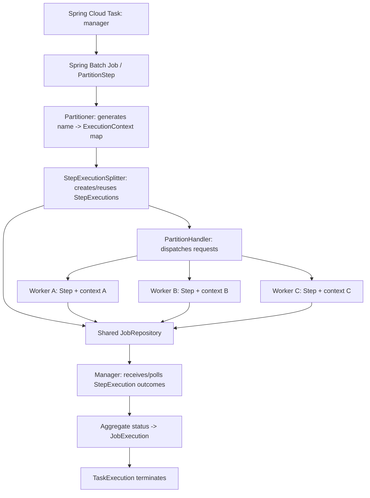

# Partitioning with Partitioner and ExecutionContext

## 1. Problem: A Single Task Processing Too Much Data

A **Spring Cloud Task** application runs for a finite duration: it starts, does its work, and exits. `TaskRepository` tracks each run at the process level (`TaskExecution`), allowing you to query start/end times, exit codes, and outcomes. When a task must import millions of invoices, sequential execution in a single process may miss its completion deadline. You can combine **Spring Batch** with **remote partitioning**: split the dataset into multiple slices and assign each slice to a worker running a `Step`.

For example, an `importInvoices` job needs to process invoices with IDs from 1 to 1,000. The manager splits this into four ID ranges, each handled by a worker:

| Partition | `fromId` (inclusive) | `toIdExclusive` (exclusive) | Processed IDs |
| --- | ---: | ---: | --- |
| `partition0` | 1 | 251 | 1–250 |
| `partition1` | 251 | 501 | 251–500 |
| `partition2` | 501 | 751 | 501–750 |
| `partition3` | 751 | 1001 | 751–1000 |

Every worker runs the same `invoiceWorkerStep` configuration but receives a **different `ExecutionContext`**. Workers do not need to know about data in other partitions. Spring Batch stores Step/Job metadata in `JobRepository` to aggregate status and support restarts.

Objectives of this lesson in the **Remote Partitioning** chapter:

1. Understand the roles of `Partitioner`, `ExecutionContext`, `PartitionStep`, `StepExecutionSplitter`, and `PartitionHandler`.
2. Create **complete, non-overlapping partitions with stable names**, avoiding off-by-one errors.
3. Use `@StepScope` and `stepExecutionContext` to bind each worker's specific parameters.
4. Distinguish running multiple threads in one JVM from running **remote** workers via a broker or Spring Cloud Task launcher.
5. Design consistency, restartability, idempotency, observability, and safe operations.

## 2. What Roles Do Partitioner and ExecutionContext Play?

### Partitioner — The Data-Splitting Planner

In Spring Batch, `org.springframework.batch.core.partition.Partitioner` is a functional interface with a single method:

```java
Map<String, ExecutionContext> partition(int gridSize);
```

The return value is a map. The **key** is a partition name unique among the `StepExecution`s created for the Job; the **value** holds parameters specific to that partition. Spring Batch creates `StepExecution` instances for the partitions and persists each `ExecutionContext` into `JobRepository`.

`gridSize` is a **hint for the number of partitions**, not a guarantee of physical worker count, thread count, or container count. The `Partitioner` may use this hint to produce up to N slices or choose a partition count based on actual data volume. In a remote setup, `PartitionHandler` and the worker deployment mechanism determine actual execution and distribution.

### ExecutionContext — Data for a Single Execution

`ExecutionContext` is a key–value container used by Spring Batch at the `JobExecution` or `StepExecution` level. With partitioning, **each partition gets its own `StepExecutionContext`**. It typically holds small, stable values such as:

```text
partition0:
  fromId         = 1
  toIdExclusive  = 251
  businessDate   = 2026-11-24

partition1:
  fromId         = 251
  toIdExclusive  = 501
  businessDate   = 2026-11-24
```

Spring Batch can serialize contexts into metadata tables—for instance, `BATCH_STEP_EXECUTION_CONTEXT` with a JDBC `JobRepository`. Therefore, **only store small values supported by the framework/serializer**, such as `String`, `Long`, `Integer`, and file or ID-range identifiers; never put entire datasets, database connections, beans, tokens, or passwords inside. Avoid mutating range-defining keys across a restart.

### Distinguishing from Other Parameter Types

| Type | Scope | Example |
| --- | --- | --- |
| `JobParameters` | Identifying/configuring a Batch Job run | `businessDate=2026-11-24`, `tenant=acme` |
| `JobExecutionContext` | Data shared across a `JobExecution` (per state-persistence policy) | Snapshot cutoff, overall manifest |
| Partition `StepExecutionContext` | Data specific to an individual worker step | `fromId=251`, `toIdExclusive=501` |
| `TaskExecution.arguments` | Startup arguments of a Spring Cloud Task process | `--spring.cloud.task.name=...` |

**`TaskRepository` and `JobRepository` are two distinct layers**: `TaskRepository` records JVM/Task process runs, while `JobRepository` holds `JobExecution`, `StepExecution`, and `ExecutionContext` for Batch processing. If the manager spawns multiple Spring Cloud Task workers, there can be multiple `TaskExecution` records for those processes; each worker must still read its exact **`StepExecution`** from the shared `JobRepository`.

## 3. Manager–Worker Flow in Remote Partitioning



Components and responsibilities:

| Component | Responsibility |
| --- | --- |
| `PartitionStep` (manager step) | Orchestrates partitioning and aggregates worker outcomes |
| `Partitioner` | Produces partition names and input `ExecutionContext`s |
| `StepExecutionSplitter` | Builds `StepExecution`s for partitions; coordinates metadata for restarts |
| `PartitionHandler` | Dispatches/executes `StepExecution`s on threads, a broker, or a remote platform |
| Worker `Step` | Reads its dedicated context and processes its assigned slice of data |
| `JobRepository` | Stores Jobs, Steps, contexts, statuses/checkpoints for monitoring and restarts |
| `TaskRepository` | Records lifecycle metadata of Spring Cloud Task processes |

Do not confuse **remote partitioning** with **remote chunking**:

- **Remote partitioning:** each worker runs a **complete Step**, with its own `ItemReader`, `ItemProcessor`, `ItemWriter` (or a `Tasklet`), and its own `StepExecution`.
- **Remote chunking:** the manager typically reads items and sends **chunks** over middleware for workers to process/write; splitting is not driven by a `Partitioner -> ExecutionContext` map like remote partitioning.

A Job can test partitioning locally first using `TaskExecutorPartitionHandler`, then swap in a remote handler. **The data-splitting logic in `Partitioner` can stay the same**, while dispatch channels, worker deployment, `JobRepository` connectivity, and operational safety must be designed specifically for remote execution.

## 4. Range-Splitting Rule: Half-Open `[from, to)`

When splitting ID ranges, standardize on **inclusive lower bound, exclusive upper bound**:

```sql
SELECT id, customer_id, amount
FROM invoice
WHERE id >= :fromId
  AND id <  :toIdExclusive
ORDER BY id;
```

Partitions like `[1, 251)` and `[251, 501)` meet at the boundary without **both picking ID 251**. If both used `<= upper`, the boundary ID would be processed twice.

Three critical invariants for a partition set:

1. **Coverage:** the union of ranges covers the exact target ID set, missing nothing at the start or end.
2. **Disjointness:** no two ranges overlap.
3. **Stability:** partition names and range semantics used on restart remain stable so they match stored metadata.

Never assume IDs are contiguous or every range holds the same number of records. Tables with large ID gaps can leave many workers idle. When data is skewed, consider partitioning by file manifest, time intervals, key quantiles, or bucket lists precomputed from a snapshot.

## 5. Java 17+ Example: Writing RangePartitioner

This example follows **Spring Batch 6.x** (Spring Boot 4.x generation): `ExecutionContext` lives in package `org.springframework.batch.infrastructure.item`. In Spring Batch 5.x, the package is typically `org.springframework.batch.item.ExecutionContext`; follow your project's BOM version.

File `RangePartitioner.java`:

```java
package com.example.invoice;

import java.util.LinkedHashMap;
import java.util.Locale;
import java.util.Map;
import org.springframework.batch.core.partition.Partitioner;
import org.springframework.batch.infrastructure.item.ExecutionContext;

public final class RangePartitioner implements Partitioner {
    private final long minInclusive;
    private final long maxExclusive;

    public RangePartitioner(long minInclusive, long maxExclusive) {
        if (minInclusive < 0 || maxExclusive <= minInclusive) {
            throw new IllegalArgumentException("ID range must be non-empty");
        }
        this.minInclusive = minInclusive;
        this.maxExclusive = maxExclusive;
    }

    @Override
    public Map<String, ExecutionContext> partition(int gridSize) {
        if (gridSize <= 0) {
            throw new IllegalArgumentException("gridSize must be > 0");
        }

        long total = Math.subtractExact(maxExclusive, minInclusive);
        int parts = (int) Math.min((long) gridSize, total);
        long width = total / parts + (total % parts == 0 ? 0 : 1);
        Map<String, ExecutionContext> result = new LinkedHashMap<>();

        long from = minInclusive;
        for (int i = 0; i < parts && from < maxExclusive; i++) {
            long toExclusive = from
                + Math.min(width, maxExclusive - from);

            ExecutionContext context = new ExecutionContext();
            context.putLong("fromId", from);
            context.putLong("toIdExclusive", toExclusive);

            String name = String.format(Locale.ROOT, "partition%04d", i);
            result.put(name, context);
            from = toExclusive;
        }
        return result;
    }
}
```

**Why design it this way?**

- The constructor rejects empty ranges; runs with no data should be handled by an explicit "no work" branch rather than silently creating ambiguous partitioned Jobs.
- `gridSize` must be positive; if the full span has only two IDs and `gridSize` is ten, at most two non-empty partitions are created.
- `width` rounds up; the loop uses `Math.min(...)` so the final bound never exceeds `maxExclusive`.
- `LinkedHashMap` preserves a clear ordering for inspection; the **names** `partition0000`, `partition0001` act as identifying keys—do not rely on map iteration order as the source of truth for restarts.
- `Math.subtractExact` catches integer overflow. The example assumes ID bounds fit in `long` without arithmetic overflow.

Example with `new RangePartitioner(1, 1001).partition(4)`:

```text
partition0000 -> {fromId=1,   toIdExclusive=251}
partition0001 -> {fromId=251, toIdExclusive=501}
partition0002 -> {fromId=501, toIdExclusive=751}
partition0003 -> {fromId=751, toIdExclusive=1001}
```

**Note on real data:** `minInclusive` and `maxExclusive` should not be re-queried arbitrarily from a mutating table on each restart. A Job can capture a snapshot or record a stable manifest/cutoff in `JobParameters` so the run's dataset never shifts. Already-created `StepExecution`s preserve their contexts in `JobRepository`, yet recomputing partition names with a different split can still cause unpredictable restart behavior.

### Verifying Partitioning with a Small Test Snippet

```java
var partitions = new RangePartitioner(1, 1001).partition(4);
if (partitions.size() != 4) {
    throw new AssertionError("Must create 4 partitions");
}

long expectedStart = 1;
for (var entry : partitions.entrySet()) {
    var context = entry.getValue();
    long start = context.getLong("fromId");
    long end = context.getLong("toIdExclusive");

    if (start != expectedStart || end <= start) {
        throw new AssertionError("Overlapping or missing range: " + entry.getKey());
    }
    expectedStart = end;
}
if (expectedStart != 1001) {
    throw new AssertionError("ID range not fully covered");
}
```

This snippet validates `Partitioner` logic without starting a Job or database. For production, also test `gridSize=1`, `gridSize > total`, very large IDs, and verify partition names remain identical when data/snapshots do not change.

## 6. Worker Reading ExecutionContext via @StepScope

The manager stores `fromId` and `toIdExclusive` in **`StepExecutionContext`**. The worker reads them when **`StepExecution` is running**, which requires *late binding*. `@StepScope` creates a bean per `StepExecution`, giving each partition its own values; binding context into a singleton at application startup fails because data is not ready yet or would be shared wrongly across workers.

Example worker using a `Tasklet` to **count records** in its range (safe for learning; replace with a chunk reader/processor/writer in real deployments):

```java
package com.example.invoice;

import org.springframework.batch.core.step.tasklet.Tasklet;
import org.springframework.batch.infrastructure.repeat.RepeatStatus;
import org.springframework.jdbc.core.JdbcTemplate;

public class RangeCountTasklet implements Tasklet {
    private final JdbcTemplate jdbc;
    private final long fromId;
    private final long toIdExclusive;

    public RangeCountTasklet(
            JdbcTemplate jdbc, long fromId, long toIdExclusive) {
        if (fromId >= toIdExclusive) {
            throw new IllegalArgumentException("Invalid ID range");
        }
        this.jdbc = jdbc;
        this.fromId = fromId;
        this.toIdExclusive = toIdExclusive;
    }

    @Override
    public RepeatStatus execute(
            org.springframework.batch.core.step.StepContribution contribution,
            org.springframework.batch.core.scope.context.ChunkContext context) {

        Long count = jdbc.queryForObject(
            "SELECT COUNT(*) FROM invoice WHERE id >= ? AND id < ?",
            Long.class, fromId, toIdExclusive
        );
        System.out.printf("Range [%d,%d): %d invoices%n",
            fromId, toIdExclusive, count);
        return RepeatStatus.FINISHED;
    }
}
```

Wiring the step-scoped bean and Step in configuration:

```java
package com.example.invoice;

import org.springframework.batch.core.configuration.annotation.StepScope;
import org.springframework.batch.core.repository.JobRepository;
import org.springframework.batch.core.step.Step;
import org.springframework.batch.core.step.builder.StepBuilder;
import org.springframework.context.annotation.Bean;
import org.springframework.context.annotation.Configuration;
import org.springframework.beans.factory.annotation.Qualifier;
import org.springframework.beans.factory.annotation.Value;
import org.springframework.jdbc.core.JdbcTemplate;
import org.springframework.transaction.PlatformTransactionManager;

@Configuration
public class WorkerStepConfig {
    @Bean
    @StepScope
    RangeCountTasklet rangeCountTasklet(
            JdbcTemplate jdbc,
            @Value("#{stepExecutionContext['fromId']}") Long fromId,
            @Value("#{stepExecutionContext['toIdExclusive']}") Long toId) {
        if (fromId == null || toId == null) {
            throw new IllegalArgumentException("Missing partition context");
        }
        return new RangeCountTasklet(jdbc, fromId, toId);
    }

    @Bean
    Step invoiceWorkerStep(
            JobRepository repository,
            PlatformTransactionManager transactionManager,
            @Qualifier("rangeCountTasklet") RangeCountTasklet tasklet) {
        return new StepBuilder("invoiceWorkerStep", repository)
            .tasklet(tasklet, transactionManager)
            .build();
    }
}
```

Each worker receives two `Long` values from **its own `StepExecution` context**, never reading `fromId` from a static/global variable or only from `JobParameters`. If a Step starts with missing keys, fail fast so metadata marks the Step failed instead of scanning the entire table.

The code above is an illustrative configuration assuming an existing `invoice` table and JDBC/Batch setup; it is not a complete application. When processing real data, use `JdbcPagingItemReader` or an equivalent reader with conditions like:

```sql
SELECT id, customer_id, amount
FROM invoice
WHERE id >= :fromId
  AND id < :toIdExclusive
ORDER BY id;
```

With `JdbcPagingItemReader`, use a stable, unique sort key (such as `id`), configure page size, and enable restart state persistence. Reader, processor, and writer must all have the proper scope. For mutable sources, enforce snapshots or consistency strategies so restarts read the exact intended dataset.

## 7. Testing Partitioning Locally Before Deploying Remotely

A risk-reducing approach is to use the **exact same `RangePartitioner`** and worker Step, running partitions inside one JVM first. Spring Batch provides `TaskExecutorPartitionHandler` and the `taskExecutor(...)` builder so you can verify context mapping, error handling, and status aggregation before integrating a broker or launcher.

Example **local manager** configuration with `gridSize=4`:

```java
package com.example.invoice;

import org.springframework.batch.core.job.Job;
import org.springframework.batch.core.job.builder.JobBuilder;
import org.springframework.batch.core.partition.Partitioner;
import org.springframework.batch.core.repository.JobRepository;
import org.springframework.batch.core.step.Step;
import org.springframework.batch.core.step.builder.StepBuilder;
import org.springframework.context.annotation.Bean;
import org.springframework.context.annotation.Configuration;
import org.springframework.core.task.SimpleAsyncTaskExecutor;
import org.springframework.beans.factory.annotation.Qualifier;

@Configuration
public class LocalPartitionManagerConfig {
    @Bean
    Partitioner invoicePartitioner() {
        // Example snapshot: invoices with IDs in [1,1001).
        return new RangePartitioner(1, 1001);
    }

    @Bean
    Step invoiceManagerStep(
            JobRepository repository,
            Partitioner invoicePartitioner,
            @Qualifier("invoiceWorkerStep") Step workerStep) {
        SimpleAsyncTaskExecutor executor =
            new SimpleAsyncTaskExecutor("invoice-partition-");
        executor.setConcurrencyLimit(4);

        return new StepBuilder("invoiceManagerStep", repository)
            .partitioner("invoiceWorkerStep", invoicePartitioner)
            .step(workerStep)
            .gridSize(4)
            .taskExecutor(executor)
            .build();
    }

    @Bean
    Job invoicePartitionJob(
            JobRepository repository,
            @Qualifier("invoiceManagerStep") Step managerStep) {
        return new JobBuilder("invoicePartitionJob", repository)
            .start(managerStep)
            .build();
    }
}
```

This is a **local test setup**, not remote partitioning yet. The `invoiceWorkerStep`, `rangeCountTasklet`, and `invoicePartitioner` beans must all reside in the same context, backed by the database and `invoice` table. Using `SimpleAsyncTaskExecutor` with a concurrency limit is for learning only; production should use managed executors with controlled thread and connection pools.

When executed, you expect four child `StepExecution`s such as `invoiceWorkerStep:partition0000` through `...partition0003`. Each Step processes one context, and `JobRepository` aggregates results. `gridSize=4` does not spawn four new **Spring Cloud Tasks** in this model, because all Steps still run inside the manager JVM.

## 8. Moving to True Remote Partitioning

There are **two common approaches**, both reusing the same `Partitioner` and `StepExecutionContext`s:

| Approach | `PartitionHandler` / mechanism | What does the worker receive? |
| --- | --- | --- |
| Spring Batch Integration via message broker | `MessageChannelPartitionHandler`, request/reply over Spring Integration (JMS, AMQP, etc., per configured adapter) | `StepExecutionRequest` identifier so the worker locates and runs the Step |
| Spring Cloud Task + platform launcher | `DeployerPartitionHandler` uses `TaskLauncher` to launch worker Tasks on the deployment platform | `StepExecution` ID passed to the worker (e.g., via environment variables); worker uses `DeployerStepExecutionHandler` to load metadata from `JobRepository` |

In both approaches, the **manager** holds the `Partitioner` and dispatches `StepExecution`s, while **workers** hold `invoiceWorkerStep` and processing logic. Workers **never re-split the ID range themselves**. Once a worker receives a `StepExecutionId`, it loads the persisted context from `JobRepository` and binds `fromId`/`toIdExclusive`.

### 8.1. Sketching Manager Configuration with a Remote Handler

Replace `.taskExecutor(...)` / `.step(...)` in the local manager with a `PartitionHandler` configured for your target environment:

```java
// Inside the manager's @Configuration class.
@Bean
Step remoteInvoiceManagerStep(
        JobRepository repository,
        Partitioner invoicePartitioner,
        PartitionHandler remotePartitionHandler) {
    return new StepBuilder("remoteInvoiceManagerStep", repository)
        .partitioner("invoiceWorkerStep", invoicePartitioner)
        .gridSize(4)
        .partitionHandler(remotePartitionHandler)
        .build();
}
```

This is a **structural illustration** requiring imports for `Step`, `Partitioner`, `PartitionHandler`, `StepBuilder`, `JobRepository`, and a concrete `remotePartitionHandler` bean. Adding one annotation is not enough to make it run. Broker-based setups require configuring outbound request channels, reply channels or `JobRepository` polling, serialization, authentication, and durability. Deployer-based setups require `TaskLauncher`, worker artifact, deployment properties, worker concurrency limits, polling/timeouts, and network/credential access to the shared `JobRepository`.

### 8.2. Two Applications with Distinct Responsibilities

**Manager Task:**

1. Receives and validates parameters (report date, tenant, data scope).
2. Determines the snapshot or manifest for stable splitting.
3. Launches the Batch Job containing the partition manager Step.
4. Creates `StepExecutionContext`s, dispatches work, and waits/aggregates outcomes.
5. Translates failed Batch status into Task failure and an appropriate exit code for the scheduler.

**Worker Task/process:**

1. Receives the `StepExecution` identifier through the **configured** dispatch mechanism.
2. Connects to the shared `JobRepository` and retrieves its assigned partition context.
3. Runs `invoiceWorkerStep` with `@StepScope`, recording progress and Batch status.
4. Exits and signals the manager via repository/broker/handler.

When using `DeployerPartitionHandler`, each worker is typically its own Spring Cloud Task and can have its own `TaskExecution`; however, **Batch partition metadata must still coordinate through the shared `JobRepository`**. Never confuse `TaskExecution` IDs with `StepExecution` IDs.

**Lifecycle note:** the worker application must be configured **not to auto-launch the entire manager Job** at startup. For example, separate `manager` and `worker` profiles and disable Batch Job auto-run on workers depending on the handler's bootstrap mechanism. If both manager and workers auto-launch the same Job, work may be duplicated or fail on `JobInstance` collisions.

## 9. Partitioning Mistakes to Avoid

### 9.1. Off-by-One, Overlaps, and Gaps

Never mix `BETWEEN lower AND upper` (inclusive at both ends) with a `toIdExclusive` convention. If you write:

```sql
-- Wrong under the half-open convention when two ranges touch:
WHERE id BETWEEN :fromId AND :toIdExclusive
```

then ID `251` falls into both `[1,251)` and `[251,501)`. Always use `id >= :fromId AND id < :toIdExclusive`.

### 9.2. Source Data Mutating Mid-Execution

Splitting by current `MIN(id)`/`MAX(id)` while rows are still being inserted or modified can break snapshot consistency. For invoices, enforce a clear rule such as `businessDate`, a fixed `createdAt < cutoff`, or a finalized ID manifest. A partition should never depend on data whose boundaries shift on restart.

### 9.3. Severely Skewed Partitions

With IDs 1 to 1,000,000 where 90% of rows sit in the trailing range, equal numeric splits force one worker to carry nearly the entire load. Partition by file, time window, data quantiles, or create more small partitions than workers to balance load. **`gridSize` does not automatically balance business data.**

### 9.4. Unstable Names Across Restarts

Partition names must be unique and deterministic within a `JobInstance`. Generating names from timestamps or random UUIDs on each planning pass makes it hard for Spring Batch to match retries against completed `StepExecution`s. `PartitionNameProvider` is an option for supplying stable names explicitly, especially when recomputing partitions is expensive; if used, names must match those produced by `Partitioner`.

### 9.5. Putting Too Much Data or Secrets into ExecutionContext

`ExecutionContext` is metadata serialized and stored in the database. Never place lists of millions of IDs, invoice payloads, access tokens, passwords, or unnecessary customer PII inside it. Store ID bounds, manifest paths, or access-controlled work identifiers; workers fetch actual data from the proper source.

## 10. Restarts, Retries, and Aggregated Outcomes

Spring Batch supports restarts using `JobRepository` metadata. For a failed **`JobInstance`**, completed partition `StepExecution`s can be preserved while failed partitions re-execute under restart rules; the manager aggregates results including previously completed partitions. This requires **stable partition names and data ranges**, plus `JobParameters` identifying the exact `JobInstance`.

Example:

| Partition | First run | On restarting same JobInstance |
| --- | --- | --- |
| `partition0000` | `COMPLETED` | Normally skipped |
| `partition0001` | `COMPLETED` | Normally skipped |
| `partition0002` | `FAILED` | Re-executed per restart policy |
| `partition0003` | `COMPLETED` | Normally skipped |

This is the expected model when using standard splitters and repositories; actual behavior also depends on Step config, `JobParameters`, `allowStartIfComplete`, restart limits, dispatch mechanics, and persisted state. Broker or launcher retries **do not automatically guarantee business-level exactly-once execution**. A worker might finish writing data and die before `COMPLETED` metadata is committed; restarts require idempotency or proper transactions/checkpoints to avoid duplicate writes.

**Avoid changing `gridSize`, splitting algorithms, or snapshots when restarting a `JobInstance` that already has partition metadata** unless you understand the exact impact on existing `StepExecution`s. If business scope changes, intentionally launch a new `JobInstance` rather than patching active contexts.

### Difference Between Task Retries and Job Restarts

| Action | What can it create? | Risk without idempotency |
| --- | --- | --- |
| Scheduler re-invokes manager Task | New `TaskExecution` | Could unintentionally start the Job anew |
| Spring Batch restarts failed Job | New `JobExecution` in the same `JobInstance`, reusing eligible partition metadata | Failed partition may re-write part of its data |
| Broker redelivers request | May resend the same `StepExecutionRequest` per middleware mechanics | Must guard against duplicate execution and stale state |
| Worker Task relaunches | New process/`TaskExecution` | Must ensure which `StepExecution`s are eligible to re-run |

With Spring Cloud Task, never assume a failed Batch Job automatically makes the manager process return a non-zero exit code. Verify the outcome bridge (such as `spring.cloud.task.batch.fail-on-job-failure` in compatible Batch setups or explicit manager logic), then verify **`JobExecution.status`**, **`TaskExecution.exitCode`**, and the process exit code observed by the scheduler.

## 11. Inspecting Execution Metadata in the Database

With the standard JDBC `JobRepository`, operators can inspect each partition's status:

```sql
SELECT
    STEP_EXECUTION_ID,
    JOB_EXECUTION_ID,
    STEP_NAME,
    STATUS,
    EXIT_CODE,
    START_TIME,
    END_TIME,
    READ_COUNT,
    WRITE_COUNT
FROM BATCH_STEP_EXECUTION
WHERE JOB_EXECUTION_ID = :jobExecutionId
ORDER BY STEP_NAME, STEP_EXECUTION_ID;
```

`STEP_NAME` typically looks like `invoiceWorkerStep:partition0000`. To inspect a partition's context, use the `JobExplorer`/`JobRepository` API or query `BATCH_STEP_EXECUTION_CONTEXT` by `STEP_EXECUTION_ID` after checking your DDL. Contexts may be serialized, so **never assume plain JSON readability** or edit them via manual SQL.

If workers run as Spring Cloud Task processes, also query `TASK_EXECUTION` to trace process start/end times and exit codes. Relationships between `TaskExecution` and `JobExecution` depend on how Batch/Task integration is configured; links like `TASK_TASK_BATCH` only appear when the corresponding component is wired. Never assume `TASK_EXECUTION_ID = STEP_EXECUTION_ID`.

Signals to collect:

- Total partitions, counts of `COMPLETED`/`FAILED`/`STARTED`, and duration per partition.
- Distribution of read/write counts, skips, errors, and the slowest partition.
- Active worker count versus `maxWorkers`/allocated resources.
- Manager wait time, handler timeouts, and broker or `JobRepository` latency.
- Retry counts, duplicate-delivery indicators, and scheduler Task status.

`END_TIME IS NULL` does not prove a worker is still alive; the process may have been killed before metadata updated. When a partition stalls, cross-check `JobRepository`, worker logs, container status, and infrastructure heartbeats/timeouts.

## 12. Operational Safety and Performance

| Issue | Mitigation |
| --- | --- |
| More partitions than DB capacity | Cap concurrency/`maxWorkers`, monitor JDBC pools and locks |
| One oversized partition | Split smaller or switch to distribution based on real data volume |
| Mutating input data | Lock snapshot/cutoff and identifying `JobParameters` |
| Overlapping partitions | Use half-open ranges, test overlap and coverage |
| Worker finishes but manager doesn't see it | Check `JobRepository`, broker replies/polling, timeouts; enforce idempotency |
| Sensitive data in context | Store only required IDs/bounds; restrict DB and log access |
| Worker auto-runs entire manager Job | Separate profiles/entrypoints, disable inappropriate auto-run |
| Restarting with wrong parameters | Use `JobInstance`/`JobParameters` semantics properly, keep partition names stable |
| Task/Batch writing metadata to same DB | Align schemas, connection pools, transactions, and migrations |
| Non-transactional partition outputs | Use unique constraints, outbox, idempotent writes, or compensation |

**Never adopt remote partitioning just to spawn more JVMs.** If the bottleneck is a single hot lock in the database, running 20 workers can be slower than running one. Before raising `gridSize`, measure read/write latency, network delay, I/O, and transaction contention.

## 13. Practice Exercises

### Exercise 1 — Testing the Partitioner

Use `RangePartitioner` to partition `[1,1001)` with `gridSize` values `1`, `4`, `8`, and `1200`. For each result, verify:

1. No empty or overlapping ranges.
2. The first range starts at `1` and the last ends at `1001`.
3. Partition count never exceeds the number of IDs in the range.
4. Partition names stay identical across two runs on the same data.

### Exercise 2 — Running Locally

Create table `invoice(id, customer_id, amount)` with IDs 1 through 1,000. Run `invoicePartitionJob` with four partitions in one JVM. Compare the counts printed by each `RangeCountTasklet` against the total row count in the table. Inspect `BATCH_STEP_EXECUTION` and each `StepExecution`'s context.

### Exercise 3 — Simulating Failure and Restart

Have the worker for `partition0002` throw an exception after starting while letting the other three partitions succeed. Restart the `JobInstance` using Spring Batch mechanics. Verify which partition re-runs, which partitions are reused, and the aggregated Job status. If switching from counting to writing rows, add a unique constraint to prove zero duplicate writes.

### Exercise 4 — Switching to Remote Distribution

Pick **one** approach: message broker via Spring Batch Integration or `DeployerPartitionHandler` with `TaskLauncher`. Diagram the path of `StepExecutionId`, `JobRepository`, `ExecutionContext`, and outcomes from worker back to manager. Detail shared connectivity setup, authentication, timeouts, worker limits, and preventing workers from launching the manager Job.

### Exercise 5 — Designing a Snapshot for Mutating Data

While processing date `2026-11-24`, 5,000 new invoices are inserted. Decide whether they belong to the current Job. Propose a way to pin a cutoff/manifest in `JobParameters` or metadata and explain how to keep restart outcomes consistent.

### Self-Assessment

- Does `gridSize=8` guarantee exactly eight worker containers?
- Why should `ExecutionContext` hold ranges or manifests instead of full data?
- Why must workers use `@StepScope` to bind `stepExecutionContext`?
- Why do ranges `[1,251)` and `[251,501)` never double-process an ID?
- What is the difference between remote partitioning and remote chunking?
- If a worker finishes writing data and dies before saving status, what protects data on restart?
- How do `TaskRepository` and `JobRepository` record different units of execution?

**Completion criteria:** you can write a `Partitioner` producing stable names/ranges, verify coverage and non-overlap, bind context on workers, distinguish local vs. remote manager/worker setups, read status in `JobRepository`, and design verifiable restart, security, and idempotency strategies.

## Official References

- [Spring Batch — Scaling and Parallel Processing / Partitioning](https://docs.spring.io/spring-batch/reference/scalability.html): `Partitioner`, `PartitionHandler`, `gridSize`, restarts, and the role of `ExecutionContext`.
- [Spring Batch — Remote Partitioning](https://docs.spring.io/spring-batch/reference/spring-batch-integration/externalizing-execution.html): manager/worker patterns and Spring Integration communication options.
- [Spring Batch 6 — Partitioner API](https://docs.spring.io/spring-batch/reference/api/org/springframework/batch/core/partition/Partitioner.html).
- [Spring Batch 6 — ExecutionContext API](https://docs.spring.io/spring-batch/reference/api/org/springframework/batch/infrastructure/item/ExecutionContext.html).
- [Spring Batch 6 — StepScope API](https://docs.spring.io/spring-batch/reference/api/org/springframework/batch/core/configuration/annotation/StepScope.html).
- [Spring Cloud Task — DeployerPartitionHandler API](https://docs.spring.io/spring-cloud-task/docs/current/apidocs/org/springframework/cloud/task/batch/partition/DeployerPartitionHandler.html): launching worker Tasks and passing `StepExecution` identifiers.
- [Spring Batch Samples — Remote Partitioning Sample](https://github.com/spring-projects/spring-batch/tree/main/spring-batch-samples): illustrative manager/worker configurations and comparison with remote chunking.
