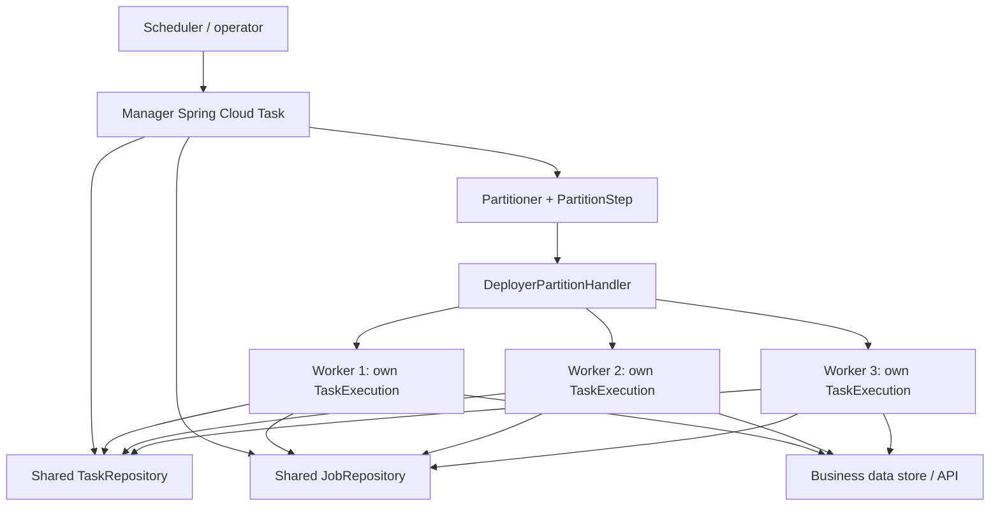
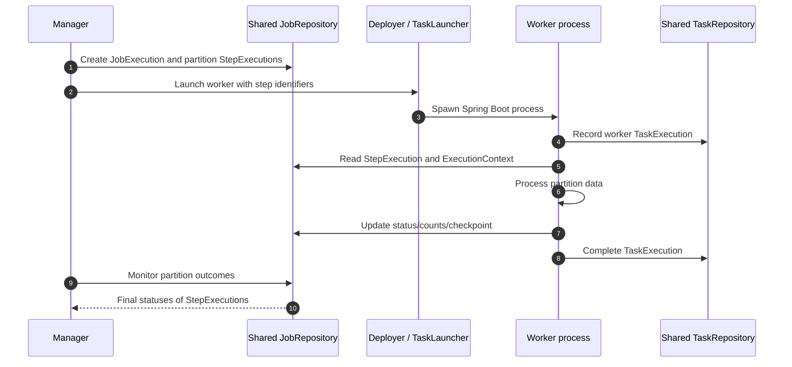
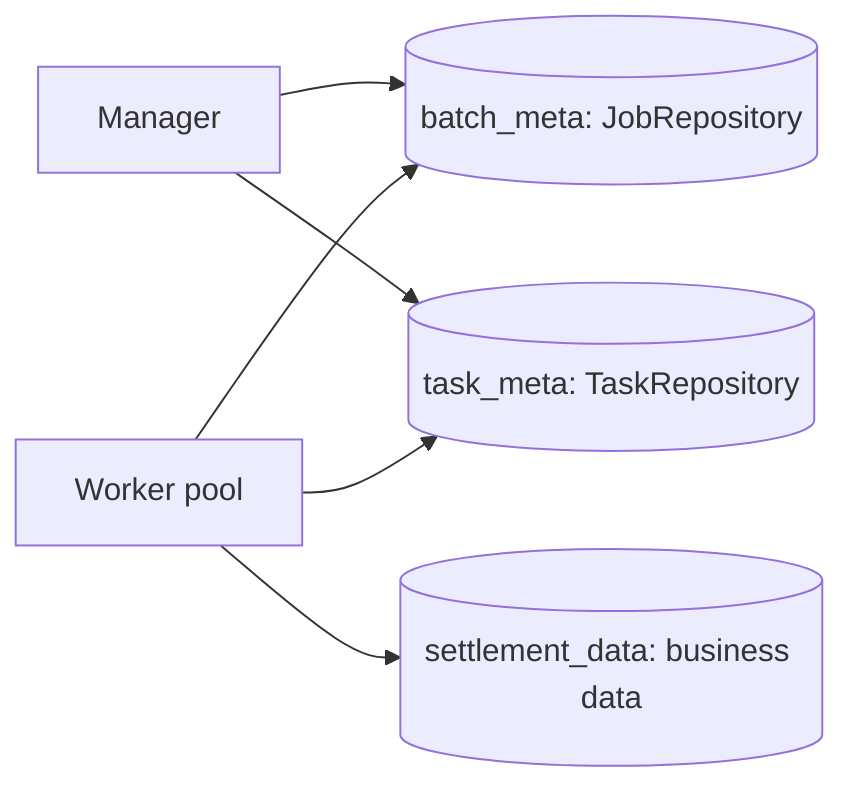

# Shared Job and Task Repositories Across Processes in Remote Partitioning

## 1. Problem: Manager and Workers Run in Separate JVMs

In a **Spring Cloud Task** system, a Spring Boot application can execute a finite job and then exit. When combined with **Spring Batch**, we can use **remote partitioning** to divide data into multiple parts and process them on workers running across separate processes, Pods, or hosts.

For example, a reconciliation task needs to process 10,000 transactions. A **manager** process splits the work into four partitions; **workers** handle each ID range and return results. For the system to recover from failures, manager and workers must share a common understanding of: which job is running, which partition was assigned, which step has completed, and which run corresponds to each process.

This is why we must distinguish two metadata repositories:

- **Spring Batch `JobRepository`**: manages `JobInstance`, `JobExecution`, `StepExecution`, `ExecutionContext`, and per-partition restartability.
- **Spring Cloud Task `TaskRepository`**: manages `TaskExecution`, i.e., individual runs of manager/worker applications along with start time, end time, exit code, and error details.

The topic of this lesson in the **Remote Partitioning** chapter is **shared Job and Task repositories across processes**. The goal is not to merge both repositories into a single table, but to ensure every process participating in a run connects to the **right shared metadata store for each framework**.

After this lesson, you will be able to design the storage topology, explain why per-worker in-memory databases cannot be used, configure proper connections, query results, handle lost-worker failures, and build a safe restart strategy.

## 2. Manager–Worker Architecture and Two Repositories

The `Partitioner` on the manager decides how work is divided. Spring Batch creates `StepExecution` metadata for partitions; `PartitionHandler` coordinates execution. In the **Spring Cloud Task + Spring Cloud Deployer** integration model, `DeployerPartitionHandler` uses `TaskLauncher` to launch separate Spring Boot workers, while `DeployerStepExecutionHandler` on the worker receives partition details to look up and run the matching step.



Read this diagram along two axes:

1. Manager and workers are **independent processes**, each with its own environment configuration, lifecycle, and exit code.
2. The manager writes and monitors Batch metadata; workers must retrieve the `StepExecution` created by the manager and update partition outcomes.
3. If each process is configured as a Spring Cloud Task, each process creates its **own `TaskExecution`** in the Task repository.
4. The business data store can be a third database or external API; it does not implicitly coincide with either metadata repository.
5. `TaskRepository` and `JobRepository` may live in the **same physical database**, yet still have **separate schemas/models and tables**.

The key requirement of `DeployerPartitionHandler` is that **the manager and all workers must see the same `JobRepository` data store**. Spring Cloud Task's remote partitioning guide also expects participating processes to have access to the data store used for both Job and Task in this deployment model.

## 3. Which Repository Stores What?

| Information to track | Spring Batch `JobRepository` | Spring Cloud Task `TaskRepository` |
| --- | --- | --- |
| Which business Job is running? | `JobInstance`, `JobExecution` | Task name and application run; does not replace Job metadata |
| How far has partition `workerStep:partition0` progressed? | `StepExecution` and `ExecutionContext` | Does not store Batch item-processing checkpoints |
| How many records did the Step read/write? | `READ_COUNT`, `WRITE_COUNT`, `ROLLBACK_COUNT`, step status | Does not directly store processed item counts |
| When did a worker JVM start/end? | Not its primary purpose | `TaskExecution`, timestamps, exit code, error message |
| Restarting a failed partition | Batch restart mechanism and metadata | Does not replace partition restart mechanics |
| Is a new Pod a different run? | May be an attempt of a recovering job/step | Normally creates a new `TaskExecution` if the context initializes |

In standard JDBC schemas:

- Batch tables: `BATCH_JOB_INSTANCE`, `BATCH_JOB_EXECUTION`, `BATCH_STEP_EXECUTION`, `BATCH_JOB_EXECUTION_CONTEXT`, `BATCH_STEP_EXECUTION_CONTEXT`, and ID-generation objects.
- Task tables: `TASK_EXECUTION`, `TASK_EXECUTION_PARAMS`, `TASK_TASK_BATCH` (linking Task to Batch when integration and the corresponding listener are active), and supporting objects depending on version.

**Three distinct identifiers** must be kept separate:

| Identifier | Illustrative example | Description |
| --- | --- | --- |
| `TaskExecution.executionId` | `310` | A single run of a manager or worker process |
| `JobExecution.id` | `80` | A single execution of a Batch job |
| `StepExecution.id` | `805` | A single execution of a Batch step/partition |

Never assume `310 = 80 = 805` or substitute these IDs for business keys. The manager creating four partitions **does not mean** Batch creates four `JobExecution`s: normally they are separate `StepExecution`s under a single `JobExecution`.

## 4. Why Must `JobRepository` Be Shared?

The manager uses `Partitioner` to generate partition names and each partition's `ExecutionContext`. For example:

| Partitioned step | `minIdInclusive` | `maxIdExclusive` | Processing range |
| --- | ---: | ---: | --- |
| `workerStep:partition0` | 0 | 2500 | IDs from 0 up to 2499 |
| `workerStep:partition1` | 2500 | 5000 | IDs from 2500 up to 4999 |
| `workerStep:partition2` | 5000 | 7500 | IDs from 5000 up to 7499 |
| `workerStep:partition3` | 7500 | 10000 | IDs from 7500 up to 9999 |

With `DeployerPartitionHandler`, the manager launches workers and passes the **required execution identifiers** through the framework's deployment mechanism. Workers use `DeployerStepExecutionHandler` and `JobExplorer`/`JobRepository` to **read the existing `StepExecution` record**, retrieve `ExecutionContext`, run the right step, and update outcomes.



If a worker connects to a **separate `JobRepository`**, it will fail to find the `StepExecution` created by the manager, or create metadata elsewhere so the manager cannot aggregate outcomes. This cannot be fixed by simply giving steps or jobs the same name.

**Thus "shared" means the same logical store and compatible Batch metadata schema—not merely the same database engine.** Two PostgreSQL instances at different addresses are still two separate stores even if both contain a table named `BATCH_STEP_EXECUTION`.

### 4.1. `JobRepository` Is Not a Business Work Queue

In the Spring Cloud Deployer model, `TaskLauncher` spawns worker processes; the repository stores metadata for coordination and outcome inspection. In remote partitioning over Spring Integration/JMS/AMQP, the manager sends step requests over middleware; workers still must access the matching metadata store.

Do not confuse **remote partitioning** with **remote chunking**: remote chunking typically has the manager read data and send already-read chunks to workers for processing; remote partitioning has each worker process **a step/partition with its own reader/processor/writer**. Choosing the architecture dictates where data is read and how metadata is configured.

## 5. Role of the Shared `TaskRepository`

Each successfully started Spring Cloud Task process normally creates a `TaskExecution`. If the manager launches four workers, you may observe **one manager `TaskExecution` and four worker `TaskExecution`s**, depending on actual worker count and launch attempts.

Illustrative example:

| Process | `taskName` | `executionId` | Outcome |
| --- | --- | ---: | --- |
| Manager | `settlement-manager` | 310 | Waiting for partitions |
| Worker A | `settlement-worker` | 311 | Succeeded |
| Worker B | `settlement-worker` | 312 | Succeeded |
| Worker C | `settlement-worker` | 313 | Failed |
| Worker D | `settlement-worker` | 314 | Succeeded |

`executionId` is allocated by the Task repository for **each application execution**, not as a partition ID. A relaunched worker gets a new `executionId`, even while re-processing part of the same Batch `JobInstance`.

### 5.1. When Is a Shared Task Repository Needed?

- **Spring Cloud Task `DeployerPartitionHandler` model**: manager/workers are designed to access Task metadata together for launching, linking, and tracing processes.
- **Pure Spring Batch remote partitioning via message broker**: the shared `JobRepository` is the centerpiece for coordinating `StepExecution`s. If workers are not Spring Cloud Task apps, they are **not required** to produce `TaskExecution` records. Do not impose a Cloud Task integration constraint on a Batch-only architecture.
- **Systems with centralized history/monitoring**: sharing the Task repository lets you query all manager and worker runs from a single place.

Never create a separate Task database per Pod if the goal is to query and correlate history across the cluster. Per-JVM **in-memory** H2 databases lose data when the process exits and prevent manager/workers from sharing durable state.

### 5.2. Parent–Child Task Relationships

Some Spring Cloud Task configurations support **parent task execution** tracking when one task launches another, such as `spring.cloud.task.parent-execution-id`. In Deployer integration, the framework can forward metadata pointing back to the manager run.

When tracing, verify the actual parent/external execution columns present in your **exact schema version**, rather than assuming every worker gets an automatic parent–child link under every deployment mechanism.

`TASK_TASK_BATCH` can help link `TaskExecution` to `JobExecution` when `spring-cloud-task-batch` and `TaskBatchExecutionListener` are active. **Do not expect this table to always contain a row for every partitioned worker**, because each worker may only execute a `StepExecution` rather than launching a full Batch job.

## 6. Simple Option: One Physical Database, Two Metadata Table Groups

For learning environments and moderate workloads, a single persistent PostgreSQL instance can host **both Batch and Task schemas**. All processes use the **same JDBC URL, database/schema, and compatible schema version**, while differing in application name and role.

```text
PostgreSQL: batch_control
├── BATCH_JOB_INSTANCE
├── BATCH_JOB_EXECUTION
├── BATCH_STEP_EXECUTION
├── BATCH_STEP_EXECUTION_CONTEXT
├── ... Batch tables/sequences
├── TASK_EXECUTION
├── TASK_EXECUTION_PARAMS
├── TASK_TASK_BATCH
└── ... Task tables/sequences
```

### 6.1. Shared Connection Configuration

Example `application.yml` applicable to **both manager and worker** in the same environment:

```yaml
spring:
  main:
    web-application-type: none
  datasource:
    url: ${METADATA_DB_URL}
    username: ${METADATA_DB_USER}
    password: ${METADATA_DB_PASSWORD}
```

These variables must be supplied to **both the manager process and every worker**. An example URL could be `jdbc:postgresql://postgres.internal:5432/batch_control`. This hostname is illustrative; real configs must point to a database reachable from all Pods/hosts.

The manager can set its task name and enable job execution:

```yaml
spring:
  cloud:
    task:
      name: settlement-manager
  batch:
    job:
      enabled: true
```

Workers can use role-specific configuration:

```yaml
spring:
  cloud:
    task:
      name: settlement-worker
  batch:
    job:
      enabled: false
```

`spring.batch.job.enabled=false` prevents **auto-running the entire Batch job** when the worker Boot context starts; the worker must run only the **step designated by remote partitioning**. Actual configuration must match how you register `DeployerStepExecutionHandler`/`JobLauncher` and the Spring Boot line in use.

**The YAML snippets here are configuration fragments to compose by profile or deployment**, not three standalone files that merge automatically. Use a shared `application.yml` with `manager`/`worker` profiles, or equivalent overrides passed by the scheduler.

### 6.2. What Must Be Identical vs. What Should Differ

| Item | Must manager and worker match? | Reason |
| --- | --- | --- |
| Batch repository JDBC endpoint/schema | **Yes**, same logical store | Workers must read `StepExecution`s created by the manager |
| Task repository JDBC endpoint/schema in Deployer Task model | **Yes**, same shared Task store | Trace Task launch runs |
| Batch schema version / mappings | **Must be compatible** | Avoid SQL errors or `ExecutionContext` deserialization failures |
| Database account | **Not necessarily** | Separate accounts can be used, provided privileges are sufficient |
| `spring.cloud.task.name` | **Can differ** | Helps separate manager and worker history |
| Role/profile | **Different** | Manager partitions; worker runs an assigned step |
| Specific `JobExecution`/`StepExecution` parameters | **Different per partition** | Each worker gets the exact ID/`ExecutionContext` managed by the manager |
| Connection pool | **Sized per role** | Connection counts and query loads differ |

Never pass database passwords or tokens via command-line arguments if they could leak into logs, process lists, or `TASK_EXECUTION_PARAMS`. Prefer a secret manager, least-privilege grants, TLS, and environment-specific secret injection.

## 7. Advanced Option: Separating Job, Task, and Business Data

At higher scale or when strict privilege separation is needed, you can split them:

| Store | Example | Who needs access? |
| --- | --- | --- |
| **Batch metadata DB** | `batch_meta` | Manager and all workers must share the same `JobRepository` store |
| **Task metadata DB** | `task_meta` | Manager and Spring Cloud Task workers share the same `TaskRepository` store |
| **Business DB** | `settlement_data` | Workers need access to data for their partition; manager access depends on design |



When an application has multiple `DataSource`s, **do not simply define two beans and hope auto-configuration picks the right ones**. Explicitly configure the datasource designated for Spring Cloud Task (e.g., `@TaskDataSource` in supported versions) and the datasource for Spring Batch metadata (such as Spring Boot's `@BatchDataSource` where appropriate). When manually wiring `JobRepository`/`TaskConfigurer`, verify those exact beans receive the intended datasources.

**Transaction warning:** using multiple databases does not create a distributed transaction spanning the Job store, Task store, and business data. A worker may commit business writes successfully yet fail to update `StepExecution` due to a lost connection. Thus idempotency, state reconciliation, and recovery remain essential; never claim "exactly once" solely from sharing repositories.

Additionally, `TASK_TASK_BATCH` lives in the Task schema while `BATCH_JOB_EXECUTION` lives in the Batch schema. When the two stores sit in separate databases without cross-database query support, **you cannot assume a direct SQL JOIN** across them: use APIs, separate queries, and explicitly persisted correlation IDs.

## 8. `Partitioner` Example Producing Non-Overlapping Ranges

Below is an illustrative Spring Batch 5 `Partitioner`. It splits the ID range `[0, 10000)` into `[inclusive lower bound, exclusive upper bound)` slices. Partitioning runs **inside the manager**; Spring Batch saves the `ExecutionContext`s so workers can read them upon receiving their `StepExecution`.

```java
import java.util.LinkedHashMap;
import java.util.Map;

import org.springframework.batch.core.partition.support.Partitioner;
import org.springframework.batch.item.ExecutionContext;
import org.springframework.context.annotation.Bean;
import org.springframework.context.annotation.Configuration;

@Configuration(proxyBeanMethods = false)
public class SettlementPartitionConfiguration {

    @Bean
    Partitioner settlementPartitioner() {
        return gridSize -> {
            if (gridSize <= 0) {
                throw new IllegalArgumentException("gridSize must be greater than 0");
            }

            int total = 10_000;
            int block = (total + gridSize - 1) / gridSize;
            Map<String, ExecutionContext> partitions = new LinkedHashMap<>();

            for (int i = 0; i < gridSize; i++) {
                int min = i * block;
                if (min >= total) {
                    break;
                }

                int max = Math.min(total, min + block);
                ExecutionContext context = new ExecutionContext();
                context.putInt("minIdInclusive", min);
                context.putInt("maxIdExclusive", max);

                partitions.put("workerStep:partition" + i, context);
            }
            return partitions;
        };
    }
}
```

With `gridSize=4`, this yields the four partitions shown in section 4. In real applications, derive boundaries from **stable data or snapshots**, avoiding splitting by live `MAX(id)` and reading continuously mutating datasets without consistency rules.

The worker's reader/query uses the values from context, for example:

```sql
SELECT id, merchant_id, amount
FROM settlement_source
WHERE id >= :minIdInclusive
  AND id < :maxIdExclusive
ORDER BY id;
```

`:minIdInclusive` and `:maxIdExclusive` are **JDBC-layer bind parameters**, not raw SQL syntax usable verbatim in every tool. In a Spring Batch app, declare a `@StepScope` reader and inject bounds via expressions like `@Value("#{stepExecutionContext['minIdInclusive']}")`.

Note: `gridSize` controls how your algorithm splits partitions, whereas concurrent worker count is governed by `PartitionHandler`, `TaskLauncher` limits, infrastructure quotas, and database capacity. **Four partitions do not force four Pods to run simultaneously.**

## 9. Coordinating with `DeployerPartitionHandler` and `DeployerStepExecutionHandler`

When using **Spring Cloud Task remote partitioning via Spring Cloud Deployer**, the manager needs a `PartitionHandler` to launch workers. The two core integration classes are:

- `DeployerPartitionHandler`: accepts `TaskLauncher`, `JobExplorer`, worker artifact resource, and `TaskRepository`; handles launching workers and polling `StepExecution` outcomes in `JobRepository`.
- `DeployerStepExecutionHandler`: on the worker, extracts the step ID passed at launch and uses `JobExplorer`/`JobRepository` to look up and execute the matching step.

**Condensed** bean configuration examples on branches providing these APIs:

```java
import org.springframework.batch.core.explore.JobExplorer;
import org.springframework.batch.core.partition.PartitionHandler;
import org.springframework.cloud.deployer.spi.task.TaskLauncher;
import org.springframework.cloud.task.batch.partition.DeployerPartitionHandler;
import org.springframework.cloud.task.repository.TaskRepository;
import org.springframework.context.annotation.Bean;
import org.springframework.context.annotation.Configuration;
import org.springframework.context.annotation.Profile;
import org.springframework.core.io.Resource;

@Configuration(proxyBeanMethods = false)
public class RemoteManagerConfiguration {

    @Bean
    @Profile("manager")
    PartitionHandler deployerPartitionHandler(
            TaskLauncher taskLauncher,
            JobExplorer jobExplorer,
            TaskRepository taskRepository,
            Resource workerArtifact) {

        DeployerPartitionHandler handler =
            new DeployerPartitionHandler(
                taskLauncher, jobExplorer, workerArtifact,
                "workerStep", taskRepository);

        handler.setMaxWorkers(4);
        return handler;
    }
}
```

Here `workerArtifact` is a `Resource` bean **that must be provided by your project's deployment config**, pointing to a JAR/OCI artifact runnable by `TaskLauncher`; the snippet only highlights core dependencies and is **not a complete runnable application**. You still need platform deployer setup, job/step/partitioner beans, timeouts, parameter/environment providers, and shutdown handling when using custom executors. APIs and constructors can vary by release line, so cross-check against your active docs and BOM.

**Condensed** worker configuration example following the Spring Cloud Task API pattern:

```java
import org.springframework.batch.core.explore.JobExplorer;
import org.springframework.batch.core.repository.JobRepository;
import org.springframework.cloud.task.batch.partition.DeployerStepExecutionHandler;
import org.springframework.context.ApplicationContext;
import org.springframework.context.annotation.Bean;
import org.springframework.context.annotation.Configuration;
import org.springframework.context.annotation.Profile;

@Configuration(proxyBeanMethods = false)
public class RemoteWorkerConfiguration {

    @Bean
    @Profile("worker")
    DeployerStepExecutionHandler workerStepExecutionHandler(
            ApplicationContext context,
            JobExplorer jobExplorer,
            JobRepository jobRepository) {

        return new DeployerStepExecutionHandler(
            context, jobExplorer, jobRepository);
    }
}
```

In a real worker, there must be a `Step` bean named `workerStep` with logic to process `ExecutionContext`. Matching step names is **insufficient** if the two processes do not point to the same `JobRepository`. If using remote partitioning via **Spring Batch Integration and a message broker** instead of Deployer, coordination classes and inbound/outbound channels differ, while the shared Batch metadata principle stays identical.

## 10. Schema Management and Migrations Before Launching Workers

Sharing a database **does not mean letting every Pod run DDL**. In production, use Flyway, Liquibase, or an independent DBA pipeline to provision Batch/Task schemas **before** manager and workers start.

A sensible rollout order:

1. Select compatible Spring Boot, Spring Batch, and Spring Cloud Task versions; pin them in your BOM.
2. Create Batch and Task metadata databases/schemas using scripts for the **exact version and database engine**.
3. Ensure ID-generation sequences/tables have proper concurrency handling and grants.
4. Grant minimal **runtime** privileges to manager/workers; separate the migration account that holds DDL rights.
5. Deploy uniform connection environment variables to manager and workers.
6. Run a test job with a few partitions and verify metadata in both repositories before scaling worker count.

If one Pod runs against an older schema while another uses a newer library, SQL errors or `ExecutionContext` deserialization failures can occur. Never resolve this by letting each Pod create its own isolated tables.

With a shared database schema, decide who owns **history cleanup** and retention policies. Never purge `BATCH_STEP_EXECUTION`, `BATCH_JOB_EXECUTION`, or execution contexts in a way that breaks restartability for jobs that may still need recovery.

## 11. Queries to Inspect Both Shared Repositories

When launching a job, connect **directly to the configured metadata store** rather than trusting "connected successfully" logs alone. The queries below reflect standard JDBC schemas; verify exact column names against your version.

### 11.1. Inspecting Batch Job Executions

```sql
SELECT JOB_EXECUTION_ID,
       STATUS,
       EXIT_CODE,
       START_TIME,
       END_TIME
FROM BATCH_JOB_EXECUTION
ORDER BY JOB_EXECUTION_ID DESC;
```

### 11.2. Inspecting Individual Partitions

```sql
SELECT STEP_EXECUTION_ID,
       JOB_EXECUTION_ID,
       STEP_NAME,
       STATUS,
       READ_COUNT,
       WRITE_COUNT,
       ROLLBACK_COUNT,
       START_TIME,
       END_TIME
FROM BATCH_STEP_EXECUTION
WHERE STEP_NAME LIKE 'workerStep:%'
ORDER BY JOB_EXECUTION_ID DESC, STEP_NAME;
```

If the manager wrote `workerStep:partition0` yet the worker cannot find the ID, check:

- Do manager and worker share the exact same JDBC endpoint, schema, and Batch metadata grants?
- Did the worker receive the right `JobExecution`/`StepExecution` IDs from the deployment layer?
- Does the worker have the `Step` bean under the exact name `DeployerStepExecutionHandler` looks up?
- Is there a schema or `ExecutionContext` version mismatch?
- Did the job actually create partitions, or did an error happen before the partitioning step?

### 11.3. Inspecting Manager and Worker Tasks

```sql
SELECT TASK_EXECUTION_ID,
       TASK_NAME,
       START_TIME,
       END_TIME,
       EXIT_CODE
FROM TASK_EXECUTION
WHERE TASK_NAME IN ('settlement-manager', 'settlement-worker')
ORDER BY TASK_EXECUTION_ID DESC;
```

### 11.4. Linking Jobs and Tasks When Integration Metadata Exists

If `spring-cloud-task-batch`, `TaskBatchExecutionListener`, and `TASK_TASK_BATCH` are properly configured in the **same database**, you can inspect recorded links:

```sql
SELECT t.TASK_EXECUTION_ID,
       t.TASK_NAME,
       l.JOB_EXECUTION_ID,
       j.STATUS AS JOB_STATUS
FROM TASK_EXECUTION t
JOIN TASK_TASK_BATCH l
  ON l.TASK_EXECUTION_ID = t.TASK_EXECUTION_ID
JOIN BATCH_JOB_EXECUTION j
  ON j.JOB_EXECUTION_ID = l.JOB_EXECUTION_ID
ORDER BY t.TASK_EXECUTION_ID DESC;
```

This table is **linking metadata when the integration actually records it**, not a partitioning table replacing `BATCH_STEP_EXECUTION`. If Job and Task reside in separate databases, direct JOINs like this may not be supported. If no link row exists for a worker, do not rush to conclude the worker never ran: check `TASK_EXECUTION`, `BATCH_STEP_EXECUTION`, and logs first.

## 12. What Happens When a Worker Loses Connection or Stops?

Remote partitioning brings load distribution while introducing new failure modes:

| Failure | Observable metadata | Safe action |
| --- | --- | --- |
| Worker cannot find `StepExecution` | Manager created the step, worker throws lookup error | Check JDBC, schema, passed IDs, and profile config |
| Worker finishes data writes but dies before updating Batch | Step stays `STARTED` or lacks `END_TIME` | Reconcile business output and worker health before restarting |
| Worker updates Batch successfully but fails to update Task | Step may be `COMPLETED`, `TaskExecution` lacks end/exit | Separate Task metadata failure from actual Batch outcome |
| Manager dies after spawning workers | Workers may keep running; manager Task may be incomplete | Inspect `JobRepository`, deployer state, and prevent duplicate runs |
| One partition fails, others succeed | One `StepExecution` is `FAILED` | Recover/restart the right `JobInstance` and only needed slices |
| Metadata DB goes down | Read/write errors in `JobRepository` or `TaskRepository` | Never treat missing metadata as proof no business work occurred |

Spring Batch uses metadata to support **restarting failed partitions** under the right conditions. Partitions already `COMPLETED` usually do not need to re-run when restarting the same `JobInstance`. However, that is **not an exactly-once guarantee for external non-DB operations**: an external API may have created a record even though the worker died before marking the step successful.

Use an **idempotency key** derived from a stable unit of work—for example `settlement:{businessDate}:{merchantId}`—instead of generating keys from `TaskExecution.executionId` or Pod IDs on each retry. For outbound calls, query status and resolve ambiguous outcomes before resending.

### 12.1. Restarting the Same `JobInstance` vs. Creating a New Job

A `JobInstance` is identified by job name and **identifying `JobParameters`**. When retrying a failed job, reusing the exact business identifiers enables Spring Batch restart mechanics and checkpoint metadata. If the scheduler injects a fresh UUID into identifying parameters on every attempt, it creates a **new `JobInstance`** and reprocesses all partitions.

Not all jobs are restartable; behavior depends on job configuration, reader/writer state, and final status. Define an explicit recovery policy rather than blindly tweaking parameters to bypass errors.

### 12.2. Timeout and Poll Interval Are Not Restart Policies

`DeployerPartitionHandler` checks worker outcomes via `JobExplorer`/`JobRepository` at configured intervals. **Poll interval** is the pause between checks; **timeout** caps total wait time; both differ from task-level retry limits or Batch restart policies.

If a worker hangs, you need infrastructure-level deadlines/timeouts on worker runs and a clear status-resolution procedure. Raising worker counts without caps will exhaust database connection pools or Kubernetes quotas.

## 13. Concurrency, Transactions, and Security

### 13.1. Multiple Workers Writing Metadata Concurrently

Each worker can open multiple connections: some for `JobRepository`, some for `TaskRepository`, and others for business data. Total connection demand must stay within database and pool limits.

With `N` workers, do not simply multiply `N` by a single pool size and assume it suffices: Batch steps may open nested/separate transactions, the manager polls metadata, and the deployment layer may spin up new workers before old ones finish closing connections.

`JobRepository` supports optimistic locking/versioning on metadata updates per Batch mechanics, yet it **does not replace business locks or sensible transaction boundaries**. Never share one `StepExecution` across two arbitrary processes or redeliver the same message in a way that breaks coordination.

### 13.2. Never Use Repositories as Secret Stores

Task arguments and Batch job parameters can be persisted in metadata tables and logs. Never pass passwords, tokens, or sensitive personal data via CLI arguments or `ExecutionContext` without appropriate protection.

Grant metadata read/write privileges only to processes that need them. Workers need controlled access to Batch and Task schemas, not DDL privileges. If a worker does not need global business-table visibility, restrict access using least privilege.

### 13.3. Never Share Repositories Across Wrong Environments

`dev`, `staging`, and `prod` must never write metadata into the same database without strict isolation and naming. If a `prod` manager accidentally points to a `staging` repository, workers may fail to locate steps or corrupt history.

Verify **database URL, schema, instance name, secrets, namespace, and profile** on both manager and workers before running real jobs. A correct `spring.cloud.task.name` cannot compensate for pointing at the wrong database.

## 14. Integration Testing Scenarios

A minimal integration test can use **10,000 synthetic records** and four partitions. Execute in order:

1. Start PostgreSQL pre-loaded with version-matched Task and Batch schemas.
2. Run the manager with shared `METADATA_DB_URL` and the `manager` profile.
3. Observe the manager creating `JobExecution` and partition `StepExecution`s in `JobRepository`.
4. Verify workers launch against the **same metadata store** while recording separate `TaskExecution`s.
5. Confirm the four partitions process **with zero overlaps and zero gaps**.
6. Inject a simulated error in one partition; inspect `BatchStatus.FAILED` and Task metadata.
7. Restart the same `JobInstance` and verify only the unfinished slice re-executes under Batch rules.
8. Intentionally point one worker to a wrong test repository and verify the system **fails loudly** rather than silently writing bad data.
9. Test killing a worker after business writes commit but before metadata updates; verify idempotency.
10. Inspect logs, `BATCH_JOB_EXECUTION`, `BATCH_STEP_EXECUTION`, and `TASK_EXECUTION` after each scenario.

| Scenario | Expected in Job store | Expected in Task store |
| --- | --- | --- |
| All workers succeed | Partition steps complete; job can become `COMPLETED` | Manager/worker runs finish if recorded cleanly |
| One worker errors | Corresponding partition is `FAILED` or incomplete | Failed worker may exit non-zero; never substitute for Batch status |
| Worker hits wrong Job DB | Cannot locate manager-created step | May record a failed `TaskExecution` or fail before writing |
| Restart same instance | Metadata distinguishes completed vs. pending partitions | Relaunched processes create new `TaskExecution`s |
| Task DB lost after step finishes | Batch may still hold valid metadata | Task execution may remain incomplete |

**Never use a zero exit code alone as proof that all 10,000 transactions succeeded.** Reconcile total record counts, successful transaction counts, duplicates, ambiguous states, and error logs.

## 15. Common Misconceptions

**Misconception 1 — "Manager and worker share the same JAR, so they share the same repository."** The same JAR with different `spring.datasource.url` or schema values creates isolated metadata stores. Verify effective configuration in every process.

**Misconception 2 — "Sharing one PostgreSQL database means `TaskRepository` and `JobRepository` are the same thing."** They remain two distinct repositories and two table sets with different identifiers, transactions, and purposes.

**Misconception 3 — "One worker equals one `JobExecution`."** Standard remote partitioning creates partitioned `StepExecution`s under a single job execution. Separate `TaskExecution`s may be created per worker process when using Spring Cloud Task.

**Misconception 4 — "`TaskExecution.executionId` tells the worker which partition to process."** Partition details live in `StepExecution`/`ExecutionContext` and the message/ID supplied by the handler. Task IDs serve process-run tracing.

**Misconception 5 — "`JobRepository` guarantees every external side effect occurs once."** The repository tracks step status and restarts, not distributed transactions across external APIs. Idempotency and reconciliation remain mandatory.

**Misconception 6 — "Once the worker JVM exits, the manager already knows every result."** The manager relies on Batch metadata and polling/monitoring; if a worker dies before persisting outcomes, ambiguous states must be handled.

**Misconception 7 — "Every Pod can auto-create schemas on startup."** DDL should run beforehand via controlled migrations. Concurrent or mismatched table creation causes bootstrap failures.

## 16. Pre-Deployment Checklist

- [ ] Manager and workers access the **same logical `JobRepository`** and compatible schema.
- [ ] When using Spring Cloud Task Deployer partitioning, manager/workers access the designated shared `TaskRepository`.
- [ ] Metadata resides in a **persistent** database, not per-JVM in-memory H2.
- [ ] Manager and worker roles/profiles are separated; workers never auto-run the entire Batch job.
- [ ] `StepExecution` and `ExecutionContext` use non-overlapping data bounds and stable identifiers.
- [ ] Exact Batch/Task schema versions, migrations, and ID-sequence permissions are in place.
- [ ] DB configs/secrets are injected into every worker without leaking into CLI args or logs.
- [ ] `PartitionHandler`, `JobExplorer`, `JobRepository`, and `TaskRepository` bind to the intended datasources.
- [ ] Connection pools, concurrent worker caps, timeouts, and poll intervals fit database capacity.
- [ ] Side-effecting operations have idempotency, especially across worker kills and retries.
- [ ] Operators can query `BATCH_STEP_EXECUTION`, `BATCH_JOB_EXECUTION`, and `TASK_EXECUTION` to reconcile runs.
- [ ] Worker failures, manager failures, DB disconnects, and `JobInstance` restarts have been tested.

## 17. Self-Check Questions

**Question 1.** Why must manager and workers share access to `JobRepository` in the `DeployerPartitionHandler` model?

**Question 2.** A manager runs one job with four partitions, and four workers run in four JVMs. Must there be four `JobExecution`s and four `TaskExecution`s?

**Question 3.** A worker commits business updates successfully and is killed before updating `StepExecution`. Why is idempotency required on restart?

**Question 4.** An application uses separate `batch_meta` and `task_meta` databases. Which processes must reach each store? Can you directly JOIN tables across the two databases with plain SQL?

**Question 5.** In a shared schema, which table is right for checking how many rows a partition wrote: `TASK_EXECUTION` or `BATCH_STEP_EXECUTION`?

**Question 6.** Why does `gridSize = 8` not guarantee eight worker Pods running simultaneously?

**Answer Hints:** (1) Workers must retrieve `StepExecution` and `ExecutionContext` saved by the manager and write outcomes back for the manager; (2) no—normally there is one job execution with multiple step executions, while `TaskExecution` count depends on actually launched processes; (3) incomplete metadata does not prove side effects did not occur; (4) participating processes must reach the same logical store for each framework, and cross-database JOINs depend on engine support or API queries; (5) `BATCH_STEP_EXECUTION`; (6) worker caps, `TaskLauncher`, quotas, and scheduling limits constrain concurrency.

## 18. Summary and References

In **remote partitioning**, the **shared `JobRepository` is where Batch partition state is coordinated**. The manager creates `StepExecution`s; workers fetch their exact records and `ExecutionContext`s, process data, and update outcomes. When using **Spring Cloud Task + Spring Cloud Deployer**, manager and workers also access a shared **`TaskRepository`** to track finite process runs.

The two repositories can sit in **one physical database or separate databases**; what is mandatory is that every process points to the **same logical store for each framework**, with matching schema versions, proper permissions, and durable access. Never confuse `TaskExecution` with `JobExecution`/`StepExecution`, never mistake metadata for an exactly-once distributed transaction, and always build retries/restarts around **business keys and idempotency**.

**Official Documentation:**

- [Spring Cloud Task — Remote Partitioning and Spring Cloud Deployer](https://docs.spring.io/spring-cloud-task/docs/current/reference/html/)
- [Spring Cloud Task — `DeployerPartitionHandler` API and Shared `JobRepository` Requirement](https://docs.spring.io/spring-cloud-task/docs/current/apidocs/org/springframework/cloud/task/batch/partition/DeployerPartitionHandler.html)
- [Spring Cloud Task — Task Repository Schema](https://docs.spring.io/spring-cloud-task/docs/current/reference/html/appendix-task-repository-schema.html)
- [Spring Cloud Task — Batch Integration and `TaskBatchExecutionListener`](https://docs.spring.io/spring-cloud-task/reference/batch.html)
- [Spring Batch — Scaling and Partitioning](https://docs.spring.io/spring-batch/reference/scalability.html)
- [Spring Batch — Configuring a `JobRepository`](https://docs.spring.io/spring-batch/reference/job/configuring-repository.html)
