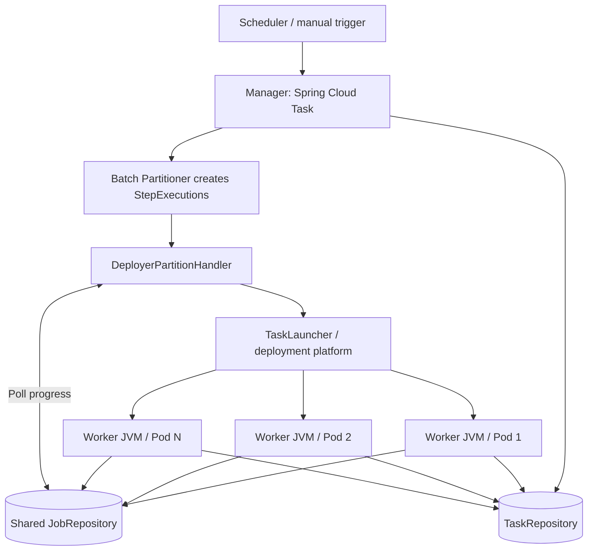

# Limiting Child Processes, Polling Interval, and Timeout

## 1. Context: Orchestrating Remote Partitioning in Spring Cloud Task

**Spring Cloud Task** fits Spring Boot applications that perform a finite task and exit. Combined with **Spring Batch**, a large workload such as data ingestion, transaction reconciliation, or order aggregation can be split into independent **partitions** processed in parallel across multiple child processes (*workers*).

In **remote partitioning** with Spring Cloud Deployer, the **manager** application defines the partitioned Job and Step, creates `StepExecution`s for each partition, and uses `DeployerPartitionHandler` to ask `TaskLauncher` to launch worker JVMs/containers. Each worker uses `DeployerStepExecutionHandler` to locate its corresponding `StepExecution` in **`JobRepository`** and run the business Step. The manager periodically queries `JobRepository` to see which partitions have finished. Both manager and workers can also record separate histories in Spring Cloud Task's **`TaskRepository`**.



Merely increasing partition count does not guarantee faster processing. Each worker consumes CPU/RAM, database connections, startup time, and deployment-platform resources. Three critical tuning knobs on `DeployerPartitionHandler` are:

1. **`setMaxWorkers(int)`**: limits how many workers execute concurrently.
2. **`setPollInterval(long)`**: how often the manager checks `JobRepository` for completed Steps.
3. **`setTimeout(long)`**: maximum time the manager waits for all workers of the partitioned master step to finish.

The goal of this lesson is to configure these three settings properly, understand how they interact with `gridSize`, observe execution, and handle errors/timeouts so partitioned tasks run safely on a schedule or on demand.

## 2. Distinguishing Partition, Worker, JobExecution, and TaskExecution

| Concept | Meaning in remote partitioning |
| --- | --- |
| **Partition** | A slice of data/work described by an `ExecutionContext`, e.g., ID range `1..1000` |
| **Worker** | A Spring Boot process launched by `TaskLauncher` to process one partition; concurrent workers may be capped |
| **`gridSize`** | A hint to `Partitioner`/`StepExecutionSplitter` on how many partitions to create; not a mandatory concurrency level |
| **`maxWorkers`** | Maximum number of workers the handler allows to run at the same time |
| **`JobExecution`** | A single run of a Spring Batch Job, tracked in `BATCH_JOB_EXECUTION` |
| **`StepExecution`** | Execution of the master step or a worker partition, holding `STATUS`, `READ_COUNT`, `WRITE_COUNT`, etc. |
| **`TaskExecution`** | A single startup run of a Spring Cloud Task application; manager and workers can each have their own records |

Suppose `Partitioner` creates **8 partitions** from eight non-overlapping ID ranges, while `maxWorkers = 3`. At most three workers can be active simultaneously; remaining partitions wait for a slot. If all workers take roughly equal time, you can picture three waves: `3 + 3 + 2`. **This is an idealized mental model**, not a rigid schedule: provisioning speed, processing time, failures, retries, and `TaskLauncher` behavior alter the actual timeline.

`gridSize` and `maxWorkers` solve **two different problems**. `gridSize = 8` does not force `Partitioner` to return exactly eight partitions; `maxWorkers = 3` does not create three partitions by itself, nor does it cap the entire system if **multiple separate manager Jobs** run at once. If each manager allows up to three workers and four managers are active, the global cap must be enforced separately via the scheduler, platform quotas, or another orchestrator.

## 3. Tuning Methods and Default Values

`DeployerPartitionHandler` resides in package `org.springframework.cloud.task.batch.partition`. Its APIs and default values are documented by Spring Cloud Task as follows:

| API | Documented default | Interpretation |
| --- | --- | --- |
| `setGridSize(int)` | `1` | Partition grid-size hint passed to splitter/partitioner |
| `setMaxWorkers(int)` | `-1` (unlimited) | Maximum number of concurrently executing worker processes |
| `setPollInterval(long)` | 10 seconds | Interval for polling Step outcomes in `JobRepository` |
| `setTimeout(long)` | `-1` (wait indefinitely) | Deadline for master step waiting on **all** workers to complete |

In this lesson's examples, durations are passed in **milliseconds**, so use `Duration.toMillis()` to avoid unit mistakes. Verify exact signatures/APIs and units against the exact Spring Cloud Task version your project uses.

### 3.1. `maxWorkers`: Capping Infrastructure Load

For example, `setMaxWorkers(3)` instructs the handler not to keep more than three workers running concurrently within the scope of the run it manages. This setting directly affects Pod/JVM allocation, DB connections, CPU/RAM, and bandwidth. Setting it too low prolongs Job runtime; setting it too high risks overloading the database, deployment queues, or cloud platform.

**Never leave `-1` as the default in production.** Unlimited on the handler side does not mean the platform has unlimited resources. Start from database capacity and environment quotas, then tune upward based on measured data.

### 3.2. `pollInterval`: Observation Latency and Query Cost

The handler periodically queries `JobRepository` to detect finished workers. A shorter `pollInterval` lets the manager notice completion sooner, at the cost of more status queries. A longer interval reduces DB queries but can delay outcome collection and dispatching the next worker.

For instance, checking every 5 seconds lets the manager detect a finished Step with roughly up to one polling cycle of delay under normal conditions. This is only an estimate for **status visibility**, not a promise that the Job finishes in 5 seconds: DB latency, thread scheduling, provisioning, and failed processes all affect timing.

### 3.3. `timeout`: Master Wait Limit

`setTimeout(...)` applies to how long the **master partition step waits for all workers**, not to an individual SQL statement, HTTP request, or single worker. For example, `setTimeout(Duration.ofMinutes(20).toMillis())` sets an overall wait threshold in our example.

Crucial point: **the manager timing out does not prove workers have been terminated**. Some workers may still be running, may have already committed data, or may be waiting on the orchestrator to stop them. On timeout, inspect worker status on the deployment platform and `JobRepository`/`TaskRepository` metadata; apply dedicated stop/cleanup and retry policies. Never immediately re-run the entire Job simply because the manager timed out.

`-1` (no timeout) avoids premature deadline errors on long workloads, yet leaves the manager waiting indefinitely if a worker hangs or never updates status. In production, choose a data-backed deadline and configure alerts for abnormal runs.

## 4. Choosing the Three Values Based on Real Workload

No single combination fits every system. Suppose a job has **12 partitions**, each worker averages 4 minutes **after startup**, and Pod provisioning takes about 30 seconds.

| Illustrative setting | Minimum waves when all workers run at similar speed | Notes |
| --- | --- | --- |
| `maxWorkers=2` | 6 waves | Lower DB pressure, longer total runtime |
| `maxWorkers=3` | 4 waves | Balanced starting point if DB handles three workers |
| `maxWorkers=6` | 2 waves | Faster in theory, consumes more connections/resources |
| `maxWorkers=12` | 1 wave | High peak load, easily exceeds infrastructure limits |

These numbers show **ideal processing waves**, not guaranteed performance. Uneven partition sizes, quota waits during provisioning, or writer table contention mean adding workers does **not** scale throughput linearly.

When sizing, measure:

- Actual partition count, record skew, and runtime variance across partitions.
- Time from `TaskLauncher` launch request until the worker starts processing; Pod startup/image pull can be significant.
- Active DB connections, pool wait times, deadlocks/lock waits, CPU/IO, and transactions/sec.
- `JobRepository` query count from polling, read latency, and metadata size.
- Job runtime percentiles (`p50`, `p95`, `p99`), timeout frequency, and recovery time after failures.

Example sizing calculation: if each worker opens up to 5 connections, setting `maxWorkers=6` can generate pressure of roughly 30 connections **from workers alone**, excluding the manager and other services. This is an estimation for connection budgeting; actual connection counts depend on pool configuration, reader/writer types, and intra-worker concurrency.

### Polling Interval and Timeout Should Be Tuned Together

A baseline setup might use `maxWorkers=3`, `pollInterval=5 seconds`, `timeout=20 minutes`. If normal workers take 15 minutes under peak load, a 5-minute timeout causes false failures. If no normal worker ever exceeds 2 minutes, a 60-minute timeout delays hang detection too long. Base settings on real statistics plus headroom for container startup, controlled retries, DB latency, and straggling tasks.

Manager timeouts, scheduler timeouts, Pod timeouts, and JDBC/API timeouts operate at **different layers**. They must be coordinated. For example, the scheduler should not kill the manager early while workers are still processing without cleanup; conversely, workers must not run unbounded after the master has given up waiting.

## 5. Prerequisites Before Enabling Remote Partitioning

For a manager to monitor remote workers properly, prepare:

1. **Compatible Spring Boot, Spring Cloud Task, Spring Batch, and Spring Cloud Deployer versions** via your project BOM/versions. The APIs below illustrate Spring Cloud Task 3.x with Spring Batch 5.x; re-verify if using another release line.
2. **A `TaskLauncher` implementation for your real platform** (local, Kubernetes, or other environment). `TaskLauncher` is an SPI; adding a starter to the classpath does not automatically provide a worker deployment platform.
3. **A worker artifact reachable** by `TaskLauncher`, such as an executable JAR or deployer-supported resource. Workers must boot with the right profile/config.
4. **The same persistent `JobRepository`** for the manager and all workers. This is mandatory so workers find `StepExecution` and the manager polls outcomes; per-JVM `mem:` H2 databases do not work.
5. **Matching `TaskRepository` and business DB connectivity**, with official privileges, drivers, and schemas. If you want parent–child tracing across `TaskExecution`s, manager and workers must use the version's metadata-linking mechanism.
6. **Non-overlapping data slices**, along with business keys/idempotency and retry rules. Running parallel workers does not automatically ensure a record is processed only once.

### Illustrative Maven Dependencies

```xml
<!-- Spring Boot, Spring Cloud, and Spring Batch versions
     are managed via the project's compatible BOM. -->
<dependencies>
    <dependency>
        <groupId>org.springframework.cloud</groupId>
        <artifactId>spring-cloud-starter-task</artifactId>
    </dependency>
    <dependency>
        <groupId>org.springframework.cloud</groupId>
        <artifactId>spring-cloud-task-batch</artifactId>
    </dependency>
    <dependency>
        <groupId>org.springframework.boot</groupId>
        <artifactId>spring-boot-starter-batch</artifactId>
    </dependency>
    <dependency>
        <groupId>org.postgresql</groupId>
        <artifactId>postgresql</artifactId>
        <scope>runtime</scope>
    </dependency>
</dependencies>
```

You must also configure/declare the **Spring Cloud Deployer implementation** and `TaskLauncher` matching your system; the code below illustrates orchestration and tuning only, and is **not an application that deploys workers to any cloud by itself**.

## 6. Example: Configuring the Manager with Three Limits

The example uses a single artifact with two profiles: `manager` defines the partitioned Job, while `worker` provides the execution Step. Source data lives in PostgreSQL table `source_orders` with IDs 1 through 80; results go into `processed_orders` with a unique key on `id`. Eight sample partitions correspond to eight non-overlapping ID ranges. In production, counts and ranges should be derived from a run snapshot/manifest rather than hardcoded.

### 6.1. Common and Profile-Specific Configuration

`src/main/resources/application.yml`:

```yaml
spring:
  application:
    name: remote-partition-demo
  main:
    web-application-type: none
  datasource:
    url: ${TASK_DB_URL}
    username: ${TASK_DB_USER}
    password: ${TASK_DB_PASSWORD}
  batch:
    job:
      enabled: false
    jdbc:
      initialize-schema: never
  cloud:
    task:
      initialize-enabled: false
```

`src/main/resources/application-manager.yml`:

```yaml
spring:
  cloud:
    task:
      name: orders-partition-manager
app:
  partition:
    grid-size: 8
    max-workers: 3
    poll-interval: PT5S
    timeout: PT20M
    worker-resource: file:/opt/tasks/remote-worker.jar
```

`src/main/resources/application-worker.yml`:

```yaml
spring:
  cloud:
    task:
      name: orders-partition-worker
```

`app.partition.*` are **custom properties for this example**, not built-in auto-configuration properties of Spring Cloud Task. They take effect only when the code below binds and passes them to `DeployerPartitionHandler`. `PT5S` and `PT20M` use ISO-8601 `Duration` syntax. `worker-resource` must be replaced with a resource accessible to **your active `TaskLauncher` implementation**; on cloud platforms, a different resource/deployer scheme may be required instead of a local file path.

`initialize-schema: never` and `initialize-enabled: false` mean both **Spring Batch (`BATCH_*`) and Spring Cloud Task (`TASK_*`) schemas must be created beforehand** via version-matched migrations. In multi-JVM tests, never let two processes concurrently initialize the same tables. Database credentials need metadata write rights for manager and workers, plus appropriate privileges on business tables.

### 6.2. Manager: Creating Partitions and Capping Workers

Create `ManagerPartitionConfiguration.java` in a package scanned by Spring Boot:

```java
package com.example.partition;

import java.time.Duration;
import java.util.LinkedHashMap;
import java.util.List;
import java.util.Map;

import org.springframework.batch.core.Job;
import org.springframework.batch.core.BatchStatus;
import org.springframework.batch.core.JobExecution;
import org.springframework.batch.core.Step;
import org.springframework.batch.core.explore.JobExplorer;
import org.springframework.batch.core.job.builder.JobBuilder;
import org.springframework.batch.core.JobParametersBuilder;
import org.springframework.batch.core.launch.JobLauncher;
import org.springframework.batch.core.partition.support.Partitioner;
import org.springframework.batch.core.repository.JobRepository;
import org.springframework.batch.core.step.builder.StepBuilder;
import org.springframework.batch.item.ExecutionContext;
import org.springframework.beans.factory.annotation.Value;
import org.springframework.boot.ApplicationRunner;
import org.springframework.cloud.deployer.spi.task.TaskLauncher;
import org.springframework.cloud.task.batch.partition.DeployerPartitionHandler;
import org.springframework.cloud.task.batch.partition.PassThroughCommandLineArgsProvider;
import org.springframework.cloud.task.repository.TaskRepository;
import org.springframework.context.annotation.Bean;
import org.springframework.context.annotation.Configuration;
import org.springframework.context.annotation.Profile;
import org.springframework.core.io.Resource;

@Configuration(proxyBeanMethods = false)
@Profile("manager")
public class ManagerPartitionConfiguration {

    @Bean
    Partitioner orderIdPartitioner() {
        return gridSize -> {
            int totalIds = 80; // Only for fixed sample data.
            int partitions = Math.max(1, gridSize);
            int width = (totalIds + partitions - 1) / partitions;
            Map<String, ExecutionContext> result = new LinkedHashMap<>();

            for (int index = 0; index < partitions; index++) {
                int first = 1 + index * width;
                if (first > totalIds) {
                    break;
                }
                int last = Math.min(totalIds, first + width - 1);
                ExecutionContext context = new ExecutionContext();
                context.putLong("minId", first);
                context.putLong("maxId", last);
                result.put("partition" + index, context);
            }
            return result;
        };
    }

    @Bean
    DeployerPartitionHandler partitionHandler(
            TaskLauncher taskLauncher,
            JobExplorer jobExplorer,
            TaskRepository taskRepository,
            @Value("${app.partition.worker-resource}") Resource workerResource,
            @Value("${app.partition.grid-size:8}") int gridSize,
            @Value("${app.partition.max-workers:3}") int maxWorkers,
            @Value("${app.partition.poll-interval:PT5S}") Duration pollInterval,
            @Value("${app.partition.timeout:PT20M}") Duration timeout) {

        if (gridSize <= 0 || maxWorkers <= 0 ||
                pollInterval.isZero() || pollInterval.isNegative() ||
                timeout.isZero() || timeout.isNegative()) {
            throw new IllegalArgumentException("Invalid partition configuration");
        }

        DeployerPartitionHandler handler = new DeployerPartitionHandler(
                taskLauncher, jobExplorer, workerResource,
                "workerStep", taskRepository);

        handler.setGridSize(gridSize);
        handler.setMaxWorkers(maxWorkers);
        handler.setPollInterval(pollInterval.toMillis());
        handler.setTimeout(timeout.toMillis());
        handler.setCommandLineArgsProvider(
                new PassThroughCommandLineArgsProvider(List.of(
                        "--spring.profiles.active=worker",
                        "--spring.batch.job.enabled=false")));
        return handler;
    }

    @Bean
    Step managerStep(JobRepository jobRepository,
                     Partitioner orderIdPartitioner,
                     DeployerPartitionHandler partitionHandler,
                     @Value("${app.partition.grid-size:8}") int gridSize) {
        return new StepBuilder("managerStep", jobRepository)
                .partitioner("workerStep", orderIdPartitioner)
                .gridSize(gridSize)
                .partitionHandler(partitionHandler)
                .build();
    }

    @Bean
    Job partitionedOrdersJob(JobRepository jobRepository, Step managerStep) {
        return new JobBuilder("partitionedOrdersJob", jobRepository)
                .start(managerStep)
                .build();
    }

    @Bean
    ApplicationRunner launchManagerJob(
            JobLauncher jobLauncher,
            Job partitionedOrdersJob,
            @Value("${app.partition.request-key:demo-001}") String requestKey) {
        return args -> {
            JobExecution execution = jobLauncher.run(
                    partitionedOrdersJob,
                    new JobParametersBuilder()
                            .addString("requestKey", requestKey, true)
                            .toJobParameters());

            if (execution.getStatus() != BatchStatus.COMPLETED) {
                throw new IllegalStateException(
                        "Remote partition Job did not complete: " + execution.getStatus());
            }
        };
    }
}
```

This is **component configuration code**; the project still needs a real `TaskLauncher` bean, a deployable worker resource, and business tables. `ApplicationRunner` invokes `JobLauncher` once in the `manager` profile with an identifying `requestKey`; if the Job fails to complete, the runner throws so Spring Cloud Task reflects the failure status. The example assumes a synchronous launcher that waits for terminal status; if using an asynchronous `JobLauncher`, poll Job status via `JobRepository` instead of concluding immediately from `run()`. The `DeployerPartitionHandler` constructor in Spring Cloud Task 3.x accepts `TaskLauncher`, `JobExplorer`, `Resource`, **worker Step name**, and `TaskRepository`; older examples online may use a different constructor.

The default `requestKey` value `demo-001` is for lab use only. Re-running against the same `JobRepository` with unchanged Job name and identifying parameters on an already completed instance raises `JobInstanceAlreadyCompleteException`; to process a new request, supply a new business request key, or to restart after failure, preserve identifying parameters and checkpoints.

In `managerStep`, `.gridSize(gridSize)` hints the partitioner; `.partitionHandler(partitionHandler)` selects remote execution. `handler.setMaxWorkers(maxWorkers)` is what caps concurrent workers managed by the handler. Setting `gridSize` in both places keeps configuration clear; do not assume they produce two separate partition sets.

Each `ExecutionContext` carries `minId` and `maxId` so workers process one ID range. With IDs 1 through 80, `gridSize=8` yields eight 10-ID intervals; with large or skewed datasets, build a `Partitioner` that computes key-based regions, balances sizes, and stays deterministic across restarts.

### 6.3. Worker: Reading Its Exact Assigned Partition

Example `WorkerPartitionConfiguration.java` defining a Step named **exactly** `workerStep` (matching the argument passed to the manager's handler):

```java
package com.example.partition;

import org.springframework.batch.core.Step;
import org.springframework.batch.core.configuration.annotation.StepScope;
import org.springframework.batch.core.explore.JobExplorer;
import org.springframework.batch.core.repository.JobRepository;
import org.springframework.batch.core.step.builder.StepBuilder;
import org.springframework.batch.core.step.tasklet.Tasklet;
import org.springframework.batch.repeat.RepeatStatus;
import org.springframework.beans.factory.BeanFactory;
import org.springframework.beans.factory.annotation.Value;
import org.springframework.cloud.task.batch.partition.DeployerStepExecutionHandler;
import org.springframework.context.annotation.Bean;
import org.springframework.context.annotation.Configuration;
import org.springframework.context.annotation.Profile;
import org.springframework.jdbc.core.JdbcTemplate;
import org.springframework.transaction.PlatformTransactionManager;

@Configuration(proxyBeanMethods = false)
@Profile("worker")
public class WorkerPartitionConfiguration {

    @Bean
    @StepScope
    Tasklet processRangeTasklet(
            @Value("#{stepExecutionContext['minId']}") Long minId,
            @Value("#{stepExecutionContext['maxId']}") Long maxId,
            JdbcTemplate jdbc) {

        return (contribution, chunkContext) -> {
            if (minId == null || maxId == null || minId > maxId) {
                throw new IllegalArgumentException("Invalid partition range");
            }

            int inserted = jdbc.update("""
                    INSERT INTO processed_orders (id, payload)
                    SELECT id, payload
                    FROM source_orders
                    WHERE id BETWEEN ? AND ?
                    ON CONFLICT (id) DO NOTHING
                    """, minId, maxId);

            System.out.printf("WORKER range=[%d,%d] inserted=%d%n",
                    minId, maxId, inserted);
            return RepeatStatus.FINISHED;
        };
    }

    @Bean
    Step workerStep(JobRepository jobRepository,
                    PlatformTransactionManager transactionManager,
                    Tasklet processRangeTasklet) {
        return new StepBuilder("workerStep", jobRepository)
                .tasklet(processRangeTasklet, transactionManager)
                .build();
    }

    @Bean
    DeployerStepExecutionHandler stepExecutionHandler(
            BeanFactory beanFactory,
            JobExplorer jobExplorer,
            JobRepository jobRepository) {
        return new DeployerStepExecutionHandler(
                beanFactory, jobExplorer, jobRepository);
    }
}
```

The worker receives its `StepExecution` identifier from arguments/environment variables provided by `DeployerPartitionHandler` via `TaskLauncher`. `DeployerStepExecutionHandler` looks up the `StepExecution` in the **shared `JobRepository`** and executes `workerStep`; `@StepScope` binds `minId`/`maxId` from `StepExecutionContext`. The worker never creates a new Job instance with different parameters.

The SQL uses **PostgreSQL** `ON CONFLICT (id) DO NOTHING` syntax to prevent key collisions on worker re-runs. This illustrates basic idempotency; it **does not automatically verify whether an existing payload matches new values**. In production, define policies for conflicting contents on existing keys, mutating source rows, business locks, and reconciliation audits. If readers/writers span multiple datasources or external APIs, the tasklet's transaction boundary does not cover all side effects.

### 6.4. Business DDL and Startup

Example PostgreSQL tables, created via migration **before** manager and workers run:

```sql
CREATE TABLE source_orders (
    id BIGINT PRIMARY KEY,
    payload VARCHAR(200) NOT NULL
);

CREATE TABLE processed_orders (
    id BIGINT PRIMARY KEY,
    payload VARCHAR(200) NOT NULL
);
```

To test eight ID intervals, seed `source_orders` with IDs `1..80`, ensuring the dataset does not change mid-run or across restarts. Using PostgreSQL to generate test rows:

```sql
INSERT INTO source_orders (id, payload)
SELECT n, 'order-' || n
FROM generate_series(1, 80) AS n;
```

Create a `@SpringBootApplication` in package `com.example.partition` to scan both configuration classes; `manager` and `worker` profiles decide which beans activate:

```java
package com.example.partition;

import org.springframework.boot.SpringApplication;
import org.springframework.boot.autoconfigure.SpringBootApplication;
import org.springframework.cloud.task.configuration.EnableTask;

@EnableTask
@SpringBootApplication
public class RemotePartitionApplication {
    public static void main(String[] args) {
        SpringApplication.run(RemotePartitionApplication.class, args);
    }
}
```

The manager launches the Job **once** via `ApplicationRunner` with stable identifying `JobParameters`, while workers use `DeployerStepExecutionHandler`. Keep `spring.batch.job.enabled=false` as shown to prevent Batch's default auto-launch from firing the Job twice.

```bash
# Example command to start the manager; workers are deployed by TaskLauncher from resource.
java -jar target/remote-partition-demo.jar \
  --spring.profiles.active=manager
```

The `TaskLauncher` implementation (local, Kubernetes, etc.), worker artifact, and DB connection environment variables must be wired per your infrastructure. The command above **starts the manager and runs the Job via the runner in the example**; workers spawn only when an actual `TaskLauncher` is registered and able to deploy the target resource. Also avoid passing DB passwords directly via CLI arguments to every worker.

## 7. Asynchronous Worker Launching vs. `maxWorkers`

Per Spring Cloud Task documentation, dispatching partition deployments can happen **sequentially** by default. If `TaskLauncher` Pod/JVM provisioning blocks until resources become available, launching many workers can add substantial latency even when `maxWorkers` is high.

`DeployerPartitionHandler` offers a constructor accepting a `TaskExecutor` (such as `ThreadPoolTaskExecutor`) to handle **asynchronous launch calls**:

```java
// Illustrative alternative constructor choice; replace the five-argument
// constructor in the manager bean if asynchronous launching is desired.
DeployerPartitionHandler handler = new DeployerPartitionHandler(
        taskLauncher, jobExplorer, workerResource,
        "workerStep", taskRepository, launchExecutor);

handler.setMaxWorkers(3);
handler.setPollInterval(Duration.ofSeconds(5).toMillis());
handler.setTimeout(Duration.ofMinutes(20).toMillis());
```

Here `launchExecutor` is a Spring-managed `ThreadPoolTaskExecutor` bean initialized with proper lifecycle shutdown. `TaskExecutor` lets multiple **launch commands** run concurrently; it **does not replace** the active-worker cap. `maxWorkers` and the launch pool may need independent tuning, while respecting Pod quotas, `TaskLauncher` limits, and DB connection limits.

For instance, raising the launch pool from 2 to 8 threads while keeping `maxWorkers=3` does not run eight workers simultaneously. Conversely, setting `maxWorkers=8` with a tiny launch pool, slow `TaskLauncher`, or scarce platform quota may still leave very few workers actually running.

## 8. Observing JobRepository, TaskRepository, and Infrastructure

For any remote partitioning run, monitor **three layers** concurrently: Batch state, Task history, and process/Pod status managed by the deployment platform.

### 8.1. Querying StepExecutions

```sql
SELECT ji.JOB_NAME,
       je.JOB_EXECUTION_ID,
       je.STATUS AS JOB_STATUS,
       se.STEP_EXECUTION_ID,
       se.STEP_NAME,
       se.STATUS AS STEP_STATUS,
       se.START_TIME,
       se.END_TIME,
       se.READ_COUNT,
       se.WRITE_COUNT,
       se.COMMIT_COUNT
FROM BATCH_JOB_INSTANCE AS ji
JOIN BATCH_JOB_EXECUTION AS je
  ON je.JOB_INSTANCE_ID = ji.JOB_INSTANCE_ID
JOIN BATCH_STEP_EXECUTION AS se
  ON se.JOB_EXECUTION_ID = je.JOB_EXECUTION_ID
WHERE ji.JOB_NAME = 'partitionedOrdersJob'
ORDER BY je.JOB_EXECUTION_ID DESC, se.STEP_EXECUTION_ID;
```

Partitioned Step names may include suffixes identifying each partition; also inspect `BATCH_STEP_EXECUTION_CONTEXT` to cross-check `minId`/`maxId` bounds per your Batch version's schema/serializer. Never infer worker success merely because `TaskLauncher` created a Pod; the Step must reach a completed status and business outputs must be verified.

### 8.2. Querying Parent and Worker Task History

```sql
SELECT TASK_EXECUTION_ID,
       PARENT_TASK_EXECUTION_ID,
       TASK_NAME,
       START_TIME,
       END_TIME,
       EXIT_CODE
FROM TASK_EXECUTION
WHERE TASK_NAME IN ('orders-partition-manager', 'orders-partition-worker')
ORDER BY TASK_EXECUTION_ID DESC;
```

`PARENT_TASK_EXECUTION_ID` is populated when the system propagates and persists the **parent task execution ID** under the corresponding integration flow. Never assume this column is non-null for every worker if your configuration or platform does not establish parent–child links. IDs in `TASK_EXECUTION` are distinct from Spring Batch's `JOB_EXECUTION_ID` and `STEP_EXECUTION_ID`.

### 8.3. Reconciling Actual Business Outcomes

```sql
SELECT COUNT(*) AS processed_count,
       MIN(id) AS min_id,
       MAX(id) AS max_id
FROM processed_orders;

SELECT s.id
FROM source_orders AS s
LEFT JOIN processed_orders AS p ON p.id = s.id
WHERE p.id IS NULL
ORDER BY s.id;
```

In a lab with 80 valid source IDs, `processed_count=80` and zero rows from the second query are two basic checks. With real data, verify **full ID sets, payload checksums, and business invariants**, because raw row counts miss subtle corruption. A Step may report success while data was written incorrectly or altered afterward.

### 8.4. Operational Signals to Collect

| Signal | When to pay attention |
| --- | --- |
| Count of partitions `STARTING`/`STARTED`/`COMPLETED`/`FAILED` | Track progress and pinpoint stalled work |
| Active workers vs. `maxWorkers` | Detect missing quotas or ineffective tuning |
| Time from launch request to worker execution | Detect slow provisioning or image pulls |
| `JobRepository` query latency and polling frequency | Spot metadata DB overload from aggressive polling |
| Manager timeouts and workers still running post-timeout | Alert for investigation and cleanup |
| DB connections/CPU/IO/deadlocks | Decide whether to scale workers up or down |
| Processed ID ranges, missing/duplicate rows, per-partition retries | Catch boundary conflicts or idempotency bugs |

## 9. Timeouts and Failures: Do Not Immediately Re-run When the Manager Stops Waiting

Suppose the manager waits at most 20 minutes, while the worker handling partition `61..70` takes 25 minutes due to a slow external API. After 20 minutes, the manager times out; however, that worker may still be **actively running** and may have already committed partial data.

Safe recovery procedure:

1. **Inspect infrastructure:** find all worker Pods/JVMs belonging to the Job/Task, verify which are still running, and see which launch requests were issued.
2. **Read `JobRepository`:** check `JobExecution`, whether each `StepExecution` is `COMPLETED`, `FAILED`, `STARTED`, or stuck, and inspect checkpoints in `ExecutionContext`.
3. **Reconcile business data:** see which IDs committed, which are missing, and whether external side effects or open transactions exist.
4. **Handle orphan workers:** use platform stop/reclaim mechanisms once verified appropriate, instead of killing the manager and assuming workers vanish automatically.
5. **Decide on restart:** keep the Job name and identifying parameters to resume the same Job instance per Spring Batch rules; avoid creating a new Job instance just to bypass checkpoints.
6. **Review configuration:** raise timeouts if valid workloads regularly exceed limits, lower `maxWorkers` if the DB is saturated, or optimize partitions/workers if one slice runs abnormally long.

If a Job remains `STARTED` after a crash, Spring Batch recovery may require confirming the old worker has stopped and updating status through supported administrative APIs/tools before restarting. Never run raw `UPDATE BATCH_STEP_EXECUTION SET STATUS='COMPLETED'` or delete metadata rows to make dashboards look green.

### Timeouts and Retries Across Multiple Layers

| Layer | Example | Do not confuse with |
| --- | --- | --- |
| Manager partition handler | `setTimeout(20 minutes)` | Does not guarantee `TaskLauncher` terminated workers |
| Polling interval | `setPollInterval(5 seconds)` | Not a SQL query or HTTP request timeout |
| Worker transaction | JDBC/transaction timeout | Not the entire Job's timeout |
| Deployment platform | Pod deadline, quotas, stop/cleanup policy | Not a Spring Batch checkpoint |
| Scheduler | Workflow deadline, retry/backoff | Does not roll back partially committed data |

Align timeouts across these layers and define **who owns worker cancellation**; otherwise, automatic scheduler retries can spawn duplicate processes writing the same data.

## 10. Common Configuration Mistakes

| Symptom | Likely cause | Fix |
| --- | --- | --- |
| More workers than expected when multiple Jobs run | `maxWorkers` applies per handler/run; no global cap | Cap concurrent managers, worker quotas, or scheduler concurrency |
| `gridSize=8` yet only 3 workers run | `maxWorkers=3`, platform quota, or `TaskLauncher` provisioning | Verify actual partition count and active limits |
| `maxWorkers=8` yet only 2 partitions created | Partitioner returned only two `ExecutionContext`s or data has only two slices | Inspect partitioner and `gridSize`; don't force idle workers |
| Manager reports progress slowly | `pollInterval` too long or slow `JobRepository`/queries | Measure polling latency and shorten cautiously without overloading DB |
| Manager hammers the DB with queries | `pollInterval` too small | Increase polling interval and monitor DB IO/connections |
| Timeout while workers are still running | Deadline too short, slow startup, skewed partition | Check Pods, `StepExecution`, and data before retrying |
| Manager hangs forever without exiting | Timeout `-1`, hung worker, or failure to update `JobRepository` | Set reasonable timeout, alerts, and cleanup policy |
| Worker cannot find `StepExecution` | Manager and worker hit different `JobRepository`/schemas or wrong IDs passed | Check connections/profiles, env vars, step name, and schema |
| Worker processes wrong ID range | Bad `ExecutionContext`, worker missing `@StepScope`, or mismatched key names | Verify `minId`, `maxId`, step name, and disjoint ranges |
| Step succeeds yet Task reports failure | Error updating Task metadata post-step or failing post-callbacks | Inspect Batch/Task statuses and business outputs separately |
| Retried worker task creates duplicates | Missing business key/idempotency, creating new Job instance instead of restarting | Add unique keys/checkpoints and inspect committed data |
| Worker never starts despite `TaskLauncher` success | Bad resource, profile, startup config, DB permissions, or quota | Inspect deployer logs, worker logs, and `JobRepository` |

## 11. Practice Exercises

1. With `gridSize=8`, `maxWorkers=3`, and 80 IDs `1..80`, list the ID intervals created by the sample partitioner. Explain why three concurrent workers does not mean only three partitions exist.
2. Change `maxWorkers` from 3 to 2, then to 5 in a lab with enough quota. Measure actual concurrent workers, runtime, DB connections, and provisioning wait times.
3. Keeping the same workload, compare `pollInterval=PT1S`, `PT5S`, and `PT15S`. Observe `JobRepository` query frequency and how quickly the manager notices finished partitions.
4. Set `timeout=PT1M` when a simulated worker takes over a minute; inspect `JobExecution`/`StepExecution`, Pods/JVMs, and business data. Why should you not retry immediately on timeout?
5. Test `gridSize=4` and `gridSize=12` on the same 80 IDs. Explain how the `Partitioner` determines actual partition count and its impact on load skew.
6. Simulate a worker failing after committing partial data. Design a retry targeting the failed Job instance/partition and verify safe re-writes via business keys.
7. Intentionally point manager and worker to two different databases. List the symptoms in logs and `JobRepository`; why is in-memory H2 (`mem:`) unsuitable for multi-JVM tests?
8. If the scheduler triggers two managers concurrently, each with `maxWorkers=3`, how many total workers can run? At which layer will you enforce a system-wide cap?
9. Build an experiment table recording partition count, `maxWorkers`, polling interval, timeout, total duration, DB connections, and timeout count; choose a well-justified configuration for the current workload.

After this lesson, you should clearly distinguish **partition count** from **concurrent worker count**, configure `setMaxWorkers`, `setPollInterval`, and `setTimeout` on `DeployerPartitionHandler`, understand why manager/workers require a **shared `JobRepository`**, and follow reliable procedures for handling timeouts, retries, checkpoints, and outcome reconciliation when operating Spring Cloud Task with Spring Batch.

## 12. References

- [Spring Cloud Task Reference — Remote Partitioning](https://docs.spring.io/spring-cloud-task/docs/current/reference/htmlsingle/#_remote_partitioning): `DeployerPartitionHandler` and worker architecture, polling/timeout defaults, and asynchronous launching.
- [Javadoc `DeployerPartitionHandler` (Spring Cloud Task 3.0.4)](https://docs.spring.io/spring-cloud-task/docs/current/apidocs/org/springframework/cloud/task/batch/partition/DeployerPartitionHandler.html): constructors, `setGridSize`, `setMaxWorkers`, `setPollInterval`, `setTimeout`.
- [Javadoc `DeployerStepExecutionHandler`](https://docs.spring.io/spring-cloud-task/docs/current/apidocs/org/springframework/cloud/task/batch/partition/DeployerStepExecutionHandler.html): worker lookup and execution of `StepExecution` from `JobRepository`.
- [Spring Batch Reference — Partitioning](https://docs.spring.io/spring-batch/reference/scalability.html): partitioner, manager/worker, `StepExecution`, and restarts.
- [Spring Batch Javadoc `PartitionStepBuilder`](https://docs.spring.io/spring-batch/docs/5.2.6/api/org/springframework/batch/core/step/builder/PartitionStepBuilder.html): distinguishing `gridSize` and `partitionHandler`.

These examples illustrate mechanics and tuning knobs only. In production, use **compatible Spring Cloud Task/Spring Batch versions**, a configured `TaskLauncher` implementation, accurate schemas/migrations, and empirical measurements from your runtime environment to tune worker counts, polling, and timeouts.
