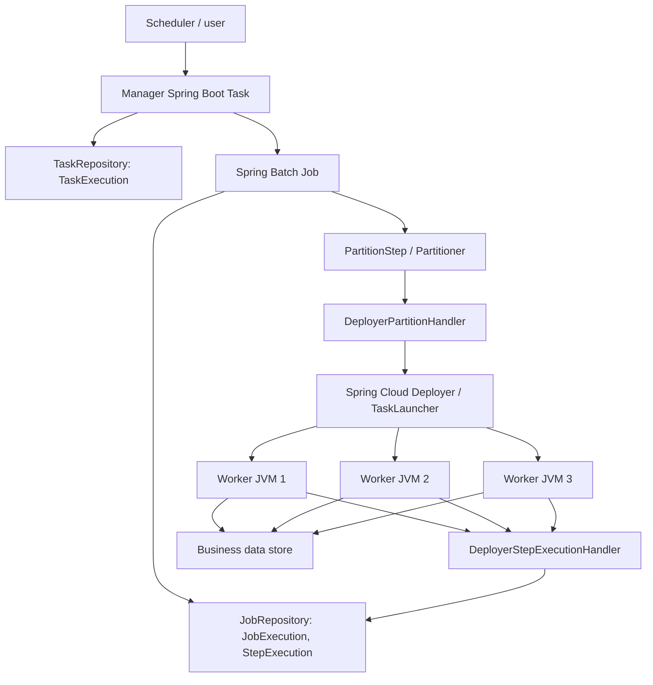
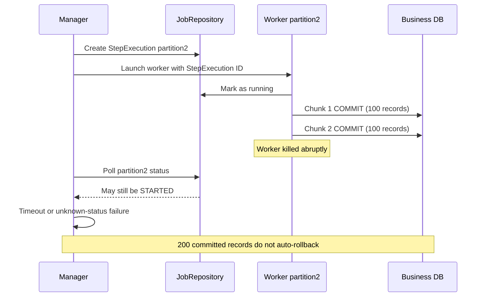
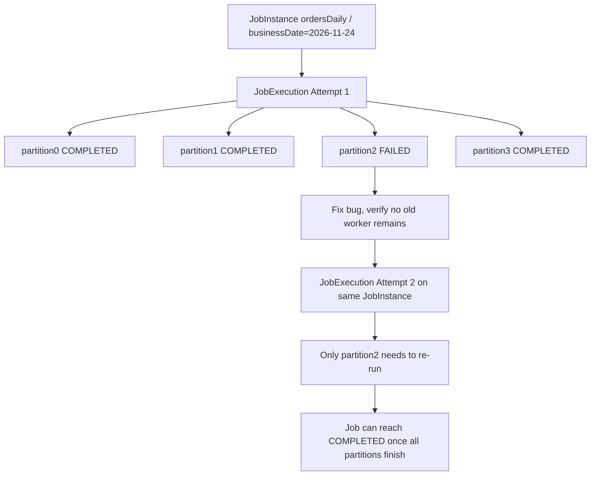
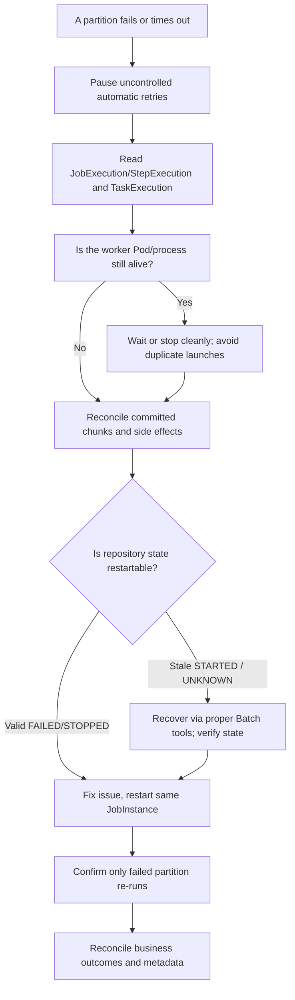

# Handling Failed Partitions, Restarts, and Version Compatibility

## 1. Why Does Remote Partitioning Need Its Own Recovery Mechanism?

**Spring Cloud Task** builds Spring Boot applications with a finite runtime: they start, do their work, persist execution metadata via `TaskRepository`, and terminate. When combined with **Spring Batch**, a large data-processing job can be split into multiple **partitions** and distributed across separate worker processes. This fits cases where one JVM lacks sufficient resources or work can be divided into independent data domains.

For example, a reconciliation task for 4 million orders is split into four ID ranges, each processed by one worker. If three workers finish while the fourth stops mid-way, recovery is not just about re-launching a process. The system must determine **which partitions succeeded, which are uncertain, which data already committed**, and whether re-running is safe without duplicating outcomes.

That is the focus of **"Handling Failed Partitions, Restarts, and Version Compatibility"** in the **Remote Partitioning** chapter:

- Understand how manager, workers, `DeployerPartitionHandler`, `DeployerStepExecutionHandler`, and `JobRepository` coordinate.
- Classify worker errors, deployment errors, timeouts, connection drops, and manager failures.
- Distinguish **in-Step retries** from **Job restarts** and **re-launching the entire Spring Cloud Task**.
- Design stable partition keys, checkpoints, idempotency, and handling for ambiguous states.
- Verify compatibility across Spring Boot, Spring Batch, Spring Cloud Task, Spring Cloud Deployer, schemas, and worker artifacts before upgrading.

## 2. Manager–Worker Architecture and State Sources

### 2.1. Two Execution Layers: Task and Batch



In the Spring Cloud Task model using Spring Cloud Deployer:

1. The **Manager** runs a Batch `Job` containing a `PartitionStep`.
2. `Partitioner` creates `ExecutionContext`s, each describing a data domain such as `fromId` and `toIdExclusive`.
3. `StepExecutionSplitter` creates or reuses `StepExecution` metadata for partitions.
4. `DeployerPartitionHandler` uses `TaskLauncher` to deploy worker processes, passing `StepExecution` IDs and needed parameters to workers.
5. Inside each worker, `DeployerStepExecutionHandler` reads its `StepExecution` from the **same `JobRepository`**, runs the Step, and updates outcomes.
6. The manager reads partition statuses back from `JobRepository` via `JobExplorer`, aggregates results, and finishes the Job.

Per the `DeployerPartitionHandler` API docs, the manager and all workers **must see the same `JobRepository` data**. Spring Cloud Task's sample docs also place the manager/worker `TaskRepository` in a commonly reachable datastore to link `TaskExecution`s and manage parent–child history. If you split the two repositories across two datasources, configure every participating component deliberately.

### 2.2. Role of Each Repository

| Source | Key objects | Questions answered |
| --- | --- | --- |
| `TaskRepository` | `TaskExecution`, `TASK_*` tables | How did the manager and each worker Task start, end, and fail? |
| `JobRepository` | `JobInstance`, `JobExecution`, `StepExecution`, `ExecutionContext`, `BATCH_*` tables | Which partitions completed or failed, how much committed, and is it restartable? |
| Business database | Orders, checkpoints, idempotency keys | Which **actual** changes were persisted? |
| Deployment infrastructure | Pod/Job/container/process IDs, exit codes, logs | Was the worker created, is it still running, or was it killed? |

A `TaskExecution` can correspond to a worker process, yet **Task status does not replace Step status**. For instance, a worker may write data and commit several chunks before losing power prior to marking `StepExecution` as `COMPLETED`.

### 2.3. Remote Partitioning vs. Remote Chunking

| Mechanism | What does the manager do? | What does the worker do? | Recovery unit |
| --- | --- | --- | --- |
| **Remote partitioning** | Splits data into regions, assigns `StepExecution`s to workers | Runs a **complete Step** with its own reader/processor/writer for its slice | Per-partition `StepExecution` |
| **Remote chunking** | Reader builds chunks and sends them over middleware | Processes/writes each received chunk | Depends on protocol, checkpoints, delivery, and config |

Remote partitioning relies heavily on `JobRepository` metadata and `ExecutionContext`. Never apply remote-chunking message retry guidance while ignoring Batch partition states.

## 3. Prerequisites for Reliable Partition Restarts

### 3.1. Partitions Must Have Stable Names and Ranges

Suppose orders with IDs 1 through 400 need processing. Instead of generating random spans on every run, split them deterministically:

| Partition name | Data range | Assumed first-run status |
| --- | --- | --- |
| `orders.worker:partition0` | `[1, 101)` | `COMPLETED` |
| `orders.worker:partition1` | `[101, 201)` | `COMPLETED` |
| `orders.worker:partition2` | `[201, 301)` | `FAILED` |
| `orders.worker:partition3` | `[301, 401)` | `COMPLETED` |

The notation `[a, b)` means `a <= id < b`. Ranges are **non-overlapping**, easy to reconcile, and avoid boundary errors. Ensure every expected ID belongs to exactly one range.

When restarting the **same `JobInstance`**, keep:

- Consistent **Job name** and **identifying `JobParameters`**.
- Stable **partition names** so Spring Batch finds the matching prior `StepExecution`s.
- Enough information in **`ExecutionContext`** so workers know their exact range again.
- Consistent snapshots or selection rules; never silently mutate the input dataset.

Per Spring Batch, `PartitionNameProvider` can supply partition names separately on restart; if used, those names must **match** the names generated by `Partitioner`. Never recompute partitions based on available Pod count and completely rename them within the same `JobInstance`.

### 3.2. Illustrative Java Partitioner

The Java 17+ example below creates four ID-range partitions; usable in any Spring Batch setup supporting the `Partitioner` interface:

```java
import java.util.LinkedHashMap;
import java.util.Map;
import org.springframework.batch.core.partition.support.Partitioner;
import org.springframework.batch.item.ExecutionContext;

public class OrderRangePartitioner implements Partitioner {
    private final long firstIdInclusive;
    private final long lastIdExclusive;

    public OrderRangePartitioner(long firstIdInclusive, long lastIdExclusive) {
        if (firstIdInclusive >= lastIdExclusive) {
            throw new IllegalArgumentException("Invalid ID range");
        }
        this.firstIdInclusive = firstIdInclusive;
        this.lastIdExclusive = lastIdExclusive;
    }

    @Override
    public Map<String, ExecutionContext> partition(int gridSize) {
        if (gridSize <= 0) {
            throw new IllegalArgumentException("gridSize must be > 0");
        }
        Map<String, ExecutionContext> partitions = new LinkedHashMap<>();
        long size = lastIdExclusive - firstIdInclusive;
        long chunk = (size + gridSize - 1L) / gridSize;

        long from = firstIdInclusive;
        int index = 0;
        while (from < lastIdExclusive) {
            long to = Math.min(from + chunk, lastIdExclusive);
            ExecutionContext context = new ExecutionContext();
            context.putLong("fromId", from);
            context.putLong("toIdExclusive", to);
            partitions.put("partition" + index++, context);
            from = to;
        }
        return partitions;
    }
}
```

With `new OrderRangePartitioner(1, 401)` and `gridSize=4`, the output matches the four ID ranges in the table above. The code uses small numbers for readability; for huge ID ranges, guard against overflow in `size + gridSize - 1` and compute partitions from a stable input snapshot.

**Example caveat:** `gridSize` is a work-splitting parameter; it does not guarantee exactly four JVMs run concurrently. Actual concurrent processes depend on `maxWorkers`, cluster capacity, and how `PartitionHandler` deploys them.

### 3.3. Workers Must Receive the Exact Data Range

Example reader using `@StepScope` to bind bounds from `ExecutionContext`:

```java
@Bean
@StepScope
JdbcPagingItemReader<OrderRow> orderReader(
        DataSource dataSource,
        @Value("#{stepExecutionContext['fromId']}") long fromId,
        @Value("#{stepExecutionContext['toIdExclusive']}") long toIdExclusive) {
    // Create reader with condition id >= :fromId AND id < :toIdExclusive.
    // Set a unique and stable sort key, e.g. id.
    // Return the reader configured for your Spring Batch version.
    throw new UnsupportedOperationException("Illustrative StepScope configuration");
}
```

This snippet is a **skeleton showing how bounds are bound**, not a runnable bean. A real `JdbcPagingItemReader` needs a `PagingQueryProvider`, page size, parameters, row mapper, and reader name; API imports must match your Spring Batch version. You may also use `JdbcCursorItemReader` or an appropriate custom reader.

**Do not split by partition name alone:** SQL/readers must actually filter the exact range; if all four workers run `SELECT * FROM orders` without range predicates, partitions with different names will still **process duplicate data**.

## 4. Reading Success, Failure, and "Unknown Outcome" States

### 4.1. Spring Batch Statuses to Recognize

| `BatchStatus` | Common meaning | Action |
| --- | --- | --- |
| `COMPLETED` | Step finished per Batch rules | On restarting the same `JobInstance`, normally **skip** this partition |
| `FAILED` | Step ended with an error that was recorded | Restartable if Job/Step allows and root cause is fixed |
| `STOPPED` | Step stopped in a controlled manner | Evaluate whether resumption/restart is safe |
| `STARTED` / `STARTING` | Metadata indicates currently running or starting | Check process; if dead, this may be stale state |
| `UNKNOWN` | Exact outcome could not be determined | Reconcile carefully; never assume everything rolled back |
| `ABANDONED` | Excluded from restart by Batch mechanics | Use only after an intentional operational decision |

Beyond `BatchStatus`, Batch also uses `ExitStatus` and `ExitCode` to describe Step/Job outcomes. **Never equate** the worker process exit code, `TaskExecution.exitCode`, `StepExecution.getExitStatus()`, and `JobExecution` status.

### 4.2. Four Common Failure Scenarios

| Scenario | On the worker | In `JobRepository` | What the manager sees |
| --- | --- | --- | --- |
| Worker finishes and updates cleanly | Process exits normally | Partition `COMPLETED` | Aggregates success |
| Writer throws exception, framework still alive | Process errors | Partition usually `FAILED` | Manager Step/Job fails |
| Worker receives `SIGKILL` mid-chunk | Process skips cleanup | Step may stay `STARTED`; prior chunks committed | Keeps polling, may time out |
| Deployer fails to spawn worker | No business process created | Step may never transition to terminal status | Deployment error or timeout; inspect infra |

**Never assume every failure records `FAILED` in the repository.** Sudden crashes at bad moments can leave `STARTED` or prevent metadata from flushing/committing. Likewise, never assume business data is untouched just because the Job did not finish.

### 4.3. Overall Job Status Is an Aggregate

`PartitionStep` is the manager's Step. If one of four worker partitions fails, the Job normally cannot reach `COMPLETED` under the default flow. Still, already-completed partitions and committed chunks are **not globally rolled back** just because another worker failed: each runs independent transactions.

Suppose:

```text
Manager JobExecution #520
  orders.worker:partition0 -> COMPLETED (100 item)
  orders.worker:partition1 -> COMPLETED (100 item)
  orders.worker:partition2 -> FAILED    (60 items committed before error)
  orders.worker:partition3 -> COMPLETED (100 item)

Outcome: Job FAILED (assuming no fault-tolerant flow is configured).
Data: at least 360 items may have been committed chunk by chunk.
```

On restart, `partition2` must safely resume from its unfinished portion. Batch metadata identifies which Step needs re-execution, yet **does not undo** the 60 already-committed items or external API/Kafka side effects.

## 5. Remote Partitioning with Spring Cloud Task and Deployer

### 5.1. Core Components

Per Spring Cloud Task documentation on remote partitioning via Spring Cloud Deployer:

| Component | Responsibility |
| --- | --- |
| `PartitionStep` | Manager-side Step orchestrating partitions |
| `Partitioner` | Produces partition names and parameter-carrying `ExecutionContext`s |
| `DeployerPartitionHandler` | Launches workers per `StepExecution`, caps active workers, polls outcomes |
| `TaskLauncher` | Calls infrastructure to deploy tasks as processes or containers |
| `DeployerStepExecutionHandler` | On workers, receives `StepExecution` ID, loads from `JobRepository`, runs Step |
| `JobExplorer` | Reads Job/Step statuses from `JobRepository` |
| `TaskRepository` / `TaskExplorer` | Tracks manager/worker Task lifecycles when integration is configured |

Per the **Spring Cloud Task 3.0.4** API docs, `DeployerPartitionHandler` passes the `StepExecution` ID to workers (via environment variables in that implementation) and polls `JobRepository` for results. This lets the manager monitor progress even when workers expose no direct HTTP callback endpoint.

### 5.2. Manager Configuration: Directional Example

The skeleton below shows how Spring Batch components connect. It is **not a complete standalone compilable configuration**; `DeployerPartitionHandler` constructors and supporting beans vary across versions:

```java
// Spring Batch manager configuration (illustrative)
@Bean
Step managerStep(JobRepository jobRepository,
                 Partitioner partitioner,
                 PartitionHandler deployerPartitionHandler) {
    return new StepBuilder("orders.manager", jobRepository)
            .partitioner("orders.worker", partitioner)
            .partitionHandler(deployerPartitionHandler)
            .build();
}
```

`deployerPartitionHandler` must also be configured with `TaskLauncher`, `JobExplorer`, worker artifact, worker Step name, and `TaskRepository` if required by your API version. Operational settings:

- **`gridSize`** governs how work is split into `StepExecution`s/partitions.
- **`maxWorkers`** caps concurrently active worker processes.
- **`pollInterval`** sets how often the manager reads statuses from the repository; it is not a business retry delay.
- **`timeout`** caps waiting at the manager/handler layer; 3.0.x examples show `-1` for no timeout, so production must pick an explicit deadline.
- **Asynchronous `TaskExecutor` launching** reduces Pod-creation wait times when deploying each worker is slow; it does not alter how Spring Batch manages partition outcomes.

Never interpret `pollInterval = 10 seconds` as meaning workers only update `StepExecution` every 10 seconds; that is the **manager polling cadence**, while workers update the repository according to the Step lifecycle.

### 5.3. Worker: Running the Right Step Without Auto-Running Other Jobs

In the worker application, `DeployerStepExecutionHandler` is configured per your API version; the handler looks up `StepExecution` in `JobRepository` and triggers the matching worker Step. Minimum prerequisites:

1. The worker receives the exact **`StepExecution` ID** and arguments passed by the manager/deployer.
2. The worker connects to the **same `JobRepository`** with a compatible schema.
3. The worker defines a Step bean matching the **exact name** partitioned by the manager.
4. The worker **does not auto-run the entire manager Job** due to Spring Boot auto-launch or misconfigured profiles.
5. The worker has access to its partition's data/snapshot; any file paths must exist inside the worker environment.

Basic runtime configuration example, assuming the database is already migrated:

```yaml
spring:
  application:
    name: orders-remote-worker
  main:
    web-application-type: none
  datasource:
    url: ${JOB_DB_URL:jdbc:postgresql://localhost:5432/batchdb}
    username: ${JOB_DB_USER:batch_worker}
    password: ${JOB_DB_PASSWORD}
  cloud:
    task:
      initialize-enabled: false
      closecontextEnabled: true
  batch:
    jdbc:
      initialize-schema: never
    job:
      enabled: false
```

`spring.batch.job.enabled=false` stops Boot from auto-launching `Job` beans on workers when **`DeployerStepExecutionHandler`** is meant to drive the Step. Use this when your worker architecture follows this pattern and verify behavior on your active Spring Boot/Task version.

**Security note:** The properties above use environment variables; never pass passwords via command-line arguments because arguments can surface in logs, process listings, and Task metadata. If `TaskRepository` and `JobRepository` sit in separate databases, configure each `DataSource` and `TaskConfigurer`/Batch infrastructure explicitly—never assume a single `spring.datasource` suffices for every architecture.

## 6. Three Frequently Confused Types of Reruns

### 6.1. Retries Inside a Worker Step

Spring Batch can retry transient failures **inside a Step** using fault-tolerance configuration—for instance, bounded retries on transient network API errors. This happens before the Step declares terminal failure.

```java
// Chunk-oriented Spring Batch Step configuration fragment (not a complete class).
return new StepBuilder("orders.worker", jobRepository)
    .<OrderRow, OrderRow>chunk(100, transactionManager)
    .reader(reader)
    .processor(processor)
    .writer(writer)
    .faultTolerant()
    .retry(TransientDependencyException.class)
    .retryLimit(3)
    .build();
```

This snippet assumes project `reader`, `processor`, `writer`, `jobRepository`, `transactionManager`, and exception classes are declared, using builder APIs matching your Spring Batch version. `retryLimit` has version-specific semantics, so test actual attempt counts. In-Step retries do not help when a worker is killed with `SIGKILL`; a dead process cannot execute retries.

### 6.2. Deployer-Level Worker Launch Retries

If Kubernetes fails to create a Pod, image pulls fail, or quotas are exhausted, the problem is in **worker deployment**. You can investigate and reissue launch requests after confirming the Step never ran; never spawn **two workers processing the same `StepExecution`** merely because the manager has not yet seen a result.

Infrastructure-level Job/Pod auto-retries do not inherently understand Batch metadata and may spawn an extra process working on the exact same slice. Any infrastructure retry must align with Step ownership, timeouts, old-worker status, and idempotency.

### 6.3. Restarting a Spring Batch Job

When a Job records `FAILED` or `STOPPED` under rules permitting restarts, the official recovery path is **restarting the same `JobInstance`**: keep the Job name and **identifying `JobParameters`** unchanged so Spring Batch uses `JobRepository` to decide which Steps need re-execution.

Logical example:

```text
Run 1:
  partition0 COMPLETED
  partition1 COMPLETED
  partition2 FAILED
  partition3 COMPLETED

Restart same JobInstance:
  partition0 does not re-run
  partition1 does not re-run
  partition2 is re-executed if the Step is restartable
  partition3 does not re-run
```

This is the behavior documented by Spring Batch for partitioned Steps. It depends on intact metadata, stable partition names, valid terminal statuses, and restartable job/step flags. **Never generate new `JobParameters` with a random timestamp** when your true goal is resuming: doing so creates a **new `JobInstance`** and reprocesses the entire dataset.

### 6.4. Re-launching the Entire Spring Cloud Task

Each re-invocation of the manager JAR creates a **new `TaskExecution`**. Yet two distinct Batch outcomes are possible:

| Scenario | `TaskExecution` | `JobInstance` | Expected outcome |
| --- | --- | --- | --- |
| New manager process, **same** identifying `JobParameters` | New | Existing if `JobInstance` exists | Batch can restart just the failed partition |
| New manager process, **different identifying `JobParameters`** | New | New | All partitions may run from scratch |

For this reason, scheduler, launcher, and application must agree on deriving `JobParameters` from business keys such as `businessDate=2026-11-24` and `source=orders`. Never inject process IDs or timestamps into **identifying parameters** when resuming the same `JobInstance` is intended.

## 7. When a Worker Dies Mid-Way: Which State Can You Trust?

### 7.1. Timeline of a Crash After Commit



Looking only at `StepExecution.STATUS=STARTED` does not tell you whether the worker is alive, dead, or temporarily disconnected. Looking only at a dead Pod does not tell you which chunks committed. You need **both metadata and business data**, alongside deployment logs.

### 7.2. Three Outcomes to Verify After a Failure

| Data source | What to verify | Warning |
| --- | --- | --- |
| `JobExecution` / `StepExecution` status | `COMPLETED`, `FAILED`, `STARTED`, `STOPPED`, `UNKNOWN` | Long-running `STARTED` does not prove the process is alive |
| Worker process/Pod status | Created? Pending? Running? Terminated? Exit code? | `Terminating` Pod does not always mean all operations have stopped |
| Business data | Committed chunks, unique keys, checkpoints, external side effects | A new chunk's transaction rollback never rolls back previously committed chunks |

If a worker was killed and `StepExecution` stays stuck in `STARTED`, normal restart **may be rejected by Spring Batch** because `JobRepository` still thinks an execution is active. Confirm **no old worker remains**, determine real state, and recover using administrative APIs/tools **supported by your Spring Batch version**. Never blindly run SQL `STATUS='FAILED'` updates to force a rerun.

### 7.3. When the Manager Dies While Workers Keep Running

Another scenario: the manager process is killed while deployed workers are still running and writing data. If the scheduler immediately starts a new manager and re-dispatches every partition, **two groups of workers may process concurrently**.

Before restarting the manager:

1. Check whether old workers are still active in Kubernetes or your deployment platform.
2. Cross-reference their `JobExecutionId` and `StepExecutionId`.
3. Decide whether to let them finish or stop them in a controlled manner.
4. Inspect `JobRepository` metadata and already-committed data.
5. Only restart the same `JobInstance` once state is clear and Steps are eligible.

When preventing two managers from coordinating the same `JobInstance`, add concurrency controls in the scheduler/application alongside Batch restart rules. **Remote partitioning alone does not replace duplicate-run guards.**

## 8. Protecting Data When Partitions Re-execute

### 8.1. Chunk Transaction Boundaries

In a chunk-oriented Step, each chunk is normally wrapped in one transaction covering participating resources. Suppose a partition reads 250 rows with `chunkSize=100` and fails at row 230:

```text
Chunk 1: rows 1..100   -> commit
Chunk 2: rows 101..200 -> commit
Chunk 3: rows 201..250 -> rolled back on error before commit
```

On restart, Batch can use `ExecutionContext` and reader/writer state to resume from the checkpoint, **provided components support restart and source data is stable**. External operations (sending email, HTTP calls, Kafka publishes) may already have succeeded before the DB transaction committed; re-execution can still repeat external side effects.

### 8.2. Business Keys and Upserts

In PostgreSQL, unique constraints make duplicate writes safer to handle:

```sql
CREATE TABLE reconciled_orders (
    source_system VARCHAR(40) NOT NULL,
    order_id BIGINT NOT NULL,
    total NUMERIC(18, 2) NOT NULL,
    reconciled_at TIMESTAMPTZ NOT NULL DEFAULT CURRENT_TIMESTAMP,
    PRIMARY KEY (source_system, order_id)
);
```

Example idempotent writer when you **only want first-time insertion**:

```sql
INSERT INTO reconciled_orders (source_system, order_id, total)
VALUES (:sourceSystem, :orderId, :total)
ON CONFLICT (source_system, order_id) DO NOTHING;
```

Named parameters are bound via `NamedParameterJdbcTemplate` or an equivalent writer. This SQL targets PostgreSQL; other databases have their own syntax. If `total` can legitimately change between runs, `DO NOTHING` can **silently hide updated values**: in that case, use version/checksum rules and an explicit update strategy.

### 8.3. Conditional Work Claiming

Another option per order:

```sql
UPDATE orders
SET state = 'PROCESSING'
WHERE id = :orderId
  AND state = 'PENDING';
```

The worker must check the **updated row count**; if `0`, another worker may have claimed the order or its state is no longer valid. Never silently ignore `0` without checking why. If a process dies after committing `PROCESSING`, you need leases/timeouts and recovery for abandoned rows.

### 8.4. Fencing and Mutating Source Data

When an old worker might keep running after a timeout, use a **fencing token** or monotonically increasing version checked at the target resource:

```sql
UPDATE partition_progress
SET status = 'DONE'
WHERE partition_key = :partitionKey
  AND owner_token = :ownerToken
  AND status = 'PROCESSING';
```

This example assumes `partition_progress` has an `owner_token` column and atomic token issuance. It is a **design pattern**, not something Spring Cloud Task generates automatically. If the token mismatches, the stale worker must stop producing business side effects. For external APIs that do not enforce tokens, use idempotency keys/outbox or equivalent safeguards.

**ID partitioning has another pitfall:** if the ID set mutates mid-run, fixed intervals still do not overlap, yet actual work can diverge from the initial snapshot. Use timestamp/snapshot IDs, watermarks, or a locked key list as required by your data semantics.

## 9. Restarting Exact Partitions via `JobRepository`

### 9.1. How Is `COMPLETED` Reused?

Per Spring Batch partitioning docs, when restarting a failed Job, **already-completed partitions are skipped** while still contributing to the manager's aggregated result. Batch determines which Steps need re-execution from `JobRepository`.

Example:



Key requirements:

- Job is declared restartable; Step is not flagged to prevent restarts.
- Previous attempt is in a restartable terminal status, with no execution still running.
- Partition names and `JobInstance` identity are unchanged.
- Readers/writers and `ExecutionContext` support accurate recovery.
- All business side effects have proper duplicate protection.

### 9.2. Never Auto-Increment Identifying `JobParameters` on Retry

Suppose a Job has:

```text
jobName = reconcileOrdersJob
businessDate = 2026-11-24 (identifying)
source = marketplace-A (identifying)
```

That defines **one `JobInstance`**. On error restarts, keep those identifying parameters identical. If a scheduler always injects `run.id=<new-timestamp>` as an identifying parameter, Spring Batch creates a **new `JobInstance`**, forcing already-`COMPLETED` partitions to run again too.

If the system needs to support **deliberately re-running a completed batch**, define it as a new `JobInstance` with its own business version and duplicate-handling plan. Do not lump both behaviors under the single word "restart."

### 9.3. Status-Based Decision Table

| Inspection result | Decision |
| --- | --- |
| `FAILED`, worker confirmed stopped, data restartable | Fix issue, restart the same `JobInstance` |
| `STOPPED` after controlled stop | Verify restart rules and checkpoints |
| `STARTED` and process still running | Wait or stop cleanly; **do not** spawn a second worker |
| `STARTED` and process is dead | Reconcile; use supported Batch admin tools to resolve stale execution |
| Entire Job is `COMPLETED` | Do not restart the same `JobInstance`; re-processing requires a new `JobInstance` plan |
| `UNKNOWN` or corrupted metadata DB | Halt auto-retries, investigate, and decide recovery manually |

`ABANDONED` carries special meaning: an abandoned `StepExecution` is normally **never restarted**. Never mark it just to clear alerts; it is an operational/business decision requiring verification.

## 10. Diagnostics with SQL and Logs

### 10.1. Recent `JobExecution`s

This SQL reflects common Spring Batch JDBC schemas on PostgreSQL; verify DDL for your exact version:

```sql
SELECT ji.JOB_NAME,
       je.JOB_EXECUTION_ID,
       je.STATUS,
       je.EXIT_CODE,
       je.CREATE_TIME,
       je.END_TIME
FROM BATCH_JOB_EXECUTION je
JOIN BATCH_JOB_INSTANCE ji
  ON ji.JOB_INSTANCE_ID = je.JOB_INSTANCE_ID
WHERE ji.JOB_NAME = 'reconcileOrdersJob'
ORDER BY je.JOB_EXECUTION_ID DESC;
```

### 10.2. Per-Partition Status

```sql
SELECT JOB_EXECUTION_ID,
       STEP_EXECUTION_ID,
       STEP_NAME,
       STATUS,
       EXIT_CODE,
       START_TIME,
       END_TIME,
       READ_COUNT,
       WRITE_COUNT,
       COMMIT_COUNT,
       ROLLBACK_COUNT
FROM BATCH_STEP_EXECUTION
WHERE STEP_NAME LIKE 'orders.worker:%'
ORDER BY JOB_EXECUTION_ID DESC, STEP_NAME;
```

Partition names follow our example; if your framework/project uses different naming, adjust the `LIKE` filter accordingly. A Step showing `WRITE_COUNT=200` **does not prove** all 200 external non-DB side effects succeeded; verify business tables or target systems.

### 10.3. Context Holding Partition Boundaries

Spring Batch persists `ExecutionContext` in tables like `BATCH_STEP_EXECUTION_CONTEXT`, where **context serialization** may be binary or text depending on version and configuration. Never write custom SQL to decode `SERIALIZED_CONTEXT` and hand-edit it to force a partition to re-run.

Controlled information to log when a worker starts:

```text
jobExecutionId=520
stepExecutionId=1842
stepName=orders.worker:partition2
partition=partition2
fromId=201
toIdExclusive=301
imageDigest=sha256:<digest>
workerProcessId=<platform-id>
```

These values are illustrative. Never log tokens, passwords, JDBC URLs with credentials, or sensitive arguments. Combining `StepExecutionId` with Job/Pod IDs lets you trace a partition across separate manager and worker hosts.

## 11. Timeouts and Worker Limits

### 11.1. Different Types of Timeouts

| Limit | Which layer? | When exceeded |
| --- | --- | --- |
| `DeployerPartitionHandler.timeout` | Manager waiting on partition status | Manager stops waiting/throws timeout; worker **is not guaranteed killed** |
| `pollInterval` | Manager reading repository | Only changes observation latency |
| Step/chunk/I/O timeout | Worker and downstream services | May roll back chunk and throw exception |
| Pod/Job deadline | Kubernetes or deployment platform | May send `SIGTERM` then kill |
| `maxWorkers` | `DeployerPartitionHandler` | Caps concurrently running workers |
| DB pool/connection limit | Database engine | Can cause pool waits or connection errors |

**A manager timeout is not proof that old workers are dead.** If the manager exits on timeout while a Pod is still writing data, restarting the manager immediately can spawn a second worker on the same partition.

### 11.2. Capacity Estimation

Suppose there are 16 partitions, `maxWorkers=4`, each worker uses 3 JDBC connections, and `JobRepository` also serves polling/updates. The environment must provide database connections for up to **12 business connections plus infrastructure connections**, aside from the manager and other workloads. Never set `maxWorkers=20` when the cluster only has quota for 4 Pods or the DB only tolerates a handful of connections.

Raising `gridSize` creates smaller partitions, yet also increases `StepExecution` rows, launch calls, metadata volume, and polling cost. Measure Pod provisioning time, per-partition processing time, and partition size skew before optimizing.

### 11.3. Ensuring Completion and Failure Propagate to the Manager

When a worker finishes, outcomes must be written to the **right `JobRepository`**. If a worker fails before initializing its datasource, `StepExecution` may never update. The manager needs timeouts, logging, and infrastructure monitoring to catch this case.

Additionally, when the manager runs under Spring Cloud Task, verify how Batch failure propagates to Task/process exit codes. In supported versions, `spring.cloud.task.batch.fail-on-job-failure=true` prevents the Task from reporting success when the Job fails; always confirm behavior via integration tests on your actual version.

## 12. Version Compatibility: Which Layers Must Be Checked?

Remote partitioning spans more libraries and protocols than a single-process Spring Batch Job. Do not just check "same Java" or "same Spring Cloud version."

| Layer | What must be compatible |
| --- | --- |
| **Java/JDK** | Minimum runtime version across Spring Boot, Batch, Cloud Task, and worker images |
| **Spring Boot / Spring Framework** | Autoconfiguration APIs, lifecycles, properties, and dependency versions |
| **Spring Batch** | `JobRepository` DDL, `JobExecution`/`StepExecution`, builder APIs, `ExecutionContext` serializers, restart semantics |
| **Spring Cloud Task** | `TaskRepository` schema, `DeployerPartitionHandler` and `DeployerStepExecutionHandler` APIs, Task–Batch linking |
| **Spring Cloud Deployer** | `TaskLauncher`, resource artifacts, deployment properties, launcher backends |
| **Infrastructure** | Kubernetes APIs/permissions/quotas, image pulls, networking, secrets, DB/drivers |
| **Worker application** | Step names, `ExecutionContext` formats, data types, `JobParameters`, build artifact, and reader/writer |

**Common trap:** Spring Cloud Task `3.0.4` remote partitioning docs still contain older snippets referencing `1.1.0.RELEASE` artifacts and legacy properties like `spring.cloud.task.initialize.enable` and `spring.batch.initializer.enabled`. Those are historical examples, **not code to copy verbatim** into modern Spring Boot/Spring Batch. Even the `DeployerPartitionHandler` constructor in older snippets does not match every signature in the 3.0.4 API.

In newer Spring Cloud Task reference docs, the Batch section may be organized differently or omit older Deployer remote partitioning examples. Before assuming a feature or API exists in your target release, inspect **Javadocs, the resolved classpath, and source code of your exact release**.

### 12.1. Use a BOM—Do Not Mix Versions Manually

Spring Cloud ships **release trains** aligned with Spring Boot generations. Projects should import the matching Spring Boot and Spring Cloud BOMs, inspect the Spring Batch and Deployer versions they bring in, and override only deliberately.

Example release manifest details to pin:

```text
Java runtime:         <exact target JDK>
Spring Boot:          <verified version>
Spring Cloud train:   <compatible release train>
Spring Cloud Task:    <managed version>
Spring Batch:         <managed version>
Spring Cloud Deployer:<deployed version>
Manager artifact:     <version and image digest>
Worker artifact:      <version and image digest>
JobRepository DDL:    <migration version>
TaskRepository DDL:   <migration version>
ExecutionContext:     <verified serializer and format>
```

Never build a static chart assuming every version pair stays compatible long-term. Consult **Spring Cloud Release Train / Spring Projects Generations** and release notes at release time to choose versions, then test end-to-end.

### 12.2. Can Manager and Worker Run Different Versions?

In theory, the two processes do not have to share one JAR, yet they **share `JobRepository`, `StepExecution`, and the `ExecutionContext` contract**. Running mismatched versions risks:

- Newer workers failing to deserialize contexts written by an older manager.
- An older manager invoking constructors or passing environment variables rejected by a newer worker handler.
- Keeping the same Step name while SQL/business logic changed, making restarts over old data unsafe.
- Newer schema migrations breaking queries/updates from an older runtime.

**Safe choice for a run:** deploy manager and workers from the **same tested, compatible build set**, pin images by digest, and never upgrade worker images mid-flight while a `JobInstance` is running or awaiting restart without explicit compatibility testing.

### 12.3. `ExecutionContext` and Schema Are Shared Protocols

`ExecutionContext` can hold `Long`, `String`, reader/writer checkpoint state, or custom objects. Placing custom Java classes inside context means package/class/serializer changes across versions can break worker reads or restarts. Prefer simple, stable primitives like `String`, `Long`, and business keys.

`BATCH_*` and `TASK_*` tables must be migrated with DDL matching the **exact framework version and DB vendor**. Never let workers race to auto-create/alter schemas on startup. Production should run a separate Flyway/Liquibase step before starting manager or workers.

## 13. Upgrading While Partitions Are Still Running

### 13.1. Phased Safe Rollout

1. **Lock the plan:** finalize versions, image digests, DDL, serializers, and Step/partition names; record rollback points.
2. **Pause new `JobInstance` creation:** pause schedules or block new run requests during rollout.
3. **Drain or stop cleanly:** watch manager and active workers finish; confirm zero old workers remain touching data.
4. **Back up metadata and critical data:** take recoverable backups of `JobRepository`, `TaskRepository`, and business checkpoints.
5. **Run migrations:** apply Flyway/Liquibase DDL in order, verify checksums, and confirm compatibility with target manager/workers.
6. **Deploy manager/worker from the same release:** verify Step names, environment config, and the artifact actually launched by `TaskLauncher`.
7. **Happy-path smoke test:** run a small Job, verify all partitions reach `COMPLETED`, check exit codes and metadata.
8. **Failure and restart smoke test:** fail one partition, restart the same `JobInstance`, and confirm completed partitions do not duplicate writes.
9. **Re-enable schedules and monitor:** active worker counts, polling latency, `FAILED`/`STARTED` `JobExecution`s, Deployer errors, and duplicate writes.

A new DB schema does not necessarily stay compatible with older binaries. If bidirectional compatibility cannot be guaranteed, ensure **zero old workers remain** before applying breaking migrations or deployments.

### 13.2. When Is a Rolling Upgrade Possible?

A rolling upgrade is safe only when concurrently running versions share **compatible protocols and schemas**, and in-flight Jobs keep identical partition names, checkpoint formats, and business semantics. Without test evidence proving that compatibility, prefer **quiesce/drain then cutover** instead of swapping Pod images mid-way through an unfinished `JobInstance`.

Never treat Kubernetes' "restart" action as equivalent to Spring Batch restarting the right partition; Kubernetes manages processes, whereas Spring Batch manages `JobExecution`/`StepExecution`.

### 13.3. Release Rollback Plan

If a bug is found in the new release:

- Identify which Jobs/Steps ran under the new code/schema and what data was written.
- Check whether the schema is **backward compatible** with the old runtime.
- If contexts written by the new version cannot be read by the old one, do not simply downgrade images and restart the Job.
- Restore from backup or apply a reviewed corrective migration—never arbitrarily edit or delete `BATCH_*` rows.
- Test the restart on a cloned environment before recovering production workloads.

Rolling back an **image** and rolling back **schema/data** are two separate operations. Already-committed business writes and outbound messages do not revert automatically when you swap container images.

## 14. Production Runbook for a Failed Partition

### 14.1. Decision Steps



**Step 1 — Capture identifiers.** Record `JobName`, identifying `JobParameters`, `JobExecutionId`, `StepExecutionId`, partition name, `TaskExecutionId`, worker Pod/process ID, and image digest.

**Step 2 — Classify the failure.** Application/SQL error, infrastructure failure, manager timeout, worker launch failure, repository disconnect, or version mismatch? Collect stack traces, process exit codes, Kubernetes events, and DB metrics.

**Step 3 — Check old workers.** If still running, avoid launching another worker for the same `StepExecution`. If dead, establish the exact stop time and committed operations.

**Step 4 — Reconcile.** Inspect `BATCH_STEP_EXECUTION`, `ExecutionContext`, business data, checkpoints, outbox/messages, and record ownership.

**Step 5 — Recover metadata via supported means.** If Batch still thinks an execution is running, use `JobOperator`/version-appropriate operational procedures to investigate and transition it to a restartable state once justified. Avoid running raw SQL edits against `BATCH_JOB_EXECUTION` or `BATCH_STEP_EXECUTION` without understanding the consequences.

**Step 6 — Controlled restart.** Preserve identifying `JobParameters` and partition names; watch the manager dispatch only unfinished slices and ensure the scheduler does not launch a competing `JobInstance`.

**Step 7 — Verify completion.** Confirm Job/Step `COMPLETED`, accurate business data, zero duplicates, and all worker processes exited/cleaned up.

### 14.2. Risky Actions to Avoid

| Action | Risk |
| --- | --- |
| Creating new timestamp `JobParameters` to "restart" | Creates a new `JobInstance`; every partition may re-run |
| Deleting failed `BATCH_STEP_EXECUTION` rows | Loses checkpoints and restart metadata |
| Updating `STARTED → COMPLETED` directly via SQL | Hides unexecuted chunks, causing missing data |
| Raising `maxWorkers` without limit when workers fail | Exhausts DB pools/quotas, worsens contention |
| Renaming partitions within one `JobInstance` | Old metadata no longer matches, risking duplicate runs |
| Immediately re-launching after manager timeout | Old worker may still be alive and writing data |
| Using the `latest` tag for worker images | One Job may run incompatible worker versions |
| Letting every worker auto-migrate schemas | DDL races, migration locks, startup failures |

## 15. Pre-Release Testing Matrix

| Scenario | How to test in staging | Passing criteria |
| --- | --- | --- |
| Normal completion | Run 4 disjoint partitions | All 4 Steps `COMPLETED`, zero duplicates |
| Controlled single-worker error | Throw exception in `partition2` | Job fails, other partitions retain completed metadata |
| Restart same `JobInstance` | Fix error and restart keeping parameters | Only unfinished slice re-runs |
| Mid-chunk crash | Kill worker mid-processing | Stale state detected; recovery creates zero duplicates |
| Manager crash | Kill manager while keeping workers alive | No duplicate re-launch while old workers still run |
| Worker fails to start | Use invalid image/tight quota | Deployer reports error; does not hang forever |
| DB disconnect | Simulate brief controlled disconnect | Clear logs, never guesses commit outcomes |
| Manager timeout | Set timeout shorter than worker runtime | Never automatically assumes worker died |
| Scaling `maxWorkers` | Run with limits 1, 2, 4 | Stays within DB/cluster capacity |
| Manager–worker mismatch | Test old image against new context/schema on clone | Failure caught before production |
| DDL mismatch | Test against unmigrated schema | Startup or repository error caught clearly |
| Post-upgrade restart | Test against copy of real `FAILED` metadata | Reads context and resumes accurately |
| Duplicate external API call | Simulate retry after commit | Idempotency key/fencing blocks duplicate side effect |

Tests involving killing processes, altering schemas, or dropping DB connections must run **only in isolated test environments**, never against production processes or data.

## 16. Practice Exercises

**Exercise 1 — Failure classification.** Worker `partition2` dies after committing two chunks while `StepExecution` remains `STARTED`. List at least four sources of truth to check and explain why you cannot restart immediately based solely on `STARTED`.

**Exercise 2 — `JobInstance`.** Job `ordersDaily` runs with `businessDate=2026-11-24`. `partition0`/`1`/`3` are `COMPLETED`, `partition2` is `FAILED`. Describe how to restart `partition2` properly and what happens if a new identifying parameter `run.id` is added.

**Exercise 3 — Partition ranges.** Write a `Partitioner` splitting 1,000 IDs into five non-overlapping ranges. Verify non-divisible counts and the final boundary.

**Exercise 4 — Idempotency.** Using PostgreSQL, write an `INSERT ... ON CONFLICT` statement preventing duplicates on `(source_system, order_id)` when a partition retries. Explain the limitation of `DO NOTHING` when source data changes.

**Exercise 5 — Timeouts.** The manager times out after 10 minutes, while a worker Pod is still running at minute 12. Analyze the risk if the scheduler launches a new manager and propose a procedure to prevent concurrent processing.

**Exercise 6 — Upgrades.** Manager version A creates an `ExecutionContext` containing class `com.example.Range`; worker version B renames that class. Predict the deserialization failure and propose a more resilient context design.

**Exercise 7 — Compatibility matrix.** Build a table listing Java, Boot, Spring Cloud Task, Batch, Deployer, schema, and image versions. Pick a specific release train from official docs and explain pre-deployment verification steps.

**Exercise 8 — Spring Batch and Task.** Diagram the relationships among `TaskExecution` (manager/worker), `JobExecution`, and `StepExecution`. When a worker fails before context initialization, identify which metadata may be missing and how to investigate.

## 17. Key Principles to Remember

1. **Remote partitioning splits a Step by data region; workers run a complete Step themselves.** A shared `JobRepository` is the foundation for tracking partitions.
2. **A true restart preserves `JobInstance`, identifying `JobParameters`, and partition names.** `COMPLETED` partitions normally do not re-run.
3. **A dead worker can leave `STARTED` status and already-committed data.** Never assume failures automatically roll back every chunk.
4. **Manager timeout does not mean workers are dead**; cross-check infrastructure and repositories before re-launching.
5. **Idempotency, checkpoints, and transactions** remain mandatory for business logic even when Spring Batch manages restarts.
6. **Manager and workers need compatible protocols, `ExecutionContext`s, and schemas.** Pin artifacts and use proper BOMs instead of mixing multi-generation API examples.
7. **Production deployments require separate migrations, failure-restart testing, monitoring, and runbooks** for safe recovery.

## References

- [Spring Batch — Scaling and Parallel Processing](https://docs.spring.io/spring-batch/reference/scalability.html): `PartitionStep`, `PartitionHandler`, `Partitioner`, restarting only failed partitions, and `PartitionNameProvider`.
- [Spring Cloud Task — Remote Partitioning (3.0.4 docs)](https://docs.spring.io/spring-cloud-task/docs/current/reference/html/#remote-partitioning): manager/worker via Spring Cloud Deployer, launch parameters, and polling configuration. When using a newer release, consult the matching release Javadoc.
- [Spring Cloud Task API — DeployerPartitionHandler (3.0.4)](https://docs.spring.io/spring-cloud-task/docs/current/apidocs/org/springframework/cloud/task/batch/partition/DeployerPartitionHandler.html): repository roles, worker launching, and `setMaxWorkers`, `setPollInterval`, `setTimeout` methods.
- [Spring Cloud Task — Features](https://docs.spring.io/spring-cloud-task/reference/features.html): `TaskExecution`, `TaskRepository`, and finite application lifecycle.
- [Spring Cloud Task — Batch](https://docs.spring.io/spring-cloud-task/reference/batch.html): linking `JobExecution` to Task and exit codes.
- [Spring Batch — Job](https://docs.spring.io/spring-batch/reference/job.html): `JobInstance`, `JobExecution`, `JobParameters`, and restartability.
- [Spring Batch — Configuring a Step](https://docs.spring.io/spring-batch/reference/step/chunk-oriented-processing.html): chunk-oriented transactions and item management.
- [Spring Cloud — Release Train Compatibility](https://spring.io/projects/spring-cloud/): selecting release trains by Spring Boot generation.
- [Spring Projects — Generations](https://spring.io/projects/generations/): Boot, Batch, Cloud, and Spring project generation matrix.
