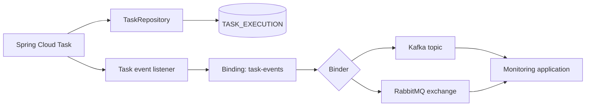
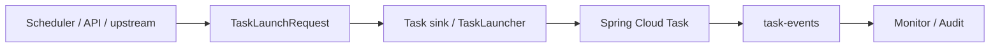
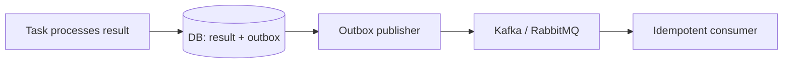

# Spring Cloud Stream Integration and Binder Selection

## 1. Why Does Spring Cloud Task Need to Emit Events?

**Spring Cloud Task** helps build Spring Boot applications with a finite runtime: start up, perform a task, and terminate. Each run is tracked by `TaskExecution` and stored in the database via **`TaskRepository`**. The system can know the start time, end time, exit code, and error information even after the Java process has stopped.

However, not every system interested in the result should continuously poll the `TASK_EXECUTION` table. For example:

- A monitoring service needs to receive notifications when a task starts or finishes.
- An auditing system needs to know how a data synchronization batch ran and ended.
- An orchestration service needs to continue a workflow after receiving the execution result.
- A reporting system wants to aggregate events from multiple tasks running across multiple machines.

**Spring Cloud Stream** provides the **binder** abstraction to connect an application to a messaging system such as **Apache Kafka** or **RabbitMQ**. Spring Cloud Task can use Spring Cloud Stream to emit `TaskExecution` data as **events** on a binding named `task-events`.

After this lesson, you will be able to:

1. Distinguish between **TaskRepository storing state** and **Spring Cloud Stream emitting events**.
2. Add the `spring-cloud-stream` dependency along with a Kafka or RabbitMQ binder.
3. Configure the `task-events` binding, destination, JSON payload, and message broker address.
4. Understand when to choose Kafka, when to choose RabbitMQ, and how to configure when **multiple binders** are present.
5. Build a task application that emits events and a consumer that receives events.
6. Distinguish **emitting task lifecycle events** from **receiving messages to launch a task**, as well as Spring Batch events.
7. Handle broker connectivity issues, security, duplicate/lost messages, retries, and finite tasks exiting too early.

## 2. TaskRepository – Stream – Binder Architecture

The **`TaskExecution`** object describes a single Spring Cloud Task run; `TaskRepository` is where it is persistently recorded according to the database configuration. When the events feature is enabled and the environment has the required dependencies, a **task listener** publishes `TaskExecution` information to the logical channel `task-events` at **start time** and **end time**.



| Concept | Role |
| --- | --- |
| `TaskExecution` | Data about a run: ID, task name, timestamps, exit code, error info… |
| `TaskRepository` | Inserts/updates execution metadata into the database table. |
| **Task event listener** | Creates lifecycle messages based on `TaskExecution`. |
| `task-events` | **Logical binding/channel name** used by Spring Cloud Task to publish messages. |
| `destination` | External destination name, for example the `training.task-events` topic. |
| **Binder** | Spring Cloud Stream adapter that connects the binding to Kafka, RabbitMQ, or the corresponding middleware. |
| **Consumer** | Application that receives messages to write audit logs, display dashboards, or update workflow state. |

**Distinguishing binding and destination:** `task-events` is the binding name referenced by the code/framework. You can map it to a destination with a different name:

```yaml
spring:
  cloud:
    stream:
      bindings:
        task-events:
          destination: training.task-events
```

In a Kafka environment, the destination corresponds to a **topic**; in a RabbitMQ environment, it typically corresponds to an **exchange** managed by the binder. Changing the destination does not require changing the `task-events` binding name in Spring Cloud Task.

### 2.1. Distinguishing Event Timings

| Timing | Typically Observed Data | Limitations |
| --- | --- | --- |
| Start | Task name, start timestamp, execution details available at emission time | `endTime` and final outcome are not yet available. |
| End | End timestamp, exit code, and error details if any | Only present if the application goes through the shutdown lifecycle and the event is emitted successfully. |

The Spring Cloud Task documentation describes **two events** at start and end, rather than a single message for the entire run. Specific fields should be verified against the **`TaskExecution` version** and the serialized content. Do not assume every attribute such as `executionId` or `exitCode` is already populated in the start event.

> Do not confuse **having a record in TaskRepository** with **successfully sending to the message broker**. These are two separate operations; they do not automatically form an atomic transaction between the database and Kafka/RabbitMQ.

## 3. Conditions for Automatic Event Emission

According to the Spring Cloud Task 3.2 documentation, for the mechanism that emits `TaskExecution` via Stream to work, the application needs:

1. **Spring Cloud Task** configured with a finite task (e.g., an `ApplicationRunner`).
2. **`spring-cloud-stream`** on the classpath.
3. **At least one binder implementation**, such as `spring-cloud-stream-binder-kafka` or `spring-cloud-stream-binder-rabbit`.
4. Connection configuration to an **actual broker** and an appropriate destination/binding.

Property controlling the listener:

```yaml
spring:
  cloud:
    task:
      events:
        enabled: true
```

When you want to **disable Task event emission** while still continuing to record metadata:

```yaml
spring:
  cloud:
    task:
      events:
        enabled: false
```

`spring.cloud.task.events.enabled=false` only disables the listener that emits **Task** lifecycle events. It does **not** disable `TaskRepository`, does not stop `ApplicationRunner` execution, and does not automatically disable all **Spring Batch** events.

**Easily overlooked point:** Adding only `spring-cloud-stream` without a binder does not provide an actual messaging system; having a binder on the classpath when the broker is unreachable also does not mean events have been delivered successfully.

## 4. Choosing a Binder: Kafka or RabbitMQ?

Spring Cloud Stream uses the same abstraction, but the two middlewares deliver messages differently.

| Criterion | Kafka binder | RabbitMQ binder |
| --- | --- | --- |
| Dependency | `spring-cloud-stream-binder-kafka` | `spring-cloud-stream-binder-rabbit` |
| Typical destination | Kafka **topic** | RabbitMQ **exchange** |
| Consumption model | Consumer groups with offsets; data still in the topic can be re-read based on retention and offset policy | Exchange routes to queues, consumers pull from queues; replay requires appropriate storage/republish design |
| Better suited when | Need an event log, multiple independent consumer groups, replay capability, and high event volume | Need queue/exchange routing, AMQP integration, queue and worker control |
| Ordering | Ordered **within each partition**, not globally across the topic by default | Depends on queue, concurrency level, and delivery mode; strict ordering is not guaranteed by default |
| Operations | Manage topics, partitions, retention, offsets, Kafka security | Manage exchanges, queues, bindings, DLQs, TTL, and AMQP permissions |

**Choose Kafka** when the same `TaskExecution` stream needs to serve multiple system groups (audit, monitoring, analytics), when you want to replay events within the retention window, or when high throughput is required. **Choose RabbitMQ** when your organization already operates AMQP, needs exchange/queue routing, or primarily uses worker-queue consumption.

There is no "best" binder for every case. When choosing, consider existing infrastructure, operational permissions, event delivery SLAs, retry/retention, cost, and replay requirements. If you only need to check the status of a few tasks, querying `TaskRepository` may be simpler than building a full messaging system.

### 4.1. Choosing a Binder in Maven

For **Kafka**:

```xml
<dependency>
    <groupId>org.springframework.cloud</groupId>
    <artifactId>spring-cloud-stream</artifactId>
</dependency>
<dependency>
    <groupId>org.springframework.cloud</groupId>
    <artifactId>spring-cloud-stream-binder-kafka</artifactId>
</dependency>
```

For **RabbitMQ**, replace the Kafka binder dependency with:

```xml
<dependency>
    <groupId>org.springframework.cloud</groupId>
    <artifactId>spring-cloud-stream-binder-rabbit</artifactId>
</dependency>
```

Both binders do not need to be present together if the application only connects to one middleware. Use a **compatible Spring Cloud BOM** to manage versions; avoid manually forcing a Kafka/Rabbit binder version from a different Spring Cloud Stream generation than the core.

## 5. Spring Cloud Task Project Emitting Events to Kafka

The example uses **Java 17**, **Spring Boot 3.4.5**, **Spring Cloud 2024.0.2**, and a **Kafka broker** running at `localhost:9092`. The Boot–Cloud pair is an example from the same compatible generation; choose the corresponding versions if your project uses a different generation.

H2 stores Task metadata on disk so it can be cross-checked against messages. Kafka is used to receive events from the task. These two stores are **independent**.

```text
task-events-demo/
├── pom.xml
└── src/main/
    ├── java/com/example/taskevents/
    │   ├── TaskEventsApplication.java
    │   └── ImportTaskRunner.java
    └── resources/
        └── application.yml
```

### 5.1. `pom.xml`

```xml
<?xml version="1.0" encoding="UTF-8"?>
<project xmlns="http://maven.apache.org/POM/4.0.0"
         xmlns:xsi="http://www.w3.org/2001/XMLSchema-instance"
         xsi:schemaLocation="http://maven.apache.org/POM/4.0.0 https://maven.apache.org/xsd/maven-4.0.0.xsd">
    <modelVersion>4.0.0</modelVersion>

    <parent>
        <groupId>org.springframework.boot</groupId>
        <artifactId>spring-boot-starter-parent</artifactId>
        <version>3.4.5</version>
        <relativePath/>
    </parent>

    <groupId>com.example</groupId>
    <artifactId>task-events-demo</artifactId>
    <version>0.0.1-SNAPSHOT</version>

    <properties>
        <java.version>17</java.version>
    </properties>

    <dependencyManagement>
        <dependencies>
            <dependency>
                <groupId>org.springframework.cloud</groupId>
                <artifactId>spring-cloud-dependencies</artifactId>
                <version>2024.0.2</version>
                <type>pom</type>
                <scope>import</scope>
            </dependency>
        </dependencies>
    </dependencyManagement>

    <dependencies>
        <dependency>
            <groupId>org.springframework.cloud</groupId>
            <artifactId>spring-cloud-starter-task</artifactId>
        </dependency>
        <dependency>
            <groupId>org.springframework.boot</groupId>
            <artifactId>spring-boot-starter-jdbc</artifactId>
        </dependency>
        <dependency>
            <groupId>com.h2database</groupId>
            <artifactId>h2</artifactId>
            <scope>runtime</scope>
        </dependency>
        <dependency>
            <groupId>org.springframework.cloud</groupId>
            <artifactId>spring-cloud-stream</artifactId>
        </dependency>
        <dependency>
            <groupId>org.springframework.cloud</groupId>
            <artifactId>spring-cloud-stream-binder-kafka</artifactId>
        </dependency>
    </dependencies>

    <build>
        <plugins>
            <plugin>
                <groupId>org.springframework.boot</groupId>
                <artifactId>spring-boot-maven-plugin</artifactId>
            </plugin>
        </plugins>
    </build>
</project>
```

Here, **you do not need to write a Kafka producer manually**. Spring Cloud Task provides the task event listener; Spring Cloud Stream/binder maps the `task-events` channel to the broker.

### 5.2. `application.yml`

```yaml
spring:
  application:
    name: task-events-demo
  main:
    web-application-type: none
  datasource:
    url: jdbc:h2:file:./data/task-events-db;DB_CLOSE_ON_EXIT=FALSE
    driver-class-name: org.h2.Driver
    username: sa
    password: ""
  cloud:
    task:
      name: import-orders-task
      initialize-enabled: true
      closecontext-enabled: true
      events:
        enabled: true
    stream:
      bindings:
        task-events:
          destination: training.task-events
          content-type: application/json
          binder: kafka
      kafka:
        binder:
          brokers: localhost:9092
```

Explanation of each part:

| Configuration | Meaning |
| --- | --- |
| `spring.cloud.task.name` | Identifies the task; runs with the same name still have separate `TaskExecution` records. |
| `spring.cloud.task.events.enabled` | Enables the listener to emit lifecycle events. |
| `spring.cloud.stream.bindings.task-events.destination` | Kafka topic name to which the `task-events` binding maps. |
| `spring.cloud.stream.bindings.task-events.content-type` | Sets the payload type so JSON consumers can integrate easily. |
| `spring.cloud.stream.bindings.task-events.binder` | Selects the `kafka` binder for this binding. |
| `spring.cloud.stream.kafka.binder.brokers` | Kafka broker bootstrap address. |
| `spring.cloud.task.initialize-enabled` | Initializes the Task schema on H2 when practicing with a fresh DB. |

`web-application-type: none` prevents the application from starting an HTTP server. H2 is used in file mode to preserve metadata after the JVM exits; create the `data` directory before running. In production, use a durable database and manage schemas with migrations instead of letting multiple instances run DDL automatically.

Depending on the broker, you may need to **create the topic in advance** or allow the binder to provision it. In tightly controlled environments, administrators usually pre-create topics and grant produce/read permissions; applications should not have broker admin privileges by default.

### 5.3. Application Class

Create `TaskEventsApplication.java`:

```java
package com.example.taskevents;

import org.springframework.boot.SpringApplication;
import org.springframework.boot.autoconfigure.SpringBootApplication;
import org.springframework.cloud.task.configuration.EnableTask;

@SpringBootApplication
@EnableTask
public class TaskEventsApplication {

    public static void main(String[] args) {
        SpringApplication.run(TaskEventsApplication.class, args);
    }
}
```

### 5.4. Runner with Success and Failure Scenarios

Create `ImportTaskRunner.java`:

```java
package com.example.taskevents;

import org.springframework.boot.ApplicationArguments;
import org.springframework.boot.ApplicationRunner;
import org.springframework.stereotype.Component;

@Component
public class ImportTaskRunner implements ApplicationRunner {

    @Override
    public void run(ApplicationArguments args) throws Exception {
        System.out.println("[TASK] Starting order synchronization");

        try {
            Thread.sleep(1_000);
        } catch (InterruptedException interrupted) {
            Thread.currentThread().interrupt();
            throw interrupted;
        }

        if (args.containsOption("fail")) {
            throw new IllegalStateException("Simulated order synchronization failure");
        }

        System.out.println("[TASK] Synchronization completed");
    }
}
```

The task runs for about one second to make it easy to observe. When `--fail` is passed, the runner throws an **unhandled** exception so Spring Cloud Task can record a failed result. Do not catch the error and merely log it, because doing so easily causes metadata and events to falsely report success.

### 5.5. What Is Emitted?

When the Stream/binder environment is ready, a normal launch can publish two messages carrying `TaskExecution` state:

```text
Task starts
  -> TaskExecution at start -> task-events -> Kafka
Runner executes
Task completes
  -> TaskExecution at end -> task-events -> Kafka
```

The message **is not by default a custom event** with an `eventType = STARTED` or `FINISHED` field. Spring Cloud Task emits **`TaskExecution`**; the consumer must interpret the actual fields present in the payload, for example checking whether `endTime` is set and inspecting the exit code. If downstream systems need a stable business event schema, define a separate contract and transform the data at the integration layer.

## 6. Running and Observing Events on Kafka

### 6.1. Preparing the Infrastructure

You need a reachable Kafka broker at `localhost:9092`. Ensure the `training.task-events` topic exists or the binder has sufficient permissions to create topics in the test environment.

From the project directory:

```bash
mkdir -p data
mvn clean package
```

On PowerShell, you can use `New-Item -ItemType Directory -Force data` instead of `mkdir -p data`.

### 6.2. Start Observing the Kafka Topic

If the Kafka CLI is available in your environment, open a separate terminal:

```bash
kafka-console-consumer.sh \
  --bootstrap-server localhost:9092 \
  --topic training.task-events \
  --from-beginning
```

Executable names and paths may differ between directly installed Kafka, containers, and operating systems. `--from-beginning` reads records still retained according to retention policies and does not guarantee infinite historical events.

### 6.3. Run the Successful Task

In another terminal:

```bash
java -jar target/task-events-demo-0.0.1-SNAPSHOT.jar
```

Business log:

```text
[TASK] Starting order synchronization
[TASK] Synchronization completed
```

The Kafka consumer expects to receive **two records for a normal run**: one at the start and one at the end. The exact JSON content depends on the Task version and message conversion; fields typically reflect `taskName`, `executionId`, `startTime`, `endTime`, or `exitCode` at the time of emission.

**Simplified illustrative example** (not a guaranteed JSON schema across all versions):

```json
{"taskName":"import-orders-task","executionId":42,"startTime":"...","endTime":null}
{"taskName":"import-orders-task","executionId":42,"startTime":"...","endTime":"...","exitCode":0}
```

**Do not use the illustrative JSON as a strict field-by-field assertion baseline.** Inspect the actual payload via the Kafka consumer and compare it with the `TaskExecution` read from `TaskRepository`. The same run should share the corresponding identifier once that identifier has been assigned.

### 6.4. Run the Failure Scenario

```bash
java -jar target/task-events-demo-0.0.1-SNAPSHOT.jar --fail
```

Expected behavior: the runner throws `IllegalStateException`, the framework records the failed run, and when error handling passes through the end callback, the final event describes the failed result. However, **the final event is not guaranteed to arrive** if the JVM is killed, fails too early during startup, or cannot send to the broker.

**Important:** A start record may appear without an end record. Do not let the consumer implicitly treat this case as success; use timeouts and cross-check with `TaskRepository`/scheduler when confirmation is needed.

## 7. Building a Consumer to Receive `TaskExecution`

The Task producer can be very short-lived. The consumer should run as a **separate, longer-lived service**—do not let an always-on Kafka consumer keep the finite task's own JVM alive indefinitely.

Suppose the consumer application also uses compatible `spring-cloud-stream` and `spring-cloud-stream-binder-kafka`. Define a Spring Cloud Function:

```java
package com.example.taskmonitor;

import java.util.Map;
import java.util.function.Consumer;

import org.springframework.context.annotation.Bean;
import org.springframework.context.annotation.Configuration;

@Configuration
public class TaskMonitorConfiguration {

    @Bean
    public Consumer<Map<String, Object>> taskEventConsumer() {
        return event -> {
            Object taskName = event.get("taskName");
            Object executionId = event.get("executionId");
            Object endTime = event.get("endTime");

            String phase = (endTime == null) ? "START_OR_UNKNOWN" : "END";
            System.out.println("[EVENT] task=" + taskName
                    + ", execution=" + executionId
                    + ", phase=" + phase);
        };
    }
}
```

Consumer configuration:

```yaml
spring:
  application:
    name: task-event-monitor
  cloud:
    function:
      definition: taskEventConsumer
    stream:
      bindings:
        taskEventConsumer-in-0:
          destination: training.task-events
          group: task-audit-service
          content-type: application/json
          binder: kafka
      kafka:
        binder:
          brokers: localhost:9092
```

`taskEventConsumer-in-0` is the **input binding name** generated according to Spring Cloud Stream's functional model. It is **different from** `task-events` — the output binding used by Spring Cloud Task. The two applications coordinate because they share the **same destination** `training.task-events`, not because their binding names match.

**Contract safety note:** The example consumer handles `Map<String,Object>` to avoid requiring the `TaskExecution` class on the receiving classpath, but how JSON is converted to a Map depends on content-type configuration and converters. In a real system, verify the `content-type` value, actual serialization, timestamp format, field names, potential `null` values, and dead-letter/error message handling. If a strict contract is required, deserialize the message into a versioned DTO.

### 7.1. Consumer Groups and Multiple Receiving Applications

With Kafka:

- Two instances of the **same consumer group** generally share partitions: used to scale one type of processing.
- Two **different consumer groups** can read the same topic independently, for example `task-audit-service` and `task-dashboard-service`.
- Offsets, retention, and partition counts affect replay capability, though consumer groups themselves do **not guarantee** exactly-once processing.

With RabbitMQ, consumers in the same group typically share a queue according to the binder's setup; different groups typically have separate queues bound to the exchange. Do not directly apply Kafka offset concepts to RabbitMQ.

## 8. Switching from Kafka to RabbitMQ

To use RabbitMQ, replace the Kafka binder dependency with:

```xml
<dependency>
    <groupId>org.springframework.cloud</groupId>
    <artifactId>spring-cloud-stream-binder-rabbit</artifactId>
</dependency>
```

And use this configuration:

```yaml
spring:
  rabbitmq:
    host: localhost
    port: 5672
    username: guest
    password: guest
  cloud:
    task:
      events:
        enabled: true
    stream:
      bindings:
        task-events:
          destination: training.task-events
          binder: rabbit
          content-type: application/json
```

The `guest/guest` example is only suitable for **local RabbitMQ used for practice**; many RabbitMQ deployments restrict the `guest` account to localhost logins only. Production must use dedicated credentials, TLS, and exchange/queue permissions.

In RabbitMQ, the destination is mapped by the binder to an exchange/binding according to the Rabbit binder's mechanism. A consumer with a `group` may be provisioned with a durable queue by the binder depending on configuration. **Changing only the YAML while keeping the Kafka binder** or having the RabbitMQ broker stopped will not produce a valid event flow.

### 8.1. Comparing the Two Binders' Configurations

| Component | Kafka | RabbitMQ |
| --- | --- | --- |
| Maven dependency | `spring-cloud-stream-binder-kafka` | `spring-cloud-stream-binder-rabbit` |
| Binder selection | `binder: kafka` | `binder: rabbit` |
| Broker | `spring.cloud.stream.kafka.binder.brokers` | `spring.rabbitmq.host` and AMQP properties |
| Destination | Topic | Exchange/queue binding depending on data direction |
| Consumer checkpoint | Per-group offset | Ack/queue delivery via AMQP mechanisms |

When switching binders, review operational parameters again: retry, consumer groups, DLQ, message size limits, provisioning, and delivery guarantees. The abstraction enables code reuse; it **does not make the two brokers completely equivalent**.

## 9. When Multiple Binders Are on the Classpath

If an application needs both Kafka and RabbitMQ, select the binder **explicitly** for each binding:

```yaml
spring:
  cloud:
    stream:
      bindings:
        task-events:
          destination: training.task-events
          binder: kafka
        notifications-out-0:
          destination: notifications
          binder: rabbit
      kafka:
        binder:
          brokers: kafka.internal:9092
  rabbitmq:
    host: rabbit.internal
    port: 5672
```

The `notifications-out-0` section merely illustrates **another output binding** if the application actually has functionality using it; declaring it in YAML does not automatically create a notification stream without a corresponding producer.

You can set a default binder for bindings that do not specify one:

```properties
spring.cloud.stream.defaultBinder=kafka
```

However, for applications with multiple middlewares, configuring `binder` on each binding is usually easier to audit. If you need to connect to **two different Kafka clusters** or **two different RabbitMQ brokers**, you must declare **named binder configurations** under `spring.cloud.stream.binders.*` with their own `environment` section. That is a different scenario from simply adding two different binder types to the classpath.

**Common error:** Having both binders on the classpath without declaring a default binder or a specific binder for `task-events`; Spring Cloud Stream may not know which binder to choose and fail when initializing the binding.

## 10. Distinguishing Event Emission from Launching Tasks via Messages

Spring Cloud Task supports two Stream integration styles with different goals:

| Integration Style | Input | Output | Purpose |
| --- | --- | --- | --- |
| **Task events** | Running Task application | `TaskExecution` emitted to `task-events` | Notifies external systems of **execution status**. |
| **Launching a task from a stream** | Message with `TaskLaunchRequest` payload | A task launched by TaskLauncher | Uses messages to **command a task to start**. |

`TaskLaunchRequest` can describe the artifact `uri`, `applicationName`, `commandLineArguments`, `environmentProperties`, and `deploymentProperties`. A **task sink** annotated with `@EnableTaskLauncher` can receive the request and deploy/launch the task according to the deployer configuration.



In this model, one message stream is used to **start tasks**, while another is used to **report that a task has started/finished**. The two streams should be designed as distinct destinations with separate access controls and message schemas. Do not send a `TaskLaunchRequest` message to the `task-events` topic expecting the task event listener to launch a task.

## 11. When a Task Also Runs Spring Batch

When a Spring Cloud Task application executes a **Spring Batch Job**, in addition to Task-level events, it can also emit Batch-level events:

| Spring Batch Listener | Default Binding/Destination Described in Task Docs |
| --- | --- |
| `JobExecutionListener` | `job-execution-events` |
| `StepExecutionListener` | `step-execution-events` |
| `ChunkListener` | `chunk-events` |
| `ItemReadListener` | `item-read-events` |
| `ItemProcessListener` | `item-process-events` |
| `ItemWriteListener` | `item-write-events` |
| `SkipListener` | `skip-events` |

Batch events require **Batch integration infrastructure** and the appropriate listeners; simply adding a normal task runner does not produce `job-execution-events` or `chunk-events`.

Example configuration changing the Step event destination:

```yaml
spring:
  cloud:
    task:
      batch:
        events:
          step-execution-events-binding-name: my-step-execution-events
    stream:
      bindings:
        my-step-execution-events:
          destination: training.batch-step-events
          binder: kafka
```

The snippet above demonstrates changing the **binding name** used by the Step listener, then mapping that binding to an actual destination. Supported properties and listener types vary across versions, so cross-check the documentation for the specific Spring Cloud Task and Stream versions you are deploying.

Disable **all** Batch events if not needed:

```properties
spring.cloud.task.batch.events.enabled=false
```

Disable only one event type, such as `chunk`:

```properties
spring.cloud.task.batch.events.chunk.enabled=false
```

Disabling Batch events does not necessarily disable `TaskExecution` events; the two groups are configured separately. Item- and chunk-level events can have **very high volume**, so you must consider broker cost, payload size, sensitive data, and the risk of slow emission hurting Job throughput.

## 12. Reconciling Events with `TaskRepository`

After the Task application exits, connect to the H2 file:

```text
JDBC URL: jdbc:h2:file:./data/task-events-db
User: sa
Password: (leave blank)
```

Relative URLs resolve against the exact working directory where the task ran; if your SQL client is opened from another directory, use an absolute path.

Query:

```sql
SELECT TASK_EXECUTION_ID,
       TASK_NAME,
       START_TIME,
       END_TIME,
       EXIT_CODE,
       ERROR_MESSAGE
FROM TASK_EXECUTION
ORDER BY TASK_EXECUTION_ID DESC;
```

Compare events against database records:

| Check | Meaning |
| --- | --- |
| `TaskExecution` record exists but no event seen | Check binder dependencies, broker, listener, destination, serialization, and error logs. |
| Start event exists but no end event | The task may still be running, was killed, failed on shutdown, or event emission failed; check DB and process status. |
| Two events describe the same execution | Could be a valid start/end pair; do not assume by default that the message was duplicated. |
| Two end events for the same execution | May involve retry/redelivery/producer behavior; the consumer must handle messages idempotently. |
| `EXIT_CODE` non-zero | The task failed as reported by the framework, even though an event may still be emitted. |

A monitoring system often needs a **state machine** keyed by `executionId` and status fields, such as `STARTED` → `COMPLETED`/`FAILED`. If an event arrives again, use an idempotency key combining `taskName`, execution ID, and the lifecycle phase derived from the payload to avoid creating duplicate fake runs.

## 13. Reliability When Emitting Events from Finite Tasks

The main concern is not merely writing valid YAML. **A task can terminate quickly**, whereas sending via a broker involves buffering, retries, flushing, reconnection, and asynchronous acknowledgments. Practical risks include:

1. **Broker unreachable** when the Task starts or ends.
2. **JVM exits too early** before the producer finishes sending messages.
3. **Listener fails to send the event** while Task state was already saved to the DB, or vice versa.
4. **Consumer receives duplicates** due to retry/redelivery mechanisms.
5. **Events arrive out of order** when multiple partitions or concurrent execution flows exist.
6. **The first message has `endTime = null`**, because it represents a running state, not a serialization bug.

Therefore, **do not treat event emission and writing to `TaskRepository` as an atomically committed transaction**. If your product requires every business change to have a corresponding event, consider the **transactional outbox** pattern:



In the outbox model, the application writes the business result and an outbox record within the **same transaction on a single database** (when business logic allows), and a separate publisher sends and marks them as published. This approach requires additional infrastructure but avoids relying on the task staying alive long enough to deliver its final event itself. **An outbox is not automatically provided** just by enabling `spring.cloud.task.events.enabled`.

### 13.1. Contract Control and Security

- Define the event schema/version, required fields, and timestamp representation (prefer explicit UTC).
- Do not let consumers infer success from the **mere presence of a message**; always inspect the final state.
- Do not pass passwords, API tokens, or personal data in task arguments, as metadata may be serialized into events and accessed by multiple consumers.
- Enable TLS/SASL for Kafka or TLS/AMQP authentication for RabbitMQ according to infrastructure policy.
- Grant producers permission only to **publish** to the necessary destination; consumers should only read from their assigned group/queue.
- Configure producer timeouts/retries and message size limits; monitor publisher errors and consumer lag.
- Consider keeping **`TaskRepository` as the authoritative source for status checks** when events are lost, delayed, or missing an end event.

### 13.2. Testing in Development Environments

When writing integration tests, you can use the **Spring Cloud Stream test binder** to verify bindings/payloads, or use Kafka/RabbitMQ Testcontainers to test the end-to-end path. The test binder does not fully simulate retention, acknowledgments, security, network timeouts, or real broker offsets.

For this lab, the most meaningful verification step is to run the JAR, observe the two events on the broker, query `TASK_EXECUTION`, and compare the same run.

## 14. Common Issues and Troubleshooting

| Symptom | Possible Cause | Resolution |
| --- | --- | --- |
| No messages on the topic | Missing binder, events disabled, or wrong destination | Check dependencies, `events.enabled`, `task-events` binding, and startup logs. |
| `No binder available` or binder not found | No valid `spring-cloud-stream-binder-...` | Add the appropriate binder dependency and version via the BOM. |
| Both Kafka and Rabbit present, app cannot choose | No default binder or per-binding binder configured | Set `binder: kafka/rabbit` or `spring.cloud.stream.defaultBinder`. |
| Cannot connect to Kafka | Wrong `brokers`, advertised listener address, or ACLs | Check bootstrap servers, network, advertised listeners, SASL/TLS, and topic permissions. |
| Cannot connect to RabbitMQ | Wrong host, port, credentials, or vhost | Check AMQP, TLS, exchange/queue permissions, and firewall. |
| Events in topic but consumer not receiving | Wrong group, destination, offset, or consumer not running | Verify `taskEventConsumer-in-0` binding, Kafka group, and offset. |
| Consumer JSON conversion error | Content type or DTO/payload mismatch | Inspect actual payload, `content-type` configuration, and message converter. |
| Start event present, end event missing | Task still running, killed, or end event failed to send | Check DB, process, scheduler, producer logs, and design timeout/reconciliation. |
| Multiple events for the same execution | Two lifecycle points or redelivery | Distinguish start/end; consume idempotently by execution + state. |
| Too many Batch events increasing load | Item/chunk listeners enabled in a large job | Enable only the event groups actually needed and monitor throughput. |
| Task keeps JVM alive unusually long | Consumer or long-lived producer thread configured inside the Task itself | Run the consumer separately, manage sender lifecycle, and ensure finite task termination. |

When diagnosing, check along the chain: **Task has `TaskExecution` → event listener enabled → `task-events` binding exists → binder selected → broker receives message → consumer reads the right destination/group**. This helps pinpoint failures at the right layer instead of only patching data in the repository.

## 15. Practice and Self-Check Questions

### Exercise 1: Emit Task Events via Kafka

1. Create the `task-events-demo` project with Maven and the configuration above.
2. Ensure the Kafka broker is running and the `training.task-events` topic exists.
3. Run the task successfully and observe the messages at start and end.
4. Query `TASK_EXECUTION` to compare the results.
5. Run again with `--fail` and inspect the failure event/metadata.

### Exercise 2: Swap Binders

Replace the Kafka dependency with the Rabbit binder and configure the RabbitMQ connection. Keep the `task-events` binding name, but observe the external destination under RabbitMQ's exchange/queue model. Explain why `ImportTaskRunner` code does not need to change.

### Exercise 3: Multiple Consumers and Duplicate Handling

Create two independent Kafka consumer groups: one group writing audit logs and one updating a dashboard. Design an idempotency key so that redelivery of the same end message does not create two false completions.

### Exercise 4: Broker Disruption

Simulate the broker being temporarily unreachable while the task runs. Inspect how the application reacts, the `TaskExecution` record remaining in the DB, error logs, and how the consumer system recovers state. Propose when an outbox or a reconciliation process is needed.

### Review Questions

1. How do `TaskRepository` and Spring Cloud Stream solve two different problems?
2. Is `task-events` a binding name or a mandatory topic name? Where do you configure it if you want to change the topic name?
3. Why is adding `spring-cloud-stream` without adding a binder not enough?
4. When should you choose Kafka vs. RabbitMQ for the `TaskExecution` stream?
5. Which configuration selects a binder when multiple binders are on the classpath?
6. Why must a consumer distinguish between start events and end events?
7. Does `spring.cloud.task.events.enabled=false` disable TaskRepository?
8. How does `TaskLaunchRequest` differ in purpose from a `TaskExecution` event?
9. Why does an emitted event neither prove task success nor guarantee exactly-once processing?
10. When integrating Spring Batch, how do `job-execution-events` differ from `task-events`?

**Remember:** **Spring Cloud Task** manages lifecycle and metadata; **Spring Cloud Stream** delivers events via the `task-events` binding; the **binder** determines how to connect to Kafka, RabbitMQ, or a specific middleware. Choose the binder based on operational needs, distinguish bindings from destinations, inspect actual payloads, and design idempotent consumers. When high reliability is required, treat `TaskRepository` as the source of reconciliation and add a reconciliation mechanism or outbox instead of assuming every event will always arrive.

## References

- [Spring Cloud Task 3.2 — Spring Cloud Stream Integration](https://docs.spring.io/spring-cloud-task/reference/3.2/stream.html): `task-events`, binder requirement, `TaskExecution` events at start/end, TaskLaunchRequest, and Batch events.
- [Spring Cloud Stream 4.2 — Binder Detection](https://docs.spring.io/spring-cloud-stream/reference/4.2/spring-cloud-stream/binder-detection.html): how Stream detects binders from the classpath.
- [Spring Cloud Stream 4.2 — Multiple Binders](https://docs.spring.io/spring-cloud-stream/reference/4.2/spring-cloud-stream/multiple-binders.html): choosing a default binder or per-binding binder.
- [Spring Cloud Stream — Kafka Binder Usage](https://docs.spring.io/spring-cloud-stream/reference/kafka/kafka-binder/usage.html): Kafka dependencies and topic/consumer group concepts.
- [Spring Cloud Stream — RabbitMQ Binder](https://docs.spring.io/spring-cloud-stream-binder-rabbit/docs/current/reference/html/spring-cloud-stream-binder-rabbit.html): AMQP connectivity and exchange/queue model.
