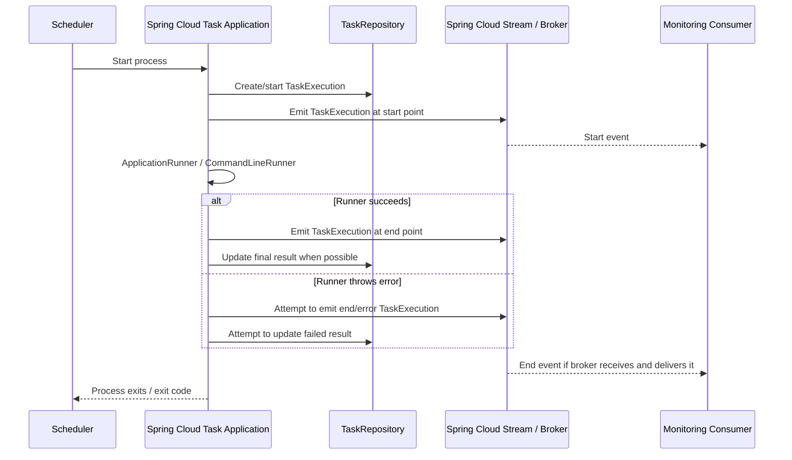

# Emitting TaskExecution at Start and End

## Lesson Objectives

In **SPRING_CLOUD_TASK (Spring Cloud Task)**, a Spring Boot application performs a **finite** unit of work and then terminates. The framework stores the history of each run in `TaskRepository` as a `TaskExecution`: task name, ID, start and end times, exit code, and error information. This supports running tasks on a schedule or on demand, troubleshooting failures, and coordinating with Spring Batch.

However, a dashboard or monitoring system in another process does not necessarily want to continuously poll the database to know when a task has just started or finished. **Spring Cloud Task Events** addresses that notification need by **emitting the `TaskExecution` object via Spring Cloud Stream when a Task starts and when a Task ends**.

This lesson in the **Events** chapter helps you:

- Distinguish a record in `TaskRepository` from a `TaskExecution` message sent via a broker.
- Explain the two event emission points, along with the `task-events` channel and the data observable at each point.
- Add Spring Cloud Stream dependencies, a binder, and version-compatible output binding configuration.
- Write a finite Task application that emits events and an independent consumer that receives events.
- Enable/disable event emission with `spring.cloud.task.events.enabled`.
- Reconcile information from the broker, database, and orchestrator; handle duplicate, missing, late, or failed-to-publish events.
- Distinguish Task events from Spring Boot `ApplicationEvent` and Spring Batch events.

## 1. What Are Task Events Used For?

A Task may run on a personal machine, in a container, or as a Kubernetes Job. Several related systems need near-real-time notifications:

- Monitoring screens displaying "running", "finished", or "failed".
- Log/metrics collectors recording duration and failure counts.
- Orchestration services tracking runs that just started, just finished, or timed out.
- Downstream systems receiving a signal to check conditions for continuing processing.

Event emission should not be treated as a replacement for `TaskRepository`. The two components serve different purposes:

| Component | Question It Answers | Durability and Limitations |
| --- | --- | --- |
| `TaskRepository` | "What is this run's ID, final status, and how is error info stored?" | Stores metadata in the configured database; requires schema and a working connection. |
| `TaskExecution` event | "What change related to a Task lifecycle just occurred?" | Message via Spring Cloud Stream/broker; may arrive late, duplicate, or go missing if event infrastructure fails. |
| Scheduler / Kubernetes Job | "Was the process actually created, retried, timed out, or killed?" | Tracks processes and resources on the deployment platform. |
| Business result | "Are the report/file/data correct?" | Must be verified separately; exit codes or success events do not validate business correctness on their own. |

For example, `daily-report-task` generates the daily report for `2026-11-23`: the dashboard can transition to "processing" upon receiving the first event, transition to "finished" upon receiving the final event, and then read `TaskRepository` or an admin API to confirm the status was persisted. If the final event does not arrive, the dashboard still needs a way to reconcile status from the database and scheduler.

## 2. Two `TaskExecution` Emission Points

The Spring Cloud Task documentation describes a listener that emits `TaskExecution` to a channel named **`task-events`** at the **start** and **end** of each Task execution when Spring Cloud Stream integration conditions are met.



**The diagram shows logical order, not a strict guarantee of the exact commit order of each operation.** Events are emitted through lifecycle listeners. In some execution paths, the end-point listener is invoked **before** the final update to `TaskRepository`; a consumer receiving the event might query the database immediately and not yet see `END_TIME` or the committed final result. Verify the actual behavior of the version you use if this affects your system.

### Comparing Data at Both Timings

| `TaskExecution` Attribute | Start Event | End Event |
| --- | --- | --- |
| `executionId` | Already identifies the run when Task initialization succeeds. | **Same ID** as the start event. |
| `taskName` | Job name, e.g., `daily-report-task`. | Usually unchanged. |
| `startTime` | Start timestamp has already been determined. | Still the start timestamp of this run. |
| `endTime` | Usually not set yet (`null`). | May be populated when going through the normal completion path. |
| `exitCode` | No final conclusion yet or using initial value. | Reflects the expected technical result; metadata persistence and actual exit code must be verified. |
| `exitMessage` / `errorMessage` | Usually no completion info yet. | May include completion/error context if the framework reaches the corresponding hook. |

Do not treat this table as a rigid serialization contract for every release. `TaskExecution` is the **same object type** sent at two moments, not two separate `TaskStartedEvent` and `TaskCompletedEvent` classes in the documented API. Values may be `null`, and serialization format may vary by converter and version.

**Illustrative example**, the ID and JSON below are simulated for clarity:

```json
{
  "executionId": 8421,
  "taskName": "daily-report-task",
  "startTime": "2026-11-23T02:00:00",
  "endTime": null,
  "exitCode": null
}
```

Upon completion, a message for the same ID may be received:

```json
{
  "executionId": 8421,
  "taskName": "daily-report-task",
  "startTime": "2026-11-23T02:00:00",
  "endTime": "2026-11-23T02:00:08",
  "exitCode": 0
}
```

The actual payload may also include arguments, error messages, external execution ID, and other `TaskExecution` fields. This is a **minimal sample for explanation**, not a mandatory standard JSON schema. Capture a real message from the broker to inspect field names, timestamp formats, content type, and sensitive-data masking policies.

## 3. Conditions for Automatic Event Emission

The Task events mechanism only works when the application has **actual Spring Cloud Stream integration**. Declaring `spring.cloud.task.events.enabled=true` alone does not establish a broker connection.

Typically required:

1. A Spring Boot application with Spring Cloud Task active and a finite runner.
2. The `spring-cloud-task-stream` integration module compatible with the Spring Cloud Task line in use.
3. Spring Cloud Stream and a **deployable binder** for the chosen broker, such as Kafka or RabbitMQ.
4. Valid broker/binding configuration, publish permissions, and network reachability to the broker.
5. An independent consumer if events need to be displayed or processed; the producer itself does not create a dashboard.

The Spring Cloud Task documentation highlights a classpath containing `spring-cloud-stream`, `spring-cloud-stream-<binder>`, and Task definitions; Spring Cloud Data Flow documentation also guides using `spring-cloud-task-stream`. For each version, inspect the dependency tree and actual auto-configuration conditions to ensure the **event-emitting module** is loaded.

### Maven Example with Kafka

In a project already managing **compatible Spring Boot and Spring Cloud BOMs**:

```xml
<dependencies>
    <dependency>
        <groupId>org.springframework.cloud</groupId>
        <artifactId>spring-cloud-starter-task</artifactId>
    </dependency>
    <dependency>
        <groupId>org.springframework.cloud</groupId>
        <artifactId>spring-cloud-task-stream</artifactId>
    </dependency>
    <dependency>
        <groupId>org.springframework.cloud</groupId>
        <artifactId>spring-cloud-stream-binder-kafka</artifactId>
    </dependency>
    <dependency>
        <groupId>org.springframework.boot</groupId>
        <artifactId>spring-boot-starter-jdbc</artifactId>
    </dependency>
    <dependency>
        <groupId>org.postgresql</groupId>
        <artifactId>postgresql</artifactId>
        <scope>runtime</scope>
    </dependency>
</dependencies>
```

This is a **reference dependency list**, not a complete POM: the BOM must manage the exact version of each artifact, including the `spring-cloud-task-stream` module. If an artifact is not managed by the BOM, pin its version from compatible release metadata/POMs rather than guessing version numbers. Artifacts and auto-configuration may differ depending on the Spring Cloud Task/Stream release line in use.

Kafka is only an illustrative choice. If using RabbitMQ, replace it with a compatible RabbitMQ binder and corresponding connection configuration. Adding multiple binders simultaneously may require specifying an explicit binder for the binding; do not leave broker selection to hard-to-control auto-detection.

## 4. Configuring the `task-events` Channel

Example for a producer with the **Spring Cloud Stream Kafka binder**:

```yaml
# application.yml
spring:
  application:
    name: daily-report-task
  main:
    web-application-type: none
  cloud:
    task:
      name: daily-report-task
      events:
        enabled: true
    stream:
      bindings:
        task-events:
          destination: task-events
          content-type: application/json
      kafka:
        binder:
          brokers: "${KAFKA_BROKERS:localhost:9092}"
```

`task-events` under `bindings` is the **binding/channel name used for Task events**; `destination` is the topic/target name on the broker. Matching names are just for readability, not a mandatory rule. When you need to publish to `ops-task-events`, configure:

```yaml
spring:
  cloud:
    stream:
      bindings:
        task-events:
          destination: ops-task-events
```

This is the binding name per the Task event integration in the Spring Cloud Task documentation. Do not rename it to `taskEvents-out-0` just because modern Spring Cloud Stream apps often use functional bindings; any name change must be based on the **actual publisher module**. Consumers using the functional model can use their own `<functionName>-in-0` binding.

In production, Kafka bootstrap servers, TLS/SASL, and broker credentials must be provided outside source code. Do not pass passwords into `spring.cloud.task.*` or the command line where they would appear in Task arguments metadata.

### Disabling Events When Not Needed

```yaml
spring:
  cloud:
    task:
      events:
        enabled: false
```

The `spring.cloud.task.events.enabled` property is documented and defaults to `true` when the appropriate event mechanism is present. Set it to `false` to disable the **listener emitting `TaskExecution`**. It does not stop the business task, does not delete `TaskExecution` records from the database, and does not automatically disable all Spring Batch event listeners or Spring Boot `ApplicationEvent`s.

**Missing a binder** or misconfiguring the broker is not equivalent to `enabled=false`: when event emission is requested but the binder does not work, the application may fail at startup or during message emission depending on the version and execution path. Check logs and the behavior of your deployed configuration.

## 5. Sample Task Application Emitting Events at Both Points

With working dependencies and bindings, a Task with a regular `ApplicationRunner` is enough for the framework to emit events; you do not need to manually add `streamBridge.send(…)` inside the runner just to duplicate the default events.

```java
package com.example.taskevents;

import java.time.LocalDate;
import java.util.List;

import org.slf4j.Logger;
import org.slf4j.LoggerFactory;
import org.springframework.boot.ApplicationRunner;
import org.springframework.boot.SpringApplication;
import org.springframework.boot.autoconfigure.SpringBootApplication;
import org.springframework.cloud.task.configuration.EnableTask;
import org.springframework.context.annotation.Bean;

@SpringBootApplication
@EnableTask
public class DailyReportTaskApplication {

    private static final Logger log =
            LoggerFactory.getLogger(DailyReportTaskApplication.class);

    public static void main(String[] args) {
        SpringApplication.run(DailyReportTaskApplication.class, args);
    }

    @Bean
    ApplicationRunner reportRunner() {
        return args -> {
            List<String> days = args.getOptionValues("businessDate");
            if (days == null || days.size() != 1) {
                throw new IllegalArgumentException(
                        "Exactly one --businessDate=yyyy-MM-dd is required");
            }

            LocalDate day = LocalDate.parse(days.get(0));
            log.info("Starting business processing for {}", day);

            // Illustration: replace with ReportService.generate(day).
            log.info("Completed business processing for {}", day);
        };
    }
}
```

The example uses a logger in place of business operations. When the application executes with properly configured database and binder, the Task process will:

1. Initialize Spring Boot and `ApplicationContext`.
2. Start managing `TaskExecution` and invoke the listener to emit the start event.
3. Run `reportRunner` with the business date.
4. Pass through the end hook, attempt to emit the final event, and write the result to metadata.
5. Exit the process when no resources/threads keep the JVM alive.

Do not use `@Scheduled` to keep the process waiting indefinitely if this is a finite task: cron, Kubernetes CronJob, or an orchestration platform should trigger **a new process for each run**. Each run will have its own `executionId`, even if `taskName` is the same.

### Test Run

```bash
java -jar target/daily-report-task.jar \
  --spring.profiles.active=local \
  --businessDate=2026-11-23
```

The JAR name and profile are examples; the `local` profile must be configured for your metadata database and test broker. Inspect the output of this process and the `task-events` topic. For a successful run, expect **two messages with the same execution ID** containing data from the two different timestamps.

Test an exception in the runner to observe the end/error event:

```java
// Illustrative line inside the runner, enable in tests only:
throw new IllegalStateException("Simulated report failure");
```

When the runner throws an unhandled error, Spring Boot and Spring Cloud Task go through the failure path. The framework **attempts** to emit an event at the end point and save the error into `TaskRepository`. Do not phrase this as "always emits both events": early startup failures, broker loss, JVM kills, or listener errors can prevent publishing.

## 6. Building an Independent Consumer to Receive `task-events`

An event-receiving application should be deployed **separately** from the Task producer; placing an HTTP listener or an indefinitely running message consumer inside the same Task may prevent the process from exiting after business work completes.

Example of a Spring Cloud Stream service using the **functional programming model**:

```java
package com.example.taskmonitor;

import java.util.Map;
import java.util.function.Consumer;

import org.slf4j.Logger;
import org.slf4j.LoggerFactory;
import org.springframework.context.annotation.Bean;
import org.springframework.context.annotation.Configuration;
import org.springframework.messaging.Message;

@Configuration(proxyBeanMethods = false)
class TaskEventConsumerConfiguration {

    private static final Logger log =
            LoggerFactory.getLogger(TaskEventConsumerConfiguration.class);

    @Bean
    Consumer<Message<Map<String, Object>>> taskEventSink() {
        return message -> {
            Map<String, Object> payload = message.getPayload();
            Object id = payload.get("executionId");
            Object endTime = payload.get("endTime");
            Object exitCode = payload.get("exitCode");

            if (id == null) {
                log.warn("Event missing executionId; check schema");
                return;
            }

            String phase = endTime == null ? "START" : "END";
            log.info("Received Task event: executionId={}, phase={}, exitCode={}",
                    id, phase, exitCode);
        };
    }
}
```

And the configuration **in the consumer application**, using the same broker but a separate input binding:

```yaml
spring:
  cloud:
    function:
      definition: taskEventSink
    stream:
      bindings:
        taskEventSink-in-0:
          destination: task-events
          group: task-monitoring
          content-type: application/json
      kafka:
        binder:
          brokers: "${KAFKA_BROKERS:localhost:9092}"
```

This consumer illustrates mapping JSON to a `Map`. **Actual schema and conversion must be tested**: another producer or binder version might use different field names/date formats, special headers, or a differently serialized payload. If the payload is a byte array/string instead of a Map, declare the appropriate content type and message converter; do not guess based on the `TaskExecution` class name.

Inferring `phase` from `endTime` is **illustrative only**. For production systems needing exact status, normalize the event into a DTO with an explicit `eventType`/`phase` field in the processing/relay layer, store the schema version, and only update status after reconciling with a trusted source.

### When You Don't Need a Java Consumer

You can use broker tools, an existing sink app, or a monitoring platform to consume the topic. For Kafka in a test environment, a quick check is reading records from the `task-events` topic with the Kafka CLI tool matching your broker version. If you receive binary data or unexpected JSON, check content-type and serializer settings rather than modifying production schemas based on guessed data.

## 7. Distinguishing Task Events from Other Event Types

In the Spring ecosystem, several mechanisms are all called "events":

| Type | Example | Scope | Must It Go Through a Broker? |
| --- | --- | --- | --- |
| **Spring Cloud Task event** | `TaskExecution` payload on `task-events` | Notifies other applications of Task lifecycle. | **Yes**, when using the Spring Cloud Stream/binder integration presented here. |
| **Spring Boot application event** | `ApplicationReadyEvent`, `ApplicationFailedEvent` | `ApplicationContext` startup/failure events. | **No**; in-process `ApplicationEvent` by default. |
| **`TaskExecutionListener` callback** | `onTaskStartup`, `onTaskEnd`, `onTaskFailed` | Hooks running inside the Task process. | **Not required**; the listener emitting Stream events is one implementation. |
| **Spring Batch event** | `job-execution-events`, `step-execution-events`, `chunk-events` | Detailed notifications about Batch Job/Step/chunk. | Depends on Stream integration and Batch listeners. |
| **Business event** | `ReportReady`, `InvoiceIssued` | Application-defined domain events. | Depends on architecture, usually with its own schema and reliability mechanism. |

A single Task failure can produce an in-process `ApplicationFailedEvent`, trigger the `onTaskFailed` callback, update `TaskExecution`, and attempt to publish a final event to `task-events`. **These are multiple manifestations of the same failure**, not a single mechanism providing cross-system transactional guarantees.

### When Spring Batch Is Present

If the Task runs a Batch Job, additional documented channels can be enabled, such as:

- `job-execution-events`: Job-level callbacks.
- `step-execution-events`: Step-level callbacks.
- `chunk-events`: chunk milestones.
- `item-read-events`, `item-process-events`, `item-write-events`, and `skip-events`.

The `spring.cloud.task.batch.events.enabled` property controls the **Batch events** group in supported versions, separate from `spring.cloud.task.events.enabled` for **Task events**. Do not use a Step event as proof that the entire Task has finished: a Task may contain multiple Jobs or additional Steps after the Step that just emitted an event.

## 8. Consistency, Ordering, and Event Loss

**`TaskRepository` and the broker do not share a transaction by default.** Updating the database and publishing an event are typically two operations against two different resources. The following scenarios must be anticipated:

| Scenario | Observable Behavior | How to Handle |
| --- | --- | --- |
| Consumer receives start event very quickly | Immediate DB query may not yet see all fields or committed transaction. | Retry query with short backoff; do not conclude non-existence on first read. |
| End event arrives before final DB update | Event says finished, but `END_TIME` or exit code in DB is not reflected yet. | Reconcile metadata and scheduler status; do not mark final based on event alone. |
| Broker loses connection when Task emits event | Message may not be sent or application logs publish error. | Monitor logs/binder errors; design separate retry and reconciliation. |
| JVM receives `SIGKILL`/node dies | End event may never be emitted. | Use timeouts, Job/Pod status, and reconcile against `TaskRepository`. |
| Consumer finishes processing before committing offset/ack | The same message may be redelivered. | Make consumer idempotent using an event key. |
| Multiple runs with the same Task name | Messages have the same name but different `executionId`. | Track by execution ID, not by Task name alone. |
| Two messages for same execution arrive out of order | Dashboard might overwrite "finished" with "running". | Use monotonic state transitions and reconcile against the authoritative source. |
| `ApplicationContext` initialization fails before Task lifecycle | May have neither metadata nor start event. | Monitor scheduler launch status, not only the topic. |

**Specifically:** In Kafka, ordering is only guaranteed **within the same partition**. If the producer does not use the same message key for both events of an execution, or the binder picks different partitions, the consumer cannot assume START is always processed before END in all scenarios. Even when broker order is stable, parallel consumers or replays still require rules against backward state updates.

### Recommended Consumer State Model

Suppose the consumer maintains a `task_event_status` table to power a dashboard:

```text
UNKNOWN --> START_OBSERVED --> END_OBSERVED
        \--------------------> END_OBSERVED
```

- Receive START when nothing exists yet: record "start observed".
- Receive END without having seen START: still record "end observed", then reconcile with DB.
- Receive START after END: do not regress status from END back to START.
- Receive duplicate of the same phase: accept without generating extra notifications or side effects.

If the final event has a non-zero `exitCode`, display it as **result observed from event** prior to verification. Separate "event received" from "metadata confirmed"; a single "success" status lacking a verification source is hard to investigate when the database or broker fails.

## 9. Idempotency and Consumer Event Storage Pattern

A consumer receiving Task events should not send an email or trigger a new pipeline directly from every message without a deduplication key. A reference key is:

```text
task-event:<executionId>:<phase>
```

For example, `task-event:8421:END` ensures **once-per-execution** processing. If the goal is "send only one notification for a business date's report even if rerun multiple times", use a **business** key such as `report:2026-11-23:ready`; execution IDs differ across reruns.

PostgreSQL example for recording observed events:

```sql
CREATE TABLE observed_task_event (
    event_key VARCHAR(160) PRIMARY KEY,
    task_execution_id BIGINT NOT NULL,
    event_phase VARCHAR(12) NOT NULL,
    observed_at TIMESTAMP NOT NULL DEFAULT CURRENT_TIMESTAMP
);

INSERT INTO observed_task_event (
    event_key, task_execution_id, event_phase
) VALUES (
    'task-event:8421:END', 8421, 'END'
) ON CONFLICT (event_key) DO NOTHING;
```

`ON CONFLICT` is PostgreSQL syntax; other databases have different upsert/unique handling. Ensure that recording receipt and executing critical side effects are designed within an appropriately scoped transaction or outbox process. Recording "processed" and crashing before sending the notification can drop the event; sending the notification and crashing before marking can cause duplicate delivery.

**There is no end-to-end exactly-once guarantee just because Spring Cloud Task emits events twice.** If publishing an event is business-critical, consider a transactional outbox emitted from business data or a relay mechanism after metadata verification; the receiving side must still be idempotent.

## 10. Security and Data Limits in `TaskExecution`

`TaskExecution` contains more than timestamps and exit codes. It can also contain `arguments`, `errorMessage`, and `exitMessage`. These fields can expose:

- Tokens or passwords if passed improperly via command line.
- Internal URLs or resource paths containing sensitive information.
- Detailed stack traces when a Task fails.
- Business data copied verbatim into the exit message.

When emitted to a broker, the data may be readable by more consumers than the metadata tables governed by database accounts. Therefore:

1. Do not pass secrets in Task arguments; use a secret manager or appropriate environment variables.
2. Grant publish and consume permissions on the `task-events` topic following least privilege.
3. Configure TLS/authentication and appropriate data retention policies on the broker.
4. Do not log full raw payloads in production logs if payloads contain stack traces or user parameters.
5. Consider a **normalized DTO event with sensitive fields filtered out** when integrating with multiple partners; do not expose raw `TaskExecution` unvetted.

## 11. How to Verify Event Emission and Actual State

For a Task using the default JDBC database, you can inspect the record after a run:

```sql
SELECT TASK_EXECUTION_ID,
       TASK_NAME,
       START_TIME,
       END_TIME,
       EXIT_CODE,
       EXIT_MESSAGE
FROM TASK_EXECUTION
WHERE TASK_NAME = 'daily-report-task'
ORDER BY TASK_EXECUTION_ID DESC;
```

This is illustrative SQL for common table/column names. When using a table prefix, different schema, or different metadata version, adjust the query to match the actual DDL.

### Test Matrix

| Test Case | Action | Expected Result to Verify |
| --- | --- | --- |
| Successful launch | Enable events, run a valid Task. | Receive start and end events with the **same `executionId`**; Task DB has final result. |
| Disable events | Set `spring.cloud.task.events.enabled=false` and rerun. | No two Task events from the listener for the new run; Task metadata is still recorded. |
| Business error | Runner throws an unhandled exception. | Failure log/exit code present; final event may include error if publish succeeds. |
| Broker unreachable | Use a test broker with connection failure. | Verify actual startup/publish behavior; detect errors via logs and monitoring. |
| Missing binder | Remove binder dependency in test environment. | Do not assume a working output channel exists; inspect auto-configuration. |
| Context init failure | Intentionally misconfigure a bean or DB. | Neither event nor `TaskExecution` may exist; scheduler still records process failure. |
| Abrupt process termination | Force-kill in an isolated environment. | End event may be missing; reconciliation tool detects timeout. |
| Consumer receives duplicate | Replay an already-received payload in test environment. | Status does not regress, side effects are not duplicated. |
| Two Tasks run closely together | Launch two runs with the same Task name but different IDs. | Do not mix events between the two runs; UI groups by `executionId`. |
| With Spring Batch | Run a Batch Job inside a Task and enable Batch events separately. | Distinguish `task-events` from `job-execution-events` and `step-execution-events`. |

Do not conclude success merely because two messages were read: a Task run might emit notifications while the final metadata persistence step failed, or business output might be wrong without the runner throwing an exception.

### Common Configuration Errors

| Symptom | Possible Cause | Troubleshooting Direction |
| --- | --- | --- |
| No events seen, though Task completed | Missing `spring-cloud-task-stream`, binder, or auto-configuration not activated. | Check dependency tree, condition evaluation report, `events.enabled`, and publisher logs. |
| Events sent to unexpected topic | `destination` of `task-events` binding overridden by profile. | Safely inspect binding info and check final resolved environment config. |
| Consumer fails to decode JSON | Content type, converter, or schema mismatch between versions. | Capture actual payload, compare headers, JSON fields, and message converters. |
| START event present, no END | Task crashed, final publish failed, or process was killed. | Check scheduler and `TaskRepository`; do not wait indefinitely. |
| Dashboard receives END then START | Delivery/replay/parallel consumers produced out-of-order delivery. | Store monotonic state per `executionId` alongside an idempotent event key. |
| Same event emitted twice | Consumer retry or unintended Task resend. | Distinguish runs by execution ID; deduplicate on the consumer. |
| Consumer handles Task and Batch with one schema | Confusing `TaskExecution` messages with `JobExecution`. | Separate topics/bindings/DTOs; validate schema and version. |

## 12. Comprehensive Practice Lab

**Scenario:** Build `daily-report-task` running every day at 02:00. A `task-monitor` application receives START/END notifications to update a dashboard; if the Task does not finish within 10 minutes, operations must see an alert, even if the broker drops the final event.

1. Create a Spring Cloud Task application with a runner accepting `--businessDate=yyyy-MM-dd`, running finitely, and persisting JDBC metadata to a test database.
2. Add `spring-cloud-task-stream` and a matching Kafka binder release; enable `spring.cloud.task.events.enabled=true`.
3. Configure the `task-events` binding and broker, and run the Task once successfully.
4. Read the topic and compare the two payloads with the same execution ID; identify which fields change between start and end.
5. Create the `task-monitor` consumer app with a `Consumer<Message<Map<String,Object>>>` bean and `taskEventSink-in-0` binding.
6. Persist state keyed by `executionId`, update monotonically so END never regresses to START, and add a unique event key to handle duplicates.
7. Make the runner throw an intentional exception; observe logs, end event, `TASK_EXECUTION.EXIT_CODE`, and scheduler exit code.
8. Test `events.enabled=false`, missing binder, and broker disconnection in a test environment; record the difference between "Task succeeded" and "event delivered".
9. Simulate a killed Task or missing end event, and use the scheduler and `TaskRepository` to detect timed-out runs.
10. Optional: add Spring Batch and distinguish Job/Step events from Task events; do not trigger downstream workflows from an unverified event alone.

**Acceptance criteria:** a normal Task run emits two notifications with the same execution ID; the consumer does not duplicate side effects on repeated events and does not regress state on late events; broker/process failures are detected by reconciling metadata and scheduler state; sensitive data is not pushed into messages.

## 13. References

- [Spring Cloud Task — Spring Cloud Stream Integration: Task Events](https://docs.spring.io/spring-cloud-task/reference/stream.html): emitting `TaskExecution` to `task-events` at start and end, dependencies/binders, and `spring.cloud.task.events.enabled`.
- [Spring Cloud Task — Features](https://docs.spring.io/spring-cloud-task/reference/features.html): `TaskExecution` lifecycle, `TaskRepository`, and Task listeners.
- [Spring Cloud Task — TaskExecution API](https://docs.spring.io/spring-cloud-task/docs/current/apidocs/org/springframework/cloud/task/repository/TaskExecution.html): metadata fields and methods to read ID/timestamps/exit code.
- [Spring Cloud Stream — Reference](https://docs.spring.io/spring-cloud-stream/reference/): binders, producer/consumer, functional binding, content types, and message handling.
- [Spring Cloud Data Flow — Subscribing to Task and Batch Events](https://docs.spring.io/spring-cloud-dataflow/docs/current/reference/htmlsingle/index.html): `spring-cloud-task-stream` example, default destinations, and how consumers receive events.

The examples apply to the documented general Spring Cloud Task/Stream model. **You must cross-check your project's Spring Boot, Spring Cloud Task, Stream binder versions, and serialization mechanism** before applying to production.

## Remember

- When Stream integration and a valid binder are present, Spring Cloud Task can emit **`TaskExecution` twice** on `task-events`: at start and at end.
- Two messages belonging to one Task run share the **same `executionId`**, but differ in status fields; the actual payload depends on version and message converters.
- `spring.cloud.task.events.enabled=false` disables Task event emission, **not** persisting `TaskExecution` in `TaskRepository`.
- An event is an **observational signal**, not guaranteed proof that the database committed or business logic succeeded. When events are lost, you must still reconcile Task metadata and scheduler state.
- Consumers must handle **duplicates, missing events, and out-of-order delivery** using idempotency keys and monotonic state transitions. Place guarantees for critical business data where proper transactions/outboxes exist.
- Task events differ from Spring Boot `ApplicationEvent`, local `TaskExecutionListener` callbacks, and Spring Batch Job/Step events. Distinguish event types accurately before orchestrating subsequent steps.
