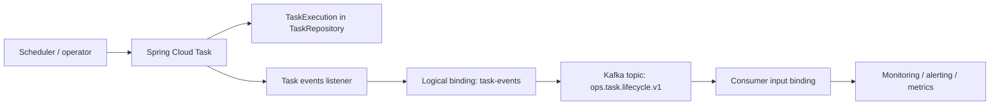
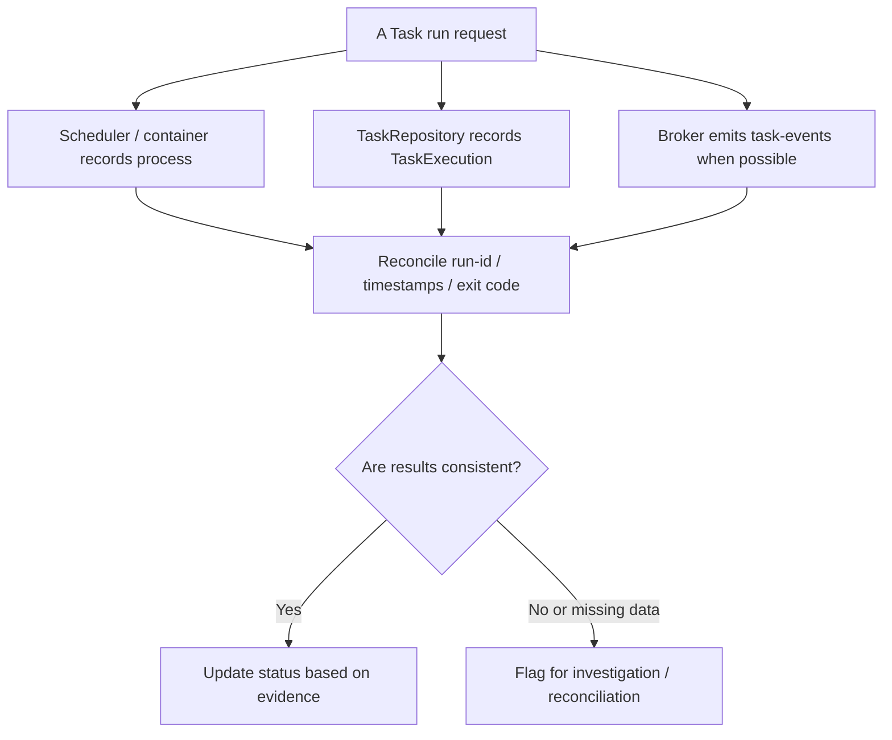

# Configuring the Destination for task-events

In the **Events** chapter of the **SPRING_CLOUD_TASK** module, we explore how to publish lifecycle information of a Spring Cloud Task application to a messaging system. Instead of only inspecting history in a database via `TaskRepository`, other systems can track when a task **starts** and **ends** by receiving events from Spring Cloud Stream.

Spring Cloud Task supports emitting `TaskExecution` information through a binding named **`task-events`**. This name often also serves as the default destination on the broker, but you can change the destination to route events to a centrally managed Kafka topic or RabbitMQ destination. The core mechanism is:

```properties
spring.cloud.stream.bindings.task-events.destination=ops.task.lifecycle.v1
```

In this example, **`task-events` is the binding name on the producing application side**, while **`ops.task.lifecycle.v1` is the actual destination** on the broker. The event-receiving service needs to point its own input binding to the same destination. If the two sides use different names, the applications may still run, but events will not reach the intended consumer.

## 1. Learning Objectives

After this lesson, you will be able to:

- Explain the differences between a task event, `TaskExecution`, a binding, and a destination.
- Enable Spring Cloud Task event emission when Spring Cloud Stream and a compatible binder are present.
- Keep the default destination `task-events` or assign a new name using `spring.cloud.stream.bindings.task-events.destination`.
- Configure a Spring Cloud Stream consumer to receive events from the right Kafka topic.
- Understand the role of `group` on the consumer, `contentType`, the broker, and connection properties.
- Distinguish task events from granular Spring Batch events.
- Diagnose causes of missing events: missing binder, wrong destination, wrong broker, payload type mismatch, or early process termination.
- Design monitoring capabilities, duplicate-processing avoidance, and safe reconciliation with `TaskRepository`.

## 2. What Is a Task Event?

A **task event** is a message containing `TaskExecution` data emitted by Spring Cloud Task's listener via Spring Cloud Stream. According to the documentation, when integration is configured properly, events can be emitted at **two main milestones** of a run:

1. **Start:** the framework has created the execution record and sends an event reflecting that the run has been recorded as started.
2. **End:** when the task completes or ends with an error and the listener is still active, the framework sends an event reflecting the final outcome.

For example, an application runs at 01:00 and finishes after 5 seconds. A monitoring system may receive two messages sharing the same `executionId`, yet the data at start time and end time differ. The start message typically does not yet have `endTime`; the end message may already have `endTime`, `exitCode`, and result details.

**This is not a business event** like `OrderCreated` or `InvoicePaid`. Task events provide metadata about a **finite application execution**. They do not replace output files, business tables, or verifying that an actual report is accurate and complete.

### Components in the Flow

| Component | Role |
| --- | --- |
| Spring Cloud Task | Manages lifecycle, creates/updates `TaskExecution`, provides event-emitting listener |
| Spring Cloud Stream | Abstracts input/output bindings between the application and middleware |
| `task-events` binding | Logical name of the output used by the Spring Cloud Task integration |
| Destination | Topic/exchange/target on the broker, e.g., `ops.task.lifecycle.v1` |
| Binder | Specific bridge to Kafka, RabbitMQ, or compatible middleware |
| Consumer | Application receiving events to log, build dashboards, alert, or feed workflows |
| `TaskRepository` | Source of execution metadata, which can be persisted in a JDBC database |



Going through a message broker enables other applications to receive near-real-time updates, while `TaskRepository` supports querying persisted executions. Do not assume these two sources always hold identical data at every instant.

## 3. Distinguishing Binding Name from Destination

In Spring Cloud Stream, each binding has an **in-application name**. The `destination` property determines which target on the middleware that binding connects to.

Example:

```yaml
spring:
  cloud:
    stream:
      bindings:
        task-events:
          destination: ops.task.lifecycle.v1
```

Interpretation:

- `task-events` under `bindings` is the **producer-side binding name** used by Spring Cloud Task.
- `ops.task.lifecycle.v1` is the **broker destination** you choose. With Kafka, this is the topic name.
- A consumer can name its binding according to its programming model; it does **not** need to call its binding `task-events`. It only needs to point to the same destination and use the right broker.

For instance, a modern consumer using a function bean `receiveTaskEvent` will have a default input binding of `receiveTaskEvent-in-0`:

```yaml
spring:
  cloud:
    function:
      definition: receiveTaskEvent
    stream:
      bindings:
        receiveTaskEvent-in-0:
          destination: ops.task.lifecycle.v1
          group: task-monitoring
```

Two different binding names, yet the same destination.

| Concept | Example | Where Configured |
| --- | --- | --- |
| Task output binding | `task-events` | Spring Cloud Task application side |
| Chosen Kafka topic | `ops.task.lifecycle.v1` | Pointed to by both producer and consumer |
| Consumer input binding | `receiveTaskEvent-in-0` | Receiving application side |
| Consumer group | `task-monitoring` | Consumer side; manages how instances share messages |

Do not rename the `task-events` key to `ops.task.lifecycle.v1` under `bindings`, because doing so configures **a different binding name** and the real binding may continue sending to the default destination.

## 4. Conditions for Spring Cloud Task to Emit Events

Simply adding `spring-cloud-starter-task` does not automatically establish an event stream to Kafka.

According to the Spring Cloud Task documentation, events integration requires Spring Cloud Stream components on the classpath, an **actual binder**, and a properly configured task application. Typical Maven dependencies on the producer side are:

```xml
<dependencies>
    <dependency>
        <groupId>org.springframework.boot</groupId>
        <artifactId>spring-boot-starter</artifactId>
    </dependency>

    <dependency>
        <groupId>org.springframework.cloud</groupId>
        <artifactId>spring-cloud-starter-task</artifactId>
    </dependency>

    <dependency>
        <groupId>org.springframework.cloud</groupId>
        <artifactId>spring-cloud-task-stream</artifactId>
    </dependency>

    <dependency>
        <groupId>org.springframework.cloud</groupId>
        <artifactId>spring-cloud-stream-binder-kafka</artifactId>
    </dependency>

    <dependency>
        <groupId>org.springframework.boot</groupId>
        <artifactId>spring-boot-starter-jdbc</artifactId>
    </dependency>

    <dependency>
        <groupId>com.h2database</groupId>
        <artifactId>h2</artifactId>
        <scope>runtime</scope>
    </dependency>
</dependencies>
```

Across different release lines, transitive dependencies and auto-configuration behavior may vary. Use compatible **Spring Boot BOM/parent** and **Spring Cloud BOM** to manage Task/Stream/binder versions; do not copy versions from arbitrary release trains and expect them to be compatible.

`spring-cloud-task-stream` is the Task–Stream integration module published by the Spring Cloud Task project. The JDBC/H2 portion in the example serves metadata persistence and experimentation, and is **not a prerequisite for Kafka to receive messages**. In production, use a durable JDBC database and a version-appropriate schema instead of in-memory H2.

### Controlling Event Listener Enablement

Property:

```yaml
spring:
  cloud:
    task:
      events:
        enabled: true
```

Spring Cloud Task supports `spring.cloud.task.events.enabled`; set it to `false` to disable Task event emission:

```properties
spring.cloud.task.events.enabled=false
```

**Do not confuse** this toggle with `spring.cloud.task.autoconfiguration.enabled`. Disabling the **Task event listener** is intended to stop publishing messages; it is not equivalent to disabling the entire `TaskExecution` recording infrastructure.

## 5. Spring Cloud Task Producer Example

Suppose you want every run of the `daily-summary-task` application to emit events to the Kafka topic `ops.task.lifecycle.v1`.

Create `src/main/java/com/example/task/TaskEventProducerApplication.java`:

```java
package com.example.task;

import java.time.LocalDate;
import java.util.List;

import org.springframework.boot.ApplicationRunner;
import org.springframework.boot.SpringApplication;
import org.springframework.boot.autoconfigure.SpringBootApplication;
import org.springframework.cloud.task.configuration.EnableTask;
import org.springframework.context.annotation.Bean;

@SpringBootApplication
@EnableTask
public class TaskEventProducerApplication {

    public static void main(String[] args) {
        SpringApplication.run(TaskEventProducerApplication.class, args);
    }

    @Bean
    ApplicationRunner dailySummary() {
        return arguments -> {
            List<String> values = arguments.getOptionValues("businessDate");
            if (values == null || values.size() != 1
                    || values.get(0).isBlank()) {
                throw new IllegalArgumentException(
                        "Must pass --businessDate=YYYY-MM-DD");
            }

            LocalDate date = LocalDate.parse(values.get(0));
            System.out.println("Completed summary for date " + date);
        };
    }
}
```

Key points to note:

- `ApplicationRunner` performs a finite piece of work.
- `@EnableTask` enables lifecycle configuration following the common pattern; applications on Spring Cloud Task releases with auto-configuration may not need to declare this annotation manually. Do not add duplicate lifecycle configurations.
- There is no need to call `StreamBridge.send(...)` inside the runner to emit lifecycle events **if the Task–Stream listener has been configured successfully**.
- When the task runs, the listener emits `TaskExecution` at the framework-supported milestones; the runner code stays focused on business logic.
- Do not add a loop keeping the application running forever to "wait for the consumer". A task has a finite lifetime; consuming messages belongs to a separate application or system.

### Producer `application.yml`

```yaml
spring:
  application:
    name: daily-summary-task
  main:
    web-application-type: none

  datasource:
    url: jdbc:h2:mem:taskdb
    driver-class-name: org.h2.Driver
    username: sa
    password: ""

  cloud:
    task:
      name: daily-summary-task
      initialize-enabled: true
      events:
        enabled: true

    stream:
      bindings:
        task-events:
          destination: ops.task.lifecycle.v1
          contentType: application/json

      kafka:
        binder:
          brokers: localhost:9092
```

In this YAML file:

1. `task-events.destination` changes the event emission target from the default name to the `ops.task.lifecycle.v1` topic.
2. `contentType: application/json` clarifies the expected interchange format; the consumer needs a converter compatible with the payload of the running Task version.
3. `kafka.binder.brokers` points to a Kafka broker running on the development machine; in a real environment, replace it with the appropriate broker endpoint/cluster and security settings.
4. `spring.cloud.task.events.enabled` enables event emission when all conditions are satisfied.
5. H2 `mem:` only gives the example JDBC support and **does not retain history across subsequent JVM launches**.

For Kafka topics managed by an operations team, proactively pre-create topics and set appropriate partition/replica counts, ACLs, and retention policies. Avoid relying on binder auto-creation of topics in production.

### Running the Producer

Package the JAR with the Spring Boot Maven Plugin, using compatible dependency versions:

```bash
./mvnw clean package
java -jar target/daily-summary-task-0.0.1-SNAPSHOT.jar \
  --businessDate=2026-11-24
```

On Windows PowerShell, use `mvnw.cmd clean package` and enter the `java -jar` command on one line or use PowerShell's line-continuation syntax. The JAR filename depends on your actual `artifactId` and `version`.

The business log may print:

```text
Completed summary for date 2026-11-24
```

**The criterion for verifying event emission** is that messages appear on the right topic and the consumer receives payloads containing run information. Simply seeing the business log line **does not prove** the event was sent successfully.

## 6. Configuring the Application Receiving task-events

The receiving application can be a continuously running monitoring system. Unlike the Spring Cloud Task producer, the consumer typically needs to stay connected to receive many events across many task launches.

Java example using Spring Cloud Stream's **functional model**:

```java
package com.example.monitoring;

import java.util.Map;
import java.util.function.Consumer;

import org.springframework.boot.SpringApplication;
import org.springframework.boot.autoconfigure.SpringBootApplication;
import org.springframework.context.annotation.Bean;

@SpringBootApplication
public class TaskEventConsumerApplication {

    public static void main(String[] args) {
        SpringApplication.run(TaskEventConsumerApplication.class, args);
    }

    @Bean
    Consumer<Map<String, Object>> receiveTaskEvent() {
        return event -> {
            Object id = event.get("executionId");
            Object name = event.get("taskName");
            Object exitCode = event.get("exitCode");
            Object endTime = event.get("endTime");

            System.out.printf(
                    "taskId=%s task=%s exit=%s ended=%s%n",
                    id, name, exitCode, endTime);
        };
    }
}
```

The example uses `Map<String, Object>` so the consumer does not need the exact same version of the `TaskExecution` class. Field names such as `executionId`, `taskName`, etc. in the example illustrate how a `TaskExecution` **might be represented** as JSON; verify against the actual payload and serializer of your framework version. When the receiving system has a clear contract, you can move to a dedicated DTO with validation and versioning.

**Consumer-side dependencies** do not require `spring-cloud-task-stream` if only reading JSON messages; Spring Cloud Stream and a compatible Kafka binder are required. Maven example:

```xml
<dependencies>
    <dependency>
        <groupId>org.springframework.boot</groupId>
        <artifactId>spring-boot-starter</artifactId>
    </dependency>
    <dependency>
        <groupId>org.springframework.cloud</groupId>
        <artifactId>spring-cloud-stream-binder-kafka</artifactId>
    </dependency>
</dependencies>
```

### Consumer `application.yml`

```yaml
spring:
  application:
    name: task-event-monitor

  cloud:
    function:
      definition: receiveTaskEvent

    stream:
      bindings:
        receiveTaskEvent-in-0:
          destination: ops.task.lifecycle.v1
          group: task-monitoring
          contentType: application/json

      kafka:
        binder:
          brokers: localhost:9092
```

Things to note:

- `receiveTaskEvent-in-0` is the **input binding** created from the `receiveTaskEvent` function bean in the modern Spring Cloud Stream model.
- `destination: ops.task.lifecycle.v1` must match the producer's destination **exactly**, including letter case and separators.
- `group: task-monitoring` is the consumer group. In Kafka, multiple instances in the **same group** share topic records; if two independent services both need to receive all events, each service usually uses its own group.
- The consumer must connect to the **same Kafka cluster** the producer sends to, not merely the same topic name.
- Depending on configuration and converters, the payload may not automatically convert into a `Map`; if so, check content-type headers, serializers, and choose an appropriate DTO or byte array.

### When Does the Consumer Receive Events?

Suppose the monitor is already running and registered in its consumer group before the task emits events. The monitor can then see the start event followed by the end event for the same run. If the monitor only starts **after** the task finishes, replayability depends on **Kafka retention, offset/consumer group, and read policy**; you cannot assume messages will be received merely because the topic exists.

With the RabbitMQ binder, the destination typically maps to an exchange/binding per Rabbit's model. Consumer groups and queue provisioning have distinct semantics; consult the Rabbit binder documentation for your version.

## 7. Inspecting Directly with Kafka

To separate producer issues from consumer issues, you can inspect the topic directly with Kafka CLI tools (script paths depend on your installation).

Example with a local Kafka broker:

```bash
kafka-topics.sh \
  --bootstrap-server localhost:9092 \
  --list
```

Look for the `ops.task.lifecycle.v1` topic. If you are in a test environment and permitted to create topics, use the corresponding admin tool to configure appropriate partition and replication factor counts. Do not run topic-creation commands in production without administrative authorization.

To observe events directly from the topic:

```bash
kafka-console-consumer.sh \
  --bootstrap-server localhost:9092 \
  --topic ops.task.lifecycle.v1 \
  --from-beginning
```

The command above reads messages still within retention and continues waiting. This is an independent inspection tool that tells you **whether the broker actually has messages** before debugging Java consumer logic.

A message may look similar to this JSON:

```json
{
  "executionId": 1042,
  "taskName": "daily-summary-task",
  "startTime": "2026-11-24T01:00:00",
  "endTime": "2026-11-24T01:00:04",
  "exitCode": 0
}
```

This is only an **illustrative payload showing logical structure**, not a guaranteed format/field/type specification for every version. Inspect real messages because serializers, timestamp representations, enums, extra fields, and headers may differ.

In Kafka environments secured with TLS/SASL, CLI commands require appropriate client configuration and topic read permissions. Do not treat the `localhost:9092` example as a default production setup.

## 8. Changing the Destination Without Modifying Java Code

One benefit of Spring Cloud Stream is that the broker destination can be selected through configuration rather than hardcoded in runner or listener code.

Example switching to the `ops.task.lifecycle.prod.v1` topic:

**Producer:**

```properties
spring.cloud.stream.bindings.task-events.destination=ops.task.lifecycle.prod.v1
```

**Consumer:**

```properties
spring.cloud.stream.bindings.receiveTaskEvent-in-0.destination=ops.task.lifecycle.prod.v1
```

All involved applications must be deployed with consistent configuration. If you only update the producer, the old consumer will keep listening to the old topic and miss the new events.

You can pass properties via the command line when running the task:

```bash
java -jar daily-summary-task.jar \
  --spring.cloud.stream.bindings.task-events.destination=ops.task.lifecycle.prod.v1 \
  --businessDate=2026-11-24
```

**Do not confuse `task-events` in the property key with the new topic name.** Even after changing the destination, the logical binding of the Spring Cloud Task integration remains `task-events` per the documented contract.

If using **Spring Cloud Data Flow** to orchestrate tasks, the Data Flow documentation describes passing application properties when launching a task. Pay attention to the `app.<taskName>.` prefix for launch parameters in your Data Flow version; that is a rule for **passing properties through the orchestrator**, not a property name inside the Spring Cloud Task application itself.

## 9. Naming Destinations for Operational Clarity

A consistent destination convention helps avoid mixing events from dev, staging, and production or from incompatible payload versions.

Example:

| Environment | Destination | Purpose |
| --- | --- | --- |
| Local | `dev.task.lifecycle.v1` | Testing on the development broker |
| Staging | `staging.task.lifecycle.v1` | Integration and alerting tests |
| Production | `ops.task.lifecycle.v1` | General operational monitoring |
| New version rollout stream | `ops.task.lifecycle.v2` | Migrating payload contract on breaking changes |

These are **suggested naming conventions**, not mandatory names required by Spring Cloud Task.

You should also define:

- **Topic owner:** who is allowed to create topics, change retention, and grant producer/consumer permissions.
- **Data contract:** schema, version, and required fields.
- **Retention:** how long messages remain on the broker; whether it meets post-incident replay needs.
- **Volume:** runs and events emitted per day, payload size, and broker limits.
- **Authorization:** producers only write to allowed topics; consumers only read allowed topics.
- **Environment and task names:** whether names collide across environments and whether separate namespaces are needed.

Do not use the event topic as the sole long-term store for execution history if business requirements demand durable querying. JDBC `TaskRepository`, logs, and monitoring systems serve complementary roles.

## 10. Task Events vs. Spring Batch Events

When a Spring Cloud Task runs a **Spring Batch Job**, the framework may also emit events at the Job, Step, and item levels depending on modules, listeners, and configuration.

| Event Type | Default Destination in Docs | Meaning |
| --- | --- | --- |
| Task lifecycle | `task-events` | Start/end of an application execution |
| JobExecution | `job-execution-events` | Events of a Spring Batch Job |
| StepExecution | `step-execution-events` | Events of a Step |
| Chunk | `chunk-events` | Chunk-related events |
| Item read/process/write | `item-read-events`, `item-process-events`, `item-write-events` | Per-item operations |
| Skip | `skip-events` | Information on skipped items from listeners |

Do not send `task-events` and `job-execution-events` to the same destination just for "convenience" if consumers cannot distinguish the payloads. Doing so can cause schema mismatches, false alerts, and unnecessary message volume.

Changing Batch event destinations can use the corresponding binding configurations and version-specific Batch event properties. The `spring.cloud.task.batch.events.enabled=false` property disables the Batch event listener system; it is **not equivalent** to `spring.cloud.task.events.enabled=false`.

Spring Batch has `JobRepository` storing `JobExecution` and `StepExecution`; Spring Cloud Task has `TaskRepository` storing `TaskExecution`. Broker events are a separate notification channel. All three sources may need to be cross-checked when investigating incidents.

## 11. Common Errors When Configuring the Destination

| Symptom | Possible Cause | How to Check |
| --- | --- | --- |
| Task runs but Kafka topic is empty | Missing Task–Stream module or Kafka binder; listener disabled | Check dependencies, `spring.cloud.task.events.enabled`, condition logs |
| Default `task-events` topic has events but new topic does not | Typo in binding name for destination property or config not loaded | Check actual `spring.cloud.stream.bindings.task-events.destination` |
| Producer emits events but Java consumer prints nothing | Consumer points to wrong destination/group/cluster or JSON parsing fails | Read topic with Kafka CLI, verify consumer config and logs |
| Cannot connect to Kafka | Wrong host/port, DNS, broker ACLs, TLS/SASL, or network policy | Check endpoint, client auth, binder logs |
| Consumer receives event then throws `ClassNotFoundException` | Deserializer/converter tries to cast payload to a class missing from classpath | Use appropriate JSON/DTO, inspect headers and content type |
| Only start event is seen | Task killed abruptly, end listener didn't run, or producer failed to send | Check Job/Pod, exit code, logs, and `TaskRepository` |
| End event present without start event | Consumer started late, retention/offset behavior, or lost message | Check offset/group and producer logs |
| Multiple consumer instances only deliver each message to one instance | Instances share the same Kafka consumer group | Use distinct groups when each independent service needs every event |
| Same event processed multiple times | Broker/client redelivery, retries, consumer restarts | Design deduplication and idempotent processing |
| Events sent to wrong environment | Same topic name on a different broker cluster / wrong profile | Check broker endpoint, profile, env, and ACLs |

**Quick troubleshooting rules:** first verify that the producer has the listener enabled and connects to the right broker; next verify the topic actually receives events; finally inspect converters and consumer logic. Do not rewrite JSON parsing code before confirming messages actually reached the broker.

## 12. Events Do Not Replace TaskRepository and Process Checks

Spring Cloud Task is designed to record execution outcomes in `TaskRepository` when an appropriate data source is configured. Events only help **push** information to other systems.

Situations to keep in mind:

- **ApplicationContext creation fails early:** the task may not have created a `TaskExecution`, connected to the broker, or emitted any event.
- **JVM receives `SIGKILL` or runs out of memory:** the final event may never be emitted, even if part of the business logic already ran.
- **Metadata database failure:** the Task record may be missing or stale; events may also be affected depending on timing.
- **Broker connection lost:** the runner may succeed while the event never reaches the consumer; verify producer error policies and delivery behavior.
- **Consumer is down:** Kafka can retain messages per configured retention/offset, but that does not mean dashboards are updated immediately.
- **Zero exit code but wrong business output:** the end event does not prove report data is accurate.

You can use three observation sources:



Generate a `run-id` in the orchestrator before launching the application to correlate logs, container events, `TaskExecution`, and business outputs. `TASK_EXECUTION_ID` may only be assigned after Spring Cloud Task initializes, so it is insufficient to identify every **launch attempt**.

## 13. Security and Reliability When Emitting Events

In production, evaluate both the payload and the transport channel.

### 13.1. Message Content

A `TaskExecution` can contain the task name, arguments, results, and error info. Depending on configuration/schema, this data may expose sensitive information if the application places secrets in command-line arguments or error messages.

- Avoid putting tokens/passwords/PII in command-line arguments or `exitMessage`.
- Inspect actual payloads before granting broad consumer access.
- Apply clear schemas/versions for receiving applications in separate codebases.
- Do not log raw, unsanitized payloads in production.

### 13.2. Kafka Connectivity and Authorization

- Configure TLS/SASL when required by the broker; do not hardcode secrets in source repositories.
- Separate write-only producer ACLs and read-only consumer ACLs per designated topic.
- Set retention and partitions appropriate for traffic volume.
- Monitor publish failures, timeouts, consumer lag, and permission-denied alerts.

The `localhost:9092` broker endpoint example is for local use; production security settings cannot be inferred from this example.

### 13.3. Avoiding Duplicate Processing

A task typically emits **more than one event during the same run**, at minimum at start and end when integration is fully active. If a consumer deduplicates solely by `executionId`, it might accidentally drop the end event after saving the start event.

You can use a composite processing key such as **(taskExecutionId, lifecycle phase)**, where the phase is classified from the actual payload, or maintain controlled state updates per `executionId` comparing `startTime`/`endTime`. Test logic for redeliveries and out-of-order arrival; do not assume system-wide exactly-once or strict ordering.

### 13.4. No Guarantee of Final Event if the Process Dies

Direct lifecycle event emission is not automatically a transactional outbox. When a task is terminated mid-metadata update or before broker publish confirmation, events may be missing. If complete business event emission is mandatory, use a more reliable mechanism such as an outbox or an independent reconciliation service reading the repository and orchestrator state.

## 14. Practice Scenario: Changing Destination and Verifying

Carry this out in a development environment with Kafka running and topics appropriately managed.

1. **Start the consumer** with `destination=ops.task.lifecycle.v1`, `group=task-monitoring`; verify it connects to Kafka successfully.
2. **Start the producer** with the same destination and `--businessDate=2026-11-24`.
3. **Observe broker/consumer:** look for the start event and end event for the same execution if the program exits normally.
4. **Change the producer destination** to `ops.task.lifecycle.test.v1`, keeping the consumer listening to the old topic. Confirm that the consumer stops receiving new events as expected.
5. **Update the consumer destination** to the new topic, or start a separate consumer with a new group, then rerun the task to verify.
6. **Disable task events** with `--spring.cloud.task.events.enabled=false`. Verify the business program still runs without emitting Task events via the listener mechanism.
7. **Reconcile JDBC metadata:** with a durable database, inspect `TASK_EXECUTION` to distinguish whether the task ran from whether events reached the broker.

In the H2 `mem:` example from Section 5, history cannot be queried across exited JVMs. To perform step 7, switch to PostgreSQL or file-based H2 with the proper schema.

### Sample SQL Query

```sql
SELECT TASK_EXECUTION_ID,
       TASK_NAME,
       START_TIME,
       END_TIME,
       EXIT_CODE
FROM TASK_EXECUTION
ORDER BY TASK_EXECUTION_ID DESC;
```

Check the exact database/schema where the Task application actually writes metadata. Each new launch creates a new `TaskExecution`, even when the job's business key is identical.

## 15. Self-Check Questions

**Question 1.** In the configuration `spring.cloud.stream.bindings.task-events.destination=ops.task.lifecycle.v1`, which part is the binding name and which part is the destination? Why shouldn't you also replace `task-events` in the property key?

**Question 2.** The producer sends to Kafka topic `ops.task.lifecycle.v1`, while the consumer declares `receiveTaskEvent-in-0.destination=task-events`. Will the consumer necessarily receive events? What needs to be adjusted?

**Question 3.** Why does having `spring-cloud-starter-task` without a compatible binder not automatically make the application emit events to Kafka?

**Question 4.** A consumer receives an event with `executionId=1042` but no `endTime` yet. Should it mark the task as succeeded? Why or why not?

**Question 5.** If the producer is killed while sending an event, how might the data in `TaskRepository`, the broker, and the scheduler differ?

**Question 6.** In the Spring Cloud Stream function model, why does the consumer use the `receiveTaskEvent-in-0` binding instead of the output name `task-events`?

### Applied Exercises

**Exercise A — Environment-specific destinations.** Configure `application-dev.yml` to use `dev.task.lifecycle.v1` and `application-prod.yml` to use `ops.task.lifecycle.v1`. Verify that both producer and consumer load the intended profile.

**Exercise B — State monitoring.** Write a consumer that writes to a `task_observation` table keyed by execution ID and lifecycle phase. Design handling for duplicate events, late events, and end events without a preceding start event.

**Exercise C — Separating Batch events.** If a task runs a Spring Batch Job, configure separate topics for `task-events` and `job-execution-events`; explain why their payloads and monitoring purposes differ.

**Exercise D — Broker outage.** Simulate stopping the consumer in a test environment, then restarting it. Observe offset/group/retention behavior and compare with `TaskRepository` history; do not assume all messages will be recovered if retention has expired.

## 16. Remember

- Spring Cloud Task can emit **`TaskExecution` at start and end** via Spring Cloud Stream when dependencies, listeners, and a binder are properly configured.
- **`task-events` is the default logical binding name** for output; change the destination with **`spring.cloud.stream.bindings.task-events.destination`**.
- Producer and consumer must point to the **same broker and destination**. The consumer's input binding name can differ from `task-events`; for function `receiveTaskEvent`, the binding is typically `receiveTaskEvent-in-0`.
- `spring.cloud.task.events.enabled=false` disables the task-event-emitting listener; it does not disable all of Spring Cloud Task or delete stored metadata.
- Kafka consumer groups, JSON schemas, broker permissions, and retention directly affect event delivery and processing.
- Task events are a **notification channel**, not a replacement for `TaskRepository`, process status from the scheduler/container, or business success validation.
- Always account for missing end events, duplicate deliveries, late arrivals, and publish failures when tasks are short-lived processes.

## References

- [Spring Cloud Task Reference — Spring Cloud Stream Integration](https://docs.spring.io/spring-cloud-task/reference/stream.html): emitting `TaskExecution` via `task-events`, enabling/disabling listeners, and Batch events.
- [Spring Cloud Stream Reference — Binding Properties](https://docs.spring.io/spring-cloud-stream/reference/spring-cloud-stream/binding-properties.html): `destination`, `group`, `contentType`, and producer/consumer settings.
- [Spring Cloud Stream Reference — Binding Names](https://docs.spring.io/spring-cloud-stream/reference/spring-cloud-stream/binding-names.html): naming convention for function bindings `<functionName>-in-0`.
- [Spring Cloud Stream Reference — Kafka Binder Configuration](https://docs.spring.io/spring-cloud-stream/reference/kafka/kafka-binder/config-options.html): broker settings and Kafka binder properties.
- [Spring Cloud Data Flow — Subscribing to Task and Batch Events](https://docs.spring.io/spring-cloud-dataflow/docs/2.11.3/reference/htmlsingle/): subscribing example and changing destination via task launch properties.

When implementing, cross-check the versions of Spring Boot, Spring Cloud Task, Spring Cloud Stream, and the binder you are using. The `task-events` binding name and properties above follow the reference documentation, while module/dependency details, JSON conversion, shutdown behavior, and broker policies must be verified in your real environment.
