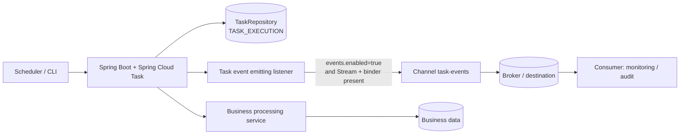
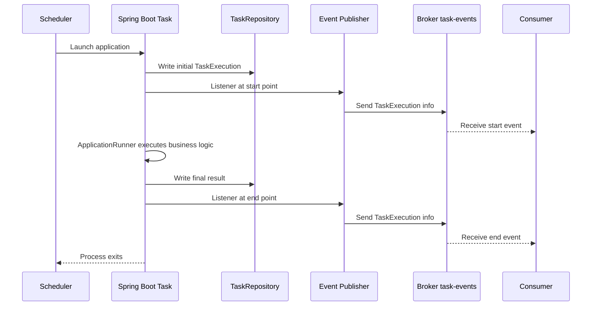

# Enabling and Disabling Task Events with `spring.cloud.task.events.enabled`

## 1. Problem Statement: Execution History or Near-Real-Time Notifications?

In the **Events** chapter of **Spring Cloud Task**, we consider a **finite-running Spring Boot application**: it accepts parameters, performs its work, updates `TaskExecution` in the database, and then exits. `TaskRepository` supports querying history later, but a monitoring system may also want to receive **notifications when a Task starts and when a Task ends** without continuously polling the database.

When integrated with **Spring Cloud Stream**, Spring Cloud Task can emit messages carrying `TaskExecution` data over the `task-events` channel. The property:

```properties
spring.cloud.task.events.enabled=true
```

controls enabling or disabling the **listener that emits these Task events**. The default value documented in Spring Cloud configuration reference is `true` in versions that support the property. However, **`true` does not automatically create a broker or an event stream**: the application still needs Spring Cloud Stream dependencies, a compatible binder, and valid connection configuration.

After this lesson, you will be able to:

1. Distinguish Task event messages from `TaskRepository` records, `TaskExecutionListener` callbacks, and Spring Application Events.
2. Configure `spring.cloud.task.events.enabled` via YAML, command line, and environment variables.
3. Identify the prerequisites for `TaskExecution` to actually be emitted on `task-events`.
4. Test both enabled and disabled modes and draw accurate conclusions when no messages appear.
5. Separate Task event configuration from Spring Batch events, Task–Batch association, and process status.
6. Design consumers, retries, monitoring, and security suited to finite-lived Task applications.

> **Key takeaway:** This property toggles **emitting Task events via Spring Cloud Stream**. It is **not** a kill switch for all of Spring Cloud Task, does not clear metadata tables, does not stop `ApplicationRunner` from running, and does not disable all custom Java listeners you wrote yourself.

## 2. Three Mechanisms Commonly Confused with One Another

| Mechanism | Where Data Appears | Purpose | Directly Controlled by `spring.cloud.task.events.enabled`? |
| --- | --- | --- | --- |
| **TaskRepository** | Metadata database such as `TASK_EXECUTION` | Creates/updates/queries history for each run | **No** |
| **Custom `TaskExecutionListener`** written by the app | Callbacks in the Java process | Logging, auditing, executing auxiliary hooks at Task milestones | **No**, except the listener **emitting Stream events** configured by the framework |
| **Task events via Spring Cloud Stream** | Message channel/broker, typically `task-events` | Notifies other applications about `TaskExecution` | **Yes** |
| **Spring Application Events** | Event multicaster in ApplicationContext | Framework lifecycle events or custom published Java events | **No** |
| **Batch events** | Channels such as `job-execution-events`, `step-execution-events` | Notifications about Spring Batch Job/Step/chunk/item | **Does not use this property** |

For example, when configured with `spring.cloud.task.events.enabled=false`, a reconciliation task can still create `TASK_EXECUTION_ID=3201`, write `START_TIME`, execute the reconciliation service, and update `END_TIME`/`EXIT_CODE`. Only the listener responsible for **emitting `TaskExecution` notifications to Stream** is disabled by this property, where supported by the framework.

### `TaskExecution` Is Not a "Control Command"

Events emitted by Spring Cloud Task are **execution status information**, not requests to automatically re-run the Task. A consumer receiving the message can update dashboards, emit metrics, or raise alerts, but it should not blindly assume "receiving an end event with an error code means immediately relaunching" without checking the actual state and business idempotency.



**Two purpose-independent data paths:** `TaskRepository` is durable persisted metadata; Stream events are signals sent to external systems. You must not infer that a Task did not run just because the broker has no message.

## 3. Exact Meaning of `spring.cloud.task.events.enabled`

The Spring Cloud Task documentation describes a listener that emits `TaskExecution` information to the `task-events` channel **when the Task starts and when the Task ends**. The property `spring.cloud.task.events.enabled=false` disables that **event-emitting listener**.

| Value | Expected Behavior When Dependencies and Bindings Are Valid | What Does Not Change |
| --- | --- | --- |
| `true` or omitted (per documented default) | Listener emits `TaskExecution` to Stream at start and end points | The Task still runs, writes to `TaskRepository`, and returns results per logic |
| `false` | Does not emit those **Task events** via the built-in listener | The Task still runs; `TaskRepository`, runners, and other listeners continue per their own config |
| `true` but missing Stream/binder | No guarantee of a message emission path, even with the property enabled | Task metadata can still persist normally if datasource/schema are valid |
| `true` but broker/binding failure | Messages may not appear, or the app may fail depending on messaging error configuration | Must inspect logs, connectivity, retries, and Task records; do not infer from the property alone |

Here, "enabled" means **allowing the event-emission feature**, not guaranteeing successful publishing/delivery. Broker, serialization, bindings, and network can still fail.

### Configuring in `application.yml`

```yaml
spring:
  cloud:
    task:
      events:
        enabled: false
```

Or directly in `application.properties`:

```properties
spring.cloud.task.events.enabled=false
```

### Overriding Per Launch

You do not need a new build just to toggle event mode. You can pass a Spring Boot command-line property:

```bash
java -jar task-events-demo.jar \
  --business-date=2026-11-24 \
  --spring.cloud.task.events.enabled=false
```

When you want to re-enable it:

```bash
java -jar task-events-demo.jar \
  --business-date=2026-11-24 \
  --spring.cloud.task.events.enabled=true
```

For containerized environments, you can set an environment variable:

```bash
export SPRING_CLOUD_TASK_EVENTS_ENABLED=false
java -jar task-events-demo.jar --business-date=2026-11-24
```

Spring Boot supports **relaxed binding**, mapping environment variables to properties. When the same property is declared in multiple sources, Spring Boot's configuration precedence determines the effective value; typically, command-line options override `application.yml` and environment variables. To keep troubleshooting straightforward, the orchestrator should establish **one primary configuration source** per environment.

## 4. Prerequisites for a Task to Emit Events

Having only `spring-cloud-starter-task` and setting the property to `true` is **not enough** to observe messages on the broker. For the mechanism described in the Spring Cloud Task documentation, you need:

1. A Spring Boot application with **Spring Cloud Task** and framework-managed Task logic.
2. The **Spring Cloud Stream** library on the classpath.
3. A **binder implementation** for an appropriate messaging system, such as RabbitMQ or Kafka, compatible with your release train.
4. Properly configured broker/binding connections and destination so the listener can publish to the `task-events` channel.
5. An actual consumer/monitoring endpoint listening on the right destination if you want to observe messages.

Example **Maven dependency snippet** when choosing the Rabbit binder, assuming `pom.xml` already manages compatible Spring Boot/Spring Cloud BOMs:

```xml
<dependencies>
    <dependency>
        <groupId>org.springframework.cloud</groupId>
        <artifactId>spring-cloud-starter-task</artifactId>
    </dependency>
    <dependency>
        <groupId>org.springframework.cloud</groupId>
        <artifactId>spring-cloud-stream</artifactId>
    </dependency>
    <dependency>
        <groupId>org.springframework.cloud</groupId>
        <artifactId>spring-cloud-stream-binder-rabbit</artifactId>
    </dependency>
    <dependency>
        <groupId>org.postgresql</groupId>
        <artifactId>postgresql</artifactId>
        <scope>runtime</scope>
    </dependency>
</dependencies>
```

These dependency snippets are **not a complete runnable project**: you need build plugins and version management. If choosing Kafka, use a compatible Kafka binder **rather than adding multiple binders arbitrarily at the same time**. Do not hardcode incompatible versions across Spring Boot, Spring Cloud Task, and Spring Cloud Stream.

### Binding and Destination

The Spring Cloud Task documentation refers to the channel used by the listener as **`task-events`**. The actual destination name on the broker depends on Spring Cloud Stream configuration. Example showing the binding name in the configuration style used by the Spring Cloud Task documentation:

```properties
spring.cloud.stream.bindings.task-events.destination=task-events
```

When working with newer Spring Cloud Stream versions, check the actual **framework-created binding name** and binder settings for your library version; the binding name may not always equal the destination after mapping layers or customization. Do not assume that setting the property above alone provisions the Kafka topic/Rabbit exchange and connects consumers properly.

**Running without a broker is a separate test case:** if you want to run the Task without connecting to a broker in a development environment, you can omit Stream/binder dependencies or disable Task event emission. However, if the same application has other Stream functionality, disabling only Task events **does not disable all of Spring Cloud Stream**.

## 5. Sample Application: A Finite Task with Toggleable Events

The example below does not rely on a hand-written application listener. Spring Cloud Task manages the lifecycle itself; when Stream integration is complete and the property is enabled, the framework's event-emitting listener handles sending.

```java
package com.example.taskevents;

import java.time.LocalDate;
import java.util.List;

import org.slf4j.Logger;
import org.slf4j.LoggerFactory;
import org.springframework.boot.ApplicationRunner;
import org.springframework.boot.SpringApplication;
import org.springframework.boot.autoconfigure.SpringBootApplication;
import org.springframework.cloud.task.configuration.EnableTask;
import org.springframework.context.annotation.Bean;

@SpringBootApplication
@EnableTask
public class TaskEventsDemoApplication {
    private static final Logger log =
            LoggerFactory.getLogger(TaskEventsDemoApplication.class);

    public static void main(String[] args) {
        SpringApplication.run(TaskEventsDemoApplication.class, args);
    }

    @Bean
    ApplicationRunner processBusinessDate() {
        return args -> {
            List<String> dates = args.getOptionValues("business-date");
            if (dates == null || dates.size() != 1) {
                throw new IllegalArgumentException(
                        "Requires --business-date=yyyy-MM-dd");
            }

            LocalDate date = LocalDate.parse(dates.get(0));
            log.info("Starting processing for date {}", date);

            // Simulate task taking long enough to observe the start event.
            Thread.sleep(2_000);

            if (args.containsOption("fail")) {
                throw new IllegalStateException(
                        "Simulated business error for " + date);
            }

            log.info("Completed business processing for date {}", date);
        };
    }
}
```

The application is designed around the **finite-run** model: start up, run an `ApplicationRunner`, and terminate if no component keeps the JVM alive. In real environments, place logic in a dedicated service, enforce timeouts, and classify errors so the scheduler can decide on safe retries.

Example `application.yml` storing Task history in PostgreSQL:

```yaml
spring:
  application:
    name: task-events-demo
  main:
    web-application-type: none
  datasource:
    url: jdbc:postgresql://localhost:5432/task_demo
    username: task_user
    password: ${TASK_DB_PASSWORD}
  cloud:
    task:
      name: task-events-demo
      events:
        enabled: true
```

To run this, you must create the database, user account, install the JDBC driver, and deploy the **version-matched Spring Cloud Task metadata schema**. The example assumes message broker connectivity is configured separately in the test environment. Never put database/broker passwords in source code or event payloads.

### Testing Both Modes

With the same JAR and datasource:

```bash
# Run A: allow emitting task-events.
java -jar task-events-demo.jar \
  --business-date=2026-11-24 \
  --spring.cloud.task.events.enabled=true

# Run B: do not emit task-events via the framework listener.
java -jar task-events-demo.jar \
  --business-date=2026-11-24 \
  --spring.cloud.task.events.enabled=false
```

**Expected outcome** when Stream and the broker are operational: Run A can produce messages at start and end points; Run B does not produce Task messages via the built-in event-emitting listener. **Both runs must still record `TaskExecution` history** provided repository connections and schema are healthy.

## 6. What Information Does the Event Receiver Observe?

A consumer application or dashboard can receive messages containing **`TaskExecution`** details. Because serialization and headers depend on version and binder, do not hardcode a JSON schema without inspecting actual messages.

Useful details about a run typically include:

| Information | Operational Meaning |
| --- | --- |
| Task execution ID | Correlates the message with a `TASK_EXECUTION` record |
| Task name | Identifies which Task ran in the system |
| Start timestamp | Shows the start milestone recorded by the framework |
| End timestamp | Distinguishes initial notification from final result once populated |
| Exit code / exit message | Summarizes Task outcome if available |
| External execution ID | Links Task metadata with scheduler, Pod/Job, or deployment platform if attached |

### Example Functional Spring Cloud Stream Consumer

In a **separate event-receiving application**, you can implement a functional consumer to observe messages. The Java example logs the payload type rather than assuming a fixed JSON format:

```java
import java.util.function.Consumer;

import org.slf4j.Logger;
import org.slf4j.LoggerFactory;
import org.springframework.context.annotation.Bean;
import org.springframework.context.annotation.Configuration;
import org.springframework.messaging.Message;

@Configuration(proxyBeanMethods = false)
public class TaskEventConsumerConfiguration {
    private static final Logger log =
            LoggerFactory.getLogger(TaskEventConsumerConfiguration.class);

    @Bean
    Consumer<Message<?>> observeTaskEvent() {
        return message -> {
            Object payload = message.getPayload();
            log.info("Received Task notification, payloadType={}",
                    payload.getClass().getName());

            // Map actual payload according to content-type and the event schema
            // contract verified in your integration environment.
        };
    }
}
```

Configuration on the **receiving application** following Spring Cloud Stream's function binding convention:

```yaml
spring:
  cloud:
    function:
      definition: observeTaskEvent
    stream:
      bindings:
        observeTaskEvent-in-0:
          destination: task-events
```

This consumer snippet illustrates the **receiving flow**, without guaranteeing that payloads across all versions are converted to one fixed type. In real development, define the contract: content type, version, date/time format, field names, and schema evolution handling. Verify via tests against your project's binder version. A consumer without configured security, retries, or dead-letter handling is not yet a production service.

### Why Shouldn't You Rely Solely on Messages?

A Task may already be saved in the database while the message has not reached the broker, or the message may have reached the broker while the consumer has not processed it yet. Events may be **delayed, duplicated, or lost** depending on broker, transaction, and retry behavior. The default Task events feature is not a promise of **exactly-once delivery across `TaskRepository` and the broker**.

Consumers must support duplicate handling (idempotency) keyed by Task ID and event phase, alongside a **reconciliation** path from `TaskRepository` to detect runs missing notifications.

## 7. Order and Meaning of the Two Emission Points

The Spring Cloud Task documentation describes emitting `TaskExecution` **when a Task starts and when a Task ends**. In a typical successful case:



This is a **logical diagram**, not a guarantee of specific commit/callback ordering between repository and broker across every version. For instance, a consumer may receive a message before final data commits and becomes visible on a read replica. Therefore, before triggering high-impact actions on an alert, re-query the repository and verify process status.

### Things You Cannot Infer from a Message Alone

- Having a **start event** does not prove the application will exit normally.
- Missing an **end event** does not prove the Task is still running; the process may have died or the broker may have failed.
- Having an **end event** does not prove all business side effects completed, especially if the runner triggered asynchronous work.
- The Task exit code inside a message does not necessarily equal the Java process exit code or the code reported by a shell wrapper.
- Two messages for the same Task do not imply two different runs: cross-check `TASK_EXECUTION_ID`.

When designing dashboards, distinguish **notification receipt status** from **actual Task status**. Recording `lastEventReceivedAt` can be useful, but it does not replace `START_TIME`/`END_TIME` and runtime checks.

## 8. Does Disabling Task Events Affect `TaskRepository`?

**No, by the property's intended design.** `spring.cloud.task.events.enabled=false` disables the listener **emitting Task events** to Spring Cloud Stream; it does not disable managing `TaskExecution` metadata.

You can confirm with the following query after running Run A and Run B:

```sql
SELECT TASK_EXECUTION_ID,
       TASK_NAME,
       START_TIME,
       END_TIME,
       EXIT_CODE,
       EXIT_MESSAGE
FROM TASK_EXECUTION
WHERE TASK_NAME = 'task-events-demo'
ORDER BY TASK_EXECUTION_ID DESC;
```

When everything works properly, both runs are recorded under **two distinct `TASK_EXECUTION_ID` values**, regardless of whether Stream event emission is enabled or disabled—provided the repository remains configured and reachable.

Similarly:

- The Task still reads arguments and executes `ApplicationRunner` / `CommandLineRunner`.
- The Task can still throw exceptions and have the failure recorded by the framework.
- Custom `TaskExecutionListener` beans you wrote can still execute when properly declared.
- Spring Batch Jobs/Steps still execute per Batch's own configuration.
- The scheduler can still rely on the **process exit code** to determine status and retries.

If you want to disable **all Spring Cloud Task auto-configuration**, that is a **different** decision and property (`spring.cloud.task.autoconfiguration.enabled` when supported by the version), with broader impact, and should not be confused with disabling message events.

## 9. How Do Task Events Differ from Spring Batch Events?

In an application running Spring Batch inside Spring Cloud Task, Batch events can be emitted on **separate channels**:

| Group | Common Channels | Meaning |
| --- | --- | --- |
| **Task event** | `task-events` | `TaskExecution` start/end milestones |
| **Batch job event** | `job-execution-events` | `JobExecution` lifecycle milestones |
| **Batch step event** | `step-execution-events` | `StepExecution` lifecycle details |
| **Batch chunk/item events** | `chunk-events`, `item-read-events`, `item-process-events`, `item-write-events`, `skip-events` | Granular events from corresponding Batch listeners |

Spring Cloud Task provides a **separate property group** for toggling Batch events. For example, when supported by your version:

```yaml
spring:
  cloud:
    task:
      events:
        enabled: false
      batch:
        events:
          enabled: true
```

This configuration expresses **disabling Task events while still allowing Batch events**, provided the corresponding dependencies, listeners, and Stream bindings exist. Batch event channels do not spontaneously generate messages just from setting the property to `true`; they also require a running Batch Job, listeners, and a working binder.

To disable both the Task event publisher and built-in Batch event listeners simultaneously:

```properties
spring.cloud.task.events.enabled=false
spring.cloud.task.batch.events.enabled=false
```

**Another property not directly tied to messaging:** `spring.cloud.task.batch.listener.enabled` controls the listener mechanism that associates `TaskExecution` with Batch `JobExecution` in supporting versions. Do not use it in place of `spring.cloud.task.batch.events.enabled`, and do not assume disabling Task events removes `TASK_TASK_BATCH`.

### Quick Comparison of Configuration Switches

| Property | Scope |
| --- | --- |
| `spring.cloud.task.events.enabled` | Listener emitting `TaskExecution` events via Spring Cloud Stream |
| `spring.cloud.task.batch.events.enabled` | Listeners emitting Spring Batch events via Stream |
| `spring.cloud.task.batch.listener.enabled` | Mechanism associating Task and Batch executions (when integrated appropriately) |
| `spring.cloud.task.autoconfiguration.enabled` | Overall Spring Cloud Task auto-configuration in supporting versions |

## 10. When Should You Disable Task Events?

The decision to enable or disable should come from **deployment role**, not merely to reduce log noise:

| Situation | Suggestion | What Must Be Guaranteed |
| --- | --- | --- |
| Local lab testing without a broker | Can set to `false` | Still inspect `TaskRepository` and business errors |
| Production Task with a monitoring system consuming events | Can set to `true` | Binder, security, event schema, retries, and message checks |
| Task suffering broker outages causing startup errors/latency | Temporarily disable event publisher if policy permits | Do not lose critical alerts; rely on repository/polling and runtime monitoring |
| Task must not send external messages due to security policy | Can set to `false` | Execution outcomes must still be persisted/audited per policy |
| App has other Stream functions besides Task events | Do not use this property to disable all of Stream | Other functions still require the broker and configuration |
| Batch app needs Job/Step events without Task events | Disable only Task events | Verify `batch.events` and listeners independently |

When disabling events in an environment where consumers already depend on `task-events`, update the operational contract with consumers: they may rely on messages for alerts, dashboards, or downstream workflows. **Turning off the message feed without a substitute mechanism can leave external systems unaware that a new Task ran.**

For scheduled or on-demand applications, the scheduler must still read the process exit code and track requests/attempts. Task events are only **an additional observation channel**, not the sole way to know an application was launched.

## 11. Reproducible Testing of Both Modes

An integration test scenario should use the **same artifact**, **same datasource**, broker, and consumer; vary only the property under test.

| Test Case | Configuration | Broker Observation | TaskRepository Observation |
| --- | --- | --- | --- |
| A — Success, events enabled | `enabled=true`, valid input | Receives start and end info when binder works | `TaskExecution` exists with success outcome |
| B — Success, events disabled | `enabled=false`, same input | No Task events emitted by framework listener | **Still** has successful `TaskExecution` |
| C — Business error, events enabled | `enabled=true --fail` | May observe start message and end/error event while lifecycle can still execute | Can record failure outcome; check logs for failures before metadata write |
| D — Business error, events disabled | `enabled=false --fail` | No Task events emitted by framework listener | Error metadata recording still works if `TaskRepository` is operational |
| E — Property enabled without valid binder | `enabled=true`, missing/broken binder | Cannot assume messages will arrive | Must check Task startup and repo; may fail depending on config |

### Recommended Test Sequence

1. Run a local/test broker and a consumer listening on the right destination. Use test credentials and non-sensitive data sources.
2. Create/migrate the Task Repository schema for your version. Verify the database allows querying `TASK_EXECUTION` after the app exits.
3. Run case A; record `TASK_EXECUTION_ID`, timestamps, exit code, and messages received by the consumer.
4. Run case B changing only `enabled=false`; confirm a **new `TaskExecution`** still appears while no corresponding Task messages arrive within a reasonable monitoring window.
5. Run cases C/D to inspect behavior when an exception occurs; check JVM/scheduler exit codes alongside metadata, not just messages.
6. If the application uses Spring Batch, write a separate test case for `spring.cloud.task.batch.events.enabled`.
7. Use a dashboard or SQL to reconcile actual run counts against received notifications; record delayed/missing/duplicate messages.

**Note on counting events:** do not simply count total messages before and after if the broker still holds older messages or multiple tasks share the topic/exchange. Filter by `TASK_EXECUTION_ID`/task name, time window, and an appropriate correlation ID. With two start/end messages, counting by ID without distinguishing phases leads to miscounting runs.

## 12. Security, Fault Tolerance, and Sensitive Information

### Broker Authorization

Task publishers typically only need **write** permission to the target destination, whereas consumers need **read** permission. Manage credentials via secrets, enforce least privilege, enable TLS suited to your broker, and avoid shared admin accounts unless required.

### Limiting Sensitive Data in Events

`TaskExecution` may contain the Task name, arguments, or error details depending on version and configuration. Do not pass passwords, tokens, or customer data via command-line arguments and assume messages/logs won't expose them. In multi-user/multi-tenant integrations, isolate event access permissions and minimize unnecessary identifiers.

### Handling Duplicates, Delays, and Lost Messages

A consumer may receive duplicates when the broker retries or the consumer restarts. Never implement logic like "on completion event, send payment" without an idempotency key. One option is a technical key such as `taskExecutionId + eventPhase` tracked in the consumer's database. However, **`eventPhase` may not be a standalone field in every version's payload**: derive it from a verified message contract rather than relying solely on arrival order.

If an event drives a workflow where **loss is unacceptable**, build a stronger guarantee—such as persisting an **outbox** within the relevant business transaction, reconciling against `TaskRepository`, using a DLQ, and defining replay policies. Setting `events.enabled=true` **does not automatically provide** atomicity between the database and the message broker.

### Shutdown Failures

Finite Tasks can finish quickly and close the context/JVM. The producer/binder needs sufficient time to publish and receive broker acknowledgments per actual configuration. Do not call `System.exit(0)` abruptly mid-runner or kill the process before metadata update and message flush phases. When a container receives `SIGKILL`, shutdown callbacks may not run; in that case, both the end event and `END_TIME` can be missing.

### Multi-Source Monitoring

A real production system should combine:

- **`TaskRepository`:** list of `TaskExecution` records, `START_TIME`, `END_TIME`, `EXIT_CODE`.
- **Broker/consumer:** which Task messages were observed, receipt times, lag, and deserialization errors.
- **Scheduler/container runtime:** process status, exit codes, restarts, timeouts/OOMs.
- **Business outcome:** whether data was processed completely and whether duplicate side effects occurred.

None of these sources completely replaces the others.

## 13. Common Issues

| Symptom | Possible Cause | How to Diagnose |
| --- | --- | --- |
| `enabled=true` but no messages | Missing Spring Cloud Stream/binder or wrong binding | Check dependencies and version-appropriate broker/destination config |
| Start message present, no end message | Task crashed/killed, publisher failed, or message delayed | Reconcile `TaskRepository`, logs, and runtime |
| `enabled=false` yet messages still appear | Old messages on broker, another app sending, or custom publisher code | Filter by ID/source; property only disables built-in Task event listener |
| `enabled=false` and Batch events also stopped | Batch events also disabled or shared binder has an issue | Check `spring.cloud.task.batch.events.enabled` and Stream config |
| No `TASK_EXECUTION` record seen | Wrong datasource/schema or Task failed before repository write phase | Read DB/startup logs; do not immediately blame the events flag |
| Task metadata saved fine, consumer receives late messages | Broker or consumer lag, network/backpressure | Monitor queue depth, consumer throughput, retries, and clocks |
| Consumer processes one Task twice | Duplicate message or misinterpreting start vs. end | Use ID+phase and an idempotent consumer |
| Disabled in YAML but actually still enabled | CLI/environment/profile overriding configuration | Check effective property per Boot's precedence order |
| `EXIT_CODE=0` yet business output missing | Runner swallowed exception or async work unfinished | Cross-check domain audit, Task result, and process exit status |

If you need debug logs for Spring Cloud Task/Stream/binder, raise log levels **strictly within test scope** and mask sensitive details. Never dump full headers, message payloads, or credentials into shared log systems.

## 14. Summary and Self-Check Questions

**Configuration decision summary:**

| Requirement | Approach |
| --- | --- |
| Only need Task history via SQL, no messaging needed | Use `TaskRepository`; can set `spring.cloud.task.events.enabled=false` |
| Need start/end notifications sent to a monitoring system | Enable Task events, configure Stream binder and consumer |
| Need detailed Spring Batch Job/Step tracking | Configure Batch events separately; do not confuse with `task-events` |
| Need guaranteed lossless event-driven workflows | Design delivery guarantees, deduplication, and reconciliation; do not rely solely on the flag |
| Need to disable all Spring Cloud Task metadata | Do not use `events.enabled`; look into separate Task auto-configuration controls |

**Self-check questions:**

1. When `spring.cloud.task.events.enabled=false` is set, does `TaskRepository` still create `TaskExecution`? Why?
2. Why is `enabled=true` not enough by itself to see messages on RabbitMQ or Kafka?
3. At which milestones does Spring Cloud Task describe emitting `TaskExecution`, and what is the default channel name?
4. What is the difference between a custom `TaskExecutionListener` you write and the listener that **emits Stream events**?
5. A consumer receives only the start event; can it conclude the Task is still running? What else must be checked?
6. Why do two messages with the same `TASK_EXECUTION_ID` not necessarily mean two separate launches?
7. If you want to disable Batch Job/Step events while keeping Task events, which property should you inspect?
8. Does `spring.cloud.task.batch.listener.enabled` mean the same thing as `spring.cloud.task.events.enabled`?
9. If your code calls an external system and then fails to publish the event, how do you prevent retries from duplicating side effects?
10. When `enabled=false` is set in YAML yet messages are still emitted, which configuration sources should you check?

## 15. References

- [Spring Cloud Task — Spring Cloud Stream Integration: Spring Cloud Task Events](https://docs.spring.io/spring-cloud-task/reference/stream.html).
- [Spring Cloud Task — Features: TaskExecution, TaskRepository, and Listeners](https://docs.spring.io/spring-cloud-task/reference/features.html).
- [Spring Cloud Task — Application Configuration and Properties](https://docs.spring.io/spring-cloud-task/reference/appendix.html) (cross-check the documentation version matching your dependencies).
- [Spring Cloud Stream — Reference](https://docs.spring.io/spring-cloud-stream/reference/).
- [Spring Boot — Externalized Configuration](https://docs.spring.io/spring-boot/reference/features/external-config.html).

**Remember:** `spring.cloud.task.events.enabled` is the **toggle for the listener that emits `TaskExecution` events via Spring Cloud Stream**, documented as enabled by default in supporting versions. When set to `false`, the built-in listener's `task-events` emission is disabled, **but the Task lifecycle, `TaskRepository` recording, and business execution are not turned off**. When enabled, you still need a Stream binder, broker, consumer, and reliability controls; combine events with metadata, process exit codes, and business outcomes for safe operations.
