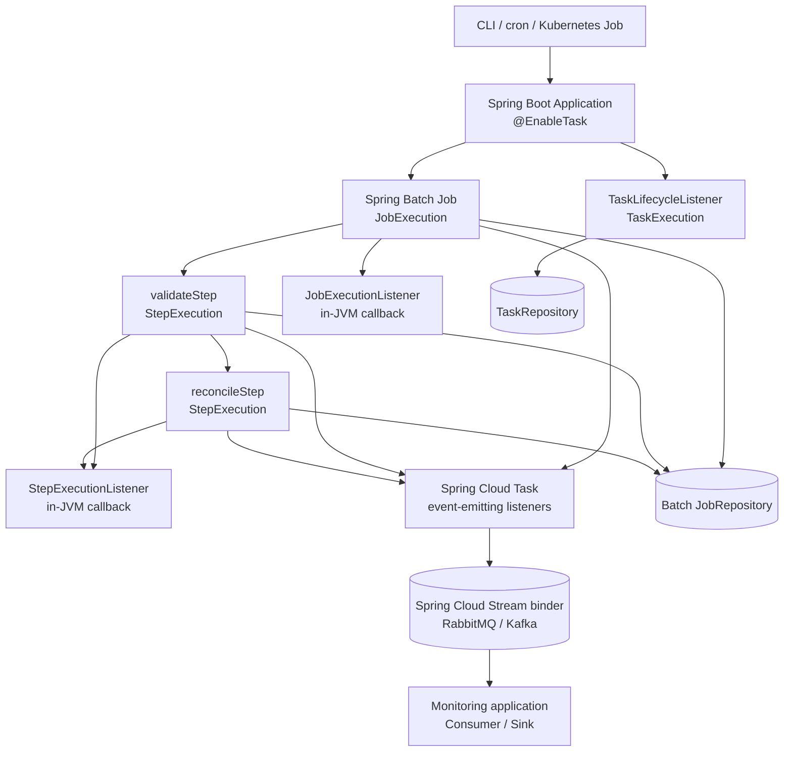

# Spring Batch Job and Step Events

## Lesson Objectives

In the **Events** chapter of the **Spring Cloud Task** module, this lesson explains how to track the **lifecycle of Spring Batch Jobs and Steps** inside a finite-running Spring Boot application. A Task may run for only a few minutes before exiting, yet operators still need to know which Job started, which Step failed, how many records were processed, and which events were sent to the monitoring system.

After this lesson, you will be able to:

- Distinguish events at three levels: `TaskExecution` of Spring Cloud Task, and `JobExecution` and `StepExecution` of Spring Batch.
- Write and register `JobExecutionListener` and `StepExecutionListener` with `beforeJob`, `afterJob`, `beforeStep`, and `afterStep` callbacks.
- Use `@BeforeJob`, `@AfterJob`, `@BeforeStep`, `@AfterStep` annotations and know when to add chunk/item/skip listeners.
- Understand how **Spring Cloud Task emits Spring Batch events via Spring Cloud Stream** to `job-execution-events`, `step-execution-events`, and other granular channels.
- Configure the binder, destinations, enable/disable flags per event group, and listener ordering according to your release branch.
- Verify events for successful/failed Jobs; reconcile IDs and statuses against `TaskRepository`, `JobRepository`, and the process exit code.
- Design a safe observability event setup: avoid exposing sensitive arguments, do not treat events as an exactly-once guarantee, and prevent notification publishing from breaking the main Job.

## 1. Problem Statement: A Task with Multiple Result Levels

Suppose a payment reconciliation job runs on a schedule at 02:00. It is packaged as an executable JAR, uses Spring Cloud Task to track the process, and uses Spring Batch to run two Steps:

1. `validateStep` checks date parameters, input files, and source metadata.
2. `reconcileStep` reads transactions, reconciles data, and writes a report.

Once both Steps finish, the process exits. Operators want immediate notifications when the **Job starts**, **each Step finishes**, and **the Job fails**, while still being able to query history after the process terminates.

Three distinct object types appear:

| Object | Tracked Unit | Typical Information |
| --- | --- | --- |
| `TaskExecution` | A single run of the **Spring Boot Task process** | Task ID, start/end timestamps, exit code, process errors |
| `JobExecution` | A single attempt of a **Spring Batch JobInstance** | Job execution ID, `BatchStatus`, `ExitStatus`, parameters, timestamps |
| `StepExecution` | A single execution of a **Step** within a JobExecution | Step execution ID, `readCount`, `writeCount`, commit/rollback, `ExitStatus` |

**One `TaskExecution` can be linked to multiple `JobExecution`s; one `JobExecution` can have multiple `StepExecution`s.** If a Job fails and is restarted in a new JVM, Spring Cloud Task creates a new `TaskExecution`, while Batch creates a new `JobExecution` that may reuse the existing **JobInstance** when *identifying JobParameters* have not changed.

Events provide early status visibility and timely reactions, whereas **repository metadata** is what you reconcile against to confirm execution history and restart Jobs.

## 2. Two Mechanisms to Distinguish: Local Callbacks vs. Broker Events

Spring Batch has listeners that invoke methods **inside the same JVM** processing the data. Spring Cloud Task also supports **auto-configuring listeners that emit messages via Spring Cloud Stream**, allowing external applications to consume Job and Step events.



| Aspect | In-JVM Spring Batch Listener | Spring Cloud Task + Stream Event |
| --- | --- | --- |
| How it works | Framework directly invokes callbacks on registered beans | Listener publishes messages to bindings/broker |
| Broker dependency | **No** | **Yes**, requires compatible binder and broker |
| Where processed | Same process running the Job | Can be in a separate app, independent of Task lifecycle |
| When to use | Logging, status checks, flow/exit status decisions | Dashboards, alerts, observability, async downstream processing |
| Risks to manage | Failing or slow callbacks impact the Job | Duplicate/delayed delivery, disconnections, serialization |

**Listeners are not the same as Spring Framework's `ApplicationEvent`.** Spring Batch callbacks are a dedicated mechanism; Spring Cloud Stream channels deliver messages via a binder when configured accordingly—they do not appear automatically just because `@EnableTask` is present.

## 3. `JobExecutionListener`: Job Start and End Events

Interface in **Spring Batch 5.2.x**:

```java
public interface JobExecutionListener {
    void beforeJob(JobExecution jobExecution);
    void afterJob(JobExecution jobExecution);
}
```

This is an **illustrative signature**, not a standalone Java file. Both methods have default implementations in modern releases. `beforeJob` runs after `JobExecution` is created, before the first Step. `afterJob` is called **both when the Job succeeds and when the Job fails** during normal execution flow.

| Callback | Timing | Suitable Work |
| --- | --- | --- |
| `beforeJob(JobExecution)` | Before executing the first Step | Log Job ID, name, and sanitized identifying parameters |
| `afterJob(JobExecution)` | After Job finishes processing, including `FAILED` | Log `BatchStatus`, `ExitStatus`, duration, and summary report |

Example local listener bean:

```java
package com.example.taskevents;

import org.slf4j.Logger;
import org.slf4j.LoggerFactory;
import org.springframework.batch.core.BatchStatus;
import org.springframework.batch.core.JobExecution;
import org.springframework.batch.core.JobExecutionListener;
import org.springframework.stereotype.Component;

@Component
public class AuditJobListener implements JobExecutionListener {

    private static final Logger log =
            LoggerFactory.getLogger(AuditJobListener.class);

    @Override
    public void beforeJob(JobExecution execution) {
        log.info("JOB_START id={}, instanceId={}",
                execution.getId(),
                execution.getJobInstance().getInstanceId());
    }

    @Override
    public void afterJob(JobExecution execution) {
        BatchStatus status = execution.getStatus();
        String exitCode = execution.getExitStatus().getExitCode();
        log.info("JOB_END id={}, status={}, exitStatus={}",
                execution.getId(), status, exitCode);

        if (status == BatchStatus.FAILED) {
            log.warn("Job {} failed; check metadata and logs",
                    execution.getId());
        }
    }
}
```

**Do not use the invocation of `afterJob` to conclude success.** This callback also receives `FAILED`, `STOPPED`, and other terminal statuses. Inspect both `BatchStatus` and `ExitStatus`; the `ExitStatus` code is a **string**, not the integer JVM exit code.

### 3.1. How to Register

Register the bean using `JobBuilder.listener(...)` on the **specific Job**:

```java
@Bean
Job reconciliationJob(
        JobRepository jobRepository,
        Step validateStep,
        Step reconcileStep,
        AuditJobListener jobListener) {

    return new JobBuilder("reconciliationJob", jobRepository)
            .start(validateStep)
            .next(reconcileStep)
            .listener(jobListener)
            .build();
}
```

This is a `@Bean` method inside a `@Configuration` class, importing `org.springframework.batch.core.Job`, `Step`, `org.springframework.batch.core.job.builder.JobBuilder`, and `org.springframework.batch.core.repository.JobRepository`.

**Simply annotating `@Component` does not register a listener on every Job.** Register it explicitly on the Job via the builder (or equivalent configuration). If you have multiple Jobs, choose which Jobs need the listener rather than assuming listener beans apply globally.

### 3.2. Annotations as an Alternative to the Interface

Spring Batch also supports annotated methods on a bean:

```java
@BeforeJob
public void beforeJob(JobExecution execution) {
    // Observe before the first Step runs.
}

@AfterJob
public void afterJob(JobExecution execution) {
    // Observe status, including FAILED.
}
```

Both annotations reside in `org.springframework.batch.core.annotation`. Put the methods on a Spring bean and **register that object via the builder's `listener(...)` method**; you do not need and should not combine both the interface and annotations for the same callback if that creates duplicate execution.

## 4. `StepExecutionListener`: Events Before and After Each Step

In **Spring Batch 5.2.x**:

```java
public interface StepExecutionListener extends StepListener {
    void beforeStep(StepExecution stepExecution);
    ExitStatus afterStep(StepExecution stepExecution);
}
```

| Callback | Timing | Suitable Data/Work |
| --- | --- | --- |
| `beforeStep(StepExecution)` | Before Step logic starts | Log ID, Step name, initialize per-Step state |
| `afterStep(StepExecution)` | After Step logic, including errors in normal execution flow | Log read/write/commit/rollback counts and status; optionally combine `ExitStatus` |

**Difference from Job listener:** `afterStep` returns an `ExitStatus` or `null`. Spring Batch combines the returned result with the current status via `ExitStatus.and(...)`; returning `null` leaves the existing exit status unchanged.

Example observer listener that **does not alter status**:

```java
package com.example.taskevents;

import org.slf4j.Logger;
import org.slf4j.LoggerFactory;
import org.springframework.batch.core.ExitStatus;
import org.springframework.batch.core.StepExecution;
import org.springframework.batch.core.StepExecutionListener;
import org.springframework.stereotype.Component;

@Component
public class AuditStepListener implements StepExecutionListener {

    private static final Logger log =
            LoggerFactory.getLogger(AuditStepListener.class);

    @Override
    public void beforeStep(StepExecution execution) {
        log.info("STEP_START id={}, jobExecutionId={}, name={}",
                execution.getId(),
                execution.getJobExecutionId(),
                execution.getStepName());
    }

    @Override
    public ExitStatus afterStep(StepExecution execution) {
        log.info(
                "STEP_END id={}, status={}, read={}, write={}, "
                    + "commit={}, rollback={}",
                execution.getId(),
                execution.getStatus(),
                execution.getReadCount(),
                execution.getWriteCount(),
                execution.getCommitCount(),
                execution.getRollbackCount());
        return null; // Preserve the ExitStatus produced by the Step.
    }
}
```

Register **on each Step** to observe:

```java
@Bean
Step validateStep(
        JobRepository repository,
        PlatformTransactionManager transactionManager,
        AuditStepListener stepListener) {

    return new StepBuilder("validateStep", repository)
            .tasklet((contribution, context) -> {
                Object value = context.getStepContext()
                        .getJobParameters().get("businessDate");
                if (value == null) {
                    throw new IllegalArgumentException(
                            "Missing businessDate");
                }
                LocalDate.parse(value.toString());
                return RepeatStatus.FINISHED;
            }, transactionManager)
            .listener(stepListener)
            .build();
}
```

Import `Step`, `StepBuilder`, `JobRepository`, `PlatformTransactionManager`, `LocalDate`, and `RepeatStatus` in the configuration class. If another Step also needs the listener, register it on that Step too. One listener bean can be reused across multiple Steps **if it holds no shared mutable state across runs/threads**.

### 4.1. Annotations and Modifying Step Status

The corresponding annotations are `@BeforeStep` and `@AfterStep`, in `org.springframework.batch.core.annotation`. If `@AfterStep` returns a non-`null` `ExitStatus`, that status is **combined** with the previous exit status; it can affect conditional transitions in a flow.

Business example: when `readCount=0`, the Job should branch to `"NO_DATA"`. You can return `new ExitStatus("NO_DATA")` in a dedicated inspection listener and **define explicit transitions** in the Job. However, if your goal is only logging/metrics, **return `null`** to avoid accidentally altering execution paths.

**Warning on errors inside `afterStep`:** the Batch 5.2 docs note that exceptions thrown in this callback are typically only logged and are not a reliable way to mark a Step as failed. If mandatory business checks are needed, perform them in the `Tasklet`, `ItemProcessor`/`ItemWriter`, or a separate Step and raise controlled errors there.

### 4.2. Job-Level and Step-Level Callback Ordering

For a two-Step Job running sequentially and succeeding:

```text
beforeJob(J1)
  beforeStep(S1: validateStep)
  afterStep(S1)
  beforeStep(S2: reconcileStep)
  afterStep(S2)
afterJob(J1)
```

If `validateStep` fails, `reconcileStep` may **not start**, so there will be no `beforeStep`/`afterStep` for the second Step. If the Job is restarted after a failure, a **new JobExecution ID** generates a fresh callback sequence; previously completed Steps may be skipped depending on restart settings.

This is the **typical logical order**, not a guarantee that messages on two different broker destinations will be consumed in exact global order.

## 5. Granular Events Inside a Step

When a Step processes data in chunks, knowing only "Step finished" may not suffice to investigate data errors. Spring Batch also provides these listeners:

| Listener | Typical Callbacks | When to Use |
| --- | --- | --- |
| `ChunkListener` | `beforeChunk`, `afterChunk`, `afterChunkError` | Know when transactions/chunks start, commit, or fail |
| `ItemReadListener` | `beforeRead`, `afterRead`, `onReadError` | Track reading source records |
| `ItemProcessListener` | `beforeProcess`, `afterProcess`, `onProcessError` | Track transforming/validating records |
| `ItemWriteListener` | `beforeWrite`, `afterWrite`, `onWriteError` | Track writing target records |
| `SkipListener` | `onSkipInRead`, `onSkipInProcess`, `onSkipInWrite` | Record items skipped under skip policy |

**`onReadError` does not automatically mean the item was skipped.** A read error might be retried and succeed; if you need counts of records ultimately excluded, `SkipListener` is more accurate.

In the chunk model, `afterWrite` is invoked **before the transaction commits**. Therefore, do not treat `afterWrite` events as absolute proof that data is durably committed in the DB. `afterChunk` runs after a successful chunk, yet broker emission and the DB are still not in a single atomic transaction by default.

### 5.1. Event Volume and Operational Cost

A Job reading 1 million records can emit **massive numbers** of `item-read`/`item-process`/`item-write` events. If the broker or dashboard only needs to know which Job succeeded/failed, emit only **Job/Step events** to reduce load and limit payload exposure.

For fine-grained tracking, prefer aggregated metrics (read/write/skip counts), sampled traces, and logs with correlation IDs. Do not stuff every transaction detail or personal data into operational events.

## 6. Spring Cloud Task Auto-Emitting Batch Events via Spring Cloud Stream

This feature connects **Spring Cloud Task** with **Spring Cloud Stream**: when a Spring Batch Job runs inside a Task, the framework can attach *event-emitting listeners* to Jobs/Steps and publish messages through Spring Cloud Stream **bindings** to a broker.

According to the Spring Cloud Task 3.3 and 5.x documentation, default channels include:

| Configured Listener | Default Channel/Binding |
| --- | --- |
| `JobExecutionListener` | `job-execution-events` |
| `StepExecutionListener` | `step-execution-events` |
| `ChunkListener` | `chunk-events` |
| `ItemReadListener` | `item-read-events` |
| `ItemProcessListener` | `item-process-events` |
| `ItemWriteListener` | `item-write-events` |
| `SkipListener` | `skip-events` |

Spring Cloud Task sets this up when **auto-configuration conditions are satisfied**, not merely from adding channel names to YAML.

Conditions to verify:

1. Spring Cloud Task is enabled to create `TaskLifecycleListener`, typically via `@EnableTask`.
2. At least one Spring Batch `Job` exists in the context along with Batch integration dependencies, notably `spring-cloud-task-batch` if not already pulled in by another starter.
3. `spring-cloud-stream` and a compatible **binder** (such as Rabbit or Kafka) matching the release train, configured to connect to the broker.
4. `spring.cloud.task.batch.events.enabled` is not set to `false`.
5. The corresponding event listeners and bindings are actually created in the context, with destinations accepted by the broker.

The Javadoc for `BatchEventAutoConfiguration` describes conditions `@ConditionalOnClass(Job)`, `@ConditionalOnBean(Job, TaskLifecycleListener)`, and the `spring.cloud.task.batch.events.enabled` property enabled by default. Still, **enabling the property does not create a broker**, nor does it guarantee events succeed if the binder cannot connect.

### 6.1. Dependencies for Event Emission

Maven example (assuming a compatible Spring Boot parent and Spring Cloud BOM are configured):

```xml
<dependencies>
    <dependency>
        <groupId>org.springframework.boot</groupId>
        <artifactId>spring-boot-starter-batch</artifactId>
    </dependency>
    <dependency>
        <groupId>org.springframework.cloud</groupId>
        <artifactId>spring-cloud-starter-task</artifactId>
    </dependency>
    <dependency>
        <groupId>org.springframework.cloud</groupId>
        <artifactId>spring-cloud-task-batch</artifactId>
    </dependency>
    <dependency>
        <groupId>org.springframework.cloud</groupId>
        <artifactId>spring-cloud-stream-binder-rabbit</artifactId>
    </dependency>
    <dependency>
        <groupId>com.h2database</groupId>
        <artifactId>h2</artifactId>
        <scope>runtime</scope>
    </dependency>
</dependencies>
```

This is a **dependencies snippet**, not a complete `pom.xml`. The Rabbit binder is illustrative; you may use the Kafka binder or another appropriate binder. Never mix versions of Spring Boot, Spring Batch, Spring Cloud Task, and Stream from different release trains.

### 6.2. Publisher: Configuring Job/Step Event Emission

```yaml
spring:
  application:
    name: reconciliation-task
  main:
    web-application-type: none
  datasource:
    url: jdbc:h2:file:./data/batch-events
    driver-class-name: org.h2.Driver
    username: sa
    password: ""
  rabbitmq:
    host: localhost
    port: 5672
  batch:
    job:
      enabled: true
    jdbc:
      initialize-schema: always
  cloud:
    task:
      initialize-enabled: true
      closecontext-enabled: true
      batch:
        fail-on-job-failure: true
        events:
          enabled: true
          job-execution:
            enabled: true
          step-execution:
            enabled: true
          chunk:
            enabled: false
          item-read:
            enabled: false
          item-process:
            enabled: false
          item-write:
            enabled: false
          skip:
            enabled: false
    stream:
      bindings:
        job-execution-events:
          destination: ops-batch-job-events
        step-execution-events:
          destination: ops-batch-step-events
```

Expected outcome: listeners emit Job events to destination `ops-batch-job-events` and Step events to `ops-batch-step-events`. Properties under `spring.cloud.task.batch.events` control **which listeners are enabled**; properties under `spring.cloud.stream.bindings` control **where messages are sent**. These are two separate concerns.

The example sets `initialize-schema: always` and `initialize-enabled: true` to initialize the schema on the first run with H2. **Once the H2 file already has metadata tables, stop forcing table recreation**: switch to `spring.batch.jdbc.initialize-schema=never` and `spring.cloud.task.initialize-enabled=false` or use controlled migrations. In production, use a durable DB, migrations for `BATCH_` and `TASK_` tables, proper permissions, and backups. RabbitMQ must be running at the configured host/port; YAML does not start the broker.

**Regarding binding names when changing channels:** the Spring Cloud Task docs illustrate `spring.cloud.task.batch.events.step-execution-events-binding-name`, whereas configuration metadata generated by some versions lists `step-execution-event-binding-name` (singular `event`). When changing a **binding name**, check configuration metadata/Javadoc or logs for your **exact JAR version**. The example above only changes the **destination** of the default bindings to avoid property-name differences.

### 6.3. Distinguishing Task Events from Batch Events

| Group | Default Channels | Controlling Property |
| --- | --- | --- |
| **Task events** | `task-events` | `spring.cloud.task.events.enabled` |
| **Job/Step and other Batch events** | `job-execution-events`, `step-execution-events`... | `spring.cloud.task.batch.events.enabled` and individual flags |

Setting `spring.cloud.task.events.enabled=false` **does not mean** all Job/Step events are disabled. To disable Batch event emission, use the Batch-group properties.

### 6.4. Adjusting Event Types and Listener Ordering

Emit only Job events, not Step events:

```yaml
spring:
  cloud:
    task:
      batch:
        events:
          enabled: true
          job-execution:
            enabled: true
          step-execution:
            enabled: false
```

Disable all Batch event-emitting listeners:

```yaml
spring:
  cloud:
    task:
      batch:
        events:
          enabled: false
```

Change the order of event-emitting listeners (when there is an explicit requirement on internal callback ordering):

```yaml
spring:
  cloud:
    task:
      batch:
        events:
          job-execution-order: 5
          step-execution-order: 5
```

According to the documentation, default event listeners typically have `Ordered.LOWEST_PRECEDENCE`; `job-execution-order` and `step-execution-order` allow adjusting **in-JVM listener** precedence. Smaller values have higher priority per `Ordered`. This **does not guarantee** that messages on two separate destinations reach consumers in global order, nor does it replace transactions between the database and broker.

## 7. Example Two-Step Job Application Generating Events

Create an illustrative project with `@EnableTask` and **one** `Job` bean so Spring Boot auto-launches it when the context is ready. This example applies to **Spring Boot 3.x, Spring Batch 5.x, Spring Cloud Task 3.x** with a compatible release train. If using Boot 4/Batch 6, verify APIs and packages for that version.

Main class `src/main/java/com/example/taskevents/BatchEventsApplication.java`:

```java
package com.example.taskevents;

import org.springframework.boot.SpringApplication;
import org.springframework.boot.autoconfigure.SpringBootApplication;
import org.springframework.cloud.task.configuration.EnableTask;

@SpringBootApplication
@EnableTask
public class BatchEventsApplication {
    public static void main(String[] args) {
        SpringApplication.run(BatchEventsApplication.class, args);
    }
}
```

Configuration class `src/main/java/com/example/taskevents/BatchEventsConfiguration.java`:

```java
package com.example.taskevents;

import java.time.LocalDate;

import org.springframework.batch.core.Job;
import org.springframework.batch.core.Step;
import org.springframework.batch.core.job.builder.JobBuilder;
import org.springframework.batch.core.repository.JobRepository;
import org.springframework.batch.core.step.builder.StepBuilder;
import org.springframework.batch.repeat.RepeatStatus;
import org.springframework.beans.factory.annotation.Qualifier;
import org.springframework.context.annotation.Bean;
import org.springframework.context.annotation.Configuration;
import org.springframework.core.env.Environment;
import org.springframework.transaction.PlatformTransactionManager;

@Configuration(proxyBeanMethods = false)
public class BatchEventsConfiguration {

    @Bean
    Job reconciliationJob(
            JobRepository jobRepository,
            @Qualifier("validateStep") Step validateStep,
            @Qualifier("reconcileStep") Step reconcileStep,
            AuditJobListener jobListener) {
        return new JobBuilder("reconciliationJob", jobRepository)
                .start(validateStep)
                .next(reconcileStep)
                .listener(jobListener)
                .build();
    }

    @Bean
    Step validateStep(
            JobRepository jobRepository,
            PlatformTransactionManager transactionManager,
            AuditStepListener stepListener) {
        return new StepBuilder("validateStep", jobRepository)
                .tasklet((contribution, context) -> {
                    Object dateValue = context.getStepContext()
                            .getJobParameters().get("businessDate");
                    if (dateValue == null) {
                        throw new IllegalArgumentException(
                                "Missing businessDate");
                    }
                    LocalDate.parse(dateValue.toString());
                    return RepeatStatus.FINISHED;
                }, transactionManager)
                .listener(stepListener)
                .build();
    }

    @Bean
    Step reconcileStep(
            JobRepository jobRepository,
            PlatformTransactionManager transactionManager,
            AuditStepListener stepListener,
            Environment environment) {
        return new StepBuilder("reconcileStep", jobRepository)
                .tasklet((contribution, context) -> {
                    if (environment.getProperty(
                            "demo.fail", Boolean.class, false)) {
                        throw new IllegalStateException(
                                "Simulated reconciliation failure");
                    }
                    // Production: call reconciliation service with transaction/idempotency.
                    return RepeatStatus.FINISHED;
                }, transactionManager)
                .listener(stepListener)
                .build();
    }
}
```

This is a **Tasklet Step example**, so `readCount` and `writeCount` may stay `0`. To observe item read/write counts, use a chunk-oriented Step with `ItemReader`/`ItemWriter`. Both `AuditJobListener` and `AuditStepListener` come from Sections 3–4, in the same package so component scanning finds them. `@Qualifier` explicitly selects each Step when multiple `Step` beans exist in the context.

**Do not add a runner that manually calls `JobLauncher`** in an example using Spring Boot Batch auto-launching; having both auto-launch and a manual launcher risks running a Job twice unintentionally.

### 7.1. Successful Run

Build and run with the Maven wrapper:

```bash
./mvnw package
java -jar target/batch-events-0.0.1-SNAPSHOT.jar businessDate=2026-11-23
```

Adjust the JAR name to match your actual artifact. With Spring Boot's default Batch launcher, `businessDate=...` **without a `--` prefix** is a JobParameter; conversely, `--demo.fail=true` is a Spring Environment property. Expected local log output looks like:

```text
JOB_START id=1, instanceId=1
STEP_START id=1, jobExecutionId=1, name=validateStep
STEP_END id=1, status=COMPLETED, read=0, write=0, ...
STEP_START id=2, jobExecutionId=1, name=reconcileStep
STEP_END id=2, status=COMPLETED, read=0, write=0, ...
JOB_END id=1, status=COMPLETED, exitStatus=COMPLETED
```

IDs and counts are illustrative. If the Spring Cloud Stream binder is configured properly, the framework can simultaneously emit corresponding messages to both destinations. **Do not assume the exact count or format of payloads** without inspecting your actual version, converter, and binder.

### 7.2. Intentional Failure Run

```bash
java -jar target/batch-events-0.0.1-SNAPSHOT.jar \
    --spring.batch.jdbc.initialize-schema=never \
    --spring.cloud.task.initialize-enabled=false \
    --demo.fail=true businessDate=2026-11-24
```

In this scenario, `initialize-schema=never` and `initialize-enabled=false` reuse the tables created on the first run; **they do not create schemas if missing**. `validateStep` completes, `reconcileStep` throws an exception, that Step's `StepExecution` reports failure, and `JobExecution` typically becomes `FAILED`. `afterJob` **still runs** in normal failure handling; this is why you must check status rather than treating every `afterJob` call as success.

When `spring.cloud.task.batch.fail-on-job-failure=true` is set, the Task/Batch integration can translate a Job failure into a non-`0` Task outcome depending on version behavior. **Measure the actual JVM/container exit code** and check `TASK_EXECUTION`; do not assume a `FAILED` Job always automatically causes `java -jar` to exit with an error.

### 7.3. Verifying Actually Published Events

With the RabbitMQ binder:

1. Confirm the publisher connects to the broker successfully and creates bindings to `ops-batch-job-events` and `ops-batch-step-events`.
2. Inspect messages in the queue/binding subscribed by the receiving app, **after** a matching consumer is bound.
3. Run both `Job COMPLETED` and `Job FAILED`; record `JobExecutionId`/`StepExecutionId`, status, timestamp, and observed event types.
4. Compare against callback logs and database metadata.
5. Disable `step-execution.enabled` and run a **new** JobInstance; verify Job events still arrive while Step events no longer appear on that channel.

When testing multiple runs, pass distinct identifying JobParameters for each new JobInstance; if you re-run an already `COMPLETED` JobInstance with the same parameters, Batch usually refuses to create a new `JobExecution`, which can mislead you into thinking the publisher is broken.

## 8. Consumer: Receiving Job/Step Events in a Monitoring Application

The event-receiving application should be a **continuously running service**, separate from the finite Task process. Using Spring Cloud Stream's functional style, an illustrative consumer can use:

```java
package com.example.batcheventsconsumer;

import java.util.function.Consumer;

import org.slf4j.Logger;
import org.slf4j.LoggerFactory;
import org.springframework.context.annotation.Bean;
import org.springframework.context.annotation.Configuration;
import org.springframework.messaging.Message;

@Configuration(proxyBeanMethods = false)
public class BatchEventConsumerConfiguration {

    private static final Logger log =
            LoggerFactory.getLogger(BatchEventConsumerConfiguration.class);

    @Bean
    Consumer<Message<?>> jobEventConsumer() {
        return message -> {
            log.info("Batch job event: contentType={}, payloadType={}",
                    message.getHeaders().get("contentType"),
                    message.getPayload().getClass().getName());
        };
    }
}
```

The consumer app needs `spring-cloud-stream` and a binder compatible with the publisher. Configuration:

```yaml
spring:
  cloud:
    function:
      definition: jobEventConsumer
    stream:
      bindings:
        jobEventConsumer-in-0:
          destination: ops-batch-job-events
          group: batch-ops
```

This is a **separate consumer application**; do not place the consumer bean inside the Batch Task app and expect the finite process to keep receiving messages after exiting. With `Consumer<Message<?>>`, the actual payload type depends on binder serialization/content-type; the example only logs metadata and payload class so it does not depend on a fixed schema or accidentally dump full JobParameters.

In production, map payloads into a **dedicated versioned event DTO with an explicit schema**, such as:

```json
{
  "eventType": "BATCH_JOB_COMPLETED",
  "jobExecutionId": 501,
  "jobName": "reconciliationJob",
  "status": "COMPLETED",
  "occurredAt": "2026-11-24T02:01:10Z",
  "schemaVersion": 1
}
```

This is an **application-proposed DTO pattern**, not a guaranteed default payload of Spring Cloud Task. If you also need `taskExecutionId`, retrieve it via `TaskBatchExecutionListener` integration and the `TASK_TASK_BATCH` table, or attach an application-controlled correlation ID in your own event.

### 8.1. Ordering, Latency, and Duplicate Events

Job/Step messages can arrive late, be resent/redelivered on retries, or be consumed out of order across partitions/queues. Use `jobExecutionId`, `stepExecutionId`, `eventType`, and version to build an **idempotency key**. If the consumer receives `Step FAILED` followed by `Job FAILED`, those can be two valid messages from the same run rather than two independent Jobs.

If every state transition must have a durable event record, consider a transactional outbox or an independent publish/replay mechanism backed by the repository. **Default binder-emitting listeners do not automatically guarantee an atomic transaction across Batch `JobRepository`, `TaskRepository`, and the message broker.**

## 9. Reconciling Events with `TaskRepository` and Batch `JobRepository`

At runtime, **`JobExecution`** and **`StepExecution`** are stored in Spring Batch metadata; **`TaskExecution`** is stored in Spring Cloud Task. The join table `TASK_TASK_BATCH` is populated when `TaskBatchExecutionListener` integration is active.

| Level | Table or API | Purpose |
| --- | --- | --- |
| Task | `TASK_EXECUTION` / `TaskExplorer` | JVM/Task exit code and execution timestamps |
| Task–Batch link | `TASK_TASK_BATCH` | Maps which `JobExecutionId` belongs to which Task run |
| Job | `BATCH_JOB_EXECUTION` / `JobExplorer` | Job status, exit status, timestamps, errors |
| Step | `BATCH_STEP_EXECUTION` / `JobExplorer` | Step status, read/write/skip/commit counts, errors |
| Broker | `job-execution-events`, `step-execution-events` (configured destinations) | Near-real-time notifications for consumers |

Query Jobs/Steps belonging to a Task run (default Spring Cloud Task and Spring Batch 5.x schema):

```sql
SELECT
    t.TASK_EXECUTION_ID,
    t.EXIT_CODE AS TASK_EXIT_CODE,
    j.JOB_EXEC_ID,
    j.STATUS AS JOB_STATUS,
    j.EXIT_CODE AS JOB_EXIT_STATUS,
    s.STEP_EXEC_ID,
    s.STEP_NAME,
    s.STATUS AS STEP_STATUS,
    s.READ_COUNT,
    s.WRITE_COUNT
FROM TASK_EXECUTION AS t
JOIN TASK_TASK_BATCH AS link
    ON link.TASK_EXECUTION_ID = t.TASK_EXECUTION_ID
JOIN BATCH_JOB_EXECUTION AS j
    ON j.JOB_EXEC_ID = link.JOB_EXECUTION_ID
LEFT JOIN BATCH_STEP_EXECUTION AS s
    ON s.JOB_EXEC_ID = j.JOB_EXEC_ID
WHERE t.TASK_EXECUTION_ID = 91
ORDER BY j.JOB_EXEC_ID, s.STEP_EXEC_ID;
```

`91` is an illustrative ID. Because a Job can have multiple Steps, the query may return **multiple rows for the same `JobExecution`**. If `TASK_TASK_BATCH` has no rows, check `spring-cloud-task-batch` and `TaskBatchExecutionListener` before assuming the Job never ran.

**When events and repositories disagree, investigate first**: an event may come from a previous attempt, be queued, not yet flushed, or be a retry. Use IDs and timestamps to reconcile; never mutate repository metadata just to "match an event".

## 10. Common Errors and Limitations

| Symptom | Possible Cause | Resolution |
| --- | --- | --- |
| `beforeJob`/`afterJob` callbacks do not run | Listener bean not registered on the Job | Add `.listener(jobListener)` to the right Job |
| Step callback runs on only one Step | Listener registered only on that Step | Register on every Step to observe |
| `afterJob` ran yet dashboard marks success even though Job `FAILED` | Consumer confuses "end" with "success" | Inspect `BatchStatus`/`ExitStatus` before classifying |
| Callback logs appear but no broker events | Missing Stream binder, disconnected broker, or event-emitting auto-configuration inactive | Check dependencies, `@EnableTask`, `Job` bean, binder, condition report |
| Events sent to wrong destination | Configured binding/destination name mismatch | Verify exact binding name for your version |
| No Step events seen | `spring.cloud.task.batch.events.step-execution.enabled=false` or Job did not run that Step | Check properties and Job flow |
| Step event arrives before Job event | Different queues/streams, retries, or consumer lag | Check IDs, lag, and `JobRepository` status |
| Multiple events for same `JobInstance` | Job restarted with new `JobExecution` or broker redelivery | Deduplicate by `JobExecutionId` + event type/phase |
| Missing `END` events when JVM is killed | Listener/event didn't get to run or broker send failed | Check scheduler/container, logs, and repositories |
| Error in `afterStep` does not fail the Step | Spring Batch may only log callback exceptions | Move mandatory business validations into Step logic |
| Broker overloaded by millions of item events | Too many `item-*` listeners enabled | Enable only necessary Job/Step/Chunk events; aggregate metrics |
| Events contain secrets or customer info | Raw `JobParameters`/exceptions/payloads emitted | Build a safe DTO, mask sensitive data, enforce broker ACLs |
| Batch Job `FAILED` yet Task/JVM exits `0` | Batch failure not mapped to process exit status | Check `spring.cloud.task.batch.fail-on-job-failure` and smoke-test exit codes |

### 10.1. Events Do Not Replace Process Monitoring

If `ApplicationContext` fails to initialize, the Task may neither create `TaskExecution` nor emit Batch events. If the JVM receives `SIGKILL` or the pod is `OOMKilled`, completion callbacks are not guaranteed to execute. You must monitor the **process exit code**, `Kubernetes Job/Pod status`, and database metadata; events are only a supplementary observation source.

### 10.2. Do Not Let Callbacks Block Transactions Too Long

Do not call slow network alerting APIs without timeouts directly inside `afterStep`/`afterJob` and expect Batch to always finish on schedule. When notifications are purely for monitoring, offload them via Spring Cloud Stream with appropriate retries/timeouts or via an outbox to decouple from the critical path. If a notification is a **mandatory business condition**, design proper data consistency rather than catching and swallowing exceptions.

### 10.3. Pay Special Attention to Ordering and State Scope

A singleton listener bean can be shared across multiple Steps/Jobs and inside parallel Jobs. Never store `currentJobExecutionId` or per-run counters in shared mutable fields without a clear concurrency strategy. Read context from the callback arguments or `ExecutionContext` and attach explicit IDs when emitting events.

## 11. Practice Checklist

1. **Run local Job/Step listeners:** test both `COMPLETED` and `FAILED`; verify callbacks execute in the expected phase and never confuse `afterJob` with success.
2. **Register beans explicitly:** verify `.listener(...)` in `JobBuilder` and `StepBuilder`.
3. **Enable Stream events:** verify binder, broker, and auto-configuration conditions; use separate destinations for Job and Step events.
4. **Reduce noise:** initially disable chunk/item/skip events; enable them only when detailed diagnostics are required.
5. **Test an independent consumer:** read Job/Step IDs, status, and timestamps; do not rely solely on message order to determine final state.
6. **Reconcile metadata:** inspect `BATCH_JOB_EXECUTION`/`BATCH_STEP_EXECUTION` and `TASK_TASK_BATCH` when Task–Batch integration is active.
7. **Test restarts:** same `JobInstance` with a new `JobExecution` produces new events; ensure consumers deduplicate at the proper level.
8. **Test broker disconnection:** measure impact on the Task, retry/timeout policies, and risk of event loss.
9. **Test forced JVM termination in an isolated environment:** do not expect completion callbacks/events to always appear.
10. **Security and retention:** restrict event read permissions, version DTO schemas, and plan audit retention windows.

## 12. Self-Assessment Questions

**1. Is `afterJob` called when a Job is `FAILED`?**

> Yes, during normal Job execution flow. You must inspect `jobExecution.getStatus()` rather than treating the end callback as synonymous with success.

**2. Why does `afterStep` return `null` in a logging-only listener?**

> To avoid altering the `ExitStatus` already determined by the Step. Returning a non-`null` `ExitStatus` can affect the Job's step-transition conditions.

**3. Is annotating `AuditStepListener` with `@Component` enough to make every Step invoke its callbacks?**

> No. You must register the listener on the relevant Steps, for example via `StepBuilder.listener(...)`.

**4. What are the default channel names for emitting Job and Step events?**

> `job-execution-events` and `step-execution-events` per Spring Cloud Task Stream integration.

**5. Does `spring.cloud.task.events.enabled=false` disable all Spring Batch events?**

> No. Batch events have their own `spring.cloud.task.batch.events.enabled` property and per-event-type enablement flags.

**6. How many `JobExecution` events will a Task running two Batch Jobs produce?**

> There are events corresponding to the callbacks of each `JobExecution` when the listener can publish; do not assume one Task always has only one `JobExecution`. Cross-check IDs and avoid asserting an exact message count without accounting for callbacks, retries, and binder behavior.

**7. Why shouldn't receiving `Step COMPLETED` immediately lead you to conclude the Task succeeded?**

> The Job may have subsequent Steps, fail in a later phase, or the JVM may be killed before the Task updates `exitCode`. Check Job status, `TaskRepository`, and the process exit code.

**8. To detect skipped records, should you listen to `ItemReadListener.onReadError` or `SkipListener`?**

> `SkipListener` reflects policy-driven skips. `onReadError` only reports read errors; an error may be retried and succeed.

## Remember

- **`JobExecutionListener`** observes before/after a **Job**; **`StepExecutionListener`** observes before/after **each Step**.
- **`afterJob` still runs on failure**; `afterStep` can combine `ExitStatus`, so return `null` when only observing.
- **Spring Cloud Task emits Batch events via Spring Cloud Stream** when the right dependencies, auto-configuration, and binder are present; default channels for Job and Step are `job-execution-events` and `step-execution-events`.
- **Task, Job, and Step have separate metadata and IDs**; when investigating events, reconcile both `TaskRepository` and Batch `JobRepository`.
- **Events serve observability**, do not automatically guarantee atomic sync with the database, and do not replace idempotency, controlled retries, or JVM/container exit-code monitoring.

## References

1. [Spring Cloud Task 3.3 — Spring Cloud Stream Integration: Spring Batch Events, binding, disable, order](https://docs.spring.io/spring-cloud-task/reference/3.3/stream.html)
2. [Spring Cloud Task 5.0 — Spring Batch Events](https://docs.spring.io/spring-cloud-task/reference/5.0/stream.html)
3. [Spring Cloud Task — Batch: linking JobExecution with TaskExecution](https://docs.spring.io/spring-cloud-task/reference/batch.html)
4. [Spring Cloud Task Javadoc — BatchEventAutoConfiguration (auto-configuration conditions)](https://docs.spring.io/spring-cloud-task/docs/current/apidocs/org/springframework/cloud/task/batch/listener/BatchEventAutoConfiguration.html)
5. [Spring Batch 5.2 — Configuring a Job and JobExecutionListener](https://docs.spring.io/spring-batch/reference/5.2/job/configuring.html)
6. [Spring Batch 5.2 — Intercepting Step Execution: Step, Chunk, Item, Skip listeners](https://docs.spring.io/spring-batch/reference/5.2/step/chunk-oriented-processing/intercepting-execution.html)
7. [Spring Batch 5.2 — Domain Language: JobExecution and StepExecution](https://docs.spring.io/spring-batch/reference/5.2/domain.html)
8. [Spring Cloud Stream — Binder Detection](https://docs.spring.io/spring-cloud-stream/reference/spring-cloud-stream/binder-detection.html)
