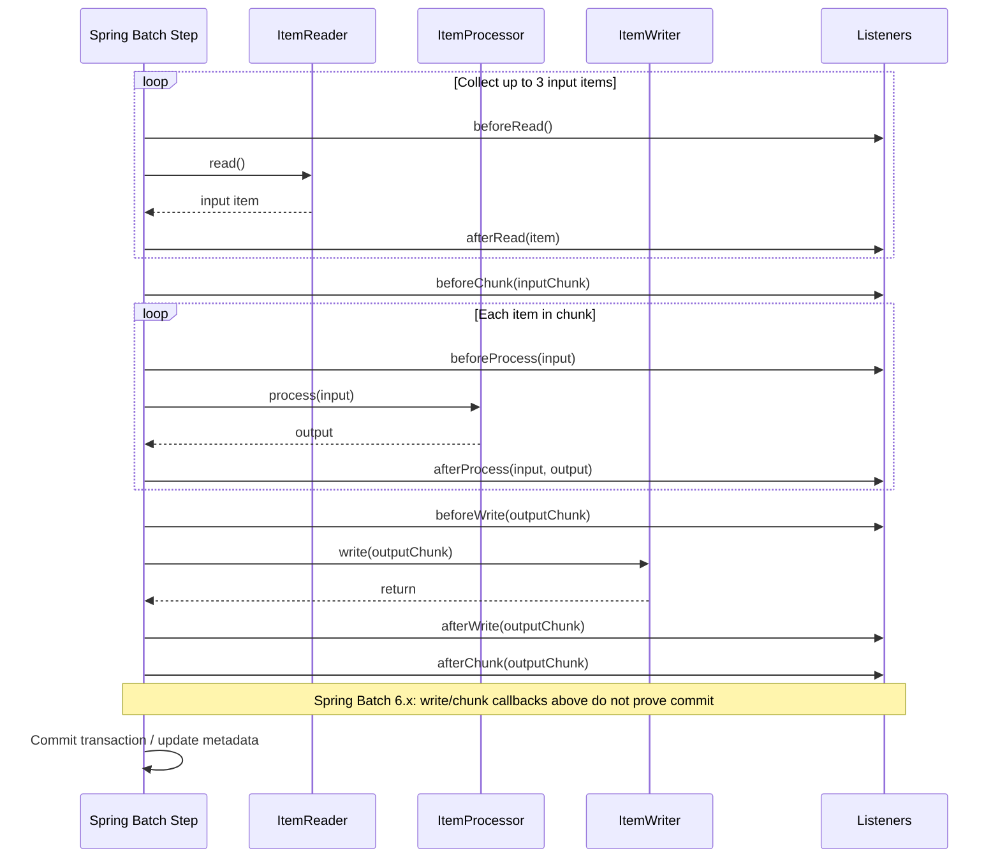
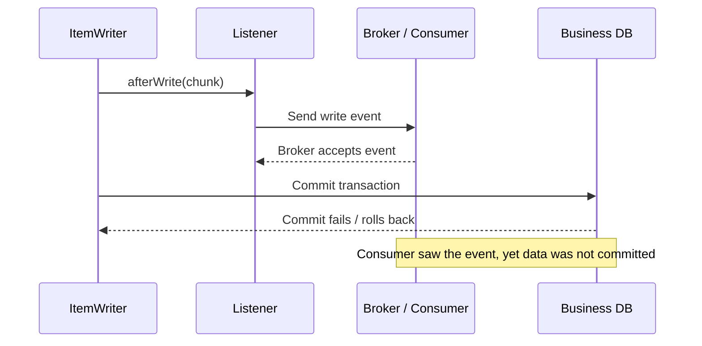

# Chunk, Item Read, Process, Write, and Skip Events

## Objectives and Context

A **Spring Cloud Task** application runs for a finite duration: it starts up, executes its work, persists information about a single run in `TaskRepository`, and exits. When that task contains a **Spring Batch Job**, a *chunk-oriented* `Step` typically reads individual items, transforms them, writes groups of items, and may retry or skip failed records. To observe each stage, Spring Batch provides **listener callbacks**; Spring Cloud Task can also forward those callbacks as **Spring Cloud Stream events** sent to external systems.

This lesson in the **Events** chapter focuses on five groups:

1. `ChunkListener` — events at chunk processing boundaries.
2. `ItemReadListener` — read events.
3. `ItemProcessListener` — processing/transformation events.
4. `ItemWriteListener` — write events.
5. `SkipListener` — events when an item is **actually skipped**.

After this lesson, you will be able to identify which callbacks execute in each scenario, configure a Step with listeners, understand how retries and transactions affect callback order and invocation counts, and enable/disable Spring Cloud Task's `chunk-events`, `item-read-events`, `item-process-events`, `item-write-events`, and `skip-events` channels.

**Version scope:** The Java API snippets illustrate **Spring Batch 6.1** on a Spring Boot/Spring Cloud Task application from a compatible release train. Significant differences exist between Batch 5.x and 6.x in `ChunkListener` signatures and `afterChunk` callback timing. If your project still uses Batch 5.x, cross-check that version's documentation before copying Java code.

## 1. Two Event Layers: Local Callbacks vs. Broker Events

| Layer | Mechanism | Recipient | Needs Kafka/RabbitMQ? | Purpose |
| --- | --- | --- | --- | --- |
| **Spring Batch listener** | Java methods invoked directly by the Step in the execution thread | Application code registered on the `Step` | **No** | Fine-grained tracking, timing, error classification, appropriate auditing |
| **Spring Cloud Task Batch Events** | Listeners configured by Task/Stream integration, emitting messages to Spring Cloud Stream channels | External consumers or monitoring systems | **Requires a binder** to emit to a broker | Observing the task from outside the process, asynchronous event handling |
| **Spring Cloud Task lifecycle events** | Emits `TaskExecution` at task start/end to `task-events` | Consumers tracking Task lifecycle | Requires a binder to emit to a broker | Tracking the **overall run**, not individual items/chunks |
| **`TaskRepository` and `JobRepository`** | Persists structured data in the DB | Dashboards, ops systems, schedulers | No | Authoritative lookup for history, status, counters, and Task–Job links |

A callback inside a Step does not automatically mean a message was sent to a broker. Conversely, **adding a Spring Cloud Stream binder** does not replace `ItemWriter` transaction rules or `Step` skip policies. The two layers complement each other.

Invoice import task example:

- `ItemProcessListener.onProcessError` reports that an invoice is invalid.
- If the Step has a `skip` policy and remaining skip budget, `SkipListener.onSkipInProcess` indicates the item was **skipped**.
- If the Step does not allow skips or exceeds the limit, the Step fails; `onProcessError` **may still have been called**.
- When Spring Cloud Task Stream integration is active, the corresponding callbacks can be emitted on `item-process-events` and `skip-events` for external listeners.

This is why **error events** and **skip events** must be counted and interpreted differently.

## 2. Callback Flow Across a Chunk

Suppose the reader returns strings, the processor converts them into invoices, the writer saves to PostgreSQL, and `chunkSize=3`. A simple pass **without errors**:



The diagram deliberately illustrates the **typical logical order** rather than every internal detail. In Spring Batch 6.1, `beforeChunk(Chunk<I>)` runs **after the input chunk is read, before processing**; `afterChunk(Chunk<O>)` runs **after writing, before transaction commit/rollback**. In Spring Batch 5.x, the `ChunkContext`-style API and `afterChunk(ChunkContext)` run **after the transaction** — a key difference to check when upgrading. See [Spring Batch 6.1 – Intercepting Step Execution](https://docs.spring.io/spring-batch/reference/step/chunk-oriented-processing/intercepting-execution.html).

At the end of the input, `ItemReader.read()` returns `null` to signal end-of-source. Do not assume an `afterRead(null)` callback is emitted: the API defines `afterRead` when an item is successfully read. If `ItemProcessor.process()` returns `null`, the item is **filtered** (`filter`), not **skipped due to error**; it is not passed to the writer.

## 3. Map of the Five Listener Groups

| Listener | Callbacks | When Reported | Common Misconceptions |
| --- | --- | --- | --- |
| `ChunkListener<I,O>` | `beforeChunk(Chunk<I>)`, `afterChunk(Chunk<O>)`, `onChunkError(Exception, Chunk<O>)` | Before processing input chunk, after writing output chunk, when chunk hits process/write error | `afterChunk` in Batch 6.x **does not mean commit succeeded** |
| `ItemReadListener<T>` | `beforeRead()`, `afterRead(T)`, `onReadError(Exception)` | Before each read, after successful read, read throws exception | `onReadError` does not mean the item was skipped |
| `ItemProcessListener<I,O>` | `beforeProcess(I)`, `afterProcess(I,O)`, `onProcessError(I,Exception)` | Before/after processing item, processor throws error | Returning `null` means **filter**, not skip |
| `ItemWriteListener<O>` | `beforeWrite(Chunk<? extends O>)`, `afterWrite(Chunk<? extends O>)`, `onWriteError(Exception, Chunk<? extends O>)` | Before/after writer writes chunk, writer throws error | Write error covers the **whole chunk**, failing item may not be isolated yet |
| `SkipListener<I,O>` | `onSkipInRead(Throwable)`, `onSkipInProcess(I,Throwable)`, `onSkipInWrite(O,Throwable)` | **Only when** fault-tolerance rules decide to skip an item | Skip callbacks can run inside a transaction that rolls back |

All five interfaces extend `StepListener` in Spring Batch. You can implement the interfaces directly or use the corresponding annotations:

| Group | Annotations |
| --- | --- |
| Chunk | `@BeforeChunk`, `@AfterChunk`, `@OnChunkError` (Batch 6.x) |
| Read | `@BeforeRead`, `@AfterRead`, `@OnReadError` |
| Process | `@BeforeProcess`, `@AfterProcess`, `@OnProcessError` |
| Write | `@BeforeWrite`, `@AfterWrite`, `@OnWriteError` |
| Skip | `@OnSkipInRead`, `@OnSkipInProcess`, `@OnSkipInWrite` |

Pick **one consistent registration style** and avoid registering the same listener twice (e.g., both attaching to a reader and calling `.listener(...)` manually), which can invoke callbacks twice. A standalone listener bean does not activate itself: it must be **registered on a Step/Job**, unless Cloud Task integration auto-configuration wires it for you.

## 4. `ChunkListener`: Transaction Boundaries and Callback Counts

In Spring Batch 6.1, `ChunkListener<I,O>` has the illustrative signature:

```java
public interface ChunkListener<I, O> extends StepListener {
    void beforeChunk(Chunk<I> chunk);
    void afterChunk(Chunk<O> chunk);
    void onChunkError(Exception exception, Chunk<O> chunk);
}
```

`Chunk<I>` holds read inputs; `Chunk<O>` holds processed outputs. `beforeChunk` and `afterChunk` execute inside the transaction per the 6.1 API description; `onChunkError` also occurs when the corresponding transaction is **about to roll back**.

- `beforeChunk` in 6.x is called **after a chunk has been read**, before the processor begins. Thus, a **read error before a processed chunk exists** does not necessarily trigger `onChunkError`.
- `afterChunk` is called after writing completes, but **is not** a "committed" callback. If the transaction ultimately fails, side effects must not be assumed durable merely because `afterChunk` ran.
- `onChunkError` receives the exception and a **non-empty processed chunk**; per the 6.1 API, read errors prior to processing are reported via `onReadError`, not `onChunkError`.
- The Batch 6.1 docs warn that `ChunkListener` callbacks are **not invoked in concurrent steps** under that mechanism. If concurrent execution is enabled, do not build critical counting logic solely on this listener.

### When the Writer Fails and the Step Retries Item by Item

Suppose the input chunk is `[A, B, C]`; the writer tries to write the whole chunk, but B and C fail with skippable errors. In **Spring Batch 6.1**, *chunk scanning* can run as follows:

```text
beforeChunk([A, B, C])
onChunkError(error, [A, B, C])    # whole-chunk write fails, rollback

beforeChunk([A])
afterChunk([A])                   # A is written successfully

beforeChunk([B])
onChunkError(error, [B])          # B is rejected and skipped

beforeChunk([C])
onChunkError(error, [C])          # C is rejected and skipped
```

**One logical chunk can produce multiple chunk callbacks.** Do not use `beforeChunk` as a "committed chunk counter" when fault tolerance is enabled. Write error callbacks can also fire **multiple times** before an item is skipped or retried successfully.

### Do Not Use Listeners for Side Tasks That Can Throw Errors

According to the docs, exceptions thrown by a listener itself are not treated as read/process/write errors eligible for skip/retry; they can cause the Step to **fail immediately**. Never call email, payment, or arbitrary database update APIs directly inside callbacks without error isolation. When writing logs/audits, catch errors safely and have a dedicated policy for audit failures so "observability failures don't break business processing".

## 5. `ItemReadListener`: Distinguishing Read, Read Error, and Skip

Callbacks:

```java
void beforeRead();
void afterRead(T item);
void onReadError(Exception exception);
```

`beforeRead()` runs before each reader invocation. `afterRead(item)` receives each successfully read item; `onReadError` receives errors from `read()`. A read exception can:

1. **Be retried:** `onReadError` may fire multiple times before the reader eventually succeeds. No skip occurs.
2. **Be skipped:** if the error matches `SkipPolicy`, `readSkipCount` increments and `onSkipInRead` is called.
3. **Fail the Step:** non-skippable error or skip limit exceeded; no successful skip is reported.

**Special note:** `onSkipInRead(Throwable)` receives only the exception because when the reader fails there may **not yet be an item object**. With `FlatFileItemReader`, `FlatFileParseException` may include the line number and parse input for debugging, so never push raw input containing PII into logs or brokers.

When designing reader retries, ensure the reader position does not advance past an exception and silently drop records. Spring Batch 6.1 notes that retrying `ItemReader.read()` depends on how the reader maintains state. Deterministic parse errors are usually better suited to skipping (if business rules permit) rather than retrying identical input repeatedly.

## 6. `ItemProcessListener`: Filtering vs. Skipping

Callbacks:

```java
void beforeProcess(I item);
void afterProcess(I item, O result);
void onProcessError(I item, Exception exception);
```

Distinguish three outcomes:

| What does `process(item)` return? | Callback / Result | Counter to Check |
| --- | --- | --- |
| Valid output | `afterProcess(item, output)`; output continues to writer | `writeCount` after successful write |
| `null` (filtered by rule) | `afterProcess(item, null)`; item does not reach writer | `filterCount` |
| Throws exception | `onProcessError(item, ex)`; then retry, skip, or fail per policy | `processSkipCount` **only when actually skipped** |

For example: an invoice with amount `0` is **intentionally excluded from the report** by the processor returning `null`; that is a **filter**, not an error record. An invoice with a negative amount throws `InvalidInvoiceException` and is skipped by the Step; that is a **process skip**. Do not use `SkipListener` to measure filtered items.

If the writer fails and *chunk scanning* runs, the processor may be invoked **again** for each item. Consequently, `afterProcess` does not necessarily occur only once per logical record across the entire Job. Processors should be deterministic and avoid irreversible side effects; `processorNonTransactional()` is only suitable when generated outputs can be safely reprocessed.

## 7. `ItemWriteListener`: Write Success Is Not Commit

In Spring Batch 6.x, the write listener receives a **`Chunk`**, not a `List` as in older examples:

```java
void beforeWrite(Chunk<? extends O> items);
void afterWrite(Chunk<? extends O> items);
void onWriteError(Exception exception, Chunk<? extends O> items);
```

`afterWrite` signals that `ItemWriter.write(chunk)` returned normally; this callback runs **before transaction commit**. It does **not** guarantee data is durable in the database or broker events were processed by consumers. If the transaction later rolls back, events logged or emitted during `afterWrite` become "false-success" observations.

`onWriteError` receives **the entire attempted chunk**, not an already-isolated failing item. In a fault-tolerant step, the framework may roll back the chunk and **retry item-by-item in separate transactions** to find the skippable item. Thus `onWriteError` can be called once for the full chunk and again for the failing item. Do not emit "invoice X was skipped" from `onWriteError`; use `onSkipInWrite`.

With JDBC, enforce unique business keys so retries cannot duplicate rows. With Kafka/AMQP, the `JobRepository` database transaction does not automatically make message publishing atomic; for reliable business event emission, consider an outbox and consumer-side idempotency.

## 8. `SkipListener`: Decision to Skip an Item

`SkipListener<I,O>` has three callbacks:

```java
void onSkipInRead(Throwable error);
void onSkipInProcess(I item, Throwable error);
void onSkipInWrite(O item, Throwable error);
```

Unlike error listeners, `SkipListener` represents the **Step's decision to skip** under its fault-tolerance policy. It does not make an exception skippable on its own — you must configure `.faultTolerant().skip(...).skipLimit(...)` or a suitable `SkipPolicy`.

- `onSkipInRead`: item could not be read; only the exception is available.
- `onSkipInProcess`: input item was read, but processor failed and policy permits skipping.
- `onSkipInWrite`: output item could not be written; the framework may scan the chunk to isolate this item.

### Skip Limit Is Combined Across Read, Process, and Write

For example, with limit `3`: at most 3 total items matching skippable exception classes may be skipped. If 1 item was skipped in read, 1 in process, and 1 in write, a **fourth skippable error** fails the Step. There is no "3 errors per phase". Spring Batch 6.1 uses `SkipPolicy`, such as `LimitCheckingExceptionHierarchySkipPolicy`, or the simple configuration `skip(InvalidInvoiceException.class)` + `skipLimit(3)`.

### Skip Listener Transactions in Batch 6.1

The 6.1 documentation notes a subtlety that differs from older guides:

| Callback | Transaction Context in Batch 6.1 | Consequence |
| --- | --- | --- |
| `onSkipInRead` | Inside the active chunk transaction, **may roll back** | Audits written in the same transaction can be lost |
| `onSkipInProcess` | Inside the active chunk transaction, **may roll back** | Audits/metrics must account for reattempts |
| `onSkipInWrite` | Inside the **single-item** scan transaction, which then **rolls back** when the item is skipped | Default transactional audits will very likely roll back too |
| `onChunkError` / `onWriteError` | Inside the failing transaction / about to roll back | Do not treat these callbacks as "committed audit" |

If you need to record skipped items in a separate audit table, call **a different service** annotated with `@Transactional(propagation = Propagation.REQUIRES_NEW)` with an idempotent event ID, or use a retry-tolerant event/outbox mechanism. Do not merely put `@Transactional(REQUIRES_NEW)` on a method in the same bean and self-invoke it: standard Spring transaction proxies **do not intercept self-invocation**.


## 9. Practice: Single-Step Job with All Five Listener Groups

Create a Spring Boot application containing `spring-boot-starter-batch`, `spring-cloud-starter-task`, `spring-cloud-task-batch`, and an appropriate H2 JDBC driver. Dependencies must be managed by **compatible Spring Boot BOM and Spring Cloud BOM**. This is an illustrative Job using an in-memory record list and a console writer to observe callbacks; **do not use this console writer as production business output**.

### 9.1. Application File

`src/main/java/com/example/task/InvoiceEventsApplication.java`:

```java
package com.example.task;

import org.springframework.boot.SpringApplication;
import org.springframework.boot.autoconfigure.SpringBootApplication;

@SpringBootApplication
public class InvoiceEventsApplication {
    public static void main(String[] args) {
        SpringApplication.run(InvoiceEventsApplication.class, args);
    }
}
```

### 9.2. Defining a Job and a Step with Skip

`src/main/java/com/example/task/InvoiceJobConfig.java`:

```java
package com.example.task;

import java.math.BigDecimal;
import java.util.List;

import org.springframework.batch.core.job.Job;
import org.springframework.batch.core.job.builder.JobBuilder;
import org.springframework.batch.core.repository.JobRepository;
import org.springframework.batch.core.step.Step;
import org.springframework.batch.core.step.builder.StepBuilder;
import org.springframework.batch.infrastructure.item.ItemProcessor;
import org.springframework.batch.infrastructure.item.ItemReader;
import org.springframework.batch.infrastructure.item.ItemWriter;
import org.springframework.batch.infrastructure.item.support.ListItemReader;
import org.springframework.context.annotation.Bean;
import org.springframework.context.annotation.Configuration;
import org.springframework.transaction.PlatformTransactionManager;

record Invoice(String id, BigDecimal amount) {}

class InvalidInvoiceException extends RuntimeException {
    InvalidInvoiceException(String reason) {
        super(reason);
    }
}

@Configuration
public class InvoiceJobConfig {

    @Bean
    ItemReader<String> invoiceReader() {
        // Input intentionally has 3 errors: B and D fail process, C fails write.
        return new ListItemReader<>(List.of(
                "A:10.00", "B:-1.00", "C:20.00",
                "D:not-a-number", "E:30.00"));
    }

    @Bean
    ItemProcessor<String, Invoice> invoiceProcessor() {
        return raw -> {
            String[] parts = raw.split(":", -1);
            if (parts.length != 2) {
                throw new InvalidInvoiceException("Invalid structure");
            }

            BigDecimal amount;
            try {
                amount = new BigDecimal(parts[1]);
            } catch (NumberFormatException ex) {
                throw new InvalidInvoiceException("Invalid amount");
            }

            if (amount.signum() < 0) {
                throw new InvalidInvoiceException("Negative amount");
            }
            return new Invoice(parts[0], amount);
        };
    }

    @Bean
    ItemWriter<Invoice> invoiceWriter() {
        return items -> {
            // Simulate write error: inspect entire chunk before printing.
            for (Invoice row : items) {
                if ("C".equals(row.id())) {
                    throw new InvalidInvoiceException("Cannot write C");
                }
            }
            for (Invoice row : items) {
                System.out.println("DEMO write " + row.id());
            }
        };
    }

    @Bean
    Step importStep(
            JobRepository jobRepository,
            PlatformTransactionManager transactionManager,
            ItemReader<String> invoiceReader,
            ItemProcessor<String, Invoice> invoiceProcessor,
            ItemWriter<Invoice> invoiceWriter,
            InvoiceEventAudit audit) {

        return new StepBuilder("importStep", jobRepository)
                .<String, Invoice>chunk(3)
                .transactionManager(transactionManager)
                .reader(invoiceReader)
                .processor(invoiceProcessor)
                .writer(invoiceWriter)
                .faultTolerant()
                .skip(InvalidInvoiceException.class)
                .skipLimit(3)
                .listener(audit)
                .build();
    }

    @Bean
    Job importJob(JobRepository jobRepository, Step importStep) {
        return new JobBuilder("importJob", jobRepository)
                .start(importStep)
                .build();
    }
}
```

In this example, `B:-1.00` and `D:not-a-number` trigger `onProcessError` and can trigger `onSkipInProcess`. `C:20.00` passes the processor but causes the writer to throw, triggering `onWriteError` and then `onSkipInWrite` as the Step performs chunk scanning. With `skipLimit(3)` and three skippable failing items, the Job can finish `COMPLETED` with **three skipped items**.

**Two intentional limitations:** `ListItemReader` is not a restartable checkpointed reader for production; `System.out.println` does not roll back with transactions. Printed lines may appear multiple times if the writer is retried. Never infer "console line count = committed item count".

### 9.3. Listener Observing Read, Process, Write, Chunk, and Skip

`src/main/java/com/example/task/InvoiceEventAudit.java`:

```java
package com.example.task;

import org.slf4j.Logger;
import org.slf4j.LoggerFactory;
import org.springframework.batch.core.listener.ChunkListener;
import org.springframework.batch.core.listener.ItemReadListener;
import org.springframework.batch.core.listener.ItemProcessListener;
import org.springframework.batch.core.listener.ItemWriteListener;
import org.springframework.batch.core.listener.SkipListener;
import org.springframework.batch.infrastructure.item.Chunk;
import org.springframework.stereotype.Component;

@Component
public class InvoiceEventAudit implements
        ChunkListener<String, Invoice>,
        ItemReadListener<String>,
        ItemProcessListener<String, Invoice>,
        ItemWriteListener<Invoice>,
        SkipListener<String, Invoice> {

    private static final Logger log =
            LoggerFactory.getLogger(InvoiceEventAudit.class);

    @Override
    public void beforeRead() {
        log.debug("read.before");
    }

    @Override
    public void afterRead(String item) {
        log.debug("read.after"); // Do not log sensitive raw items.
    }

    @Override
    public void onReadError(Exception ex) {
        log.warn("read.error type={}", ex.getClass().getSimpleName());
    }

    @Override
    public void beforeProcess(String item) {
        log.debug("process.before");
    }

    @Override
    public void afterProcess(String item, Invoice result) {
        log.debug("process.after filtered={}", result == null);
    }

    @Override
    public void onProcessError(String item, Exception ex) {
        log.warn("process.error type={}", ex.getClass().getSimpleName());
    }

    @Override
    public void beforeWrite(Chunk<? extends Invoice> items) {
        log.debug("write.before size={}", items.size());
    }

    @Override
    public void afterWrite(Chunk<? extends Invoice> items) {
        log.debug("write.after size={} (commit not yet confirmed)",
                items.size());
    }

    @Override
    public void onWriteError(
            Exception ex, Chunk<? extends Invoice> items) {
        log.warn("write.error size={} type={}",
                items.size(), ex.getClass().getSimpleName());
    }

    @Override
    public void beforeChunk(Chunk<String> chunk) {
        log.debug("chunk.before inputSize={}", chunk.size());
    }

    @Override
    public void afterChunk(Chunk<Invoice> chunk) {
        log.debug("chunk.after outputSize={} (before commit)",
                chunk.size());
    }

    @Override
    public void onChunkError(
            Exception ex, Chunk<Invoice> chunk) {
        log.warn("chunk.error outputSize={} type={}",
                chunk.size(), ex.getClass().getSimpleName());
    }

    @Override
    public void onSkipInRead(Throwable ex) {
        log.warn("skip.read type={}", ex.getClass().getSimpleName());
    }

    @Override
    public void onSkipInProcess(String item, Throwable ex) {
        log.warn("skip.process type={}", ex.getClass().getSimpleName());
    }

    @Override
    public void onSkipInWrite(Invoice item, Throwable ex) {
        log.warn("skip.write type={}", ex.getClass().getSimpleName());
    }
}
```

All interfaces above are for **Spring Batch 6.1**. In Spring Batch 5.x, listener packages live under `org.springframework.batch.core`, `Chunk` belongs to `org.springframework.batch.item`, and `ChunkListener` uses `ChunkContext`; therefore this code is not meant to be pasted directly into a 5.x project.

In `StepBuilder`, `.listener(audit)` registers the bean implementing multiple listener interfaces. **Do not** add `@BeforeRead`/`@OnSkipInWrite` if you already implement the interfaces directly. If using annotations on a POJO instead of interfaces, register the POJO itself via `.listener(...)` and ensure callback signatures match your version.

In production, replace simple logging with **Micrometer observations/counters** using safe tags such as `jobName`, `stepName`, and `errorType`. Never put raw `invoiceId` or customer data into metric tags; cardinality would explode and PII could leak.

### 9.4. Test Configuration

`src/main/resources/application.yml`:

```yaml
spring:
  application:
    name: invoice-events-task
  main:
    web-application-type: none
  datasource:
    url: jdbc:h2:mem:invoice_events;DB_CLOSE_DELAY=-1
    username: sa
    password: ""
  batch:
    job:
      enabled: true
      name: importJob
    jdbc:
      initialize-schema: always
  cloud:
    task:
      initialize-enabled: true
      batch:
        fail-on-job-failure: true

logging:
  level:
    com.example.task: DEBUG
```

With the JAR built and metadata repository initialized:

```bash
java -jar target/invoice-events-task.jar
```

Observe the `read.`, `process.`, `write.`, `chunk.`, and `skip.` groups. **Do not assume exact callback counts by counting on paper:** retries and chunk scanning can cause `beforeProcess`, `onWriteError`, and `beforeChunk` to run more times than the original logical item/chunk count.

In this example, there are no errors in `ItemReader`, so `onReadError`/`onSkipInRead` are not triggered. To test the read branch, switch to a `FlatFileItemReader` reading a file with a malformed line and mark `FlatFileParseException` as skippable within limits, or use a test reader that intentionally throws an exception. **Do this only in test environments**.

In-memory H2 is for learning and **does not retain `TaskExecution`/`JobExecution` history across JVMs**. In production, configure a durable database, proper schema migrations, and secure secrets; do not rely on `initialize-schema: always` or empty passwords.

## 10. Spring Cloud Task Emitting Batch Events via Spring Cloud Stream

This is the second layer of the lesson: once you know when listeners fire, you can send that information to a **message broker** so external monitoring systems or consumers can receive it.

According to [Spring Cloud Task 5.1 – Spring Cloud Stream Integration](https://docs.spring.io/spring-cloud-task/reference/stream.html), when an application runs a Spring Batch Job inside a Task and has the proper integration infrastructure, the corresponding listeners are configured to emit to these channels:

| Batch Listener | Default Channel | Meaning |
| --- | --- | --- |
| `JobExecutionListener` | `job-execution-events` | Job start/end |
| `StepExecutionListener` | `step-execution-events` | Step start/end |
| **`ChunkListener`** | **`chunk-events`** | Chunk events |
| **`ItemReadListener`** | **`item-read-events`** | Read events |
| **`ItemProcessListener`** | **`item-process-events`** | Processing events |
| **`ItemWriteListener`** | **`item-write-events`** | Write events |
| **`SkipListener`** | **`skip-events`** | Item skip events |
| `TaskLifecycleListener` (Task event) | `task-events` | `TaskExecution` at task start/end |

**Common pitfall:** `task-events` reflects the Spring Cloud Task lifecycle, whereas `chunk-events` and `item-*-events` originate from Spring Batch callbacks. If a task only has an `ApplicationRunner` and **no Batch Step**, item/chunk events will not be generated.

### 10.1. Required Dependencies

In a project that already has `spring-cloud-starter-task`, `spring-cloud-task-batch`, and `spring-boot-starter-batch`, emitting messages over Kafka/RabbitMQ requires adding the **Task–Stream integration module**, Stream library, and a **corresponding binder**:

```xml
<dependencies>
    <dependency>
        <groupId>org.springframework.cloud</groupId>
        <artifactId>spring-cloud-task-stream</artifactId>
    </dependency>

    <!-- Example choosing Kafka as the binder; swap binder if using RabbitMQ. -->
    <dependency>
        <groupId>org.springframework.cloud</groupId>
        <artifactId>spring-cloud-stream-binder-kafka</artifactId>
    </dependency>
</dependencies>
```

Module versions must be managed by a **compatible Spring Cloud BOM**. This is a snippet to add inside `dependencies`, not a complete `pom.xml`. You need a running Kafka/RabbitMQ broker and proper configuration for addresses, serializers/content type, access permissions, and publisher retries. If you only want callbacks running inside the JVM to log metrics, you **do not need** to add Stream or a binder.

### 10.2. Per-Group Enable/Disable and Routing Destinations

Example keeping Job/Step/Chunk/Skip events enabled while disabling per-item events to avoid excessive traffic:

```yaml
spring:
  cloud:
    task:
      batch:
        events:
          enabled: true
          chunk:
            enabled: true
          skip:
            enabled: true
          item-read:
            enabled: false
          item-process:
            enabled: false
          item-write:
            enabled: false
    stream:
      bindings:
        chunk-events:
          destination: invoice-batch-chunks
          content-type: application/json
        skip-events:
          destination: invoice-batch-skips
          content-type: application/json
```

Here `spring.cloud.task.batch.events.*` controls Spring Cloud Task's **Batch event-emitting listeners**, while `spring.cloud.stream.bindings.*.destination` controls the **broker destination**. The two namespaces are separate.

If you want to **disable all** Batch events:

```yaml
spring:
  cloud:
    task:
      batch:
        events:
          enabled: false
```

If you want to disable only **task lifecycle events** (`task-events`) while keeping Batch events:

```yaml
spring:
  cloud:
    task:
      events:
        enabled: false
```

The documentation also provides these keys:

```properties
spring.cloud.task.batch.events.job-execution.enabled=false
spring.cloud.task.batch.events.step-execution.enabled=false
spring.cloud.task.batch.events.chunk.enabled=false
spring.cloud.task.batch.events.item-read.enabled=false
spring.cloud.task.batch.events.item-process.enabled=false
spring.cloud.task.batch.events.item-write.enabled=false
spring.cloud.task.batch.events.skip.enabled=false

# Callback priority order for auto-configured event listeners:
spring.cloud.task.batch.events.chunk-order=5
spring.cloud.task.batch.events.skip-order=5
```

The default order value is `Ordered.LOWEST_PRECEDENCE` per the documentation. This order controls **in-process listener invocation order**, **not** strict global message ordering across Kafka partitions/consumers or network retries.

The documentation also describes properties to change listener binding names, such as `spring.cloud.task.batch.events.step-execution-events-binding-name`. When you only want to change the topic/destination, the clearest approach is to keep the framework's default binding name and set `spring.cloud.stream.bindings.<binding>.destination`. If you customize binding names, verify via configuration logs because internal binding names and destinations are two separate concepts.

### 10.3. How Should a Consumer Process Events?

For example, a monitoring system consumes messages on `invoice-batch-skips`, extracts sanitized metadata, and builds a data quality report. Never rely on a guessed JSON schema; inspect the actual payload of the **Task/Stream version** you run and establish an event versioning convention.

A minimal consumer should:

1. Authenticate the source and verify topic/channel permissions.
2. Parse and validate event type, job/step identity, correlation ID, and timestamp.
3. Filter out sensitive fields before storing or displaying on dashboards.
4. Tolerate redelivery and duplicate messages: use deduplication keys or idempotent inserts as needed.
5. Reconcile against `JobRepository` when concluding final status/skip counts, because receiving an event does **not** prove the data transaction committed.

**Never emit raw items directly** or stack traces containing personal data onto a message broker. At high throughput, per-item events can cost more than the processing step itself; enable events selectively with sampling/aggregation, quotas, and retention policies.

## 11. Reliability: Events Are Not Proof of Data Commit

Sequences like the following can occur:



In Spring Batch 6.x, both `ItemWriteListener.afterWrite` and `ChunkListener.afterChunk` execute **before commit**. With `SkipListener`, some callbacks can execute inside transactions that roll back. Therefore:

- Read/process/write events are **operational telemetry**, not an accounting record of "committed success".
- `onSkipInWrite` events reflect the skip decision, yet any DB audit executed by a listener inside the same scan transaction may roll back.
- Publishers may send duplicates on retries and network timeouts; consumers must tolerate duplicates.
- Broker messages may be sent before `StepExecution` and `TaskExecution` metadata is updated; real-time observers across sources may see **temporarily differing states**.

If business logic requires a highly reliable "invoice committed" event, write an **outbox row in the same transaction as the data**, and have a separate publisher send it post-commit. Listener events are meant for progress visibility and alerting, not as a substitute for outbox/transactional messaging.

## 12. Diagnostics, Metrics, and Operational Rules

Spring Batch's `JobRepository` stores `JobExecution`, `StepExecution`, and counters; Cloud Task's `TaskRepository` stores `TaskExecution`. Job and Task can be linked via `TaskBatchExecutionListener` when `spring-cloud-task-batch` is added and a `Job` bean is in the context.

| Metric/Outcome | Source | Meaning |
| --- | --- | --- |
| `readCount` | `StepExecution` | Number of inputs read per Step semantics |
| `filterCount` | `StepExecution` | Items where processor returned `null`, not skips |
| `writeCount` | `StepExecution` | Number of output items the Step considers written; not necessarily equal to new DB rows on upserts/no-ops |
| `readSkipCount` / `processSkipCount` / `writeSkipCount` | `StepExecution` | Items **actually skipped** in each phase |
| `commitCount` / `rollbackCount` | `StepExecution` | Commit/rollback counts per Step |
| `JobExecution.status` / `exitStatus` | Spring Batch | Job outcome |
| `TaskExecution.exitCode` | Spring Cloud Task | Task process exit code, `null` until finalized |
| `chunk-events` / `skip-events` | Stream/broker | Progress telemetry; can be delayed/duplicated and is not a transaction commit record |

SQL example when using JDBC `JobRepository` with default table names:

```sql
SELECT
    STEP_EXECUTION_ID, STEP_NAME, STATUS,
    READ_COUNT, FILTER_COUNT, WRITE_COUNT,
    READ_SKIP_COUNT, PROCESS_SKIP_COUNT, WRITE_SKIP_COUNT,
    COMMIT_COUNT, ROLLBACK_COUNT
FROM BATCH_STEP_EXECUTION
ORDER BY STEP_EXECUTION_ID DESC
LIMIT 20;
```

When suspecting lost or duplicated events, inspect **final counters** in the DB, sender/broker/consumer logs, offsets/acks, and orchestration IDs. Never measure "actual skipped record count" by counting received `skip-events` messages unless deduplication and delivery guarantees are proven.

### Common Errors Table

| Symptom | Possible Cause | Resolution |
| --- | --- | --- |
| No callbacks invoked at all | Listener not attached to Step; Task uses only `ApplicationRunner`, no Batch Job | Register `.listener(...)` and verify Job/Step actually runs |
| `onReadError` appears without `onSkipInRead` | Error retried and succeeded, or not skippable | Check `SkipPolicy` and `readSkipCount` |
| `afterProcess(..., null)` creates no `onSkipInProcess` | Processor **filtered** the item rather than throwing | Track `filterCount` |
| `onWriteError` called more times than failing items | Chunk scan/retry across the whole chunk and per item | Use `onSkipInWrite` to track skip decisions |
| `afterWrite` ran yet data missing from DB | Rollback/commit failure after callback | Reconcile transactions, `JobRepository`, and database |
| Wrote to audit table in `onSkipInWrite` but row is missing | Callback ran inside scan transaction that rolled back | Use a new-transaction service, outbox, or dedicated audit design |
| Listener makes Step `FAILED` despite skippable error | Listener itself threw an exception; listener errors bypass skip/retry policies | Catch errors safely and offload async I/O |
| No `skip-events` on Kafka | Missing `spring-cloud-task-stream`/binder, wrong binding/topic, or event listener disabled | Check classpath, broker, and event-emission config |
| `chunk-events` present but missing `item-read-events` | `item-read` events disabled or early error | Check `spring.cloud.task.batch.events.item-read.enabled` |
| `TaskExecution.exitCode=0` while Job `FAILED` | Batch failure not propagated to Task | Check `spring.cloud.task.batch.fail-on-job-failure=true` and integration |
| `TaskExecution.exitCode=NULL` for too long | Process still running or crashed before updating repository | Check container/launcher/logs; do not conclude from `NULL` alone |

## 13. Reasoning Exercises

**Scenario A:** A processor returns `null` for 8 out-of-scope records. How many `onSkipInProcess` invocations are expected solely from this behavior?

**Answer:** 0. This is **filtering**; track `filterCount` rather than `processSkipCount`.

**Scenario B:** A writer receives a chunk of three items and fails due to the second item. `onWriteError` is called. Can you immediately emit a notification saying "the second item was skipped"?

**Answer:** Not yet. `onWriteError` knows the chunk failed, not automatically which individual item will ultimately be excluded. The framework might retry successfully or scan item-by-item. Only use `onSkipInWrite` once policy confirms the skip.

**Scenario C:** A Spring Batch 6.1 `afterChunk` callback emits a "committed" event, and then the database rolls back. Is that event accurate?

**Answer:** No. `afterChunk(Chunk<O>)` in 6.x runs after the writer but **before commit**. For durable business events, use an outbox tied to the data commit.

**Scenario D:** `SkipListener.onSkipInWrite` writes to the same database using the default transaction, yet no audit row appears. Why?

**Answer:** It may be running inside the scan transaction that rolls back. Writing audits requires a separate new-transaction mechanism or appropriate design, plus deduplication/correlation to tolerate retries.

**Scenario E:** A scheduler launches a Spring Cloud Task that only has an `ApplicationRunner`; a Kafka binder is present. Will a consumer automatically receive `chunk-events`?

**Answer:** No—without a Spring Batch Job/Step executing, there are no corresponding chunk callbacks. The `task-events` feature is a **different** information source.

**Scenario F:** A Task has `skipLimit=3`; previously it skipped one read item and two process items. Now the writer hits a skippable failing item. What happens?

**Answer:** The fourth skippable failure exceeds the combined limit, so the Step fails instead of skipping further.

## 14. Safe Implementation Checklist

- [ ] Distinguish local Java listeners from broker messages and from `TaskExecution` stored in `TaskRepository`.
- [ ] Use the exact `ChunkListener`/`ItemWriteListener` signatures for **Spring Batch 6.x or 5.x** running in your project.
- [ ] Register listeners on the right Step/Job; avoid registering the same bean twice or assuming `@Component` suffices.
- [ ] For read, process, and write errors: distinguish `on*Error` from `onSkipIn*` and from `filterCount`.
- [ ] Configure `SkipPolicy`, **combined** skip limits, and retries only for transient recoverable errors.
- [ ] On writer failures: account for chunk scanning, rollbacks, processor re-invocations, and writer idempotency.
- [ ] Do not treat 6.x `afterWrite`/`afterChunk` as "DB commit succeeded" without commit proof.
- [ ] If skip auditing is needed, consider transaction rollbacks, `REQUIRES_NEW` on a separate service, deduplication, and payload sensitivity.
- [ ] If emitting via Stream, include `spring-cloud-task-stream` + binder, configure channels/broker, and disable unneeded per-item events.
- [ ] Bound payload size, topic permissions, log/metric tags, and retention; never emit raw PII/tokens.
- [ ] Reconcile `StepExecution` counters, `JobExecution`, and `TaskExecution`, rather than merely counting messages.
- [ ] Test with fault injection: parse errors, process errors, write rollbacks, skip-limit breaches, restarts, broker disconnects, and task crashes.

## 15. Official References

1. [Spring Cloud Task 5.1 – Spring Cloud Stream Integration](https://docs.spring.io/spring-cloud-task/reference/stream.html) — list of `chunk-events`/`item-*-events`/`skip-events`, how to disable groups, bindings, and ordering.
2. [Spring Batch 6.1 – Intercepting Step Execution](https://docs.spring.io/spring-batch/reference/step/chunk-oriented-processing/intercepting-execution.html) — listeners, callback signatures, skip transactions, and chunk scanning.
3. [Spring Batch 6.1 – Chunk-oriented Processing](https://docs.spring.io/spring-batch/reference/step/chunk-oriented-processing.html) — reader/processor/writer lifecycle and commit intervals.
4. [Spring Batch 6.1 – Configuring Skip Logic](https://docs.spring.io/spring-batch/reference/step/chunk-oriented-processing/configuring-skip.html) — skip limits, skip policies, writer errors, and item-by-item scanning.
5. [Spring Batch 6.1 – Configuring Retry Logic](https://docs.spring.io/spring-batch/reference/step/chunk-oriented-processing/retry-logic.html) — retrying transient errors, caveats for readers and processors.
6. [Spring Batch 6.1 – `ChunkListener` API](https://docs.spring.io/spring-batch/reference/api/org/springframework/batch/core/listener/ChunkListener.html) and [`SkipListener` API](https://docs.spring.io/spring-batch/reference/api/org/springframework/batch/core/listener/SkipListener.html) — exact 6.x callback boundaries.
7. [Spring Cloud Task – Batch integration](https://docs.spring.io/spring-cloud-task/reference/batch.html) — `TaskBatchExecutionListener` linking `JobExecution` and `TaskExecution`.

**Key principle to remember:** `onReadError`, `onProcessError`, and `onWriteError` report that **an operation failed**; `SkipListener` reports that **policy decided to skip an item**; `ChunkListener` observes **item groups and transaction boundaries**. In Spring Cloud Task, those signals can be emitted to Spring Cloud Stream, yet **observability events do not automatically mean data was committed or processed exactly once**.
