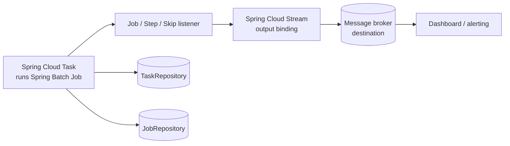

# Changing Destinations and Toggling Individual Batch Event Types

In **Spring Cloud Task**, a finite-running application can execute a **Spring Batch Job**, record its outcome, and terminate. Spring Cloud Task stores process lifecycle data in **`TaskRepository`**; Spring Batch stores Job/Step details in **`JobRepository`**. When dashboards, operational monitoring, or remote alerting are needed, Spring Cloud Task can integrate with **Spring Cloud Stream** to emit additional **Batch events** to a message broker.

Not every application needs every event. For example, a revenue reconciliation task reads millions of transactions, yet the dashboard only needs to know which Job started, which Step failed, and which items were skipped. Emitting per-item events can add unnecessary load to the broker; furthermore, each consumer group may need a separate destination.

In the **Events** chapter, this lesson covers two things:

1. **Changing the destination** receiving each Batch listener's events via Spring Cloud Stream bindings.
2. **Enabling/disabling individual event types**, or disabling the entire Batch event emission mechanism via `spring.cloud.task.batch.events.*` properties.

After this lesson, you will be able to distinguish **listener, binding name, and destination**, choose events with operational value, write complete YAML configuration, reconcile results against Task/Batch metadata, and avoid mistaking event disablement for disabling business processing.

## 1. Where Do Batch Events Come From and Go?

When Spring Cloud Task runs alongside Spring Batch and Spring Cloud Stream, the framework can auto-configure **event-emitting listeners** to observe Job/Step callbacks. The listener sends information to an **output binding**; a **binder** (RabbitMQ, Kafka, or another supported binder) delivers messages to a destination on the broker.



The components in the diagram have distinct responsibilities:

| Component | Role | Should Not Be Mistaken For |
| --- | --- | --- |
| `TaskRepository` | Stores `TaskExecution`, exit code, and app runtime | A Batch message queue. |
| `JobRepository` | Stores `JobExecution`, `StepExecution`, and checkpoints for restart | A replacement for a broker. |
| Event-emitting listener | Observes Spring Batch callbacks and produces messages | A Job orchestration/restart mechanism. |
| Spring Cloud Stream binding | Logical output of the publisher | A fixed topic or exchange name. |
| Binder and destination | Delivers messages to the messaging system | A guarantee that every message arrives exactly once. |

**Events are supplementary observational data.** An emitted event does not by itself confirm business data committed; and a Job can still run and update repositories even when event emission is turned off.

### Three Easily Confused Names

For example, for a Step:

- **Listener:** `StepExecutionListener`, invoked during the Step lifecycle.
- **Binding name:** `step-execution-events`, the logical name of the output channel.
- **Destination:** `ops.batch.steps.v1`, where the broker receives messages after mapping configuration.

Keeping the binding name and changing the destination is the simplest option. Renaming the binding is a separate step and requires reconfiguring the destination under the new name.

## 2. Seven Spring Batch Event Types

Spring Cloud Task supports seven event listener groups when an application runs a Batch Job:

| Type | Spring Batch Listener | Default Binding | Meaning and Volume |
| --- | --- | --- | --- |
| **Job execution** | `JobExecutionListener` | `job-execution-events` | Job lifecycle, low frequency. |
| **Step execution** | `StepExecutionListener` | `step-execution-events` | Step lifecycle, helps pinpoint which step failed. |
| **Chunk** | `ChunkListener` | `chunk-events` | Per chunk cycle, higher frequency than Step. |
| **Item read** | `ItemReadListener` | `item-read-events` | Per item read operation; can be very high volume. |
| **Item process** | `ItemProcessListener` | `item-process-events` | Per item processing operation; can be very high volume. |
| **Item write** | `ItemWriteListener` | `item-write-events` | Per chunk/group write callback, not necessarily per single item. |
| **Skip** | `SkipListener` | `skip-events` | When Batch skips an item under its skip policy. |

**Production recommendation:** Start with **Job + Step + Skip** if your goal is knowing when processes start/end and detecting excluded records. Only enable Chunk, Item Read, Item Process, and Item Write when granular tracing is genuinely needed and you have the traffic budget for it.

Enabling `skip.enabled=true` **does not create skip events by itself**. Spring Batch must actually encounter a skip condition in the Job/Step, and the listener must be properly configured.

## 3. Conditions for the Publisher to Work

Setting properties in `application.yml` **does not create a broker or listener by itself**. You need:

1. An application with Spring Cloud Task, Spring Batch, and a **Batch Job that actually runs**.
2. A Batch events listener mechanism compatible with your chosen Spring Cloud Task version, with auto-configuration conditions satisfied.
3. **Spring Cloud Stream** and a **binder implementation** matching your broker on the classpath.
4. An available broker, an account with publish permissions on the destination, and valid connection configuration.
5. Event switches enabled and binding/destination names properly mapped.

Example Maven dependencies for the **RabbitMQ** broker (placed inside a `pom.xml` that already has a compatible Spring Boot parent, Spring Cloud BOM, and packaging plugin):

```xml
<dependencies>
    <dependency>
        <groupId>org.springframework.cloud</groupId>
        <artifactId>spring-cloud-starter-task</artifactId>
    </dependency>
    <dependency>
        <groupId>org.springframework.boot</groupId>
        <artifactId>spring-boot-starter-batch</artifactId>
    </dependency>
    <dependency>
        <groupId>org.springframework.cloud</groupId>
        <artifactId>spring-cloud-stream-binder-rabbit</artifactId>
    </dependency>
    <dependency>
        <groupId>org.postgresql</groupId>
        <artifactId>postgresql</artifactId>
        <scope>runtime</scope>
    </dependency>
</dependencies>
```

The snippet above is not a complete POM. If using Kafka, replace the RabbitMQ binder with the Kafka binder and configure its connection accordingly. You must align **compatible Spring Boot, Spring Cloud release train, Spring Batch, and Stream binder versions**; internal binding registration may differ across framework generations.

## 4. Changing the Destination Without Renaming the Binding

This is the preferred approach when you only want to redirect where messages go. Example:

```yaml
spring:
  cloud:
    task:
      batch:
        events:
          enabled: true
    stream:
      bindings:
        job-execution-events:
          destination: ops.batch.jobs.v1
        step-execution-events:
          destination: ops.batch.steps.v1
        skip-events:
          destination: ops.batch.skips.v1
```

The default bindings remain named `job-execution-events`, `step-execution-events`, and `skip-events`. Only where they publish changes.

Equivalent `.properties` syntax:

```properties
spring.cloud.stream.bindings.job-execution-events.destination=ops.batch.jobs.v1
spring.cloud.stream.bindings.step-execution-events.destination=ops.batch.steps.v1
spring.cloud.stream.bindings.skip-events.destination=ops.batch.skips.v1
```

General format:

```properties
spring.cloud.stream.bindings.<binding-name>.destination=<new-destination>
```

Here `<binding-name>` is the **binding name used by the listener**, not the Java class name; `<new-destination>` is the desired broker target. The exact meaning of destination depends on the binder: with Kafka it generally maps to a topic; with RabbitMQ it also depends on the binder's exchange/routing/binding setup.

### When Should You Avoid Funneling All Events to One Destination?

If all Job, Step, and Item events flow into a single topic/exchange, receivers need a strict payload contract to classify them, and everything shares the same retention, ACLs, and load pressure. For large monitoring systems, **separating destinations by data granularity** generally helps:

- Job dashboards do not have to read item-level messages.
- Skip alerts get dedicated retention and subscribers.
- Stricter ACLs and security policies apply to messages with granular details.
- Bandwidth and cost can be managed per group.

## 5. Renaming the Binding Before Choosing the Destination

Spring Cloud Task also supports properties to change a listener's **binding name**. Suppose you want the Step listener to publish through a logical binding `stepAuditOut`, and then route that binding to `ops.batch.steps.v2`:

```yaml
spring:
  cloud:
    task:
      batch:
        events:
          step-execution-event-binding-name: stepAuditOut
    stream:
      bindings:
        stepAuditOut:
          destination: ops.batch.steps.v2
```

The two properties serve different purposes:

- `spring.cloud.task.batch.events.step-execution-event-binding-name`: changes the **binding name** used by the Step listener.
- `spring.cloud.stream.bindings.stepAuditOut.destination`: sets the **actual destination** for the new binding.

If you change the binding name while leaving destination settings under the **old** binding name, the listener will not necessarily use your intended target. Therefore, whenever you rename a binding, **map the destination under the new name** and verify bindings at runtime.

### Properties for Renaming Bindings

| Listener | Property Configured by Spring Cloud Task |
| --- | --- |
| Job execution | `spring.cloud.task.batch.events.job-execution-event-binding-name` |
| Step execution | `spring.cloud.task.batch.events.step-execution-event-binding-name` |
| Chunk | `spring.cloud.task.batch.events.chunk-event-binding-name` |
| Item read | `spring.cloud.task.batch.events.item-read-event-binding-name` |
| Item process | `spring.cloud.task.batch.events.item-process-event-binding-name` |
| Item write | `spring.cloud.task.batch.events.item-write-event-binding-name` |
| Skip | `spring.cloud.task.batch.events.skip-event-binding-name` |

**Property name warning:** Some examples in the Spring Cloud Task guide show `step-execution-events-binding-name` (plural `events`), whereas the **configuration properties** table and `TaskEventProperties#setStepExecutionEventBindingName(...)` API in the 3.x line use **`step-execution-event-binding-name`** (singular `event`). When renaming a binding, check the **configuration metadata/API for your project's exact version**. If you only need to change the target, using `spring.cloud.stream.bindings.step-execution-events.destination` avoids that ambiguity.

## 6. Disabling All Batch Events

Disable the Batch event-emitting listeners auto-configured by Spring Cloud Task:

```properties
spring.cloud.task.batch.events.enabled=false
```

Equivalent:

```yaml
spring:
  cloud:
    task:
      batch:
        events:
          enabled: false
```

**Impact:** The Batch event mechanism is turned off; **the Batch Job can still run**, Steps still read/process/write, `JobRepository` still saves metadata, and `TaskRepository` can still record `TaskExecution`. Custom listeners or other message pipelines in the application are not necessarily affected by this property.

### Task Events and Batch Events Are Two Separate Switches

| Property | Scope |
| --- | --- |
| `spring.cloud.task.events.enabled=false` | Does not emit **Spring Cloud Task**-level events like `TaskExecution` over `task-events`. |
| `spring.cloud.task.batch.events.enabled=false` | Does not emit **Spring Batch**-level events such as Job, Step, and Chunk via the built-in listener mechanism. |

To **receive only Task events**, disable Batch:

```yaml
spring:
  cloud:
    task:
      events:
        enabled: true
      batch:
        events:
          enabled: false
```

To **receive only Batch events**, disable Task:

```yaml
spring:
  cloud:
    task:
      events:
        enabled: false
      batch:
        events:
          enabled: true
```

**Do not use `spring.batch.job.enabled=false` as a switch to disable Batch events.** That property controls Spring Boot's automatic Job launch at startup. If the application invokes `JobLauncher` itself, Batch Jobs and event-emitting listeners can still run.

## 7. Disabling Individual Event Types

Spring Cloud Task supports these properties:

```properties
spring.cloud.task.batch.events.job-execution.enabled=false
spring.cloud.task.batch.events.step-execution.enabled=false
spring.cloud.task.batch.events.chunk.enabled=false
spring.cloud.task.batch.events.item-read.enabled=false
spring.cloud.task.batch.events.item-process.enabled=false
spring.cloud.task.batch.events.item-write.enabled=false
spring.cloud.task.batch.events.skip.enabled=false
```

Each line above is an **example of disabling one specific type**. You do not need to copy all of them and set `false` if you still want Job/Step events. To enable a type, use `enabled=true` (and keep the master switch enabled) alongside active listeners and binder. Documented per-type defaults are typically `true`, though you should verify your deployed version.

### Recommended Template for Lean Monitoring

Keep only **Job, Step, Skip**, and turn off chunk/item-level chatter:

```yaml
spring:
  cloud:
    task:
      batch:
        events:
          enabled: true
          job-execution:
            enabled: true
          step-execution:
            enabled: true
          skip:
            enabled: true
          chunk:
            enabled: false
          item-read:
            enabled: false
          item-process:
            enabled: false
          item-write:
            enabled: false
    stream:
      bindings:
        job-execution-events:
          destination: ops.batch.jobs.v1
        step-execution-events:
          destination: ops.batch.steps.v1
        skip-events:
          destination: ops.batch.skips.v1
```

Expected result:

- Job/Step can emit lifecycle messages when executed.
- Skip only emits messages when the Job actually triggers a skip condition.
- Chunk, Item Read, Item Process, and Item Write events from this Batch listener mechanism are no longer emitted.
- **Spring Batch reading, processing, writing, and skipping remain unchanged**: only the **message events** are turned off.

Actual message delivery also depends on the Job, listener auto-configuration, broker, and binder in your application version.

## 8. Hands-On Configuration Example

The `daily-reconciliation-task` application runs a revenue reconciliation Job, sending Job/Step/Skip events to RabbitMQ. Illustrative `application.yml` snippet:

```yaml
spring:
  application:
    name: daily-reconciliation-task
  main:
    web-application-type: none
  datasource:
    url: jdbc:postgresql://localhost:5432/reconciliation
    username: task_app
    password: ${TASK_DB_PASSWORD}
  batch:
    job:
      enabled: false
    jdbc:
      initialize-schema: never
  cloud:
    task:
      name: dailyReconciliationTask
      initialize-enabled: false
      events:
        enabled: true
      batch:
        events:
          enabled: true
          job-execution:
            enabled: true
          step-execution:
            enabled: true
          skip:
            enabled: true
          chunk:
            enabled: false
          item-read:
            enabled: false
          item-process:
            enabled: false
          item-write:
            enabled: false
    stream:
      bindings:
        job-execution-events:
          destination: ops.batch.jobs.v1
        step-execution-events:
          destination: ops.batch.steps.v1
        skip-events:
          destination: ops.batch.skips.v1
  rabbitmq:
    host: localhost
    port: 5672
    username: ${RABBIT_USERNAME}
    password: ${RABBIT_PASSWORD}
```

The example assumes the Spring Cloud Task/Spring Batch schemas were already created via compatible migrations (because `initialize-schema: never` and `initialize-enabled: false`). Broker and database accounts follow least privilege; passwords come from environment variables or a secret manager. Never put secrets on the command line or in event metadata.

`spring.batch.job.enabled=false` in this example means **the application launches the Job explicitly**, rather than Boot auto-running it at startup. `Job` and `ApplicationRunner` beans could look like this (placed in a Spring Boot 3.x / Spring Batch 5.x configuration class with proper imports):

```java
@Bean
Step reconcileStep(
        JobRepository repository,
        PlatformTransactionManager transactionManager) {
    return new StepBuilder("reconcileStep", repository)
        .tasklet((contribution, context) -> {
            System.out.println("Reconciling data");
            // TODO: Call actual business service.
            return RepeatStatus.FINISHED;
        }, transactionManager)
        .build();
}

@Bean
Job reconciliationJob(
        JobRepository repository,
        @Qualifier("reconcileStep") Step step) {
    return new JobBuilder("reconciliationJob", repository)
        .start(step)
        .build();
}

@Bean
ApplicationRunner launchJob(
        JobLauncher launcher,
        @Qualifier("reconciliationJob") Job job) {
    return args -> {
        List<String> dates = args.getOptionValues("business-date");
        if (dates == null || dates.size() != 1) {
            throw new IllegalArgumentException(
                "Requires --business-date=YYYY-MM-DD"
            );
        }
        LocalDate date = LocalDate.parse(dates.get(0));
        JobParameters parameters = new JobParametersBuilder()
            .addString("businessDate", date.toString(), true)
            .toJobParameters();

        JobExecution execution = launcher.run(job, parameters);
        if (execution.getStatus() != BatchStatus.COMPLETED) {
            throw new IllegalStateException(
                "Job did not complete: " + execution.getStatus()
            );
        }
    };
}
```

The example requires the corresponding Spring Batch/Boot/Spring Framework imports and an application with Spring Cloud Task enabled (such as `@EnableTask`). It assumes `JobLauncher` runs **synchronously**; if asynchronous, you must wait for completion before checking `BatchStatus` or closing the Task. These beans **only define the Job and perform business work**. Batch events are emitted via built-in listeners when conditions are met, without manually writing message-send code inside the tasklet.

Run from the packaged JAR:

```bash
./mvnw clean package
java -jar target/daily-reconciliation-task-0.0.1-SNAPSHOT.jar \
  --business-date=2026-11-24
```

The artifact name in the command is an example. If a `JobInstance` for the same date already `COMPLETED`, Spring Batch normally refuses to rerun the same identifying `JobParameters`; use a different date or a clearly designed reprocessing workflow.

## 9. Consumer Must Subscribe to the Matching Destination

When the producer changes its target from `job-execution-events` to `ops.batch.jobs.v1`, the consumer must also point to the new destination.

Example of a **functional Spring Cloud Stream** receiving application with a consumer bean named `jobStatusConsumer`:

```yaml
spring:
  cloud:
    function:
      definition: jobStatusConsumer
    stream:
      bindings:
        jobStatusConsumer-in-0:
          destination: ops.batch.jobs.v1
          group: monitoring-service
```

This is configuration on the **receiving side**, not part of the emitting task. The consumer must also provide the actual function bean, compatible message/payload types, a broker binder, error handling, and subscription permissions.

Older Spring Cloud Stream docs may show `spring.cloud.stream.bindings.input.destination`. For modern applications using the functional binding model, names like `jobStatusConsumer-in-0` are what to inspect. **Never switch the producer to a new destination while leaving the consumer subscribed to the old one**, or dashboards will go silent even as Tasks and Batch Jobs succeed.

## 10. What Toggling Events Does Not Change

| Configuration | What It Changes | What It Does Not Automatically Change |
| --- | --- | --- |
| `spring.cloud.stream.bindings.<name>.destination` | Where the binding's messages are published | Job/Step logic, `TaskExecution`, transactions. |
| `spring.cloud.task.batch.events.*-event-binding-name` | Binding name used by the listener | Destination unless a new mapping is added. |
| `spring.cloud.task.batch.events.enabled=false` | Disables built-in Batch event-emitting listeners | Running the Batch Job, `JobRepository`, restarts. |
| `spring.cloud.task.events.enabled=false` | Disables Task-level events | Task metadata and separately configured Batch events. |
| `item-read.enabled=false` | Disables sending item-read events | `ItemReader` still reads records. |
| `skip.enabled=false` | Disables sending skip events | Step skip rules can still take effect. |
| `spring.batch.job.enabled=false` | Disables **Boot auto-launching Jobs** | Application-invoked `JobLauncher` can still run Jobs. |

### Listener Order Is Not Broker Message Order

Spring Cloud Task also has `spring.cloud.task.batch.events.job-execution-order`, `step-execution-order`, `chunk-order`, `item-read-order`, `item-process-order`, `item-write-order`, and `skip-order` to adjust listener **`Ordered` precedence**.

That governs callback order within the same application context; it **does not guarantee** that messages across multiple topics/partitions/JVMs arrive at consumers in global order. When processing depends on sequence, use event IDs, timestamps, `JobExecution` IDs, and the broker's ordering guarantees.

## 11. Troubleshooting When Expected Events Are Missing

| Symptom | Possible Cause | How to Check |
| --- | --- | --- |
| No events received at all | Missing binder, Job didn't run, broker error, or `batch.events.enabled=false` | Check dependencies, configuration, `JobExecution`, binder and broker logs. |
| Job events arrive but Step events do not | Step events disabled individually, wrong binding name, or consumer on old destination | Check `step-execution.enabled` and input/output mappings. |
| Renamed binding yet destination didn't change | Mapped destination under the **old binding name** or singular/plural property typo | Check `TaskEventProperties`, configuration metadata, and runtime bindings. |
| Skip enabled yet no messages appear | Job had zero skipped items | Check `skipCount` and the Step's skip configuration. |
| Message volume spikes excessively | Chunk/item events are enabled | Disable unneeded listeners and monitor broker traffic. |
| Batch events disabled yet Job still runs | That is the expected result | Distinguish event listeners from Job/Step execution. |
| Consumer loses messages during destination change | Producer and consumer configs out of sync | Plan subscription migration/bridging to avoid monitoring gaps. |
| Duplicate messages on retries | Task rerun or broker redelivery | Use event/correlation IDs and idempotent consumers. |
| Task metadata not ended despite received event | Process still running, metadata update failed, or killed | Inspect `TaskRepository`, logs, and container/JVM status. |

Reconcile Batch metadata:

```sql
SELECT
    JOB_EXECUTION_ID,
    JOB_INSTANCE_ID,
    STATUS,
    EXIT_CODE,
    START_TIME,
    END_TIME
FROM BATCH_JOB_EXECUTION
ORDER BY JOB_EXECUTION_ID DESC;
```

And Spring Cloud Task metadata:

```sql
SELECT
    TASK_EXECUTION_ID,
    TASK_NAME,
    START_TIME,
    END_TIME,
    EXIT_CODE
FROM TASK_EXECUTION
ORDER BY TASK_EXECUTION_ID DESC;
```

Table/column names must match the schema of your installed framework version. **Do not treat "no events" as proof that "the Job never ran"**. If `JobRepository` shows a completed Job while the broker received nothing, focus investigation on listener auto-configuration, bindings, the binder, publish permissions, and subscriptions.

## 12. Safety, Reliability, and Scheduled Operations

**Control sensitive data.** Listener events can contain Job/Step information and processing context. Do not emit secrets, tokens, personal payloads, or overly granular source data unnecessarily; apply ACLs, encryption in transit, retention limits, and restricted consumer groups.

**Do not treat events as the sole source of truth.** If the JVM receives `SIGKILL` or the broker is unavailable, end events may be missing even when data committed; conversely, an event may be redelivered. Before deciding to retry, inspect `TaskExecution`, `JobExecution`, business outputs, and infrastructure state.

**Do not assume exactly-once.** Depending on the binder, broker, and ACK/retry settings, duplicates or message loss can occur during failures. Receivers should be idempotent by correlation ID/event ID and handle malformed schemas gracefully.

**If reliable post-commit notifications are needed**, direct listener publishing does not create an atomic transaction between the business database and the broker. Consider a **transactional outbox**, a retry-capable dispatcher, and consumer deduplication depending on your workflow's reliability requirements.

**Separate environments.** Dev, staging, and production should use distinct destinations/namespaces. Destinations can be parameterized via environment variables:

```yaml
spring:
  cloud:
    stream:
      bindings:
        job-execution-events:
          destination: ${BATCH_JOB_EVENT_DESTINATION:dev.batch.jobs.v1}
```

During deployment, govern environment variables and permissions so apps cannot accidentally publish to production destinations. During major destination migrations, plan for legacy consumers, schemas, ACLs, and transition windows.

## 13. Practice Lab

Execute against a **test database and test broker**:

1. Prepare a Spring Cloud Task application with a Batch Job and a binder; confirm `JobRepository`/`TaskRepository` contain metadata after a run.
2. Keep default bindings and observe `job-execution-events` and `step-execution-events` while the Job runs.
3. Change `spring.cloud.stream.bindings.job-execution-events.destination` to `lab.batch.jobs.v2`, update the consumer, and confirm routing changed.
4. Rename the Step binding via `step-execution-event-binding-name` and map the destination under the new name. Intentionally change only one side to analyze the failure.
5. Enable `job-execution`, `step-execution`, `skip`; disable `chunk`, `item-read`, `item-process`, `item-write`. Compare message counts before and after.
6. Set `spring.cloud.task.batch.events.enabled=false` and run a valid `JobInstance`. Why do Batch tables still contain rows?
7. Disable only `skip.enabled` and configure a Step that triggers actual skips. Verify that skipping still works even without emitting events.
8. Disable Task events while keeping Batch events, then reverse it; describe the difference between the two mechanisms.
9. Stop the consumer and run the Task; observe message retention and redelivery behavior for your actual binder/group.
10. Draft a production plan using only Job/Step/Skip events with dedicated destinations and retention policies.

**Review questions:**

- How do listener, binding name, and destination differ?
- Why is it preferable to change the destination of a default binding rather than renaming the binding itself?
- Which property disables **all** Batch events? Which property disables only **Item Read**?
- Why is disabling `spring.batch.job.enabled` not equivalent to disabling Batch events?
- Does a Job with `skipCount = 0` necessarily produce a skip message?
- When an end event is missing, which state sources should you verify before retrying?

**Remember:** To **change the destination**, use `spring.cloud.stream.bindings.<binding-name>.destination`; to **rename the binding**, use the version-accurate `*-event-binding-name` property; to **disable events**, use `spring.cloud.task.batch.events.<listener>.enabled=false` or disable all via `spring.cloud.task.batch.events.enabled=false`. These properties govern **observability notifications**, not the metadata, transactions, or restart capabilities of Spring Cloud Task or Spring Batch.

**Official references:**

- [Spring Cloud Task — Spring Cloud Stream Integration](https://docs.spring.io/spring-cloud-task/reference/stream.html).
- [Spring Cloud — Configuration Properties](https://docs.spring.io/spring-cloud/docs/current/reference/html/configprops.html).
- [Spring Cloud Task 3.0.4 — TaskEventProperties API](https://docs.spring.io/spring-cloud-task/docs/current/apidocs/org/springframework/cloud/task/batch/listener/support/TaskEventProperties.html).
- [Spring Cloud Stream Reference](https://docs.spring.io/spring-cloud-stream/reference/).
