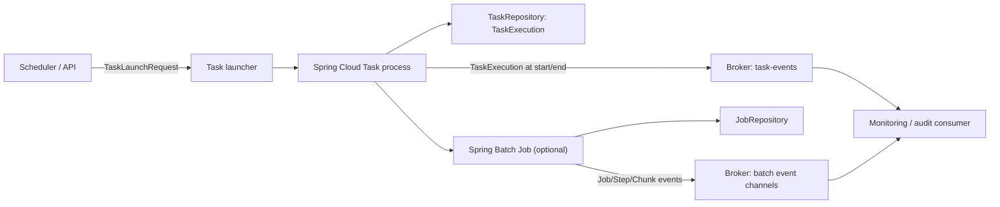

# Message Payloads, Execution Identifiers, and Data Compatibility

## 1. Why Do Task Events Need a Clear Data Contract?

**Spring Cloud Task** is used to build Spring Boot applications that run for a finite duration: start up, perform business work, and terminate. Each run is tracked by a `TaskExecution` in **`TaskRepository`**. When combined with **Spring Cloud Stream**, the application can also emit events so monitoring, alerting, or orchestration systems know when the process started and finished without continuously polling the database.

Suppose the `invoice-import` Task runs on a schedule to import invoices:

- The scheduler launches the Task at 01:00 and wants to track progress.
- The dashboard receives a "start" message, followed by an "end" message containing an exit code.
- The Task may invoke a Spring Batch Job; operations wants to link `TaskExecution` with `JobExecution`.
- The broker may redeliver messages, events may arrive out of order, or the consumer may be upgraded before the producer.

If you merely parse JSON strings without understanding **what the payload contains**, **which ID belongs to which layer**, **which fields can be null**, and **which format compatibility is guaranteed**, consumers will easily mislabel outcomes, merge two separate runs, or fail when the producer changes versions.

This lesson belongs to the **Events** chapter and focuses on three topics:

1. **Message payloads**: how native `TaskExecution` events, Batch events, and normalized business messages differ.
2. **Execution identifiers**: where `taskExecutionId`, `externalExecutionId`, `parentExecutionId`, `jobExecutionId`, and `eventId` are used.
3. **Data compatibility**: defining schemas/versions, handling nulls, timestamps, sensitive data, duplicate or out-of-order events, and producer–consumer upgrades.

## 2. Distinguishing Launch Commands from Outcome Events

Spring Cloud Task supports Spring Cloud Stream integration in multiple directions. **Never confuse a launch request message with an event describing a run that already occurred.**

| Message Type | Purpose | Typical Content |
| --- | --- | --- |
| `TaskLaunchRequest` | **Command** asking a launcher system to start a Task | Artifact `uri`, `applicationName`, `commandLineArguments`, `environmentProperties`, `deploymentProperties` |
| `TaskExecution` on `task-events` channel | **Status event** of a Task run | ID, name, start/end timestamps, exit code, messages, and arguments |
| Spring Batch events | Reflects Job/Step/Chunk or item listeners | Data specific to the Batch callback type; does not share the `TaskExecution` schema |
| Application-defined event contract | Stable interface for external systems | `eventId`, `schemaVersion`, `eventType`, correlation IDs, and normalized outcome |

`TaskLaunchRequest` can flow from a processor to a task sink to command a launch. It does not prove the Task ran successfully. Conversely, `task-events` reflects a lifecycle milestone; receiving a start event does not mean the work will complete.



To make a chain of commands and outcomes traceable, the orchestrator should intentionally generate a **correlation ID** or `externalExecutionId`; once the Task obtains a `taskExecutionId`, persist the relationship between those two values rather than treating them as the same ID.

## 3. Native Task Events: `TaskExecution` Payload

According to Spring Cloud Task documentation, when the classpath contains `spring-cloud-stream`, **a supported binder**, and a defined Task, an event listener can emit the `TaskExecution` object to a channel named **`task-events`** at **start and end**. Disable the native event-emitting listener with:

```properties
spring.cloud.task.events.enabled=false
```

Native events use the **Java `TaskExecution` type**, not a custom business JSON contract defined by your team. This Java object exposes these getters:

| Java Property | Type | Meaning |
| --- | --- | --- |
| `getExecutionId()` | `long` | ID of a `TaskExecution` run in the repository |
| `getTaskName()` | `String` | Task name |
| `getStartTime()` | `LocalDateTime` | Start timestamp |
| `getEndTime()` | `LocalDateTime` | End timestamp; may be `null` |
| `getExitCode()` | `Integer` | Exit code; may be `null` before outcome is set |
| `getExitMessage()` | `String` | Summary assigned by the application; may be `null` |
| `getErrorMessage()` | `String` | Technical error details captured by the lifecycle; may be `null` |
| `getArguments()` | `List<String>` | List of runtime arguments; may contain sensitive data |
| `getExternalExecutionId()` | `String` | Identifier supplied by an external platform, if any |
| `getParentExecutionId()` | `Long` | Parent `TaskExecution` ID, if configured |

**Not every field is populated at every milestone.** Start events typically lack `endTime` and `exitCode`. End events can carry the exit code and message, yet if the process receives `SIGKILL` or fails to finish initializing, you may **not receive an end event**.

### 3.1. Two Messages for One `TaskExecution`

The two JSON examples below **only illustrate the data semantics that may appear when serializing `TaskExecution`**. They are **not the official wire schema** across every Jackson/binder version; date formats, property names, type headers, and null representation must be verified in your real environment.

**At start**:

```json
{
  "executionId": 4812,
  "taskName": "invoice-import",
  "startTime": "2026-11-24T01:00:00",
  "endTime": null,
  "exitCode": null,
  "exitMessage": null,
  "errorMessage": null,
  "arguments": ["--task.business-date=2026-11-23"],
  "externalExecutionId": "scheduler-run-974",
  "parentExecutionId": null
}
```

**At end**:

```json
{
  "executionId": 4812,
  "taskName": "invoice-import",
  "startTime": "2026-11-24T01:00:00",
  "endTime": "2026-11-24T01:13:26",
  "exitCode": 0,
  "exitMessage": "IMPORTED; count=1200",
  "errorMessage": null,
  "arguments": ["--task.business-date=2026-11-23"],
  "externalExecutionId": "scheduler-run-974",
  "parentExecutionId": null
}
```

**Key point:** Native `TaskExecution` **does not guarantee an `eventType` or `schemaVersion` field** telling the consumer the exact phase. Receivers can cross-check `endTime`/`exitCode` and the repository, but **should not build critical workflows solely on guessing a nullable field**. If you need explicit `STARTED`/`FINISHED` indicators, emit your own application-versioned envelope.

### 3.2. Dependencies and Bindings When Using Native Events

Maven example (placed under `dependencies` in a project importing compatible Spring Boot and Spring Cloud BOMs):

```xml
<dependencies>
    <dependency>
        <groupId>org.springframework.cloud</groupId>
        <artifactId>spring-cloud-starter-task</artifactId>
    </dependency>
    <dependency>
        <groupId>org.springframework.cloud</groupId>
        <artifactId>spring-cloud-stream</artifactId>
    </dependency>
    <dependency>
        <groupId>org.springframework.cloud</groupId>
        <artifactId>spring-cloud-stream-binder-kafka</artifactId>
    </dependency>
</dependencies>
```

`spring-cloud-stream-binder-kafka` is **an illustrative choice**. Another binder supported by your project version can be used; configure and operate the corresponding broker. Adding `spring-cloud-stream` without a binder will not provide a working inter-process event channel.

Traditional binding configuration example named `task-events` in the Spring Cloud Task docs:

```yaml
spring:
  cloud:
    task:
      events:
        enabled: true
    stream:
      bindings:
        task-events:
          destination: task-events
          content-type: application/json
```

This is an example **configuration for the `task-events` channel of Task integration**; it does not define broker hosts, credentials, topic permissions, or consumers. Newer Spring Cloud Stream versions also feature **functional binding names**, while Task event integration may declare channels differently. Therefore, inspect **actual bindings at startup** for your combination of Spring Cloud Task/Stream/binder rather than mechanically renaming the channel to `task-events-out-0`.

`content-type=application/json` guides payload conversion but **does not automatically provide schema compatibility or safe deserialization of framework Java classes**. `contentType` headers, binding configuration, and defaults follow precedence rules; test encoding/decoding with consumers running different versions.

## 4. Batch Events Do Not Share the `TaskExecution` Schema

If a Spring Cloud Task runs a Spring Batch Job and Batch event integration is enabled, the docs list these channels:

| Batch Listener | Default Event Channel |
| --- | --- |
| `JobExecutionListener` | `job-execution-events` |
| `StepExecutionListener` | `step-execution-events` |
| `ChunkListener` | `chunk-events` |
| `ItemReadListener` | `item-read-events` |
| `ItemProcessListener` | `item-process-events` |
| `ItemWriteListener` | `item-write-events` |
| `SkipListener` | `skip-events` |

Each channel's payload depends on callback type and implementation. **Do not send all of them into a single consumer assuming they are `TaskExecution`**, and do not infer `jobExecutionId` as equal to `taskExecutionId`.

Disable all Batch events with:

```properties
spring.cloud.task.batch.events.enabled=false
```

Or disable only high-frequency events, for example:

```properties
spring.cloud.task.batch.events.item-read.enabled=false
spring.cloud.task.batch.events.item-process.enabled=false
spring.cloud.task.batch.events.item-write.enabled=false
spring.cloud.task.batch.events.chunk.enabled=false
```

Item/chunk events can generate huge traffic and expose record details; enable only what is genuinely needed, bound payloads, and monitor backlog. When cross-application compatibility is required, aggregate into a **stable-contract business domain event** (such as `BATCH_JOB_FINISHED` with read/write counts and error code) instead of exposing raw internal Batch objects directly.

## 5. Distinguishing Execution Identifiers

This is the most error-prone area when multiple Tasks, Batch Jobs, and orchestration systems collaborate:

| Identifier | Issued By / Scope | Proper Usage |
| --- | --- | --- |
| `taskExecutionId` (`executionId` in Java) | `TaskRepository`; unique **within one repository** | Look up the record of a single process run |
| `taskName` | Task configuration/resolver | Identifies the **job type**, does not distinguish individual runs |
| `externalExecutionId` | Scheduler/deployer or external config | Links `TaskExecution` to the platform's request/Job/Pod |
| `parentExecutionId` | Parent Task ID when parent–child relationship exists | Traces related Tasks; not `JobExecutionId` |
| `jobExecutionId` | Spring Batch's `JobRepository` | Identifies a single Batch Job run |
| `stepExecutionId` | `JobRepository` | Identifies a single Batch Step/partition execution |
| `eventId` | **Producer-defined** when using an envelope | Identifies a **logical event** for deduplication |
| `correlationId`/`traceId` | Request/trace/orchestrator; contract-dependent | Connects multiple runs and messages across one workflow |

**`taskExecutionId` is not globally unique across the world.** Two separate databases can both generate `TASK_EXECUTION_ID=4812`. When aggregating events across environments, use the tuple **`(sourceSystem, environment, taskExecutionId)`** or an explicit repository key.

**`eventId` is not `taskExecutionId`.** A Task can emit STARTED and FINISHED, or multiple distinct business events with the same `taskExecutionId` yet **different `eventId`s**. The producer should preserve the same `eventId` when **resending an already recorded event**; do not generate a fresh UUID on every broker redelivery, as that defeats consumer deduplication by `eventId`.

### 5.1. When Is `externalExecutionId` Needed?

Suppose a schedule run with ID `scheduler-run-974` launches Task 4812. The scheduler may retry and create `TaskExecution` 4813 for the same business date. Correlation table:

| Scheduler Run | TaskExecution | Attempt | Result |
| --- | ---: | ---: | --- |
| `scheduler-run-974` | 4812 | 1 | Failed |
| `scheduler-run-974` | 4813 | 2 | Succeeded |

If each retry creates a new `TaskExecution`, **do not merge 4812 and 4813 into the same run**. You can share the workflow's correlation ID while storing attempt IDs or individual `taskExecutionId`s to tell them apart. How the platform assigns `externalExecutionId` across retries must be explicitly defined; do not assume the framework creates or preserves it automatically.

### 5.2. How Are Task and Batch Linked?

One Task can invoke multiple Batch Jobs; a Batch run has its ID issued **by `JobRepository`**, not by `TaskRepository`. With proper Spring Cloud Task Batch integration, the join table `TASK_TASK_BATCH` links `TASK_EXECUTION_ID` and `JOB_EXECUTION_ID`. It only exists and holds complete links when that integration is configured.

Read-only query example:

```sql
SELECT
    t.TASK_EXECUTION_ID,
    t.TASK_NAME,
    t.EXIT_CODE AS TASK_EXIT_CODE,
    b.JOB_EXECUTION_ID
FROM TASK_EXECUTION t
JOIN TASK_TASK_BATCH b
  ON b.TASK_EXECUTION_ID = t.TASK_EXECUTION_ID
WHERE t.TASK_EXECUTION_ID = :taskExecutionId;
```

With remote partitioning, workers can be independent Spring Cloud Tasks; each worker has its own `TaskExecution` and its own Batch `StepExecution`. Never assume `parentExecutionId` always equals `JobExecutionId` or `StepExecutionId`. Persist and use the exact links provided by the launcher, Task/Batch integration, and repositories.

## 6. Proposed Versioned Event Contract

Emitting raw `TaskExecution` is convenient within a single-version ecosystem, but if data becomes a **broker-based API** across teams or languages, use a DTO/envelope with its own contract. Example **application-designed schema v1**:

```json
{
  "schemaVersion": 1,
  "eventId": "4d449a17-0212-4fdc-ad8a-7cfca39d7fb8",
  "eventType": "task.execution.finished",
  "occurredAt": "2026-11-24T01:13:26Z",
  "sourceSystem": "billing-platform",
  "environment": "production",
  "taskName": "invoice-import",
  "taskExecutionId": 4812,
  "externalExecutionId": "scheduler-run-974",
  "parentTaskExecutionId": null,
  "status": "SUCCEEDED",
  "exitCode": 0,
  "reasonCode": null
}
```

**This is an application example contract, not the default JSON emitted by Spring Cloud Task.**

| Field | Required? | Explanation |
| --- | --- | --- |
| `schemaVersion` | Yes | Integer version of the data contract |
| `eventId` | Yes | Stable ID for one logical event; enables idempotent consumption |
| `eventType` | Yes | Explicit event type, e.g., `task.execution.finished` |
| `occurredAt` | Yes | Occurrence timestamp in **UTC**, ISO-8601 with `Z` or offset |
| `sourceSystem`, `environment` | Yes | Disambiguates repositories that might share identical IDs |
| `taskName` | Yes | Job/task name |
| `taskExecutionId` | Yes on **FINISHED events** in this example contract | Key of the existing `TaskExecution` |
| `externalExecutionId`, `parentTaskExecutionId` | No | External/parent link if present |
| `status` | Yes | `SUCCEEDED`, `FAILED`, or `UNKNOWN` per application rules |
| `exitCode` | Nullable | Numeric exit code, not Spring Batch's string `ExitStatus` |
| `reasonCode` | No | Short reason code, without stack traces |

Separate `eventType` from `status` because the two fields answer different questions: **what kind of event is this** and **what is the outcome at that moment**. A `task.execution.finished` event can carry `status=FAILED`.

**For STARTED events:** you can define a separate `task.execution.started` contract and allow fields such as `taskExecutionId` to be provisional if the lifecycle/framework version does not yet provide a persisted ID at publish time. Before making ID mandatory on STARTED, verify empirically that the ID is already assigned in your version. If early correlation is needed, emit a `correlationId` pre-assigned by the launcher.

### 6.1. Timestamp Normalization

`TaskExecution.getStartTime()` and `getEndTime()` return **`LocalDateTime`**, which **carries no timezone or offset**. Therefore, never blindly append `Z` to that value and claim it is UTC.

For application-defined events, use `Instant` or `OffsetDateTime` for `occurredAt` and mandate UTC. If converting timestamps from the repository to UTC, know which timezone the database stores and define the conversion explicitly; never let producer and consumer guess the database's timezone.

### 6.2. Excluding Sensitive Data from Events

Raw `TaskExecution` payloads can contain `arguments` and `errorMessage`. CLI arguments are sometimes misused for passwords/tokens; error messages can contain stack traces, internal paths, or customer data.

A public contract should use an **allowlist** of fields like the table above. Do not send:

- Passwords, tokens, JDBC URLs containing credentials, or raw command-line arguments.
- Full stack traces, invoice contents, or large business payloads.
- Batch `ExecutionContext` objects or unsanitized exception messages.

Consumers need topic read ACLs, transport encryption, and policy-compliant log storage. Setting `content-type: application/json` is **not a security feature**.

## 7. Java Example: Emitting Normalized Events with `StreamBridge`

This example uses compatible BOM-managed **Spring Boot + Spring Cloud Task + Spring Cloud Stream**. We **disable native `task-events`** to avoid two competing event streams with different contracts, and explicitly emit **one FINISHED event** via `StreamBridge`. `eventId` and `occurredAt` are generated in application code rather than derived from `TaskExecution`.

### 7.1. DTO and `TaskExecutionListener`

```java
package com.example.invoice;

import java.time.Instant;
import java.util.UUID;

import org.slf4j.Logger;
import org.slf4j.LoggerFactory;
import org.springframework.cloud.stream.function.StreamBridge;
import org.springframework.cloud.task.listener.TaskExecutionListener;
import org.springframework.cloud.task.repository.TaskExecution;
import org.springframework.stereotype.Component;

@Component
public class TaskStatusEventListener implements TaskExecutionListener {

    private static final Logger log =
        LoggerFactory.getLogger(TaskStatusEventListener.class);

    private final StreamBridge bridge;

    public TaskStatusEventListener(StreamBridge bridge) {
        this.bridge = bridge;
    }

    @Override
    public void onTaskStartup(TaskExecution execution) {
        // Example only publishes FINISHED.
    }

    @Override
    public void onTaskFailed(
            TaskExecution execution, Throwable throwable) {
        // Do not emit Throwable / stack trace directly to the broker.
        // onTaskEnd will build the finished event.
    }

    @Override
    public void onTaskEnd(TaskExecution execution) {
        long taskId = execution.getExecutionId();
        if (taskId <= 0) {
            log.warn("Task lacks a valid executionId; skipping FINISHED");
            return;
        }

        Integer code = execution.getExitCode();
        String status;
        if (code == null) {
            status = "UNKNOWN";
        } else if (code == 0 && execution.getErrorMessage() == null) {
            status = "SUCCEEDED";
        } else {
            status = "FAILED";
        }

        TaskStatusEvent event = new TaskStatusEvent(
            1,
            UUID.randomUUID().toString(),
            "task.execution.finished",
            Instant.now(),
            "billing-platform",
            "production",
            execution.getTaskName(),
            taskId,
            execution.getExternalExecutionId(),
            execution.getParentExecutionId(),
            status,
            code,
            null
        );

        try {
            boolean accepted = bridge.send("taskStatus-out-0", event);
            if (!accepted) {
                log.warn("Broker did not accept event for Task {}", taskId);
            }
        } catch (RuntimeException publishError) {
            log.warn(
                "Failed to emit end event for Task {}",
                taskId, publishError
            );
            // Best effort: do not alter business outcome
            // merely because event observability failed.
        }
    }

    public record TaskStatusEvent(
        int schemaVersion,
        String eventId,
        String eventType,
        Instant occurredAt,
        String sourceSystem,
        String environment,
        String taskName,
        Long taskExecutionId,
        String externalExecutionId,
        Long parentTaskExecutionId,
        String status,
        Integer exitCode,
        String reasonCode
    ) {}
}
```

**Intentional limitations of this example:**

1. `status` is an **application convention**, not an official `TaskExecution` status enum. When `exitCode` is not ready, the example uses `UNKNOWN` to avoid arbitrarily marking success.
2. `onTaskEnd` runs **before the final `TaskRepository` completion update** in the documented lifecycle. A consumer may receive the event earlier than SQL sees the final `endTime` and `exitCode`; retry when querying the repository.
3. `StreamBridge.send(...)` indicates the send was accepted at a framework level, **not an end-to-end guarantee that the consumer processed it and updated its database**.
4. Because errors are caught and logged best-effort, events can be lost if the broker fails or the JVM dies. For mandatory auditing, use a **transactional outbox** or another durable mechanism rather than a listener sending straight to the broker.
5. `UUID.randomUUID()` generates an `eventId` for this emission; if your design supports **resending after a crash**, persist the `eventId` when writing the event to the outbox and **reuse the same `eventId`** rather than regenerating it on every send.
6. Hardcoded `sourceSystem`/`environment` values in the example should be injected from controlled configuration in production.

### 7.2. Output Binding Configuration

```yaml
spring:
  cloud:
    task:
      events:
        enabled: false
    stream:
      bindings:
        taskStatus-out-0:
          destination: task-status-v1
          content-type: application/json
```

`taskStatus-out-0` is an **application-chosen binding name for `StreamBridge`**, distinct from the native `task-events` channel. Producer and consumer must connect to the right `task-status-v1` topic/exchange. This example requires Kafka/RabbitMQ binder configuration, broker access permissions, serializers, and Spring Boot Jackson support for `Instant`.

This is the **application-defined event** approach. If you want to keep the native `task-events` channel for legacy consumer compatibility, do not disable the listener; instead use a **separate topic**, distinguish native vs. public contracts, and avoid double-counting in dashboards.

## 8. Compatible Consumer: Validating Schema Before Applying

An external consumer should not deserialize every message into Spring Cloud Task's `TaskExecution` because it might not run the same Java version or framework version. For versioned events, you can read JSON as a `JsonNode` and validate the schema:

```java
package com.example.monitor;

import java.util.function.Consumer;

import com.fasterxml.jackson.databind.JsonNode;
import org.springframework.context.annotation.Bean;
import org.springframework.context.annotation.Configuration;

@Configuration
public class TaskStatusConsumerConfig {

    @Bean
    Consumer<JsonNode> taskStatusConsumer() {
        return json -> {
            if (json.path("schemaVersion").asInt(-1) != 1) {
                throw new IllegalArgumentException(
                    "Unsupported TaskStatusEvent version"
                );
            }

            if (!"task.execution.finished".equals(
                    json.path("eventType").asText())) {
                throw new IllegalArgumentException(
                    "Invalid eventType for this consumer"
                );
            }

            JsonNode id = json.path("taskExecutionId");
            if (!id.isIntegralNumber() || id.asLong() <= 0) {
                throw new IllegalArgumentException(
                    "Invalid taskExecutionId"
                );
            }

            // Production app: verify eventId/source/environment,
            // deduplicate, and update state within a transaction.
            // Do not treat this validation example as a complete production consumer.
            System.out.printf("Task execution received: %d%n", id.asLong());
        };
    }
}
```

Binding for the `taskStatusConsumer` function bean:

```yaml
spring:
  cloud:
    function:
      definition: taskStatusConsumer
    stream:
      bindings:
        taskStatusConsumer-in-0:
          destination: task-status-v1
          group: task-status-monitor
          content-type: application/json
```

**Consumer group** and actual delivery guarantees depend on the binder. With Kafka, verify topic, partitions, group ID, offset commits, retries, and dead-letter topic settings. When validation throws, configure appropriate retry/DLQ policies so unsupported versions do not retry infinitely.

A production consumer should also check `sourceSystem`, `environment`, `eventId`, timestamp formats, `taskName`, tenant permissions, and string length limits. The snippet above intentionally illustrates only the schema-validation step.

## 9. Duplicates, Out-of-Order Delivery, and Eventual Consistency

Never assume the broker guarantees **exactly-once**, **global ordering**, or that both STARTED and FINISHED messages always arrive.

| Scenario | Consequence for a Naive Consumer | Mitigation |
| --- | --- | --- |
| FINISHED arrives twice | Sends two alerts / records two outcomes | Use stable `eventId`, inbox table, and unique constraints |
| FINISHED arrives before STARTED | Dashboard overwrites `FINISHED` with `RUNNING` | State transition rules preventing stale events from regressing state |
| STARTED arrives, FINISHED lost | Dashboard shows running forever | Timeouts and reconciliation against `TaskRepository`/scheduler |
| FINISHED arrives before repository commit | Lookup misses final `endTime` | Bounded retry/backoff and reconciliation mechanism |
| Task retry creates a new `TaskExecution` | Two executions share `correlationId` | Track `attempt` or distinct IDs; do not merge |
| Two repositories share `taskExecutionId` | Audit record collision | Include `sourceSystem` + `environment` + `taskExecutionId` |
| Consumer sees unsupported `schemaVersion` | Event loss or infinite retries | Route to DLQ, alert, and upgrade readers |

### 9.1. Idempotent Inbox Design

Illustrative PostgreSQL schema idea:

```sql
CREATE TABLE task_event_inbox (
    event_id UUID PRIMARY KEY,
    source_system VARCHAR(100) NOT NULL,
    environment VARCHAR(40) NOT NULL,
    task_execution_id BIGINT NOT NULL,
    event_type VARCHAR(80) NOT NULL,
    received_at TIMESTAMPTZ NOT NULL DEFAULT CURRENT_TIMESTAMP
);

-- Within the event processing transaction:
INSERT INTO task_event_inbox (
    event_id, source_system, environment,
    task_execution_id, event_type
)
VALUES (
    :eventId, :sourceSystem, :environment,
    :taskExecutionId, :eventType
)
ON CONFLICT (event_id) DO NOTHING;
```

The application must **check the inserted row count**: if it is 0, the event was already processed or recorded and its side effects must not be re-applied. Inserting into the inbox and updating internal state should happen in the **same transaction** to avoid recording inbox receipt while business state fails to update.

If the producer lacks an outbox and generates a **new `eventId`** upon resending, ID-based deduplication will miss two events with the same semantic meaning. In that case, consider a logical key `(sourceSystem, environment, taskExecutionId, eventType)` for event types that **occur only once** (such as final completion); do not use that key for events that legitimately occur many times (such as per-chunk progress).

### 9.2. Ordering Only Has Meaning Within a Scope

Kafka preserves order **within a single partition**, not across all partitions/topics. To give events for the same `TaskExecution` a chance at staying ordered, use a **stable message key** such as `sourceSystem:environment:taskExecutionId` (once the ID exists) to route to the same partition. However:

- A key cannot recreate events lost when a process dies.
- STARTED may be emitted before a usable `TaskExecutionId` exists; agree on a correlation key upfront or accept out-of-order handling.
- Events from separate workers/Batch Jobs have no global total order.
- Consumers must rely on **`eventType` and state transitions**, never treating "later message received is newer" as the sole rule.

Simple dashboard model: `UNKNOWN -> RUNNING -> FINISHED`; a STARTED event arriving after FINISHED **must not** revert state back to RUNNING. When a job has multiple retry attempts, keep individual state per **`taskExecutionId`** alongside an aggregated state at the correlation ID level.

## 10. Data Compatibility Across Version Upgrades

Native `TaskExecution` is convenient among apps in the same ecosystem, but **it is not a framework-independent versioned API schema**. Upgrading Spring Cloud Task/Spring Cloud Stream/Jackson can change timestamp serialization, type headers, default fields, exception formatting, or converters.

With an application-defined `task-status-v1` contract, you can enforce these rules:

| Change | Expected Compatibility | How to Implement |
| --- | --- | --- |
| Add a new optional field | Backward compatible if consumers ignore unknown fields | Clear default/null; older consumers must not fail on extra fields |
| Remove a required field | **Breaking** | Schema v2 or staged transition period |
| Change `taskExecutionId` from number to string | **Breaking** for typed consumers | New version and migration |
| Rename `status` or change meaning of `FAILED` | **Breaking** | Separate `eventType`/version and migration notice |
| Add a new status value | Potentially breaking for exhaustive matching | Contract allows `UNKNOWN` and defines an unknown-enum policy |
| Change timezone/timestamp format | Potentially breaking | Standardize UTC ISO-8601 and run producer–consumer tests |
| Add stack traces to payload | Alters security risk and size | Do not do this; keep reason codes and IDs for safe tracing |

### Zero/Low-Downtime Upgrade Procedure

1. **Publish the contract**: required/optional fields, data types, time units, status semantics, privacy, and delivery guarantees.
2. **Upgrade consumers first** so they can read both old and new versions or accept optional fields.
3. **Upgrade producers to emit new data** after compatibility tests pass and DLQ monitoring is active.
4. For breaking changes, use a **new topic/destination** like `task-status-v2` or explicit versioned topics rather than silently altering the meaning of an active topic.
5. **Test replaying older data** and rehearse duplicates/out-of-order delivery; ensure consumers have idempotency ready.
6. **Monitor rollout**: rejected messages, consumer lag, deserialization errors, broker availability, and discrepancies between events and `TaskRepository`.
7. Retire the old version only after every consumer is inventoried and migrated.

Some organizations use **Avro/Protobuf + Schema Registry** to enforce compatibility; smaller setups can use versioned JSON Schema. What matters is having an **explicit contract and automated contract tests**, not merely setting `content-type=application/json`.

## 11. Contract Testing and Troubleshooting

### Test Matrix

| Test Case | Expectation |
| --- | --- |
| Task succeeds | Valid FINISHED event arrives; status `SUCCEEDED` and code `0` when exit code is ready |
| Task fails | FINISHED event is not marked `SUCCEEDED`; operators can inspect error metadata |
| Task killed before end listener | FINISHED may be missing; reconciler detects timeout |
| Same event delivered twice | Recorded once thanks to inbox |
| FINISHED then late STARTED | Does not regress status back to RUNNING |
| Multiple repositories share Task ID | Not merged because of `sourceSystem`/`environment` |
| Payload missing `schemaVersion` | Explicitly rejected/DLQ, no structure guessing |
| v2 payload reaches v1-only consumer | Does not crash infinitely; alerts and triggers upgrade |
| `exitCode=null` | Keep `UNKNOWN` or wait rule; do not assume `0` |
| Producer sends native `TaskExecution` to v1 topic | Rejected for contract mismatch; no silent parsing |
| Password passed in CLI `arguments` | Arguments excluded from public contract; audit logs and data policies checked |

### Procedure for Investigating a "Missing" Event

1. Find the **launch request ID** in the scheduler and check process status.
2. Query `TaskRepository` by `taskExecutionId` or `externalExecutionId`; inspect `startTime`, `endTime`, and `exitCode`.
3. Verify the binder initialized, bindings map to the right destination, broker permissions, content type, and serialization version.
4. Inspect broker partitions/offsets, lag, DLQ, retries, and producer logs; do not assume `StreamBridge.send=true` means end-to-end processing succeeded.
5. Cross-check correlation ID, source, and environment; verify whether the consumer skipped it as a duplicate or rejected its `schemaVersion`.
6. If FINISHED is missing, use bounded reconciliation and audit logs; never arbitrarily emit a fake `SUCCEEDED` event without outcome evidence.

## 12. Exercises and Self-Assessment

**Exercise 1 — Comparing payloads.** Create a Task with an `ApplicationRunner` and enable native `task-events` with a test binder. Observe start and end messages; list which fields are null at each milestone and record the exact timestamp format of your version.

**Exercise 2 — Designing event v1.** From `TaskExecution`, create a JSON DTO containing only safe, necessary fields. Add `schemaVersion`, `eventId`, `eventType`, `sourceSystem`, `environment`, and UTC `occurredAt`. Explain why you do not copy `arguments`/`errorMessage`.

**Exercise 3 — Dedupe and reorder.** Send two FINISHED events with the same `eventId`, followed by a late STARTED event. Write inbox and state-machine logic so only one completion is recorded and the Task never reverts to RUNNING.

**Exercise 4 — Task and Batch.** One Task invokes two Batch Jobs. Use `TASK_TASK_BATCH` or corresponding integration metadata to link all three IDs; explain why `jobExecutionId` must not be substituted for `taskExecutionId`.

**Exercise 5 — Version compatibility.** Propose adding optional `durationMillis` in schema v1, then changing `taskExecutionId` from number to string in v2. Design the consumer/producer upgrade order and required contract tests.

### Self-Check Questions

- Does `TaskLaunchRequest` serve the same purpose as `task-events`?
- Why does a `TaskExecution` typically have at least two messages yet only one `taskExecutionId`?
- Does `getEndTime()` returning `LocalDateTime` mean the timestamp is in UTC?
- Why can't `eventId` and `taskExecutionId` be used completely interchangeably?
- Why are `sourceSystem` and `environment` needed when aggregating events from multiple `TaskRepository` instances?
- Why can a FINISHED event arrive before database queries see the final outcome?
- Which JSON changes can break legacy consumers even while still using `application/json`?

**Completion criteria:** You accurately identify native Task/Batch event payloads, properly correlate `TaskExecution`–`JobExecution`–scheduler, design a versioned schema and idempotent consumer, and articulate delivery, ordering, and security limits when using Spring Cloud Stream.

## Official References

- [Spring Cloud Task — Spring Cloud Stream Integration](https://docs.spring.io/spring-cloud-task/reference/stream.html): `TaskExecution` on `task-events`, Batch channels, and how to disable events.
- [Spring Cloud Task — TaskExecution API](https://docs.spring.io/spring-cloud-task/docs/current/apidocs/org/springframework/cloud/task/repository/TaskExecution.html): getters and data types of an execution.
- [Spring Cloud Task — Task Repository Schema](https://docs.spring.io/spring-cloud-task/reference/appendix-task-repository-schema.html): Task IDs, external/parent execution, and relational metadata.
- [Spring Cloud Task — Features](https://docs.spring.io/spring-cloud-task/reference/features.html): Task lifecycle and listeners.
- [Spring Cloud Stream — Reference Documentation](https://docs.spring.io/spring-cloud-stream/reference/): bindings, content types, consumer groups, `StreamBridge`, retry/DLQ.
- [Spring Batch — Reference Documentation](https://docs.spring.io/spring-batch/reference/): `JobExecution`, `StepExecution`, metadata, and Batch listeners.
