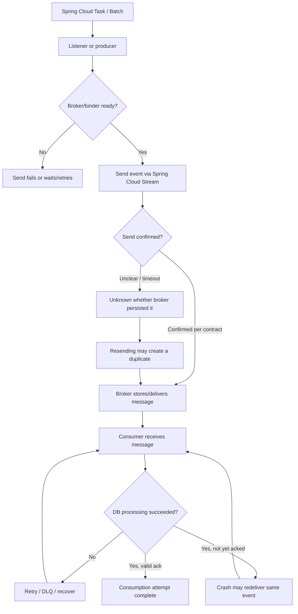
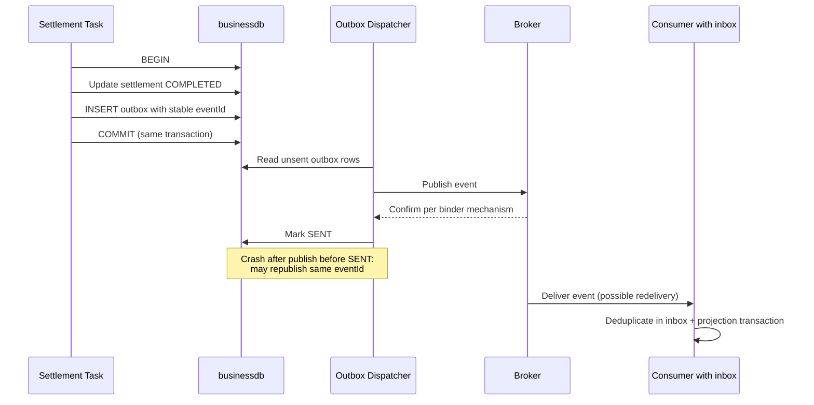

# Publish Failures, Duplicate Messages, and Delivery Guarantee Limits

## Learning Objectives

After this lesson, you will be able to:

- Distinguish **Spring Cloud Task lifecycle events**, **Spring Batch events**, and **business events** emitted by your application.
- Explain failure windows when sending messages via Spring Cloud Stream/broker: unreachable broker, async send failures, lost acknowledgments, process termination, and broker or consumer errors.
- Understand *at-most-once*, *at-least-once*, and the scope of *exactly-once*: which mechanisms can drop messages and which require handling redeliveries.
- Design **stable event IDs**, idempotent consumers, inbox tables, transactional outboxes, bounded retries, and dead-letter queues (DLQs).
- Reconcile messages against `TaskRepository`, `JobRepository`, process exit codes, and business data to detect missing/duplicate events rather than assuming message presence equals task success.
- Plan testing for publish failures, crashes, replays, concurrent runs, and recovery for scheduled or on-demand Tasks.

> **Context:** This lesson belongs to the **Events** chapter of the **SPRING_CLOUD_TASK** module. Spring Cloud Task is for finite-running Spring Boot applications that record execution metadata in a database via `TaskRepository`, support scheduled or on-demand invocation, and integrate with Spring Batch. When execution data is emitted externally via a message broker, the design must handle both **message loss** and **duplicate messages**. Events aid observability and system coordination, but they do not replace authoritative execution data sources.

## 1. Why Can a Completed Task Still Miss an Event?

Suppose the `daily-settlement-task` application does the following:

1. Receives `--business-date=2026-11-24`.
2. Updates the reconciliation results table.
3. Spring Cloud Task records completion in `TASK_EXECUTION`.
4. A listener emits a message so an operational dashboard or notification system knows the Task finished.
5. The JVM process exits.

If the broker is temporarily unreachable at step 4, this can happen:

- The business database already committed.
- `TaskRepository` already recorded a successful run.
- The dashboard **never received the message** and stays stale.
- If the publishing code does not turn send errors into a failure outcome, the scheduler may still see exit code `0`.

Conversely, the publisher may send successfully yet **fail to receive acknowledgment**. A retry can produce two messages for the same real-world event. When a consumer updates status or sends an email twice without deduplication, an observability glitch turns into a business defect.

| Desired Goal | Practical Risk | Design Measure |
| --- | --- | --- |
| No lost completion notifications | Producer crashes before broker persists message. | Track confirmations, reconcile repository; use outbox for critical business events. |
| No duplicate processing | Broker redelivery or producer retry after timeout. | Stable event ID, inbox/deduplication, and proper transactions. |
| Correct event order | START arrives after END due to retries/partitions/concurrency. | Per-entity sequence/version; projections enforce state checks. |
| No permanently dropped failures | Consumer keeps failing after retries. | DLQ/parking lot, alerts, and reprocessing workflow. |
| Schedules don't report false success | Publish exception caught and only logged. | Define publish criticality, exit codes, reconciliation, and remediation. |

**No single configuration automatically guarantees end-to-end completion across business logic, `TaskRepository`, the broker, and every consumer in one transaction.** You must define desired guarantees at each boundary.

## 2. Event Types in Spring Cloud Task

### 2.1. Task Lifecycle Events

The Spring Cloud Task 5.1.0 documentation describes emitting the `TaskExecution` object over a Spring Cloud Stream channel named `task-events`. With the proper classpath/binder and application setup, a listener can emit events **when the Task starts and when the Task ends**.

For example, a Task with `executionId=4201` might emit two messages:

```text
Task 4201 START: taskName=daily-settlement-task, startTime=...
Task 4201 END:   taskName=daily-settlement-task, endTime=..., exitCode=...
```

These two lines are a **logical** illustration, not a guaranteed JSON payload or header format produced verbatim by Spring Cloud Task. The built-in integration payload is `TaskExecution`; it **does not by default include application-defined `eventId` and `START`/`END` `eventType` fields**. If you need an envelope with a stable event key, add a custom event-publishing layer.

Disable Task events when you do not want Stream emission:

```properties
spring.cloud.task.events.enabled=false
```

This property disables the Task event-emitting listener; it **does not disable `TaskRepository`** and does not alter the finite nature of the Task application.

### 2.2. Spring Batch Events

When running a Spring Batch Job inside a Task with the matching event integration module enabled, Spring Cloud Task can attach listeners emitting to these channels:

| Spring Batch Listener | Documented Destination/Channel |
| --- | --- |
| `JobExecutionListener` | `job-execution-events` |
| `StepExecutionListener` | `step-execution-events` |
| `ChunkListener` | `chunk-events` |
| `ItemReadListener` | `item-read-events` |
| `ItemProcessListener` | `item-process-events` |
| `ItemWriteListener` | `item-write-events` |
| `SkipListener` | `skip-events` |

One Job can produce many Steps, Chunks, and read/write callbacks. **The number of Batch events does not equal the number of `TaskExecution`s**; do not use `taskExecutionId` as a unique key across all Batch callback types.

Disable all Batch events via Stream when supported by your release:

```properties
spring.cloud.task.batch.events.enabled=false
```

Or disable individual groups:

```properties
spring.cloud.task.batch.events.chunk.enabled=false
spring.cloud.task.batch.events.item-read.enabled=false
spring.cloud.task.batch.events.item-write.enabled=false
```

These properties do not disable Spring Batch Jobs or disable `TaskBatchExecutionListener`, which links `TASK_EXECUTION_ID` with `JOB_EXECUTION_ID`. **Linking Task–Batch metadata** and **emitting Stream messages** are two separate responsibilities.

### 2.3. Application-Emitted Business Events

For example, `SettlementCompleted` carrying `businessDate`, `region`, and total processed record count. This is **not the default payload of `task-events`**. The application must implement its own producer with an event contract, idempotency key, security, and—when high reliability is required—a transactional outbox.

Distinguishing the three layers:

| Event Type | Source of Truth | Meaning |
| --- | --- | --- |
| `TaskExecution` lifecycle | `TaskRepository`/`TASK_EXECUTION` | Which Task process started or finished with what result. |
| `JobExecution`/`StepExecution`/chunk | `JobRepository`/`BATCH_*` | Which Batch Job/Step or processing chunk executed. |
| Application-defined `SettlementCompleted` | Business database and validation rules | Which business settlement run completed per business contract. |

**A succeeding Task does not by itself prove business logic completed accurately**, especially if a runner swallows exceptions, async work is still pending, or a Batch Job failed without propagating its error code.

## 3. Diagram of Potential Failure Points



What counts as "confirmed" depends on implementation: `StreamBridge.send(...)` returning `true` usually only confirms the message was accepted by the internal sending channel per channel contract—it **does not automatically prove the broker durably persisted it**. Kafka producer acks, Rabbit publisher confirms, transactions, and consumer acknowledgments each have their own semantics.

## 4. Publish Failures on the Producer Side

### 4.1. Immediate Send Rejection

For instance, the broker is down or binding config is invalid; depending on binder/mode, the application may receive an exception or a failed send result. If your code does:

```java
try {
    streamBridge.send("auditEvents-out-0", event);
} catch (Exception ex) {
    log.error("Failed to send event", ex);
    // If this is a mandatory event, merely logging and returning is insufficient.
}
```

then the Task may exit normally while receivers get no notification. The right choice depends on **event criticality**:

- *Best-effort* dashboard update events: logging a warning is acceptable, provided there is a **reconciliation path against `TaskRepository`**.
- Events driving downstream business workflows: must use **durable emission and retry/recovery**, usually via an outbox; merely throwing an exception at Task end without persisting send intent is not enough to prevent event loss.
- Events with compliance/audit requirements: store verifiable trails and error-handling workflows, not just a log line.

### 4.2. Asynchrony and the Lost-Ack Window

For example, a Kafka producer may send asynchronously. `send(...)` succeeds at the application layer, yet the broker may fail afterward. If the Task terminates the JVM as soon as the runner returns, the final send outcome might never be observed; shutdown/flushing and producer callbacks must be managed properly per binder.

Even with publisher confirmations, a window still exists:

1. The broker persists the event.
2. The network drops, so the producer never receives the confirmation.
3. The producer retries with the same data.
4. The consumer receives two copies or a redelivered copy under certain conditions.

**You cannot conclude "no ack received means the broker didn't save it."** Therefore, producer retries are only safe when events have stable IDs and consumers are idempotent.

### 4.3. Failures Between DB Write and Event Emission

Suppose the business DB commits first, then the broker is called:

```text
businessdb COMMIT -> process crash -> broker never received message
```

If you reverse the order—send first, then commit:

```text
broker receives message -> businessdb ROLLBACK -> consumer sees phantom event
```

Both orders have an inconsistency window. Wrapping JDBC calls in `@Transactional` **does not automatically place Kafka/Rabbit publishing and database commits into a single atomic transaction**. This motivates the **transactional outbox** pattern below.

## 5. Delivery Guarantees: Understanding Exact Scope

| Guarantee Level | Ideal Meaning | Trade-off | Key Caveat |
| --- | --- | --- | --- |
| *At-most-once* | Each send attempt is processed zero or one time. | Messages can be lost. | Unsuitable when every event must reach its destination. |
| *At-least-once* | After proper retries/recovery, durably accepted messages are delivered one or more times. | Duplicates can occur. | Requires idempotent consumers; still depends on retention, config, and availability. |
| *Exactly-once* within a bounded scope | A defined operation or pipeline is processed once by the broker/transaction per contract. | Higher complexity, strict preconditions. | Does not automatically extend to external APIs, email, or separate DBs. |
| *Effectively-once* at the business layer | Even if an event is delivered repeatedly, the business effect is applied once. | Requires business keys, dedup, and transactions. | Usually the more realistic goal for distributed systems. |

Kafka/Rabbit binders support various modes, yet **you cannot claim system-wide at-least-once/exactly-once solely by adding the `spring-cloud-stream` dependency**. You must evaluate producer acks/transactions, broker durability/retention, retries, consumer offsets/acks, DLQs, and recovery paths.

For example, Kafka transactions can protect certain read–process–write flows **inside Kafka** when properly configured; they do not automatically form an atomic transaction with PostgreSQL or REST APIs. A consumer that credits an account in a database and crashes before committing its offset can still receive the same message again.

## 6. Where Do Duplicate Messages Come From?

Practical scenarios include:

1. **Producer retry:** missed an ack and re-sent an event already stored by the broker.
2. **Consumer crash:** committed to the database before acknowledging the message/offset.
3. **Rebalance:** broker/consumer group reassigns a partition to another instance; uncommitted records are redelivered.
4. **DLQ replay:** operations moves messages from the DLQ back to the main queue after the consumer already ran part of the logic.
5. **Task retry:** the scheduler launches a new Task process, creating a new event for the **same business date**; not always a technical duplicate.
6. **Distinct listeners:** a Task emits start and end events with the **same `executionId`**; those are **two valid events**, never delete one just because the ID matches.
7. **Spring Batch restart:** a new `JobExecution` may reprocess a previously incomplete Step/Chunk; distinguish events of a new attempt from broker redeliveries.

### What Should a Proper Event ID Represent?

Custom event envelope design:

```json
{
  "eventId": "settlement:2026-11-24:apac:completed:v1",
  "eventType": "SettlementCompleted",
  "eventVersion": 1,
  "businessKey": "2026-11-24:apac",
  "taskExecutionId": 4201,
  "occurredAt": "2026-11-24T02:15:00Z",
  "payload": {
    "businessDate": "2026-11-24",
    "region": "apac",
    "totalProcessed": 2000
  }
}
```

This is an **application-defined event**, not the native `TaskExecution` structure emitted automatically by Spring Cloud Task. The `eventId` field must stay stable when **resending the same event**. When emitting a *new valid* business event, use a distinct ID according to appropriate version/transition rules; do not reuse one ID across different states of the same business key.

| Scenario | How to Define the Deduplication Key |
| --- | --- |
| Resending the **same outbox row** after timeout | Keep the row's `eventId`. |
| START and END of the same `TaskExecution` | Must at least distinguish `(repository, executionId, phase)` if source lacks an event ID. |
| One `JobExecution` with many chunk callbacks | Do not use `jobExecutionId` alone as the key; identify callbacks/chunks per contract. |
| Task retry creates a new `executionId` for the same date | That is a distinct execution; business dedup must rely on business key/state, not `executionId` alone. |
| Consumer groups A and B both need the event | Key the inbox table by **consumer** so group A does not "swallow" group B's event. |

**Do not use a random broker-generated `MessageId` created on each redelivery as the unique key** if the source does not guarantee stability; likewise, offsets are meaningful within a partition/topic but do not express business invariants.

## 7. Spring Cloud Stream Example: Consumer with Retry and DLQ

The example below uses Spring Cloud Stream's **functional programming model**, consuming **custom business events** emitted by the application, rather than native `task-events` payloads by default.

Illustrative dependencies for a Kafka consumer:

```xml
<dependencies>
    <dependency>
        <groupId>org.springframework.cloud</groupId>
        <artifactId>spring-cloud-stream</artifactId>
    </dependency>
    <dependency>
        <groupId>org.springframework.cloud</groupId>
        <artifactId>spring-cloud-stream-binder-kafka</artifactId>
    </dependency>
    <dependency>
        <groupId>org.springframework.boot</groupId>
        <artifactId>spring-boot-starter-jdbc</artifactId>
    </dependency>
    <dependency>
        <groupId>org.postgresql</groupId>
        <artifactId>postgresql</artifactId>
        <scope>runtime</scope>
    </dependency>
</dependencies>
```

Use **compatible** Spring Boot BOM and Spring Cloud BOM versions. If using RabbitMQ, swap the binder and corresponding DLQ options—do not copy `spring.cloud.stream.kafka.*` into Rabbit config expecting it to work.

Example `application.yml`:

```yaml
spring:
  cloud:
    function:
      definition: handleSettlementEvents
    stream:
      bindings:
        handleSettlementEvents-in-0:
          destination: settlement-events
          group: settlement-projection
          content-type: application/json
          consumer:
            max-attempts: 3
      kafka:
        bindings:
          handleSettlementEvents-in-0:
            consumer:
              enable-dlq: true
```

Explanation:

- `handleSettlementEvents-in-0` is the binding name derived from the `Consumer` function in the **functional model**. This is not the built-in `task-events` unless you point to that destination and use a consumer that understands `TaskExecution`.
- `destination` is the topic; `group` lets instances in the same consumer group coordinate processing. Do not use random group names if consistent offset recovery is required.
- `max-attempts: 3` sets message processing attempts for imperative consumers supported by Spring Cloud Stream, depending on binder settings.
- `enable-dlq: true` is a **Kafka binder** option, and Kafka DLQ requires an explicit consumer group. Verify topic creation, permissions, and reprocessing paths in your real environment.
- Some custom error handler setups **bypass** the framework-managed DLQ mechanism. Never assume a custom error handler and default DLQ both remain active without checking.

Example event-receiving function:

```java
package com.example.consumer;

import java.util.function.Consumer;

import org.springframework.context.annotation.Bean;
import org.springframework.context.annotation.Configuration;

@Configuration(proxyBeanMethods = false)
public class SettlementConsumerConfiguration {

    @Bean
    Consumer<SettlementEvent> handleSettlementEvents(
            SettlementEventService service) {
        return service::apply;
    }
}
```

Compact payload model for the lesson:

```java
package com.example.consumer;

// Event emitted by the business app, NOT native TaskExecution.
public record SettlementEvent(
        String eventId,
        String eventType,
        String businessKey,
        String region,
        String status
) {}
```

In a real application, define a versioned contract schema, validate sizes/types/values, and specify handling for unsupported events. Protect private data across payloads, headers, logs, and DLQs.

## 8. Idempotent Consumer Using an Inbox Table and JDBC Transaction

If an event is delivered twice, the consumer must not create two result rows or apply duplicate business changes. A common pattern is an **inbox** storing processed message IDs and updating the projection **in the same database transaction**.

### 8.1. Illustrative PostgreSQL Schema

```sql
CREATE TABLE event_inbox (
    consumer_name VARCHAR(100) NOT NULL,
    event_id VARCHAR(200) NOT NULL,
    processed_at TIMESTAMPTZ NOT NULL DEFAULT CURRENT_TIMESTAMP,
    PRIMARY KEY (consumer_name, event_id)
);

CREATE TABLE settlement_projection (
    business_key VARCHAR(100) NOT NULL PRIMARY KEY,
    region VARCHAR(30) NOT NULL,
    status VARCHAR(30) NOT NULL,
    last_event_id VARCHAR(200) NOT NULL,
    updated_at TIMESTAMPTZ NOT NULL DEFAULT CURRENT_TIMESTAMP
);
```

The unique key on `(consumer_name, event_id)` ensures two competing consumer instances cannot insert two inbox rows for the same message. Putting the inbox insert and projection update in the same transaction means a projection failure rolls back the inbox insert, allowing redelivery to retry.

### 8.2. Duplicate-Safe Processing Service

```java
package com.example.consumer;

import org.springframework.jdbc.core.JdbcTemplate;
import org.springframework.stereotype.Service;
import org.springframework.transaction.annotation.Transactional;

@Service
public class SettlementEventService {

    private final JdbcTemplate jdbc;

    public SettlementEventService(JdbcTemplate jdbc) {
        this.jdbc = jdbc;
    }

    @Transactional
    public void apply(SettlementEvent event) {
        if (event.eventId() == null || event.eventId().isBlank()
                || event.businessKey() == null
                || event.businessKey().isBlank()) {
            throw new IllegalArgumentException("Invalid event identity");
        }

        int inserted = jdbc.update("""
            INSERT INTO event_inbox(consumer_name, event_id)
            VALUES ('settlement-projection', ?)
            ON CONFLICT (consumer_name, event_id) DO NOTHING
            """, event.eventId());

        if (inserted == 0) {
            return; // Event was already applied successfully on a previous attempt.
        }

        jdbc.update("""
            INSERT INTO settlement_projection(
                business_key, region, status, last_event_id)
            VALUES (?, ?, ?, ?)
            ON CONFLICT (business_key)
            DO UPDATE SET region = EXCLUDED.region,
                          status = EXCLUDED.status,
                          last_event_id = EXCLUDED.last_event_id,
                          updated_at = CURRENT_TIMESTAMP
            """,
            event.businessKey(), event.region(),
            event.status(), event.eventId());
    }
}
```

This is an example for **local database operations**. `@Transactional` must execute through a Spring proxy backed by a JDBC transaction manager on the right datasource. If the event is invalid or the projection update fails, the exception must propagate so the consumer framework executes retries/DLQ properly.

**Important limitations of this example:**

- Storing `eventId` only prevents **redelivery of the same event**. It does not prevent a **newer event from being overwritten by an older one**. To guard against reordering, add a monotonic version/sequence per `businessKey` and conditional updates.
- PostgreSQL's `ON CONFLICT DO NOTHING` syntax is database-specific. MySQL/SQL Server need equivalent variants.
- `@Transactional` wraps **inbox + projection**, not the broker acknowledgment itself.
- If the side effect is **sending email, calling a bank API, or publishing another message**, inbox + JDBC transactions cannot roll back that external effect. You need a dedicated outbox, external API idempotency keys, or compensation/reconciliation.
- Never return normally after an unhandled business error just to avoid redelivery; doing so tells the broker to ack the message and forfeits recovery.

## 9. Transactional Outbox for Mandatory Business Events

For `SettlementCompleted`, once the business outcome commits, the system may require the event to eventually be published. The **transactional outbox** pattern persists the *intent to publish* in the **same database transaction** as the business update.



Illustrative table:

```sql
CREATE TABLE settlement_outbox (
    event_id VARCHAR(200) PRIMARY KEY,
    aggregate_key VARCHAR(100) NOT NULL,
    event_type VARCHAR(100) NOT NULL,
    payload JSONB NOT NULL,
    state VARCHAR(20) NOT NULL DEFAULT 'PENDING',
    created_at TIMESTAMPTZ NOT NULL DEFAULT CURRENT_TIMESTAMP,
    sent_at TIMESTAMPTZ NULL,
    attempt_count INTEGER NOT NULL DEFAULT 0
);
```

Within the same transaction updating business state, insert the event:

```sql
BEGIN;

UPDATE settlement_runs
SET status = 'COMPLETED'
WHERE business_date = DATE '2026-11-24'
  AND region = 'apac';

INSERT INTO settlement_outbox(
    event_id, aggregate_key, event_type, payload)
VALUES (
    'settlement:2026-11-24:apac:completed:v1',
    '2026-11-24:apac',
    'SettlementCompleted',
    '{"businessDate":"2026-11-24","region":"apac"}'::jsonb
)
ON CONFLICT (event_id) DO NOTHING;

COMMIT;
```

The SQL only illustrates the idea. Real code must ensure the `UPDATE` performs a valid state transition, check affected row counts, compute event IDs per contract, use parameterized SQL, and avoid writing a `"COMPLETED"` outbox row if business work did not succeed. Systems may require versions and unique keys per transition.

### Why Does an Outbox Still Produce Duplicates?

A failure window exists:

1. The dispatcher reads event `E1` from the outbox.
2. The broker accepts `E1`.
3. The dispatcher crashes **before writing `state='SENT'`**.
4. On restart, the dispatcher sees `E1` is still unmarked and sends it again.

An outbox ensures **committed publish intent is never forgotten**, but **it does not eliminate duplicate sends**. Consumer/inbox deduplication remains essential.

### Where Does the Dispatcher Run?

You can build another finite Task triggered periodically by a scheduler, or a continuously running service. When multiple instances read the outbox concurrently, use a valid *claim/lease* mechanism such as `SELECT ... FOR UPDATE SKIP LOCKED` in a transaction plus an `IN_FLIGHT` state with an expiration lease. Never hold a DB transaction open indefinitely while waiting on the broker; implement reclamation for claimed events whose publisher crashed.

For true eventual delivery, include durable retries, attempt/backoff limits, manual-intervention states for permanent errors, backlog monitoring, and retention policies. Deleting outbox rows too early forfeits replay capability.

**Scope limit:** The outbox described here protects **application-defined business events**. It **does not turn Spring Cloud Task's built-in `task-events`/`job-execution-events` listeners into transactional publishers**. To guarantee durable Task status notifications, build a dedicated event/dispatcher channel or post-run repository reconciliation.

## 10. Relationship Between `TaskRepository` and Broker: Why Reconcile?

`TaskRepository` typically stores `TASK_EXECUTION`, `TASK_EXECUTION_PARAMS`, and start/end/exit code fields. When a Task crashes before updating its result, some rows may lack `END_TIME`. When an event is lost, the broker may lack the corresponding message even though metadata shows completion.

This creates four cases:

| TaskRepository | Broker/Dashboard | Interpretation |
| --- | --- | --- |
| Task succeeded | End notification present | Both sources align initially; still verify business outputs. |
| Task succeeded | No end notification | Could be send failure, consumer lag, retention expiry, wrong binding, or DLQ. |
| Task missing `END_TIME` | Start event present | Task may still be running or died abruptly; inspect process/Pod. |
| Task recorded failure | Completion notification present | Inspect payload and meaning of "end": **end does not mean success**. |

Querying the Task source of truth:

```sql
SELECT
    TASK_EXECUTION_ID,
    TASK_NAME,
    START_TIME,
    END_TIME,
    EXIT_CODE,
    EXIT_MESSAGE,
    ERROR_MESSAGE
FROM TASK_EXECUTION
WHERE TASK_NAME = 'daily-settlement-task'
ORDER BY START_TIME DESC, TASK_EXECUTION_ID DESC;
```

A monitoring service can maintain a **custom `task_event_receipts` table** and periodically reconcile against `TASK_EXECUTION`. This is not a standard Spring Cloud Task table.

```sql
-- Illustrates a custom table owned by the monitoring service.
CREATE TABLE task_event_receipts (
    repository_name VARCHAR(100) NOT NULL,
    task_execution_id BIGINT NOT NULL,
    phase VARCHAR(20) NOT NULL,
    received_at TIMESTAMPTZ NOT NULL DEFAULT CURRENT_TIMESTAMP,
    PRIMARY KEY (repository_name, task_execution_id, phase)
);
```

If both tables reside in the same database or can be queried via an integration layer, reconcile finished Tasks missing an END receipt:

```sql
SELECT t.TASK_EXECUTION_ID, t.TASK_NAME, t.END_TIME
FROM TASK_EXECUTION t
LEFT JOIN task_event_receipts r
  ON r.task_execution_id = t.TASK_EXECUTION_ID
 AND r.repository_name = 'production-taskdb'
 AND r.phase = 'END'
WHERE t.END_TIME IS NOT NULL
  AND r.task_execution_id IS NULL;
```

This is a **custom application reconciliation query**, not an out-of-the-box feature included just by adding `spring-cloud-starter-task`. If the two databases are separate, use ETL, the `TaskExplorer` API, authorized replication, or a reconciliation tool with access to both. Include a reasonable grace period so normal consumer lag is not falsely flagged as message loss.

**Never fabricate a fake `TaskExecution` event when the final state is unknown.** If recovery is needed, emit a summary message only after verifying the source of truth, tagged `reconciled`/`synthetic` with a consistent event ID.

## 11. Retries, DLQ, and Consumer Error Handling

Spring Cloud Stream provides retry and error-handling mechanisms, though exact behavior **depends on the binder and programming model**. For an imperative `Consumer<T>`, the framework can retry when the function throws an exception. Reactive functions have a different error model—do not copy imperative retry handler properties straight into reactive pipelines.

### Error Classification

| Error | Auto-Retry? | Operational Handling |
| --- | --- | --- |
| Temporary broker/context disconnect | Usually yes, bounded with backoff. | Monitor producer failures; never retry infinitely inside a finite Task. |
| Consumer database temporarily unavailable | Usually yes. | Throw exception; binder retries then DLQ/requeues per policy. |
| Incompatible JSON/schema | Usually no if payload is permanently malformed. | DLQ/parking lot, inspect contract, then controlled reprocessing. |
| Business key does not exist yet | Depends on eventual consistency rules. | Bounded retry or alert permanent missing data. |
| External API timed out with unknown execution state | Never retry blindly. | Query status and use idempotency keys on the receiving side. |
| Dead-letter event holds sensitive data | Not solved by retries alone. | Enforce access control, retention limits, and masking. |

### Warning About DLQs

**DLQ is not a universal default guaranteeing every failed message is saved.** Under some default settings, once retries are exhausted, the message may only be logged and dropped; verify your error handler and binder behavior.

With the Kafka binder, DLQ must be enabled explicitly (e.g., `enable-dlq=true`) with a consumer group; with the Rabbit binder, property names and queue topologies differ. The docs also note that a custom error handler can bypass the framework's default DLQ. Never claim "we set `max-attempts=3` so we definitely have a DLQ."

Operating a DLQ requires:

1. Alerts when queued message counts rise.
2. Error breakdowns by cause, destination, consumer group, and schema version.
3. A workflow to fix data/config and **replay while preserving the original event ID**.
4. Replay count limits to avoid infinite poison-message loops.
5. Idempotency checks because the message may have already executed partial side effects before hitting the DLQ.
6. Access controls and retention policies for messages carrying sensitive data.

## 12. Message Order Is Not Absolute Business Order

Even if a Task emits START then END internally, a consumer may observe:

```text
END(4201) -> START(4201)
```

due to different partitions, network delays, retries, or multiple consumers. With Spring Batch, `StepExecution`/chunk counts are even larger and often concurrent. Therefore:

- Do not make "already received START" a prerequisite for accepting END.
- Do not use *consumer receipt time* in place of business occurrence time.
- For dashboards, `END` is further along than `START`; **never let a late START overwrite COMPLETED/FAILED**.
- When ordering per aggregate is required, route messages with a stable key to the same partition/topic where the broker supports it, and still check versions in the database.
- Do not rely on `executionId` to infer completion order across concurrently running Tasks.

Example projection policy:

| Current State | Incoming Event | Action |
| --- | --- | --- |
| Task unknown | START | Record STARTED. |
| STARTED | Successful END | Record COMPLETED. |
| STARTED | END with non-zero exit code | Record FAILED. |
| COMPLETED | Delayed START | Ignore or audit; do not regress state. |
| FAILED | Redelivered END of same version | Deduplicate; do not raise duplicate alert. |
| Terminal state present | Newer event with higher valid version | Transition only according to the defined state machine. |

These are **application-defined dashboard rules**, not Spring Cloud Task's built-in state machine. For killed Tasks missing END, transition to `UNKNOWN/TIMED_OUT` after reconciling with the scheduler rather than assuming SUCCESS.

## 13. Relationship with Exit Codes and Spring Batch Jobs

The exit code returned to the OS is not confirmation of event delivery. Three observation layers can diverge:

- `TaskExecution.exitCode` persisted in `TaskRepository`.
- `JobExecution.status`/`ExitStatus` persisted in `JobRepository`.
- JVM/container exit status observed by a Kubernetes Job, CronJob, or shell.

A `FAILED` Batch Job can still cause the process to return `0` if a runner swallows exceptions or fails to inspect `JobExecution`. A published `job-execution-events` message also **does not prove the Job succeeded**, since the event may report a `FAILED` Job.

A runner invoking `JobLauncher` directly should check the outcome:

```java
JobExecution execution = jobLauncher.run(job, parameters);

if (execution.getStatus() != BatchStatus.COMPLETED) {
    throw new IllegalStateException(
        "Batch Job did not complete: " + execution.getStatus()
    );
}
```

With an asynchronous `JobLauncher`, you must **wait for the Job to finish** before inspecting final status. When `spring-cloud-task-batch` is present and configured appropriately, supporting releases offer `spring.cloud.task.batch.fail-on-job-failure=true`. Even then, test failure paths and real exit codes rather than inferring from published events.

For finite Task applications, `main` can obtain the exit code via Spring Boot's mechanism and return it to the OS:

```java
ConfigurableApplicationContext context =
    SpringApplication.run(DailySettlementApplication.class, args);

int code = SpringApplication.exit(context);
System.exit(code);
```

If `SpringApplication.run(...)` throws an exception, the lines below do not execute along the normal path. **Never call `System.exit(0)` blindly despite a mandatory event publish failure**, and never assume an unavailable broker automatically rolls back business transactions.

## 14. Mandatory Test Cases

A reliable test suite must reproduce **crash windows** rather than merely sending one event and asserting the consumer read it.

| Scenario | Outcome to Verify |
| --- | --- |
| Broker down before producer sends | No false success notification; publisher logs error and recovery policy applies. |
| Broker accepts event but producer loses ack | Retry reuses **the same event ID**; consumer applies the effect once. |
| Task crashes after DB commit before send | Outbox (if used) retains `PENDING` event; dispatcher emits it later. |
| Dispatcher crashes after publish before marking `SENT` | Event may duplicate; inbox/dedup prevents duplicate effects. |
| Consumer commits DB then crashes before ack | Broker redelivers; inbox transaction recognizes prior event. |
| Consumer schema/permanent validation error | Per config, message moves to DLQ/parking lot or alerts; never vanishes silently. |
| Consumer calls external API then crashes | Inbox alone is insufficient; reconcile or use API-side idempotency keys. |
| Late START arrives after END | Dashboard does not overwrite terminal state. |
| Spring Batch chunk/Step retry | Do not use `JobExecution` ID alone as the dedup key for every event. |
| Task killed and `END_TIME` empty | Combine logs, Pod status, and repository to mark UNKNOWN/FAILED; do not wait forever for END. |
| Scheduler reruns same business date | Produces a new `TaskExecution`, yet avoids duplicate side effects via business keys. |

**Prefer real test brokers** (such as Kafka/RabbitMQ in an appropriate test environment), PostgreSQL with an explicit schema, and fault-injection/consumer-restart capability. Mocking `StreamBridge.send(...)` only tests immediate success/failure branches and cannot verify delivery guarantees across process crashes.

### Illustrative Observation Commands

With Docker/Kubernetes, monitor exit codes/termination states and logs of the Task, producer, and consumer. In the shell:

```bash
java -jar daily-settlement-task.jar --business-date=2026-11-24
echo $?
```

In Kafka, observe consumer lag, DLQ topics, and inbox/projection tables; in Rabbit, inspect queue depth, DLQs, and publisher confirm statuses. Never pass secrets in CLI arguments since `TASK_EXECUTION_PARAMS` may persist those arguments.

## 15. Production Readiness Checklist

**Producer**

- Events have stable `eventId`, `eventType`, and `eventVersion`; minimal payloads free of secrets.
- Clearly classify which events are *best-effort* and which are mandatory without loss.
- Monitor both synchronous **and asynchronous** send errors per binder; do not confuse boolean channel acceptance with broker durability.
- Use an outbox or equivalent mechanism when publish intent must be tied to business commits.
- Operate a dispatcher/reconciler with rules for claimed events that lacked acks.

**Consumer**

- Use stable consumer groups; standardize event IDs and **per-consumer** dedup keys.
- Combine inbox writes and JDBC side effects in the same transaction whenever possible.
- On errors, never catch and return normally if the message requires retry/DLQ.
- Configure backoff, timeouts, retry budgets, DLQs, and replay procedures preserving `eventId`.
- Guard against out-of-order events, post-retention replays, and non-database side effects.

**Task and Operations**

- Query `TaskRepository`/`JobRepository` as metadata sources instead of relying solely on event counts.
- Log `executionId`, `jobExecutionId`, event IDs, and correlation IDs with clear uniqueness scopes.
- Monitor outbox backlog, DLQs, consumer lag, retry counts, job failures, and Tasks lacking `END_TIME`.
- Scheduled reruns require business idempotency; a new `executionId` must not be mistaken for fresh data needing full reprocessing from scratch.
- Reconcile Task history, business outputs, and consumer receipts whenever events are missing or systems report conflicting statuses.

## 16. Hands-On Exercises

**Exercise 1 — Finding failure windows:** Draw a timeline covering business commit, sending `SettlementCompleted`, broker ack, updating send status, and consumer commit. Mark every crash point that can drop an event or create a duplicate.

**Exercise 2 — Deduplicating START/END:** For two events sharing `TaskExecution.executionId=4201`, design an inbox key so both valid START and END are processed while duplicates of either cause no repeated side effects. Test END arriving before START.

**Exercise 3 — Inbox transaction:** Use the `event_inbox` and `settlement_projection` schemas. Send the same `eventId` three times and verify the projection updates only once. Inject an exception after the inbox insert and before the projection update, proving the transaction rolls back both operations.

**Exercise 4 — Outbox:** In one transaction, update `settlement_runs` and insert an outbox row; run a dispatcher that can be killed after publishing and before marking `SENT`. Restart and verify that while duplicates may be sent, the idempotent consumer preserves the right state.

**Exercise 5 — Retries and DLQ:** Use the Kafka binder with a fixed consumer group; configure retries and a DLQ in a test environment. Send an event with an invalid schema, observe retry attempts, DLQ routing, and cause logs, then fix and replay preserving the event ID.

**Exercise 6 — Task/Batch reconciliation:** Run a Task with a successful Spring Batch Job, a `FAILED` Job, and an abruptly killed Task. Compare `TASK_EXECUTION`, `BATCH_JOB_EXECUTION`, received events, process exit codes, and business state; explain why a topic alone cannot serve as the final source of truth.

## Remember

- Spring Cloud Task can emit `TaskExecution` via `task-events` at lifecycle start/end; Spring Batch emits events for Job, Step, Chunk, and other callbacks when integration is enabled.
- **Sending a message does not mean it is durably persisted**, and losing an ack does not prove the broker never stored the message.
- *At-least-once* can deliver duplicates; *exactly-once* within a broker/transaction does not automatically span PostgreSQL, external APIs, or email.
- Use **stable event IDs, idempotent consumers/inboxes**, ordering guards, and observable retries/DLQs.
- A **transactional outbox** preserves publish intent alongside business commits, yet still has a duplicate-publish window; it does not magically convert built-in lifecycle event listeners into transactional publishers.
- `TaskRepository`, `JobRepository`, the broker, logs, and process exit codes must be **reconciled**, especially when Tasks crash, listeners fail, or schedulers retry.

## References

- [Spring Cloud Task 5.1 — Spring Cloud Stream Integration](https://docs.spring.io/spring-cloud-task/reference/stream.html)
- [Spring Cloud Task — Features and TaskRepository](https://docs.spring.io/spring-cloud-task/reference/features.html)
- [Spring Cloud Task — Batch Integration](https://docs.spring.io/spring-cloud-task/reference/batch.html)
- [Spring Cloud Stream — Error Handling](https://docs.spring.io/spring-cloud-stream/reference/spring-cloud-stream/overview-error-handling.html)
- [Spring Cloud Stream — Kafka Binder Error Channels](https://docs.spring.io/spring-cloud-stream/reference/kafka/kafka-binder/error-channels.html)
- [Spring Cloud Stream — Kafka Binder Dead Letter Topics](https://docs.spring.io/spring-cloud-stream/reference/kafka/kafka-binder/dlq.html)
- [Spring Cloud Stream — Functional Model](https://docs.spring.io/spring-cloud-stream/reference/spring-cloud-stream/producing-and-consuming-messages.html)
- [Spring Batch — Metadata Schema](https://docs.spring.io/spring-batch/reference/schema-appendix.html)
