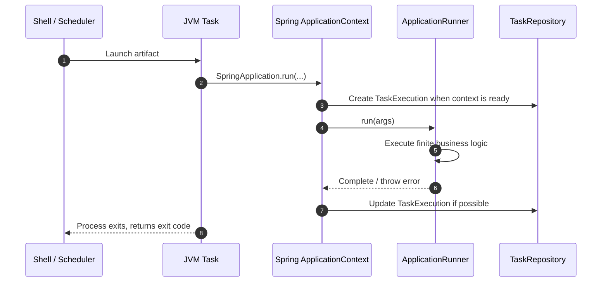
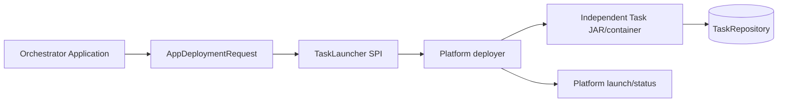

# Distinguishing In-JVM Business Execution from Launching a Task Process

## 1. Both Are Called a "Task", but They Do Not Share the Same Execution Boundary

In a Java application, a "task" can refer to a method, a `Runnable` in a thread pool, a Spring Batch `Job`, or a **Spring Cloud Task** application with a finite runtime. These concepts have very different responsibilities.

Suppose you need to aggregate revenue for `businessDate=2026-11-23`. The development team can:

- **Run inside an existing JVM:** a controller, scheduler, or `ApplicationRunner` calls `reportService.generate(date)`. The work shares the heap, resources, `ApplicationContext`, and lifecycle of the current application.
- **Launch a new Task process:** a scheduler, shell, `ProcessBuilder`, or Spring Cloud Deployer launches a separate Spring Boot artifact. The Task application creates its own context, executes the business logic, records metadata in `TaskRepository`, and terminates.

Both approaches can produce the same report. However, they differ in **isolation, startup overhead, exit codes, retries, scalability, and how runs are tracked**. This is the focus of the lesson **Distinguishing In-JVM Business Execution from Launching a Task Process**, in the **Launching** chapter of the `SPRING_CLOUD_TASK` module.

Learning objectives after this lesson:

1. Distinguish between a method call, an asynchronous job, and a Spring Cloud Task execution.
2. Understand when a new `TaskExecution` is created and when an operation is merely business logic within the current run.
3. Build an `ApplicationRunner` application that runs finite work and launch it with `java -jar`.
4. Spawn a child process from Java using `ProcessBuilder` and handle timeouts and exit codes.
5. Recognize the roles of `TaskLauncher`, `TaskLaunchRequest`, schedulers, and container platforms.
6. Design tracing, idempotency, retries, and safe Spring Batch integration.

## 2. The Lifecycle Tracked by Spring Cloud Task

Spring Cloud Task tracks **a single execution of a Spring Boot application configured as a task**, via a `TaskExecution` stored in `TaskRepository`. On a normal execution path:

1. The process starts and Spring Boot initializes the `ApplicationContext`.
2. Once the context initializes successfully, `TaskLifecycleListener` uses Spring's lifecycle mechanism to record start metadata in the repository, **before** the runners execute.
3. Spring Boot invokes the `ApplicationRunner`/`CommandLineRunner` beans.
4. When synchronous runners finish or an unhandled exception occurs, the framework attempts to update the end time, exit code, and error information.
5. The process shuts down according to application configuration; the JVM exit code is observed by the operating system or orchestrator.



`TaskExecution` typically records fields such as `executionId`, `taskName`, `startTime`, `endTime`, `exitCode`, `exitMessage`, `errorMessage`, and arguments. Metadata **does not automatically store all business output data**; reports, transactions, or output files must be verified in their own storage location.

**Key point:** a call to `reportService.generate(date)` **does not cause Spring Cloud Task to automatically create another `TaskExecution`**. The infrastructure records the lifecycle of the Task application/context, not each individual business method.

## 3. Four Execution Scopes and `TaskExecution`

| Scope | Example | New JVM? | New Context? | Automatically creates a new `TaskExecution`? |
| --- | --- | --- | --- | --- |
| Function/service call | `service.generate(date)` | No | No | **No** |
| Thread/`ExecutorService`/`@Async` | `executor.submit(...)` | No | Usually no | **No** |
| Bootstrapping another context inside the same JVM | `SpringApplication.run(OtherApp.class)` | No | Possibly yes | **Possibly**, if Task is enabled and the infrastructure can persist it |
| Launching a Task artifact in a separate process/container | `java -jar task.jar`, Kubernetes Job, Cloud `TaskLauncher` | Typically yes | Yes | **Typically yes**, after bootstrapping succeeds |

You should not oversimplify the rule to "`TaskExecution` always corresponds to exactly one JVM." In Java, it is possible to initialize another Task context within the same JVM, but that is **not an isolated process**; multiple contexts share static state, heap, process exit code, and resource-closing risks. In real deployments, **each independent launch** is usually a dedicated JVM/container for a single task run.

### 3.1. A Method Inside the JVM

```java
@Service
public class RevenueReportService {

    public void generate(LocalDate date) {
        // Query data, compute, and save the report.
        System.out.println("Generating report for " + date);
    }
}
```

A controller, scheduler, or runner can invoke this method multiple times without **creating a new context**. If the caller is a long-lived application (a web service), Spring Cloud Task does not automatically record separate history for each request.

### 3.2. Work on Another Thread

```java
@Async
public CompletableFuture<Void> generateAsync(LocalDate date) {
    reportService.generate(date);
    return CompletableFuture.completedFuture(null);
}
```

`@Async` must be properly enabled/configured and invoked through an appropriate Spring proxy. Even when running on a different thread, the work still shares the JVM. **There is no separate process and no new `TaskExecution`**.

If a runner invokes an async job and **returns immediately**, `ApplicationReadyEvent` may occur before the background work finishes. In that case, `TaskRepository` may mark the Task as completed **prematurely**. For finite work, the runner should wait for the result and propagate any errors.

### 3.3. A Run of a Task Application

```bash
java -jar revenue-report-task.jar --businessDate=2026-11-23
```

This command typically starts a new JVM process, in which the Boot application bootstraps its context, runs the runners, updates the repository, and exits. Running the same command again starts **a new application execution** (if the context initializes and can write to the repository).

**Creating a process does not mean the business work succeeded**: failures can occur when downloading the artifact, creating the context, accessing the database, running the runner, or persisting results.

## 4. Comparison Table: Same JVM or New Task Process?

| Criterion | Processing in the Running JVM | Launching a Spring Cloud Task Process |
| --- | --- | --- |
| Startup time | Usually very fast because the context already exists | Incurs process/container creation and Spring bootstrap overhead |
| Heap, thread pool | Shared with the host application | Typically separate; resources can be limited per process/Pod |
| Database connections | Can share the existing pool | New context has its own pool, increasing total connections |
| Exceptions | Can propagate synchronously to the caller | Must observe logs, process status, and metadata |
| Exit code | No separate exit code per method | Has a process/Job/Pod exit code |
| Traceability | Design your own operation ID/trace/metrics | Has `TaskExecution` if Task bootstraps and the repository works |
| Version upgrades | Usually tied to the host application version | Artifact/image can be chosen independently |
| Retries | Re-invoke method / internal queue | Orchestrator can spawn a new Task process |
| Distributed across machines | Requires separate RPC/queue | `TaskLauncher`/platform can launch on different infrastructure |
| Transactions | Can share a transaction if designed accordingly | No cross-JVM transaction by default |
| Parallel coordination | `Executor`/thread pool | Quotas, Pod/Job counts, and runtime limits |
| Timeout/cancellation | Requires cooperative cancellation | Can manage the process/Job; still requires cleanup/idempotency |

Choose **the simplest approach that meets your requirements**. A short calculation during an HTTP request may only need a service method. A nightly scheduled report that requires per-run auditing, resource isolation, and independent re-execution may be a good fit for Spring Cloud Task.

## 5. Example A: Two Business Executions, One Task Execution

Here is a Spring Cloud Task application with **one** runner that invokes the same method twice:

```java
import java.time.LocalDate;

import org.springframework.boot.ApplicationRunner;
import org.springframework.boot.SpringApplication;
import org.springframework.boot.autoconfigure.SpringBootApplication;
import org.springframework.cloud.task.configuration.EnableTask;
import org.springframework.context.annotation.Bean;

@SpringBootApplication
@EnableTask
public class InJvmReportApplication {

    public static void main(String[] args) {
        SpringApplication.run(InJvmReportApplication.class, args);
    }

    @Bean
    ApplicationRunner reportRunner() {
        return arguments -> {
            generate(LocalDate.parse("2026-11-23"));
            generate(LocalDate.parse("2026-11-24"));
        };
    }

    private void generate(LocalDate date) {
        System.out.println("Generating report: " + date);
    }
}
```

When running the application **once**:

```bash
java -jar in-jvm-report.jar
```

if `TaskRepository` is working, there will typically be **one `TaskExecution`** covering both `generate(...)` calls. That is the expected result, not Spring Cloud Task missing a "job". If you want two independent Task executions, you need to design a way to launch **two Task runs** or implement your own model for detailed sub-job observability.

Running **the `java -jar` command one more time** creates a new application run and a new `TaskExecution` if it can write to the repository.

## 6. Example B: Building a Real Task Application

A finite Task should accept explicit inputs, execute the required synchronous logic, report an error on failure, and exit so the orchestrator knows its status.

### 6.1. `ApplicationRunner` Code

```java
import java.time.LocalDate;
import java.util.List;

import org.springframework.boot.ApplicationRunner;
import org.springframework.boot.SpringApplication;
import org.springframework.boot.autoconfigure.SpringBootApplication;
import org.springframework.cloud.task.configuration.EnableTask;
import org.springframework.context.annotation.Bean;

@SpringBootApplication
@EnableTask
public class RevenueReportTaskApplication {

    public static void main(String[] args) {
        SpringApplication.run(RevenueReportTaskApplication.class, args);
    }

    @Bean
    ApplicationRunner revenueReport() {
        return arguments -> {
            List<String> dates = arguments.getOptionValues("businessDate");
            if (dates == null || dates.size() != 1) {
                throw new IllegalArgumentException(
                    "Must pass --businessDate=yyyy-MM-dd");
            }

            LocalDate date = LocalDate.parse(dates.get(0));
            System.out.println("Starting report: " + date);

            // TODO: call the report generation service; wait for completion.
            // If processing fails, throw an appropriate exception so the outcome is recorded.

            System.out.println("Completed report: " + date);
        };
    }
}
```

This class does not call `System.exit(...)` **directly inside the runner**. Forcefully exiting mid-execution can lose the final update to the Task repository. Let the completion callbacks execute as designed.

### 6.2. `application.yml` Configuration

```yaml
spring:
  application:
    name: revenue-report-worker
  main:
    web-application-type: none
  cloud:
    task:
      name: daily-revenue-report
  datasource:
    url: ${TASK_DB_URL}
    username: ${TASK_DB_USER}
    password: ${TASK_DB_PASSWORD}
```

The application needs the `spring-cloud-starter-task` dependency, a JDBC driver, and the corresponding Spring Cloud Task schema in the database. Use a persistent store if you need to query the history of multiple runs after the JVM stops; a per-process in-memory database is unsuitable for long-term monitoring.

### 6.3. Launching Twice

```bash
java -jar revenue-report-task.jar --businessDate=2026-11-23
java -jar revenue-report-task.jar --businessDate=2026-11-24
```

When both runs bootstrap successfully, you will have two `TaskExecution` records with different `executionId` values but the same name `daily-revenue-report`. The processing date is a **business parameter** and should not be embedded into the task name to create endless history groups.

If the context fails before the Task listener initializes, **no record may be written**. If the process is killed with `kill -9`, metadata may be missing `endTime`; you should cross-check platform/application logs.

## 7. Spawning a Child Process with `ProcessBuilder`

A Java orchestrator application can launch a separate JAR via `ProcessBuilder`. The following example shows how to **wait for completion** and **enforce a time limit**, rather than just starting it and assuming success.

```java
import java.io.IOException;
import java.nio.file.Path;
import java.util.concurrent.TimeUnit;

public final class TaskProcessLauncher {

    private TaskProcessLauncher() {}

    public static int launchAndWait(Path jar, String businessDate)
            throws IOException, InterruptedException {

        ProcessBuilder builder = new ProcessBuilder(
            "java", "-jar", jar.toAbsolutePath().toString(),
            "--businessDate=" + businessDate
        );
        builder.inheritIO(); // Learning example: share the console.

        Process process = builder.start(); // Process created, not yet finished.
        try {
            boolean finished = process.waitFor(120, TimeUnit.SECONDS);

            if (!finished) {
                process.destroy();
                if (!process.waitFor(5, TimeUnit.SECONDS)) {
                    process.destroyForcibly();
                    process.waitFor();
                }
                throw new IllegalStateException("Task exceeded 120 seconds");
            }

            return process.exitValue();
        } catch (InterruptedException interrupted) {
            process.destroy();
            Thread.currentThread().interrupt();
            throw interrupted;
        }
    }
}
```

Example invocation from an orchestrator program:

```java
int exitCode = TaskProcessLauncher.launchAndWait(
    Path.of("revenue-report-task.jar"),
    "2026-11-23"
);

if (exitCode != 0) {
    throw new IllegalStateException(
        "Task process failed, exit code=" + exitCode);
}
```

**Reading the boundaries accurately:**

- `ProcessBuilder.start()` requests process creation; **it does not prove the work has finished**.
- `waitFor(timeout, unit)` waits for the process to exit with a time bound; `exitValue()` returns the **operating system process** exit code.
- This code **is not** the `TaskExecution.executionId` assigned by the database. To trace through the Task repository, you must use an appropriate correlation identifier.
- `destroy()` or `destroyForcibly()` can interrupt normal shutdown paths. Do not assume metadata is always finalized upon timeout.
- `inheritIO()` is convenient for observing during learning; in production, capture stdout/stderr independently and handle logging and alerting.
- Do not let an HTTP request wait on a long-running child process; use a queue, job manager, or orchestrator for long-running work.
- Pass an argument list rather than concatenating shell strings from user input; validate `businessDate`.
- Avoid passing passwords/tokens on the command line, because they can appear in process lists, logs, or `TASK_EXECUTION_PARAMS`.

**On Kubernetes**, `ProcessBuilder` inside a running Pod normally only creates a child process **within that same container/Pod**. It does **not** automatically create an independent Kubernetes Job with its own quotas, retry policy, or Pod history. To create a new Job, you must use the orchestration platform or an appropriate deployer.

## 8. Launching with Spring Cloud Deployer's `TaskLauncher`

Spring Cloud Deployer provides the `org.springframework.cloud.deployer.spi.task.TaskLauncher` SPI. This is a mechanism for requesting **a platform to run a Task application artifact**, such as on a local runtime, Kubernetes, or another platform.



An SPI-level call is `TaskLauncher.launch(AppDeploymentRequest)`. The deployment request describes the **application name**, artifact `Resource`, deployer properties, and command-line arguments. The concrete implementation determines how to launch it (local process, Pod/Job, or equivalent resource).

**Pseudocode** example—not a standalone compilable class, because constructors and configuration details vary across Spring Cloud Deployer versions:

```java
// PSEUDOCODE
Resource artifact = resolveArtifact("revenue-report-task.jar");
AppDefinition definition = appDefinition("daily-revenue-report");
AppDeploymentRequest request = deploymentRequest(
    definition,
    artifact,
    deploymentProperties,
    List.of("--businessDate=2026-11-23")
);

String platformExecutionId = taskLauncher.launch(request);

// Cannot conclude yet that the report has completed.
// Track platform status and TaskExecution in the DB.
```

**Calling `launch` does not invoke the worker's `ApplicationRunner` on the launcher's call stack**. It asks the platform to instantiate the worker application. Many implementations complete the resource-creation request **before the business logic actually finishes**.

### 8.1. Three Different IDs

| ID | Issued by | Purpose |
| --- | --- | --- |
| Platform execution ID | `TaskLauncher` / deployer / platform | Track, query status, or cancel a deployment run according to platform capabilities |
| `TaskExecution.executionId` | Spring Cloud Task `TaskRepository` | Look up lifecycle, application outcome, and history |
| Business idempotency key | Business system | Prevent duplicate side effects when retrying/relaunching the same request |

**The ID returned by `TaskLauncher.launch(...)` is not by default `TaskExecution.executionId`.** The platform may accept the request, yet the worker fails while pulling the image or bootstrapping Java, leaving no execution recorded in the Task repository.

If the launcher is also a Spring Cloud Task application, **the launcher may have its own `TaskExecution`**, in addition to the records of child Tasks. If the launcher is a long-lived web service without Spring Cloud Task enabled, it does not get a TaskExecution simply because it called `TaskLauncher`.

### 8.2. `TaskLaunchRequest` and `@EnableTaskLauncher`

Spring Cloud Task also supports a model for **launching Tasks from Spring Cloud Stream** via `TaskLaunchRequest`. This object typically contains:

| Field | Value |
| --- | --- |
| `uri` | Artifact to run |
| `applicationName` | Name of the launched application |
| `commandLineArguments` | Arguments passed to the child application |
| `environmentProperties` | Environment variables for the Task |
| `deploymentProperties` | Configuration used by the platform deployer |

In supported release lines, `@EnableTaskLauncher` creates a **launcher sink** that receives these messages and uses `TaskLauncher` to launch them.

**Do not confuse the concepts:** `TaskLaunchRequest` is a launch request over Stream; `AppDeploymentRequest` is a request at the Deployer SPI layer; `TaskExecution` is metadata recording an application run. Stream APIs can change across release lines, so always check the documentation matching your actual BOM and binder.

## 9. Scheduled Execution: Call a Method or Launch a New Process?

Both solutions can run work at 02:00, but they sit at two different boundaries.

### 9.1. Spring `@Scheduled` Calling a Method Inside the JVM

```java
@Scheduled(cron = "0 0 2 * * *", zone = "Asia/Ho_Chi_Minh")
public void dailyRevenueReport() {
    LocalDate target = LocalDate
        .now(ZoneId.of("Asia/Ho_Chi_Minh"))
        .minusDays(1);
    reportService.generate(target);
}
```

The application must enable `@EnableScheduling` and **stay alive** so the scheduler can invoke the method. Each tick **does not automatically create a Spring Cloud Task**. If multiple scheduler instances run, each instance may execute concurrently unless separate locking/coordination is in place.

### 9.2. Cron / Kubernetes CronJob Creating a Separate Task Run

On a server, cron can execute the artifact:

```cron
0 2 * * * /usr/bin/java -jar /opt/tasks/revenue-report-task.jar --businessDate=2026-11-23
```

The line above only **illustrates how to invoke it**, not a production cron entry: the business date is hardcoded and needs to be computed dynamically for the processing period. Each time cron actually runs the command, there is **a new process run**. A Kubernetes `CronJob` creates a `Job` on schedule, managing Pods, restarts, and platform limits according to configuration.

In production, you must configure concurrency policy, timeout, quotas, `backoffLimit`/retries, logging, and platform retention. Spring Cloud Task **does not schedule itself or create Pods** merely by having its dependency present.

### 9.3. When to Choose Which?

| Requirement | Recommended Approach |
| --- | --- |
| Small calculation needing a response in a synchronous request | Call a service directly, with timeout and transaction |
| Short background processing in an always-on service | `Executor`/`@Async` with state management |
| Nightly report requiring per-run audit history | Spring Cloud Task and scheduled scheduler/deployer launch |
| Need to scale workers across multiple Pods | Cloud deployer, Kubernetes Job, or Spring Batch remote partitioning |
| Want to fail/retry the whole process with memory isolation | New Task process and orchestration policy |
| Want to run business logic twice in a single request | Call twice; no need to spawn two processes |

## 10. Parameters and Data Boundaries Between Processes

Inside the JVM, the caller passes a `LocalDate` object or service reference directly. Between two processes, **you cannot share pointers to beans or objects on the heap** as in a regular method call.

Options for passing information:

1. **Command-line arguments**, for example `--businessDate=2026-11-23`, `--requestId=...`.
2. **Environment variables and a secret manager** for JDBC URLs, credentials, and runtime configuration.
3. **Database/object storage/API** for large datasets and generated outputs.
4. **Message/correlation ID** for searching logs, linking workflows, and callbacks.

Do not pass large payloads or secrets via arguments when you can use a reference to protected data. `TaskExecution` commonly stores arguments, and the operating system or platform may retain the command line in metadata/logs.

Each new Task creates its own connection pool, transaction manager, classloader, and Spring context. Even if the Task and launcher access the same business database, they **do not share an in-memory transaction**.

## 11. Observing Results Across Four Layers

| Signal | Source | What It Confirms |
| --- | --- | --- |
| Method call returns | Java method / future | An in-JVM operation returned; details depend on the contract |
| `ProcessBuilder.start()` / `TaskLauncher.launch()` returns | OS / deployer | Launch has been requested or started; **does not guarantee business completion** |
| Process exit code / Pod / Job status | OS or platform | The process run finished according to the platform's recorded outcome |
| `TaskExecution.exitCode`, `endTime` | Spring Cloud Task repository | The Task infrastructure saved lifecycle metadata if persistence succeeded |

Example query for `daily-revenue-report` runs in the standard Spring Cloud Task JDBC schema:

```sql
SELECT TASK_EXECUTION_ID,
       TASK_NAME,
       START_TIME,
       END_TIME,
       EXIT_CODE,
       EXIT_MESSAGE,
       ERROR_MESSAGE
FROM TASK_EXECUTION
WHERE TASK_NAME = 'daily-revenue-report'
ORDER BY TASK_EXECUTION_ID DESC;
```

Table/column names should be checked against your actual schema and version; `TaskExplorer` is the Java API for querying execution history.

Do not infer that:

- **No `TaskExecution`** means the platform never attempted to launch: the worker may have failed **before** the repository created a record.
- **Empty `endTime`** means the process is still running: it may have been killed before writing completion metadata.
- **`exitCode=0`** means the report data is valid: you must reconcile the business output.
- **Platform exit code** always equals `TaskExecution.exitCode`: the two values may be determined at different times or under failure conditions.

## 12. Errors, Timeouts, and Cancellation Handling

### 12.1. Errors in the Same JVM

An error from `reportService.generate(...)` can propagate synchronously to the caller; transactions and rollbacks depend on configuration. With `@Async`, errors reside in the future or callback and **do not automatically appear** on the calling thread.

If a runner catches an exception and only logs it, Spring Cloud Task **may record a successful completion**. When an error prevents the job from succeeding, propagate the failure through the framework's mechanism instead of swallowing it.

### 12.2. Errors in a Child Process / Platform

Different failure stages must be observed separately:

| Stage | Example | Can Metadata Exist? |
| --- | --- | --- |
| Before creating the worker | JAR/image not found, quota exceeded | There may be **no `TaskExecution` yet** |
| Worker bootstrap | Missing bean/secret, invalid JDBC URL | There may be no record if the context failed to initialize |
| During runner execution | API call failure or invalid data | Usually has a failed `TaskExecution` if the repository works |
| Forced shutdown | `kill -9`, Pod evicted, node power loss | Record may be missing `endTime`/`exitCode` |
| Business work done, metadata failed | Repository database unreachable | Business data may exist even if the Task record is incomplete |

A timeout or cancellation only cuts off execution on the platform; it **does not guarantee that external APIs rolled back**. If the system sent a payment request and then lost the response, check the target system's status before resending.

### 12.3. Parallel Execution and Resource Limits

A separate task improves isolation, but many Pods launching simultaneously can open hundreds of connections to one database. Limit process count, pool size, resource requests/limits, and retry attempts. If using `spring.cloud.task.single-instance-enabled`, verify its version and repository prerequisites; it does not replace business locks or platform concurrency policies.

## 13. Safe Re-execution and Idempotency

Suppose the scheduler launches the report for the same date twice after a timeout:

| Run | `taskName` | `executionId` | Input |
| --- | --- | --- | --- |
| First run | `daily-revenue-report` | `901` | `businessDate=2026-11-23` |
| Retry | `daily-revenue-report` | `902` | `businessDate=2026-11-23` |

These are **two `TaskExecution` records** for the same **single business job**. Therefore, do not use `executionId`, Pod ID, or timestamp as a deduplication key. Choose `(reportType, businessDate)` or `(merchantId, businessDate, operation)` as a stable key, combined with unique constraints/upserts, target-state checks, and bounded retries.

Retrying an API call **inside a Task** creates multiple attempts but usually only one `TaskExecution`. Retrying by **relaunching the entire Task** creates a new `TaskExecution`. Both require idempotency if the operation has side effects.

For operations outside the database, sharing the metadata repository does not automatically provide an `exactly-once` guarantee; a request may have succeeded on the partner's side even if the application failed to persist its internal state.

## 14. Integrating with Spring Batch: `JobLauncher` vs. `TaskLauncher`

| API / Concept | What Does It Launch? | Primary Metadata |
| --- | --- | --- |
| Spring Batch `JobLauncher.run(job, params)` | A Batch job orchestrated in the current Batch runtime | `JobExecution` and `StepExecution` |
| Cloud Deployer `TaskLauncher.launch(request)` | A Task application artifact on the platform | Platform ID; child app records `TaskExecution` |
| `SpringApplication.run(...)` | Bootstraps a Boot context in the calling JVM | Task metadata if the context enables Task infrastructure |
| `ApplicationRunner.run(...)` | Logic executed at Boot startup | Does not automatically add a `TaskExecution` per call |
| `@Scheduled` / `@Async` | A method or thread inside the application | Does not automatically create a Spring Cloud Task |

A Task application can **invoke `JobLauncher` to run multiple Batch jobs** within the same JVM. In that case, there may be **one `TaskExecution`** for the application and multiple `JobExecution`/`StepExecution` records for the jobs.

In **remote partitioning**, `DeployerPartitionHandler` can use `TaskLauncher` to spawn worker processes. Workers process Batch partitioned `StepExecution` instances. Manager and workers need access to the metadata repository according to the integration model, but **one worker does not equal a separate `JobExecution`**.

If a Batch job runs asynchronously and the runner returns before the job actually completes, Task metadata may finish early. Design your flow to wait for the final status and map `BatchStatus.FAILED` errors according to the appropriate integration configuration.

## 15. Checklist for Choosing a Launch Boundary

- [ ] Does the work need to return a result within a request, or run independently on a schedule?
- [ ] Have you distinguished a method/thread/`@Async` from a new Task process and context?
- [ ] If using a Task, is Spring Cloud Task enabled and a persistent `TaskRepository` prepared?
- [ ] Is `spring.cloud.task.name` stable, with per-run inputs passed as separate arguments?
- [ ] Are large payloads and secrets kept out of command-line arguments?
- [ ] Does the launcher record/read the platform ID and correlation ID when needed?
- [ ] Have you separated **launch succeeded** from **business logic completed**?
- [ ] Are timeouts, concurrency limits, quotas, and bounded retries in place?
- [ ] Is there an idempotency strategy if a process crashes or re-runs?
- [ ] If using `ProcessBuilder`, are stdout/stderr, `waitFor`, interrupts, and timeouts handled?
- [ ] If using Cloud `TaskLauncher`, have you verified the API version and target platform?
- [ ] If combining with Spring Batch, have you distinguished `JobRepository` from `TaskRepository`?

## 16. Exercises and Self-Check Questions

**Question 1.** An `ApplicationRunner` calls `reportService.generate(D1)` and then `generate(D2)`. If the application is launched only once, how many `TaskExecution` records are typically created?

**Question 2.** A controller calls an `@Async` method and returns HTTP `202 Accepted`. Has the report completed, and has a new `TaskExecution` been created?

**Question 3.** `TaskLauncher.launch(request)` returns an ID string. Can that string be used as `TaskExecution.executionId` and taken as proof that the business work is complete?

**Question 4.** Why is using `ProcessBuilder` to create a child process inside a Kubernetes Pod not equivalent to creating a new Kubernetes Job?

**Question 5.** If the scheduler relaunches the same Task with the same `businessDate`, what key should be used to prevent duplicate writes?

**Question 6.** A Task runs two Batch jobs; must there necessarily be two `TaskExecution` records? How many `JobExecution` records can there be?

**Answer hints:** (1) usually one; (2) no, that is work inside the same JVM; (3) no, you must track both the platform and the repository; (4) the child still belongs to the same Pod/container and its resources; (5) a stable business key such as report type + processing date; (6) there can be one `TaskExecution` and two `JobExecution` records if two jobs are run.

## 17. Summary

**In-JVM business execution** means executing code inside an already running application; method calls, `ExecutorService`, or `@Async` do not automatically create a new Spring Cloud Task execution. **Launching a Task process** means asking the operating system or orchestrator to run a separate finite Spring Boot application, with its own lifecycle, resources, exit code, and typically a new `TaskExecution` once the context bootstraps and persists to the repository.

Cloud Deployer's `TaskLauncher` manages **launching artifacts on a platform**; `ApplicationRunner` executes logic inside the application; Spring Batch's `JobLauncher` launches a **Batch job**, not a new JVM. Separating these three mechanisms helps you choose the right execution model and design safe idempotency, retries, monitoring, and operations.

**Official references:**

- [Spring Cloud Task — Features, lifecycle, and TaskExecution](https://docs.spring.io/spring-cloud-task/reference/features.html)
- [Spring Cloud Task — Stream Integration and TaskLaunchRequest](https://docs.spring.io/spring-cloud-task/docs/current/reference/html/stream.html)
- [Spring Cloud Task — TaskLaunchRequest API](https://docs.spring.io/spring-cloud-task/docs/current/apidocs/org/springframework/cloud/task/launcher/TaskLaunchRequest.html)
- [Spring Boot — ApplicationRunner and CommandLineRunner](https://docs.spring.io/spring-boot/reference/features/spring-application.html)
- [Spring Cloud Task — Remote Partitioning, Spring Cloud Deployer](https://docs.spring.io/spring-cloud-task/docs/current/reference/html/)
- [Spring Batch — Configuring and Running a Job](https://docs.spring.io/spring-batch/reference/job/running.html)
