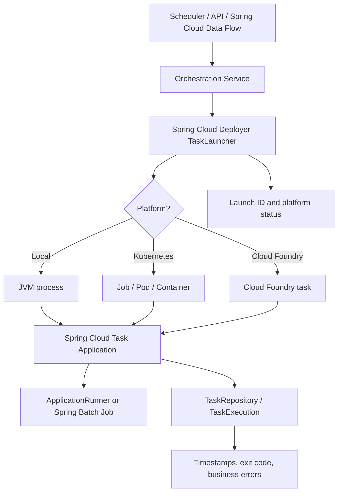
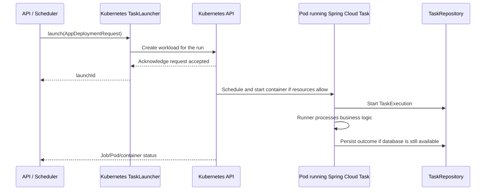
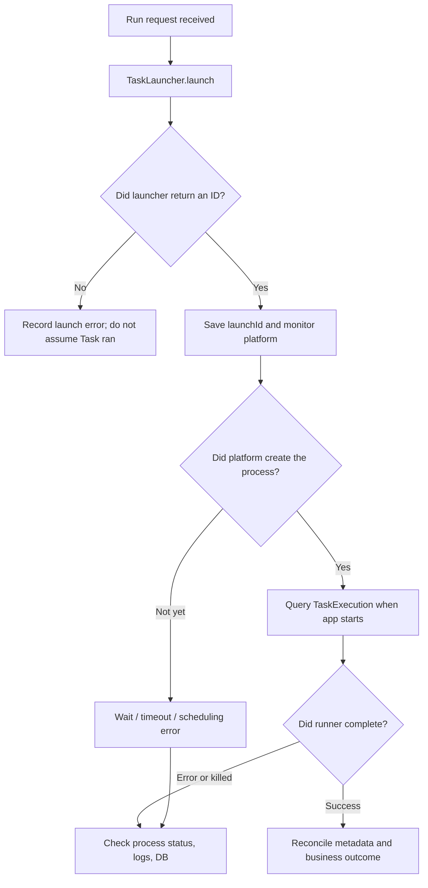
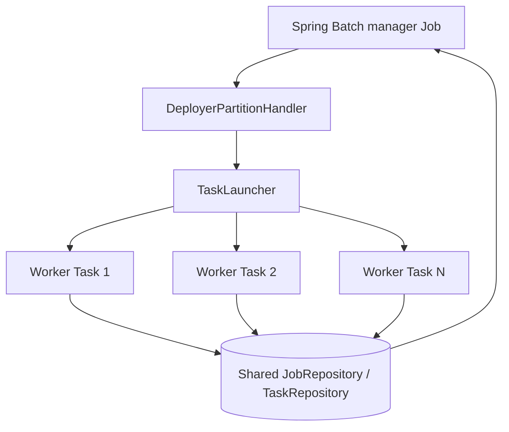

# Spring Cloud Deployer's TaskLauncher and Deployment Platforms

## Learning Objectives

**SPRING_CLOUD_TASK (Spring Cloud Task)** is used to build **finite-lived** Spring Boot applications: each startup accepts parameters, performs work, and terminates. The framework records each execution as a `TaskExecution` in `TaskRepository`, enabling result tracking, error handling, scheduled or on-demand execution, and integration with Spring Batch.

However, `TaskRepository` **is not the component that spawns processes** on a host or creates Jobs on Kubernetes. In the **Launching** chapter, `TaskLauncher` from **Spring Cloud Deployer** provides a common interface to request a deployment platform to run a Task application.

After this lesson, you will be able to:

- Distinguish `TaskLauncher`'s responsibility for **launching processes** from Spring Cloud Task's responsibility for **recording business outcomes**.
- Use the concepts `AppDefinition`, `Resource`, `AppDeploymentRequest`, and Deployer's `launch()` result.
- Recognize `TaskLaunchRequest` from Spring Cloud Task/Stream as a **different** object from Deployer's `AppDeploymentRequest`.
- Compare launching on local, Kubernetes, and Cloud Foundry; understand deployment-specific configuration.
- Separate **launch ID**, **TaskExecution ID**, Task name, Job/Pod ID, and Batch `JobExecution`.
- Design status tracking, cancellation, retries, concurrency limits, parameter security, and failure monitoring.
- Know when to use Spring Cloud Data Flow, Task Launcher Sink, or `DeployerPartitionHandler` in Spring Batch integration.

## 1. Who Is Responsible for Launching a Task?

Suppose `daily-report-task` needs to run every night to generate the order report for `2026-11-23`. A request to "run the report" must pass through **two different lifecycles**:

1. **Infrastructure lifecycle:** locate the artifact, prepare the runtime, create the process/Job/Pod, monitor it, and reclaim resources.
2. **Application lifecycle:** initialize Spring Boot, create the `ApplicationContext`, record `TaskExecution`, execute the `ApplicationRunner` or Spring Batch Job, and persist the final outcome.



| Component | Primary Responsibility | Does Not Do on Its Own |
| --- | --- | --- |
| Deployer `TaskLauncher` | Submits a request to launch a run on the platform and returns a launch identifier; queries platform status. | Does not guarantee business work succeeds; does not replace `TaskRepository`. |
| Platform launcher | Creates processes/containers/tasks according to local, Kubernetes, or Cloud Foundry capabilities. | Does not understand business logic or Spring Batch checkpoints. |
| `ApplicationRunner`/`CommandLineRunner` | Executes work inside a Spring Boot JVM. | Does not deploy Jobs to a cluster or create schedules. |
| `TaskRepository` | Records metadata for each `TaskExecution` into the configured database. | Does not spawn Pods, restart containers, or allocate CPU resources. |
| Spring Batch `JobRepository` | Records `JobInstance`, `JobExecution`, `StepExecution`. | Does not replace the Task launcher or Task metadata. |
| Scheduler/orchestrator | Decides when to run, retry, enforce timeouts, and handle duplicate-request policies. | Does not guarantee business idempotency if the application is not designed for it. |

Key point: **"launch accepted" does not mean "Task has started," and certainly does not mean "report is finished."** Even when a Job is created successfully, image, quota, database, or business errors can still occur during execution.

## 2. TaskLauncher as the Spring Cloud Deployer Interface

`TaskLauncher` belongs to the package:

```java
org.springframework.cloud.deployer.spi.task.TaskLauncher
```

It is an **SPI (Service Provider Interface)**: orchestration code shares one Java type, while the platform implementation determines how to create the process.

Commonly used primary operations:

| Operation | Role | What to Remember |
| --- | --- | --- |
| `launch(AppDeploymentRequest)` | Requests the platform to launch and returns a `String` launch ID. | Returning an ID is not a signal of business success. |
| `status(String launchId)` | Queries the platform's `TaskStatus` for the launch. | Requires polling/re-querying or platform events to track progress. |
| `cancel(String launchId)` | Requests cancellation of the run if supported by the platform. | Cancellation may not be immediate; actual state must be confirmed. |
| Other management APIs (if present) | Reads logs/cleans up resources or environment details depending on version. | Only use APIs implemented and verified in the active release. |

**Do not confuse `TaskLauncher` with `AppDeployer`:** `AppDeployer` primarily manages long-lived applications (stream apps) via `deploy()`/`undeploy()`. `TaskLauncher` is meant for **a finite run of work**, such as a cluster Job.

Also, the class named `TaskLauncherHandler` in Spring Cloud Task partitioning integration **is not** the `TaskLauncher` interface itself; it is a worker-orchestration component that **uses** a provided `TaskLauncher`.

## 3. Three Objects of a Launch Request

The Deployer API uses `AppDeploymentRequest` together with its components:

| Object | Example | Purpose |
| --- | --- | --- |
| `AppDefinition` | Name `daily-report-task` and an application properties map. | Describes the application to run and its application configuration. |
| `Resource` | `FileSystemResource` pointing to a JAR, or a platform-appropriate artifact/container resource. | Tells the launcher **which artifact** to deploy. |
| `AppDeploymentRequest` | App definition + resource + deployment properties + command-line args. | Bundles the request for `TaskLauncher.launch(…)`. |

### Application properties, deployment properties, and arguments

Three parameter groups serve different purposes:

| Group | Example | Who Interprets It? |
| --- | --- | --- |
| Application properties | `spring.cloud.task.name=daily-report-task`, `spring.profiles.active=prod`. | The Spring Boot application; how the launcher passes them via env/CLI depends on the platform. |
| Deployment properties | Memory, CPU, image, service account, namespace requests. | The platform's `TaskLauncher` implementation; **key names and units depend on the release**. |
| Command-line arguments | `--businessDate=2026-11-23`, `--requestId=req-105`. | Application runner or framework inside the Task. |

Conceptual example:

```text
AppDefinition:
  name = daily-report-task
  properties = {spring.cloud.task.name: daily-report-task}

Resource:
  /opt/tasks/daily-report-task.jar

Deployment properties:
  {cpu/memory/namespace/... platform-dependent}

Command-line args:
  [--businessDate=2026-11-23, --requestId=req-105]
```

**Do not treat the deployment properties map as ordinary Spring Boot options.** A parameter like `businessDate` does not create a larger Pod, and a CPU setting in the deployer does not alter how `ReportService` computes the report. Different launcher implementations may translate application properties into environment variables or CLI arguments differently; verify in the target environment.

## 4. Java Example: Creating a Launch Request for a Local Environment

The following example belongs to the **orchestrator application**, not the `daily-report-task` JAR itself. It uses a `TaskLauncher` configured for local deployment and a JAR already present on the disk **of the machine running the launcher**.

```java
package com.example.dispatcher;

import java.util.List;
import java.util.Map;

import org.springframework.cloud.deployer.spi.core.AppDefinition;
import org.springframework.cloud.deployer.spi.core.AppDeploymentRequest;
import org.springframework.cloud.deployer.spi.task.TaskLauncher;
import org.springframework.core.io.FileSystemResource;
import org.springframework.core.io.Resource;
import org.springframework.stereotype.Service;

@Service
public class ReportLaunchService {

    private final TaskLauncher launcher;

    public ReportLaunchService(TaskLauncher launcher) {
        this.launcher = launcher;
    }

    public String startReport(String businessDate, String requestId) {
        // Example assumes input has already been validated before calling this method.
        AppDefinition app = new AppDefinition(
                "daily-report-task",
                Map.of("spring.cloud.task.name", "daily-report-task"));

        Resource artifact =
                new FileSystemResource("/opt/tasks/daily-report-task.jar");

        AppDeploymentRequest request = new AppDeploymentRequest(
                app,
                artifact,
                Map.of(), // Deployment properties: determined by the platform.
                List.of(
                        "--businessDate=" + businessDate,
                        "--requestId=" + requestId));

        return launcher.launch(request);
    }
}
```

**Assumptions for this example to work:**

1. The orchestrator application has a `TaskLauncher` bean from a compatible **local** Spring Cloud Deployer module. Adding only the SPI interface does not provide an implementation bean.
2. `/opt/tasks/daily-report-task.jar` exists, is a valid Spring Boot executable JAR, and is readable by the launcher.
3. The Task JAR has a runner that handles the two parameters `businessDate` and `requestId`, then exits finitely.
4. Locally, the Java/runtime setup, database, and OS permissions are all satisfied.

The example code **does not** provide authentication, pre-launch idempotency checks, or correlation mapping persistence; those belong in a production orchestrator service. To avoid concatenating raw user input, validate/normalize the date with `LocalDate.parse(…)` and constrain `requestId` to an allowed format.

`AppDeploymentRequest` in the example uses the `(AppDefinition, Resource, Map<String, String>, List<String>)` constructor used in documented Deployer API release lines. Verify the signature against the `spring-cloud-deployer-spi` artifact in your project before applying it.

### Reading Status After Launch

```java
package com.example.dispatcher;

import org.springframework.cloud.deployer.spi.task.TaskLauncher;
import org.springframework.cloud.deployer.spi.task.TaskStatus;
import org.springframework.stereotype.Service;

@Service
public class ReportLaunchStatusService {

    private final TaskLauncher launcher;

    public ReportLaunchStatusService(TaskLauncher launcher) {
        this.launcher = launcher;
    }

    public String readPlatformState(String launchId) {
        TaskStatus status = launcher.status(launchId);
        return status.getState().name();
    }
}
```

This method returns **the state observed by the launcher platform**, and does not replace the `TaskExecution` table. Do not infer exit codes or report outcomes solely from `launchId` or a `RUNNING` status. With the local launcher, some states depend on the process still being tracked in memory by the launcher; after the orchestrator service restarts, querying old statuses may be limited.

## 5. What Does the Launched Task Application Do?

The JAR executing the job is still a standard Spring Cloud Task application. Example:

```java
package com.example.report;

import java.time.LocalDate;
import java.util.List;

import org.springframework.boot.ApplicationRunner;
import org.springframework.boot.SpringApplication;
import org.springframework.boot.autoconfigure.SpringBootApplication;
import org.springframework.cloud.task.configuration.EnableTask;
import org.springframework.context.annotation.Bean;

@SpringBootApplication
@EnableTask
public class DailyReportTaskApplication {

    public static void main(String[] args) {
        SpringApplication.run(DailyReportTaskApplication.class, args);
    }

    @Bean
    ApplicationRunner reportRunner() {
        return arguments -> {
            List<String> days = arguments.getOptionValues("businessDate");
            if (days == null || days.size() != 1) {
                throw new IllegalArgumentException(
                        "Requires --businessDate=yyyy-MM-dd");
            }

            LocalDate businessDate = LocalDate.parse(days.get(0));
            // Replace with ReportService.generate(businessDate).
            System.out.println("Processed " + businessDate);
        };
    }
}
```

When the JVM starts, Spring Cloud Task creates or updates `TaskExecution` in `TaskRepository` if the database/schema is available; the runner executes the business logic, and the framework records the result. If the process is killed or fails before metadata is created, you cannot rely **solely** on `TASK_EXECUTION` to know what the launcher did.

The `System.out.println` example **does not** prove the report succeeded. In a real application, the service must verify outputs, enforce idempotency, and let fatal errors propagate so Task status reflects the true outcome.

## 6. IDs That Must Not Be Confused

A single launch request can produce multiple identifiers:

| ID | Issued / Managed by | Used For |
| --- | --- | --- |
| `requestId` (e.g. `req-105`) | Orchestrator / business service. | Preventing duplicate requests, linking one request to retry attempts. |
| `launchId` (string returned by `TaskLauncher.launch`) | Deployer / platform implementation. | Querying/canceling the deployment run, looking up platform logs/status. |
| Job/Pod ID or platform task ID | Kubernetes/Cloud Foundry/OS. | Inspecting actual resources, events, and container exit codes. |
| `TaskExecution.executionId` (e.g. `8421`) | Spring Cloud Task `TaskRepository`. | Querying start/end/error metadata for one application run. |
| Spring Batch `JobExecution.id` | Spring Batch `JobRepository`. | Querying one Batch Job execution inside the Task. |

There is no contract that `launchId == TaskExecution.executionId`, even when both look numeric. `launchId` can be a platform-specific string, whereas `executionId` is typically a long integer assigned by the repository.

A diagnosable orchestration design stores the mapping:

```text
requestId=req-105
  -> launchId=<ID from TaskLauncher>
  -> platformJobId=<ID of the Kubernetes Job or platform task>
  -> taskExecutionId=8421
  -> businessDate=2026-11-23
```

In Spring Cloud Data Flow, the orchestrator can **pre-create `TaskExecution`** and pass `--spring.cloud.task.executionid=<ID>` so the process updates the existing record. However, using this property is a **specific workflow**, not default behavior for every `TaskLauncher.launch(AppDeploymentRequest)` call.

If your application implements its own launcher, **do not assign a Task ID using a random number**. To pre-assign an ID, you must create a real record via `TaskRepository` in the same metadata store, commit it before the process reads it, and then pass the generated ID.

## 7. Comparing Three Deployment Platforms

Spring Cloud Deployer has or has had implementations for multiple platforms. Supported capabilities also depend on **the specific release line and artifact**.

| Platform | Typical Task Execution Model | Things to Check | Limitations to Keep in Mind |
| --- | --- | --- | --- |
| **Local** | `LocalTaskLauncher` spawns a JVM process on the launcher host. | JAR path, Java runtime, file permissions, and launcher environment. | Suitable for dev/test; process state tracking is often tied to the launcher's own lifecycle. |
| **Kubernetes** | `KubernetesTaskLauncher` requests the cluster to create a workload/Pod for one run. | Image/artifact, namespace, service account, RBAC, resource limits, image pull, Job/Pod lifecycle. | Creating a Job does not guarantee the Pod runs; check scheduling, container exit codes, and cleanup. |
| **Cloud Foundry** | `CloudFoundryTaskLauncher` uses platform APIs to run an appropriate task. | Organization/space, API permissions, pushed/registered app, quotas, bindings, and logs. | State and concurrent task limits are managed by the platform; support depends on version. |

### Local: Convenient for Development

The local launcher is often chosen when testing launch logic with a small orchestrator service. Because the Task runs as a process on the launcher host, the `FileSystemResource` path `/opt/tasks/daily-report-task.jar` only works if **the launcher host** can access that file.

Things to avoid:

- Running the launcher on one machine and assuming a JAR on a developer's laptop disk exists on the server.
- Using `localhost` as the database URL when the process runs in another namespace/container.
- Using the local launcher as a cluster fault-tolerance solution without process supervision and recovery.

### Kubernetes: Understanding the Orchestration Boundary

With Kubernetes, the launcher typically needs an image/container artifact and permissions to create resources in the selected namespace. Configuration properties depend on the Spring Cloud Deployer Kubernetes version; do not copy `spring.cloud.deployer.*` properties from an old guide without checking your release.



The launcher successfully creating a resource **does not mean the Pod has started running**: the Pod may remain `Pending` due to no available nodes, `ImagePullBackOff`, missing secrets, or insufficient permissions. Conversely, a Task may have written output before being killed prior to updating final metadata; retries must check idempotency.

### Cloud Foundry: Tracking Tasks at the Platform Level

Cloud Foundry provides a platform-managed task model, so the launcher can use the CF API to launch and query status. Verify that the app/artifact is ready, along with bindings and org/space permissions. App pushing, task creation, and cancellation mechanics can differ across releases.

For new projects, choose a platform based on actual requirements and **verify the maintenance/support status of the Deployer module**; do not assume every Cloud Foundry or YARN example in older documentation remains an equally supported default architecture.

## 8. TaskLaunchRequest vs. AppDeploymentRequest

In the **Spring Cloud Task + Spring Cloud Stream** integration, there is the class:

```java
org.springframework.cloud.task.launcher.TaskLaunchRequest
```

This class is the **launch request payload** sent from a publisher/processor to `TaskLauncherSink`. It is **not** the direct parameter to `TaskLauncher.launch(…)` in the Deployer SPI.


### Five Fields of TaskLaunchRequest

| Field | Example | Meaning |
| --- | --- | --- |
| `uri` | URI of a JAR artifact resolvable by the launcher. | Artifact to run. |
| `applicationName` | `daily-report-task`. | Name assigned to the task on the launcher side; if omitted, the library may generate a default name. |
| `commandLineArguments` | `["--businessDate=2026-11-23"]`. | CLI arguments passed into the Task. |
| `environmentProperties` | `{"SPRING_PROFILES_ACTIVE":"prod"}`. | Environment variables used inside the Task process. |
| `deploymentProperties` | CPU, memory, platform settings. | Configuration supplied to the Deployer. |

Example creating the request object (part of the **publisher application**, not the `AppDeploymentRequest` constructor):

```java
import java.util.List;
import java.util.Map;
import org.springframework.cloud.task.launcher.TaskLaunchRequest;

TaskLaunchRequest messagePayload = new TaskLaunchRequest(
        "maven://com.example:daily-report-task:jar:1.0.0",
        List.of("--businessDate=2026-11-23"),
        Map.of("SPRING_PROFILES_ACTIVE", "prod"),
        Map.of(),
        "daily-report-task");
```

The `maven://…` example is an illustrative URI following the ecosystem's artifact-resolver style; it does not guarantee every launcher/platform can download from that repository. When using Maven resources outside the local cache, configure the repository and credentials appropriately. For Kubernetes, confirm the **image/container** execution mechanism supported by your launcher.

### TaskLauncherSink and @EnableTaskLauncher

Spring Cloud Task documentation describes a sink application that receives a message with a `TaskLaunchRequest` payload, converts it into a Deployer request, and invokes `TaskLauncher`. The API has the annotation:

```java
@SpringBootApplication
@EnableTaskLauncher
public class TaskSinkApplication {
    public static void main(String[] args) {
        SpringApplication.run(TaskSinkApplication.class, args);
    }
}
```

The example only illustrates the mechanism: you must add **imports**, the Task launcher/Stream module dependencies, a binder, and the platform's `TaskLauncher` bean. `@EnableTaskLauncher` **does not create a Deployer implementation on its own**, so the application may fail with a missing bean error if no launcher is configured.

**Version warning:** Many Spring Cloud Task `TaskLauncherSink` examples use the older Spring Cloud Stream programming model (such as `@EnableBinding`). Modern Spring Cloud Stream uses functional bindings; before reusing an example, check the actual **API, Stream version, binder, and launcher module**. Do not rename bindings or copy an old sample assuming it works across all newer releases.

## 9. Where Does Spring Cloud Data Flow Fit?

**Spring Cloud Data Flow (SCDF)** is a higher-level orchestration layer that typically uses Spring Cloud Deployer under the hood. When using SCDF, operators do not necessarily have to write custom Java code calling `TaskLauncher`.

Conceptual flow:

```text
Register Task artifact application
    -> create Task definition
    -> task launch <definition>
    -> SCDF selects platform TaskLauncher
    -> create process/Job/Pod
    -> Spring Cloud Task updates TaskExecution
    -> view execution, logs, and Job status
```

SCDF CLI example (verify syntax against your running version):

```text
dataflow:> task launch daily-report --arguments "--businessDate=2026-11-23"
dataflow:> task execution list
```

`--arguments` passes parameters to the Task application. `--properties` in some SCDF release lines uses the prefixes `app.<task-definition>.*` and `deployer.<task-definition>.*` to separate application properties and deployment properties. **Do not confuse** these two groups with runner arguments or with properties of the SCDF server itself.

SCDF can also enforce **concurrent Task execution limits** per platform account, though how runs are counted differs between local, Kubernetes, and Cloud Foundry. This is an orchestration/capacity layer, not Spring Cloud Task's `single-instance-enabled`, and it does not replace business idempotency constraints.

## 10. Properly Confirming Launch, Execution, and Completion

A safe system should record at least three groups of states:

1. **Orchestration request state:** request received, queued, calling launcher, launch ID received, rejected.
2. **Platform state:** whether the resource was created, process/Pod started, completed, failed, timed out, or canceled.
3. **Spring Cloud Task state:** what `TaskExecution` ID exists, `START_TIME`, `END_TIME`, `EXIT_CODE`, and error messages.



Querying Task metadata when using the standard schema:

```sql
SELECT TASK_EXECUTION_ID,
       TASK_NAME,
       START_TIME,
       END_TIME,
       EXIT_CODE,
       EXIT_MESSAGE
FROM TASK_EXECUTION
WHERE TASK_NAME = 'daily-report-task'
ORDER BY TASK_EXECUTION_ID DESC;
```

If multiple runs execute concurrently, filtering only by `TASK_NAME` is insufficient to identify which row belongs to a specific `launchId`. Store the correlation ID mapping in the orchestrator, use `spring.cloud.task.external-execution-id` when appropriate, and cross-check logs/metadata. Setting `spring.cloud.task.executionid` is only valid when **`TaskExecution` was pre-created** via the repository as explained earlier.

### When Launch Returns an ID but No TaskExecution Appears

Possible causes include:

- The Pod has not been scheduled yet or the image failed to pull.
- The JVM has not reached the Spring Cloud Task initialization stage.
- Task `DataSource`/schema configuration is broken.
- The Task connected to **the wrong database/profile** compared to where the orchestrator queries.
- The application lacks Spring Cloud Task or `@EnableTask`/equivalent configuration.
- The Task was killed early or metadata connectivity is unavailable.

Therefore, never automatically "close" a Task as successful simply because the launcher returned an ID. Always combine **platform status, startup logs, and DB metadata**.

## 11. Errors, Timeouts, Cancellation, and Retries

| Scenario | What Can Happen | Appropriate Handling |
| --- | --- | --- |
| Invalid URI/JAR/image | Deployer rejects or Job/Pod fails to fetch the artifact. | Check artifact, registry/repository, permissions, and version; do not retry blindly. |
| Insufficient quota/CPU/RAM | Launch may be rejected or Pod stays Pending. | Limit concurrency, configure platform resources, use controlled timeouts. |
| `TaskRepository` error at JVM startup | Process fails before runner, possibly without metadata. | Check DB URL, schema, permissions; inspect startup logs. |
| Runner throws an exception | Task ran but business outcome failed. | Let the error propagate; check `EXIT_CODE` and container status. |
| Platform response times out after launch | Job may have been created even though caller missed the launch ID. | Query resources/correlation before sending a second request. |
| User invokes cancel | Platform may terminate the process before Task writes `END_TIME`. | Confirm status via launcher/platform and reconcile metadata. |
| Scheduler auto-retries a failed Job | May trigger a new processing run for the same date. | Design business idempotency and retry/backoff policies. |
| Orchestrator service restarts | Local process info is lost if stored only in RAM. | Persist correlation durably; in production prefer platforms with Job/status APIs. |

**Canceling a launch does not guarantee rolling back all business effects.** If the Task already wrote a file or emitted an event, that action may have completed before the process stopped. Handle transactions, outbox patterns, business locks, and recovery steps separately.

### What Should Retries Be Based On?

Do not retry simply because an HTTP request to the launcher timed out or because `TaskExecution.END_TIME` is null. Both can happen while a process is still actively running.

A sound workflow:

1. Use a fixed `requestId` to identify the request.
2. Persist the request and launcher-call state to durable storage.
3. If it is unclear whether the first command created a Job, query the platform by label/name/correlation key first.
4. Only create a **new run** once the previous outcome, cancellation/timeout rules, and idempotency conditions have been determined.
5. On retry, track a new `launchId` and usually a new `TaskExecution`; preserve the history of earlier runs.

If you want to **queue** requests instead of rejecting when a Task is already running, build a queue mechanism at the orchestration layer; `TaskLauncher` itself is not a guaranteed queue.

## 12. Security and Environment-Specific Configuration

When deploying a Task onto a platform, **the orchestrator service environment** and **the Task environment** are two separate places. Environment variables present in the launcher container do not automatically appear in the Task container unless the deployment request or platform forwards them.

Recommended rules:

- Never pass passwords/credentials via `--db.password=…` in command-line args: Spring Cloud Task may persist arguments in `TASK_EXECUTION_PARAMS` and the platform may expose the CLI.
- Use Kubernetes Secrets, Cloud Foundry service bindings, or an appropriate secret manager; grant least privilege to the Task's service account.
- Allow the launcher to use only approved artifacts/images; never accept arbitrary `Resource URI` values from unauthenticated users.
- Separate databases/schemas across `local`, `test`, `prod`; metadata schemas must be migrated beforehand and the Task must have required permissions.
- Configure CPU/memory limits, TTL/timeouts, and retries aligned with expected processing duration.
- Verify network policies so the Task can reach the right database, broker, and business services.
- Keep `requestId`, `launchId`, and `executionId` in logs without printing secret values.

Example shared configuration for the **Task application** (not launcher configuration):

```yaml
# application-prod.yml
spring:
  application:
    name: daily-report-task
  main:
    web-application-type: none
  datasource:
    url: ${TASK_DB_URL}
    username: ${TASK_DB_USER}
    password: ${TASK_DB_PASSWORD}
  cloud:
    task:
      name: daily-report-task
      initialize-enabled: false
```

The `TASK_DB_*` environment variables are merely a project convention. For Task outcomes to be retained long-term, the database must be persistent and the `TaskRepository` schema must be created with the DDL matching your version.

## 13. Integrating with Spring Batch and Remote Partitioning

Spring Cloud Task can wrap a Spring Batch Job. That Job can contain multiple Steps, and `JobRepository` stores metadata independently from `TaskRepository`.

In the **remote partitioning** model, Spring Cloud Task provides `DeployerPartitionHandler` and `DeployerStepExecutionHandler`:

1. The Batch manager splits the work into partitioned `StepExecution` instances.
2. `DeployerPartitionHandler` uses `TaskLauncher` to launch worker JVMs/containers for the partitions.
3. Workers use `DeployerStepExecutionHandler` along with `JobExplorer`/`JobRepository` to look up their assigned `StepExecution` and execute it.
4. The manager reconciles partition statuses and the Job finishes.



A typical configuration includes:

- A `Resource` representing the platform-appropriate worker JAR/image.
- `TaskLauncher` with platform credentials.
- `JobExplorer` and `TaskRepository`; workers and manager must see the required metadata stores.
- `maxWorkers` to cap concurrent workers, plus controlled `pollInterval` and `timeout`.
- `CommandLineArgsProvider`/`EnvironmentVariablesProvider` to pass partition details safely.

**Do not confuse `maxWorkers` with the cluster-wide maximum Task instance count.** It limits workers within that specific handler/Job; schedulers and the platform may still run other Tasks.

If using `ThreadPoolTaskExecutor` to launch partitions asynchronously, ensure worker threads/`TaskExecutor` are shut down after completion; a JVM with lingering non-daemon threads will not exit even after Task business logic finishes. Properties related to `closecontextEnabled` must be verified against your Spring Cloud Task version.

## 14. Testing Across Platforms

| Test Case | Action | Pass Signal |
| --- | --- | --- |
| Successful local launch | Use a valid JAR and `TaskLauncher.launch()`. | Launch ID returned; runner executes; `TaskExecution` completes. |
| Launch returns ID but JVM fails | Intentionally pass an invalid DB profile in test environment. | Recognizes launch was created while Task failed; startup logs present. |
| Artifact not found | Use an invalid URI/path in an isolated test. | Clear error from launcher/platform; does not claim Task ran. |
| Invalid business parameter | Pass a malformed date. | Runner throws an error; Task/process reports failure. |
| Two close requests | Send the same `requestId` twice. | Orchestrator does not create two unintended duplicate jobs. |
| Launcher timeout | Simulate a lost response after the Job was created. | Lookup/reconciliation runs before resending the command. |
| Kubernetes Pending | Intentionally set resource requests above available nodes in test cluster. | Distinguishes Pod Pending from business Job failure. |
| Cancel while running | Send `cancel(launchId)` if the implementation supports it. | Platform stops the resource; metadata and outputs are reconciled. |
| Scheduler retry | Let the Task fail and then retry. | Retry has a distinct identifier; business output is not duplicated. |
| Spring Batch Job failure | Run a Job with a failing Step. | Reconciles `JobExecution` with `TaskExecution` and Task exit code. |
| Remote partition worker crash | Kill one worker during test. | Manager detects incomplete `StepExecution` and handles timeout/restart. |

## 15. Comprehensive Hands-On Lab

**Scenario:** An API allows requesting daily report exports. The orchestrator service runs on Kubernetes using `KubernetesTaskLauncher`; the report Task persists JDBC metadata and occasionally runs Spring Batch.

1. Create `daily-report-task` with a runner accepting `--businessDate=yyyy-MM-dd`, executing finite work and recording metadata in a test database.
2. For the local environment, create an orchestrator service with an appropriate `TaskLauncher` bean. Use `AppDefinition`, `Resource`, and `AppDeploymentRequest` to launch the Task artifact.
3. Persist `requestId` and `launchId` right after calling launch; confirm `launchId` is not `TaskExecution.executionId`.
4. Poll/monitor `TaskStatus` until the process finishes or errors; also read `TaskExecution` by ID/correlation.
5. Switch to Kubernetes deployment using an image/Resource supported by the implementation. Verify RBAC, namespace, image pull, database URL, and logs.
6. Intentionally break the database configuration or image tag in the test environment. Record the failure stage across **launcher**, **platform**, and **Task**.
7. Send two requests for the same date; use an idempotency key so duplicate reports are not created, even after one run has already finished.
8. Test cancellation, timeouts, and simulated lost launch responses. Design a reconciliation workflow that does not blindly resubmit Jobs.
9. Optional: use a Spring Batch Job and `DeployerPartitionHandler` to spawn two workers. Verify workers see the same required `JobRepository` and `TaskRepository`.
10. Reconcile business output, platform status, and Task/Batch metadata before declaring completion.

**Completion criteria:** You can explain each responsibility layer, launch a Task per platform, distinguish the various IDs, detect cases where launch succeeded yet the Task did not run, and design controlled retries/cancellations with safe business data.

## 16. References

- [Spring Cloud Task — Launching a Task from Spring Cloud Stream](https://docs.spring.io/spring-cloud-task/reference/stream.html): `TaskLaunchRequest` and `@EnableTaskLauncher`.
- [TaskLaunchRequest Javadoc](https://docs.spring.io/spring-cloud-task/docs/current/apidocs/org/springframework/cloud/task/launcher/TaskLaunchRequest.html): five input fields and constructors.
- [EnableTaskLauncher Javadoc](https://docs.spring.io/spring-cloud-task/docs/current/apidocs/org/springframework/cloud/task/launcher/annotation/EnableTaskLauncher.html): mechanism for enabling the Task launcher sink.
- [Spring Cloud Task — Remote Partitioning](https://docs.spring.io/spring-cloud-task/reference/batch.html): `DeployerPartitionHandler`, worker launcher, and partition metadata.
- [DeployerPartitionHandler Javadoc](https://docs.spring.io/spring-cloud-task/docs/current/apidocs/org/springframework/cloud/task/batch/partition/DeployerPartitionHandler.html): `setMaxWorkers`, `setPollInterval`, `setTimeout` methods.
- [Spring Cloud Data Flow — Reference Guide](https://docs.spring.io/spring-cloud-dataflow/docs/2.10.x/reference/htmlsingle/): task launch, platform `TaskLauncher`, arguments/deployment properties, and concurrency limits.
- [Spring Cloud Deployer — SPI source](https://github.com/spring-attic/spring-cloud-deployer): source for `TaskLauncher`, `AppDeploymentRequest`, and platform implementations in their respective releases.

The examples emphasize **contracts and orchestration flows**, without claiming a single version set fits every platform. When implementing, verify a compatible Spring Boot/Spring Cloud BOM, specific Deployer/launcher artifacts, container/image support, and documentation for your exact release.

## Key Takeaways

- Spring Cloud Deployer's `TaskLauncher` **initiates a run on a platform**, whereas Spring Cloud Task **records and manages the application lifecycle** in `TaskRepository`.
- `TaskLauncher.launch(AppDeploymentRequest)` returns a **launch ID**, not a `TaskExecution ID` and certainly not a guarantee of business success.
- `AppDefinition`, `Resource`, deployment properties, and command-line arguments serve distinct roles; never place secrets in CLI arguments.
- Spring Cloud Task/Stream's `TaskLaunchRequest` is a **message payload** for the sink to invoke the launcher; it is not the direct parameter of the Deployer SPI.
- Local, Kubernetes, and Cloud Foundry deploy differently; choose implementations, resources, permissions, and configuration matching your **platform version**.
- For reliable monitoring, link **request ID → launch ID → platform ID → TaskExecution ID**, reconciling statuses and errors at every layer.
- `TaskLauncher` does not replace a scheduler, idempotency, a queue, or Spring Batch `JobRepository`. Safe retries must evaluate the previous run's outcome before launching a new run.
