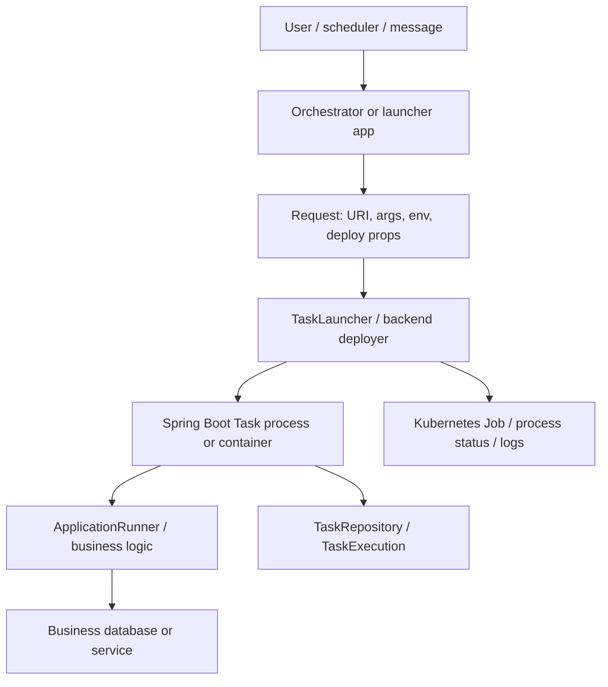
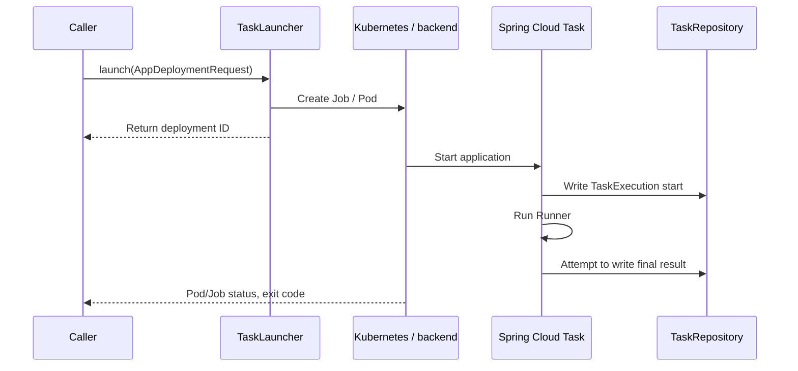
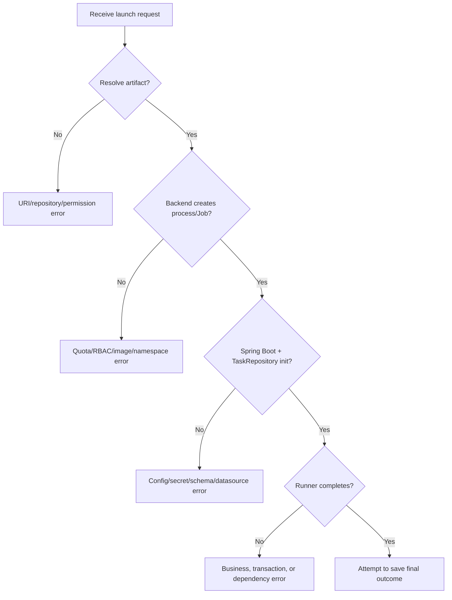

# Passing Application URI, Arguments, Environment, and Deployment Configuration

## 1. Problem: What Must Be Provided to Launch a Task?

**Spring Cloud Task** helps build Spring Boot applications with a finite runtime: start up, process work, record execution status and outcomes via `TaskRepository`, and exit. In practice, the same application can be launched via `java -jar`, a Kubernetes Job, Spring Cloud Deployer, Spring Cloud Data Flow, or an event stream. Each run must specify **which artifact to run**, **what data to process**, **what environment to provide**, and **what resources to deploy with**.

For example, an order-import task running for `2026-11-24` in production:

```text
Artifact:   orders-import version 1.4.2
Task name:  orders-import
Arguments:  --business-date=2026-11-24 --source=marketplace
Environment:
  APP_REGION=ap-southeast-1
  TASK_DB_URL=jdbc:postgresql://db.internal:5432/taskdb
Deployment:
  runs on Kubernetes, CPU/RAM limits, namespace, service account
```

These input groups **do not mean the same thing**. `--business-date` is a business parameter; `TASK_DB_URL` is a connection setting; CPU/RAM or namespace belongs to the deployer configuration; and the URI points to the JAR or image containing the code. Mixing these groups causes applications to receive wrong inputs, lack permissions, leak secrets, or run the wrong version.

After this lesson, you will know how to:

- Distinguish **application URI**, application name, Spring Cloud Task name, and execution identifiers.
- Pass command-line arguments, application properties, environment variables, and deployment properties according to their proper roles.
- Understand how `TaskLaunchRequest` and `TaskLauncher`/`AppDeploymentRequest` represent these information groups.
- Read launch examples via Spring Cloud Data Flow, directly on Kubernetes, and programmatically in Java.
- Verify artifacts, permissions, environment variables, deployment status, and `TaskExecution`.
- Design on-demand and scheduled launch workflows that are safe under retries and upgrades.

## 2. Architecture: Who Launches, Who Executes, Who Records History?



There are three separate responsibilities:

| Component | Primary Responsibility | Should Not Assume |
| --- | --- | --- |
| **Launcher/orchestrator** | Selects artifact, passes parameters, configures resources, spawns process/Pod/Job | Launch acceptance does not prove business work completed |
| **Spring Boot + Spring Cloud Task** | Receives config, runs Runner, saves `TaskExecution`, manages finite lifecycle | Does not decide system-wide schedules or retries |
| **Data store and orchestration system** | Stores actual data, execution history, Pod/Job/process info, enables investigation | A `COMPLETED` metadata row does not prove all external side effects succeeded |

Spring Cloud Task is **an application lifecycle tracking library**. Spring Cloud Deployer/`TaskLauncher` is **a deployment interface**. Spring Cloud Data Flow adds application registration, Task definition creation, API/shell, scheduling, and execution observability. You can use Spring Cloud Task **without** Data Flow: for example, running a JAR directly via cron or a Kubernetes Job.

## 3. Distinguishing the Five Information Groups of a Launch Request

### 3.1. Overview Table

| Group | Illustrative Form | Typically Consumed By | Purpose |
| --- | --- | --- | --- |
| **Artifact URI** | `maven://com.example:orders-import:1.4.2` | Resolver/deployer | Locate the exact JAR/image to run |
| **Application name** | `orders-import` | Deployer/orchestrator | Name the deployment, enable tracing |
| **Command-line arguments** | `--business-date=2026-11-24` | `ApplicationArguments` / Spring Boot | Select data, mode, and single-run parameters |
| **Environment properties** | `APP_REGION=ap-southeast-1` | Process/JVM/Spring `Environment` | Configure the runtime environment |
| **Deployment properties** | Memory, CPU, namespace, service account | `TaskLauncher` / Kubernetes/Cloud Foundry | Specify resources and deployment policies |

In Spring Cloud Task, `TaskLaunchRequest` has five corresponding fields: `uri`, `applicationName`, `commandLineArguments`, `environmentProperties`, and `deploymentProperties`. Understand this as **a launch request structure**, not a DTO whose fields business Spring Boot code automatically binds wholesale.

### 3.2. Application Name vs. Task Name and Execution ID

| Name / ID | Example | Meaning |
| --- | --- | --- |
| `applicationName` in launch request | `orders-import` | Application label for the deployer/launcher |
| `spring.cloud.task.name` | `orders-import` | Logical Spring Cloud Task name written in metadata |
| `TaskExecution.executionId` | `4821` | Key for **one** run, assigned by the repository |
| Kubernetes Job name | `orders-import-20261124-a1` | Resource name for one cluster deployment |
| `businessDate` | `2026-11-24` | Business data key, usable for idempotency |

Values may match depending on your naming convention, but **do not assume the launcher keeps them all synchronized automatically**. For easily queryable history, choose a stable logical Task name and record clear correlation IDs/business identifiers. If `applicationName` is omitted, some launcher docs describe generating a name with a `Task-` prefix, though format/details can vary by version; **never rely on auto-generated names** as business processing keys.

## 4. Application URI: Pointing to the Exact Artifact Version

### 4.1. What Is a URI?

A URI identifies **the location or source identifier of the artifact** that the deployer must fetch. In the Spring Cloud ecosystem, documented representations include:

| Type | Example | Prerequisites |
| --- | --- | --- |
| Maven artifact | `maven://com.example:orders-import:1.4.2` | Resolver can reach the Maven repository and exact version |
| Maven with extension/classifier | `maven://com.example:orders-import:jar:exec:1.4.2` | Artifact actually exists with that classifier |
| File URI | `file:///opt/apps/orders-import-1.4.2.jar` | File must exist where the resolver/deployer **actually sees it** |
| HTTPS JAR | `https://artifacts.example.com/orders-import-1.4.2.jar` | Backend/resolver supports HTTP(S), has download access, and validates checksum |
| Container image | `registry.example.com/platform/orders-import:1.4.2` in Kubernetes `image` | Image is pullable, CPU architecture/JDK/entrypoint are compatible |

For Maven, Spring Cloud Data Flow docs describe the URI format:

```text
maven://<groupId>:<artifactId>[:<extension>[:<classifier>]]:<version>
```

Bracketed segments are **optional syntax**, not literal characters in the URI. Do not insert spaces and avoid unpinned implicit versions in production. Some backends/resolvers also support dedicated URIs for Docker or OCI images; **verify schemes and syntax against your specific implementation** rather than assuming every `TaskLauncher` supports every URI scheme.

### 4.2. A Maven URI Is Not a Local File Path

With `maven://...`, the resolver uses Maven repositories, credentials, and caches to retrieve the exact artifact. With `file:///...`, the file must exist on **the filesystem of the component performing resolution**. Paths on a developer's laptop generally do not exist inside a Data Flow server container or Kubernetes Pod.

This is a common mistake:

```text
Launcher running in a Linux container:
  file:///C:/Users/me/orders-import.jar  -> does not exist in container

Application built on a developer machine:
  /home/dev/target/orders-import.jar     -> does not automatically appear on cluster nodes
```

The solution is to publish artifacts to a repository or image registry accessible to the deployment environment, or mount the artifact at the exact path expected by the resolver.

### 4.3. Version Pinning and Integrity Checks

In production, avoid mutable tags like `latest` as the sole version marker; when retrying a Task, differing builds can cause incompatible outputs or schemas. For container images, pin **digests**; for JARs, track versions/checksums and environment promotion state.

```text
App:       orders-import
Version:   1.4.2
Image:     registry.example.com/platform/orders-import@sha256:<digest>
Job run:   orders-import-20261124-a1
Input:     businessDate=2026-11-24
```

`<digest>` here is a **placeholder** for an actual SHA-256 digest. The URI/artifact version is **the software version**; `businessDate` and the run ID are **business/operational identifiers**. Those two scopes are distinct.

## 5. Command-Line Arguments: Parameters for a Single Run

### 5.1. Passing as an Argument List

Example:

```bash
java -jar orders-import-1.4.2.jar --business-date=2026-11-24 --source=marketplace --dry-run
```

Spring Boot's `ApplicationRunner` receives `ApplicationArguments` to classify them:

- `--business-date=2026-11-24`: single-value option.
- `--source=marketplace`: single-value option.
- `--dry-run`: valueless option (flag).
- Tokens not starting with `--name`: non-option arguments.

When constructing requests in Java or Kubernetes `args`, pass **each CLI token as its own list element**, for example:

```java
List<String> cliArgs = List.of(
        "--business-date=2026-11-24",
        "--source=marketplace",
        "--dry-run"
);
```

Do not pass an entire string `"--business-date=... --source=..."` as **one** element in `List<String>` expecting Spring to split on spaces. In Spring Cloud Data Flow Shell, `--arguments` is a **shell** parameter parsed by Data Flow into tokens according to its shell rules. Distinguish the shell layer from the final `argv` array reaching the JVM.

### 5.2. Validating Input with ApplicationRunner

Example of a Task accepting exactly one ISO date and one data source:

```java
import java.time.LocalDate;
import java.time.format.DateTimeParseException;
import java.util.List;
import org.springframework.boot.ApplicationArguments;
import org.springframework.boot.ApplicationRunner;
import org.springframework.context.annotation.Bean;
import org.springframework.context.annotation.Configuration;

@Configuration
class ImportRunnerConfiguration {
    @Bean
    ApplicationRunner importRunner(ImportService service) {
        return args -> {
            String source = oneRequired(args, "source");
            String dateText = oneRequired(args, "business-date");
            LocalDate date;
            try {
                date = LocalDate.parse(dateText);
            } catch (DateTimeParseException ex) {
                throw new IllegalArgumentException(
                        "--business-date must follow yyyy-MM-dd", ex);
            }
            boolean dryRun = args.containsOption("dry-run");
            List<String> flagValues = args.getOptionValues("dry-run");
            if (dryRun && flagValues != null && !flagValues.isEmpty()) {
                throw new IllegalArgumentException(
                        "--dry-run does not accept a value");
            }
            service.importOrders(source, date, dryRun);
        };
    }

    private static String oneRequired(
            ApplicationArguments args, String optionName) {
        List<String> values = args.getOptionValues(optionName);
        if (values == null || values.size() != 1
                || values.get(0).isBlank()) {
            throw new IllegalArgumentException(
                    "Requires exactly one --" + optionName + "=<value>");
        }
        return values.get(0);
    }
}
```

`ImportService` is a business bean built separately. The snippet validates inputs **before invoking the service**. If `--source` is missing or `--source=A --source=B` is passed when the contract requires one value, the Runner throws an exception. This avoids accidentally picking only the first element when an option is repeated.

### 5.3. CLI Arguments Are Not the Place for Secrets

Never pass `--password=...`, bearer tokens, or API keys via `argv`. Command-line arguments can show up in `ps`, logs, launch payloads, `TaskRepository`, or Kubernetes Pod specs. In Spring Cloud Data Flow, some entry-point modes translate application properties into CLI args; verify entry-point settings when sensitive data is involved.

For non-sensitive values such as source name, business date, or processing mode, CLI arguments are clear and appropriate. For secrets, prefer a secret manager or Kubernetes Secrets mounted as files or environment variables with restricted read access.

## 6. Environment Variables: Process Configuration

### 6.1. Role of environmentProperties

In `TaskLaunchRequest`, `environmentProperties` is a `Map<String,String>` holding environment variables to set for **the launched process**. For example:

```text
APP_REGION=ap-southeast-1
SPRING_PROFILES_ACTIVE=prod
TASK_DB_URL=jdbc:postgresql://db.internal:5432/taskdb
TASK_DB_USER=task_runtime
```

In Spring Boot, placeholders can be used:

```yaml
spring:
  application:
    name: orders-import
  main:
    web-application-type: none
  datasource:
    url: ${TASK_DB_URL}
    username: ${TASK_DB_USER}
    password: ${TASK_DB_PASSWORD}
  cloud:
    task:
      initialize-enabled: false
      closecontextEnabled: true
orders:
  region: ${APP_REGION:ap-southeast-1}
```

This is `application.yml` **inside the Task application**, not the launcher's configuration. `initialize-enabled=false` assumes the `TASK_*` tables were pre-created using a version-matched migration. `TASK_DB_PASSWORD` must come from a secure source; examples never include real credentials.

### 6.2. Application Properties vs. Environment Properties

Spring Boot's `Environment` merges multiple configuration sources: `application.yml`, environment variables, Java system properties, and command-line properties. By contrast, `ApplicationArguments` only reflects the program arguments received.

| Value | Where Authors Typically Set It | Read in the Application via |
| --- | --- | --- |
| `--business-date=2026-11-24` | CLI args | `ApplicationArguments` or command-line property source |
| `SPRING_PROFILES_ACTIVE=prod` | Env | Spring `Environment` |
| `TASK_DB_URL=jdbc:...` | Env/secret manager | Placeholder or `@ConfigurationProperties` |
| `-Duser.timezone=UTC` | JVM option, before `-jar` | Java system property / `Environment` |
| `spring.datasource.hikari.maximum-pool-size` | YAML, env, or CLI | Spring Boot configuration binding |

Do not assume the environment sees only one form. For instance, `--spring.profiles.active=prod` is an **application argument** while `SPRING_PROFILES_ACTIVE=prod` is an **environment variable**; both can affect `Environment` following Spring Boot's precedence rules. When multiple sources set the same property, check the precedence order of your Boot version to avoid activating the wrong profile.

### 6.3. Pass Secrets by Reference, Not in Launch Messages

`TaskLaunchRequest` can traverse Spring Cloud Stream and an intermediate broker. Putting plaintext secrets into `environmentProperties` inside a message risks leaking sensitive values into queues, logs, traces, or message archives.

A safer approach: the launcher only selects a **Kubernetes Secret name**, service account, or pre-provisioned security resource. In the Pod manifest, environment variables can reference the secret key:

```yaml
env:
  - name: TASK_DB_PASSWORD
    valueFrom:
      secretKeyRef:
        name: orders-task-db
        key: password
```

Note: environment variables can still be exposed via Pod/process access, heap dumps, or logs if application code prints them. Enforce least-privilege RBAC, never print secrets, and use proper secret rotation.

## 7. Deployment Properties: Execution Platform Configuration

### 7.1. Properties That Typically Belong to the Deployer

`deploymentProperties` targets the infrastructure creating the process/container, for example:

| Deployment Setting | Example | Why It Is Not a Business Parameter |
| --- | --- | --- |
| CPU request/limit | 500m / 1 CPU | Controls scheduling and container resources |
| Memory request/limit | 512Mi / 1Gi | Sets memory budget, avoids OOM |
| Kubernetes namespace | `batch-jobs` | Where Jobs/Pods are managed in the cluster |
| Service account | `orders-task-runner` | Access permissions to cluster resources |
| Node selector / tolerations | Batch node pool | Determines where the Pod is scheduled |
| Image pull secret | `private-registry-pull` | Credentials to pull container images |
| Network/volume | PVC mount, DNS, proxy | Container connectivity and storage |
| Timeout/lifecycle | Job deadline, retry/backoff | Controls process and infrastructure failures |

**`deploymentProperties` key names vary by `TaskLauncher` backend**. There is no universal `cpu=1` property understood by every launcher. In Spring Cloud Data Flow, `deployer.<application>.<platform>.<property>` settings are mapped to deployer configuration; when calling `TaskLauncher` directly, the map must use the exact keys expected by the backend SPI. Consult the documentation for the respective Local/Kubernetes/Cloud Foundry deployer.

### 7.2. Comparing Application Properties and Deployment Properties

```text
app.orders-import.orders.max-errors=10
    -> configuration read by the orders-import application

deployer.orders-import.kubernetes.requests.memory=512Mi
    -> asks the deployer to allocate memory for the container
```

This example uses Spring Cloud Data Flow's property convention keyed by the **application** name in the Task definition; memory property names must be verified against your Kubernetes deployer version. A property starting with `deployer.` **should never** be interpreted by business application code as a data-processing parameter.

### 7.3. Where Do JVM Options Go?

`-Xmx512m` and `-Dfile.encoding=UTF-8` are **JVM options**, not `ApplicationArguments` options. When running a JAR directly:

```bash
java -Xmx512m -Duser.timezone=UTC -jar orders-import.jar --source=marketplace
```

In containers, `JAVA_TOOL_OPTIONS` or a controlled entrypoint configuration can pass JVM options. The container memory limit and JVM heap must be **aligned**; never set `-Xmx` equal to the full container memory limit because the JVM also uses metaspace, direct buffers, and native memory.

## 8. TaskLaunchRequest: A Single Payload Holding All Five Groups

### 8.1. Constructor Signature

The Spring Cloud Task 3.0.4 API documentation describes:

```java
TaskLaunchRequest(
    String uri,
    List<String> commandlineArguments,
    Map<String, String> environmentProperties,
    Map<String, String> deploymentProperties,
    String applicationName
)
```

This is a **DTO from the Spring Cloud Task launcher module**, used in the mechanism that receives launch messages via Spring Cloud Stream. It is not equivalent to Spring Cloud Deployer's `AppDeploymentRequest`: `TaskLaunchRequest` is the **message-level input**, whereas `AppDeploymentRequest` is the prepared request handed to a backend launcher for deployment.

### 8.2. Java Example Creating a Request

```java
import java.util.List;
import java.util.Map;
import org.springframework.cloud.task.launcher.TaskLaunchRequest;

public class LaunchRequestExample {
    public TaskLaunchRequest create() {
        String uri =
                "maven://com.example:orders-import:1.4.2";

        List<String> arguments = List.of(
                "--business-date=2026-11-24",
                "--source=marketplace");

        Map<String, String> env = Map.of(
                "APP_REGION", "ap-southeast-1",
                "SPRING_PROFILES_ACTIVE", "prod");

        Map<String, String> deploy = Map.of(
                // This key is an illustrative example for a specific backend:
                "spring.cloud.deployer.kubernetes.requests.memory",
                "512Mi");

        return new TaskLaunchRequest(
                uri, arguments, env, deploy, "orders-import");
    }
}
```

The example **only creates the object**; it does not call a launcher or run a task yet. The deployment map uses an illustrative key; an actual backend may require a different key format. Do not confuse successfully instantiating the object with the URI being resolvable, the cluster allowing deployment, or data having been processed.

### 8.3. @EnableTaskLauncher and Version Limits

Spring Cloud Task 3.3 documentation still illustrates `@EnableTaskLauncher` to create a Spring Cloud Stream sink accepting messages with a `TaskLaunchRequest` payload:

```java
import org.springframework.boot.SpringApplication;
import org.springframework.boot.autoconfigure.SpringBootApplication;
import org.springframework.cloud.task.launcher.annotation.EnableTaskLauncher;

@SpringBootApplication
@EnableTaskLauncher
public class TaskLauncherSinkApplication {
    public static void main(String[] args) {
        SpringApplication.run(TaskLauncherSinkApplication.class, args);
    }
}
```

**Important API lifecycle warning:** Spring Cloud Task 3.3 documentation marks **Spring Cloud Stream integration for launching Tasks as end-of-life and scheduled for removal in a future release**. This example helps explain the payload and legacy systems using the older API; do not choose it as a new integration point without verifying support in your target version. New implementations can call a backend-appropriate `TaskLauncher` or use the API of an orchestrator like Spring Cloud Data Flow.

Beyond the annotation, a working sink requires Spring Cloud Stream/binder dependencies, a `TaskLauncher` backend, broker configuration, artifact access permissions, and a database. Adding the annotation alone does not build a complete Kubernetes launch mechanism.

## 9. Using TaskLauncher and AppDeploymentRequest Directly

### 9.1. The TaskLauncher Contract

Spring Cloud Deployer defines `TaskLauncher` for applications that **run once and terminate**. In the common API, the launcher accepts an `AppDeploymentRequest`, provisions resources, and returns the backend's **execution/deployment identifier**:

```text
AppDefinition
  -> application name and application properties
Resource
  -> file/JAR/image resolvable by the backend
Deployment properties
  -> backend resources and policies
Command-line arguments
  -> arguments passed to the task

AppDeploymentRequest -> TaskLauncher.launch(...)
```

The returned identifier marks **deployment initiation**, not a guarantee that `TaskExecution` was recorded or that the Runner completed. The backend may create the Pod asynchronously; afterward, you must observe both resource status and application metadata.

### 9.2. Java Pattern Using the Common Deployer API

```java
import java.util.List;
import java.util.Map;
import org.springframework.cloud.deployer.spi.core.AppDefinition;
import org.springframework.cloud.deployer.spi.core.AppDeploymentRequest;
import org.springframework.cloud.deployer.spi.task.TaskLauncher;
import org.springframework.core.io.Resource;

public class OrdersTaskDeployer {
    private final TaskLauncher taskLauncher;
    private final Resource taskArtifact;

    public OrdersTaskDeployer(
            TaskLauncher taskLauncher, Resource taskArtifact) {
        this.taskLauncher = taskLauncher;
        this.taskArtifact = taskArtifact;
    }

    public String launchDailyImport(String day) {
        AppDefinition definition = new AppDefinition(
                "orders-import",
                Map.of("spring.profiles.active", "prod"));

        AppDeploymentRequest request = new AppDeploymentRequest(
                definition,
                taskArtifact,
                Map.of(),
                List.of("--business-date=" + day,
                        "--source=marketplace"));

        return taskLauncher.launch(request);
    }
}
```

This is a **core pattern subject to API version details**. You must supply a working `TaskLauncher` backend and a `Resource` created by a supported resolver; the snippet does not configure Kubernetes, a Maven repository, or secrets by itself. Verify exact constructors and methods against your project's Spring Cloud Deployer dependency.

Before passing `day` to the CLI, validate the ISO date and launch authorization. If `taskArtifact` is a Maven `Resource`, the resolver needs matching credentials/repositories; if it is a container image, the backend needs image pull access.

### 9.3. Why Launch Is Not Business Success



Receiving a `launchId` only means the backend **accepted the request under its contract**. If image pull fails or the application fails when opening `DataSource`, `TaskExecution` may not exist yet. The caller must record a correlation ID and observe results via `TaskRepository` **together with** backend status.

## 10. Spring Cloud Data Flow: Register, Define, and Launch

Spring Cloud Data Flow (SCDF) supports managing Tasks via UI, REST, and Shell. Conceptual workflow:


### 10.1. Registering the Artifact

In the **Spring Cloud Data Flow Shell** (not the OS shell), for example:

```text
dataflow:> app register --name orders-import --type task --uri maven://com.example:orders-import:1.4.2
```

SCDF stores the registration name and URI, but **does not compile the JAR**. The artifact must already be published to a Maven repository accessible by SCDF/the deployer. Alternatives include `file:///...` or `https://...` if supported by the platform/resolver.

### 10.2. Creating a Task Definition

```text
dataflow:> task create orders-daily --definition "orders-import"
```

This creates a logical definition `orders-daily` backed by the registered `orders-import` app. Valid application properties may be included in the definition using its DSL; never hardcode sensitive credentials inside a definition.

### 10.3. Launching with Business Parameters

```text
dataflow:> task launch orders-daily --arguments "--business-date=2026-11-24 --source=marketplace"
```

Per SCDF guides, `--arguments` takes a space-separated string of command-line arguments at the Data Flow Shell level. If values contain spaces or escape characters, verify quoting rules for your Shell version and inspect the `argv` received by Spring Boot.

Separate properties can be passed as well:

```text
dataflow:> task launch orders-daily --properties "app.orders-import.orders.max-errors=10,deployer.orders-import.kubernetes.requests.memory=512Mi"
```

The name `orders-import` after the `app.`/`deployer.` prefix is **the application name in the task definition**, not necessarily the Task definition name `orders-daily`. Deployment property key structures can vary across platforms and SCDF releases; use `task info`/`app info` and the matching deployer version documentation to confirm.

### 10.4. Configuration Properties and Precedence

In SCDF, application properties and deployment properties are processed by the server/deployer; how they reach the container depends on the platform and entry-point style. For instance, Data Flow for Kubernetes documents three styles:

| `entryPointStyle` | How Application Properties Are Passed | Things to Watch |
| --- | --- | --- |
| `exec` | May be passed as CLI args | Values may appear in Pod/process descriptions |
| `shell` | Converted into environment variables | Depends on shell entrypoint and quoting |
| `boot` | Uses `SPRING_APPLICATION_JSON` for properties, CLI args for Task arguments | Avoid conflicts with existing variables |

For sensitive information, SCDF documentation recommends checking `shell`/`boot` and using appropriate Kubernetes Secrets. **Changing `entryPointStyle` does not replace secret management**: Pod/Job read permissions and how SCDF passes credentials must still be locked down.

## 11. Kubernetes Job: Deployment Example Without Data Flow

Neither SCDF nor `TaskLaunchRequest` is mandatory. A Spring Boot JAR can be packaged into an OCI image and a Kubernetes Job can pass `args`, `env`, and resource configuration directly.

### 11.1. Illustrative Manifest

```yaml
apiVersion: batch/v1
kind: Job
metadata:
  name: orders-import-20261124
  namespace: batch-jobs
  labels:
    app: orders-import
spec:
  backoffLimit: 0
  activeDeadlineSeconds: 1800
  template:
    metadata:
      labels:
        app: orders-import
    spec:
      restartPolicy: Never
      serviceAccountName: orders-task-runner
      containers:
        - name: orders-import
          image: registry.example.com/platform/orders-import:1.4.2
          imagePullPolicy: IfNotPresent
          args:
            - "--business-date=2026-11-24"
            - "--source=marketplace"
          env:
            - name: SPRING_PROFILES_ACTIVE
              value: prod
            - name: APP_REGION
              value: ap-southeast-1
            - name: TASK_DB_URL
              valueFrom:
                secretKeyRef:
                  name: orders-task-db
                  key: jdbc-url
            - name: TASK_DB_USER
              valueFrom:
                secretKeyRef:
                  name: orders-task-db
                  key: username
            - name: TASK_DB_PASSWORD
              valueFrom:
                secretKeyRef:
                  name: orders-task-db
                  key: password
          resources:
            requests:
              cpu: "250m"
              memory: "512Mi"
            limits:
              cpu: "1"
              memory: "1Gi"
```

Assumptions in this example:

- The `batch-jobs` namespace, `orders-task-runner` ServiceAccount, and `orders-task-db` Secret have been provisioned through an administrative workflow.
- The image's entrypoint launches the Spring Boot JAR properly and **forwards Kubernetes `args` to Java**; if the Dockerfile does not do this, configure `command`/`args` accordingly.
- The application has network access to PostgreSQL and the `TASK_*` schema has already been migrated.
- Image/tag, deadline, and CPU/RAM values are illustrative; production should pin image digests and use measured limits.

`backoffLimit: 0` is chosen so the lab does not automatically create a second attempt on failure. In production, retries require an explicit policy and idempotent business logic. `activeDeadlineSeconds` bounds the Job lifetime at the Kubernetes layer; it is not an SQL timeout and does not guarantee the framework can always write `TaskExecution` when expired.

### 11.2. Mapping the Three Configuration Groups in the Manifest

| Manifest Element | Equivalent in a Launch Request | Consumed By |
| --- | --- | --- |
| `image` | Artifact URI/image | Kubernetes/container runtime |
| `args` | `commandLineArguments` | Java process / `ApplicationArguments` |
| `env` | `environmentProperties` | Process/Spring `Environment` |
| `resources`, `serviceAccountName`, `namespace` | `deploymentProperties` | Kubernetes scheduler/RBAC |
| `metadata.name` | Launch/Job resource name | Kubernetes, logs, and operations |

There is no `TaskLaunchRequest` object inside a Kubernetes manifest; this is a **conceptual mapping** between achieving the same deployment goal through two different APIs.

### 11.3. Observing the Created Process

A successfully created Job does not mean the Pod is `Running`. You may encounter `Pending` due to insufficient resources, `ImagePullBackOff` from registry issues, or `CrashLoopBackOff`/`Error` on application failures depending on workload settings.

Example operational commands to inspect status:

```bash
kubectl -n batch-jobs get job orders-import-20261124
kubectl -n batch-jobs get pods -l job-name=orders-import-20261124
kubectl -n batch-jobs describe job orders-import-20261124
kubectl -n batch-jobs logs job/orders-import-20261124
```

These commands assume kubeconfig has cluster access and the Job exists. Controller-applied Pod labels can vary across Kubernetes versions; if querying Pods by label returns nothing, check the selector on the actual Job/Pod. Never treat success logs alone as proof that the Task updated completion metadata.

## 12. Scheduled and On-Demand Launch Workflows

### 12.1. On-Demand Launch

An internal service may expose an API requesting daily data imports. The API contract should accept **constrained business inputs**, never allowing callers to pass arbitrary URIs, arbitrary namespaces, or unchecked deployment properties.

```text
POST /imports
businessDate = 2026-11-24
source       = marketplace

API:
  1. Authenticate caller and validate input
  2. Check idempotency / duplicate runs
  3. Select artifact URI from allowlist of released versions
  4. Select profile/namespace/service account for the environment
  5. Create TaskLauncher or Kubernetes Job request
  6. Return launch/request ID, continue tracking asynchronously
```

Never allow clients to pass `file:///...`, unrestricted URLs, or arbitrary images into a privileged `TaskLauncher`; doing so turns the Task-launch API into an execution point for unapproved artifacts.

### 12.2. Scheduled Launch

Kubernetes CronJob example:

```yaml
apiVersion: batch/v1
kind: CronJob
metadata:
  name: orders-import-daily
  namespace: batch-jobs
spec:
  schedule: "0 2 * * *"
  timeZone: "Asia/Ho_Chi_Minh"
  concurrencyPolicy: Forbid
  jobTemplate:
    spec:
      backoffLimit: 0
      template:
        spec:
          restartPolicy: Never
          containers:
            - name: orders-import
              image: registry.example.com/platform/orders-import:1.4.2
              args:
                - "--source=marketplace"
```

This example shows **schedule structure**, not a complete production manifest; you still need Secrets, ServiceAccount, resources, deadline, and `businessDate`. For business-date schedules, **you cannot hardcode a static date** for every run. Define how `businessDate` is computed from the time zone, data period, and backfill cases.

`concurrencyPolicy: Forbid` prevents Jobs **from that same CronJob** from overlapping per controller policy; it does not block manual Jobs or Jobs from another CronJob. If only one Task with a given name may run at once, consider application-level locking or idempotency; scheduler-level concurrency does not replace data protection.

Kubernetes CronJob `timeZone` is supported in modern Kubernetes releases; if an older cluster does not support it, configure the schedule in the controller's time zone or upgrade rather than assuming the field is always valid.

## 13. Retries, Launch Failures, and Business Correctness

### 13.1. Four Distinct Failure Stages



| Stage | Example Error | Can `TaskExecution` Exist? | Investigation Direction |
| --- | --- | --- | --- |
| Resolve artifact | Bad URI, missing JAR, Maven repo 403 | Usually not yet | Check URI, repository, and permissions |
| Launch/deployment | Kubernetes RBAC denied, quota, image pull | Possibly not yet | Check backend events/Pod status |
| Application startup | Bad `DataSource`, missing `TASK_*` schema | Possibly not yet | Check config, migrations, secrets |
| Business runtime | Invalid input, DB SQL error, API timeout | Usually yes if repository works | Check transactions, `TaskExecution`, and exit code |
| Final persistence | DB disconnect, JVM killed | May lack `END_TIME` | Reconcile committed data and process status |

Do not blindly retry just because `TaskLauncher.launch(...)` threw an exception: the backend may have accepted the Job creation request before the client lost connection and missed the ID. Resending immediately without an **idempotency key/launch identifier** can spawn two processes.

### 13.2. Retrying with a Business Key

Suppose a Task processing orders for `2026-11-24` commits 80% of the data before the process loses power. Relaunching with the same `argv` still creates **a new `TaskExecution`** and re-reads the same data.

A sound design needs:

- An explicit **business key**, such as `(source, businessDate, orderId)`.
- Unique constraints/checkpoints or state-based updates to prevent duplicate writes.
- Unit-of-work transaction boundaries and outbox/idempotency keys when calling external systems.
- Policies preventing two processes with the same business key from running concurrently when unsafe.
- Defined timeouts, retry limits, backoff, and stop conditions for unrecoverable data errors.

`TaskRepository` provides run traceability but does not automatically guarantee "exactly once" for business mutations. Nor should `applicationName`/`TaskExecutionId` replace a business idempotency key when the same data batch can be re-executed.

## 14. Checking TaskRepository After Launch

### 14.1. Where Are Outcomes Recorded?

In the standard JDBC schema, Spring Cloud Task stores `TaskExecution` attributes: Task name, start/end timestamps, exit code, error message, and configured parameters.

PostgreSQL example:

```sql
SELECT TASK_EXECUTION_ID,
       TASK_NAME,
       START_TIME,
       END_TIME,
       EXIT_CODE,
       ERROR_MESSAGE
FROM TASK_EXECUTION
WHERE TASK_NAME = 'orders-import'
ORDER BY TASK_EXECUTION_ID DESC
LIMIT 20;
```

If no `TaskExecution` exists yet, check **artifact resolution**, backend deployment, and startup first. Do not treat an empty DB query as proof that the caller never requested a run.

### 14.2. Querying Runs Without an End Time

```sql
SELECT TASK_EXECUTION_ID,
       TASK_NAME,
       START_TIME,
       EXIT_CODE
FROM TASK_EXECUTION
WHERE END_TIME IS NULL
ORDER BY START_TIME;
```

Rows with `END_TIME IS NULL` may still be running normally, may have been killed, suffered a repository connection error, or missed the final callback. Reconcile Pod/process status and business data before deciding to retry or clean up.

### 14.3. Four IDs to Retain for Traceability

| Identifier | Where Generated | Used When Investigating |
| --- | --- | --- |
| Request ID / idempotency key | API/scheduler | Link the user or trigger request |
| Launch ID | `TaskLauncher` or backend | Find the created deployment/Job |
| TaskExecution ID | `TaskRepository` | Find Spring Cloud Task metadata |
| Job/Pod ID | Kubernetes/deployer | Find events, logs, exit code, and resource status |

Every launcher is not guaranteed to return all four IDs automatically; actively store the mapping in your orchestration layer. Avoid storing secrets or sensitive full arguments in correlation tables.

## 15. When a Task Invokes Spring Batch

When the launched application also includes Spring Batch, there are Batch `JobInstance`, `JobExecution`, and `StepExecution` records as well. One Task may run one or more Batch Jobs depending on architecture, but **`TaskExecution` and `JobExecution` have separate lifecycles**.

| Component | Data Managed | Impact on Launch |
| --- | --- | --- |
| `TaskRepository` | Task process start/end | Each process run can create new metadata |
| `JobRepository` | `JobInstance`, `JobExecution`, Step checkpoints | Governs restart/already-completed by `JobParameters` |
| Launcher | URI, `argv`, env, deploy properties | May start a new process even with identical parameters |

An important nuance on retries:

```text
Run 1: TaskExecution #500 -> JobExecution #800 (FAILED)
Run 2: TaskExecution #501 -> JobExecution #801
        if restarting the same JobInstance, Spring Batch uses checkpoints

If identifying JobParameters change:
        a new JobInstance may be created and run from the beginning
```

Do not automatically inject a new timestamp into **identifying `JobParameters`** when your goal is to restart a failed Batch Job. At the same time, with proper integration settings, ensure a failed Job maps to a failed Task/process outcome (for instance via `fail-on-job-failure` if supported by your version), preventing the scheduler from receiving a false success signal.

## 16. Security and Launch Access Control

A launcher capable of creating processes/images on a cluster is a **highly privileged** component. Restrict caller permissions and the artifact repositories the launcher can reach.

### 16.1. Principles to Apply

1. **Artifact allowlist:** only run approved URIs/repositories/image digests; never let clients pass unchecked artifact URLs.
2. **Input validation:** accept only defined business options, bounding dates, sources, batch sizes, and data scope.
3. **Separate secrets:** never put passwords/tokens into `argv`, `TaskLaunchRequest` payloads, or launch logs.
4. **Least-privilege RBAC:** the Job's service account should have only the permissions it needs; the launcher does not need `cluster-admin`.
5. **Resource limits:** cap CPU/RAM, parallel jobs, deadlines, retries, and quotas to prevent resource exhaustion.
6. **Version pinning:** record image digests/JAR checksums, schema versions, and runtime configuration for incident reproduction.
7. **Audit:** record who requested the launch, when, which artifact and business key were used, and the final outcome.
8. **Egress control:** allow the process to connect only to the DBs/APIs it genuinely needs.

### 16.2. Keep Deployment Configuration Out of Business Logic

Never let an `ApplicationRunner` accept a string like `--kubernetes-namespace=production` from a user and spawn Pods with arbitrary privileges. If the application needs environment selection, map an **allowed** value (such as `environment=staging`) to a pre-defined deployer profile and apply proper authorization checks.

## 17. Common Errors and Diagnostics

| Symptom | Possible Cause | How to Check |
| --- | --- | --- |
| `Artifact not found` or Maven resolve error | Wrong URI, unpublished version, missing repo credentials | Check URI, BOM/repository, permissions, and checksum |
| File URI works locally but fails in container | File exists only on the developer's machine | Check the filesystem where the resolver actually runs |
| `ImagePullBackOff` | Wrong image/tag, registry secret, or network issue | Check `kubectl describe pod` and registry credentials |
| Job stays `Pending` for a long time | Insufficient quota/CPU/RAM, node selector, or PVC | Check Pod events and resource requests/limits |
| Task starts but has no `TaskExecution` | Wrong datasource, missing `TASK_*`, or early context failure | Check startup logs and migrations |
| CLI `--source orders` has no option value | Boot parser treats `--source` as a flag and `orders` as a non-option | Use `--source=orders` |
| One item holds two options in one string | Passed a single `String` inside `List<String>` | Pass one token per list element |
| Wrong Spring profile active | YAML/env/CLI conflict or entrypoint failed to pass it | Inspect effective config and precedence |
| App prints secrets in logs | Secret placed in `argv`/application props or env printed | Move to Secrets, remove logs, restrict permissions |
| Launch returns ID but no data appears | Asynchronous deployment, Pod error, Runner did not run | Check Job/Pod status, `TaskRepository`, and logs |
| Retry causes duplicate processing | Missing business key/idempotency | Use unique keys, conditional states, checkpoints |
| Task finished yet `END_TIME` is empty | Killed or lost repository connection during final write | Reconcile OS exit, Pod, DB, and business state |
| Old app version unexpectedly runs again | Mutable registry tag or SCDF default version | Pin artifact version/digest and verify version at launch |

## 18. Systematically Testing the Launch Flow

### 18.1. Test Matrix

| Test | How to Trigger | Expected Observation |
| --- | --- | --- |
| Valid artifact | Use an existing version/image | Backend creates process, Task runs and exits |
| Invalid URI | Change version to a nonexistent one | Resolution fails before business logic runs |
| Missing required option | Omit `--business-date` | Runner throws error and writes no data |
| Malformed option | Pass `--source orders` | Parser rejects per contract |
| Invalid env | Omit `TASK_DB_URL` | Clear configuration error at startup |
| Bad Secret/RBAC | Missing Secret or insufficient service account permissions | Pod fails to start or lacks access |
| Exhausted quota | Requests exceed test quota | Job stays Pending or is rejected; logs show reason |
| Timeout | Task runs longer than test deadline | Reconcile exit code, `TaskExecution`, and data |
| Restart/retry | Re-run with the same business key | No duplicate side effects created |
| Artifact version | Change image digest in staging | Accurately traces which build ran |
| Spring Batch failure | Fail a Step | Batch failure propagates to Task per policy |
| Concurrent launches | Send two requests with the same business key | Lock or idempotency prevents duplication |

Infrastructure-breaking or process-killing tests should run only in an **isolated test environment** with data separated from production.

### 18.2. Verifying Inside the Application

An important check is verifying **which values Spring Boot actually receives**:

```java
@Bean
ApplicationRunner argumentAudit() {
    return args -> {
        System.out.println("Option names: " + args.getOptionNames());
        System.out.println("Non-option count: "
                + args.getNonOptionArgs().size());
        // Only log option names; never print full values/argv if secrets may be present.
    };
}
```

This is an illustrative bean and does not need to stay in production. If you already have a business Runner, you can add controlled diagnostic logging inside that same Runner. Avoid adding multiple Runners that write data concurrently and obscure the execution path.

## 19. Practice Exercises

**Exercise 1 — Grouping parameters.** Given URI `maven://com.example:orders-import:1.4.2`, `--source=marketplace`, `APP_REGION=ap-southeast-1`, CPU limit `1`, and name `orders-import`. Assign them to the five groups of `TaskLaunchRequest` and explain which component reads each value.

**Exercise 2 — Creating a TaskLaunchRequest.** Write Java code constructing a request for `2026-11-24`, source `marketplace`, profile `staging`, and one non-sensitive deployment property. Do not include passwords in the payload.

**Exercise 3 — URI and resolver.** A JAR exists on a laptop, yet the launcher running in Kubernetes cannot find `file:///Users/dev/task.jar`. Explain why and propose publishing via a Maven repository or OCI image.

**Exercise 4 — ApplicationArguments.** In a request, the caller passes `--business-date=2026-11-24`, `--source`, and `marketplace`. Classify options vs. non-options and fix the syntax. Add validation when `--source` appears twice.

**Exercise 5 — Data Flow.** Register the `orders-import` application, create the `orders-daily` Task definition, and launch it with `--arguments`. Distinguish `app.orders-import.*` from `deployer.orders-import.*`.

**Exercise 6 — Kubernetes Job.** Write a Job manifest with a pinned image, two CLI args, `TASK_DB_PASSWORD` from a Secret, `resources.requests`, and `activeDeadlineSeconds`. Map each section to its corresponding group in a launch request.

**Exercise 7 — Observability.** The launcher returns a launch ID, but no `TASK_EXECUTION` row exists. List diagnostic steps in order: artifact, backend, Pod/process, startup, datasource/schema, and Runner.

**Exercise 8 — Retries and idempotency.** Two requests with the same `businessDate` arrive nearly simultaneously. Design a business key, duplicate-launch policy, and data protection in case the first run committed before crashing.

**Exercise 9 — Spring Batch.** A Task has a Job that failed after the third chunk. Distinguish the new `TaskExecution` on relaunch from the restarted `JobInstance`, and explain why you should not inject random identifying `JobParameters`.

**Exercise 10 — Security.** An API lets users supply arbitrary image URIs and `deploymentProperties`. Identify the risks and design an allowlist for artifacts, permissions/namespaces, and secret references.

## 20. Key Principles to Remember

1. **URI identifies the artifact; arguments define the work; environment configures the process; deployment properties configure the deployment infrastructure.**
2. **Application name, Task name, launch ID, TaskExecution ID, and business key are distinct**, even if named similarly.
3. **`TaskLaunchRequest` describes message-level launch details**, whereas `TaskLauncher` accepts backend-specific deployment requests; launch success is not business success.
4. **Spring Cloud Data Flow is one way to manage launches, not a mandatory prerequisite for Spring Cloud Task.** Kubernetes Jobs or cron can also run finite applications.
5. **Each argument element must match Spring Boot syntax**, such as `--name=value`; never mix JVM args, env vars, and CLI business options.
6. **Secrets must be supplied through secure mechanisms**, never placed in command-line arguments or launch messages.
7. **Deployment properties depend on the launcher/backend and version**; do not assume one map works across every platform.
8. **Retries require idempotency and outcome reconciliation**, especially when the launcher loses connection after the backend accepted the request or after the Task committed data.
9. **Monitor both `TaskRepository` and backend/process status** to know what actually happened during a run.
10. **Check API lifecycle:** `@EnableTaskLauncher` integration over Spring Cloud Stream is marked end-of-life in the 3.3 documentation.

## References

- [Spring Cloud Task — Spring Cloud Stream Integration](https://docs.spring.io/spring-cloud-task/reference/3.3/stream.html): five fields of `TaskLaunchRequest`, `@EnableTaskLauncher` example, and end-of-life notice.
- [Spring Cloud Task API — TaskLaunchRequest (3.0.4)](https://docs.spring.io/spring-cloud-task/docs/current/apidocs/org/springframework/cloud/task/launcher/TaskLaunchRequest.html): constructors, getters, and field semantics.
- [Spring Cloud Data Flow — Reference Guide](https://docs.spring.io/spring-cloud-dataflow/docs/current/reference/htmlsingle/): Task URI registration, definition creation, `task launch`, `--arguments`/`--properties`, entry-point styles, and Kubernetes deployment.
- [Spring Cloud Task — Features](https://docs.spring.io/spring-cloud-task/reference/features.html): `TaskExecution`, `TaskRepository`, and application lifecycle.
- [Spring Boot — ApplicationRunner](https://docs.spring.io/spring-boot/reference/features/spring-application.html): argument parsing, Runners, and application shutdown.
- [Spring Boot — Externalized Configuration](https://docs.spring.io/spring-boot/reference/features/external-config.html): environment variables, placeholders, and configuration precedence.
- [Kubernetes — Jobs](https://kubernetes.io/docs/concepts/workloads/controllers/job/): `args`, restarts, backoff, deadlines, and Job status.
- [Kubernetes — Secrets](https://kubernetes.io/docs/concepts/configuration/secret/): referencing secrets via `secretKeyRef`.
- [Kubernetes — CronJobs](https://kubernetes.io/docs/concepts/workloads/controllers/cron-jobs/): scheduling and `concurrencyPolicy`.
- [Spring Batch — Reference](https://docs.spring.io/spring-batch/reference/): `JobInstance`, `JobExecution`, and restarts.
