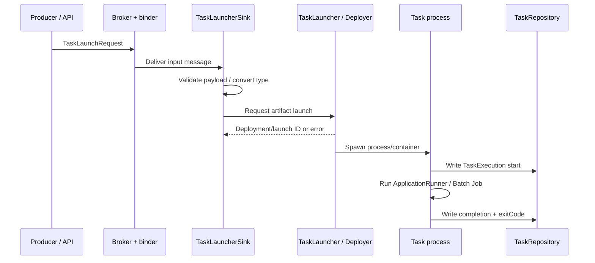
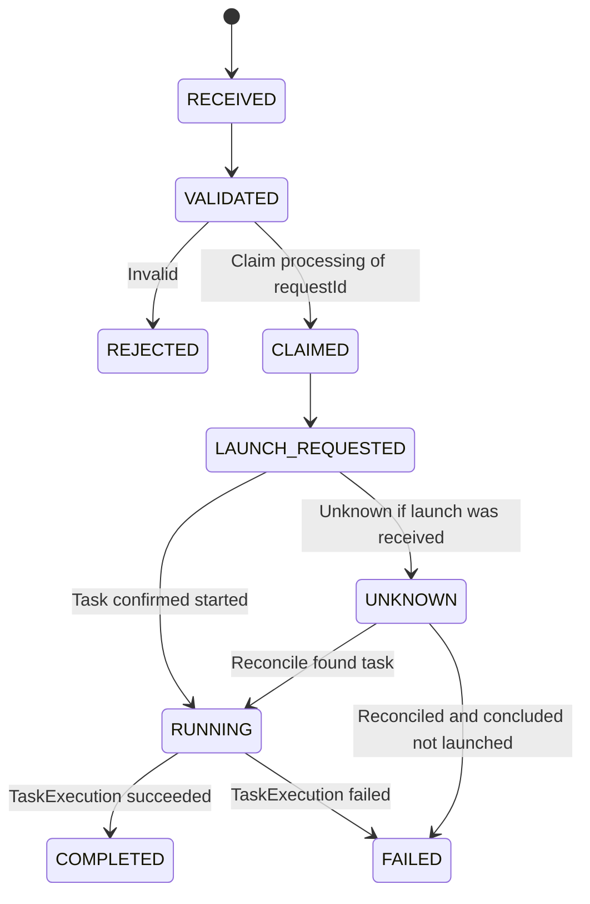
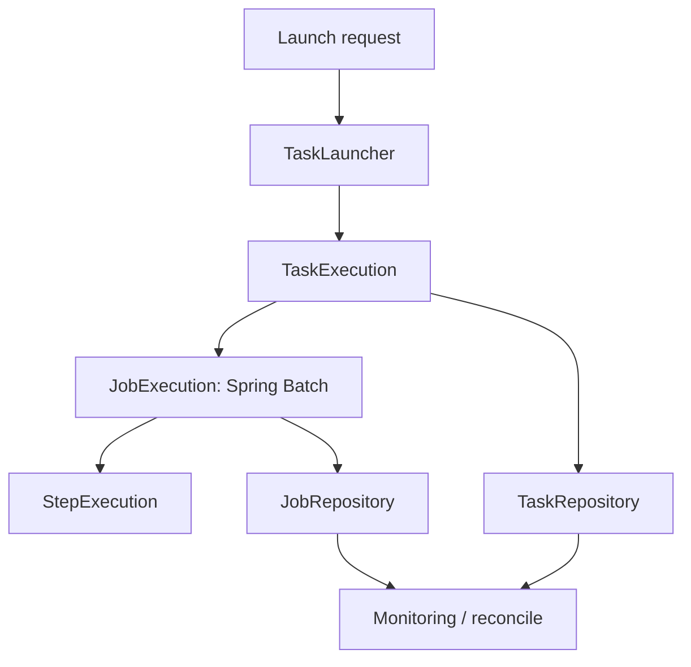

# TaskLauncherSink and Message-Driven Launching in the Supported Branch

## 1. From Message to a Spring Cloud Task Run

In many systems, a **Spring Cloud Task** does not need to run continuously. The application starts on demand, executes finite work, and exits: importing data, calculating fees, sending reports, or running a **Spring Batch Job**. After each run, `TaskRepository` retains `TaskExecution` (task name, timestamps, arguments, exit code, and errors) for lookup.

But who decides **when to launch**? Besides cron, Kubernetes Jobs, APIs, or human operators, a system can emit **launch request messages** over Kafka/RabbitMQ. In the Spring Cloud Task branches that supported this model, the **`TaskLauncherSink`** component receives a **`TaskLaunchRequest`** object from Spring Cloud Stream and delegates process creation to a Spring Cloud Deployer **`TaskLauncher`**.

This lesson focuses on **"TaskLauncherSink and message-driven launching in the supported branch."** The key point is understanding **version scope**: never copy an `@EnableTaskLauncher` example from older docs into a new Spring Boot/Spring Cloud Stream project without checking the API.

After this lesson, you will be able to:

1. Explain the roles of `TaskLauncherSink`, `TaskLaunchRequest`, binders, and `TaskLauncher`.
2. Build a properly structured request and distinguish deployment parameters from business parameters.
3. Describe a task sink using `@EnableTaskLauncher` **within a compatible library branch**.
4. Configure input bindings and choose Kafka/RabbitMQ binders.
5. Distinguish **receiving a request**, **the deployer accepting a launch**, and **the task completing successfully**.
6. Use the **functional `Consumer`** pattern in new projects instead of relying on the removed Stream annotation model.
7. Design defensively against duplicate messages, untrusted URIs, broker failures, resource exhaustion, retries, and Spring Batch outcomes.

## 2. Check the Supported Branch First

### 2.1. Important Version Status

The **Spring Cloud Task 3.2** reference documentation still describes `@EnableTaskLauncher` and `TaskLauncherSink`. **Spring Cloud Task 3.3** retains that description but **marks launching from Stream as end-of-life**, slated for removal in a later release. In **Spring Cloud Task 5.0**, the *Launching a Task from a Spring Cloud Stream* section is gone.

Another compatibility point: **Spring Cloud Stream 4.0 removed the legacy `@EnableBinding` / `@StreamListener` / `Sink` model** in favor of Spring Cloud Function (`Supplier`, `Function`, `Consumer`). Older `TaskLauncherSink` Javadocs used `@EnableBinding(Sink.class)`, so there is a very real compatibility risk if you simply bump versions in Maven.

| Ecosystem | Approach | Warning |
| --- | --- | --- |
| Compatible Spring Cloud Task **2.x** + Spring Cloud Stream **3.x** | Can use the legacy `TaskLauncherSink` / `@EnableTaskLauncher` model with matching dependencies. | Pin the version set and run integration tests; this is an older technology branch, not the default for new projects. |
| Spring Cloud Task **3.2/3.3** + Stream **4.x** | Task 3.x docs may still describe the legacy launcher. | Do not assume `@EnableBinding` still exists: inspect the actual binaries/API. Task 3.3 already marked this feature **end-of-life**. |
| Spring Cloud Task **5.x** and new systems | Choose a supported launcher/orchestrator or a Stream app using its own `Consumer` calling an API/`TaskLauncher`. | Do not expect `@EnableTaskLauncher`/`TaskLauncherSink` to remain a supported API. |

**Rule:** Always verify the exact **Spring Boot–Spring Cloud–Stream–Task–Deployer version tuple** before building. Legacy illustrative examples in this lesson are **not guaranteed** to work on Spring Boot 3.4, Spring Cloud 2024.x, or Spring Cloud Task 5.x.

### 2.2. How to Choose an Implementation Path

- **Maintaining an existing legacy system:** You can study `TaskLauncherSink` for maintenance, while actively managing upgrade, security, and version-support risks.
- **Starting a new project:** Use a `Consumer` following the current Spring Cloud Stream/Function model; the consumer calls a trusted deployment service (SCDF API, Kubernetes Job API, or a compatible `TaskLauncher`).
- **No message broker needed:** Prefer cron, Kubernetes CronJob, or a task-launch API. Spring Cloud Task only manages lifecycle; it does not schedule itself.

## 3. Architecture of Message-Driven Launching



| Component | Responsibility |
| --- | --- |
| Producer | Emits authenticated, validated requests; can originate from schedules, business events, or APIs. |
| Broker | Routes/persists messages via Kafka topics or RabbitMQ exchanges/queues. |
| Spring Cloud Stream binder | Connects the sink's input binding to the broker. |
| `TaskLauncherSink` | Receives `TaskLaunchRequest` and forwards to `TaskLauncher`; it **does not run business logic** for the child task itself. |
| `TaskLauncher` | API to deploy/launch an artifact on a platform: local, Kubernetes, Cloud Foundry, etc., depending on the implementation. |
| Task application | Runs finite work with `@EnableTask` or equivalent configuration, persisting `TaskExecution`. |
| `TaskRepository`/`TaskExplorer` | Records and queries task lifecycles once the child process runs. |

**The sink is a long-lived application** consuming requests. **The child task is a short-lived application** spawned on demand. Never attach `@EnableTaskLauncher` to the business task application itself and expect it to act simultaneously as an endless message-consuming sink and a finitely terminating Task.

### 3.1. Three Distinct Levels of Success

1. **Message accepted by the broker:** Producer successfully sends to the topic/queue.
2. **Request accepted by the launcher:** Sink calls `TaskLauncher.launch(...)` and gets an identifier or returns without throwing at call time.
3. **Task executed successfully:** Child process creates `TaskExecution`, runs business logic, and records `EXIT_CODE=0` per the application's exit contract.

A success response at **level 2** does not guarantee **level 3**: the container might fail to start, the task might lack a datasource, or a Spring Batch Job might fail afterward. The orchestration system must observe the final outcome via the platform and repository.

## 4. The `TaskLaunchRequest` Contract

The `org.springframework.cloud.task.launcher.TaskLaunchRequest` class in the historical supported API carries these fields:

| Field | Type | Meaning |
| --- | --- | --- |
| `uri` | `String` | URI of the task artifact to run, e.g., a Spring Boot executable JAR in a Maven repository. |
| `applicationName` | `String` | Application name used on launch; if omitted, historical branches may auto-generate a `Task-<UUID>` name. |
| `commandLineArguments` | `List<String>` | Arguments passed down to the task process, e.g., `--period=2026-11`. |
| `environmentProperties` | `Map<String,String>` | Environment provided to the child process, handled by the specific deployer. |
| `deploymentProperties` | `Map<String,String>` | Infrastructure-level deployment settings such as resource limits, namespace, or deployer config. |

Example JSON content of a request (to **illustrate the contract**; does not guarantee a binder automatically converts it into a Java object without matching converters/configuration):

```json
{
  "uri": "maven://com.example:orders-import-task:1.0.0",
  "applicationName": "orders-import",
  "commandLineArguments": [
    "--period=2026-11",
    "--spring.profiles.active=batch"
  ],
  "environmentProperties": {
    "TASK_REGION": "ap-southeast-1"
  },
  "deploymentProperties": {}
}
```

**Parameter groups are not interchangeable:** `commandLineArguments` are read by the Spring Boot application; `environmentProperties` are process/container environment variables; `deploymentProperties` are interpreted by **the deployer** and can vary across local/Kubernetes/Cloud Foundry. Never assume a Kubernetes key works on `LocalTaskLauncher`.

### 4.1. Creating the Request in Java

If a producer application uses a compatible Spring Cloud Task library containing `TaskLaunchRequest`, it can instantiate the object:

```java
import java.util.List;
import java.util.Map;

import org.springframework.cloud.task.launcher.TaskLaunchRequest;

TaskLaunchRequest request = new TaskLaunchRequest(
        "maven://com.example:orders-import-task:1.0.0",
        List.of("--period=2026-11"),
        Map.of("TASK_REGION", "ap-southeast-1"),
        Map.of(),
        "orders-import");
```

The constructor parameter order is **URI, command-line arguments, environment properties, deployment properties, application name**. Serialization depends on the message converter and binder. If the source application uses the Spring Cloud Stream functional model, it can wrap the request in a `Message<?>` and send via `StreamBridge`; both ends must still agree on payload encoding/decoding.

### 4.2. Why Arbitrary URIs Must Not Be Allowed

An untrusted message containing `uri` could instruct the platform to **download and execute code**. That is a highly sensitive privilege. Production systems require an **artifact allowlist**, signed/controlled versions, per-team publish permissions, and must block clients from passing unrestricted deployment properties.

Never accept fields like `uri` or arbitrary shell commands from end users and pass them straight to the launcher. Instead, turn business messages into a **schema-constrained command**, such as `{"taskType":"orders-import","period":"2026-11"}`, and map `taskType` to a fixed artifact URI in server-side configuration.

## 5. Legacy `TaskLauncherSink`: Understanding `@EnableTaskLauncher`

In the historical supported API branch, the annotation:

```java
import org.springframework.cloud.task.launcher.annotation.EnableTaskLauncher;
```

is placed on the sink application:

```java
package com.example.launchsink;

import org.springframework.boot.SpringApplication;
import org.springframework.boot.autoconfigure.SpringBootApplication;
import org.springframework.cloud.task.launcher.annotation.EnableTaskLauncher;

@SpringBootApplication
@EnableTaskLauncher
public class TaskSinkApplication {

    public static void main(String[] args) {
        SpringApplication.run(TaskSinkApplication.class, args);
    }
}
```

`@EnableTaskLauncher` imports the `TaskLauncherSink` configuration into the context. Javadocs of legacy releases show `TaskLauncherSink` using Spring Cloud Stream's annotation-based model and method:

```java
// Signature excerpt for explanation, not a bean to redeclare:
@ServiceActivator(inputChannel = "input")
public void taskLauncherSink(TaskLaunchRequest request) throws Exception
```

The framework receives `TaskLaunchRequest` from the input channel and invokes the configured `TaskLauncher`. If the payload is not an accepted type, the sink can throw an exception and the binder applies its retry/error flow rules.

**Requires a `TaskLauncher` bean:** The annotation does not magically turn the sink into a platform capable of spawning JVMs/containers. You must supply a Spring Cloud Deployer implementation/configuration matching where tasks execute. Local development may use the Local deployer; production typically integrates with a managed deployment platform.

### 5.1. A Dependency Set from the Historical Branch

To illustrate **same-generation** libraries, a maintained legacy application might use Spring Boot **2.7.18** with Spring Cloud release train **2021.0.9**, selecting Spring Cloud Task/Stream/Deployer from the matching BOM:

```xml
<parent>
    <groupId>org.springframework.boot</groupId>
    <artifactId>spring-boot-starter-parent</artifactId>
    <version>2.7.18</version>
    <relativePath/>
</parent>

<properties>
    <java.version>17</java.version>
</properties>

<dependencyManagement>
    <dependencies>
        <dependency>
            <groupId>org.springframework.cloud</groupId>
            <artifactId>spring-cloud-dependencies</artifactId>
            <version>2021.0.9</version>
            <type>pom</type>
            <scope>import</scope>
        </dependency>
    </dependencies>
</dependencyManagement>

<dependencies>
    <dependency>
        <groupId>org.springframework.cloud</groupId>
        <artifactId>spring-cloud-starter-task</artifactId>
    </dependency>
    <dependency>
        <groupId>org.springframework.cloud</groupId>
        <artifactId>spring-cloud-stream</artifactId>
    </dependency>
    <dependency>
        <groupId>org.springframework.cloud</groupId>
        <artifactId>spring-cloud-stream-binder-kafka</artifactId>
    </dependency>
    <!-- Add the TaskLauncher implementation for the chosen platform,
         of a compatible version. Do not assume the binder alone is enough. -->
</dependencies>
```

This is a **dependency configuration excerpt**, not a complete `pom.xml` or a guarantee that every older patch-level combination is safe. Older version sets may no longer receive upstream maintenance. Before actual use, verify that the classpath contains `TaskLauncherSink`, `@EnableTaskLauncher`, `@EnableBinding`, and `TaskLauncher`, and run integration tests against the broker/deployer. Never mix `spring-cloud-task 2.x` with Spring Boot 3.x or Stream 4.x.

### 5.2. Configuring the Input Binding for the Legacy Sink

Example with Kafka:

```yaml
spring:
  application:
    name: task-launch-sink
  cloud:
    stream:
      bindings:
        input:
          destination: ops.task-launch-requests
          group: task-launchers
          content-type: application/json
          binder: kafka
      kafka:
        binder:
          brokers: localhost:9092
```

The name `input` belongs to **the legacy Sink channel model**; it differs from functional binding names like `launchRequests-in-0`. `destination` specifies the Kafka topic from which requests are read. In properties format, this can be written concisely as `spring.cloud.stream.bindings.input.destination=ops.task-launch-requests`. `group` lets multiple sink replicas in the same consumer group partition messages according to the binder's rules.

**Payload conversion:** JSON on the broker must convert into a `TaskLaunchRequest` by the time the `ServiceActivator` is invoked. Depending on the Stream generation, an appropriate message type/content-type/converter is required. Do not assume any JSON with similar field names automatically becomes a Java `TaskLaunchRequest`. During testing, inspect converter logs and deserialization errors, not just Kafka consumer status.

### 5.3. The Child Task Must Be a Separate Application

Example `orders-import-task` application packaged as an **executable Spring Boot JAR** and configured with Spring Cloud Task:

```java
package com.example.orders;

import org.springframework.boot.ApplicationArguments;
import org.springframework.boot.ApplicationRunner;
import org.springframework.boot.SpringApplication;
import org.springframework.boot.autoconfigure.SpringBootApplication;
import org.springframework.cloud.task.configuration.EnableTask;
import org.springframework.stereotype.Component;

@SpringBootApplication
@EnableTask
public class OrdersImportTask {
    public static void main(String[] args) {
        SpringApplication.run(OrdersImportTask.class, args);
    }
}

@Component
class OrdersRunner implements ApplicationRunner {
    @Override
    public void run(ApplicationArguments args) {
        String period = args.containsOption("period")
                ? args.getOptionValues("period").get(0)
                : "unspecified";
        System.out.println("Importing orders for " + period);
        // Call the business service, handle errors, and exit finitely here.
    }
}
```

The Task needs a valid `DataSource`/`TaskRepository` to persist metadata; in production, prepare the schema via migrations. When integrating with Spring Batch, you need the `JobRepository` schema and a mechanism to propagate Job failure status to the Task exit code.

**Do not confuse the two applications:** the Sink **stays up continuously to consume messages**; the JAR containing the runner above **runs only when spawned by the launcher**. Putting `@EnableTaskLauncher` into the business JAR does not replace building and deploying a dedicated sink.

## 6. End-to-End Scenario in the Supported Branch

Assume the environment already has:

- Kafka topic `ops.task-launch-requests`.
- A compatible task sink accepting JSON/`TaskLaunchRequest` and a working `TaskLauncher` bean.
- The `orders-import-task` artifact in a Maven repository or location readable by the deployer.
- Spring Cloud Task metadata database created, with required permissions for the sink/deployer.

### 6.1. Sending an Illustrative Request

Create a JSON message externally (the snippet below is **illustrative message content**, not a shell command):

```json
{
  "uri": "maven://com.example:orders-import-task:1.0.0",
  "applicationName": "orders-import",
  "commandLineArguments": ["--period=2026-11"],
  "environmentProperties": {},
  "deploymentProperties": {}
}
```

If testing with Kafka CLI and the sink's converter permits JSON:

```bash
kafka-console-producer.sh \
  --bootstrap-server localhost:9092 \
  --topic ops.task-launch-requests
```

Then paste **the JSON on a single line** into stdin. Note that Kafka CLI sends bytes/strings in its own way; message headers like `content-type` or type information may not be included as a Spring Cloud Stream producer would. With a legacy sink expecting a `TaskLaunchRequest` object, **there is no guarantee** sending JSON from CLI is sufficient; the standard test approach uses a compatible producer/processor or an integration test binder with a verified converter.

### 6.2. Outcomes to Verify

1. Sink receives the message on the expected input binding and converts it into a `TaskLaunchRequest`.
2. Sink/`TaskLauncher` resolves the artifact, prepares the environment, and starts the process/container.
3. Child task logs `Importing orders for 2026-11`.
4. `TaskRepository` creates a `TaskExecution` and updates its completion.
5. The orchestration system reconciles the final execution status rather than merely noting "message consumed".

If the launcher returns a deployment ID, store the relationship **message ID → deployment ID → TaskExecution ID** in an audit system. Never assume the container deployment ID equals `TASK_EXECUTION_ID` in the database.

### 6.3. Querying Metadata After the Task Runs

In the database used by the child Task application:

```sql
SELECT TASK_EXECUTION_ID,
       TASK_NAME,
       START_TIME,
       END_TIME,
       EXIT_CODE,
       ERROR_MESSAGE
FROM TASK_EXECUTION
ORDER BY TASK_EXECUTION_ID DESC;
```

If no row exists, check whether the child task was created and initialized far enough to write to `TaskRepository`. If `START_TIME` is present without `END_TIME`, you cannot conclude the task is still running: it may have been killed or lost its database connection before writing final status.

## 7. Spring Cloud Data Flow Integration: Two Kinds of Task Launchers to Note

Historical Spring Cloud Task documentation includes an example registering a **sink app** and **processor app** in Spring Cloud Data Flow:

```text
app register --name taskSink --type sink --uri maven://io.spring.cloud:tasksink:<version>
app register --name taskProcessor --type processor --uri maven://io.spring.cloud:taskprocessor:<version>

stream create foo --definition "http --server.port=9000 | taskProcessor | taskSink" --deploy
```

This is **illustrative syntax from historical branch documentation**, not a recipe guaranteed to work on every modern Spring Cloud Data Flow version. Specific artifacts and versions must exist and be supported by the platform.

There is also an application named **TaskLauncher Data Flow Sink** in the Spring Cloud Stream App Starters family. That sink receives a **`LaunchRequest`** targeting a *task definition* registered on the **SCDF server** and uses the REST API to request a launch; its example payload contains `name`, `deploymentProps`, and `args`. It **has a different contract** from `TaskLauncherSink`'s `TaskLaunchRequest` containing `uri`:

| Sink Type | Message | How It Executes |
| --- | --- | --- |
| Historical Spring Cloud Task `TaskLauncherSink` | `TaskLaunchRequest` containing the artifact `uri` | Calls `TaskLauncher`/deployer directly. |
| TaskLauncher Data Flow Sink | `LaunchRequest` containing the name of a task definition registered on SCDF | Calls the SCDF Task API to launch the definition. |
| Custom modern `Consumer` | Application-designed contract, e.g., `taskType`, `period` | Calls SCDF REST, Kubernetes Job API, or a `TaskLauncher` adapter. |

**Do not route JSON between the two sinks while skipping schema mapping.** A `{"name":"orders-import"}` message meant for the Data Flow Sink is not a `TaskLaunchRequest` for the legacy `TaskLauncherSink`.

## 8. Modern Approach: `Consumer` + Controlled Launcher

With **Spring Cloud Stream 4.x/5.x**, the standard message-receiving model is a `java.util.function.Consumer` bean. You can write your own consumer and invoke `TaskLauncher` through the SPI, or integrate a modern orchestration API; `@EnableTaskLauncher`/`@EnableBinding` are not needed.

### 8.1. Designing a Constrained Contract

Instead of letting producers pass arbitrary URIs, use a business message:

```json
{
  "requestId": "req-2026-11-001",
  "taskType": "orders-import",
  "period": "2026-11"
}
```

`requestId` prevents duplicates. `taskType` is chosen from an allowlist, while URI and deployment policies are decided server-side. The payload contains no secrets or shell commands.

### 8.2. A Consumer Receiving Requests

```java
package com.example.launchsink;

import java.util.function.Consumer;
import org.springframework.context.annotation.Bean;
import org.springframework.context.annotation.Configuration;

record LaunchCommand(String requestId, String taskType, String period) {}

interface ApprovedTaskLaunchService {
    void submit(LaunchCommand command);
}

@Configuration
public class LaunchConsumerConfiguration {

    @Bean
    public Consumer<LaunchCommand> launchRequests(
            ApprovedTaskLaunchService launchService) {
        return launchService::submit;
    }
}
```

`ApprovedTaskLaunchService` is an **application interface** requiring an implementation you write against your actual platform. The snippet illustrates the bridge between the Stream Consumer and the launcher layer; **it is not a complete project** you can simply paste and run tasks with.

Kafka binding using the functional model:

```yaml
spring:
  cloud:
    function:
      definition: launchRequests
    stream:
      bindings:
        launchRequests-in-0:
          destination: ops.task-launch-requests
          group: approved-task-launchers
          content-type: application/json
      kafka:
        binder:
          brokers: localhost:9092
```

`launchRequests-in-0` is the input binding name derived from the `Consumer`; it is **not** the legacy Sink's `input` binding, nor is it `task-events` used to emit `TaskExecution` events.

### 8.3. Translating the Request into a `TaskLauncher` Call

If the application provides a platform-compatible `org.springframework.cloud.deployer.spi.task.TaskLauncher` bean, the adapter can construct an `AppDeploymentRequest`. The example below uses a **fixed artifact**, ignoring any URI from the message:

```java
package com.example.launchsink;

import java.time.YearMonth;
import java.util.List;
import java.util.Map;
import java.util.Set;

import org.springframework.cloud.deployer.spi.core.AppDefinition;
import org.springframework.cloud.deployer.spi.core.AppDeploymentRequest;
import org.springframework.cloud.deployer.spi.task.TaskLauncher;
import org.springframework.core.io.Resource;
import org.springframework.core.io.ResourceLoader;
import org.springframework.stereotype.Service;

@Service
class ApprovedTaskLaunchServiceImpl implements ApprovedTaskLaunchService {

    private static final Set<String> ALLOWED =
            Set.of("orders-import");

    private final TaskLauncher taskLauncher;
    private final ResourceLoader resourceLoader;

    ApprovedTaskLaunchServiceImpl(
            TaskLauncher taskLauncher, ResourceLoader resourceLoader) {
        this.taskLauncher = taskLauncher;
        this.resourceLoader = resourceLoader;
    }

    @Override
    public void submit(LaunchCommand command) {
        if (command == null || command.requestId() == null
                || command.requestId().isBlank()
                || !ALLOWED.contains(command.taskType())) {
            throw new IllegalArgumentException("Invalid task request");
        }

        // YearMonth validates the format; never pass raw input
        // into a script/shell command.
        YearMonth period = YearMonth.parse(command.period());

        // Server-controlled URI; requires an artifact that actually exists.
        Resource resource = resourceLoader.getResource(
                "file:/opt/approved-tasks/orders-import.jar");

        AppDefinition definition = new AppDefinition(
                "orders-import", Map.of());

        AppDeploymentRequest deployment = new AppDeploymentRequest(
                definition,
                resource,
                Map.of(),
                List.of("--period=" + period));

        String deploymentId = taskLauncher.launch(deployment);

        // Save requestId -> deploymentId to the audit/idempotency store
        // before acknowledging the message; DB persistence is omitted in this example.
        System.out.println("Accepted " + command.requestId()
                + " deployment=" + deploymentId);
    }
}
```

**Prerequisites for the code above to work:**

- The project must include **Spring Cloud Deployer SPI** dependencies and an **actually configured** `TaskLauncher` implementation.
- `ResourceLoader` must be able to read the artifact and the launcher implementation must support the chosen resource format (local file/JAR/Maven/Docker...).
- `/opt/approved-tasks/orders-import.jar` is only an example path; never feed a raw URI from a message into `ResourceLoader` in production.
- The code only illustrates **issuing the launch command**. It **does not yet** implement deduplication transactions, outbox, or completion status verification. Production readiness requires adding the capabilities discussed in the following sections.
- Exact APIs or constructors must be checked against your running **Spring Cloud Deployer version**; never mix incompatible releases.

The key strength of this approach is that **the application actively controls validation, artifacts, and deployment permissions**, while using the Spring Cloud Stream model supported in modern releases.

## 9. Kafka, RabbitMQ, and Duplicate Request Handling

### 9.1. Binders Do Not Guarantee Business Uniqueness

| Criterion | Kafka | RabbitMQ |
| --- | --- | --- |
| Destination | Topic | Exchange/queue as configured by the Rabbit binder |
| Consumer group | Instances in the same group share partitions; other groups can read the same topic | Consumers on the same queue share messages; other groups typically have separate queues |
| Retry/redelivery | Depends on offsets/commits and consumer policies | Depends on ack/nack, retries, DLQ, and queue policies |
| Connection drop | Consumer may redeliver messages after recovery | May redeliver unacknowledged or requeued messages |
| Implication for launcher | A request can be processed again | A request can likewise be processed again |

With any binder, **message delivery does not guarantee exactly-once process creation**. A failure can happen after `TaskLauncher.launch()` accepted the command but **before the consumer marks the message processed**; the broker redelivers it, causing two tasks to run.

### 9.2. State Machine Pattern for Requests



Lock `requestId` using a **unique constraint** in the launcher's database or a shared idempotency store. When a duplicate message arrives, look up the existing request and launch outcome instead of calling the launcher again automatically.

A complex system must distinguish:

- **Message deduplication:** Do not re-run the same launch command.
- **Single-instance task:** Prevent two runs with **the same name** at the same time; if using Spring Cloud Task's single-instance feature, configure JDBC locking properly.
- **Business idempotency:** A task retried after a crash still does not double-charge or double-write data.

These three measures **complement one another**; they do not replace each other.

### 9.3. When to Ack/Nack?

Do not ack immediately upon reading JSON before validating conditions. At the same time, do not hold a message unacknowledged **for hours** waiting for the Task to finish: that ties up consumer resources, causes unexpected redeliveries, and stalls the stream.

Common pattern:

1. Validate the message and authorization.
2. Persist command/idempotency state to the database.
3. Launch or enqueue the validated command into a reliable internal queue.
4. Persist launch acceptance or deployment failure.
5. Ack the message according to the chosen transaction/retry policy.
6. Monitor **`TaskExecution`** independently until terminal state, emitting status events upstream.

There is no default atomic transaction spanning Kafka/RabbitMQ, `TaskLauncher`, the container platform, and `TaskRepository`. For strict SLAs, use reconciliation/outbox patterns and controlled retries.

## 10. Task Outcomes, Spring Batch Status, and Relationship to Schedulers

**`TaskLauncher`** only handles launching. **Spring Cloud Task** records `TaskExecution`; if the child task runs **Spring Batch**, `JobRepository` stores `JobExecution` and `StepExecution`.



A failed Job **does not always** produce a non-zero Task exit code if the application fails to propagate the outcome properly. When integrating `spring-cloud-task-batch`, check `spring.cloud.task.batch.fail-on-job-failure` and wait for any asynchronous Jobs to finish before the Task lifecycle ends.

`TaskExecution` events emitted via Spring Cloud Stream on the `task-events` binding are **lifecycle notifications**, distinct from **`TaskLaunchRequest`** messages on the launcher's input. Never share the same destination without separating payload types and access controls.

## 11. Security: Treat Launch Commands as Privileged Operations

A sink capable of launching JARs/containers is a sensitive choke point in the system. Apply:

- **Message source authorization:** Kafka ACLs or RabbitMQ vhost/exchange/queue permissions; only authorized producers may send commands.
- **Artifact allowlist:** Fixed URIs per task type, approved versions, checksums/signatures, and trusted artifact repositories.
- **Block arbitrary `deploymentProperties`:** Those fields can affect CPU, RAM, service accounts, namespaces, volume mounts, or network access.
- **Block arbitrary shell commands:** `TaskLauncher` runs controlled artifacts; never turn messages into OS shell execution.
- **Resource limits:** Max concurrent launches, rate limits, queue depth, retry budgets, and namespace/platform quotas.
- **Protect secrets:** Never place tokens/passwords in `commandLineArguments`, logs, or payloads, since `TaskRepository` may persist parameters and brokers retain messages.
- **Audit:** Log `requestId`, submitting principal, `taskType`, artifact version, `deploymentId`, `TaskExecutionId`, and final status; never log credentials.
- **Protect outputs:** Restrict access to `TASK_EXECUTION`, logs, and status messages; do not treat IDs as authorization proofs.

If the broker receives messages from public-facing systems, place an API/authentication/validation layer in front. A consumer that directly accepts unauthenticated JSON and deploys artifacts is a dangerous design.

## 12. Common Errors and Diagnostics

| Symptom | Possible Cause | How to Fix |
| --- | --- | --- |
| `@EnableBinding` or `Sink` not found | Using Spring Cloud Stream 4/5 with legacy code | Migrate to a functional `Consumer` or use a verified historical stack; do not force old dependencies into modern Boot. |
| Missing `TaskLauncher` bean | No Spring Cloud Deployer implementation configured | Register a launcher for the actual platform; verify versions and permissions. |
| JSON arrives on topic but sink reports wrong payload type | JSON → `TaskLaunchRequest` conversion failed | Check content-type, converters/type metadata, and request contract. |
| Request exists but no launch happens | Wrong `input` binding/destination/group or broker connection error | Check Kafka/Rabbit binder, ACLs, consumer logs, and routing. |
| Deployer cannot fetch artifact | Bad URI, unpublished artifact, missing repo permissions | Check resource resolver, Maven repository/proxy, and deployer credentials. |
| Launcher returns ID but no `TaskExecution` | Child process never started or failed early at startup | Inspect deployment status, container/process logs, datasource, and Task schema. |
| Task has non-zero `EXIT_CODE` | Business or configuration error in the child app | Query `TaskRepository`, runner logs, and `JobRepository` if using Batch. |
| One message causes the task to run twice | Redelivery or competing consumers/missing idempotency | Use unique `requestId`, audit launch results, reconcile before retrying. |
| Retry blocked even though old process died | Single-instance lock TTL still active or scheduler missed final status | Reconcile processes, `TaskRepository`, lock tables, and leases/TTLs. |
| Sink works locally but cannot create tasks on Kubernetes | Incompatible deployer or missing namespace/service account | Use the right launcher implementation, config, and platform RBAC. |
| Sent Data Flow Sink JSON but legacy `TaskLauncherSink` rejects it | Confusing `LaunchRequest` with `TaskLaunchRequest` | Use the matching contract or write an explicit converter/adapter. |
| Batch Job failed yet task launcher reported accepted | Accepted is not final business success | Monitor `JobExecution`/`TaskExecution` independently to terminal state. |

For quick diagnosis, check in sequence: **valid message → input binder → consumer/sink converter → launcher/deployer → artifact/process → `TaskRepository` → business outcome**. Do not start by deleting metadata just because "the task didn't run".

## 13. Pre-Production Checklist

| Area | Question to Answer |
| --- | --- |
| Version | Is the code on a branch supporting `TaskLauncherSink`, or migrated to a functional consumer? |
| Broker | Are destination, group, ACLs, and DLQ/retention properly configured? |
| Message contract | Have you distinguished `TaskLaunchRequest`, SCDF `LaunchRequest`, and `TaskExecution` events? |
| TaskLauncher | Which platform runs the task? Are the implementation, resource quotas, and permissions verified? |
| Artifact | Is the URI on an allowlist, and is the artifact published and verified? |
| Deduplication | Are stable `requestId`, unique constraints, and retry handling in place? |
| Status tracking | Is there a mapping from request → deployment → `TaskExecution`/`JobExecution`? |
| Infrastructure errors | Are timeouts, bounded retries, reconciliation, and alerts configured? |
| Data | Is the task idempotent on restart without duplicate processing? |
| Security | Are secrets absent from messages, command-line args, and metadata? |

## 14. Practice Exercises

### Exercise 1: Explain TaskLauncherSink

Draw a diagram from a Kafka topic to `TaskLauncherSink`, `TaskLauncher`, JVM/Container, and `TaskRepository`. Indicate clearly which component **receives messages**, which **executes the task**, and where **final state is stored**.

### Exercise 2: Compare Two Requests

Given JSON:

```json
{"uri":"maven://com.example:orders-import-task:1.0.0","applicationName":"orders-import","commandLineArguments":["--period=2026-11"],"environmentProperties":{},"deploymentProperties":{}}
```

and:

```json
{"name":"orders-import","deploymentProps":{},"args":["--period=2026-11"]}
```

Identify which message belongs to the legacy `TaskLauncherSink`'s `TaskLaunchRequest`, which resembles the Data Flow Sink's `LaunchRequest`, and why the two payloads cannot be swapped without schema translation.

### Exercise 3: Migrate from Legacy to Functional

Suppose a project upgrades Spring Cloud Stream 3.x to 4.x and hits errors because `@EnableBinding` is gone. Replace the old sink idea with a `Consumer<LaunchCommand>`, map `taskType` via an allowlist, call a configured launcher, and persist `requestId` for deduplication.

### Exercise 4: Failure Testing

Simulate the broker redelivering the exact same message because the consumer disconnected after the launcher accepted the command. Describe how an idempotency store recognizes the prior request, avoids a second launch, and reconciles child process status with `TaskExecution`.

### Self-Check Questions

1. How does `TaskLauncherSink` differ from an `ApplicationRunner` inside the child task?
2. What is the purpose of each of the five fields of `TaskLaunchRequest`?
3. Why does `@EnableTaskLauncher` appearing in 3.2/3.3 docs not mean that API is compatible with every newer Spring Cloud Stream release?
4. Does a message sitting in a Kafka topic prove a `TaskExecution` was created?
5. Does `TaskLauncher.launch(...)` returning an identifier prove the task succeeded?
6. What security risks does a sender-chosen `uri` field introduce?
7. Why can a single message lead to two runs, and how does `requestId` help?
8. When should you use the Data Flow Task API instead of provisioning your own `TaskLauncher`?
9. How does a `TaskExecution` event differ from `TaskLaunchRequest` in data flow direction?
10. When a task runs Spring Batch, why must you observe both `JobExecution` and `TaskExecution`?

**Key takeaway:** In **supported branches**, `TaskLauncherSink` receives `TaskLaunchRequest` via Spring Cloud Stream and delegates task execution to `TaskLauncher`. This legacy feature was marked **end-of-life** in Spring Cloud Task 3.3 and removed from Task 5.x docs; do not treat `@EnableTaskLauncher` as the default choice for new projects. For modern systems, use a **functional `Consumer` + controlled launcher/orchestrator**, validate and deduplicate commands, and reconcile final outcomes via **`TaskRepository`**.

## References

- [Spring Cloud Task 3.2 — Spring Cloud Stream Integration](https://docs.spring.io/spring-cloud-task/reference/3.2/stream.html): `TaskLauncherSink`, `TaskLaunchRequest`, and `@EnableTaskLauncher`.
- [Spring Cloud Task 3.3 — Spring Cloud Stream Integration](https://docs.spring.io/spring-cloud-task/reference/3.3/stream.html): note that launching from Stream is end-of-life.
- [Spring Cloud Task 5.0 — Spring Cloud Stream Integration](https://docs.spring.io/spring-cloud-task/reference/5.0/stream.html): Task/Batch events documentation, legacy launch section removed.
- [TaskLaunchRequest API](https://docs.spring.io/spring-cloud-task/docs/current/apidocs/org/springframework/cloud/task/launcher/TaskLaunchRequest.html): constructor and meaning of the five fields.
- [TaskLauncherSink API in the legacy branch](https://docs.spring.io/spring-cloud-task/docs/2.3.4/apidocs/org/springframework/cloud/task/launcher/TaskLauncherSink.html): `@EnableBinding` and `@ServiceActivator(inputChannel="input")`.
- [Spring Cloud Stream — Functional Binding Names](https://docs.spring.io/spring-cloud-stream/reference/spring-cloud-stream/functional-binding-names.html): how `Consumer` generates input binding names.
- [Spring Cloud Data Flow — Launching a Task](https://docs.spring.io/spring-cloud-dataflow/docs/2.10.x/reference/htmlsingle/): API and shell for launching registered tasks on the platform.
