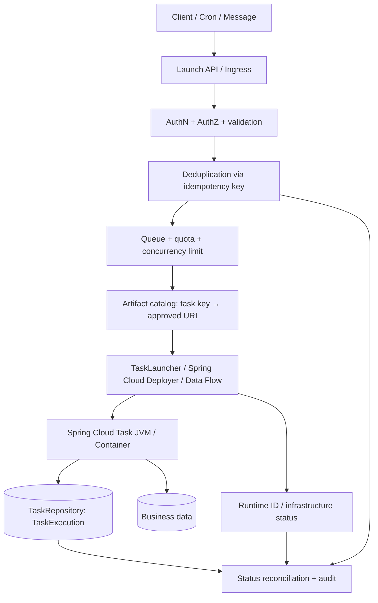
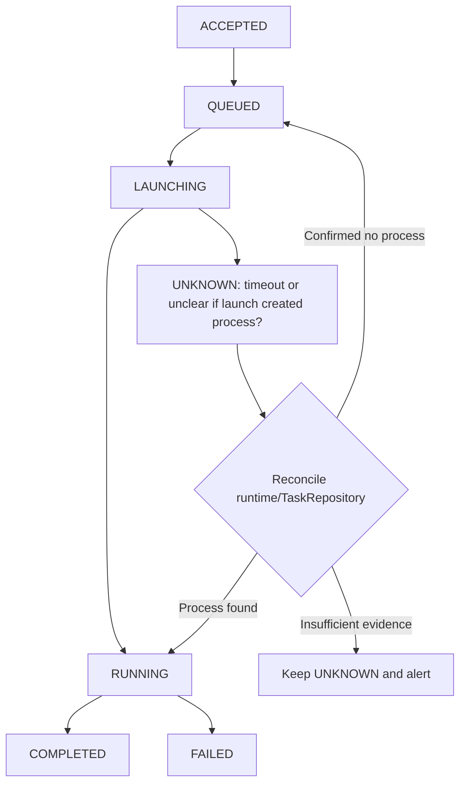
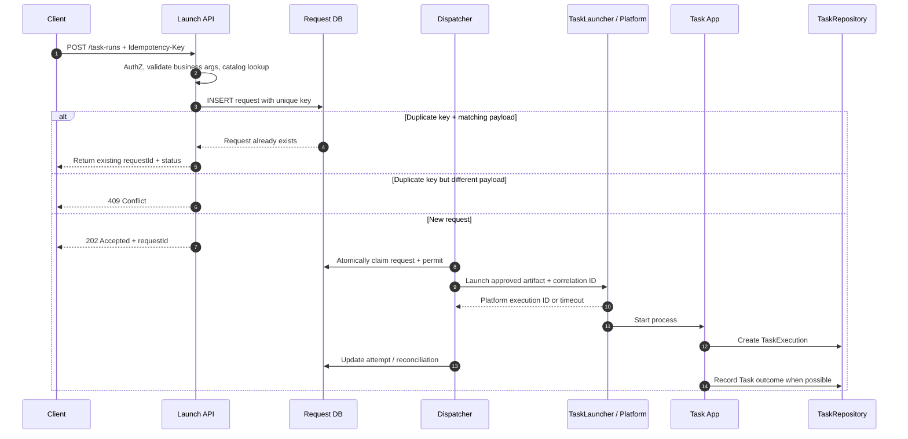

# Controlling Application URIs, Duplicate Requests, and Launch Limits

## 1. Why Does a Task Launch System Need a Control Layer?

In the **Launching** chapter, we examine how to take **Spring Cloud Task** from a finite-lived Spring Boot application to a system driven by schedules, APIs, or messages that request runs at arbitrary times. The goal is not merely "launching a JAR": a sound orchestration service must know **which programs are allowed to run**, **which requests are duplicates of previously accepted ones**, and **whether infrastructure has enough capacity for a new run**.

Consider an API receiving order reconciliation requests for `2026-11-24`. Due to a network timeout, a client sends the same request three times; meanwhile, 200 other clients submit requests at the top of the hour. If every request goes straight to the launcher:

- A user could specify a URI pointing to an unverified artifact, leading to unintended code execution.
- Three identical requests could spawn three processes and write duplicate data.
- Hundreds of concurrent processes could exhaust CPU, Pod quotas, or the database connection pool.
- A scheduler receiving an error response without knowing whether a process launched could retry and create even more duplicates.

Spring Cloud Task stores **the history of each execution** in `TaskRepository`; it **does not natively provide complete** artifact control, HTTP request idempotency, queuing, or system-wide quotas. Those responsibilities live in the ingress service, launcher, scheduler, Spring Cloud Data Flow, or deployment platform depending on architecture.

### Learning Objectives

After this lesson, you will be able to:

1. Explain the roles of the artifact URI, `TaskLaunchRequest`, and `TaskLauncher` in the launch path.
2. Design an application allowlist/registry to prevent callers from choosing unauthorized URIs, arguments, or deployment properties.
3. Distinguish **duplicate requests**, **concurrently running tasks with the same name**, and **two distinct business runs**.
4. Use idempotency keys and a database to prevent duplicates under concurrent load.
5. Distinguish `spring.cloud.task.single-instance-enabled` from concurrency limits in Spring Cloud Data Flow, Kubernetes, and custom orchestrators.
6. Handle uncertain-outcome timeouts, retries, resource limits, and post-run `TaskExecution` reconciliation.

> **Principle:** "Request received", "launch command issued", "process created", "`TaskExecution` recorded", and "business work completed" are **five different states**. A safe design separates them instead of collapsing them into a single `success` boolean.

## 2. Path from Request to Spring Cloud Task Process

A typical system comprises these components:



In the **Spring Cloud Task + Spring Cloud Stream** model, Spring Cloud Task documentation defines `TaskLaunchRequest` carrying the information needed for a **task launcher sink** to request running an application. In the **Spring Cloud Data Flow** model, task registration and launching can go through Data Flow's API/shell/UI; Data Flow delegates to the deployment platform's `TaskLauncher`. A custom-built system can invoke `TaskLauncher` directly, yet must still enforce security and operational constraints.

| Component | Primary Responsibility | Should Not Assume |
| --- | --- | --- |
| API / message ingress | Authenticates and validates requests | Every incoming payload is trustworthy |
| Catalog/registry | Maps business task keys to approved artifacts | Clients can arbitrarily pick JARs/images |
| Idempotency store | Recognizes the same request across retries | `TaskRepository` automatically deduplicates HTTP requests |
| Queue / admission controller | Bounds the number of incoming runs | A single in-JVM `Semaphore` is sufficient |
| `TaskLauncher` / deployer | Asks infrastructure to spawn processes | Launch response equals business completion |
| `TaskRepository` | Records timestamps and outcomes of **`TaskExecution`** | Every early-failing request has a Task record |
| Runtime/scheduler | Knows whether Pods, containers, or processes are alive | `END_TIME IS NULL` definitely means still running |

## 3. What Can `TaskLaunchRequest` Carry?

In the Spring Cloud Stream launching mechanism, `TaskLaunchRequest` (package `org.springframework.cloud.task.launcher` in documented current versions) has these fields:

| Field | Meaning | Mandatory Control |
| --- | --- | --- |
| `uri` | URI pointing to the Task artifact to execute | **Allowlist** source, artifact, version/digest |
| `applicationName` | Application name associated with the launch | Accept only valid catalog names |
| `commandLineArguments` | Arguments passed to the application | Allow only schema-defined business args |
| `environmentProperties` | Environment variables provided to the process | Source only from approved configurations |
| `deploymentProperties` | Infrastructure properties, depending on `TaskLauncher` and deployer | Restrict CPU, memory, namespace, account, service identity |

Illustrative URI examples:

```text
maven://com.example.tasks:order-sync:jar:1.4.2
docker://registry.example.com/tasks/order-sync:1.4.2
```

**A URI is not an arbitrary website address typed by a user.** Supported schemes depend on the resolver, `Resource`/`TaskLauncher` implementation, and platform. Kubernetes environments typically deploy container images; another environment may distribute tasks from a Maven repository. Do not infer from examples that every deployer accepts every scheme.

Similarly, `applicationName` in a launcher request is the name used in the launch/deployer context; do not assume it equals `TASK_EXECUTION.TASK_NAME` if the application configures a different `spring.cloud.task.name`. Identifiers should be aligned intentionally.

### Why Letting Clients Populate All Five Fields Is Dangerous

A payload could contain a URI to a malicious artifact, inject arguments altering the datasource, activate a privileged profile, or request running in a high-privilege namespace. A launcher permitted to spawn Pods or access repositories becomes an **indirect code-execution vector** if validation only checks that the JSON has all fields.

In particular, allowing unrestricted `deploymentProperties` can bypass CPU/memory caps, select privileged service accounts, mount sensitive volumes, or reach internal networks. Enforce checks at **a trusted boundary before calling the launcher or publishing to a sink**.

## 4. Controlling URIs with a Catalog and Immutable Artifacts

### 4.1. Choose a `taskKey` Instead of Accepting Free-Form URIs

A safer API contract:

```json
{
  "taskKey": "order-reconciliation",
  "businessDate": "2026-11-24",
  "inputVersion": "snapshot-v1",
  "requestId": "req-20261124-001"
}
```

The API **does not** accept `uri`, `applicationName`, `deploymentProperties`, or arbitrary environment variables from the client. The server maps `taskKey=order-reconciliation` via an internal catalog:

| taskKey | Approved Artifact URI | Allowed Application | Profile/Quota |
| --- | --- | --- | --- |
| `order-reconciliation` | `maven://com.example.tasks:order-sync:jar:1.4.2` | `order-sync` | Batch worker, 2 CPU / 2 GiB |
| `daily-summary` | `maven://com.example.tasks:daily-summary:jar:2.1.0` | `daily-summary` | Light worker, 1 CPU / 1 GiB |

Resource figures in the table are policy examples, not Spring Cloud Task defaults. Real URIs must point to artifacts existing in a trusted repository.

### 4.2. Do Not Rely Only on Hostname Allowlists

To control which code runs, apply defense in depth:

1. **Scheme allowlist:** allow only schemes genuinely needed, such as Maven artifacts in an organization-controlled repository or images in an approved registry.
2. **Artifact allowlist:** allow exact `group/artifact` or image repositories; avoid overly broad wildcards.
3. **Immutable versions:** avoid `latest`/`SNAPSHOT` in critical production if contents can mutate; prefer verified digests or checksums.
4. **Trusted fetch sources:** block redirects to foreign hosts, unexpected paths, `file://`, or internal network/metadata endpoints unless required; this is also an SSRF risk.
5. **Provenance/signatures:** use image signatures, artifact signing, or digests to verify origin.
6. **Least-privilege deployer permissions:** grant read-only repository access and workload creation only in permitted namespaces/accounts.
7. **Audit and rollback capability:** record the artifact identity/digest of every attempt so you know exactly which code ran.

Simple prefix string checks like `startsWith("https://trusted")` are insufficient because of host/URL parsing mismatches, redirects, or alternate URI encodings. Use structured parsers/allowlists, canonicalize carefully, and ideally **never expose URI inputs on public endpoints at all**.

### 4.3. Example Building a Launch Request from a Fixed Catalog

The Java snippet below shows how to construct a `TaskLaunchRequest` from **server-controlled** data rather than forwarding a client payload straight to the launcher. The code uses the documented Spring Cloud Task constructor API; requires Java 17+ and compatible dependencies:

```java
import java.time.LocalDate;
import java.util.List;
import java.util.Map;

import org.springframework.cloud.task.launcher.TaskLaunchRequest;

public final class ApprovedTaskLaunchFactory {

    private record ApprovedTask(String uri, String applicationName) {}

    private static final Map<String, ApprovedTask> CATALOG = Map.of(
        "order-reconciliation",
        new ApprovedTask(
            "maven://com.example.tasks:order-sync:jar:1.4.2",
            "order-sync")
    );

    public TaskLaunchRequest prepare(
            String taskKey,
            String businessDate,
            String requestId) {
        ApprovedTask approved = CATALOG.get(taskKey);
        if (approved == null) {
            throw new IllegalArgumentException("Task not permitted");
        }

        // Parse and normalize; never pass raw client strings into args.
        String date = LocalDate.parse(businessDate).toString();
        if (requestId == null ||
                !requestId.matches("[A-Za-z0-9_-]{8,80}")) {
            throw new IllegalArgumentException("Invalid requestId");
        }

        List<String> arguments = List.of(
            "--business-date=" + date,
            "--request-id=" + requestId
        );

        // All environment/deployment properties are defined server-side.
        Map<String, String> environment = Map.of(
            "SPRING_PROFILES_ACTIVE", "batch"
        );
        Map<String, String> deployment = Map.of();

        return new TaskLaunchRequest(
            approved.uri(),
            arguments,
            environment,
            deployment,
            approved.applicationName()
        );
    }
}
```

This is a **payload-building factory**, not a runnable launcher by itself: it lacks authentication, request storage, a broker, `TaskLauncher`, a database, secrets, and concurrency limits. Using `Map.of()` for deployment properties ensures **clients cannot dictate deployment resources**; quota configuration is applied separately at the platform/deployer layer.

Manage task names and catalog artifacts through reviewed configuration changes; never pull raw URIs, secrets, or deployment flags from untrusted messages.

## 5. Restricting Arguments, Environment Variables, and Infrastructure Privileges

Even when the artifact URI is locked down, an argument can alter code behavior or Spring Boot configuration.

For example, if an API permits arbitrary options:

```text
--spring.datasource.url=jdbc:postgresql://another-host/other_db
--spring.profiles.active=admin
--spring.cloud.task.name=another-task
```

a caller could redirect the task to the wrong database, activate an unintended profile, or disrupt single-instance name limits. **Permit only contract-defined business arguments**, such as `--business-date` and `--input-version`, and parse them into strongly typed values at the API boundary.

| Value Category | Recommended Handling |
| --- | --- |
| Date, tenant, business processing bounds | Validate type, range, and tenant authorization; map to explicit arguments |
| `spring.datasource.*`, profiles, service identity | Supply only from server or trusted secret/config stores |
| `deploymentProperties` such as CPU/memory/namespace | Pull only from catalog and policy; enforce hard limits on the platform |
| `environmentProperties` | Keep secrets out of payloads, logs, and messages; use secret references where supported |
| `applicationName` and `spring.cloud.task.name` | Standardize stable names; prevent clients from spoofing names |
| `externalExecutionId` / request ID | Use for tracing, not as a business key or deduplication key |

Also enforce authorization on **who can run which task type**, in which environment, and how many requests they can submit—do not merely check that the caller is authenticated. Apply network policies, RBAC, quotas, and egress controls to running workloads.

## 6. Three "Duplicate" Concepts Commonly Confused

| Concept | Example | Appropriate Handling |
| --- | --- | --- |
| **Same request resent** | Client times out and resends `requestId=req-001` with the same payload | **Idempotency key** at ingress; return the prior acceptance result |
| **Two Tasks with the same name running** | Two `daily-sync` processes running concurrently | `single-instance-enabled` or name-based lock; concurrency limits |
| **Two business requests overlapping data** | Requests A and B have different IDs but both reconcile `tenant+businessDate` | Business key, unique constraint, idempotent writer, or coalesce policy |

**`TaskRepository` normally creates a new `TaskExecution` for every launched process**, even when `taskName` and arguments are identical. Thus, it is not an automatic HTTP request deduplicator or an exactly-once side-effect guarantee.

Duplicate requests can come from many sources: browser auto-retries, reverse-proxy retries, message broker redeliveries, scheduler retries after timeouts, or users double-clicking a button. Your design must work even when **two copies arrive simultaneously** on two different API instances.

### What Should an Idempotency Key Include?

An ideal key is stable for **the same logical request**, for example:

```text
tenantId + operation + callerProvidedIdempotencyKey
```

Where:

- `tenantId` and `operation` come from the authenticated identity/catalog—never trust a client string spoofing a tenant.
- `callerProvidedIdempotencyKey` stays constant when the client retries the exact same request.
- Also store a **fingerprint of the canonicalized payload** to detect reusing the same key for **different** data.
- Define retention periods, key scope, and policies for intentional re-runs.

`TaskExecutionId` is **not** suitable as an inbound request idempotency key: it exists only after a Task starts and typically changes across attempts. Platform `externalExecutionId` values can also change across Pod or container retries.

## 7. Preventing Duplicate Requests with a Database and Durable State

### 7.1. A Request Table and an Attempts Table

Illustrative **PostgreSQL DDL** for a custom launch service:

```sql
CREATE TABLE TASK_LAUNCH_REQUEST (
    REQUEST_ID UUID PRIMARY KEY,
    TENANT_ID VARCHAR(80) NOT NULL,
    OPERATION VARCHAR(80) NOT NULL,
    IDEMPOTENCY_KEY VARCHAR(160) NOT NULL,
    PAYLOAD_SHA256 CHAR(64) NOT NULL,
    TASK_KEY VARCHAR(100) NOT NULL,
    ARTIFACT_URI VARCHAR(500) NOT NULL,
    STATE VARCHAR(32) NOT NULL
        CHECK (STATE IN (
            'ACCEPTED', 'QUEUED', 'LAUNCHING',
            'RUNNING', 'COMPLETED', 'FAILED', 'UNKNOWN'
        )),
    REQUESTED_AT TIMESTAMPTZ NOT NULL DEFAULT now(),
    UPDATED_AT TIMESTAMPTZ NOT NULL DEFAULT now(),
    CONSTRAINT uq_task_launch_request
        UNIQUE (TENANT_ID, OPERATION, IDEMPOTENCY_KEY)
);

CREATE TABLE TASK_LAUNCH_ATTEMPT (
    REQUEST_ID UUID NOT NULL
        REFERENCES TASK_LAUNCH_REQUEST(REQUEST_ID),
    ATTEMPT_NO INTEGER NOT NULL CHECK (ATTEMPT_NO > 0),
    PLATFORM_EXECUTION_ID VARCHAR(200),
    TASK_EXECUTION_ID BIGINT,
    STATE VARCHAR(32) NOT NULL,
    CREATED_AT TIMESTAMPTZ NOT NULL DEFAULT now(),
    PRIMARY KEY (REQUEST_ID, ATTEMPT_NO)
);
```

This is an **application-managed schema**, not part of Spring Cloud Task's standard DDL. The `TASK_EXECUTION_ID` column stores a tracing link once obtained; do not add a foreign key to `TASK_EXECUTION` if the two tables live in separate databases. Add state transition policies, indexes, retention, and permissions suited to your system.

A single request may have **multiple attempts** due to infrastructure issues, but each attempt should have its own identifier and link to a specific runtime ID/`TaskExecution` when available.

### 7.2. Atomic Insert Instead of Check-Then-Insert

A classic race condition:

```text
API instance A: SELECT finds no request
API instance B: SELECT finds no request
A and B: both decide to launch
```

Solution: let the database enforce a **unique constraint** as the arbiter. Example:

```sql
INSERT INTO TASK_LAUNCH_REQUEST (
    REQUEST_ID, TENANT_ID, OPERATION,
    IDEMPOTENCY_KEY, PAYLOAD_SHA256,
    TASK_KEY, ARTIFACT_URI, STATE
) VALUES (
    :requestId, :tenantId, :operation,
    :idempotencyKey, :payloadSha256,
    :taskKey, :artifactUri, 'ACCEPTED'
)
ON CONFLICT (TENANT_ID, OPERATION, IDEMPOTENCY_KEY)
DO NOTHING;
```

`:parameter` placeholders are **named parameters** for the corresponding JDBC library, not literal syntax supported by every raw SQL client. After inserting, the application reads the existing row and compares `PAYLOAD_SHA256`:

- Same key + same fingerprint → **do not create a new request**; return the prior `REQUEST_ID`/status.
- Same key + different fingerprint → return **conflict** instead of silently reusing an old result.
- New key → create one request and enqueue it for quota allocation.

Compute the fingerprint from a **canonicalized payload** using invariant rules (excluding random headers, insignificant property ordering, normalized timestamps). `SHA-256` is an example fingerprinting algorithm; it does not turn an idempotency key into a security token.

### 7.3. Why Not Call `TaskLauncher.launch` Inside a Long DB Transaction?

Calling the launcher typically produces a **side effect outside the database**, such as asking Kubernetes to create a Job/Pod. A database transaction cannot roll back an already-created Pod. Holding a transaction open across network calls also increases the risk of lock timeouts, deadlocks, and connection pool exhaustion.

A better pattern:

1. **Short transaction:** persist the request, `ACCEPTED/QUEUED` state, and an outbox event or processing lease.
2. **Dispatcher worker:** pick up the request from the queue/outbox, acquire an atomic concurrency permit/slot, and conditionally update state to `LAUNCHING`.
3. **Call the platform:** pass a correlation ID and safe launch request, recording the platform execution ID when returned.
4. **Reconcile:** inspect runtime and `TaskRepository` to transition to `RUNNING`, `COMPLETED`, `FAILED`, or `UNKNOWN`.

This flow must survive crashes between steps 3 and 4; never assume an HTTP 500 or timeout means no Pod was created.

## 8. Request States, Uncertainty, and Retry Policies



`UNKNOWN` is an **essential** state, not a design flaw. It prevents immediately spawning a new attempt when a deployer call times out after the platform already started a process. To enable reconciliation, pass `requestId`, `attemptNo`, or a platform-supported correlation label into runtime/application metadata rather than keeping it solely in local API logs.

With platforms supporting a **server-side idempotency token** on their deployment API, leverage it and reuse the same token when retrying a single launch operation. Where the platform lacks that feature, the orchestrator must look up existing workloads by label/ID before issuing a new creation command.

### A Different Request: "Intentional Re-Run"

Suppose the reconciliation task for `2026-11-24` succeeded, and the next day an operator wants to backfill with a new input data version. This **is not a duplicate** of the earlier request. Generate a new request ID/idempotency key, record `reason` and `inputVersion` clearly, and enforce authorization. Never reuse the old key to force unexplained extra attempts.

If a Batch Job already finished as `COMPLETED`, re-running with the same identifying `JobParameters` may be rejected by Spring Batch; never inject random identifying timestamps merely to bypass restart rules without understanding the business requirements.

## 9. `single-instance-enabled`: Restricting Concurrent Runs of the Same Task Name

Spring Cloud Task supports:

```properties
spring.cloud.task.name=order-sync
spring.cloud.task.single-instance-enabled=true
```

When enabled with the required **locking/repository infrastructure**, the framework tries to prevent **two runs with the same Task name from executing concurrently**. Per Spring Cloud Task documentation, `single-instance-enabled` defaults to `false`; a subsequent run arriving while that name is active may fail with exit code `1`.

Documented dependencies for this feature include:

```xml
<dependency>
    <groupId>org.springframework.integration</groupId>
    <artifactId>spring-integration-core</artifactId>
</dependency>
<dependency>
    <groupId>org.springframework.integration</groupId>
    <artifactId>spring-integration-jdbc</artifactId>
</dependency>
```

This is a **dependency excerpt** requiring a compatible Spring Boot/Spring Cloud/Spring Integration BOM and a database for the lock store. In supported versions, you can also configure `spring.cloud.task.single-instance-lock-check-interval` and `spring.cloud.task.single-instance-lock-ttl`; size them based on task duration and hung-process policies so a too-short TTL does not let two runs overlap.

**Limitations of single-instance:**

- It restricts **concurrent runs of the same Task name**, not duplicate HTTP requests arriving before launch.
- It can block two requests for **different data** sharing the same task name, even when business rules allow parallelism.
- It does not cap the total count across **all different task names** running on the platform.
- It does not replace database-layer unique constraints/idempotency; a running task could be killed or partially write data before the lock releases.
- If instances point to different databases/lock stores or use inconsistent task names, do not expect system-wide coordination.

**Usage policy:** enable single-instance when overlapping runs of the same name are **never permitted**. If locking is only needed per `tenant + businessDate`, design a business lock at that exact scope rather than serializing all tenants.

## 10. Limiting Total Concurrent Tasks: Admission and Capacity

Single-instance only governs runs sharing one name. To prevent overload, cap **the total running workloads** per platform and resource pool.

### 10.1. Spring Cloud Data Flow

In **Spring Cloud Data Flow (SCDF)**, documentation describes limiting concurrent tasks per platform account. The configuration path in matching Data Flow versions is:

```properties
# Example for the Kubernetes "default" account; verify exact syntax for your SCDF version.
spring.cloud.dataflow.task.platform.kubernetes.accounts.default.maximumConcurrentTasks=10
```

SCDF docs describe a **default limit of 20** in documented releases; do not treat 20 as an immutable constant across every release. When active runs reach the limit, **new launch requests may be rejected** by the API/shell/UI per SCDF behavior. Some versions/deployers use slightly different property paths, so always check **the reference guide for your exact SCDF and platform version**.

Platform limits do not mean callers automatically retry safely. If an ingress API persisted the request durably, it should **queue/backoff according to policy** and wait for a slot rather than hammering the endpoint or raising quotas automatically.

### 10.2. Kubernetes CronJob and Job

For a CronJob, Kubernetes provides:

```yaml
apiVersion: batch/v1
kind: CronJob
metadata:
  name: order-reconciliation-nightly
spec:
  schedule: "0 2 * * *"
  concurrencyPolicy: Forbid
  jobTemplate:
    spec:
      template:
        spec:
          restartPolicy: Never
          containers:
            - name: task
              image: registry.example.com/tasks/order-sync:1.4.2
```

`concurrencyPolicy: Forbid` prevents Jobs **created by that specific CronJob** from overlapping. It **does not** prevent an API or another CronJob from launching Jobs with the same business purpose. This manifest only illustrates concurrency control; add Secrets, quotas, `backoffLimit`, Job TTL/history limits, permissions, and proper application arguments before production use.

### 10.3. Limits in a Custom Launcher

If building your own launch service, design at least four layers:

| Layer | Policy Example | Purpose |
| --- | --- | --- |
| Ingress | 50 requests/min/tenant | Prevent spam, keep API stable |
| Queue | 1,000 pending requests; reject clearly above limit | Avoid unbounded work in memory |
| Per-task/per-tenant | At most 1 reconciliation for the same tenant/date | Prevent business data contention |
| Global platform | Max 10 workers or total CPU/memory cap | Protect node quotas, DB pools, and downstream services |

**Avoid:** `if (countRunning() < 10) launch()` across two API instances without synchronization, because both can observe 9 and launch simultaneously, exceeding the limit. Use **atomic permit/lease allocation** in a shared store (such as a database, queue, or SCDF/platform admission control) with heartbeats/expiry and recovery if a dispatcher crashes. A local `Semaphore` only works within one JVM.

## 11. Finite Runtime, Execution Limits, and Database Pressure

"A finite-lived Task application" is a lifecycle goal, not a guarantee against hanging. Configure:

- **Business timeouts:** time limits on API calls, transactions, and processing blocks.
- **Launcher/platform timeouts:** tasks exceeding deadlines must be recorded and handled per policy, not killed and forgotten.
- **CPU/memory quotas:** per-container limits and aggregate infrastructure budgets.
- **Connection pool budget:** concurrent workers multiplied by pool size per worker must not exceed DB or shared-service capacity.
- **Spring Batch concurrency:** cap threads, chunk sizes, partitions, and concurrent Jobs.
- **Backoff and retry budgets:** prevent retry storms while downstream services are overloaded.

For instance, 20 tasks each opening up to 10 JDBC connections could demand around **200 connections** before counting other services. This is an illustrative capacity calculation, not a claim every pool hits `maxPoolSize`. Measure actual connections, CPU, memory, queue depth, slot wait time, and execution duration.

### Requeue or Reject?

When the platform hits quota, there are two policies:

1. **Reject:** return an overload error or `429 Too Many Requests`/`503 Service Unavailable` with appropriate `Retry-After` guidance. Do not spawn a process.
2. **Queue:** return `202 Accepted` and a request ID, then process once a permit is available. Clients query status by request ID; resending the same idempotency key returns the same request ID.

Never return `200 Completed` right after **enqueuing** a request. The API must distinguish `accepted`, `launched`, and `completed`.

## 12. End-to-End Request Processing Flow

Example flow for a request-accepting API:



The diagram depicts **the business contract**, without promising that every DB operation and platform call sits in one transaction. Test timeouts at every boundary, especially `launch returned unknown`. On timeout, the dispatcher must not immediately create another attempt before reconciling whether the workload was already created.

### Which Statuses Should Be Returned to the Caller?

| HTTP / API Scenario | Recommended Response | Meaning |
| --- | --- | --- |
| New request persisted/queued | `202 Accepted` + request ID | Accepted for asynchronous processing, **not yet finished** |
| Resent same idempotency key and payload | Return same request ID/status | No new attempt created |
| Reused key with different payload | `409 Conflict` | Never silently mutate the original request |
| Not authorized to run task | `403 Forbidden` or auth-policy response | Avoid leaking unnecessary URI/catalog details |
| Invalid business arguments | `400 Bad Request` | Never forward to launcher |
| Queue/quota full | `429` or `503` per policy, with retry guidance | Never silently spawn workloads past limits |
| Launcher timed out with uncertain outcome | `UNKNOWN` or `LAUNCHING` status requiring reconciliation | Never assert "not launched" |

These responses are **API design recommendations**, not status codes automatically emitted by Spring Cloud Task.

## 13. Tracking Runtime IDs and `TaskExecution`

Once launched successfully, a run can carry multiple identifiers:

| ID | Source | When Available? |
| --- | --- | --- |
| `requestId` | Launch API | Upon request acceptance |
| `attemptNo` | Dispatcher | Each time a workload launch is attempted |
| `platformExecutionId` / Pod UID | `TaskLauncher` or platform | After the platform creates or acknowledges the workload |
| `TASK_EXECUTION_ID` | Spring Cloud Task inside the app | Once the app starts and writes Task metadata to `TaskRepository` |
| `JobExecutionId` | Spring Batch if used | When the Batch Job is created/run inside the app |

Spring Cloud Task provides `spring.cloud.task.external-execution-id` to attach an external ID to metadata; how to pass it depends on when the platform assigns the ID. Do not equate external IDs with internal IDs, and never rely solely on `taskName` to identify a specific attempt.

Example querying `TaskRepository` by external execution ID:

```sql
SELECT TASK_EXECUTION_ID,
       TASK_NAME,
       EXTERNAL_EXECUTION_ID,
       START_TIME,
       END_TIME,
       EXIT_CODE
FROM TASK_EXECUTION
WHERE EXTERNAL_EXECUTION_ID = :externalId
ORDER BY TASK_EXECUTION_ID DESC;
```

`:externalId` is an illustrative named parameter for a parameterized JDBC library. If no record appears, the application may **not have reached the `TaskExecution` creation phase yet**, may be pointing at the wrong DB, or may have failed to write metadata; never assume the platform failed to create a process.

`END_TIME IS NULL` can indicate the task is still running **or** crashed/was killed before recording completion. Therefore, monitoring must combine `TaskRepository`, platform runtime, the request store, and business outputs.

## 14. Deployment Risks and Diagnostics

| Symptom | Possible Cause | How to Fix |
| --- | --- | --- |
| Client picks an unexpected URI | API converts raw payload straight into `TaskLaunchRequest` | Accept only `taskKey`, look up server-side catalog, lock artifacts |
| Retried request creates multiple `TaskExecution` rows | Missing idempotency key or non-atomic duplicate check | Unique constraint + fingerprint + lookup existing request |
| Two tasks with the same name run in parallel | `single-instance-enabled=false` or separate locks/repositories | Check config, name, and lock store; add business locks |
| Single-instance enabled yet requests still accepted twice | Property blocks **same-name executions**, not **requests** | Deduplicate at ingress; never treat launch failure as dedup success |
| Quota reached yet system keeps spawning workloads | Counting running jobs via SELECT, race across dispatchers | Atomic admission; SCDF/platform quotas; reconciliation |
| Launcher times out and API retry spawns a second Pod | Missing `UNKNOWN` state or correlation ID | Query runtime by request/attempt before relaunching |
| Task reports success yet business writes are incomplete | Code swallowed errors or async work did not finish | Business auditing and proper exit-code mapping |
| `END_TIME IS NULL` for a long time | Task still alive, killed, or DB metadata failed | Inspect Pod/process and repository connectivity; never edit data blindly |
| Task rejected even though cluster has free CPU | Per-name/per-tenant policy or SCDF quota reached | Distinguish each limit layer and log rejection reasons |
| Pending request queue grows endlessly | Unbounded queue or arrival rate exceeds service capacity | Rate limits, backpressure, rejection, and capacity planning |

### Controlling Logs and Sensitive Data

Never dump raw `TaskLaunchRequest` objects into logs if they may hold sensitive environment properties or arguments. Prefer logging:

```text
requestId, attemptNo, taskKey, artifactDigest,
tenantScope, platformExecutionId, taskExecutionId,
launchDecision, reasonCode, timestamp
```

Never log passwords, tokens, secret references containing credentials, or customer payloads. For multi-tenant logs, verify tenant-scoped access controls and retention policies.

## 15. Hands-On Safety Verification Labs

### Lab A — Controlling URIs

Build a catalog with exactly two `taskKey` entries. Submit a request with a valid `taskKey`, then try adding an extra `uri` field pointing to an unfamiliar host. The system must **ignore or reject** the unexpected field and never pass a client URI to the launcher. Try injecting `deploymentProperties` requesting a privileged service account and verify the request is blocked.

### Lab B — Two Concurrent Requests

Send two concurrent requests with the same `tenantId + operation + idempotencyKey` and identical payload. Verify `TASK_LAUNCH_REQUEST` has only **one** row and both responses return the same request ID. Repeat with the same key but a different `businessDate`; the system must return a conflict without creating a new workload.

### Lab C — Uncertain-Outcome Timeout

Simulate the platform API accepting a launch and creating a workload while the response is lost. The dispatcher sees a timeout. Verify the state moves to `UNKNOWN`, followed by **runtime reconciliation** to locate the existing workload rather than immediately starting a second run.

### Lab D — Single-Instance Is Not Idempotency

Run two processes sharing `spring.cloud.task.name` with `single-instance-enabled=true`, ensuring compatible JDBC lock config. Observe the second process being rejected while the first is still running. Then resend the same request after the first process finishes: explain why this property **cannot block** re-executing an old request over time.

### Lab E — Capping Total Workers

Simulate a `maxConcurrent=2` quota with five valid requests. Observe only two workloads running concurrently; the remaining requests must queue or reject **according to explicit policy**. Crash one worker; verify the permit is reclaimed/reconciled instead of leaking forever or over-allocating.

### Lab F — End-to-End Traceability

Pick a request with multiple attempts. Trace `requestId` → `platformExecutionId` → `TASK_EXECUTION_ID` → `EXIT_CODE` → business outcome step by step. Explain why `TaskRepository` cannot replace a request store or runtime signals.

### Self-Check Questions

1. What fields does `TaskLaunchRequest` have, and why should you never accept this raw object from an untrusted HTTP client?
2. Is locking a Maven URI by `groupId/artifactId` enough to guarantee the artifact's contents never change? What else is needed?
3. Why is `TaskExecutionId` unsuitable as an inbound request idempotency key?
4. Can two distinct business requests share the same `taskName` yet not be allowed to run in parallel? Which locking mechanism fits that case?
5. Why is `SELECT COUNT(*)` before launching insufficient to enforce quotas across multiple dispatchers?
6. How does `single-instance-enabled` differ from SCDF's total concurrent task limit?
7. Does Kubernetes `concurrencyPolicy: Forbid` block a launch request sent from another API?
8. If the launcher times out, what conditions must be verified before retrying?
9. Does an API returning `202 Accepted` mean the process has completed?
10. Is `END_TIME IS NULL` in `TaskRepository` enough to conclude a Task is currently running?

## 16. References

- [Spring Cloud Task — Launching a Task from a Spring Cloud Stream](https://docs.spring.io/spring-cloud-task/reference/stream.html).
- [Spring Cloud Task — TaskLaunchRequest API](https://docs.spring.io/spring-cloud-task/docs/current/apidocs/org/springframework/cloud/task/launcher/TaskLaunchRequest.html).
- [Spring Cloud Task — Restricting Spring Cloud Task Instances](https://docs.spring.io/spring-cloud-task/reference/features.html).
- [Spring Cloud Data Flow — Task Launching and Maximum Concurrent Tasks](https://docs.spring.io/spring-cloud-dataflow/docs/current/reference/htmlsingle/).
- [Kubernetes — CronJob](https://kubernetes.io/docs/concepts/workloads/controllers/cron-jobs/).

**Key takeaway:** Safe Task launching is a **controlled decision chain**: authenticate callers, choose only approved artifact URIs, validate arguments/deployment properties, deduplicate requests using idempotency keys and a database, cap total workloads, and reconcile runtime state against `TaskRepository`. `single-instance-enabled` prevents same-name overlap within its configured scope, yet **does not replace** idempotency, quotas, or retry policies. When a launch outcome is uncertain, prioritize **reconciliation** instead of immediately spawning another process that could write duplicate data.
