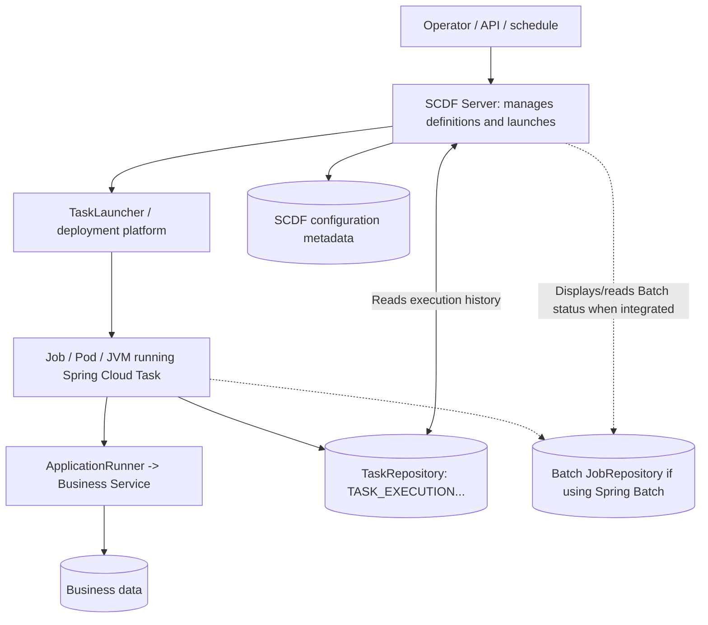
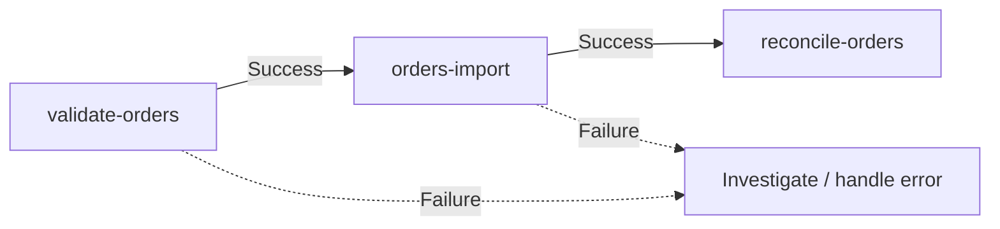

# The Optional Role of Spring Cloud Data Flow

## 1. Does Spring Cloud Task Need Spring Cloud Data Flow to Run?

**No.** Spring Cloud Task is a framework for Spring Boot applications with a **finite runtime**: start up, receive arguments, invoke business services, record execution information via `TaskRepository`, and then terminate. Such an application can be run directly with `java -jar`, from cron, a Kubernetes Job/CronJob, a CI/CD pipeline, or another orchestrator **without installing Spring Cloud Data Flow**.

**Spring Cloud Data Flow (SCDF)** is an **optional management and orchestration layer** placed outside the task application. When using SCDF, you get a UI/API to register artifacts, create task definitions, launch on demand, schedule on supported platforms, view execution history, and compose tasks into multi-step flows. The business rules themselves still reside inside the Spring Cloud Task application.

For example: an `orders-import` job that reads data from a partner every night.

| Responsibility | Without SCDF | With SCDF |
| --- | --- | --- |
| Write order import logic | Spring Boot + Spring Cloud Task | **Still** Spring Boot + Spring Cloud Task |
| Read `--import.date`, `--request-id` | `ApplicationRunner`/service | **Still** read and processed by the application |
| Write `TaskExecution` metadata | Spring Cloud Task `TaskRepository` | **Still** written by the task to the appropriate metadata store |
| Manual launch | `java -jar`, Kubernetes Job, or internal API | SCDF Shell/UI/REST invokes the deployment platform |
| Scheduling | cron, Kubernetes CronJob, or another scheduler | SCDF manages schedules via the supported platform's scheduler |
| View multiple executions | SQL, logs, custom-built dashboards | SCDF provides execution lists/details when it can read metadata |
| Orchestrate multiple tasks | Self-selected script/workflow engine | Can use **Composed Task** and Composed Task Runner |

**The goal of this lesson** is to understand where SCDF helps, how to connect it to an existing task, and the cases where using SCDF only adds complexity without delivering value yet.

## 2. Distinguishing Framework, Runtime, and Control Plane Roles

SCDF does not replace Spring Boot, Spring Cloud Task, Spring Batch, or the OS/container runtime. Each component has a distinct scope of responsibility:



The diagram above is a conceptual architecture; the deployment location of the server, metadata, `TaskLauncher`, and access permissions depend on the platform. The key point is that **SCDF requires a runtime to create processes**, and **the task must actually run and have a repository** for historical data to appear.

### What Does Each Component Do?

| Component | Responsibility | Does Not Guarantee by Itself |
| --- | --- | --- |
| **Spring Cloud Task** | Finite application lifecycle; creates/updates `TaskExecution` | Run schedule, pod placement, business exactly-once guarantee |
| **`TaskRepository`** | Stores `TASK_NAME`, timestamps, exit code, errors, and arguments per schema/version | That business data is complete and valid |
| **SCDF Server** | API/UI to manage task apps, definitions, launches, schedules, and orchestration metadata | Directly replacing the task's business code |
| **`TaskLauncher`** | Maps launch requests to processes on local/Kubernetes/Cloud Foundry or supported platforms | That the task will succeed after being launched |
| **Platform Scheduler** | Decides when to create a process according to a schedule | Idempotency, rollback of already-committed data |
| **Spring Batch** | Handles job/step, chunks, checkpoints, restarts when integrated | Creating a new `TaskExecution` for each independent service call |

Therefore, **Data Flow is the control plane**; **Spring Cloud Task is the execution application (workload)**. In documentation, the word *task* sometimes refers to a **task definition** managed by SCDF, and sometimes to **an execution instance** of Spring Cloud Task. You need to distinguish them clearly so you do not confuse a definition with a run.

## 3. Three Architectural Approaches: Direct, Scheduler-Based, and SCDF-Based

### Option A — Direct Execution, No SCDF

```text
User / CI/CD
    -> java -jar orders-import-task.jar --import.date=2026-11-24
    -> Spring Cloud Task + business service
    -> target data + TaskRepository
```

This option fits learning, a few simple tasks, small internal jobs, or when you already have an orchestrator that meets your needs. You can obtain the exit code from the process and query `TASK_EXECUTION` for investigation. You must handle artifact distribution, authorization, logging, alerting, and scheduling yourself if needed.

### Option B — External Scheduler/Orchestrator, No SCDF

```text
cron / Kubernetes CronJob / workflow engine
    -> creates a new Job or process on schedule
    -> Spring Cloud Task
    -> TaskRepository + business data
```

This is also a **complete and valid** design. With Kubernetes, a CronJob can create a Job/Pod for each run; the scheduler provides concurrency, retry, and deadline properties. Spring Cloud Task can still write metadata as long as the processes use a persistent database with a compatible schema. You do not need to install SCDF just to use cron.

### Option C — Using Spring Cloud Data Flow

```text
SCDF UI / Shell / REST / schedule
    -> task definition + launch request
    -> TaskLauncher / platform scheduler
    -> Spring Cloud Task in Pod/JVM
    -> TaskRepository metadata for SCDF to display history
```

Option C pays off when an operations team must manage many tasks, multiple application versions, multiple platform accounts, on-demand launches, and centralized history. In return, you take on an additional **SCDF Server**, database configuration, artifact deployment, authentication/authorization, and upgrade/maintenance work.

| Decision Criterion | Favors **Not Using SCDF** | Favors **Using SCDF** |
| --- | --- | --- |
| Scale | A few tasks, few operators | Many tasks, multiple people co-managing |
| Deployment | Existing cron/Kubernetes/CI/CD is sufficient | Want centralized task lifecycle management via UI/API |
| Scheduling | Simple, fixed schedules in existing infrastructure | Want to manage and monitor many schedules from one place |
| Workflow | Single independent job or existing workflow engine | Want composed tasks made of multiple task definitions |
| Observability | Existing logs/SQL/metrics are sufficient | Need a centralized task/Batch history view |
| Operational cost | Prefer fewer components and dependencies | Accept operating an extra server and metadata store |

**Do not choose SCDF just because the product name contains "Data Flow".** If the requirement is only to run one program every night, a scheduler and a Spring Cloud Task application may already be enough. If the workload is a continuously running HTTP service, finite Spring Cloud Task is not the right fit either.

## 4. Concepts When Working with SCDF

SCDF introduces several naming/identification layers, but it does not eliminate `TaskExecution` or business identifiers.

| Concept | Example | What Is It Really? |
| --- | --- | --- |
| **Task app registration** | `orders-import` | Application name and artifact URI registered with SCDF, application type `task` |
| **Task definition** | `orders-daily` | Named definition pointing to a task app and configuration properties |
| **Task execution** | Execution ID `125` | A single launch of a definition, with metadata recorded at runtime |
| **Task name** | `orders-import-task` or an environment-assigned name | Name in `TaskExecution`; inspect the actual value rather than guessing from the definition |
| **Schedule** | `orders-at-2am` | Rule for creating future runs for a definition |
| **Batch Job instance** | `importOrdersJob` + identifying parameters | Job identity per Spring Batch; distinct from Task execution |
| **Business request key** | `partner-a-2026-11-24` | Key for a business request, which should remain stable across retries |

A definition can be launched multiple times. A launch can fail, have its own `TaskExecution`, and be retried. **Do not use the SCDF task definition name or TaskExecution ID as the idempotency key** for order records; use a `requestId` or business key with clear rules.

SCDF also has its own metadata managing definitions, registrations, platforms, and schedules. SCDF metadata is distinct from **`TASK_*` tables written by Spring Cloud Task** and **`BATCH_*` tables written by Spring Batch**. In supported setups, SCDF needs to read execution metadata, so SCDF Server and the task application must connect to **the same compatible metadata store**, not merely each have a table named `TASK_EXECUTION` in two independent databases.

## 5. A Standalone Spring Cloud Task Example First

Before putting an application into SCDF, prove that it runs cleanly **without SCDF**. The example below accepts an order import date and `requestId`; the runner validates the arguments and then calls the business service.

### 5.1. Dependencies and Configuration

In a Maven Spring Boot project with a Spring Cloud BOM **compatible with the Spring Boot version**, the required dependencies may include:

```xml
<dependencies>
    <dependency>
        <groupId>org.springframework.cloud</groupId>
        <artifactId>spring-cloud-starter-task</artifactId>
    </dependency>
    <dependency>
        <groupId>org.springframework.boot</groupId>
        <artifactId>spring-boot-starter-jdbc</artifactId>
    </dependency>
    <dependency>
        <groupId>org.postgresql</groupId>
        <artifactId>postgresql</artifactId>
        <scope>runtime</scope>
    </dependency>
</dependencies>
```

SCDF **is not a required dependency in a task application**. When deploying through SCDF, you typically package the Spring Cloud Task application itself as an executable JAR or image for `TaskLauncher` to start, rather than embedding SCDF Server inside the business process.

`src/main/resources/application.yml`:

```yaml
spring:
  application:
    name: orders-import-app
  main:
    web-application-type: none
  datasource:
    url: ${TASK_DB_URL}
    username: ${TASK_DB_USER}
    password: ${TASK_DB_PASSWORD}
  cloud:
    task:
      name: orders-import-task
      initialize-enabled: false
```

`web-application-type: none` keeps the finite process from opening a web server. `initialize-enabled: false` **assumes the Spring Cloud Task metadata tables have already been created via a version-matched migration** in the PostgreSQL database; if the schema does not exist yet, the task may fail right at startup. This configuration is a choice for environments with separate schema management, not a guide for connecting to an empty database.

### 5.2. A Runner That Only Accepts the Request

`OrdersTaskApplication.java`:

```java
package com.example.orders;

import java.time.LocalDate;
import java.util.List;

import org.springframework.boot.ApplicationArguments;
import org.springframework.boot.ApplicationRunner;
import org.springframework.boot.SpringApplication;
import org.springframework.boot.autoconfigure.SpringBootApplication;
import org.springframework.cloud.task.configuration.EnableTask;
import org.springframework.context.annotation.Bean;

@EnableTask
@SpringBootApplication
public class OrdersTaskApplication {

    public static void main(String[] args) {
        SpringApplication.run(OrdersTaskApplication.class, args);
    }

    @Bean
    ApplicationRunner runOnce(OrderImportService service) {
        return args -> {
            LocalDate date = LocalDate.parse(required(args, "import.date"));
            String requestId = required(args, "import.request-id");
            long count = service.importFor(date, requestId);
            System.out.printf("request=%s date=%s imported=%d%n",
                    requestId, date, count);
        };
    }

    private static String required(ApplicationArguments args, String key) {
        List<String> values = args.getOptionValues(key);
        if (values == null || values.size() != 1 ||
                values.get(0) == null || values.get(0).isBlank()) {
            throw new IllegalArgumentException("Missing or invalid --" + key);
        }
        return values.get(0);
    }
}
```

`OrderImportService.java`:

```java
package com.example.orders;

import java.time.LocalDate;
import org.springframework.stereotype.Service;

@Service
public class OrderImportService {

    public long importFor(LocalDate date, String requestId) {
        // Learning code: replace with data processing, transactions, source validation,
        // and an idempotency key by requestId in a real application.
        System.out.printf("IMPORT_START request=%s date=%s%n", requestId, date);
        return 0L;
    }
}
```

This service is **intentionally a stub**: it does not import real orders. What matters for the Data Flow topic is that **the same runner/service works both when run directly and when launched by SCDF**, without modifying business logic just to use SCDF. For production deployment, add data access, business locking, transactions, and idempotency in the service.

After building an executable JAR, run it directly with the prepared PostgreSQL environment:

```bash
java -jar target/orders-import-task.jar \
  --import.date=2026-11-24 \
  --import.request-id=partner-a-2026-11-24
```

`target/orders-import-task.jar` is just an illustrative artifact name. A successful run writes `TaskExecution` metadata to the configured store. When an input request is invalid, the runner throws an exception instead of swallowing the error and printing "success"; the scheduler/SCDF needs to see the failure signal to handle it.

## 6. Bringing That Same Application into Spring Cloud Data Flow

To use SCDF, you first need a **running SCDF Server**, an account with permission to register/run tasks, a **task platform** configured on the server, an artifact accessible from that platform, and a metadata database that both SCDF and the task application can read/write. Simply adding the Spring Cloud Task dependency will not make SCDF commands work automatically.

### 6.1. Registering the Artifact (App Registration)

Example in **Spring Cloud Data Flow Shell** (not regular Bash/PowerShell). Suppose you have built/published the image `registry.example.com/team/orders-import-task:1.0.0` and the platform is Kubernetes:

```text
dataflow:> app register --name orders-import --type task --uri docker://registry.example.com/team/orders-import-task:1.0.0
```

The URI in this example is a **placeholder**; replace it with a real image that the cluster has permission to pull. When running on a local task platform, you can use a suitable Maven URI, such as `maven://com.example:orders-import-task:1.0.0`, **if that artifact has actually been published and the runtime can resolve it**.

The *register* operation only declares the artifact and the `task` application type; it **does not create a process or process any data yet**. Depending on your SCDF configuration, you can also provide application property metadata for display and parameter input assistance in the UI.

### 6.2. Creating a Task Definition

```text
dataflow:> task create orders-daily --definition "orders-import"
dataflow:> task list
```

`orders-daily` is the **task definition name in SCDF**, referencing the application registered under the name `orders-import`. A single definition can be run many times without recreating the definition each day. Do not confuse `orders-daily` with the business key `partner-a-2026-11-24` or with the ID of an individual execution.

### 6.3. Launching on Demand and Passing Arguments

```text
dataflow:> task launch orders-daily --arguments "--import.date=2026-11-24 --import.request-id=partner-a-2026-11-24"
dataflow:> task execution list
```

SCDF forwards the launch request to the platform's corresponding `TaskLauncher`. **Receiving a launch response does not mean the task has completed successfully**: you must check the execution status, exit code, and logs after the worker/JVM stops. The SCDF UI also has a *Task Executions* section to view history when the server can read the application's metadata.

`--arguments` passes **arguments to the task application**; they are still parsed by `ApplicationRunner` just as in a direct run. `--properties` on the `task launch` command serves a different purpose: supplying **application/deployment properties** to `TaskLauncher`, such as environment configuration or resources on a specific platform. Prefix syntax like `app.<task-definition>.*`, `deployer.<...>.*`, and advanced cases should be verified against the SCDF/TaskLauncher documentation for the exact version you are using.

### 6.4. Checking Metadata in the Database

Once the task completes, with the default Spring Cloud Task schema you can check:

```sql
SELECT TASK_EXECUTION_ID, TASK_NAME,
       START_TIME, END_TIME, EXIT_CODE,
       EXIT_MESSAGE, ERROR_MESSAGE
FROM TASK_EXECUTION
ORDER BY TASK_EXECUTION_ID DESC;
```

Each run typically creates a separate `TASK_EXECUTION_ID`; `TASK_NAME` reflects the final name chosen by the configuration and `TaskNameResolver`. SCDF may supply additional launch configuration/identifiers, so **inspect the actual data** instead of assuming every name in SCDF equals `spring.application.name`.

If SCDF shows no history even though the task ran, the cause is usually that the server and task **do not share the same TaskRepository store**, lack schema/permissions, connected with the wrong profile, or the task failed before metadata was written. Check the logs of both SCDF Server and the task process, the JDBC URL/schema, table prefix, and version compatibility.

## 7. SCDF Orchestrates Schedules, but Does Not Turn a Task into an Always-On App

SCDF can register schedules that create task executions on supported platforms. For example, with the `orders-daily` task definition, on **Kubernetes** suppose we want to schedule a run at 02:00 every day:

```text
dataflow:> task schedule create --name orders-at-2am --definitionName orders-daily --expression "0 2 * * *"
dataflow:> task schedule list
```

This is **Kubernetes-style 5-field** cron syntax, not a Cloud Foundry Quartz expression; the time zone depends on the scheduler/cluster configuration. To enable scheduling in the appropriate SCDF configuration, both task and schedule features must be enabled; SCDF documentation describes these properties:

```yaml
spring:
  cloud:
    dataflow:
      features:
        tasks-enabled: true
        schedules-enabled: true
```

The YAML snippet above is **SCDF Server** configuration, **not** a required `application.yml` setting for the Spring Cloud Task application. On Kubernetes, SCDF creates a **CronJob** so the platform itself executes subsequent runs. Do not assume an SCDF Server must continuously keep a thread awake until the scheduled hour to run `ApplicationRunner` directly.

**Things to check before using schedules:**

- Whether the scheduler on the target platform is supported and enabled. SCDF documentation describes scheduling for Kubernetes and Cloud Foundry; the local platform does not include an equivalent built-in scheduling feature.
- Overlap policy, deadline, retry/backoff, and time zone of the scheduler. A new scheduled run can trigger while an earlier run is still in progress; you need `concurrencyPolicy`, task locking by name, or appropriate business idempotency.
- Which artifact/version the CronJob will actually run. In SCDF's scheduling mechanism, changing a task definition's version/properties **does not automatically update an already-created schedule**; you need a process to update or recreate the schedule according to your platform's features/version.
- Business arguments that change daily. Do not hard-code `--import.date=2026-11-24` for an indefinite schedule. Design a date source based on the business time zone, a data window, or a supported parameter-passing method; keep `requestId` stable so same-day retries remain safe.

Deleting a schedule prevents **future triggers**; it does not mean every process already started by the schedule is stopped. To stop a running task, use the corresponding execution/pod control operation and consider already-committed data.

## 8. Composed Task: When You Need Multiple Finite Jobs in Sequence

Another benefit of SCDF is **Composed Task**: defining a directed flow composed of independent tasks, for example:

```text
validate-orders && orders-import && reconcile-orders
```

The `&&` operator indicates that the subsequent job is only launched after the preceding job completes successfully according to the composed task mechanism. SCDF uses **Composed Task Runner** to orchestrate the graph and call back into the Data Flow Server API to launch the child tasks. This is an **orchestration layer**, not a Java method automatically embedded into every `ApplicationRunner`.



Each node requires a registered corresponding task app/definition, and the environment must have the **Composed Task Runner artifact**, SCDF Server access configuration, permissions, and appropriate deployer infrastructure. SCDF tracks node orchestration; each application still processes its own data and reports its status. Do not use composed tasks to hide errors inside a runner: if `ApplicationRunner` swallows an exception and exits with code 0, the graph may advance to the next step even when the business outcome was not achieved.

If you only have one independent task running each night, composed tasks provide no necessary benefit. If your organization already has a suitable workflow engine, that engine can orchestrate Spring Cloud Task applications **without SCDF**.

## 9. Spring Batch and SCDF: Three Different Execution Levels

A Spring Cloud Task application can invoke a **Spring Batch Job**. When launched by SCDF, distinguish between:

1. **SCDF task definition and launch request**: describes the artifact, configuration, and request to place the process onto the platform.
2. **Spring Cloud Task `TaskExecution`**: tracks the lifecycle of the JVM/container running the task application.
3. **Spring Batch `JobExecution`/`StepExecution`**: tracks progress, commits, errors, checkpoints, and restarts at the Batch Job/Step level.

| Question | Where to Look |
| --- | --- |
| Which platform was the task deployed on? | SCDF launch/deployment details and platform logs |
| What exit code did a task run finish with? | `TASK_EXECUTION`, SCDF Task Executions UI |
| Which Batch Job FAILED, which Step rolled back? | `BATCH_JOB_EXECUTION`, `BATCH_STEP_EXECUTION`, JobRepository |
| Which rows were actually written to the DB, which files were exported? | Business data, manifests, and evidence from the receiver |
| Should a failed Job instance be retried? | JobRepository, identifying `JobParameters`, checkpoints, and idempotency policy |

SCDF can display Batch information when integrated and given access to the right metadata, but **never infer `TaskExecution ID = JobExecution ID`**. Nor should you assume SCDF provides *exactly once*; if a task commits data and then loses connectivity, relaunching it can still write duplicates if the application lacks business constraints.

## 10. Security and Operations When Adding SCDF

When adopting SCDF, the job is not just getting `task launch` to run. A production architecture needs at least the following controls:

### 10.1. Artifacts, Versions, and Execution Permissions

- **Pin versions** of artifacts/images: avoid silently mutable tags and record which version ran for each execution. Establish a rollout/rollback procedure.
- **SCDF authorization**: who can register artifacts, modify task definitions, launch tasks, create schedules, view logs, and delete schedules. The SCDF Server API must be protected with proper authentication/authorization.
- **Runtime controls**: namespace, service account, network policy, quotas, CPU/RAM, concurrent launch limits, log/pod retention, and storage permissions per platform.
- **Keep secrets out of launch commands**: CLI arguments and metadata/logs can expose tokens or passwords. Prefer a secret store/Kubernetes Secret or secure runtime environment-variable injection; check how the entrypoint passes app properties.

### 10.2. Using the Right Metadata Store

SCDF must connect to the same task metadata store as the applications. On many platforms, SCDF Server and the task applications must access **the same metadata database** for the UI to display `TaskExecution` records; an in-memory `jdbc:h2:mem:...` database inside each Pod/JVM cannot act as a shared store. The `TASK_*` and `BATCH_*` DDL must match the framework version, with managed migrations and proper JDBC permissions.

Do not directly edit `TASK_EXECUTION` rows to make results look "clean". Execution errors and business outcomes should be preserved as audit records, while confirmation that a request completed can be recorded in a separate reconciliation table keyed by `requestId`.

### 10.3. Distinguishing Concurrency Limits Across Layers

| Mechanism | What Does It Limit? | What Problem Does It Not Solve? |
| --- | --- | --- |
| SCDF task launch limits per platform/account | Total running tasks on a platform configuration per SCDF policy | Does not guarantee only one instance of a given business type |
| `spring.cloud.task.single-instance-enabled=true` | Prevents multiple instances of **the same task name** within the scope of a shared lock store when properly configured | Does not restrict tasks with different names from writing to the same table |
| Kubernetes CronJob `concurrencyPolicy` | Overlapping Jobs managed by **that specific CronJob** | Does not govern a manual launch from elsewhere |
| Unique constraints and business idempotency | Blocks/makes safe repeated operations on the same logical data | Does not schedule runs or limit all workers by itself |

These mechanisms can work together. For instance, if a schedule triggers two consecutive launches while the old task is still running: the scheduler can reject the duplicate launch, while the service must still remain safe if the same `requestId` is replayed after a crash.

### 10.4. Observability and Error Handling

Monitor **launch status, process status, `TaskExecution`, JobExecution if any, and business data**. A success response from a "launch" API does not mean data has been processed; `EXIT_CODE=0` also does not prove every transaction in external systems was confirmed.

If a task times out or is terminated abruptly, check platform logs and metadata rows with a null `END_TIME`; verify the old process has stopped before retrying. Distinguish deployment/image/permission/network errors from file read errors, invalid data, and database connection errors; each category needs its own retry and alerting policy.

## 11. Common Misconceptions and Pitfalls

| Symptom | Possible Cause | How to Handle |
| --- | --- | --- |
| "SCDF isn't installed so Spring Cloud Task can't run" | Confusing the framework with the orchestrator | Run directly via `java -jar`; check DataSource and Task schema |
| Registered the task app but no execution appears | Registration is not a launch | Create a definition and run `task launch` |
| `task launch` reports accepted but no result appears | Task hasn't finished, deployer failed, or metadata DB isn't shared | Read runtime logs, SCDF Server logs, and `TASK_EXECUTION` |
| SCDF UI is empty even though task runs fine outside SCDF | Server/task don't share a metadata store or use different schemas/prefixes | Check JDBC URL, schema, permissions, and versions |
| Next day's scheduled run still uses old image/config | Schedule does not automatically pick up definition changes | Use a platform-appropriate schedule update/recreate procedure |
| Cron expression reported invalid | Confusing Kubernetes 5-field syntax with Quartz/Cloud Foundry | Use the syntax for the active scheduler |
| Task ran duplicates after retry | Missing idempotency key or concurrency policy | Use a stable `requestId`, unique constraints, and locks where needed |
| Every batch retry creates a new Job instance | Attaching a random `run.id` or changing identifying params | Keep the identifying parameters of the Job instance to restart |
| Composed task advances even though data is incomplete | Prior task swallowed error and reported false success | Catch errors properly, return appropriate exit codes, reconcile outputs |
| SCDF Server fails to create Pod | Missing `TaskLauncher`, permissions, image pull secret, or quota | Check deployment platform and pod events/logs |
| Secrets appear in logs or process args | Passing passwords insecurely via `--arguments`/properties | Move to secret management; review how runtime maps properties |

## 12. Exercises and Self-Check Questions

1. Run a Spring Cloud Task using `java -jar` **without SCDF**. Explain under what conditions the application still records `TaskExecution`, and why SCDF Server is not required.
2. List the steps to use SCDF for the same artifact: **register app → create definition → launch → monitor execution**. Distinguish the three names `orders-import`, `orders-daily`, and `orders-import-task`.
3. With one SCDF task definition, run it twice with the same `--import.request-id`. Why can there be two `TaskExecution` records while there should only be one business outcome?
4. On Kubernetes, create a schedule to run at 02:00 every day. Check the time zone and concurrency policy. Why must you not hard-code a fixed processing date for a multi-year schedule?
5. Suppose SCDF shows no execution even though the Pod completed. State the order of checks: database, schema, access permissions, SCDF logs, Pod logs, and `TaskRepository`.
6. Compare three ways to solve the same "run a task every night" problem: cron on a VM, a direct Kubernetes CronJob, and an SCDF schedule. When does SCDF add real practical value?
7. Sketch a composed task `validate && import && reconcile`. What should happen when `validate` fails? Why must the import job not swallow exceptions?
8. If the task runs Spring Batch, identify which metadata tables answer questions about Job/Step, which table answers questions about the task process, and which data confirms the orders were actually imported.
9. Design a security/deployment checklist for a task launched by SCDF: artifact version, image registry, credentials, DB migration, permissions, concurrency, timeout, logs, and idempotency.

**Summary:** Spring Cloud Data Flow is **an orchestration option**, not a prerequisite for a Spring Cloud Task application to work. Start with a finite task that has clear inputs, a properly configured `TaskRepository`, and retry-safe business logic. Add SCDF only when registration, deployment, scheduling, centralized monitoring, or composed tasks genuinely simplify operations.

## 13. References

- [Spring Cloud Task Reference Guide](https://docs.spring.io/spring-cloud-task/reference/): finite task model, `TaskExecution`, and `TaskRepository`.
- [Spring Cloud Data Flow — Architecture](https://dataflow.spring.io/docs/concepts/architecture/): role of short-lived applications and Data Flow.
- [Spring Cloud Data Flow — Deploying a Spring Cloud Task](https://dataflow.spring.io/docs/batch-developer-guides/batch/data-flow-simple-task/): registration, definition, launch, and execution tracking.
- [Spring Cloud Data Flow — Scheduling](https://dataflow.spring.io/docs/feature-guides/batch/scheduling/): platform-based task scheduling and schedule management.
- [Spring Cloud Data Flow — Composed Tasks](https://dataflow.spring.io/docs/feature-guides/batch/composed-task/): composed tasks and Composed Task Runner.
- [Spring Cloud Data Flow Reference Guide](https://docs.spring.io/spring-cloud-dataflow/docs/current/reference/htmlsingle/): Shell/REST, task definitions, arguments/properties, and task launch limits.

The SCDF commands in this lesson are learning examples and require a compatible SCDF Server/TaskLauncher, a genuinely deployable artifact, and a prepared metadata database. Across different versions, verify Shell syntax, APIs, scheduling models, and compatibility requirements before applying them in production.
