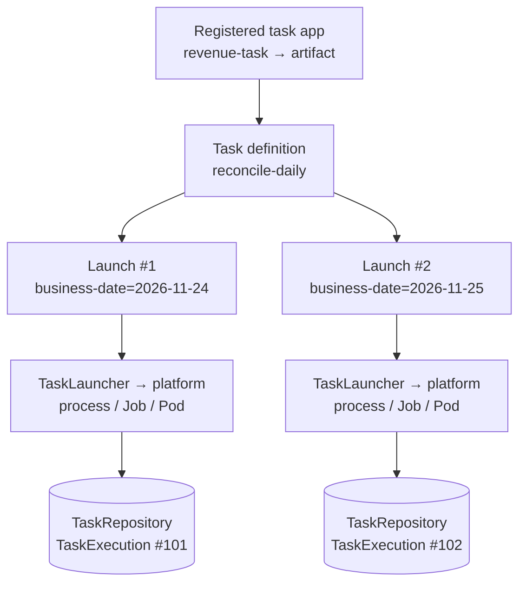

# Distinguishing Task Definition, TaskExecution, and Platform Status

In **Spring Cloud Data Flow (SCDF)**, a **Spring Cloud Task** application can be registered, turned into a task definition, launched on demand or on a schedule, and observed after completion. Because a Task is an application with a **finite runtime**, operators typically care about three distinct questions:

1. **What work was declared, and based on which application?** → Check the **Task definition** in Data Flow.
2. **How did a specific run actually execute?** → Check the **`TaskExecution`** recorded by Spring Cloud Task in the database.
3. **Where is the process or container right now—still running or dead?** → Check the **platform status** from TaskLauncher, Kubernetes, Cloud Foundry, or the OS.

These three layers are related, but **they are not a single unified status**. For example, Data Flow may accept a launch request while the container fails to start; or business logic may commit results and the JVM gets killed before it can write `END_TIME`. Looking at only one screen or one status column can easily lead to wrong retry decisions and duplicate data processing.

After this lesson in the **Data Flow** chapter, you will know how to distinguish each object, read the right IDs/statuses, use Data Flow Shell to create and monitor tasks, analyze mismatched statuses, and make safe operational decisions when running on a schedule, on demand, or with Spring Batch integration.

## 1. Four Steps in a Task's Lifecycle

In SCDF, the common workflow consists of:

1. **Register task application:** register a logical name and artifact URI (JAR or suitable image) that Data Flow can deploy.
2. **Create Task definition:** create a named configuration referencing the registered application and any required default properties.
3. **Launch Task definition:** instruct SCDF to invoke a **`TaskLauncher`** suited to the platform; each launch can create a new process or Job/container.
4. **Review Task executions:** the Spring Cloud Task application persists metadata for each run; SCDF displays history, IDs, and status. The orchestration system still needs to consult the platform to know the actual process/container state.



In the diagram, **one definition** can be launched multiple times. Each run that starts far enough to write metadata has its own `TaskExecution`. However, **an accepted launch request does not prove the container ran successfully**; if startup fails early, repository data may be incomplete.

## 2. How Does a Task Application Differ from a Task Definition?

A **Task application** is the executable software: a Spring Boot executable JAR with Spring Cloud Task, `ApplicationRunner`/`CommandLineRunner` beans, and business logic. SCDF manages application registrations by name, application type (`task`), and artifact URI; depending on the version, it also supports registering multiple versions.

A **Task definition** is a **declaration stored by SCDF** specifying which application to run, with a task name and applicable configuration properties. A definition is like a *launch template*, not a live process.

| Object | Example | When Is It Created? | Is It a Run? |
| --- | --- | --- | --- |
| **Registered task app** | `revenue-task` → `maven://com.example:revenue-task:1.0.0` | When registering the app in SCDF | **No**. Only declares an available artifact. |
| **Task definition** | `reconcile-daily` → DSL `revenue-task` | When using `task create` or Dashboard | **No**. Can be launched many times. |
| **Launch request** | Run `reconcile-daily` for 2026-11-24 | When requested by API, user, or scheduler | It is a **request to create a run**, not a completed result. |
| **TaskExecution** | `TASK_EXECUTION_ID = 101` | When Spring Cloud Task/SCDF records an execution | **Yes**. Contains metadata of a specific run. |
| **Platform runtime object** | Kubernetes Job/Pod, Cloud Foundry task, or local process | When the launcher creates resources on infrastructure | **Yes** at the platform level; manages container/process lifecycle. |

### Deleting a Definition Does Not Mean Deleting History

When running `task destroy reconcile-daily`, SCDF deletes the **Task definition**. Under the default behavior in SCDF guides, this **does not automatically delete** existing `TaskExecution` records and does not mean every running process stops immediately.

SCDF has separate **cleanup** mechanisms for executions and deployment resources; some versions support a `--cleanup` option on destroy or cleanup actions via Dashboard/API. Cleanup operations can delete platform logs/resources or historical metadata depending on the specific action, so you must verify the blast radius and retention policy before using them in production.

> **Rule:** Task definition answers **"what can be run?"**; TaskExecution answers **"which run occurred and what outcome was recorded?"**.

## 3. What Data Does `TaskExecution` Store?

Inside a Spring Cloud Task application, **`TaskRepository`** writes information about each run; **`TaskExplorer`** supports querying it. Common fields include:

| Field | Role | Notes |
| --- | --- | --- |
| `executionId` / `TASK_EXECUTION_ID` | Identifies **a run**, managed by the metadata store | Do not substitute with definition name or Pod ID. |
| `taskName` / `TASK_NAME` | Logical name of the task | Multiple runs can share the same name. |
| `startTime` | Recorded start timestamp | May be missing if the app did not start far enough. |
| `endTime` | Recorded end timestamp | Can be `NULL` if the process was killed/crashed. |
| `exitCode` | Exit result recorded by the app/framework | Typically `0` means success; non-zero means error. |
| `exitMessage` | Exit/error message for diagnostics | Does not replace full logs; avoid exposing secrets. |
| `arguments` / parameters | Parameters of the run | Can change on each launch of the same definition. |
| `externalExecutionId` | External execution resource ID provided by infrastructure/launcher when supported | Not identical to `executionId`. |
| `parentExecutionId` | Parent TaskExecution ID if this is a child task | Links execution trees; not a JobExecution ID. |

In a JDBC database, the table is usually named **`TASK_EXECUTION`**; parameter and related metadata tables depend on the Spring Cloud Task schema. For persistent history, the application must have a DataSource pointing to an appropriate metadata database. If SCDF and the task use **two different databases** without a corresponding connection/lookup mechanism, the SCDF Dashboard may not see newly created executions.

### One Definition, Three Runs

Suppose the `reconcile-daily` definition was launched three times:

| Execution ID | Business Argument | Start | End | Exit Code | Interpretation |
| ---: | --- | --- | --- | ---: | --- |
| 101 | `business-date=2026-11-24` | 08:00 | 08:04 | 0 | Metadata records successful completion. |
| 102 | `business-date=2026-11-25` | 09:00 | 09:01 | 12 | Another run ended with an error code. |
| 103 | `business-date=2026-11-26` | 10:00 | `NULL` | `NULL` | Completion not seen yet: may still be running or missed update. |

The three records are not merged into one just because they share a definition. If you retry 2026-11-25, the rerun typically receives a **new execution ID**; business idempotency must rely on keys like `business-date` and data version, **not** execution ID.

## 4. "Task Status" in Data Flow Is Not a Raw Repository Field

SCDF provides display statuses at the REST/Dashboard layer, such as the **`TaskExecutionStatus`** enum in documented versions:

| SCDF Status | Meaning at the Display Layer | How to Verify |
| --- | --- | --- |
| **`COMPLETE`** | Execution is considered completed successfully | Cross-check `END_TIME` and `EXIT_CODE`, then verify business results. |
| **`ERROR`** | Execution did not complete successfully | Check exit code, error message, logs, and infrastructure status. |
| **`RUNNING`** | SCDF considers the run still executing | Inspect the actual process/Pod, especially when `END_TIME` stays empty too long. |
| **`UNKNOWN`** | Execution information is insufficient or the execution has not truly started per display logic | Check launch request, deployment, and metadata connectivity. |

**These are inferred statuses at the Data Flow layer**, not a mandatory `TASK_STATUS` column in `TASK_EXECUTION`. Inference rules and additional fields can vary by version, so do not write your own `if/else` formula and treat it as official across every release.

For example, `END_TIME IS NULL` is not enough to conclude the worker is still running. If Kubernetes has already marked the Job/Pod failed while metadata was not updated, the UI may show an inconsistent status until reconciliation runs.

### Distinguish from `BatchStatus`

If the application also runs a **Spring Batch Job**, you additionally have `JobExecution`/`StepExecution` with statuses such as `STARTING`, `STARTED`, `COMPLETED`, `FAILED`, and `STOPPED`. Those belong to **Spring Batch's `JobRepository`**, not the `TaskExecutionStatus` enum and not the Kubernetes Job status.

One `TaskExecution` can contain **multiple `JobExecution`s**. When a Job/Step fails, the application must map that outcome to an appropriate task exit code; do not assume every Batch status automatically synchronizes with the JVM exit code.

## 5. Platform Status: Process, Pod, and Job

**Platform status** describes what happened to the resource created by `TaskLauncher`. That can be:

- **Local deployer:** the launched Java process, PID, alive/exited state, and OS exit code if observed by the launcher.
- **Kubernetes:** Job/Pod, `Pending`/`Running` phase, `Succeeded`/`Failed` result, restart count, `OOMKilled`/image pull error reasons, events, and logs subject to retention.
- **Cloud Foundry or other platforms:** task resource, deploy/run/exit status, and error codes per platform API.

Specific status names **are not shared across platforms**. For example, `Succeeded` is a Kubernetes Pod/Job value; `COMPLETE` is an SCDF display status. Though similar in meaning, they come from different data sources and update at different times.

| Question | Most Reliable Data Source |
| --- | --- |
| Does the definition exist, and which artifact does it point to? | SCDF Task Definitions / App Registry. |
| Did SCDF accept the launch command? | REST/Shell response, Data Flow Server logs. |
| Was the JVM/container created? | `TaskLauncher` and platform API. |
| Is the container running, killed, or resource-starved? | Events/Job/Pod/process and infrastructure logs. |
| What exit code did Spring Cloud Task record? | `TaskRepository` via SCDF Executions or `TaskExplorer`. |
| Which Batch Step did not finish? | Spring Batch `JobRepository`/`JobExplorer`. |
| Were the actual revenue results committed? | Business database/files/API and idempotency keys. |

**Do not treat Pod `Succeeded` as absolute proof that all business data is correct.** A container can return `0` even if code swallowed an exception. Conversely, Pod `Failed` does not prove no business changes happened; transactions committed prior to failure may still exist.

## 6. From Shell Command to Execution: Practical Example

The commands below illustrate **Spring Cloud Data Flow Shell** on an SCDF version supporting register/create/launch/list operations. Syntax and artifact URIs must be adapted to your SCDF version, repository type, and connected platform. Installing the shell is not required if your environment only provides the Dashboard or REST API: equivalent operations can be performed through the UI/API.

### 6.1. Registering the Task Application

Suppose you have built a Spring Boot / Spring Cloud Task executable JAR and published an artifact downloadable from the Data Flow environment:

```text
dataflow:>app register --name revenue-task --type task --uri maven://com.example:revenue-task:1.0.0
```

Explanation:

- `revenue-task` is the **registered app name** in SCDF, not a run ID.
- `maven://com.example:revenue-task:1.0.0` is an **illustrative** artifact URI; replace it with actual Maven/artifact coordinates supported by SCDF and the deployer.
- Registering the app alone **does not create a `TaskExecution`**, does not create a Pod, and does not start processing.

### 6.2. Creating a Task Definition

```text
dataflow:>task create reconcile-daily --definition "revenue-task"
dataflow:>task list
```

`reconcile-daily` is the **definition name**, while DSL `revenue-task` references the registered app. A definition may show status related to its executions in some views, but **the existence of a definition does not mean a process is running**.

### 6.3. Launching with Business Arguments

```text
dataflow:>task launch reconcile-daily --arguments "--business-date=2026-11-24"
```

This is a **launch request**. In some versions, Data Flow allocates/returns an execution ID or external ID as soon as the launch is accepted, even before the JVM begins writing metadata. Therefore, keep checking both execution history and infrastructure; the line `Launched task ...` is not proof that revenue reconciliation succeeded.

The `--business-date` argument is an option of **your own application**. For Data Flow to turn this date into business behavior, your `ApplicationRunner` code must read and validate it.

### 6.4. Viewing History and a Specific Run

```text
dataflow:>task execution list
dataflow:>task execution list --name reconcile-daily
dataflow:>task execution status --id 101
```

Replace `101` with an **actual execution ID** reported by SCDF. These commands give visibility into timestamps, exit codes, and `TaskExecution` status; when you need to verify the container, use the Logs/Execution Detail view in the Dashboard and infrastructure tools.

If you run the same definition again with `--business-date=2026-11-25`, you will see **a new execution**, not a single updated state on the definition.

### 6.5. Customizing Application/Deployer Properties

Example:

```text
dataflow:>task launch reconcile-daily --properties "app.revenue-task.myapp.mode=report,deployer.revenue-task.memory=1024m" --arguments "--business-date=2026-11-24"
```

This pattern distinguishes an **application property** (`app.<app-name>.*`) from a **deployer property** (`deployer.<app-name>.*`). The name, validity, and meaning of `memory` depend on **the deployer and version**; not every platform accepts the exact property in the example. When using Kubernetes, consult the official Kubernetes task deployer properties rather than guessing.

**Key takeaway:** An application property affects the process's configuration/logic; a deployer property affects how the platform provisions resources. Both can vary per launch of the same Task definition.

## 7. Shared Database Configuration and Querying Results

For SCDF to display history accurately, the Task application and Data Flow infrastructure need consistent access to Spring Cloud Task metadata, matching the **schema/datasource Data Flow uses for lookups**. The example configuration below belongs to the **Task application**, not the full Data Flow Server configuration:

```yaml
spring:
  application:
    name: revenue-task
  main:
    web-application-type: none
  datasource:
    url: jdbc:postgresql://metadata-db.internal:5432/dataflow_metadata
    username: task_runtime
    password: ${TASK_METADATA_DB_PASSWORD}
  cloud:
    task:
      name: reconcileDaily
      initialize-enabled: false
```

Pay attention to `spring.cloud.task.name` and the SCDF Task definition name: Data Flow typically supplies the properties needed to identify the run; **do not unintentionally force a different name** in Task configuration if doing so causes metadata to appear under an unexpected name. In hands-on labs, you can omit `spring.cloud.task.name` and let SCDF manage the task name at launch; here the line illustrates that the application also has a logical name property.

With `initialize-enabled: false`, a version-matched Task metadata schema must already exist, created by managed migrations beforehand. When production runs multiple application versions, check Spring Cloud Task and SCDF schema/driver compatibility. The database URL is an example only; never place real passwords in source code, CLI commands, or logs.

### Querying `TASK_EXECUTION` Directly

```sql
SELECT
    TASK_EXECUTION_ID,
    TASK_NAME,
    START_TIME,
    END_TIME,
    EXIT_CODE,
    EXIT_MESSAGE,
    EXTERNAL_EXECUTION_ID
FROM TASK_EXECUTION
ORDER BY TASK_EXECUTION_ID DESC;
```

Column names and schema can vary by version or custom prefix. Use SQL strictly for **reading and diagnostics**; do not manually `UPDATE` exit codes or `END_TIME` to make the UI look "green". Find the real reason why the run did not finish or data is missing.

If a query shows `EXIT_CODE = 0` but users report no report file, check **business outcomes**, not just Task metadata. If the query returns no rows while Kubernetes already has a failed Pod, check **application startup, DataSource, database permissions, schema, and container logs**.

## 8. Mismatched Status Scenarios

This is the most critical part of operations:

| Scenario | Task definition | TaskExecution/SCDF | Platform | How to Handle |
| --- | --- | --- | --- | --- |
| Definition created, not yet launched | **Exists** | No corresponding run yet | No Pod/process for a run | Only configuration is registered; indicates neither business success nor failure. |
| Launch accepted but image pull fails | **Exists** | May have an initial record, `UNKNOWN`, or incomplete metadata | Job/Pod `ImagePullBackOff` or similar | Check URI/image, credentials, networking, and deployment events. |
| JVM started and processing | **Exists** | Often `RUNNING`; `START_TIME` set, `END_TIME` null | Process/Pod `Running` | Monitor progress and runtime limits. |
| Business error and JVM returns non-zero | **Exists** | May be `ERROR`, non-zero exitCode if metadata updated | Pod/Job typically `Failed` | Inspect exception, Batch metadata, and already-committed data. |
| Business work completes, metadata updated | **Exists** | May be `COMPLETE`, exitCode `0` | Pod/Job typically ends successfully | Verify business outputs; avoid relying on status badge color alone. |
| Container killed by `SIGKILL`/OOM after business commit | **Exists** | May remain `RUNNING` or lack `END_TIME` | Pod `Failed`, `OOMKilled`, or terminated | Check idempotency and committed data before retrying. |
| Job/Pod cleaned up by TTL | Exists or definition deleted | Historical `TaskExecution` may remain intact | Pod is gone for direct log inspection | Rely on centralized logs, metadata, and appropriate retention. |
| Definition destroyed without cleanup | **No** | Past history usually still exists | Old resources may remain depending on platform | Do not confuse deleting a definition with stopping/terminating an execution. |

The states in the table are **illustrative scenarios**; SCDF may display differently due to timing, execution pre-creation settings, and version. A case like **"TaskExecution RUNNING while Kubernetes Job has Failed"** is a signal to reconcile both sources, not a reason to hand-edit `EXIT_CODE`.

### A Successful Platform Status Is Not Enough to Conclude Business Success

For example, a runner catches an exception and only logs it:

```java
try {
    reconcileRevenue();
} catch (Exception e) {
    log.error("Reconciliation error", e);
    // Does not rethrow and does not update the exit code.
}
```

This snippet illustrates the **wrong** approach if the process must fail when reconciliation errors occur: the JVM may exit with `0` and Task metadata may look successful. For reliable orchestration, let errors propagate or map exit codes via mechanisms supported by Spring Boot, while recording business outcomes independently.

## 9. Distinguishing Execution ID, External ID, and Job/Pod Name

In SCDF, at least four identifiers commonly appear:

| ID / Name | Where Does It Live? | Purpose |
| --- | --- | --- |
| **Task definition name** | SCDF Definitions | Declaration used by operators to launch repeatedly. |
| **`TaskExecution.executionId`** | TaskRepository / SCDF Executions | Identifies a single run in Task metadata. |
| **`externalExecutionId`** | Task metadata if supplied by launcher/infrastructure | Links the run to a deployer/infrastructure resource. |
| **Kubernetes Job/Pod name**, Cloud Foundry task ID, or PID | Platform | Inspect logs, events, runtime status, cost, and resources. |
| **Business request ID** | Business data or correlation logging | Identifies the same logical work across retries. |

**Do not use `TaskExecution.executionId` as a business idempotency key**; a retry normally gets a new ID. Nor can you infer execution ID by taking the trailing number of a Pod name. In a multi-account/multi-platform system, also store **platform name/account, environment, and correlation ID** to avoid mixing up resources.

### Concurrent Launches of the Same Definition

If two operators simultaneously launch `reconcile-daily` for 2026-11-24, SCDF can create **two executions** and **two platform resources**. Data Flow's concurrent task launch limits help protect infrastructure, but **do not replace business locks**. The reconciliation service should have a unique constraint/idempotency key or a lock/lease keyed by `tenant + businessDate + version`.

## 10. Schedule Status and Single-Run Status Are Two Different Things

SCDF includes **Scheduling** for Tasks. A schedule defines future trigger rules (cron/expression and deployment properties depending on the platform). Distinguish:

- **Schedule definition:** the rule for *when* to request a launch; can exist before any trigger fires.
- **Task definition:** *what application* to run when requested.
- **TaskExecution:** *a specific run* recorded in the store.
- **Platform runtime status:** what state the actual infrastructure resource for *that launch* is in.

For instance, a daily 02:00 schedule can generate many TaskExecutions over time. Deleting the schedule **does not implicitly delete history of prior runs**. If one run fails, the next day's schedule can still fire; the system needs policies to prevent overlapping data periods, handle retries, and bound concurrency.

### "Relaunch" Differs from "Restarting a Spring Batch Job"

- **Relaunch task:** creates a new application execution with a new `TaskExecution`; business side effects may happen again.
- **Restart Batch Job:** uses `JobRepository` and `JobParameters` to resume a restartable `JobInstance`, usually creating a new `JobExecution` under the existing JobInstance.
- **Retry deployment:** restarting a container/Pod involves launcher and Kubernetes behavior; never assume it automatically represents a new TaskExecution or a safe Batch restart.

When a Task contains a Batch Job, cross-check **TaskExecution, Batch JobExecution/StepExecution, and infrastructure status**.

## 11. Diagnostic Workflow When a Task Is "Stuck RUNNING"

When the SCDF Dashboard keeps showing a task as `RUNNING` for too long, avoid clicking launch again immediately. A safe diagnostic workflow:

1. **Capture all identifiers:** definition name, `TASK_EXECUTION_ID`, `externalExecutionId`, platform/account, arguments, and correlation ID.
2. **Check SCDF Execution Detail:** `START_TIME`, `END_TIME`, `EXIT_CODE`, error messages, and logs if still accessible.
3. **Check the platform:** does the Pod/Job/process still exist, `Running`/`Failed` state, image pull, OOM, liveness, TTL, and container logs.
4. **Cross-check the database:** is there an unfinished row in `TASK_EXECUTION`? If Batch is used, does `BATCH_JOB_EXECUTION` have a Step in `STARTED` or failed state?
5. **Verify business side effects:** was the report file, reconciliation table, or outbound event committed? Is there an idempotency record?
6. **Decide on action:** wait, stop via a supported mechanism, fix configuration, reconcile metadata, or retry with a stable business key. Configure timeouts/backoff and concurrency limits.
7. **Document the incident:** update runbooks, alert on metadata-vs-infrastructure mismatches, and never hand-edit framework tables to hide failures.

**Note on stop:** Issuing a stop through SCDF is **a request to the platform**; it does not guarantee the process stopped instantaneously. With Spring Batch, a Job/Step can retain `STARTED` metadata if the process was terminated before updating it. Retry only after verifying old resources and business side effects.

## 12. Monitoring, Cleanup, and Operational Safety

**Separate three alert types:** (1) **launch/deployment failures** before running, (2) **business/task exit failures** after running, and (3) **stale metadata when infrastructure already terminated**. A single red/green dashboard indicator cannot capture all three.

**Retain logs longer than Pods when needed:** Kubernetes TTL or cleanup policies can delete Jobs/Pods before operators investigate. Use centralized logging and correlation IDs; `TaskExecution` holds metadata but does not replace full stack traces.

**Protect the metadata database:** SCDF and Task applications must connect to the supported database/schema/driver. Use migrations, least-privilege permissions, a secret manager, and compatible configuration across app versions. Do not hardcode passwords in `--arguments` or deployment properties that are likely to be logged.

**Do not delete executions arbitrarily:** Metadata cleanup can erase audit history or links to Batch Jobs. Design retention, archiving, and backups, and verify cleanup scope (platform resources only vs. metadata too).

**Guard retries:** Each relaunch can create a new `TaskExecution` while still targeting the same business date. Use idempotency keys, short transactions, retry limits, and verification that prior processes have exited to prevent duplicate writes.

**Balance schedule cadence and resources:** A scheduler can trigger a new Task while the old Task is still running. SCDF provides concurrent task launch limits per platform account in supported versions; that is a resource-protection mechanism, **not** a guarantee that a given business day runs only once.

## 13. Self-Check Lab Exercises

Perform in a **test SCDF and database environment**:

1. Register a Spring Cloud Task executable JAR using `app register` and create a `Task definition` with a different name from the app name. Verify that creating the definition alone creates no new `TaskExecution`.
2. Launch the definition with `--business-date=2026-11-24`. Record the execution ID, platform name, and external execution ID if present.
3. Inspect the Kubernetes Job/Pod or local process for the run. Distinguish the platform resource name from `TASK_EXECUTION_ID`.
4. Query `TASK_EXECUTION` and compare `START_TIME`, `END_TIME`, and `EXIT_CODE` with Shell `task execution status --id`.
5. Relaunch the definition with a different date. Explain why there is only **one definition** yet **two executions**.
6. Intentionally misconfigure an image URI or block the container from reaching the metadata database in a test environment. Observe the case where **the platform reports an error while metadata is missing**.
7. Have the task write a business outcome and then simulate a crash before the Task finishes. Design a retry strategy that does not duplicate results.
8. If the Task runs a Spring Batch Job, query `JobRepository` and explain how JobExecution ID differs from TaskExecution ID.
9. Use destroy definition **without cleanup**; verify execution history remains per version behavior. Do not perform bulk metadata deletion without backups.
10. Describe the handling procedure when the Dashboard still shows `RUNNING` while the Kubernetes Job is `Failed` and the Pod was already removed by TTL.

**Review questions:**

- Why is a `Task definition` not a `TaskExecution`?
- If SCDF Shell reports a successful "launch", can you conclude the business work succeeded? Why or why not?
- Do `TaskExecutionStatus.COMPLETE` and Kubernetes Pod `Succeeded` come from the same data source?
- Is `END_TIME IS NULL` sufficient to confirm the JVM is still running?
- Why must deleting a Task definition not be interpreted as deleting past run history?
- When restarting a Spring Batch Job inside a Task, which IDs are newly created and which repository tracks Steps?
- If a definition runs twice for the same date, what mechanism prevents revenue data from being double-counted?

**Remember:** A **Task definition** is a declarative configuration to **launch repeatedly**; a **TaskExecution** is the record of **each finite execution** in the database; and **platform status** describes the actual process/container. When the three sources disagree, verify **launch → runtime → metadata → business data** before stopping, cleaning up, or retrying.

**References:**

- [Spring Cloud Data Flow — Tasks: Lifecycle, Definitions, Executions](https://docs.spring.io/spring-cloud-dataflow/docs/current/reference/htmlsingle/#tasks).
- [Spring Cloud Data Flow — TaskExecutionStatus API](https://docs.spring.io/spring-cloud-dataflow/docs/current/api/org/springframework/cloud/dataflow/rest/resource/TaskExecutionStatus.html).
- [Spring Cloud Data Flow — Frequently Asked Questions](https://dataflow.spring.io/docs/resources/faq/): why Data Flow and task applications must share a metadata database.
- [Spring Cloud Task — Reference](https://docs.spring.io/spring-cloud-task/reference/): `TaskExecution`, `TaskRepository`, arguments, and task lifecycle.
