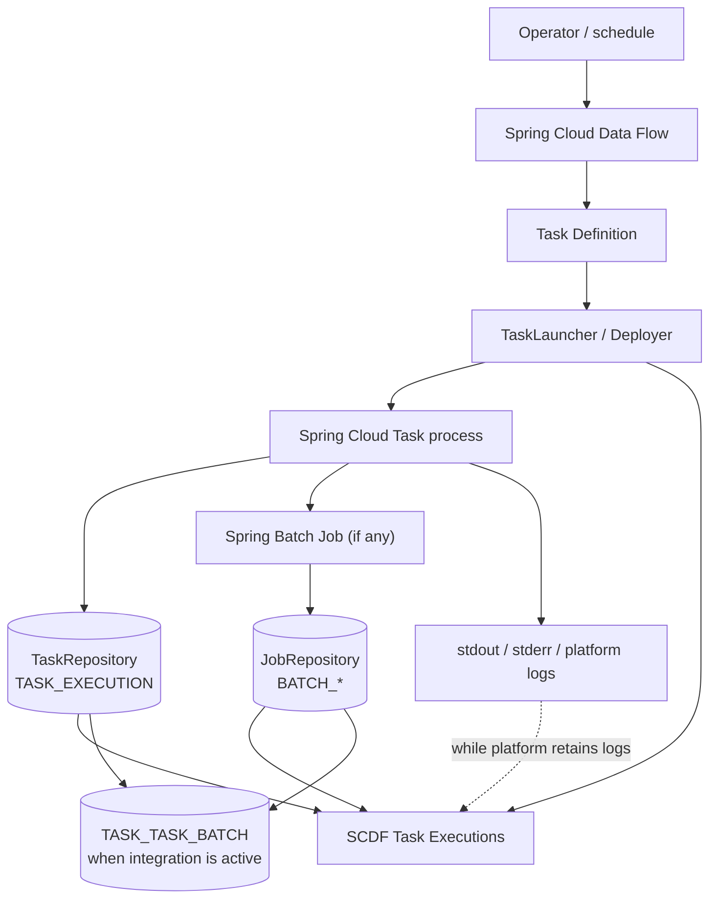
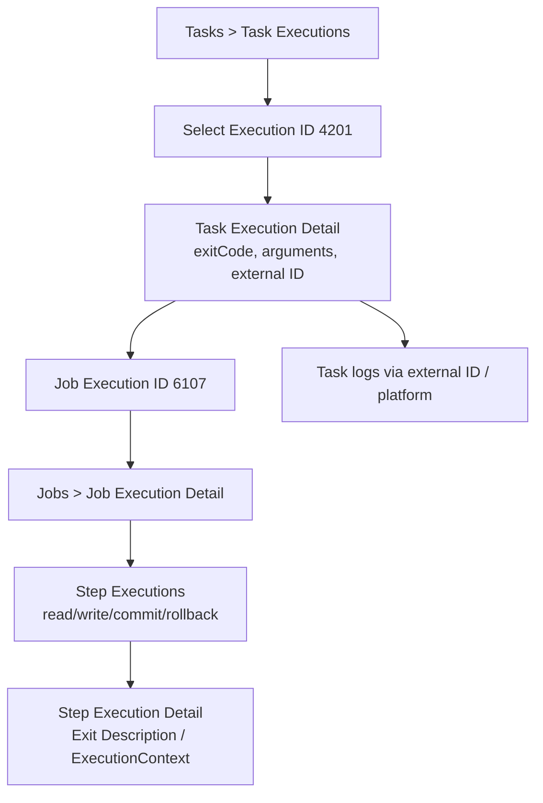
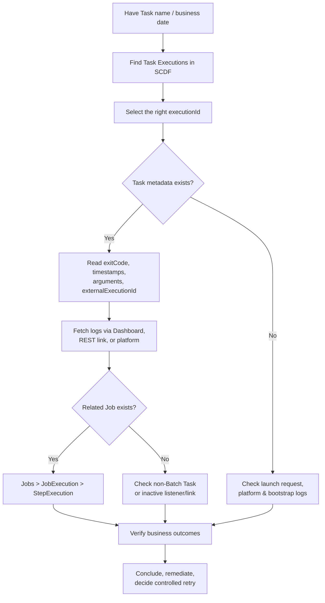

# Viewing History, Logs, and Related Jobs

## Learning Objectives

After this lesson, you will be able to:

- Use **Spring Cloud Data Flow (SCDF)** to inspect the run history of a finite **Spring Cloud Task** application, without confusing *Task Definition* with *Task Execution*.
- Starting from a `TaskExecution.executionId`, view timestamps, outcomes, arguments, external identifiers, and the **logs of that exact run**.
- Navigate from a Task Execution to related **Spring Batch JobExecution/StepExecution** records, reading status, item counts, errors, and restartability.
- Query history through three interfaces: **Data Flow Dashboard**, **Data Flow Shell**, and **REST API**; know when to fall back to platform logs such as Kubernetes.
- Explain the roles of `TASK_EXECUTION`, `TASK_TASK_BATCH`, and `BATCH_JOB_EXECUTION`, and distinguish Task, Job, and Pod IDs.
- Handle scenarios with missing logs, missing linked Jobs, metadata missing an end time, or a Task reporting success while the Batch Job failed.
- Propose checklists for security, history retention, reconciliation, and incident investigation when Tasks run on schedules or on demand.

> **Context:** This lesson belongs to the **Data Flow** chapter of the **SPRING_CLOUD_TASK** module. Spring Cloud Task enables Spring Boot applications to run for a finite duration and record each execution's outcome to a database via `TaskRepository`. Spring Cloud Data Flow is an orchestration/observability layer for registering, launching, and viewing history, logs, and related Spring Batch Jobs when the application is deployed in supported infrastructure. The two products have distinct roles; Data Flow **does not replace** `TaskRepository` or `JobRepository`.

## 1. Operational Example: Why Must You Find the Exact Run?

Suppose a system has a Task `daily-reconciliation` running at 02:00 every day that can also be rerun by operators on failure:

```text
Task Definition: daily-reconciliation

Date 2026-11-24
  Run A: TaskExecution 4201
    02:00:02 -> 02:01:35, exitCode=1
    Batch JobExecution 6107: FAILED

  Run B: TaskExecution 4202
    02:10:01 -> 02:11:52, exitCode=0
    Batch JobExecution 6108: COMPLETED
```

The IDs and timestamps above are **illustrative data**, not output from a live SCDF server. Both runs can share `--business-date=2026-11-24` while producing **two different TaskExecution IDs** and potentially two different JobExecution IDs.

Operators often have to answer a chain of questions:

1. How many times was the Task launched for that processing date?
2. Which run succeeded, and which failed? Is any process still running?
3. What exception does the log of run `4201` contain?
4. Which Batch Job ran **inside run `4201`**? Which Step failed?
5. Were any business records committed before the Job errored?
6. When rerunning as `4202`, did the system prevent duplicate data processing?

Searching by `taskName` alone is not enough. You need **run identifiers** and the links connecting Task metadata, infrastructure logs, Spring Batch metadata, and business state.

## 2. Distinguishing the Layers of Spring Cloud Task and Data Flow

| Concept | Managed Where | Meaning |
| --- | --- | --- |
| **Task Definition** | Spring Cloud Data Flow | Logical configuration/registered Task app, e.g., name `daily-reconciliation` and artifact. |
| **Task Execution** | Spring Cloud Task + `TaskRepository`; viewed/queried by SCDF | **A single run** of the application, with `executionId`, timestamps, exit code, and arguments. |
| **External Execution ID** | Platform TaskLauncher/Deployer | External identifier used to locate the process/container or logs; distinct from repository `executionId`. |
| **Job Instance** | Spring Batch `JobRepository` | Logical Job by name and identifying `JobParameters` set. |
| **Job Execution** | Spring Batch `JobRepository` | A single attempt to execute a Job; has `JOB_EXECUTION_ID`, `BatchStatus`, and `ExitStatus`. |
| **Step Execution** | Spring Batch `JobRepository` | Execution of a specific Step inside a Job, with read/write/commit/rollback counts and errors. |
| **Pod/container/process** | Kubernetes, Cloud Foundry, or another runtime | Runtime resource; has OS exit code and logs, which may already be cleaned up. |

**A Task Definition is not run history.** When you click *Launch*, Data Flow asks a TaskLauncher to create a process; the Spring Cloud Task application writes a `TaskExecution` to the repository once its infrastructure initializes. If a failure happens too early, there may be a launch request or failed container with **no TaskExecution record yet**.



SCDF can store definition configurations and orchestration data and read Task/Batch metadata via the appropriate repositories. SCDF **does not generate any Job/Step information** if the application does not use Spring Batch or does not persist Batch metadata.

### Database Prerequisites

For reliable history display:

- The Task application uses `spring-cloud-starter-task`, has a JDBC `DataSource`, and has a **version-matched Task schema**.
- SCDF is configured to access the matching Task/Batch metadata for the infrastructure and **schema target** supported by the release.
- If using Spring Batch, the application uses a persistent `JobRepository` with `BATCH_*` tables and Task–Batch integration configured when linking Jobs back to Tasks is required.
- Keep Spring Boot/Spring Cloud Task/Spring Batch/SCDF versions compatible; UI screens, API responses, table mechanisms, and parameters can vary across releases.

**Example scope:** The UI, Shell, and REST examples in this lesson are based on **Spring Cloud Data Flow 2.11.x** documentation. If you use a different release, check the API root, login mechanism, authorization, platform setup, and available features before copying commands.

## 3. Which Identifier Is Used for Which Operation?

An illustrative Task run:

```text
taskName:           daily-reconciliation
executionId:        4201
externalExecutionId: daily-reconciliation-e8c0c7ad
platformName:        default
jobExecutionIds:     [6107]
businessDate:        2026-11-24
```

| What Do You Need to Do? | What Should You Use? | Do Not Confuse With |
| --- | --- | --- |
| View details of a Task run in Dashboard/API | `executionId=4201`. | Task name. |
| Fetch runtime logs via Data Flow REST | `externalExecutionId` and `platformName`, or the `tasks/logs` link returned in the response. | Numeric `executionId`. |
| View details of a Batch Job | `jobExecutionId=6107`. | `taskExecutionId=4201`. |
| Prevent duplicate processing for a business date | `businessDate` combined with other business keys. | `executionId`: retries normally get a new ID. |
| Investigate a Kubernetes Pod | Pod name/UID, labels, timestamps, and external ID if available. | Task name, which repeats across runs. |
| Aggregate logs across environments | Environment + repository + TaskExecution ID + trace/correlation ID. | A single ID, which is not unique across databases. |

In SCDF REST responses, `jobExecutionIds` can contain multiple JobExecution IDs; **do not assume every Task runs exactly one Batch Job**. `externalExecutionId` can be empty when the Task was not launched via a platform that supplies an external ID.

## 4. Viewing History in the SCDF Dashboard

### 4.1. Opening the Task Executions Screen

In the SCDF UI supported in the 2.11.x documentation line:

1. Sign in to **Spring Cloud Data Flow Dashboard** with an account that has permission to view Tasks.
2. Open **Tasks**.
3. Switch to the **Task Executions** or **Executions** tab.
4. Filter by Task name, time, or criteria supported by your UI version.
5. Pick the row to inspect using `Task Name`, `Execution ID`, `Start Time`, `End Time`, and `Exit Code`.
6. Click the **Execution ID** of the run you want to investigate.

**Do not select a run solely by definition name** if the Task has run multiple times. In our example, both `4201` and `4202` belong to `daily-reconciliation`, yet one failed and the other succeeded.

### 4.2. Fields Visible on the Detail Page

SCDF 2.11.x documentation describes the *Task Execution Detail* page displaying fields such as:

| Field | How to Use It |
| --- | --- |
| `executionId` and `taskName` | Identify the exact run and application type. |
| `startTime`, `endTime`, duration | Measure how long the Task was recorded active; spot abnormal runs. |
| `exitCode`, `exitMessage` | Evaluate process outcome per repository; combine with logs and business checks. |
| Arguments | Inspect stored parameters; avoid exposing secrets when sharing screenshots/logs. |
| `externalExecutionId` | Correlate the Task with the resource created by the Deployer. |
| Batch job indicator | Indicates whether the Task has linked Job metadata. |
| **Job Execution IDs** | Links to the corresponding Job Execution pages if present. |
| Logging output | Task logs the platform can provide at query time. |

The UI may show actions like *Relaunch*, *Stop*, or *Cleanup*. **Do not treat them as read-only inspection buttons**: relaunch starts a new run, stop can terminate work, and cleanup can remove resources or data depending on the option chosen.

### 4.3. Filtering the Exact Run by Business Arguments

If two runs share `--business-date=2026-11-24`, you should:

- List Task Executions by `taskName` and sort/reference by timestamp.
- Open **Arguments** for each run or use repository tooling to verify the date.
- Check `executionId` in logs if the application logged it via a `TaskExecutionListener`.
- Determine whether the retry was triggered by a scheduler, an operator, or automatic retry.
- Record a mapping table between `executionId`, JobExecution ID, and business key in the incident ticket.

Never infer "the highest ID is the run that succeeded" without checking outcomes and business data.

## 5. Navigating from a Task Execution to Related Spring Batch Jobs

When a Task contains a Spring Batch Job, open **Job Execution IDs** from Task Execution Detail, or go to the **Jobs** section of the Dashboard.

The navigation path described in SCDF documentation:



### 5.1. Metadata Levels

| Level | Illustrative ID | Useful Fields |
| --- | ---: | --- |
| TaskExecution | `4201` | Task name, start/end, exit code, arguments. |
| JobInstance | `3050` | Job name and identifying JobParameters. |
| JobExecution | `6107` | `BatchStatus`, `ExitStatus`, timestamps, JobParameters. |
| StepExecution | `8101` | `StepName`, status, readCount, writeCount, commitCount, rollbackCount, exit message. |

One TaskExecution can link to multiple JobExecutions; one JobInstance can have multiple JobExecutions across restarts. Each JobExecution can have multiple StepExecutions.

### 5.2. Identifying the Failed Step

In **Job Execution Detail**, select the Step with `Status=FAILED` or an unexpected outcome. In **Step Execution Detail**, read:

- `START_TIME` and `END_TIME`.
- `READ_COUNT`, `WRITE_COUNT`, `COMMIT_COUNT`, `ROLLBACK_COUNT`, and skip metrics if present.
- The Step's `EXIT_CODE` and `EXIT_MESSAGE`.
- The Step's `ExecutionContext` if displayed by the UI.
- Matching application/worker logs at the time of failure.

**Warning:** Exit descriptions in Batch tables have schema length limits. Long stack traces can be truncated; when root-cause details are missing, consult platform logs instead of concluding there was no error.

### 5.3. When No Related Job Appears

Possible reasons:

1. The Task is a plain application that does not run a Batch Job.
2. The Spring Batch Job was never actually launched (auto-run disabled, launcher never invoked).
3. `TaskBatchExecutionListener` was not enabled or the Job ran outside the listener's scope.
4. `spring-cloud-task-batch`/integration dependency was not included at runtime.
5. `TaskRepository` and `JobRepository` are not recognized by SCDF under the current config/schema.
6. The `TASK_TASK_BATCH` table is missing or the link could not be written.
7. The run failed too early before the Job created metadata.
8. Batch or Task metadata was already cleaned up/purged by retention.

**Do not treat "empty Job Execution IDs" as proof the Task did not run Batch.** Directly check `BATCH_JOB_EXECUTION`, Task logs, and listener configuration before concluding.

## 6. Viewing Logs: Starting from Task Execution Detail

On the detail page, SCDF may provide **logging output** and a log-view action (button label depends on release/UI). However, logs are not guaranteed to exist forever:

- On **Kubernetes**, logs are tied to the Pod/container and affected by retention policies, Pod deletion, node rotation, or log collection.
- On the **local deployer**, the child process may have exited and log files are retained according to the deployment setup.
- On **Cloud Foundry**, log storage and querying depend on the runtime/logging service.
- In a **centralized logging system**, history can outlive Pods; include IDs so you can locate the exact run.

### 6.1. Identifier for REST Log Queries

SCDF 2.11.x REST documentation specifies:

```http
GET /tasks/logs/{externalTaskExecutionId}?platformName={platformName}
```

Therefore, log retrieval uses the **external execution ID**, rather than simply substituting `4201` into the path. The safe approach is to call `GET /tasks/executions/4201` and follow **`_links["tasks/logs"].href`** when returned. That link already carries the right external ID/platform (and possibly `schemaTarget`) for the execution.

If `externalExecutionId` is absent, the platform deleted the resource, or the environment does not support log retrieval, the Dashboard may show nothing. In that case, switch to centralized logging and infrastructure data.

### 6.2. Checking Logs on Kubernetes

In an SCDF deployment on Kubernetes, reference documentation uses the `task-name` label to locate Task Pods:

```bash
# Replace task-name and namespace with real values.
kubectl -n batch-tasks get pods -l task-name=daily-reconciliation

# Pick the exact Pod for the execution under investigation.
kubectl -n batch-tasks logs <task-pod-name>

# Inspect Pod condition and termination reason.
kubectl -n batch-tasks describe pod <task-pod-name>
```

**Do not assume the `task-name` label matches only one Pod.** Retries, schedules, or composed Tasks can produce many Pods with the same label. Cross-check creation timestamps, external execution IDs, actual labels/annotations, and logged `executionId` values.

If a Pod has multiple containers, select the right container with `-c <container-name>`. If the Pod was deleted without centralized logging, `kubectl logs` may have no data left. `kubectl logs --previous` only helps in certain container-restart cases while prior logs still exist; it does not recover deleted Pods.

### 6.3. What Logs Should the Application Emit?

For effective troubleshooting, a Task should log at least:

- `taskName` and `executionId` immediately once Spring Cloud Task registers the run.
- `externalExecutionId`/correlation ID if accessible to the application and needed for platform correlation.
- `businessDate` or **non-sensitive** business keys.
- When using Batch: `jobExecutionId`, `stepExecutionId`, and Job/Step names.
- Start/end timestamps, processed record counts, and outcomes.
- Exceptions with stack traces at meaningful error-handling boundaries.
- Never log passwords, tokens, personal data, or an uncontrolled full dump of `ExecutionContext`.

Example `TaskExecutionListener` for lifecycle logging:

```java
package com.example.reconciliation;

import org.slf4j.Logger;
import org.slf4j.LoggerFactory;
import org.springframework.cloud.task.listener.TaskExecutionListener;
import org.springframework.cloud.task.repository.TaskExecution;
import org.springframework.stereotype.Component;

@Component
public class TaskAuditListener implements TaskExecutionListener {

    private static final Logger log =
            LoggerFactory.getLogger(TaskAuditListener.class);

    @Override
    public void onTaskStartup(TaskExecution taskExecution) {
        log.info("Task started executionId={}, name={}",
                taskExecution.getExecutionId(),
                taskExecution.getTaskName());
    }

    @Override
    public void onTaskEnd(TaskExecution taskExecution) {
        log.info("Task ended executionId={}, exitCode={}",
                taskExecution.getExecutionId(),
                taskExecution.getExitCode());
    }

    @Override
    public void onTaskFailed(TaskExecution taskExecution, Throwable cause) {
        log.error("Task failed executionId={}",
                taskExecution.getExecutionId(), cause);
    }
}
```

`TaskExecutionListener` emits logs for correlation; it does not replace durable log storage. If the Task fails before the listener is invoked, inspect bootstrap/container logs. If the runner catches an exception, logs it, and returns normally, the failure callback is not necessarily triggered.

## 7. Querying with Spring Cloud Data Flow Shell

Besides the Dashboard, SCDF Shell supports querying Task history. After connecting Shell to the SCDF server and authenticating per active security settings:

```text
dataflow:>task execution list
dataflow:>task execution list --name daily-reconciliation
dataflow:>task execution status --id 4201
```

Explanation:

| Command | Result |
| --- | --- |
| `task execution list` | Lists recent Task runs managed/recognized by SCDF. |
| `task execution list --name daily-reconciliation` | Filters runs by Task name. |
| `task execution status --id 4201` | Shows detailed status of a single execution. |

These commands are documented for SCDF 2.11.x. If another Shell release uses different options or formats, consult `help` or the Shell documentation for your running version.

**Shell returns metadata, not full logs.** For complete stack traces, use Dashboard logs, REST `tasks/logs`, or platform logging. A completed Task does not automatically provide a Shell command to read historical stdout once the Deployer has cleaned up resources.

### Distinguishing History Inspection from Task Operations

Administrative commands such as `task launch`, `task execution relaunch`, `task execution stop`, or `task execution cleanup` can create, interrupt, or remove resources. Do not invoke them during a **read-only investigation** without verifying impact and permissions.

Specifically, **Relaunch** creates a new TaskExecution and can rerun the same arguments. If the job transfers money, sends emails, or publishes messages, verify idempotency before relaunching.

## 8. Querying via the SCDF REST API

The following examples follow SCDF 2.11.x REST documentation, assuming a local server at `http://localhost:9393`. This is an **example address**, not a production endpoint. In real systems, use HTTPS, authentication, authorization, and the base URL provided by operations.

### 8.1. Listing Runs by Name

```http
GET /tasks/executions?name=daily-reconciliation&page=0&size=10
```

`curl` example for a permitted local environment:

```bash
curl -sS \
  'http://localhost:9393/tasks/executions?name=daily-reconciliation&page=0&size=10'
```

Normally the HAL/JSON response contains `_embedded.taskExecutionResourceList` and pagination metadata. Actual payloads can include `taskName`, `executionId`, `exitCode`, `arguments`, `jobExecutionIds`, `externalExecutionId`, `platformName`, and corresponding links.

**Note:** `page` is `0`-indexed in the documented API; paginate when history holds thousands of runs. Do not load the entire history into memory just to find a few failed runs.

### 8.2. Details of a Single Task Execution

```http
GET /tasks/executions/4201
```

```bash
curl -sS 'http://localhost:9393/tasks/executions/4201'
```

**Abbreviated** illustrative response:

```json
{
  "executionId": 4201,
  "taskName": "daily-reconciliation",
  "startTime": "2026-11-24T02:00:02Z",
  "endTime": "2026-11-24T02:01:35Z",
  "exitCode": 1,
  "arguments": ["--business-date=2026-11-24"],
  "jobExecutionIds": [6107],
  "externalExecutionId": "daily-reconciliation-e8c0c7ad",
  "platformName": "default",
  "_links": {
    "self": {
      "href": "http://localhost:9393/tasks/executions/4201"
    },
    "tasks/logs": {
      "href": "http://localhost:9393/tasks/logs/daily-reconciliation-e8c0c7ad?platformName=default"
    }
  }
}
```

This is a **sample for understanding structure**, not a live server response. `schemaTarget` or other fields may be added in environments managing multiple Boot schemas; date formats and links vary by release.

### 8.3. Reading Logs by External ID

```http
GET /tasks/logs/daily-reconciliation-e8c0c7ad?platformName=default
```

Example:

```bash
curl -sS \
  'http://localhost:9393/tasks/logs/daily-reconciliation-e8c0c7ad?platformName=default'
```

If the `GET /tasks/executions/4201` response already includes `_links["tasks/logs"].href`, **prefer using the server-provided URL**. It may carry `schemaTarget`/platform parameters and the proper deployment path; do not guess links if an SCDF instance sits behind a custom base path.

Having logs does not mean processing succeeded; check Task exit code, Job status, and business data. Conversely, an empty log endpoint response may be due to cleaned-up resources, expired log retention, or lack of platform retrieval support—not proof that the Task never ran.

### 8.4. Listing Batch Jobs by Task Execution ID

Per SCDF 2.11.x REST:

```http
GET /jobs/thinexecutions?page=0&size=10&taskExecutionId=4201
```

```bash
curl -sS \
  'http://localhost:9393/jobs/thinexecutions?page=0&size=10&taskExecutionId=4201'
```

`thinexecutions` returns a compact representation of JobExecution, convenient when listing linked jobs without loading every Step detail upfront. For each `JobExecution ID` obtained, follow the `self` link in the Job response or:

```http
GET /jobs/executions/6107
```

```bash
curl -sS 'http://localhost:9393/jobs/executions/6107'
```

Step endpoints are also exposed by SCDF in REST root/HAL links; when you need Step details, prefer **following `_links`** from the Job Execution rather than guessing URL templates from another version.

### 8.5. Why Does REST Use HAL Links?

For Spring HATEOAS APIs, responses include `_links` pointing to related operations. Following links avoids:

- Constructing wrong URLs when the server has a base path or API gateway.
- Omitting `platformName`/`schemaTarget` when querying logs/Jobs.
- Confusing Task execution ID with Job execution ID.
- Hardcoding paths across release upgrades.

In production, query automation should handle HTTP `401/403`, `404`, `5xx`, timeouts, and pagination; avoid printing access tokens or full arguments containing secrets into pipeline logs.

## 9. Read-Only SQL: Inspecting Tasks/Jobs When the Dashboard Lacks Data

If you have read access to the metadata database or are investigating the repository directly, SQL lets you verify independently of the UI. The queries below use common default table names; check the actual **schema prefix and database dialect** before running.

### 9.1. Finding the Latest Task Runs

```sql
SELECT
    TASK_EXECUTION_ID,
    TASK_NAME,
    START_TIME,
    END_TIME,
    EXIT_CODE,
    EXIT_MESSAGE,
    ERROR_MESSAGE
FROM TASK_EXECUTION
WHERE TASK_NAME = 'daily-reconciliation'
ORDER BY START_TIME DESC, TASK_EXECUTION_ID DESC;
```

Add pagination/limits appropriate for your database. SQL results only show what was written in the repository; `END_TIME IS NULL` can mean the Task is still running **or** the Pod was killed/lost DB connectivity before recording completion.

### 9.2. Viewing Arguments of a Run

```sql
SELECT TASK_EXECUTION_ID, TASK_PARAM
FROM TASK_EXECUTION_PARAMS
WHERE TASK_EXECUTION_ID = 4201;
```

Parameter data can contain sensitive values if an application mistakenly passed secrets via CLI. Restrict read access and redact values before pasting into tickets or screenshots.

### 9.3. Joining Task and Spring Batch Job via the Link Table

When Task–Batch integration is enabled and the `TASK_TASK_BATCH` table exists:

```sql
SELECT
    t.TASK_EXECUTION_ID,
    t.TASK_NAME,
    t.EXIT_CODE AS TASK_EXIT_CODE,
    x.JOB_EXECUTION_ID,
    i.JOB_NAME,
    j.STATUS AS JOB_STATUS,
    j.EXIT_CODE AS JOB_EXIT_CODE,
    j.START_TIME AS JOB_START,
    j.END_TIME AS JOB_END
FROM TASK_EXECUTION t
LEFT JOIN TASK_TASK_BATCH x
  ON x.TASK_EXECUTION_ID = t.TASK_EXECUTION_ID
LEFT JOIN BATCH_JOB_EXECUTION j
  ON j.JOB_EXECUTION_ID = x.JOB_EXECUTION_ID
LEFT JOIN BATCH_JOB_INSTANCE i
  ON i.JOB_INSTANCE_ID = j.JOB_INSTANCE_ID
WHERE t.TASK_EXECUTION_ID = 4201
ORDER BY x.JOB_EXECUTION_ID;
```

`TASK_TASK_BATCH` is a **key-mapping table**; it does not prove every Job succeeded. One Task can link to **multiple JobExecutions**, so the join may return multiple rows. `LEFT JOIN` ensures the Task still appears even if no Job is linked.

Do not join `TASK_EXECUTION_ID = JOB_EXECUTION_ID` directly: the two IDs are allocated independently. If `TaskRepository` and `JobRepository` actually live in **two different databases**, a plain SQL JOIN cannot span sources automatically; you need cross-source querying capability or service-layer correlation.

### 9.4. Finding the Failed Step

```sql
SELECT
    STEP_EXECUTION_ID,
    JOB_EXECUTION_ID,
    STEP_NAME,
    STATUS,
    READ_COUNT,
    WRITE_COUNT,
    COMMIT_COUNT,
    ROLLBACK_COUNT,
    EXIT_CODE,
    EXIT_MESSAGE
FROM BATCH_STEP_EXECUTION
WHERE JOB_EXECUTION_ID = 6107
ORDER BY STEP_EXECUTION_ID;
```

Read `EXIT_MESSAGE` to find Step-level exceptions; for long stack traces, platform logs are an essential complement. Even a Step reporting `COMPLETED` does not prove business logic was right if code handled errors improperly.

## 10. Using Logs, Tasks, and Jobs in Investigation Order

You can follow an **outside-in** troubleshooting flow:



### Reasoning Example

Observations:

- `TaskExecution 4201` has `EXIT_CODE = 1`.
- Pod logs show a timeout error in the data-ingestion service.
- `JobExecution 6107` has `STATUS = FAILED`.
- `StepExecution importPayments` has `WRITE_COUNT = 12000` and `ROLLBACK_COUNT = 1`.

From this you **cannot conclude all 12,000 records were committed**: `WRITE_COUNT`/chunk and transaction boundaries must be interpreted per Spring Batch; some records may have rolled back. Check business tables, checkpoints, and external system states.

To rerun, do not just click `Relaunch`. First verify identifying JobParameters, JobInstance state, restart mechanisms, transactions, business idempotency keys, and external side effects.

## 11. Distinguishing Three Types of "Data Not Found"

| Symptom | Things to Check | Do Not Jump to This Conclusion |
| --- | --- | --- |
| Task Execution not visible | Is SCDF connected to the right repository/schema target? Did the Task fail before writing metadata? View permissions? Data cleaned up? | "The Task was never launched." |
| Task Execution exists, but logs cannot be viewed | Are external ID/platform correct? Does the Pod still exist? Does the logging service retain it? Did the REST link return an error? | "The app emitted no logs" or "The Task succeeded." |
| Task Execution exists, but no Job link | Does the Task run Batch? Are listener/`TASK_TASK_BATCH` active? Does JobRepository have data? | "No Batch Job executed." |

**Repository metadata can outlive runtime logs**, and runtime logs sometimes hold error details even when TaskRepository never created a row. Therefore, keep multiple independent observability sources.

### `UNKNOWN` Status and `END_TIME IS NULL`

SCDF may display a runtime status such as `UNKNOWN` when it cannot determine the Task's state on the platform. `END_TIME IS NULL` in the database merely reflects that no completion update was written. Neither fact alone proves the process is still alive or has failed: cross-check Pod/container status, timestamps, and logs.

### Task Exit Code Differs from Batch Job Status

If a Batch Job is `FAILED` while the Task has `EXIT_CODE=0`, check:

- Did the runner catch an exception and return normally?
- Does application code inspect `JobExecution.getStatus()` when using a custom `JobLauncher`?
- Is `spring-cloud-task-batch` integration enabled and configured to propagate Job failures to the Task?
- Are `SpringApplication.exit(context)` and `System.exit(code)` propagating the exit code to the OS?
- Is SCDF showing a TaskExecution and JobExecution from **the same run**?

Never manually edit `TASK_EXECUTION.EXIT_CODE` or `BATCH_JOB_EXECUTION.STATUS` to make the Dashboard appear consistent; preserve history for investigation.

## 12. Scheduled Runs, On-Demand Runs, and Retry History

SCDF allows defining/launching Tasks on demand and provides scheduling on supported platforms. Each launch typically creates a new Task run; Batch may create a new JobExecution depending on JobParameters setup and restart policy.

Example:

| Trigger | Task Execution | JobExecution | Processing Date |
| --- | ---: | ---: | --- |
| 02:00 schedule | `4201` | `6107` FAILED | 2026-11-24 |
| Operator rerun | `4202` | `6108` COMPLETED | 2026-11-24 |
| Next day's schedule | `4203` | `6109` COMPLETED | 2026-11-25 |

**A new TaskExecution ID does not mean new business data to process.** Before relaunching, know how far the Task/Batch progressed and committed, whether external APIs were already called, and whether an idempotency key guards repeated effects.

With CronJobs or schedulers outside SCDF, SCDF may lack launch/Pod details needed to fetch logs, even though the Task database still holds metadata if properly connected. Management capabilities depend on the platform and how the Task was launched/registered.

## 13. Resource Cleanup vs. Metadata History Deletion

This distinction is critical when investigating failures several days later.

SCDF documentation describes Task Execution operations that can:

- **`CLEANUP`:** remove deployment resources such as completed Pods/processes, depending on the platform.
- **`REMOVE_DATA`:** delete Task Execution data in the metadata store and potentially delete related Batch metadata.
- **`Relaunch`:** create a rerun request, generating new history and potentially re-executing business logic.

Before using any cleanup/remove action:

1. Record the Task Execution ID, Pod ID, and JobExecution ID you need to preserve.
2. Check retention/log collection policies and potential audit/investigation needs.
3. Export or archive data required for auditing via an approved mechanism.
4. Understand **infrastructure-only cleanup** versus **repository data deletion**.
5. For composed Tasks, note that operations may affect child Tasks; per documentation, metadata deletion has specific rules around parent Tasks.
6. Verify the cleanup operation will not disrupt active processes or workers unexpectedly.

**Do not run manual SQL DELETEs** against `TASK_EXECUTION`/`TASK_TASK_BATCH`/`BATCH_*` to "clean up history." Relational constraints and restart rules can break.

### When the Pod Has Already Been Cleaned Up

If a completed Pod is deleted without centralized logging, Dashboard/REST may no longer retrieve stdout/stderr, **even though the `TASK_EXECUTION` row still exists**. Therefore, for long-term investigations, design centralized logging and retention independent of Pod lifecycle.

## 14. Security When Viewing History and Logs

Execution history is operational data that can contain:

- CLI arguments, including values passed by users at launch.
- Error logs containing internal URLs, customer names, SQL queries, or tokens if logged improperly.
- `ExitMessage`/`ErrorMessage` and Batch `ExecutionContext` that may expose sensitive data.
- Task artifact names and deployment properties.

Therefore:

- Use HTTPS and authentication/read permissions (`view/read`) for Dashboard, Shell, and REST.
- Separate privileges for **Relaunch, Stop, Cleanup, Remove Data** from read-only viewing privileges.
- Never put passwords, access tokens, or secrets into command-line arguments; use the platform's secret manager/credential mechanism.
- Do not copy full REST responses containing `arguments` or `appProperties` into public tickets.
- Mask sensitive data in logs, enforce retention, and audit access.
- Grant SQL inspection accounts only the **`SELECT` permissions** needed; never grant DDL/DML solely for diagnostics.

Different SCDF releases have different security configurations; do not assume every environment allows anonymous access to `localhost:9393` as in learning examples.

## 15. Verifiable Hands-On Walkthrough

### Setup

Assume a dev/test SCDF environment with:

- A Spring Cloud Task application named `daily-reconciliation`.
- Task/Batch database initialized with the appropriate schema and SCDF connected to the same repository.
- A Spring Batch Job named `reconcileJob` with two Steps: `loadStep` and `reconcileStep`.
- Read access to Task Executions, Jobs, and infrastructure logs or Kibana/Loki/Cloud Logging depending on the platform.

**Examples do not require creating a new production environment**, and running destructive code is discouraged; use non-sensitive datasets on dev/test.

### 15.1. Success Scenario

1. Launch the Task with `--business-date=2026-11-24` via SCDF.
2. In **Tasks → Task Executions**, note the `executionId`.
3. Open Task Execution Detail and verify arguments, start/end time, exit code `0`, and external ID.
4. Read logs via the UI or `_links["tasks/logs"].href`; locate `Task started` and `Task ended`.
5. If a Job link exists, open `JobExecution` and each `StepExecution` to confirm `COMPLETED`.
6. Reconcile data written to the business database rather than relying solely on `EXIT_CODE=0`.

### 15.2. Failed Job Scenario

1. In the test environment, induce a controlled error in `reconcileStep`.
2. Rerun with suitable test data and record the new Task Execution ID.
3. Open **Jobs**, locate the related JobExecution, and verify the `FAILED` Step/`EXIT_MESSAGE`.
4. Check the Task exit code and Pod exit status; if still `0`, investigate error propagation.
5. Read Pod logs via external execution ID or centralized logging to find the full stack trace.
6. Check committed business state and retry criteria before rerunning.

### 15.3. Missing Logs Scenario

1. Run a short Task in test, recording `executionId` and `externalExecutionId`.
2. Clean up the Pod **only when permitted** and after logs have been shipped to centralized logging.
3. Observe that Dashboard/REST logs may no longer be available while `TASK_EXECUTION` remains.
4. Search centralized logs using execution ID/correlation ID.
5. Document the difference and propose an appropriate retention policy.

### Result Table to Complete After Practice

| Field | Successful Task | Task with Failed Batch | Task Missing Runtime Logs |
| --- | --- | --- | --- |
| Task executionId | Actual ID | Actual ID | Actual ID |
| Task exitCode | Per DB | Per DB | Per DB |
| externalExecutionId | Present/absent | Present/absent | Present/absent |
| JobExecution ID | Per DB | Per DB | Per DB |
| Batch status | Per DB | FAILED or actual status | Per DB |
| Dashboard/REST Logs | Available/not | Available/not | Likely unavailable |
| Centralized Logs | Available/not | Available/not | Available/not |
| Business outcome | Reconciled | Needs recovery | Reconciled |

## 16. Common Pitfalls

| Symptom | Possible Cause | How to Check |
| --- | --- | --- |
| Task missing from Dashboard | Task failed before creating metadata; SCDF points to wrong repository/schema target; missing permissions. | Check launch logs, SCDF platform, TaskRepository JDBC, and actual database. |
| Two runs with the same name lead to picking the wrong one | Filtered only by Task Definition without distinguishing `executionId`. | Use Task Execution ID alongside timestamps/arguments. |
| REST `/tasks/logs/4201` returns nothing | Log endpoint uses **external execution ID**, not numeric ID. | Follow `_links["tasks/logs"].href` and `platformName`. |
| Dashboard shows empty Job IDs | Job didn't run, missing listener/link, wrong repository, or metadata cleaned up. | Query `BATCH_JOB_EXECUTION` and `TASK_TASK_BATCH`. |
| Task `EXIT_CODE=0` while Job `FAILED` | Exception swallowed or Job status not propagated. | Cross-check `JobExecution`, runner, and JVM/container exit code. |
| `END_TIME IS NULL` after Pod died | Crash/kill before updating repository. | Cross-check Pod status, logs, and timestamps; don't label RUNNING from SQL alone. |
| Truncated logs | Exit message length limit or log retention/aggregation. | Check centralized logging for the full stack trace. |
| Pod was cleaned up so logs are gone | Runtime artifacts were removed with no centralized logging. | Design retention; preserve investigative data before cleanup. |
| Clicking Relaunch caused duplicate data | Task reran with the same business key without idempotency. | Check JobParameters, business keys, and committed side effects. |
| Counting Tasks via SQL JOIN overcounts | One Task has multiple JobExecutions or parameters. | Use `COUNT(DISTINCT TASK_EXECUTION_ID)` when counting Tasks. |
| API works locally but production returns `403` | Environment uses different RBAC/auth. | Grant appropriate read roles; never share tokens. |

## 17. Production Incident Investigation Checklist

- [ ] Identify the Task Definition and **Task Execution ID** of the run under investigation.
- [ ] Record start/end times, exit code, permitted arguments, external execution ID, and platform.
- [ ] Fetch logs via Dashboard/REST `tasks/logs` or platform logging.
- [ ] If logs are empty, check whether the Pod/container still exists, retention, and centralized logging.
- [ ] If the Task includes Batch, locate the related **JobExecution ID** and open the failed StepExecution.
- [ ] Cross-check `TASK_EXECUTION`, `TASK_TASK_BATCH`, and `BATCH_JOB_EXECUTION` if the UI lacks links.
- [ ] Verify business results and external side effects; never infer solely from exit code.
- [ ] Check retry/JobParameters/idempotency before relaunching.
- [ ] Only clean up resources or metadata per approved retention policies.
- [ ] Save an incident report with IDs, timestamps, environment, root cause, actions, and secret-free evidence.

## 18. Practice Exercises

**Exercise 1 — Identifiers:** A Task `report-task` runs three times, producing TaskExecution IDs `101`, `102`, and `103` with the same `--date`. Explain why neither the Task name nor the highest ID may be used as proof of business completion.

**Exercise 2 — Dashboard:** Describe the navigation path from **Tasks → Task Executions → Execution Detail → Job Execution Detail → Step Execution Detail**. At each step, list three pieces of information you will check to find the root cause.

**Exercise 3 — Shell/REST:** Using `task execution list --name report-task`, `task execution status --id 101`, and REST `/tasks/executions/101`, point out the difference between `executionId` and `externalExecutionId` when calling the log endpoint.

**Exercise 4 — SQL:** Write a query listing all Batch JobExecutions belonging to TaskExecution `101` via `TASK_TASK_BATCH`, including Job name and status; explain why you cannot join Task ID directly to Job ID.

**Exercise 5 — Missing logs:** Simulate a Pod completing and then being cleaned up in dev/test. Identify which sources can still prove Task timing and outcome, and propose centralized logging and retention settings.

**Exercise 6 — Retry:** A Task has a `FAILED` Batch Job while the Task exit code is `0`. Describe how to detect it, possible causes, how to fix error propagation, and mandatory idempotency checks before rerunning.

## Takeaways

- **SCDF Task Definition** is configuration; **TaskExecution** is **a single run** with an ID, timestamps, arguments, and outcome in `TaskRepository`.
- On SCDF 2.11.x, open **Tasks → Task Executions** and click an **Execution ID** to inspect details, logs, and **Job Execution IDs** when linked.
- `executionId`, `externalExecutionId`, and `JobExecutionId` serve three different purposes. REST logs usually require **external ID + platform**, so prefer following returned `_links`.
- **Jobs → JobExecution → StepExecution** helps pinpoint failing Jobs/Steps and processing counts, though logs and business data must still be verified.
- Runtime logs can disappear after cleanup/retention; repository metadata can also be incomplete or stale after a crash. Never rely on a single source to draw conclusions.
- **Relaunch, Stop, and Cleanup** are state-changing operations, not passive view buttons; check permissions, data state, and idempotency before using them.

## References

- [Spring Cloud Data Flow 2.11.x — Reference Guide](https://docs.spring.io/spring-cloud-dataflow/docs/2.11.4/reference/htmlsingle/)
- [Spring Cloud Data Flow — Task Developer Guide](https://dataflow.spring.io/docs/batch-developer-guides/getting-started/task/)
- [Spring Cloud Task — Features and TaskRepository](https://docs.spring.io/spring-cloud-task/reference/features.html)
- [Spring Cloud Task — Spring Batch Integration](https://docs.spring.io/spring-cloud-task/reference/batch.html)
- [Spring Batch — Metadata Schema](https://docs.spring.io/spring-batch/reference/schema-appendix.html)
- [Kubernetes — Logging Architecture](https://kubernetes.io/docs/concepts/cluster-administration/logging/)
