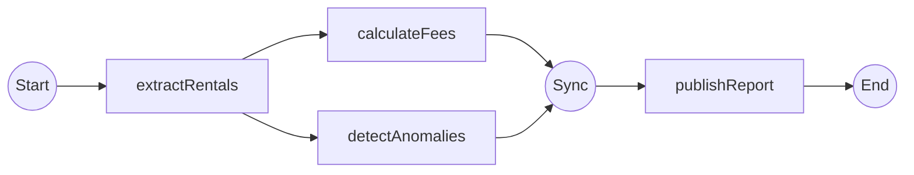
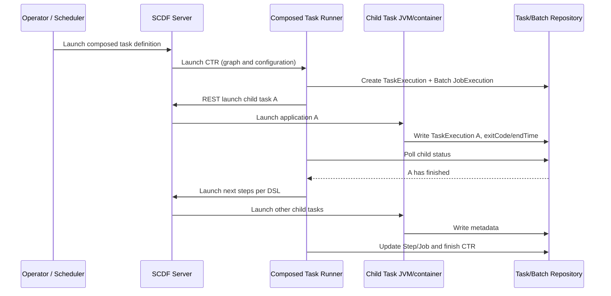
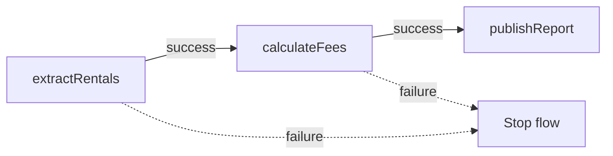
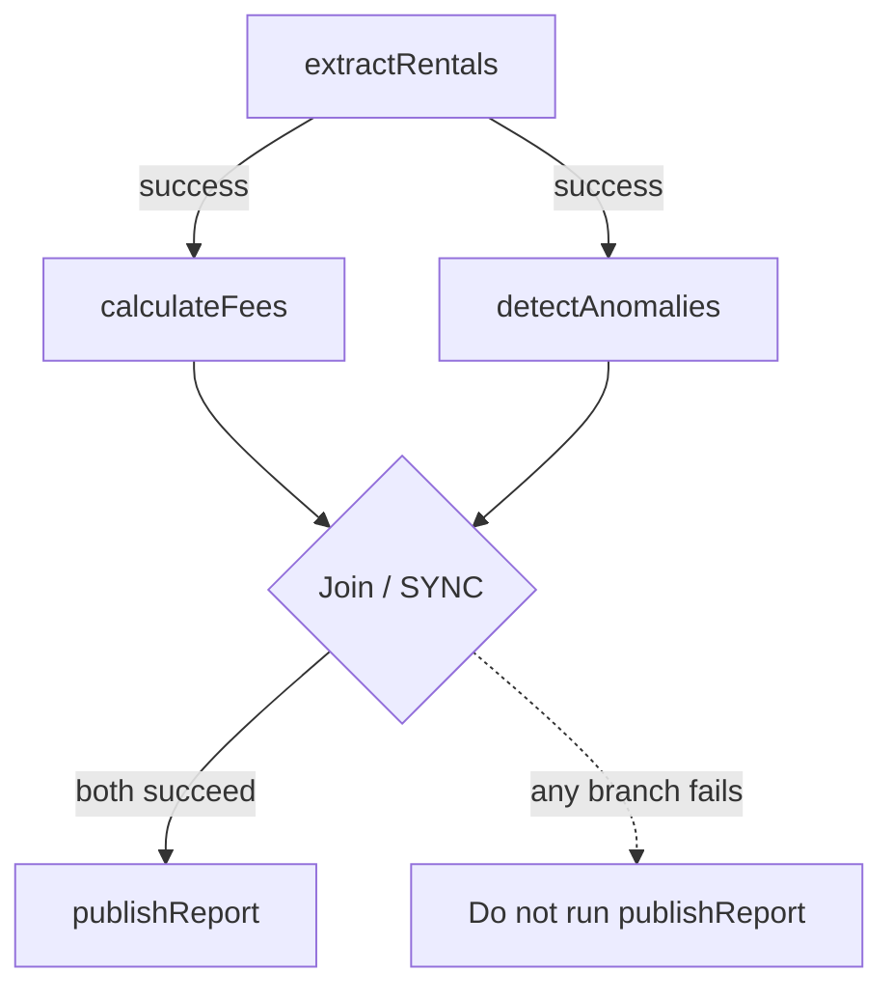
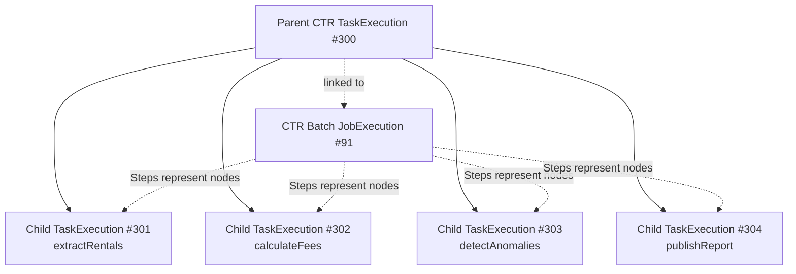

# Composed Task Runner: Sequential and Parallel Execution

## Lesson Objectives

In the **Data Flow** chapter of the **Spring Cloud Task** module, this lesson teaches how to use **Composed Task Runner (CTR)** to orchestrate multiple finite-running Spring Cloud Task applications in a workflow graph. We will step through designing **sequential**, **parallel**, and combined flows, handling failures, and verifying execution status.

After this lesson, you will be able to:

- Distinguish the responsibilities of **Spring Cloud Task**, **Spring Cloud Data Flow (SCDF)**, **Composed Task Runner**, and **Spring Batch** inside CTR.
- Write accurate Task DSL: `A && B` (sequential), `<A || B>` (parallel), `A && <B || C> && D` (combined), and conditional transitions based on `ExitStatus`.
- Register **task applications**, create **task definitions**, and run a **composed task** via Spring Cloud Data Flow Shell or UI.
- Understand how CTR calls the SCDF REST API, polls child TaskExecution status, creates a JobExecution/StepExecution for the graph, and maintains parent–child links.
- Choose appropriate thread counts, polling intervals, wait timeouts, arguments, deployer resources, and restart policies.
- Read errors at the right level; avoid confusing `ExitMessage` with `ExitCode`, or a child application's `TaskExecution` with the overall graph status.
- Deploy safely: shared metadata store, idempotency, overlap prevention, secret controls, per-process monitoring, and business data verification.

## 1. Problem: Daily Closing in a Flow with Dependencies

Suppose a rental management system must perform daily closing for `2026-11-23`:

1. `extractRentals` reads closed rental transactions for the day and produces a stable snapshot.
2. `calculateFees` computes fees/surcharges from the snapshot.
3. `detectAnomalies` checks for anomalous transactions from **the same snapshot**, independent of fee calculation.
4. `publishReport` aggregates both outputs and publishes the report.

`calculateFees` and `detectAnomalies` can run **in parallel** because they read the same snapshot and write to two separate output areas. However, `publishReport` must only run after **both branches** complete successfully.



This graph can be written in **Composed Task DSL**:

```text
extractRentals && <calculateFees || detectAnomalies> && publishReport
```

**Composed Task Runner does not replace business logic.** Each name in the graph corresponds to a **task definition** registered in SCDF; the application behind that name is the Spring Boot/Spring Cloud Task that actually computes, stores data, and returns results. CTR only decides when to launch which step and when the graph is considered complete or failed.

## 2. Role of Each Component

| Component | Responsibility | Lifecycle Scope |
| --- | --- | --- |
| **Spring Cloud Task** | Records timestamps, name, ID, exit code, and errors of a finite application run into `TaskRepository` | A child process or CTR |
| **Spring Cloud Data Flow Server** | Stores app registrations/Task definitions, exposes APIs, selects target platform, and accepts launch commands | Orchestration service |
| **Composed Task Runner** | Parses graph DSL; calls the **SCDF REST API** to launch each Task; polls metadata to know when a Task completes and advances | A finite orchestration process |
| **Spring Batch inside CTR** | Represents the graph using Job/Steps/flows, tracks state, and supports graph restarts | CTR's `JobExecution`/`StepExecution` |
| **Child Task application** | Runs business work such as extraction, fee calculation, anomaly detection, or report publishing | A separate JVM/container run |
| **TaskRepository and Batch JobRepository** | Stores metadata of parent Task, child Tasks, and CTR Job/Steps | Persistent database used for lookups/restarts |
| **Task platform/deployer** | Creates JVMs, processes, or Kubernetes Jobs/containers; enforces quotas, resources, and run policies | Deployment infrastructure |



**Note:** The graph is a **control-flow graph**, not an implicit direct data pipeline. CTR does not transfer an in-memory `Map`/`Object` from `extractRentals` to `calculateFees`. Applications are **independent processes**; pass data via databases, object storage, shared files, message brokers, or pre-designed input/output contracts.

### 2.1. Why Isn't CTR Simply Calling Java Methods?

Sequential Java calls in the same JVM do not need SCDF. CTR makes sense when each part is an **independently deployable Task**: with its own image/JAR, its own CPU/RAM allocation, isolated runtime, separate logs, and `TaskExecution` status for orchestration.

In exchange, CTR depends on **SCDF Server**, **API connectivity**, and a **metadata repository**. If you only need to run two methods inside one small transaction, CTR can introduce unnecessary complexity.

### 2.2. Parent Task and Child Tasks

When SCDF launches a composed task:

- **Parent** is a run of **CTR**, usually bearing the composed task name.
- **Children** are the application runs that CTR asks SCDF to launch.
- Children have their own `TaskExecutionId`s and can be linked to the parent via `parentExecutionId`/`PARENT_TASK_EXECUTION_ID`.
- CTR's graph also has a **Spring Batch JobExecution** and StepExecutions for orchestration.

Do not confuse CTR's `JobExecution` with a JobExecution **inside a child** if the child also uses Spring Batch. They are separate Jobs, even if they share the same metadata infrastructure.

## 3. Sequential DSL: The `&&` Operator

The `&&` symbol denotes **conditional sequence**: launch the next step only if CTR evaluates the preceding step as completed successfully.

```text
extractRentals && calculateFees && publishReport
```

Execution order:

1. `extractRentals` launches and finishes successfully.
2. CTR then launches `calculateFees` and waits for successful completion.
3. CTR then launches `publishReport`.
4. When the final step completes, the orchestration Job can become `COMPLETED`.



If `calculateFees` fails and the DSL has no error-handling transition, `publishReport` **is not launched**. `extractRentals`, which already completed, **is not automatically rolled back**. When designing retries, you must know which steps already wrote data and whether they can rerun safely.

**Sequential execution does not mean a single transaction.** Each child can commit data in its own DB before a later step fails. CTR does not provide distributed transactions or graph-wide rollback.

### 3.1. Running the Same Task Definition Multiple Times

DSL can reference the same name multiple times:

```text
extractRentals && extractRentals && publishReport
```

Each node triggers a launch request, yet without a clear purpose and distinct parameters, two runs of `extractRentals` can easily write duplicates. Give them distinct logical labels and business arguments/keys when multiple iterations are genuinely needed.

## 4. Parallel DSL: The `<... || ...>` Operator

Double pipes `||` inside angle brackets represent a **split**: instructing CTR to launch independent branches in parallel.

```text
<calculateFees || detectAnomalies>
```

This is **not** a shell logical OR operator or an "if the left step fails, run the right step" condition. In **Composed Task DSL**, `||` separates branches that execute concurrently **inside a split**. When writing the Shell command to create the graph, wrap the entire DSL in quotes as documented.

### 4.1. Split Combined with Join

```text
extractRentals && <calculateFees || detectAnomalies> && publishReport
```



According to Spring Cloud Data Flow documentation, **all branches of a split must complete successfully** before the step after the split runs. If `calculateFees` succeeded while `detectAnomalies` failed, `publishReport` will not run. However, the data written by `calculateFees` **remains persisted**; on restart, you must avoid duplicating results.

### 4.2. Multiple Parallel Groups in Sequence

```text
<extractRentals || extractPayments || extractRefunds>
    && <validateRentals || validatePayments>
    && publishReport
```

The second group only starts after **all three** tasks in the first group complete successfully. `publishReport` only runs after both tasks in the second group finish.

### 4.3. Sequence Inside a Split Branch

```text
<extractRentals && calculateFees || detectAnomalies> && publishReport
```

In this example, `extractRentals` and `detectAnomalies` can start in parallel; `calculateFees` waits for `extractRentals`, while `publishReport` waits for all branches inside the split. **Only use this topology if `detectAnomalies` does not depend on new output created by `extractRentals`**, otherwise a race condition occurs.

### 4.4. Actual Parallelism Depends on Threads and Platform

The DSL `<A || B || C>` requests parallel execution, but does not guarantee three containers/JVMs start at the **exact same millisecond**. Actual concurrency depends on:

- CTR's `split-thread-core-pool-size` and executor configuration.
- The Spring Cloud Data Flow platform's concurrent Task limit.
- CPU/RAM, schedulable nodes/pods, image pulls, quotas, and database connections.
- Each child's startup time, readiness, and individual resources.

For example, if the largest split has three children, SCDF documentation suggests `split-thread-core-pool-size=3`. If only two threads are configured, the third child may wait until an earlier branch frees a thread. **CTR's threads do not execute business logic**; business logic still runs in each separate child process/container.

## 5. Composed Task DSL Syntax Reference

| DSL | Graph Type | Meaning |
| --- | --- | --- |
| `A && B` | Sequential | B runs if A succeeds |
| `A && B && C` | Three-step sequence | C runs only if A and B succeed |
| `<A || B>` | Split | Requests A and B to run in parallel |
| `A && <B || C> && D` | Split after prep step | D waits for A, B, and C per join condition |
| `<A || B || C> && <D || E>` | Two sequential splits | Second split waits for first split to succeed |
| `<A && B || C>` | Sequence inside split | A and C run in parallel; B waits for A |
| `A 'FAILED' -> B` | Transition | If A's `ExitStatus` is `FAILED`, run B |
| `A 'COMPLETED' -> B` | Transition | If A's `ExitStatus` is `COMPLETED`, run B |

**Important:** `&&` does not mean "continue in all cases", and `||` does not mean "run B only if A fails". When you need outcome-based branching, use **transitions** based on `ExitStatus`.

### 5.1. Conditional Transitions

```text
extractRentals 'FAILED' -> notifyFailure 'COMPLETED' -> calculateFees
```

This example illustrates **transitions branching from `extractRentals`'s outcome**: the failure path goes to `notifyFailure`, and the completion path goes to `calculateFees`. Do not read the expression above as the sequence `extractRentals -> notifyFailure -> calculateFees`. Documentation also supports the wildcard `'*'` for other `ExitStatus` values.

If the requirement is **only proceed when all branches succeed**, use sequences/splits as in Sections 3–4; do not use transitions to mask failures.

### 5.2. `ExitCode`, `ExitMessage`, and `ExitStatus`

CTR uses child metadata to decide the orchestration Step status. **Composed Task Runner App Starters** documentation describes these rules:

1. If the child `TaskExecution` has an `ExitMessage`, that value can be used as the CTR Step's `ExitStatus`.
2. If there is **no ExitMessage** and `exitCode=0`, the CTR Step is normally treated as `COMPLETED`.
3. If there is **no ExitMessage** and `exitCode=1`, the CTR Step is normally treated as `FAILED`.
4. For other exit codes or custom logic, **verify the mapping of your exact CTR version**; do not assume every non-zero code automatically matches `'FAILED'`.

```text
Child TaskExecution
  exitCode = 0
  exitMessage = "REQUIRES_REVIEW"

CTR Step ExitStatus
  "REQUIRES_REVIEW"  (depending on version mapping)
```

A common pitfall in parallel runs: SCDF documentation warns **not to set custom `ExitMessage` values on children inside a split**. In a split, an ExitMessage other than `COMPLETED` can cause the entire split to be marked `FAILED` even when `exitCode` is `0`. If keeping ExitMessage to record a business reason is mandatory, documentation describes `ignoreExitMessage=true` per app inside the split; **enable it only after verifying it aligns with your orchestration policy**.

For new systems, standardize on:

- `exitCode=0` only when business processing is confirmed complete.
- `exitCode != 0` for errors that must stop or trigger retry handling.
- Keep `ExitMessage` concise, free of sensitive data, and use it for transitions only when intentionally designed.

## 6. Preparing the Spring Cloud Data Flow Environment

Examples follow **Spring Cloud Data Flow 2.x and its corresponding Composed Task Runner** documentation. SCDF, CTR, child Tasks, and the database must be **compatible versions**. Never mix a very old CTR image with newer Spring Boot/Spring Cloud Task releases without checking the support matrix and metadata DDL.

Before creating a graph, ensure you have:

1. A **running SCDF Server** with an endpoint reachable by both operators and the **CTR process**.
2. A configured **Task platform**: local, Cloud Foundry, or Kubernetes per your SCDF version.
3. A **persistent metadata store** with matching schemas for SCDF, Spring Cloud Task, and Spring Batch; children must write metadata that CTR/SCDF can read.
4. **Packaged Task applications** as Maven artifacts/JARs or Docker images downloadable by the platform.
5. **CTR artifact/image** configured on SCDF; documentation describes `spring.cloud.dataflow.task.composedtaskrunner.uri`.
6. **API and database permissions**, DNS/networking, TLS, and ServiceAccount/secrets when running on Kubernetes.

### 6.1. Why Must Metadata Be Shared?

CTR launches children through the **SCDF REST API**, then **polls the database** to check whether each child TaskExecution has an `endTime`/exit code. If a child uses its own in-memory H2 database while SCDF/CTR inspects a different database, the following can happen:

- The child actually finished, yet CTR **never finds completion metadata**.
- CTR waits until timeout or hangs indefinitely if `max-wait-time=0`.
- SCDF's Task history page fails to reflect the real status.

Therefore, **never use a private in-memory H2 database per child container in a multi-process orchestration environment**. Use a persistent DataSource accessible by SCDF and Tasks, and verify schema compatibility. Advanced architectures may separate schemas/datasources, provided CTR's metadata polling mechanism can observe the child runs accurately.

### 6.2. Distinguishing Artifact Name, Definition Name, and Execution Name

| Name | Example | Role |
| --- | --- | --- |
| Registered app name | `rental-import` | Points to the JAR/image known to SCDF |
| Task definition | `extractRentals` | Node name appearing in DSL |
| Composed task definition | `nightlyClose` | Name of the entire graph |
| CTR runtime | Composed Task Runner | Orchestrator app deployed by SCDF |
| TaskExecution | ID `302` for `nightlyClose-extractRentals` | A single **run** of a child |

The TaskExecution name may be prefixed by SCDF/CTR with the composed task name or node label; do not hardcode that name in business logic. Use `executionId`, `parentExecutionId`, and a **business key** like `businessDate` for reconciliation.

## 7. Hands-On: Creating and Running a Graph via Spring Cloud Data Flow Shell

Assume **four real Spring Cloud Task applications** have been built/published: one for extraction, two independent computations, and one for report publishing. The Maven URIs in the examples are **hypothetical**; replace them with artifacts you built that your SCDF platform can resolve.

### 7.1. Registering the Applications

The commands below run **inside Spring Cloud Data Flow Shell** (`dataflow:>` is an illustrative prompt, not part of the command):

```text
dataflow:> app register --name rental-import --type task --uri maven://com.example:rental-import-task:1.0.0
dataflow:> app register --name fee-calc --type task --uri maven://com.example:fee-calculation-task:1.0.0
dataflow:> app register --name anomaly-check --type task --uri maven://com.example:anomaly-check-task:1.0.0
dataflow:> app register --name rental-report --type task --uri maven://com.example:rental-report-task:1.0.0
```

On Kubernetes, SCDF typically uses Docker/OCI images declared as `docker:registry.example.com/path/image:tag` instead of Maven artifacts, depending on the platform. Do not assume the Maven URIs in this example work on every cluster.

### 7.2. Creating Four Task Definitions

A **task definition** binds a DSL node name to a registered app. Example:

```text
dataflow:> task create extractRentals --definition "rental-import"
dataflow:> task create calculateFees --definition "fee-calc"
dataflow:> task create detectAnomalies --definition "anomaly-check"
dataflow:> task create publishReport --definition "rental-report"
```

No process runs at this step. `app register` only registers the artifact; `task create` saves a definition; only **`task launch`** asks the platform to run it.

### 7.3. First Sequential Graph

```text
dataflow:> task create nightlyCloseSeq --definition "extractRentals && calculateFees && publishReport"
dataflow:> task launch nightlyCloseSeq
```

Observe `Task Definitions`, `Task Executions`, and `Job Executions` in the dashboard:

- CTR is launched for `nightlyCloseSeq`.
- Only after `extractRentals` succeeds does `calculateFees` start.
- Only after `calculateFees` succeeds is `publishReport` requested to run.
- If a child fails, downstream nodes **do not launch** under default sequential semantics.

### 7.4. Graph with Two Parallel Branches

```text
dataflow:> task create nightlyCloseParallel --definition "extractRentals && <calculateFees || detectAnomalies> && publishReport"
dataflow:> task launch nightlyCloseParallel
```

After `extractRentals`, CTR requests `calculateFees` and `detectAnomalies` to run. `publishReport` waits for both to finish successfully.

**Caution when reusing test data:** the children in this example must be designed to be idempotent using an explicit snapshot/`businessDate`. If you run `nightlyCloseSeq` and then `nightlyCloseParallel` for the same date, `extractRentals` will be invoked twice. CTR does not automatically prevent duplicate rows in your output tables.

### 7.5. Configuring Properties for Children

Spring Cloud Data Flow allows declaring app properties directly inside task DSL:

```text
dataflow:> task create nightlyCloseWithDate --definition "extractRentals --businessDate=2026-11-23 && <calculateFees --businessDate=2026-11-23 || detectAnomalies --businessDate=2026-11-23> && publishReport --businessDate=2026-11-23"
```

In this DSL, the `--businessDate=...` flags are **node-scoped application properties**, distinct from CTR's own properties. If a child uses Spring Batch, distinguish **Boot Environment properties** from **Spring Batch identifying JobParameters**; many Batch auto-launchers only turn **non-option arguments** into JobParameters. Do not assume every `--businessDate` automatically creates a Batch JobInstance.

When each batch run has a different date, it is usually better to pass arguments/properties **at launch time** via Data Flow UI/REST targeting the app/node name, instead of creating a new task definition every day. The `app`/`deployer` key structure per node depends on version and labeling; inspect SCDF's Launch/Properties page before automating.

### 7.6. Running via the Dashboard Instead of Shell

In the SCDF Dashboard:

1. Register artifacts under **Applications**.
2. Create task definitions or use the visual designer under **Tasks / Create Task**.
3. Enter the DSL `extractRentals && <calculateFees || detectAnomalies> && publishReport` or drag graph nodes.
4. Preview the nodes **START → Task → Split → SYNC → Task → END** before creating.
5. Select the composed task and click **Launch**, configure CTR/child properties, and monitor executions.

Menu names and layout can vary across SCDF versions; the core steps remain **create definition**, **launch**, and **monitor Job/Task executions**.

## 8. Configuring CTR for True Parallel Execution

The following properties belong to **Composed Task Runner**. In the Data Flow UI, they appear under CTR properties; when running the CTR JAR standalone, they are CTR options. Do not confuse them with child properties.

| CTR Option | Unit | Meaning |
| --- | --- | --- |
| `dataflow-server-uri` | URL | SCDF REST API that CTR calls to launch children |
| `interval-time-between-checks` | Milliseconds | Polling interval for child metadata; guides cite a default around `10000` |
| `max-start-wait-time` | Milliseconds | Max time to wait for a child to record start; `0` usually means unlimited |
| `max-wait-time` | Milliseconds | Max time to wait for a child to finish; `0` usually means unlimited |
| `split-thread-core-pool-size` | Threads | Core thread count for the split executor |
| `split-thread-max-pool-size` | Threads | Max thread limit per executor configuration |
| `split-thread-queue-capacity` | Items | Queue capacity for branches waiting on a thread |
| `split-thread-keep-alive-seconds` | Seconds | Idle keep-alive duration for extra threads |
| `increment-instance-enabled` | Boolean | Adds an incrementing identifying parameter to launch new instances as needed |
| `uuid-instance-enabled` | Boolean | Adds a UUID identifier for new composed task instances on supported versions |

**Default values changed between older CTR App Starters docs and SCDF 2.x.** For instance, an older doc lists `split-thread-core-pool-size` defaulting to `4` and `increment-instance-enabled` defaulting to `false`, whereas SCDF 2.x reference lists `1` and `true` respectively. Never copy defaults from old blog posts into production: verify the actual metadata/version of the CTR image/JAR deployed by SCDF.

### 8.1. Launch Configuration Example

To run two branches in parallel, under **CTR Properties** on the Launch page you might set:

```properties
split-thread-core-pool-size=2
split-thread-max-pool-size=4
interval-time-between-checks=2000
max-start-wait-time=120000
max-wait-time=900000
spring.cloud.task.closecontext-enabled=true
spring.cloud.task.batch.fail-on-job-failure=true
```

These are **learning values**, not a drop-in properties file for every SCDF release. In some UIs, application properties require the `app.<CTR-app-name>.` prefix when passed through SCDF; the UI normally supplies the corresponding prefix. Verify where properties are edited and inspect CTR startup logs.

- `split-thread-core-pool-size=2` is an appropriate core size for two branches; if your graph has a split of up to three children, consider at least three threads.
- `interval-time-between-checks=2000` gives faster updates at the cost of more database queries; avoid setting it too low at high Task volume.
- `max-start-wait-time=120000` only bounds waiting for the child to start; tune according to image pull and JVM startup times.
- `max-wait-time=900000` bounds waiting for a child to finish; if a Task runs longer, raise it after measuring real durations.
- `spring.cloud.task.closecontext-enabled=true` is especially important for splits in CTR docs so the orchestrator process closes its context after threads finish.
- `spring.cloud.task.batch.fail-on-job-failure=true` ensures a **failed CTR Job** is reflected in process outcome instead of the CTR JVM returning `0` on a `FAILED` Job as some branches default to.

**CTR timeout is not a "kill child and roll back data" mechanism.** When a wait limit is exceeded, CTR may mark the orchestration Job failed while the child keeps running or must be stopped via a separate platform action. Always check actual child status and design timeout error handling.

### 8.2. SCDF Platform Concurrency Limits

SCDF also enforces concurrent Task limits per platform account, such as `maximumConcurrentTasks` in deployer config. If the platform allows at most two Tasks while CTR itself counts as one Task and the graph needs two children simultaneously, this limit can cause launch requests to be rejected. **Do not count only CTR threads**: include children and other Tasks sharing the same platform.

On Kubernetes, also verify quotas, resource requests/limits, image pull configuration, node affinity, and service accounts. A three-branch logical split does not guarantee enough cluster resources exist to schedule three Pods simultaneously.

## 9. Outcomes, Errors, and Failure Paths

### 9.1. Linear Case

Graph:

```text
extractRentals && calculateFees && publishReport
```

Suppose `calculateFees` returns exit code `1` with no special `ExitMessage`, and CTR maps it to `FAILED`:

| Component | Outcome |
| --- | --- |
| `extractRentals` | Ran and `COMPLETED` |
| `calculateFees` | `FAILED`; child `TaskExecution` exists |
| `publishReport` | **Never launched** |
| CTR Spring Batch Job | May be `FAILED` at the corresponding orchestration Step |
| CTR `TaskExecution` and JVM code | Must verify `fail-on-job-failure`; do not assume automatic alignment with Job status |

Never equate "a failed CTR Job" with "all children rolled back." Earlier children may already have committed durable data.

### 9.2. Split Case

Graph:

```text
extractRentals && <calculateFees || detectAnomalies> && publishReport
```

If `calculateFees` fails while `detectAnomalies` completes:

- CTR will not proceed to `publishReport` on the default split path.
- `detectAnomalies` **is not undone** just because the sibling branch failed.
- Upon fixing the issue and restarting, CTR/Spring Batch may skip already-completed Steps and rerun only the failed part per restart semantics; **verify your version and metadata**, rather than assuming every child automatically reruns from scratch.

### 9.3. Failures Before a Child Writes Metadata

There are cases where CTR never receives a complete `TaskExecution`:

- Docker image/JAR cannot be pulled, or the launch request is rejected by the platform.
- Child crashes before the Spring Context initializes `TaskRepository`.
- Child writes metadata to a different database/schema than CTR polls.
- API connectivity, database connection, auth token, or read permissions fail.
- Child receives `SIGKILL`/OOM, leaving `END_TIME = NULL`.

In these cases, `max-start-wait-time`, `max-wait-time`, platform logs, and overdue-Task alerts are essential. Never hand-edit `EXIT_CODE=0` in the DB to force a graph forward.

## 10. Restarting a Composed Task After Failure

CTR is built on **Spring Batch**. When the orchestration Job fails, SCDF lets you **restart the failed JobExecution** via the **Jobs / Job Executions** UI or version-supported API/CLI.

Example:

```text
Run 1:
extractRentals (COMPLETED)
  -> calculateFees (FAILED)
  -> publishReport (NOT RUN)

Restart CTR Job:
calculateFees (RERUN, COMPLETED)
  -> publishReport (COMPLETED)
```

SCDF documentation describes resuming from the failed portion when restarting a composed task, rather than rerunning every already-successful task. This is a **restart of CTR's Spring Batch Job**, not clicking `task launch` to start a brand-new composed task run with a different identity. Distinguish:

| Operation | Meaning |
| --- | --- |
| **Restart failed CTR Job** | Resumes the failed logical work per Batch metadata; skips completed Steps when restart rules allow |
| **Launch composed task again as a new instance** | Creates a new orchestration run; can re-execute the entire graph |
| **Restart Batch Job inside child** | Recovers a Job/Step **inside the child** via its own JobRepository; independent of CTR-level restart |

### 10.1. Two Restart Layers When a Child Is Also a Batch Job

Suppose `calculateFees` contains a Job reading 1 million transactions and committed 800,000 rows before failing. When CTR restarts the child:

1. **CTR** decides it must relaunch the `calculateFees` node.
2. **The child Spring Batch** decides whether to restart the **same JobInstance** or create a new JobInstance based on identifying JobParameters and JobRepository.
3. If the prior JobInstance/ExecutionContext is preserved and readers/writers are restartable, the child can resume from its checkpoint.
4. If metadata is lost or identifying parameters changed (e.g., adding a new `run.id`), the child may re-read from the start.

Do not place full responsibility for "no duplicate data" on CTR. Build **idempotency into every child**, especially when writing to external APIs, message brokers, or already-committed business databases.

### 10.2. Identifiers for Each Processing Batch

Carry a **business key** such as `businessDate=2026-11-23` across all children and outputs:

```text
nightlyClose / businessDate=2026-11-23
  extractRentals     -> snapshot/rentals/2026-11-23
  calculateFees      -> fee_results(business_date=2026-11-23)
  detectAnomalies    -> anomaly_results(business_date=2026-11-23)
  publishReport      -> reports/2026-11-23/final.json
```

These paths are **illustrative data contracts**, not pre-existing files. Each child should use a unique business key, `MERGE/UPSERT`, or atomic publishing. Never publish the final report before confirming both split outputs belong to **the same snapshot/same businessDate**.

## 11. Tracing Status and Reconciling Metadata

SCDF provides **Tasks / Executions** and **Jobs / Executions** views. When investigating, inspect at least three levels:

1. **Parent CTR TaskExecution:** which orchestration run is active, has it finished, and what exit code did it return?
2. **Child TaskExecutions:** which children launched, their `exitCode`, timestamps, `parentExecutionId`, and logs?
3. **CTR Batch JobExecution/StepExecutions:** which node did the graph stop at, `FAILED`/`COMPLETED` status, and is it restartable?



IDs are illustrative, not live records. On a run that failed before `publishReport`, **there is no Child TaskExecution for `publishReport`**; the diagram shows relationships only when every node launched successfully.

### 11.1. SQL to Inspect Parent and Children

With the **default Spring Cloud Task schema** containing `PARENT_TASK_EXECUTION_ID`:

```sql
SELECT
    TASK_EXECUTION_ID,
    TASK_NAME,
    PARENT_TASK_EXECUTION_ID,
    START_TIME,
    END_TIME,
    EXIT_CODE,
    EXIT_MESSAGE
FROM TASK_EXECUTION
WHERE TASK_EXECUTION_ID = 300
   OR PARENT_TASK_EXECUTION_ID = 300
ORDER BY START_TIME, TASK_EXECUTION_ID;
```

Replace `300` with the parent CTR's ID. If `PARENT_TASK_EXECUTION_ID` is not populated for children in your setup, check versions, `spring.cloud.task.parent-execution-id` arguments, and SCDF linkage instead of inferring relationships by name.

### 11.2. SQL to Query CTR's Job

When Task/Batch integration has populated the `TASK_TASK_BATCH` link table, you can inspect:

```sql
SELECT
    t.TASK_EXECUTION_ID,
    t.TASK_NAME,
    t.EXIT_CODE AS TASK_EXIT_CODE,
    j.JOB_EXEC_ID,
    j.STATUS AS JOB_STATUS,
    j.EXIT_CODE AS JOB_EXIT_STATUS
FROM TASK_EXECUTION AS t
JOIN TASK_TASK_BATCH AS l
    ON l.TASK_EXECUTION_ID = t.TASK_EXECUTION_ID
JOIN BATCH_JOB_EXECUTION AS j
    ON j.JOB_EXEC_ID = l.JOB_EXECUTION_ID
WHERE t.TASK_EXECUTION_ID = 300;
```

Spring Batch Job's `EXIT_CODE` is an **`ExitStatus` string** such as `FAILED`, whereas `TASK_EXECUTION.EXIT_CODE` is an **integer**. A `FAILED` CTR Job does not automatically guarantee the CTR process returns non-zero unless the appropriate failure-propagation setting is enabled. Measure both layers and the container exit code.

## 12. Common Design Pitfalls

| Symptom | Possible Cause | How to Handle |
| --- | --- | --- |
| `task create` reports node name not found | Task definition `extractRentals` not created yet or misspelled | Register artifact and create matching Task definition before creating the graph |
| CTR fails to launch child | SCDF URI unreachable from CTR, token/permissions, or platform error | Check `dataflow-server-uri`, DNS/TLS, and CTR/SCDF logs |
| Child finished yet CTR keeps waiting | Child wrote metadata to a different DB, lacks `END_TIME`, or CTR cannot poll | Compare datasource/schema and `TaskExecutionId` |
| `<A || B>` does not actually run in parallel | Executor has only one thread or platform lacks quota | Check `split-thread-core-pool-size` and `maximumConcurrentTasks` |
| Split keeps running after children finish | Context didn't close or thread pool stayed alive | Check `spring.cloud.task.closecontext-enabled` in CTR |
| B failed yet C still ran when expecting sequence | DSL is a transition/split instead of intended sequence | Review `&&`, `||` syntax and generated graph |
| `publishReport` doesn't run even though both children returned `0` | Child set a custom `ExitMessage` preventing split `COMPLETED` | Check `ExitStatus` in CTR; consider `ignoreExitMessage` per version |
| CTR Job `FAILED`, yet CTR container exited `0` | Spring Batch failure not propagated to process | Check `spring.cloud.task.batch.fail-on-job-failure=true` and measure directly |
| Restart recreates all data | Launched a new composed task instance instead of restarting Job; child not idempotent | Distinguish restart vs. new launch; enforce business keys |
| Child still running after CTR timeout | Orchestration timeout does not guarantee killing children | Check Pod/process; apply stop and cleanup policies |
| Duplicate records when running in parallel | Two children write to the same table/key without coordination | Partition writes, add unique constraints, isolation, or proper orchestration |
| Data uses different `businessDate`s | Passed different args per node or queried un-snapshotted live data | Use a unified manifest/snapshot ID across the graph |
| CTR cannot restart | JobRepository lost data or identifying parameters changed | Use persistent DB and target the right CTR JobInstance |
| Child logs/Job missing in UI | Wrong platform account or missing UI permissions | Check platform, logs, job/task metadata, and permissions |

## 13. Security, Limits, and Safe Operations

**API and network permissions.** CTR must call SCDF Server to launch children. On Kubernetes/Cloud Foundry, CTR's `localhost:9393` is **not** the SCDF host. Configure `dataflow-server-uri` to point to a real address reachable by CTR with TLS/authentication; avoid putting passwords directly in the graph or arguments that get persisted in metadata/logs.

**Concurrency quotas.** Control CPU, RAM, connections, and concurrency. Two children querying the same large table can overload the database even when CTR uses only two orchestration threads. Size CTR threads, platform Task limits, and each child's connection pool to real capacity.

**True data state.** Never treat `TaskExecution.exitCode=0` as confirmation that all work completed accurately. For example, if `extractRentals` returns `0` while missing 10% of source data, the graph will still advance. Verify snapshots, row counts, checksums, and report identifiers before publishing.

**Idempotency and retries.** Every child can be rerun due to CTR restarts, child Job restarts, scheduler failures, or operator actions. Design business keys, upsert/unique constraints, outboxes, or staging-then-atomic-publish patterns. Especially in splits, never let two branches modify the same row without concurrency controls.

**Timeouts.** Set `max-start-wait-time`, `max-wait-time`, and scheduler alerts. Distinguish **CTR wait time** from **the child's actual execution limits** enforced by Kubernetes Job `activeDeadlineSeconds`, CPU/app timeouts, and the deployer.

**Persistent metadata.** Use a production DB, version-compatible migrations, and retention policies. Uncontrolled deletion of `TASK_`/`BATCH_` tables can destroy restartability and parent–child traceability.

**No cross-graph transactions.** CTR does not automatically compensate earlier committed steps. For all-or-nothing business requirements, design Sagas/compensation or staged batch publishing rather than assuming CTR can roll back child data.

## 14. Pre-Production Verification Checklist

1. **Valid DSL:** clearly identify sequential branches, parallel branches, and join points; never confuse `||` with shell OR.
2. **Each Task runs standalone:** each child has `@EnableTask`/TaskRepository, meaningful exit codes, and terminates on time.
3. **Correct dependencies:** if B/C read data produced by A, A must finish and commit its snapshot before the split starts.
4. **Shared schema:** SCDF and children write/read metadata in the same place CTR polls; verify timestamps and IDs.
5. **CTR options:** thread pool sized for the widest split; non-zero timeouts where SLA requires; context closes on completion.
6. **Failure paths:** deliberately fail a child in sequence/split and confirm downstream nodes do not run.
7. **ExitStatus:** inspect child `ExitMessage`/`ExitCode` and CTR Step status, especially splits with custom ExitMessages.
8. **Restart:** test restarting a failed CTR Job and observe which child reruns; verify data is not duplicated.
9. **Container/platform:** check Pod counts, quotas, logs, CPU/RAM, image pulls, and network/ServiceAccounts.
10. **Report reconciliation:** matching businessDate, right snapshot, complete data, and no overwrites from other runs.

## 15. Self-Check Exercises

**Question 1.** How does the graph `A && B && C` execute if `B` fails?

> `A` ran successfully; `B` failed; `C` is not launched if the DSL has no error-handling transition.

**Question 2.** Does `<A || B || C> && D` guarantee that `A`, `B`, and `C` start at the exact same millisecond?

> No. CTR attempts parallel execution, but actual timing depends on `split-thread-core-pool-size`, platform quotas, and each child's startup time.

**Question 3.** If `B` fails while `A` and `C` succeed in a split, does `D` run?

> Under default split semantics, no; all branches must complete successfully before proceeding to `D`.

**Question 4.** Why can you observe a child with `exitCode=0` while the split still ends `FAILED`?

> The child may have set a custom `ExitMessage` other than `COMPLETED`; CTR uses that message as `ExitStatus`. Check your version's mapping and evaluate whether `ignoreExitMessage` should be used.

**Question 5.** With two CTR threads, does a three-child split truly run all three steps simultaneously?

> Not necessarily. Per sizing guidance in SCDF documentation, the third child may wait when the core pool only has two threads; configure both the executor and platform limits appropriately.

**Question 6.** Why are there zero TaskExecutions right after creating `nightlyCloseParallel`?

> `task create` only saves the definition. You must run `task launch` or trigger it via UI/API/scheduler to produce an execution.

**Question 7.** Does restarting a failed CTR Job mean restarting the Batch Job inside a child from its checkpoint?

> No. CTR decides which nodes to rerun; Batch inside the child only uses checkpoints if it reruns the same JobInstance, metadata persists, and readers/writers support restart.

**Question 8.** CTR timed out—can you assume the child stopped and rolled back?

> No. Inspect the process/Pod and target data. An orchestration timeout does not automatically kill processes or roll back committed transactions.

## Takeaways

- **`&&` expresses success-conditional sequence**; **`<A || B>` is a parallel split**, and steps after a split wait for all branches to succeed.
- **CTR is a Spring Batch-based orchestration Task** that calls the SCDF API to launch child Tasks and polls TaskRepository.
- **Business data is not automatically passed across JVMs by CTR**: design snapshots, storage, and data contracts between children.
- **True parallelism requires sufficient threads, quotas, and resources**, not just valid DSL syntax.
- **`ExitMessage` can affect `ExitStatus`**, especially inside splits; check mappings and exit codes for every child.
- **Restarting CTR does not automatically restart a child's internal Job**, nor does it provide exactly-once guarantees or graph-wide rollback.
- **Safe operations** require persistent metadata, timeouts, accurate exit codes, idempotency, secrets management, and monitoring of children, parent, and business results.

## References

1. [Spring Cloud Data Flow — Composed Tasks: Official Feature Guide](https://dataflow.spring.io/docs/feature-guides/batch/composed-task/)
2. [Spring Cloud Data Flow Reference — Composed Tasks and Composed Task Runner](https://docs.spring.io/spring-cloud-dataflow/docs/2.11.3/reference/htmlsingle/#_composed_tasks)
3. [Spring Cloud Data Flow Reference — Composed Tasks DSL, sequence, transition, split](https://docs.spring.io/spring-cloud-dataflow/docs/2.11.3/reference/htmlsingle/#_composed_tasks_dsl)
4. [Composed Task Runner App Starter — Graph DSL and Options](https://docs.spring.io/spring-cloud-task-app-starters/docs/current/reference/html/_composed_task_runner.html)
5. [Spring Cloud Data Flow — Task Lifecycle: Registering and Running Tasks](https://docs.spring.io/spring-cloud-dataflow/docs/2.11.3/reference/htmlsingle/#_the_lifecycle_of_a_task)
6. [Spring Cloud Task — Features: TaskExecution and TaskRepository](https://docs.spring.io/spring-cloud-task/reference/features.html)
7. [Spring Cloud Task — Batch integration, Job exit codes](https://docs.spring.io/spring-cloud-task/reference/batch.html)
8. [Spring Cloud Data Flow — FAQ on CTR, restarts, and orchestration](https://dataflow.spring.io/docs/resources/faq/)
