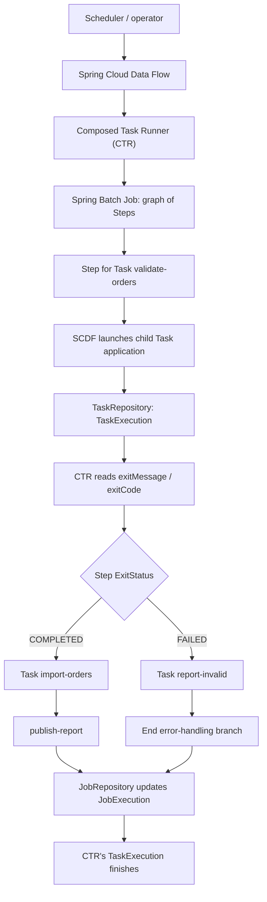
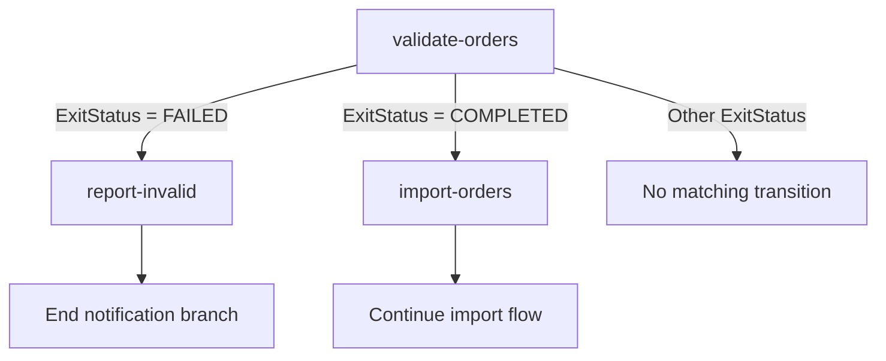
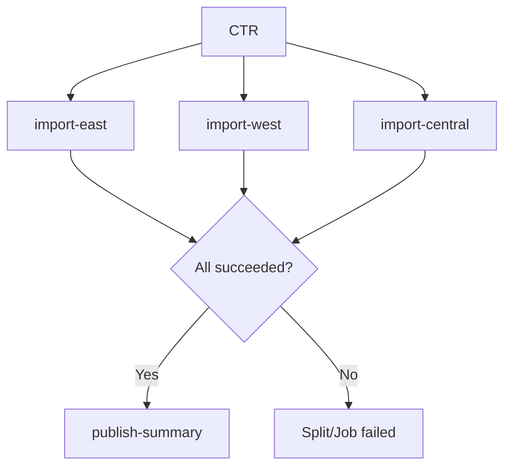

# Conditional Transitions, Component Failures, and Restarts in Spring Cloud Data Flow

## 1. Problem: Orchestrating Multiple Spring Cloud Tasks by Outcome

A **Spring Cloud Task** is a Spring Boot application with a finite runtime: start up, execute business logic, record the outcome, and exit. **`TaskRepository`** stores `TaskExecution` records so you can query task names, timestamps, `exitCode`, and exit messages. When a system has multiple interdependent jobs, scheduling each Task individually makes it hard to express conditions such as "only publish the report if the data import succeeded" or "re-check the data if validation failed."

**Spring Cloud Data Flow (SCDF)** provides **composed tasks**: a graph of Tasks orchestrated by **Composed Task Runner (CTR)**. CTR uses **Spring Batch** to track the nodes in the graph as Steps. Each Step can launch an independent Spring Cloud Task application; when a child Task finishes, CTR inspects the outcome and decides which edge to follow next.

Example end-of-day workflow:

1. `validate-orders` validates the orders file.
2. If valid, run `import-orders` and then `publish-report`.
3. If invalid, run `report-invalid` to notify that the data was rejected.
4. If a component hits an infrastructure failure, operations needs to know where to **restart** from without importing data twice.

This lesson belongs to the **Data Flow** chapter and focuses on three skills:

- **Conditional transitions:** reading the exact `ExitStatus` CTR uses, writing DSL for sequences, conditional branches, wildcards, and splits.
- **Component failures:** distinguishing child Task errors, launch/timeout errors, Batch Job failures, and CTR outcomes.
- **Reruns and restarts:** distinguishing **restarting a composed task job** from **launching a new run**, coordinating `JobRepository`/`TaskRepository`, and ensuring idempotency.

> Scope: "Data Flow" here refers to **Spring Cloud Data Flow orchestrating composed tasks**, not `if/else` statements inside an `ApplicationRunner` or programmatic branching inside a plain-Java Batch Job. Verify DSL syntax and CTR properties against the **SCDF version you are deploying**.

## 2. Architecture: Who Decides the Next Branch?



There are **two metadata layers** that are very easy to confuse:

| Layer | Data Store / Object | What Is It Used For? |
| --- | --- | --- |
| **Child Task** | `TaskRepository` / `TaskExecution` | Records each actual run of `validate-orders`, `import-orders`, etc. |
| **CTR as a Batch Job** | `JobRepository` / `JobExecution` and `StepExecution` | Records node ordering, succeeded/failed/stopped Steps, and restart state |
| **CTR as a Task** | `TaskRepository` / a separate `TaskExecution` | Tracks the orchestrator process itself |
| **SCDF / deployment platform** | Task definitions, launch records, container/Job logs | Launching, stopping, monitoring, and tracing executions |

When you declare a composed task, SCDF can generate **child Task Definitions** named after the composed task and the application name. Each run also gets its own **execution ID**; the IDs of CTR, child Tasks, and Batch Jobs are **not a single shared ID**. When tracing, follow the stored relationships and the IDs provided by the orchestrator.

### CTR Does Not Guess "Success"

CTR launches a child Task via SCDF and then inspects its corresponding `TaskExecution`. When the Task completes, CTR sets the **`ExitStatus` on the Batch Step** representing that Task. Next, the Batch flow evaluates the conditions in the DSL.

Therefore, before writing branches, you must understand **how CTR converts Task data into an ExitStatus**, rather than relying solely on a log message.

## 3. The Most Important Rule: `exitMessage` Takes Precedence over `exitCode`

According to the Composed Task Runner guide and SCDF reference documentation, when determining the `ExitStatus` for the Step representing a child Task, CTR applies these rules:

1. If `TaskExecution.exitMessage` **has a value**, CTR uses that value as the **Step's `ExitStatus` code**.
2. If there is no `exitMessage` and `TaskExecution.exitCode = 0`, the Step receives `ExitStatus` **`COMPLETED`**.
3. If there is no `exitMessage` and `exitCode` is **any non-zero number**, the Step receives `ExitStatus` **`FAILED`**.

| `TaskExecution.exitCode` | `TaskExecution.exitMessage` | `ExitStatus` Code Used by CTR for Transitions | Meaning |
| ---: | --- | --- | --- |
| `0` | `null` | `COMPLETED` | Default success |
| `1` | `null` | `FAILED` | Default failure |
| `2` | `null` | `FAILED` | Custom error code with no branch label |
| `0` | `NO_DATA` | `NO_DATA` | Completed along an alternate business branch |
| `1` | `RETRYABLE_ERROR` | `RETRYABLE_ERROR` | Technical failure with an explicit transition code |
| `1` | `COMPLETED` | `COMPLETED` | **Dangerous:** the message can cause the graph to take the success branch despite a non-zero exit code |

Values like `NO_DATA` and `RETRYABLE_ERROR` are **application example conventions**. CTR does not generate those labels on its own.

**Design warning:** in a standalone Spring Cloud Task, `exitMessage` is just a short descriptive string. But when using **composed tasks**, that same value can also become a **branching condition**. If a listener accidentally sets `exitMessage="IMPORT_FINISHED; rows=100"`, DSL expecting `'COMPLETED'` will not match as you intended. If a listener sets `"COMPLETED"` even when `exitCode=1`, it can **mask errors at the graph level**.

To stay safe, enforce clear conventions:

- Standardize **branching status codes**, such as `COMPLETED`, `FAILED`, `NO_DATA`, or `RETRYABLE_ERROR`.
- **Detailed telemetry** such as row counts, report filenames, or trace IDs must live in logs, metrics, business metadata, or separate observability channels—**never cram them into `exitMessage`** when it is used as a transition code.
- **`exitCode` remains the technical signal** for the child Task and scheduler; setting `exitMessage` alone does not automatically change the process exit code.
- Test both the child's `TaskExecution` **and** CTR's `StepExecution` before promoting to production.

### CTR's ExitStatus Is Not the Child Task's BatchStatus

`BatchStatus` is an enum describing the lifecycle state of a `JobExecution` or `StepExecution`: `STARTED`, `COMPLETED`, `FAILED`, `STOPPED`, etc. By contrast, `ExitStatus` holds a customizable **string** code. A DSL condition like `'FAILED' ->` evaluates **the Step's ExitStatus inside CTR**, rather than directly comparing `TaskExecution.exitCode` or the `BatchStatus` of a Batch Job inside the child Task.

## 4. Writing DSL: Sequential, Conditional Branching, and Parallel

Composed task DSL expresses a **directed graph**, unlike a shell script. Names such as `validate-orders` and `import-orders` in the examples are **Task Definitions that must be registered in SCDF before creating the composed task**.

### 4.1. Sequential Execution with `&&`

```text
validate-orders && import-orders && publish-report
```

The graph runs `validate-orders` first. If its Step completes successfully per the flow, CTR launches `import-orders`; only after import succeeds does it run `publish-report`. If `import-orders` returns an unhandled `FAILED`, `publish-report` **does not run**.

SCDF Shell example (assuming artifacts are already registered):

```text
dataflow:> task create nightly-orders --definition "validate-orders && import-orders && publish-report"
dataflow:> task launch nightly-orders
```

These are **Spring Cloud Data Flow Shell** commands, not terminal commands to run a Spring Boot JAR directly.

**Do not mistake** `&&` here for a shell operator. SCDF parses the entire quoted string as composed task DSL.

### 4.2. Branching by ExitStatus

```text
validate-orders 'FAILED' -> report-invalid 'COMPLETED' -> import-orders
```

Meaning of this transition syntax:

- If **`validate-orders`** returns `ExitStatus = FAILED`, CTR transitions to `report-invalid`.
- If **`validate-orders`** returns `ExitStatus = COMPLETED`, CTR transitions to `import-orders`.
- Both `'FAILED'` and `'COMPLETED'` labels **attach to `validate-orders`'s outcome**, not as a condition on `report-invalid`.



This is an **orchestration branch**, not "if it fails, automatically retry validate." If `report-invalid` succeeds, the flow handled the error branch per the DSL, but that **does not mean the input data was valid**. To prevent business dashboards from misleadingly turning green, define overall business outcomes and alerts separately.

### 4.3. Wildcard for Other Outcomes

```text
validate-orders 'FAILED' -> report-invalid 'COMPLETED' -> import-orders '*' -> investigate-status
```

`'*'` acts as a fallback branch for any `ExitStatus` from **the same source node** that does not match explicit conditions. For instance, `NO_DATA`, `RETRYABLE_ERROR`, or a newly introduced undeclared code can route to `investigate-status` instead of silently halting the graph.

Once a wildcard is declared, **verify the syntax with your SCDF version's parser/designer**, especially if you want to chain `&&` after a transition. SCDF documentation notes structural constraints when mixing wildcards and sequences; do not arbitrarily concatenate long expressions and assume the parser accepts everything.

**A wildcard must not swallow all errors and report success.** The `investigate-status` branch should record the unclassified status and alert operations if the outcome is an error.

### 4.4. Parallel Splitting with `<... || ...>`

```text
<import-east || import-west || import-central> && publish-summary
```

Three Tasks are launched in parallel. In a sequence following a split, `publish-summary` launches **only after all required branches in the split complete successfully**. If `import-west` fails and is not handled by design, the downstream aggregation step **does not run**; that alone does not mean `import-east` and `import-central` did not write data.



`<`, `>`, and `||` are **composed task DSL syntax**. To run splits, prepare CTR's thread pool, concurrent child task limits, and infrastructure resources. CTR properties like `split-thread-core-pool-size` govern parallel orchestration capacity; increasing the thread pool does not automatically allow the database to handle more connections or prevent overlapping writes.

### 4.5. Combining Conditions: Avoid Graphs That Are Too Hard to Verify

SCDF documentation supports transitions combined with sequences, for example:

```text
validate-orders 'FAILED' -> report-invalid 'UNKNOWN' -> investigate-status && import-orders
```

Such combinations carry specific graph semantics defined by CTR's parser. In training and production systems, once conditions become complex, **sketch the flow**, test with each `ExitStatus`, and inspect exactly which applications are invoked rather than reading the expression like Java code.

For flows with more than a few branches or requiring loops/complex compensation, consider breaking them into smaller composed tasks or using a dedicated workflow orchestrator. Basic composed task DSL is not a general-purpose workflow language with distributed transactions.

## 5. Example: Registering, Creating, and Launching a Composed Task

Assume three JARs have been built/published to an internal artifact registry and are compatible with your Spring Boot/Spring Cloud Task BOM:

```text
dataflow:> app register --name validate-orders --type task --uri maven://com.example.tasks:validate-orders:1.0.0
dataflow:> app register --name import-orders --type task --uri maven://com.example.tasks:import-orders:1.0.0
dataflow:> app register --name publish-report --type task --uri maven://com.example.tasks:publish-report:1.0.0

dataflow:> task create nightly-orders --definition "validate-orders && import-orders && publish-report"
dataflow:> task list
dataflow:> task launch nightly-orders
dataflow:> task execution list
```

The `maven://com.example.tasks:...` URIs are **illustrative placeholders only**, not real packages. Replace them with your project's artifacts; prerequisites include an SCDF-accessible registry, metadata datasource configuration, a platform deployer, and application permissions.

### Arguments to Child Tasks vs. CTR Are Two Separate Channels

In a composed task, you can attach parameters directly inside the DSL:

```text
dataflow:> task create nightly-orders \
  --definition "validate-orders --business-date=2026-11-24 && import-orders --business-date=2026-11-24"
```

Or at launch time, use properties routed to child applications by name, for example:

```text
dataflow:> task launch nightly-orders \
  --properties "app.validate-orders.task.business-date=2026-11-24,app.import-orders.task.business-date=2026-11-24"
```

The example uses `\` for line wrapping; join into a single line in SCDF Shell if your environment does not support line continuation. `app.<child-name>.<property>` applies to the **child task app**; **Composed Task Runner** properties use their own prefix or are passed via `--arguments`, depending on SCDF syntax/version. Never put credentials in DSL, CLI commands, or `TaskExecution` arguments.

**Important note:** CTR parameters that act as **JobInstance identifiers** must be kept consistent when **restarting**. If an operator edits the business date or enables an auto-incrementing ID parameter during a restart, it can create a **new run** instead of resuming the prior Job.

## 6. Producing Outcomes for Branching: Success, Failure, Custom Codes

### 6.1. Default Case: Exit Code Only

The Java 17+ application below illustrates a file-validation Task. You can pair it with the appropriate Spring Cloud Task starter, DataSource/TaskRepository, and Spring Boot version:

```java
package com.example.tasks;

import java.util.List;

import org.springframework.boot.ApplicationArguments;
import org.springframework.boot.ApplicationRunner;
import org.springframework.boot.SpringApplication;
import org.springframework.boot.autoconfigure.SpringBootApplication;
import org.springframework.cloud.task.configuration.EnableTask;
import org.springframework.context.annotation.Bean;

@SpringBootApplication
@EnableTask
public class ValidateOrdersApplication {

    public static void main(String[] args) {
        SpringApplication.run(ValidateOrdersApplication.class, args);
    }

    @Bean
    ApplicationRunner validateOrders() {
        return args -> {
            List<String> flags = List.of(args.getSourceArgs());

            if (flags.contains("--demo.invalid=true")) {
                throw new IllegalArgumentException(
                    "Invalid orders file"
                );
            }

            System.out.println("Orders file passed validation");
        };
    }
}
```

When the runner finishes normally, `TaskExecution.exitCode` is typically `0`; on an unhandled exception, it typically receives a non-zero code (default `1`). If `exitMessage` **is not set**, CTR sees the Step as `COMPLETED` or `FAILED` per the rules in Section 3. This suffices when DSL only has two primary outcomes.

This example uses the `--demo.invalid=true` flag for simulation, not as a complete file validator. In production code, parse and validate arguments properly rather than checking for arbitrary string presence, and ensure proper transactions and rollbacks.

### 6.2. When You Need a Business Branch Other Than COMPLETED/FAILED

Suppose a validation Task finds no new records to import. We can set `exitMessage` to a **branch code** such as `NO_DATA`:

```java
import org.springframework.cloud.task.listener.TaskExecutionListener;
import org.springframework.cloud.task.repository.TaskExecution;
import org.springframework.stereotype.Component;

@Component
public class NoDataResultListener implements TaskExecutionListener {
    private final ImportResult result;

    public NoDataResultListener(ImportResult result) {
        this.result = result;
    }

    @Override
    public void onTaskStartup(TaskExecution task) {
    }

    @Override
    public void onTaskFailed(TaskExecution task, Throwable error) {
        // Do not set NO_DATA if the Task is actually failing.
    }

    @Override
    public void onTaskEnd(TaskExecution task) {
        if (Integer.valueOf(0).equals(task.getExitCode())
                && task.getErrorMessage() == null
                && result.hasNoData()) {
            task.setExitMessage("NO_DATA");
        }
    }
}
```

`ImportResult` and `hasNoData()` in the example are **project-implemented business services**. Avoid a shared mutable singleton holding results if one JVM can run multiple tasks concurrently; scope state cleanly to the single execution. When there is no data, the listener sets `NO_DATA`; on other successful runs, it **leaves `exitMessage` unset** so CTR infers `COMPLETED`.

With that state, illustrative DSL:

```text
check-input 'NO_DATA' -> skip-import 'COMPLETED' -> import-orders
```

If a listener instead sets `"IMPORT_SUCCESS; rows=1200"`, an expression expecting `'COMPLETED'` will not match automatically. Keep record counts in metrics/business tables and maintain a stable **branch-code vocabulary** for `exitMessage`.

### 6.3. Custom Error Codes Must Be Handled Intentionally

Suppose an upstream API times out and the child Task finishes with `exitCode=3` and `exitMessage=RETRYABLE_ERROR`. CTR can route:

```text
fetch-orders 'RETRYABLE_ERROR' -> alert-retry 'FAILED' -> report-failure 'COMPLETED' -> transform-orders
```

**This expression illustrates branching; it does not automatically retry `fetch-orders`.** A basic composed task is a directed graph, not an unbounded loop over the same node. Retries must be designed via a scheduler mechanism, application-level retry policy, or bounded idempotent recovery stage. The alert branch must also clearly reflect whether the issue was resolved or merely logged.

## 7. Component Failures: Not Every Error Is the Same

A composed task can fail at multiple layers. Before deciding to rerun, classify the error source accurately:

| Error | Symptom | Verification Step | Remediation |
| --- | --- | --- | --- |
| **Child Task business error** | Non-zero `exitCode`; CTR Step usually `FAILED` unless custom branch code | Child Task logs, `TASK_EXECUTION`, input data | Fix input/code, controlled restart |
| **Child Task completed but exitMessage mismatched** | Did not take expected branch | Inspect `exitMessage` and CTR Step `ExitStatus` | Standardize branch codes, add fallback |
| **Child Task's Batch Job failed** | Batch `FAILED` while Task `exitCode=0` | `BATCH_JOB_EXECUTION` and Task configuration | Enable Batch failure bridge or propagate failure signal |
| **Failed to launch child Task** | CTR sees no TaskExecution start or platform returns error | SCDF server, deployer, registry, image/JAR, RBAC | Fix infrastructure first; do not rush to edit business data |
| **Child Task killed / lost connection** | `endTime` may be null; CTR waits too long | Scheduler, pod/process, TaskRepository | Timeout, reconcile, check partial writes |
| **CTR stopped or crashed** | JobExecution `STOPPED`/`FAILED`/incomplete | JobRepository, CTR logs | Restart Job with matching metadata |
| **Failure inside a split** | One branch `FAILED`, another may have succeeded | Inspect every TaskExecution/StepExecution | Do not assume committed sibling branches rolled back |
| **Wrong error message / exit code** | Dashboard looks wrong despite business failure | Listener, exit-code mapping, Batch bridge | Fix signal propagation and test failure path |

### 7.1. Unhandled Child Task Error

In the chain:

```text
validate-orders && import-orders && publish-report
```

if `import-orders` throws an exception and `TaskExecution.exitMessage` is empty, CTR sees `FAILED`. `publish-report` does not run. Without a transition handling this failure, the **composed Batch Job** transitions to `FAILED` and becomes a candidate for restart.

There is no guarantee that side effects committed before the exception were rolled back. For example, `import-orders` may have committed 400 of 1,000 records before failing; a non-idempotent retry can duplicate those 400 records.

### 7.2. Child Has a `FAILED` Spring Batch Job While Process Reports Success

A Batch Job with `BatchStatus.FAILED` does not mean `TaskExecution.exitCode` automatically becomes non-zero. If the application or Batch auto-runner does not surface the failure to the Task layer, CTR may infer `COMPLETED` and continue.

Depending on your version combination, Spring Cloud Task provides:

```yaml
spring:
  cloud:
    task:
      batch:
        fail-on-job-failure: true
```

The `spring.cloud.task.batch.fail-on-job-failure` property marks the Task failed when a monitored Batch Job has `BatchStatus.FAILED`. Proper Batch/Task integration must be active and **verified on the child Task**, not just set on CTR.

At the same time, **CTR itself is a Batch Job**, so the **CTR process exit code** can also differ from its Job status. If an orchestrator outside SCDF needs a non-zero code when the composed Job fails, configure fail-on-job-failure on **CTR** as well and verify the `process exit code` separately. Never conflate "child's Batch Job" and "CTR's Batch Job" into one setting.

### 7.3. Never Rely on a Single Status Table as the Sole Source of Truth

A killed Task may fail to write `END_TIME`. Conversely, a child's `TaskExecution` can report `0` when a Batch Job failed and the application swallowed the signal. When investigating, cross-check:

- `TaskExecution` of CTR and each child: `taskName`, timestamps, `exitCode`, `exitMessage`.
- `JobExecution` and `StepExecution` of the **composed Batch Job**: status and ExitStatus to see which Step is running/ran.
- `JobExecution` of any **Batch Job inside a child** if the child uses Spring Batch.
- CTR logs, platform deployer logs, broker/scheduler logs, and final business data.

## 8. Timeouts, Polling Intervals, and Stop States

CTR exposes important settings for when a component fails to start or finish:

| CTR Property | Meaning | Default in Referenced SCDF Docs |
| --- | --- | --- |
| `interval-time-between-checks` | Interval between CTR database polls for child Task status | `10000` ms |
| `max-start-wait-time` | Max time to wait for a child Task to record `startTime` | `0` = no timeout |
| `max-wait-time` | Max runtime CTR waits for a child Step | `0` = no timeout |
| `split-thread-core-pool-size` | Core threads for CTR split branches | `1` |
| `increment-instance-enabled` | Enables creating a new JobInstance on definition relaunch (via `run.id`) | `true` in referenced SCDF docs |
| `uuid-instance-enabled` | Uses a UUID parameter to identify each CTR run | `false` |

**Defaults can differ across standalone CTR versions, SCDF generations, and deployment setups.** Use the table for orientation rather than copying defaults blindly; verify against your actual release.

To configure CTR via SCDF Shell, guides show passing `--arguments`:

```text
dataflow:> task launch nightly-orders \
  --arguments "--interval-time-between-checks=1000 --max-start-wait-time=120000 --max-wait-time=900000"
```

These are **CTR arguments**, not per-child arguments. `max-wait-time=900000` is 15 minutes for monitoring the child; it is not a guarantee that the JVM/container is cleanly killed right at the deadline. On timeout, verify **whether the child is still running** before rerunning, to prevent two instances from overwriting data.

### Stop Differs from Failed

Per SCDF documentation, when an operator **Stops** a composed task via Dashboard/REST, the stop may take effect after the **currently running child finishes**; the corresponding Step and composed task JobExecution are recorded as `STOPPED`. This differs from a child throwing an exception and ending with `FAILED` JobExecution.

When restarting a `STOPPED` composed job, documentation notes the child at the stopped point may be launched again, after which remaining unexecuted children continue per the DSL. Never treat the Stop button as an immediate kill of all child processes or a rollback of committed transactions.

## 9. Rerunning: Restarting a Job vs. Launching a New Run

### 9.1. Restarting When a Composed Task Is `FAILED`

CTR executes the graph as a **Spring Batch Job**. When a child fails and the composed Job is marked `FAILED`, SCDF can **restart** the Job from the failed point using Batch metadata:

```text
Graph: task-a && task-b && task-c

First run:
task-a -> COMPLETED
task-b -> FAILED
task-c -> not yet launched

After fixing root cause and restarting the Job:
task-a -> reuses completed status
task-b -> reruns
task-c -> runs if task-b succeeds
```

SCDF documentation describes doing this from the Dashboard: go to **Jobs**, find the `FAILED` composed task JobExecution, and click **Restart**. The corresponding REST API can also be used. Some documentation also describes shell commands to rerun with the same parameters, though **you must distinguish that from a fresh launch** when ID/UUID incrementing properties are enabled.

**Never assume `task launch nightly-orders` always "resumes" the prior failure**: if CTR creates a new JobInstance, earlier steps can run again from the start. To resume the exact JobInstance, prefer **restarting the specific JobExecution** and verify results in Jobs/Executions.

### 9.2. Fresh Launch

Launching a new composed task run is meant for **a different business cycle**, such as a new reporting date. When `increment-instance-enabled`/`uuid-instance-enabled` creates a new Batch JobInstance identifier, Steps execute from the beginning even if a prior run succeeded.

In some cases, restarting the exact JobInstance requires keeping **identifying JobParameters** unchanged, whereas a fresh launch intentionally supplies new identifying parameters. Do not inject random UUIDs merely to bypass `JobInstanceAlreadyCompleteException` when your goal is to resume prior work.

| Scenario | Appropriate Action | What to Avoid |
| --- | --- | --- |
| `task-b` failed, `task-a` already succeeded | Restart the **`FAILED` composed JobExecution** after fixing the error | Fresh launch causing `task-a` to re-import data |
| Flow was cleanly Stopped | Restart from stopped state per version docs | Assuming the running child was killed instantaneously |
| Running report for a new day | Launch a new composed task with a new business key | Reusing JobParameters of an already-completed day |
| DSL structure was wrong in prior run | Fix definition and start a **new controlled run**, auditing old data | Expecting restart to migrate old metadata onto a new graph |
| Child died while possibly still writing | Verify owner/scheduler, transactions, and business side effects | Retrying concurrently with an unstopped process |

### 9.3. Why Idempotency Matters More Than "Retry"

Suppose `import-orders` writes 400 records and hits a network failure. A restart may re-execute this step with the same input. Safe design requires:

- Using a stable **business key** (e.g., `(tenant_id, order_id, business_date)`) and matching unique constraints/upserts.
- Splitting commits into restartable transactions/chunks when using Spring Batch.
- Recording `jobExecutionId`, `taskExecutionId`, run IDs, and watermarks within scope; never merging two runs into one.
- For notifications or external calls, using an outbox/idempotency key to prevent duplicate sends.
- If a child produces output files, writing to a temporary file and finalizing via an atomic rename/manifest step instead of publishing partial files.

**A Batch Job restart does not magically make non-transactional side effects exactly-once.** CTR knows which Steps completed, but it cannot undo changes a child already wrote to external systems.

## 10. Observing and Tracing Failures in the Database

With standard JDBC configuration and schema, start at `TaskRepository`:

```sql
SELECT
    TASK_EXECUTION_ID,
    TASK_NAME,
    PARENT_TASK_EXECUTION_ID,
    START_TIME,
    END_TIME,
    EXIT_CODE,
    EXIT_MESSAGE
FROM TASK_EXECUTION
WHERE TASK_NAME LIKE :taskNamePrefix
ORDER BY TASK_EXECUTION_ID DESC;
```

For example, `:taskNamePrefix` might be `nightly-orders%`, bound safely via JDBC/ORM rather than concatenating raw input strings. Not every child name is guaranteed to follow the same prefix if naming was customized.

If CTR writes Batch Job metadata into the same repository:

```sql
SELECT
    j.JOB_EXECUTION_ID,
    j.STATUS AS CTR_JOB_STATUS,
    j.EXIT_CODE AS CTR_JOB_EXIT_STATUS,
    s.STEP_EXECUTION_ID,
    s.STEP_NAME,
    s.STATUS AS CTR_STEP_STATUS,
    s.EXIT_CODE AS CTR_STEP_EXIT_STATUS
FROM BATCH_JOB_EXECUTION j
JOIN BATCH_STEP_EXECUTION s
  ON s.JOB_EXECUTION_ID = j.JOB_EXECUTION_ID
WHERE j.JOB_EXECUTION_ID = :ctrJobExecutionId
ORDER BY s.STEP_EXECUTION_ID;
```

**`BATCH_*.EXIT_CODE` is an `ExitStatus` string; `TASK_EXECUTION.EXIT_CODE` is an integer.** Do not label both as "0/1 exit codes." A child's own Batch Job records may require separate queries; `TASK_TASK_BATCH` links may exist if Spring Cloud Task Batch integration is enabled.

To reconcile Task/Batch metadata with SCDF, record:

| Information | Why Needed |
| --- | --- |
| Composed task name and CTR's TaskExecutionId | Locate the exact orchestration run |
| CTR's JobExecutionId | Identify which Job to restart |
| Failed Step name and StepExecutionId | Pinpoint which DSL node failed |
| Child's TaskExecutionId | Read exit code, exit message, and detailed logs |
| Business date, tenant, run/correlation ID | Control data scope and prevent duplicate retries |
| Pod/container/deployer ID | Distinguish application bugs from kills/OOM/network issues |

`END_TIME IS NULL` does not prove a process is still running. A child may have been killed before updating `TaskRepository`; verify against the platform and timeouts. Conversely, `EXIT_CODE=0` does not prove every Batch Job inside a child succeeded.

## 11. Operational Error-Handling Policies

Define explicit actions by **error category**, rather than treating every `FAILED` status identically:

| Error Type | Auto-Retry? | Conditions |
| --- | --- | --- |
| Invalid input schema/arguments | Usually **no** | Fix data or request |
| Transient DB/broker connection error | Possible | Backoff, retry cap, and side-effect check |
| CTR cannot launch child due to artifact/RBAC | Do not retry indefinitely | Fix artifact, credentials, quota, or deployer |
| Child timed out but not confirmed stopped | **Not yet** | Verify/force-stop prior owner first |
| Batch Step FAILED after partial commits | Restartable | JobRepository/transactions/uniqueness protect data |
| One split branch failed after another succeeded | Controlled | Preserve completed results, rerun only needed parts |
| Unmapped new ExitMessage | Never assume success | Wildcard to investigation branch or alert |
| Unrecoverable data corruption | No | Log, halt, and require manual intervention |

### CTR Metrics to Monitor

- Child start and completion wait times relative to `max-start-wait-time` and `max-wait-time`.
- `TaskRepository` polling load from `interval-time-between-checks`.
- Number of concurrently running children in splits vs. thread/connection pool limits.
- Job restart counts, newly spawned child TaskExecutions, and re-executed Steps.
- `TaskExecution`s missing `endTime`, and child `JobExecution`s stuck in `STARTED` too long.
- Rates of `FAILED`, `RETRYABLE_ERROR`, `NO_DATA`, and unclassified wildcard branches.

**Keep branch codes stable across releases.** If a producer changes `exitMessage` from `NO_DATA` to `EMPTY_INPUT` while DSL still checks `NO_DATA`, the flow will stop routing as before. Treat the list of `ExitStatus` values used in composed tasks as a **compatibility contract** between child apps and CTR, tested on every upgrade.

## 12. Graph and Restart Test Matrix

Before going to production, test with synthetic data covering at least these cases:

| Case | Simulation | Expected Result to Verify |
| --- | --- | --- |
| A — success | All children `exitCode=0` with no custom `exitMessage` | `&&` sequence executes all nodes |
| B — child error | `import-orders` throws an exception | `publish-report` does not run; CTR Job records `FAILED` |
| C — failure branch | `validate-orders` returns `FAILED` | Only `report-invalid` runs; `import-orders` does not run |
| D — custom branch | `validate-orders` returns `NO_DATA` | Takes custom or fallback branch; not treated as default success |
| E — masking exitMessage | `exitCode=1` with `exitMessage=COMPLETED` | Detect risk of graph taking wrong branch; fix listener |
| F — split failure | One of three split Tasks errors | Step after split is blocked; other two Tasks may have written data |
| G — child killed | Kill a child process | CTR times out/detects incident per config; no overlapping owner retry |
| H — restart | `task-a` COMPLETED, `task-b` FAILED | Restarts from `task-b` per Job metadata; `task-a` does not rerun needlessly |
| I — fresh launch | Intentionally change business date or JobInstance | Creates a new run; does not assume resume |
| J — child Batch failure | Batch Job `FAILED` while runner exits normally | Enable/configure failure bridge so CTR doesn't falsely see `COMPLETED` |
| K — STOPPED | Operator Stops composed task | Distinguish controlled stop from failure and verify restart |

### Practice Exercises

**Exercise 1 — Sketching branches:** Given DSL `validate-orders 'FAILED' -> report-invalid 'COMPLETED' -> import-orders`, draw the outgoing edges from `validate-orders` and state which Step runs for `FAILED`, `COMPLETED`, and `NO_DATA`.

**Exercise 2 — Custom ExitMessage:** Write a listener that sets `exitMessage="NO_DATA"` only when the Task succeeds with no new records. Use DSL with `NO_DATA` and `COMPLETED` branches. Explain why record counts must not be embedded in `exitMessage` when it drives branching.

**Exercise 3 — Mid-chain failure:** Fail `task-b` in `task-a && task-b && task-c`. After fixing the bug, restart the failed JobExecution and compare TaskExecutions before and after. If you ran a fresh launch instead, which Task risks rerunning?

**Exercise 4 — Split and writes:** Let two of three split branches succeed and one fail. Propose an idempotency design protecting results on restart, covering both business keys and unique constraints.

**Exercise 5 — Timeout:** A child has a 15-minute timeout, yet the container is still running after 20 minutes. Write a runbook to verify the process, transactions, committed data, and when retrying is permitted.

**Exercise 6 — Tracing:** Starting from a CTR Batch JobExecutionId, locate the failed StepExecution, corresponding TaskExecution, and container logs, then explain why this ID differs from the Batch Job ID inside the child Task.

### Self-Assessment Questions

1. Why is `&&` in a composed task not a Java or shell operator?
2. When `exitCode=2` and `exitMessage=null`, which `ExitStatus` does CTR choose?
3. Why is `exitCode=1` with `exitMessage=COMPLETED` especially dangerous?
4. Does `'FAILED' ->` check `BatchStatus` or the CTR Step's `ExitStatus`?
5. If a child Task uses Batch and gets `BatchStatus.FAILED` while its Task exit code is `0`, which branch can CTR take?
6. Why does stopping a composed task not prove child containers stopped immediately?
7. What is the difference between **Restarting an existing JobExecution** and **Launching a new run**?
8. When one split branch has already committed data, what prevents duplicate writes on rerun?

**Completion criteria:** you can read a composed task graph, predict branches from `ExitStatus`, spot the risk of `exitMessage` masking errors, classify application vs. infrastructure errors, use CTR metadata to restart at the right step, and protect data across every retry or relaunch.

## Official References

- [Spring Cloud Data Flow — Composed Tasks and DSL](https://docs.spring.io/spring-cloud-dataflow/docs/current/reference/htmlsingle/#composed-tasks): composed task lifecycle, `&&` conditions, transitions, wildcards, splits, stopping, and restarting.
- [Spring Cloud Data Flow — Feature Guide: Composed Task](https://dataflow.spring.io/docs/feature-guides/batch/composed-task/): branching examples, child failures, and restarting from the failed step.
- [Composed Task Runner — Reference](https://docs.spring.io/spring-cloud-task-app-starters/docs/current/reference/html/_composed_task_runner.html): rules converting `exitMessage`/`exitCode` into `ExitStatus`, options, and timeouts.
- [Spring Cloud Task — TaskExecution and Lifecycle](https://docs.spring.io/spring-cloud-task/reference/features.html): exit codes, messages, and repository.
- [Spring Cloud Task — Batch Integration](https://docs.spring.io/spring-cloud-task/reference/batch.html): `fail-on-job-failure` and Batch integration.
- [Spring Batch — Controlling Step Flow](https://docs.spring.io/spring-batch/reference/step/controlling-flow.html): `BatchStatus`, `ExitStatus`, conditional flow, and restarts.
