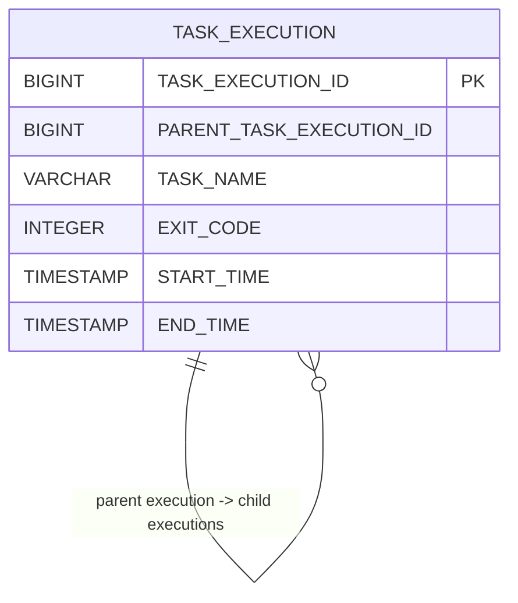
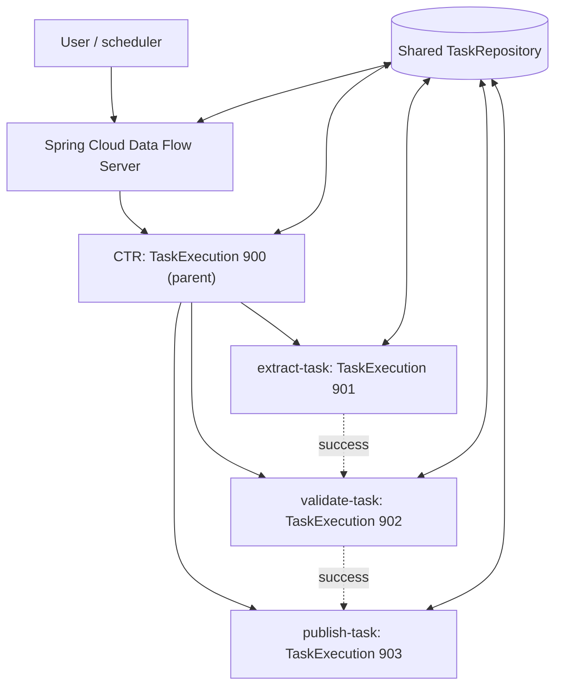
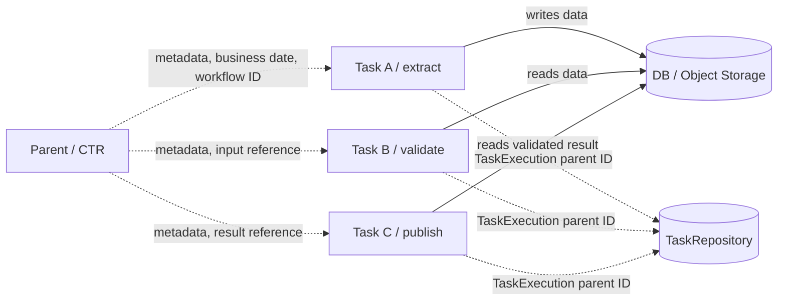
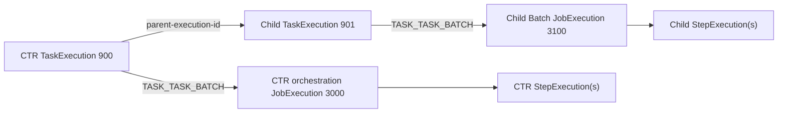

# Parent–Child Execution Relationships in Task Workflows

## Objectives and Real-World Context

A **Spring Cloud Task** application runs for a finite duration, recording start time, end time, and exit code into `TaskRepository`. When a larger problem spans multiple sub-applications—for example, **extract → validate → aggregate → publish report**—an overall run must link to **the exact child executions** started within that flow.

In the **Data Flow** chapter, "parent–child task execution" answers: **which Task execution launched or orchestrated which other Task execution?** This is lineage metadata for runs, not a business domain object relationship.

After this lesson, you will be able to:

- Distinguish **Task definition**, **TaskExecution**, **parent execution ID**, **external execution ID**, and Spring Batch **`JobExecution`**.
- Configure `spring.cloud.task.parent-execution-id` **on a child task** and understand how metadata is persisted into `TASK_EXECUTION`.
- Understand how **Spring Cloud Data Flow (SCDF)** with **Composed Task Runner (CTR)** orchestrates a task graph.
- Query parent–child trees via SQL and `TaskExplorer`, including cases where a child fails, a record is missing, or a workflow retries.
- Design data handoff, idempotency, security, and monitoring for multi-process task workflows.

**Version sources:** Schema examples below are based on [Spring Cloud Task 5.1 – Task Repository Schema](https://docs.spring.io/spring-cloud-task/reference/appendix-task-repository-schema.html). Composed Task syntax is illustrated per the [Spring Cloud Data Flow 2.10.x guide](https://dataflow.spring.io/docs/feature-guides/batch/composed-task/). Always verify the exact SCDF, CTR, Spring Boot, and Spring Cloud Task versions you deploy, as these products follow independent release cycles.

## 1. Four Identifiers You Must Not Confuse

| Concept | Identifier / Field | Meaning |
| --- | --- | --- |
| **Task definition** | Definition name such as `settlement-flow`, `extract-task` | *Which job can be launched?* One definition can run many times |
| **Task execution** | `TaskExecution.executionId` / `TASK_EXECUTION_ID` (`long`) | *Which exact physical run?* Each run has its own ID |
| **Parent task execution** | `parentExecutionId` / `PARENT_TASK_EXECUTION_ID` (`Long`, nullable) | *Which Task run is the direct parent of this run?* |
| **External execution ID** | `externalExecutionId` / `EXTERNAL_EXECUTION_ID` (`String`) | Reference code supplied by the external platform/deployer, **not the parent ID** |
| **Spring Batch Job execution** | `JobExecution.id` / `BATCH_JOB_EXECUTION.JOB_EXECUTION_ID` | A single execution of a Batch Job, linkable to TaskExecution via `TASK_TASK_BATCH` |

Example closing-book graph:

```text
Task definition:  settlement-flow
Run #1:           TaskExecution 900
                  ├─ TaskExecution 901: extract-task
                  ├─ TaskExecution 902: validate-task
                  └─ TaskExecution 903: report-task

Run #2:           TaskExecution 950
                  ├─ TaskExecution 951: extract-task
                  ├─ TaskExecution 952: validate-task
                  └─ TaskExecution 953: report-task
```

In this hypothetical metadata table, child task `901` has `parentExecutionId=900`; child task `952` has `parentExecutionId=950`. Two runs can invoke the same **task name**, yet their lineage must be distinguished by **execution ID**, not merely by name or start time.

> **Never use a JobExecution ID as a Task's `parentExecutionId`.** This ID must be the **parent task's `TASK_EXECUTION_ID`**, and it must belong to the same TaskRepository metadata space used by the child task.

## 2. Parent–Child Relationship Metadata in Spring Cloud Task

Spring Cloud Task lets you attach the parent execution's ID to each child execution using the property:

```properties
spring.cloud.task.parent-execution-id=<parentTaskExecutionId>
```

In practice, when the parent has `executionId=900`, the **child task** is started with:

```bash
java -jar target/validate-task.jar \
  --spring.cloud.task.parent-execution-id=900 \
  --business-date=2026-11-23
```

Per [Spring Cloud Task – Parent Task Id](https://docs.spring.io/spring-cloud-task/reference/features.html#parent-task-id), the framework uses this property value to persist the parent link on the child's `TaskExecution`. This is a **metadata mechanism**: adding this property **does not run the parent task**, **does not wait for the parent task to finish**, and **does not pass business payloads from parent to child**.

### 2.1. Relevant Columns in `TASK_EXECUTION`

The **Spring Cloud Task 5.1** schema defines:

| Column | Type / Nullable | Purpose |
| --- | --- | --- |
| `TASK_EXECUTION_ID` | `BIGINT`, required | Identifies this run |
| `TASK_NAME` | `VARCHAR` | Task application name |
| `PARENT_TASK_EXECUTION_ID` | `BIGINT`, **nullable** | Parent execution ID |
| `EXTERNAL_EXECUTION_ID` | `VARCHAR`, nullable | External platform reference ID |
| `START_TIME`, `END_TIME` | Timestamp, `END_TIME` nullable | Execution lifecycle timestamps |
| `EXIT_CODE` | Integer, **nullable** | Result finalized by framework; NULL before completion |
| `EXIT_MESSAGE`, `ERROR_MESSAGE` | Text, nullable | Exit/error messages |
| `LAST_UPDATED` | Timestamp | Metadata update timestamp |

The name **`PARENT_TASK_EXECUTION_ID`** matches schema 5.1; **some older DDL/docs use `PARENT_EXECUTION_ID`**, so check your actual application version's DDL before writing SQL or migrations. Likewise, if a project changes `spring.cloud.task.tablePrefix`, the table name may no longer be `TASK_EXECUTION`. Do not assume every database enforces a foreign key on the parent column: verify constraints from actual DDL.

The relationship structure can be visualized as a self-reference:



The figure above is a **logical diagram**; the relationship notation does not assert that the default schema creates a foreign key between the two columns. A root TaskExecution typically has `PARENT_TASK_EXECUTION_ID = NULL`; one parent can have **many direct children**. If a child itself launches grandchildren, a multi-level tree is formed by passing the child's `executionId` as `parent-execution-id` to the grandchild.

### 2.2. Who Creates the Records and Links?

Spring Cloud Task creates metadata when each application's `ApplicationContext` initializes far enough to reach the Task lifecycle phase. The parent Task and each child Task are **separate processes/runs**, each writing its own record. `PARENT_TASK_EXECUTION_ID` is stored on the **child** record, not as a list of children inside a column on the parent.

Logical steps:

1. A parent Task starts and obtains a `TaskExecutionId`, e.g., `900`.
2. The orchestrator knows ID `900` and launches the child, supplying `spring.cloud.task.parent-execution-id=900`.
3. The child initializes Spring Cloud Task with a `DataSource` pointing to the matching TaskRepository; the framework inserts/updates the child record, e.g., `901`, with `PARENT_TASK_EXECUTION_ID=900`.
4. The child runs its own `ApplicationRunner` or Batch Job; outcomes and exit codes are written to **the child's record**.
5. The orchestrator monitors children, decides the next step, or marks the overall workflow failed/succeeded according to **orchestration rules**.

**Limitation:** if a child fails so early that its `ApplicationContext` never becomes ready, there may be **no child TaskExecution record**, even though the launcher sees the process failed. If a child is killed mid-run, the row may remain with `EXIT_CODE=NULL`. Never use the presence or absence of a single DB row as your sole monitoring source.

## 3. How Does Data Flow Orchestrate Children?

In [Spring Cloud Data Flow](https://dataflow.spring.io/docs/feature-guides/batch/composed-task/), a **composed task** is a directed graph where each node is a task application. **Composed Task Runner (CTR)** runs as a dedicated Task application to orchestrate the graph, calling SCDF's API for each child and checking outcomes before deciding the next node.



Lines from the **parent CTR** to the children represent **sharing the same `parentExecutionId`**, while dashed lines between children represent **business execution ordering** in the graph. These two relationships are **different**:

- **Parent–child relationship**: `901`, `902`, and `903` all link directly to `900`.
- **Ordering relationship**: `902` runs only after `901` meets the condition, and `903` runs only after `902` per DSL. **`902` is not the parent of `903`** just because it ran earlier.

### 3.1. Creating a Composed Task with DSL

Suppose an administrator has registered three task apps—`extract-task`, `validate-task`, and `publish-task`—in SCDF and the platform has an appropriate Composed Task Runner configured. The commands below are for **SCDF Shell**, not a regular Bash terminal:

```text
dataflow:> task create settlement-flow --definition "extract-task && validate-task && publish-task"
dataflow:> task launch settlement-flow
```

The `&&` operator means **the preceding node must complete successfully** before the next node is launched. That is a composed task rule, not how Spring Cloud Task itself interprets parent IDs. In multi-branch graphs, SCDF also provides syntax for splits, transitions, and restarts per version documentation.

In this example, CTR has the parent TaskExecution and the graph's apps have child TaskExecutions. Per [Spring Cloud Data Flow – Composed Task](https://dataflow.spring.io/docs/feature-guides/batch/composed-task/), CTR uses SCDF APIs to launch the apps and determines the next step from each node's execution status. This is **one orchestration implementation**, not a requirement that you must use SCDF to use `parent-execution-id`; you can also build a custom launcher.

### 3.2. Crucial Requirement: Shared Metadata Store

SCDF, CTR, and children **must share a compatible metadata database** so Data Flow can display complete parent–child history. The [SCDF FAQ](https://dataflow.spring.io/docs/resources/faq/) emphasizes connecting SCDF, CTR, and batch/task apps to a **shared database** for this purpose. The **business** database can be separate from the metadata database, but `TaskRepository` must be configured consistently.

Example of Spring Cloud Task apps pointing to the same pre-created metadata DB schema:

```yaml
spring:
  application:
    name: validate-task
  main:
    web-application-type: none
  datasource:
    url: ${TASK_METADATA_DB_URL}
    username: ${TASK_METADATA_DB_USER}
    password: ${TASK_METADATA_DB_PASSWORD}
  cloud:
    task:
      initialize-enabled: false
      closecontext-enabled: true
```

This snippet assumes a single `DataSource` for the Task and that you supplied a matching JDBC driver. If the application has multiple `DataSource`s (metadata and business), configure `TaskConfigurer` or corresponding infrastructure beans so `TaskRepository` uses the metadata DB. Do not assume `spring.datasource.url` alone always controls the repository if the project customized datasources.

**Never put secrets in CLI arguments** or in Task argument tables. Use a secret manager, mounted volumes, or managed environment variables with least-privilege DB permissions.

### 3.3. CTR Also Uses Spring Batch at the Orchestration Level

CTR can use a **Spring Batch Job** to execute the workflow graph. Consequently, on the dashboard you may see:

- A parent TaskExecution for **CTR**.
- A JobExecution (and StepExecutions) for the **orchestration workflow**.
- Multiple child TaskExecutions for the node applications.
- If a child node runs its own Batch Job, **that node itself** has its own separate JobExecutions.

Do not lump everything into a single JobExecution, and never pass a `JobExecutionId` as the `parent-execution-id` for children. Batch–Task linking details follow in a later section.

## 4. Passing the Parent ID Manually Without CTR

In a system with a custom-written launcher, the core pattern stays the same:

```text
Parent Task:
  parentExecutionId = actual ID allocated by TaskRepository

Launcher:
  launch(childApp, [
      "--spring.cloud.task.parent-execution-id=" + parentExecutionId,
      "--business-date=2026-11-23",
      "--tenant-id=shop-42"
  ])

Child Task:
  reads parent-execution-id from Environment;
  Spring Cloud Task writes parent ID to child TaskExecution.
```

This is **launcher interface pseudocode**, not a built-in Spring Cloud Task Java method named `launch`. Depending on your environment, the launcher could be the SCDF API, a Kubernetes Job, a Cloud Foundry Task, or an application-managed `ProcessBuilder`. Pass an **argument list** rather than concatenating user input into a shell command, to avoid command injection.

Three things must be right:

1. `parentExecutionId` is the ID of the **current parent run**, not a task definition ID, task name, or a previous parent run's ID.
2. The parent ID must be provided in **configuration at child startup**. Setting it after the child has already written metadata will not retroactively fix that record.
3. Parent and child must use **the same TaskExecution store** if you want to read the link via `TaskExplorer`/SQL; if stored separately, `PARENT_TASK_EXECUTION_ID` may point to an ID missing from the queried database.

### 4.1. `parent-execution-id` vs. `executionid` and `external-execution-id`

These are three distinct properties:

| Property | Meaning | Set On |
| --- | --- | --- |
| `spring.cloud.task.parent-execution-id=900` | Links lineage to **parent run 900** | Child |
| `spring.cloud.task.executionid=901` | Uses a **pre-created TaskExecution ID** so the task updates *its own* record; used only when launcher/repository supports pre-creation | The running task itself |
| `spring.cloud.task.external-execution-id=platform-job-xyz` | Stores an external deployment/execution ID for correlation | The running task itself |

Example setting the property directly on a child:

```bash
java -jar target/validate-task.jar \
  --spring.cloud.task.parent-execution-id=900 \
  --business-date=2026-11-23
```

Use that only when parent ID `900` already exists **in the child's TaskRepository** and the child is genuinely authorized as a step of that parent flow. In SCDF, CTR/the deployer normally supplies the needed values; **never allow manual overriding of parent ID** via an unauthenticated public API, as it can forge lineage links.

### 4.2. Reading and Checking the Parent ID Inside the Child Application

`TaskExecution.getParentExecutionId()` returns a nullable `Long`. `TaskExplorer.getTaskExecution(long)` looks up a record by ID and can return `null` if not found. Example helper component reading the property from `Environment` and looking up the parent:

```java
package com.example.task;

import org.springframework.boot.ApplicationArguments;
import org.springframework.boot.ApplicationRunner;
import org.springframework.cloud.task.repository.TaskExecution;
import org.springframework.cloud.task.repository.TaskExplorer;
import org.springframework.core.env.Environment;
import org.springframework.stereotype.Component;

@Component
public class ParentExecutionCheck implements ApplicationRunner {

    private final TaskExplorer taskExplorer;
    private final Environment environment;

    public ParentExecutionCheck(
            TaskExplorer taskExplorer, Environment environment) {
        this.taskExplorer = taskExplorer;
        this.environment = environment;
    }

    @Override
    public void run(ApplicationArguments arguments) {
        String rawId = environment.getProperty(
                "spring.cloud.task.parent-execution-id");

        if (rawId == null || rawId.isBlank()) {
            System.out.println("Standalone task: no parent execution");
            return;
        }

        long parentId;
        try {
            parentId = Long.parseLong(rawId);
        } catch (NumberFormatException ex) {
            throw new IllegalArgumentException(
                    "parent-execution-id must be an integer", ex);
        }
        if (parentId <= 0) {
            throw new IllegalArgumentException("parent ID must be > 0");
        }

        TaskExecution parent = taskExplorer.getTaskExecution(parentId);
        if (parent == null) {
            throw new IllegalStateException(
                    "Parent execution ID not found: " + parentId);
        }

        System.out.printf(
                "Child belongs to parent id=%d, taskName=%s%n",
                parent.getExecutionId(), parent.getTaskName());
        // Continue validating tenant/workflow using a real authorization mechanism.
    }
}
```

This is an **operational reference check**, not authorization. That a parent record exists **does not** mean the caller is permitted to spawn a child under someone else's name or access the same tenant's data. When accessing sensitive data, validate principal/tenant and workflow contracts at both the orchestration and business layers.

### 4.3. How Does the Parent Obtain Its Own ID?

In an orchestrator like SCDF, the platform knows the `TaskExecutionId` when creating/launching the parent and passes it to children. If building a custom launcher, obtain the ID from **the current run's repository** via the appropriate lifecycle/API, never by guessing with `getLatestTaskExecutionForTaskName`, because **two runs with the same name may overlap or run concurrently**.

## 5. Querying Parent, Children, and Full Execution Trees with SQL

Assume all Tasks use **PostgreSQL** with a `TASK_EXECUTION` table matching schema 5.1, an unchanged table prefix, and read-only query permissions. The IDs below are **examples only**:

| `TASK_EXECUTION_ID` | `TASK_NAME` | `PARENT_TASK_EXECUTION_ID` | `EXIT_CODE` | Role |
| ---: | --- | ---: | ---: | --- |
| 900 | `settlement-flow` | `NULL` | `0` | Parent / CTR |
| 901 | `extract-task` | 900 | `0` | Child 1 |
| 902 | `validate-task` | 900 | `0` | Child 2 |
| 903 | `publish-task` | 900 | `0` | Child 3 |
| 950 | `settlement-flow` | `NULL` | `NULL` | Another workflow run, unfinished |
| 951 | `extract-task` | 950 | `0` | Child belonging to run 950 |

Never group `901` and `951` into the same workflow merely because they share the name `extract-task`.

### 5.1. Finding the Parent of a Child

```sql
SELECT
    child.TASK_EXECUTION_ID AS child_id,
    child.TASK_NAME AS child_name,
    child.PARENT_TASK_EXECUTION_ID AS parent_id,
    parent.TASK_NAME AS parent_name,
    parent.EXIT_CODE AS parent_exit_code
FROM TASK_EXECUTION child
LEFT JOIN TASK_EXECUTION parent
       ON parent.TASK_EXECUTION_ID = child.PARENT_TASK_EXECUTION_ID
WHERE child.TASK_EXECUTION_ID = 902;
```

Use `LEFT JOIN` because a child may have no parent (`NULL`) or reference a parent ID that was deleted or lives outside the queried database. If `parent_id` is non-null while `parent_name` is `NULL`, that is an **unresolved link** requiring checks on DB, migrations, retention, or ID-passing bugs. Never conclude a record is a root just because an inner join returned nothing.

### 5.2. Listing Direct Children of a Parent Run

```sql
SELECT
    TASK_EXECUTION_ID,
    TASK_NAME,
    START_TIME,
    END_TIME,
    EXIT_CODE,
    EXIT_MESSAGE
FROM TASK_EXECUTION
WHERE PARENT_TASK_EXECUTION_ID = 900
ORDER BY START_TIME, TASK_EXECUTION_ID;
```

This is a **direct-relationship** query. It does not reveal exact graph dependency ordering, because multiple children can share one parent while running in parallel or sequentially per DSL. To know which node followed which, inspect the **composed task definition/graph** and CTR's Job/Step metadata.

### 5.3. Finding Descendants in a Multi-Level Hierarchy

If a child can itself act as a launcher for further children, use PostgreSQL's `WITH RECURSIVE`:

```sql
WITH RECURSIVE task_tree AS (
    SELECT
        TASK_EXECUTION_ID,
        PARENT_TASK_EXECUTION_ID,
        TASK_NAME,
        START_TIME,
        END_TIME,
        EXIT_CODE,
        0 AS depth,
        ARRAY[TASK_EXECUTION_ID] AS visited_ids
    FROM TASK_EXECUTION
    WHERE TASK_EXECUTION_ID = 900

    UNION ALL

    SELECT
        child.TASK_EXECUTION_ID,
        child.PARENT_TASK_EXECUTION_ID,
        child.TASK_NAME,
        child.START_TIME,
        child.END_TIME,
        child.EXIT_CODE,
        parent.depth + 1,
        parent.visited_ids || child.TASK_EXECUTION_ID
    FROM TASK_EXECUTION child
    JOIN task_tree parent
      ON child.PARENT_TASK_EXECUTION_ID = parent.TASK_EXECUTION_ID
    WHERE parent.depth < 20
      AND NOT child.TASK_EXECUTION_ID = ANY(parent.visited_ids)
)
SELECT
    TASK_EXECUTION_ID,
    PARENT_TASK_EXECUTION_ID,
    TASK_NAME,
    depth,
    START_TIME,
    END_TIME,
    EXIT_CODE
FROM task_tree
ORDER BY depth, START_TIME, TASK_EXECUTION_ID;
```

`depth=0` is parent `900` itself; `depth=1` are direct children, and `depth=2` are grandchildren. The depth guard and `visited_ids` array reduce infinite-loop risk if metadata was accidentally written in a cycle. This is a **monitoring query**, not a substitute for cycle validation when authoring workflows.

If the entire composed task has only one parent–child level, the `WHERE PARENT_TASK_EXECUTION_ID = ?` query in Section 5.2 is simpler, index-friendly, and usually sufficient.

### 5.4. Detecting Dangling Parent References

```sql
SELECT
    child.TASK_EXECUTION_ID AS child_id,
    child.TASK_NAME,
    child.PARENT_TASK_EXECUTION_ID AS missing_parent_id
FROM TASK_EXECUTION child
LEFT JOIN TASK_EXECUTION parent
  ON parent.TASK_EXECUTION_ID = child.PARENT_TASK_EXECUTION_ID
WHERE child.PARENT_TASK_EXECUTION_ID IS NOT NULL
  AND parent.TASK_EXECUTION_ID IS NULL;
```

Causes to investigate: launcher passed a wrong ID, SCDF/CTR/child use **different DBs**, parent data was purged by retention without accounting for children, or an old schema had incomplete migrations. **Do not bulk-update the parent column** to silence alerts before finding the root cause.

### 5.5. Summarizing Child Statuses to Spot Anomalies

PostgreSQL aggregation example:

```sql
SELECT
    PARENT_TASK_EXECUTION_ID AS parent_id,
    COUNT(*) AS total_child_executions,
    COUNT(*) FILTER (
        WHERE EXIT_CODE = 0 AND END_TIME IS NOT NULL
    ) AS finalized_success,
    COUNT(*) FILTER (
        WHERE EXIT_CODE <> 0 AND END_TIME IS NOT NULL
    ) AS finalized_failure,
    COUNT(*) FILTER (
        WHERE EXIT_CODE IS NULL OR END_TIME IS NULL
    ) AS not_finalized
FROM TASK_EXECUTION
WHERE PARENT_TASK_EXECUTION_ID = 900
GROUP BY PARENT_TASK_EXECUTION_ID;
```

Remember: `not_finalized` does **not** mean **still running**. A process may have been killed before finalizing metadata; a `TaskExecution` for an app that failed too early may **not exist at all**. And a query showing "3 children succeeded" does not prove the composed graph finished: the graph may have another child **not yet launched** due to conditions or pathing.

## 6. Reading Lineage via Java `TaskExplorer`

`TaskExplorer` is the **read** API for `TaskRepository`. It provides `getTaskExecution(long id)` and methods to find executions by name/pagination. Per API docs, `getTaskExecution` can return `null` if the ID does not exist.

Example service returning a child's parent:

```java
package com.example.task;

import java.util.Optional;

import org.springframework.cloud.task.repository.TaskExecution;
import org.springframework.cloud.task.repository.TaskExplorer;
import org.springframework.stereotype.Service;

@Service
public class TaskLineageReader {

    private final TaskExplorer taskExplorer;

    public TaskLineageReader(TaskExplorer taskExplorer) {
        this.taskExplorer = taskExplorer;
    }

    public Optional<TaskExecution> findParent(long childExecutionId) {
        TaskExecution child = taskExplorer.getTaskExecution(childExecutionId);
        if (child == null) {
            return Optional.empty();
        }

        Long parentId = child.getParentExecutionId();
        if (parentId == null) {
            return Optional.empty(); // Child did not declare a parent.
        }

        return Optional.ofNullable(
                taskExplorer.getTaskExecution(parentId));
    }

    public String explain(long executionId) {
        TaskExecution execution = taskExplorer.getTaskExecution(executionId);
        if (execution == null) {
            return "NOT_FOUND";
        }

        Long parentId = execution.getParentExecutionId();
        String parentText =
                parentId == null ? "none" : parentId.toString();

        Integer exitCode = execution.getExitCode();
        String status = exitCode == null ? "NOT_FINALIZED"
                : exitCode == 0 ? "SUCCESS" : "FAILED";

        return "executionId=" + execution.getExecutionId()
                + ", parentId=" + parentText
                + ", taskName=" + execution.getTaskName()
                + ", state=" + status;
    }
}
```

Two improvements needed before using this in a production service:

- `Optional.empty()` conflates **child not found**, **child has no parent**, and **parent ID not found**. A real API should distinguish those cases instead of collapsing them and hiding broken links.
- `TaskExplorer` does not expose a "fetch the entire workflow graph" method. In a large dashboard, use indexed SQL repository queries or SCDF APIs to list children, rather than guessing with `getLatestTaskExecutionForTaskName`. `TaskExplorer` remains useful for verifying a specific ID.

**Nullable caution:** `getParentExecutionId()` returns `Long`; `getExitCode()` returns `Integer`. Never unbox before checking for `null`.

## 7. Parent–Child Lineage Does Not Mean Data Flows Directly Between Tasks

`PARENT_TASK_EXECUTION_ID` is **orchestration tracking metadata**, not a mechanism for passing a `List<Invoice>`, DTO, or `ExecutionContext` from parent process to child process. Applications have **independent** `ApplicationContext`s, heaps, and transactions.



A safe data-handoff contract typically includes:

1. **Business request key**: e.g., `(tenantId, businessDate, workflowRunKey)` so every child knows the **data scope**.
2. **Data reference**: an object store path, table name + partition key, or batch dataset ID. Pass **references**, never thousands of records in command-line arguments.
3. **"Ready" signaling**: Task A reports success only after its output data is committed or atomically published; Task B must never read partially written files or tables.
4. **Validation and authorization**: the child must be authorized to read the right tenant's data and validate the input reference; `parentExecutionId` is not an auth token.
5. **Safe repeatability**: retrying a child must not generate duplicate invoices or transfers; the database enforces `PRIMARY KEY/UNIQUE` and publishers use dedup/outbox for non-DB side effects.

### 7.1. A Data-Handoff Table Between Steps

Example application table **separate** from `TASK_EXECUTION`:

```sql
CREATE TABLE workflow_artifact (
    workflow_run_key VARCHAR(100) NOT NULL,
    step_name        VARCHAR(80) NOT NULL,
    artifact_uri     VARCHAR(500) NOT NULL,
    checksum_sha256  VARCHAR(64),
    status           VARCHAR(20) NOT NULL
                     CHECK (status IN ('WRITING','READY','FAILED')),
    created_at       TIMESTAMPTZ NOT NULL DEFAULT CURRENT_TIMESTAMP,
    PRIMARY KEY (workflow_run_key, step_name)
);
```

Task A writes data to durable storage, verifies the checksum, and then sets `status='READY'`. Task B reads only once A is `READY`, matching the `workflow_run_key` passed by the orchestrator and validating that the artifact URI falls within allowed bounds. This table defines **which data** was produced; `TaskExecution` defines **which run** produced it.

**Do not necessarily use `TaskExecutionId` as `workflow_run_key`.** When retrying an entire workflow while keeping **the same business intent**, use a business key stable across retries plus a separate **per-attempt** ID for log tracing. When rerunning intentionally to produce a new revision, use version/generation per the business contract.

## 8. Success/Failure: Child and Parent Have Separate Lifecycles

| Case | Child TaskExecution | Parent / CTR | What to Monitor |
| --- | --- | --- | --- |
| Child succeeds | `EXIT_CODE=0` after finalizing | CTR can continue to dependent nodes | Any remaining unexecuted nodes on Parent? |
| Child errors | `EXIT_CODE<>0` or failure metadata | With DSL `A && B`, B does not launch if A failed | Inspect `errorMessage`, logs, and branch rules |
| Child not finalized | `EXIT_CODE=NULL`, usually `END_TIME=NULL` | Parent waiting or hung | Check process/container, timeout, launcher |
| Child fails before Task bootstrap | **May have no record** | Deployer/CTR can still receive launch failure | Cross-check runtime platform and logs |
| Parent dies, child still running | Child may still be active | Parent unclosed / failed | Have stop/cleanup/reconcile policies for children |
| Child retried | May get a **new TaskExecutionId** | CTR has workflow restart logic | Distinguish new attempt vs. business side effects |

The `parentExecutionId` link **does not aggregate results automatically**, nor does it roll back earlier committed children when a later child fails. Skipping a downstream step after a prior failure is behavior of the **orchestrator and graph**, not implicit logic of the parent metadata field.

### 8.1. Example `extract && validate && publish`

Suppose `extract-task` writes a file/table and exits `0`; `validate-task` finds invalid data and exits `12`; `publish-task` **never runs**. Then:

- The parent workflow has **two child executions** started; there does not need to be a `publish-task` row.
- `validate-task` has a non-zero exit code; per `&&`, `publish-task` is not launched.
- Parent/CTR must record the **workflow** outcome as failed per SCDF/CTR mechanics.
- The file/table committed by `extract-task` **does not vanish** because validation failed. If cross-step rollback is required, use compensation, staging, or publish only after full validation.

### 8.2. CTR Exit Code vs. Spring Batch Outcome

SCDF documentation explains that CTR uses a Spring Batch Job to orchestrate the graph. It is possible for **CTR's Batch Job to fail** while the process/Task exit code remains `0` under default Boot/Batch behavior. If you want a Batch Job failure to cause the Task to exit with a failure code, configure on CTR:

```yaml
spring:
  cloud:
    task:
      batch:
        fail-on-job-failure: true
```

This applies with matching Task/Batch integration. Never assume `EXIT_CODE=0` on the parent proves every child succeeded without checking policies and logs. See [SCDF – Restarting composed tasks when task app fails](https://dataflow.spring.io/docs/feature-guides/batch/composed-task/) and [Spring Cloud Task – Batch](https://docs.spring.io/spring-cloud-task/reference/batch.html).

## 9. Restart, Retry, and Multiple Executions of the Same Workflow

When a workflow fails, a **new launch** can create additional parent/child `TaskExecution` records; whether CTR resumes from the failed step, reuses a workflow/job instance, or creates a new attempt depends on **the restart mechanism and `JobParameters`** of your SCDF/CTR version.

Never assume:

- `parentExecutionId` **stays constant** across all retries of the same business request.
- Same `TASK_NAME` and `businessDate` imply the same TaskExecution.
- A child with `EXIT_CODE=0` executed **exactly once**.
- A parent with an `END_TIME` means no child process launched asynchronously by a custom launcher is still running.

Example of a workflow retried after failure:

```text
Workflow business key: shop-42/2026-11-23

Attempt 1 (parent executionId 900)
  901 extract       0
  902 validate     12   <- failed
  publish          --   <- not run

Attempt 2 (parent executionId 950, if launcher creates a new run)
  951 validate      0
  952 publish       0
```

The IDs in this example **illustrate one launcher strategy that creates a new run**, not a guarantee of how SCDF/CTR always assigns IDs on restart. SCDF's specific restart flow can resume only the nodes needing rerun rather than starting every node from scratch; inspect the corresponding `JobExecution`/`StepExecution` and execution history.

### 9.1. Idempotency and External Side Effects

Place a **business idempotency key** on the target store, e.g., `(tenantId, businessDate, reportVersion)`. When `publish` is retried, do not emit two reports of the same version or send two payment requests simply because it has a new `TaskExecutionId`. Use:

- `UNIQUE`/`PRIMARY KEY` in the database, conditional writes, or proper transactions.
- Checkpoints, restart semantics, and identifying `JobParameters` when a child runs Spring Batch.
- Dedup keys in Kafka/RabbitMQ consumers or idempotency keys on receiving APIs for external events/artifacts.
- Workflow correlation ID + child execution ID to distinguish retry attempts in logs.

Never use `PARENT_TASK_EXECUTION_ID` as a uniqueness key to prevent duplicate business work: two attempts with different parent IDs can still process **the same data**.

## 10. Distinguishing Task Parent–Child Lineage from Task–Batch Links

The Spring Cloud Task schema includes `TASK_TASK_BATCH` to join `TASK_EXECUTION_ID` and `JOB_EXECUTION_ID`. That represents **a TaskExecution containing/executing a JobExecution**, distinct from a parent TaskExecution launching child TaskExecutions.



These relationships enable multi-level analysis:

- `PARENT_TASK_EXECUTION_ID` on a child's TaskExecution: **who orchestrated me?**
- `TASK_TASK_BATCH`: **which Batch Job ran inside this Task run?**
- `BATCH_JOB_EXECUTION` / `BATCH_STEP_EXECUTION`: **how did the Job and each Step process data?**

Querying Task ↔ Batch links (when the integration library populated the link table):

```sql
SELECT
    t.TASK_EXECUTION_ID,
    t.TASK_NAME,
    t.PARENT_TASK_EXECUTION_ID,
    link.JOB_EXECUTION_ID
FROM TASK_EXECUTION t
LEFT JOIN TASK_TASK_BATCH link
  ON link.TASK_EXECUTION_ID = t.TASK_EXECUTION_ID
WHERE t.TASK_EXECUTION_ID IN (900, 901)
ORDER BY t.TASK_EXECUTION_ID, link.JOB_EXECUTION_ID;
```

One TaskExecution can have **multiple JobExecutions** depending on the application; never write a one-to-one `JOIN` without understanding the workflow. And if Spring Batch is not used or `TaskBatchExecutionListener`/required integration is absent, the link table may have zero rows—which **does not** by itself mean the child Task failed.

## 11. Operational Monitoring and Access Control

In production, dashboards should surface:

| Dimension | Minimum Content | Recommended Alerts |
| --- | --- | --- |
| Workflow/parent | Parent ID, Task name, start/end times, process exit | Parent hung past SLA, CTR no longer alive |
| Child | Child ID, parent ID, name, exit code, end time, errors | Child failed or unfinalized past deadline |
| Graph | Definition DSL, executed/unexecuted nodes/branches, dependencies | Critical node didn't run despite predecessor success |
| Metadata | Schema/prefix, DataSource, external execution ID | Child cannot find parent, split metadata DBs |
| Business | Tenant, date, business key, artifact/report ID | Replay created duplicates, invalid input data |
| Batch (if used) | JobExecution, StepExecution, read/write/skip counts | Child Batch Job FAILED while Task reported success |

`EXIT_CODE=NULL` on a child only indicates **no final code yet**; it cannot distinguish **running** from **crashed**. Cross-check Kubernetes Job/Pod, Cloud Foundry Task, scheduler, process exit code, and logs.

Spring Cloud Task 5.1 also includes [Observability](https://docs.spring.io/spring-cloud-task/reference/observability.html), documenting tags such as `spring.cloud.task.execution.id` and `spring.cloud.task.parent.execution.id` in observations/spans. Execution IDs have **very high cardinality**, so prefer placing them in traces/logs and choosing an appropriate metric strategy rather than turning every execution ID into an unbounded long-lived metric label.

### 11.1. Security and Link Integrity

- Never accept `--spring.cloud.task.parent-execution-id=...` from unauthenticated/unauthorized users. A numeric ID is not proof the caller is authorized to join a workflow.
- Verify tenant permissions, workflow definition, input data, and launcher origin when authenticating a child.
- Never pass JDBC passwords, API tokens, or sensitive PII via CLI: `TaskRepository` can persist **arguments** into `TASK_EXECUTION_PARAMS`, in addition to process listing and log exposure.
- Separate Task metadata write permissions from business data read permissions; restrict APIs that look up arbitrary TaskExecutions by ID so other tenants' info cannot leak.
- Enforce **tree-aware retention policies**: deleting a parent early can orphan children and break lineage views on dashboards.

## 12. Common Pitfalls and How to Investigate

| Symptom | Common Causes | How to Check |
| --- | --- | --- |
| Child lacks `PARENT_TASK_EXECUTION_ID` | Launcher omitted property, misspelled key, or set after child startup | Inspect launcher arguments; exact key `spring.cloud.task.parent-execution-id` |
| `parentExecutionId` exists, but parent not found | Different DBs, wrong ID, parent deleted | Check datasource/schema/prefix and run the `LEFT JOIN` query in Section 5 |
| Both parent and child have `parentExecutionId=NULL` | Child launched standalone or property stripped | Verify who launched it and deployer configuration |
| Children share a name but belong to different workflows | Multiple executions of the same definition | Group by `TASK_EXECUTION_ID`, never `TASK_NAME` |
| Parent `exitCode=0` despite a failed child | Custom launcher didn't aggregate errors or CTR Job failure not propagated | Check DSL/JobExecution, `fail-on-job-failure`, and logs |
| Child failed and next child didn't appear | With `&&`, downstream node won't run after failure; or deploy failed | Inspect graph and platform status |
| Parent finished while child is still running | Custom launcher ran asynchronously without awaiting child | Add join/wait/timeout or use CTR |
| Child stays `exitCode=NULL` for a long time | Process still running or killed without updating TaskRepository | Cross-check runtime, logs, and DB connectivity |
| `TASK_TASK_BATCH` has Job ID but no parent link | Two distinct relationship types | Use `PARENT_TASK_EXECUTION_ID` to trace parent Task |
| Retry generated duplicate reports | Used execution ID instead of business idempotency key | Add business-scoped unique key and safe output handoff |
| Query reports "column not found" | Older schema uses different column name, custom table prefix/schema | Check version-specific DDL, migrations, and column names |

## 13. Self-Practice Exercises

**Scenario A.** Rows `(900, NULL)`, `(901, 900)`, `(902, 900)` appear in `(TASK_EXECUTION_ID, PARENT_TASK_EXECUTION_ID)`. Which Task is the parent, and is `902` a child of `901`?

**Answer:** `900` is the root; both `901` and `902` are **direct children of `900`**. `902` is not a child of `901`, even if `901` ran before `902`.

**Scenario B.** `PARENT_TASK_EXECUTION_ID=900`, yet SQL in the child's database has no `TASK_EXECUTION_ID=900`. Can you manually set `EXIT_CODE=0` or update `PARENT_TASK_EXECUTION_ID=NULL` to clear the alert?

**Answer:** No. Verify the ID passed by the launcher, the datasource/schema/prefix of CTR and child, and retention settings. Editing metadata without evidence corrupts audit history.

**Scenario C.** Composed task `A && B && C` runs A successfully, and B fails. Why is there no TaskExecution row for C?

**Answer:** Under `&&`, C is launched only when B succeeds. Still cross-check logs/deployer to distinguish "not launched per condition" from "launch requested but failed bootstrap before writing TaskExecution."

**Scenario D.** Parent `TaskExecutionId=900`, and inside CTR there is `JobExecutionId=3000`. What should `--spring.cloud.task.parent-execution-id` be for child `task-A`?

**Answer:** **900**, because the property expects the **parent's TaskExecution ID**, not JobExecution ID `3000`.

**Scenario E.** A workflow is retried; the new run has a new parent ID while processing the same tenant/date. Should you use the new parent ID to decide whether to emit an additional report?

**Answer:** No. The parent ID identifies an attempt/execution. To avoid duplicate output, use a **stable business key** such as `(tenantId, businessDate, reportVersion)`.

**Scenario F.** Child A reported `EXIT_CODE=0`, yet its output file wasn't committed/published and Task B already started. Which stage needs fixing?

**Answer:** Task A must report success **only after data is ready and durable**; use staging + atomic publish or a DB transaction with a `READY` state. Parent–child linkage neither transfers data nor guarantees commit visibility.

## 14. Deployment Checklist

- [ ] Every launcher/CTR passes the **exact parent TaskExecution ID** to each child; do not confuse with `executionid` or `external-execution-id`.
- [ ] SCDF, CTR, and children share the **metadata TaskRepository** as required; migrations, schemas, and prefixes are consistent.
- [ ] Never use `getLatestTaskExecutionForTaskName` or `MAX(TASK_EXECUTION_ID)` to find the current run's parent in concurrent systems.
- [ ] SQL queries inspect `PARENT_TASK_EXECUTION_ID`, distinguishing roots, children, grandchildren, and missing parents.
- [ ] Retain composed task definitions/DSL and launcher logs to distinguish **node execution order** from **parent–child lineage**.
- [ ] Monitor both `EXIT_CODE=NULL`/missing records and process/container state, rather than relying solely on TaskRepository.
- [ ] Define rules propagating child failures to parent/workflow; with CTR/Batch, verify `fail-on-job-failure`.
- [ ] Pass **data references + business keys**, never large payloads or secrets inside arguments.
- [ ] Enforce idempotency constraints, transactions/outbox, controlled retry/restart, and crash recovery plans.
- [ ] If children run Spring Batch, use `TASK_TASK_BATCH` to link JobExecutions—do not treat it as a parent column.
- [ ] Restrict TaskExecution read access by tenant/workflow and establish tree-preserving retention policies.
- [ ] Test: normal workflow, concurrent runs of the same definition, child failure, child bootstrap failure, parent crash, retry, and split metadata DBs.

## 15. Official References

1. [Spring Cloud Task 5.1 – Parent Task Id](https://docs.spring.io/spring-cloud-task/reference/features.html#parent-task-id): defines `spring.cloud.task.parent-execution-id` and parent–child task relationships.
2. [Spring Cloud Task 5.1 – Task Repository Schema](https://docs.spring.io/spring-cloud-task/reference/appendix-task-repository-schema.html): `PARENT_TASK_EXECUTION_ID`, `EXTERNAL_EXECUTION_ID`, `TASK_TASK_BATCH`, and metadata tables.
3. [Spring Cloud Task – `TaskExecution` API](https://docs.spring.io/spring-cloud-task/docs/current/apidocs/org/springframework/cloud/task/repository/TaskExecution.html): `getExecutionId()`, `getParentExecutionId()`, and `getExternalExecutionId()`.
4. [Spring Cloud Task – `TaskExplorer` API](https://docs.spring.io/spring-cloud-task/docs/current/apidocs/org/springframework/cloud/task/repository/TaskExplorer.html): looking up a single execution and executions for a given name.
5. [Spring Cloud Data Flow – Composed Tasks](https://dataflow.spring.io/docs/feature-guides/batch/composed-task/): Task graphs, CTR, `&&`, child monitoring, and retry/restart handling.
6. [Spring Cloud Data Flow – FAQ](https://dataflow.spring.io/docs/resources/faq/): shared metadata database requirement across SCDF, CTR, and Task applications.
7. [Spring Cloud Task – Batch integration](https://docs.spring.io/spring-cloud-task/reference/batch.html): TaskExecution–JobExecution relationships and propagating Batch errors to Task.
8. [Spring Cloud Task – Observability](https://docs.spring.io/spring-cloud-task/reference/observability.html): correlation/observation including `spring.cloud.task.parent.execution.id`.

**Rule to remember:** **`PARENT_TASK_EXECUTION_ID` answers "which run spawned this run?"; the SCDF/CTR graph answers "which step depends on which?"; business data and the business idempotency key answer "what is being processed and was it already processed?"** These are three distinct questions that must be designed and monitored together so a multi-step Spring Cloud Task workflow remains traceable, safely restartable, and reliable in operations.
