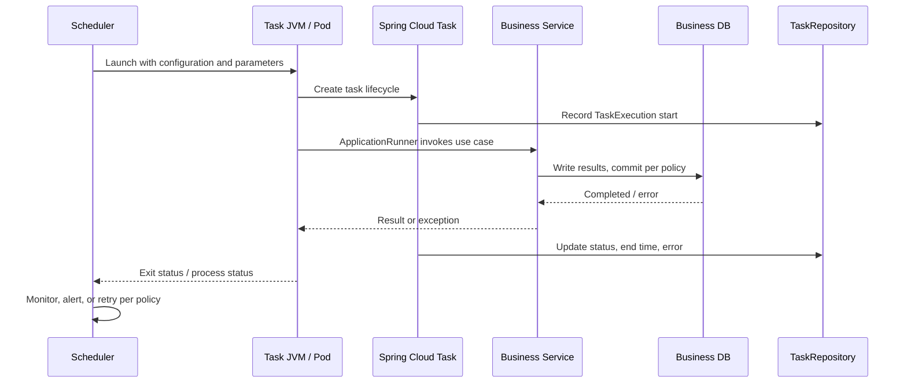
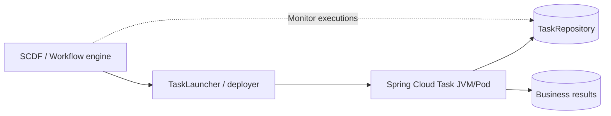

# Distinguishing the Task Library from External Scheduling Systems

## 1. Spring Cloud Task Is Not a Scheduler

**Spring Cloud Task** is a library for building Spring Boot applications with a **finite runtime**: the application starts, accepts arguments, executes a unit of work, and terminates. When a database and `TaskRepository` are configured, the framework records metadata for **each execution** (`TaskExecution`): the task name, start/end timestamps, exit code, and error information.

By contrast, a **scheduling system (scheduler)** decides **when and how** to launch an execution: for example, at 02:00 every day, on the first business day of the month, or after a pipeline completes. The scheduler can be cron on a server, a Kubernetes CronJob, a workflow engine, Spring Cloud Data Flow, or another orchestration tool.

> **Core distinction:** Spring Cloud Task manages **the lifecycle of a single run**; a scheduler manages **trigger timing and policies across multiple runs**. You do not need to install Spring Cloud Data Flow, Quartz, or cron to write and manually run a Spring Cloud Task application. Conversely, simply adding the Spring Cloud Task dependency **does not create a schedule automatically**.

Consider the `daily-report` task: each day it generates a report of pending orders. There are at least three independent questions:

| Question | Responsible Component | Data to Inspect |
| --- | --- | --- |
| When and how many times should the report be generated? | Cron/CronJob/scheduler or user request | Schedule, trigger event, Job/pod status |
| How did run #125 start and finish? | Spring Cloud Task and `TaskRepository` | `TASK_EXECUTION`, logs, exit status |
| Does the report for 2026-11-23 exist, and is it accurate and complete? | Business service, database, and reconciliation rules | Output tables, `requestId`, checksum/business rules |

You should not infer the third answer solely from `EXIT_CODE = 0`: the process may have exited before an external system confirmed the result, or the code may have swallowed an error. Nor should you automatically assume that a run with a null `END_TIME` is still active; the process may have been forcibly terminated.

## 2. Responsibility Flow in Scheduled Runs



This diagram is a conceptual model: exact listener timing, metadata persistence, error codes, and transaction boundaries depend on the version and configuration. If the JVM fails too early before the framework can create the application context, **a `TASK_EXECUTION` row might not exist yet**. Therefore, the scheduler also needs to record **process launch/deployment signals** rather than relying solely on the metadata table.

Each time the scheduler starts a new Spring Cloud Task process, the application normally creates a new `TaskExecution` in the **same metadata store**. However, multiple attempts for the same request can use the **same business `requestId`**. This is why you must distinguish the framework execution ID from the business deduplication key.

### Distinction from Spring Batch

When a Spring Cloud Task invokes a Spring Batch Job:

- `TaskExecution` tracks **the task application execution**.
- Spring Batch's `JobExecution` and `StepExecution` track **the job/step**, checkpoint data, and restarts.
- The scheduler decides **when** to launch the application or workflow.

These layers can be linked together, but they **do not share a single ID**. Scheduling does not automatically turn a failed run into a Spring Batch restart at the right checkpoint; that requires a Job name, identifying `JobParameters`, a durable `JobRepository`, and proper idempotency logic.

## 3. Common Scheduling Options

| Trigger Mechanism | How It Operates | When It Fits | What You Must Design Yourself |
| --- | --- | --- | --- |
| **Manual run / API** | A user or system invokes `java -jar`/container Job | Labs, on-demand jobs, backfills | Authorization, parameters, logging, timeouts, and traceability |
| **cron / systemd timer** | The host OS launches processes on a schedule | A small number of tasks on a stable VM | Host availability, overlap locking, logging, alerting, retries |
| **Kubernetes CronJob** | Controller creates a Kubernetes Job/Pod on a cron schedule | Containerized workloads running on Kubernetes | Timezone, concurrency, deadlines, quotas, Secrets, retries |
| **Workflow engine (Argo/Airflow/Temporal...)** | Orchestrates multiple steps, conditions, and dependencies | Complex multi-service pipelines | Task launcher adapter, external DB state, correlation data |
| **Spring Cloud Data Flow** | Registers tasks, creates definitions, launches/schedules, and views history | Centralized management of many task applications | Server, TaskLauncher, metadata DB, platform, security |
| **Quartz / Spring `@Scheduled`** | Scheduler runs inside a live Java application process | Applications managing internal schedules or requiring Quartz | Must design how to **launch a separate finite task** if each trigger needs its own JVM/`TaskExecution` |

No single option is universally best by default. If you only need to run one JAR every night, cron or a Kubernetes CronJob may be sufficient. If you have many workflows, shared resources, multiple schedules, and centralized observability requirements, a workflow engine or SCDF may be a better fit.

### What Spring Cloud Task Does Not Do on Its Own

Spring Cloud Task **does not provide** a property like `spring.cloud.task.cron=...` to define schedules. Nor does it create Kubernetes CronJobs, guarantee pod placement on a node, terminate hung processes, or automatically retry after infrastructure failures. Those responsibilities belong to the scheduler/orchestrator and operational mechanisms you choose.

`spring.cloud.task.single-instance-enabled=true` (when the Spring Integration dependency and a shared lock repository are configured) is only a mechanism for **concurrency limiting by task name**, **not a scheduler**. It does not compute the next run time and does not automatically queue a blocked execution to run later.

## 4. Why Is `@Scheduled` Different from a Finite Spring Cloud Task?

Spring Framework provides the `@Scheduled` annotation for methods that run periodically **inside an already-running ApplicationContext**. For example:

```java
@EnableScheduling
@Configuration
class InternalScheduleConfiguration {

    @Scheduled(cron = "0 0 2 * * *", zone = "Asia/Ho_Chi_Minh")
    void trigger() {
        // This method runs inside the living application's JVM.
    }
}
```

The snippet above **illustrates an internal scheduler**, not code to add to the finite task example later in this guide. If an application uses `@Scheduled` to run repeatedly forever inside a single JVM, that model is **different** from an external scheduler spawning **a new Spring Cloud Task process for each scheduled run**. A new `TaskExecution` is not automatically created for every invocation of a `@Scheduled` method within the same context.

In particular:

- Spring `@Scheduled(cron = ...)` typically uses a **six-field** expression with a *seconds* field first (`0 0 2 * * *`), whereas Linux cron and Kubernetes CronJob typically use **five fields** (`0 2 * * *`). Do not copy cron expressions verbatim across systems without checking the syntax.
- Spring Boot's `spring.task.scheduling.*` properties configure the **Spring Framework** thread pool/scheduler; they do not replace `spring.cloud.task.*` and cannot enforce limits across separate JVMs.
- A process containing an internal scheduler must be kept alive properly. With Spring Cloud Task, the common goal is to **exit after completing a single job**, so keeping scheduling external is usually cleaner and easier to operate.
- If you want Quartz or `@Scheduled` to trigger independent Spring Cloud Tasks, have it invoke a **process launcher, the Kubernetes API, or an orchestration system**, rather than calling a service method directly and assuming a new `TaskExecution` will be recorded.

## 5. A Spring Cloud Task Example Independent of Any Scheduler

Example design: each time the task runs, it generates a **report of `PENDING` orders for a business date**. You can pass the date explicitly via `--business.date=YYYY-MM-DD`, or—for the demo schedule—omit the date so the task uses **the previous day in a configured timezone**. Each date has a deterministic `requestId` to prevent duplicate writes on retry.

### 5.1. Maven Dependencies and Configuration

In a Spring Boot project whose Spring Cloud version is managed by a **compatible** BOM, the core dependencies are:

```xml
<dependencies>
    <dependency>
        <groupId>org.springframework.cloud</groupId>
        <artifactId>spring-cloud-starter-task</artifactId>
    </dependency>
    <dependency>
        <groupId>org.springframework.boot</groupId>
        <artifactId>spring-boot-starter-jdbc</artifactId>
    </dependency>
    <dependency>
        <groupId>org.postgresql</groupId>
        <artifactId>postgresql</artifactId>
        <scope>runtime</scope>
    </dependency>
</dependencies>
```

No cron, Quartz, or Spring Cloud Data Flow dependency is required for the task code to run standalone. This example uses Java 17 or later and PostgreSQL as a durable metadata store shared across processes.

`src/main/resources/application.yml`:

```yaml
spring:
  application:
    name: daily-report-app
  main:
    web-application-type: none
  datasource:
    url: ${TASK_DB_URL}
    username: ${TASK_DB_USER}
    password: ${TASK_DB_PASSWORD}
  cloud:
    task:
      name: daily-report-task
      initialize-enabled: false

app:
  business-zone: Asia/Ho_Chi_Minh
```

`web-application-type: none` prevents the process from starting a web server. `initialize-enabled: false` **assumes the Spring Cloud Task schema has already been migrated for the exact version in use**. The task and scheduler can use different database components, but to view unified execution history, the task processes must connect to the appropriate metadata store.

`app.business-zone` is a **custom property defined in this example**, not a built-in Spring Cloud Task property. Defining the timezone explicitly avoids discrepancies between developer machines, containers, and the scheduler. Both the **schedule's timezone** and the **business-date resolution timezone** must be specified and verified consistently.

### 5.2. Business Tables

Create two tables using your application's own PostgreSQL migration (without modifying the `TASK_*` schema):

```sql
CREATE TABLE business_orders (
    order_id BIGINT PRIMARY KEY,
    order_date DATE NOT NULL,
    status VARCHAR(20) NOT NULL
);

CREATE TABLE daily_reports (
    request_key VARCHAR(80) PRIMARY KEY,
    business_date DATE NOT NULL,
    pending_count BIGINT NOT NULL,
    created_at TIMESTAMPTZ NOT NULL DEFAULT CURRENT_TIMESTAMP
);
```

The `request_key` primary key prevents two runs from writing two separate reports for the **same request key**. In a production system, you also need business keys/constraints to ensure the scheduler does not issue two different `requestId` values for the same report if that is disallowed, as well as handling source data that changes while the task runs.

### 5.3. Business Service: Idempotency at the Data Layer

Create `DailyReportService.java` in package `com.example.report`:

```java
package com.example.report;

import java.sql.Date;
import java.time.LocalDate;

import org.springframework.jdbc.core.JdbcTemplate;
import org.springframework.stereotype.Service;
import org.springframework.transaction.annotation.Transactional;

@Service
public class DailyReportService {

    private final JdbcTemplate jdbc;

    public DailyReportService(JdbcTemplate jdbc) {
        this.jdbc = jdbc;
    }

    @Transactional
    public ReportResult ensureReport(String requestKey, LocalDate date) {
        if (requestKey.isBlank() || requestKey.length() > 80) {
            throw new IllegalArgumentException("requestKey must be 1-80 characters");
        }

        Long count = jdbc.queryForObject(
                "SELECT COUNT(*) FROM business_orders " +
                "WHERE order_date = ? AND status = 'PENDING'",
                Long.class, Date.valueOf(date));

        jdbc.update("""
                INSERT INTO daily_reports (request_key, business_date, pending_count)
                VALUES (?, ?, ?)
                ON CONFLICT (request_key) DO NOTHING
                """, requestKey, Date.valueOf(date), count);

        return jdbc.queryForObject("""
                SELECT business_date, pending_count
                FROM daily_reports
                WHERE request_key = ?
                """, (rs, rowNum) -> {
                    LocalDate savedDate = rs.getDate("business_date").toLocalDate();
                    if (!date.equals(savedDate)) {
                        throw new IllegalStateException(
                                "requestKey has already been used for a different date");
                    }
                    return new ReportResult(requestKey, savedDate,
                            rs.getLong("pending_count"));
                }, requestKey);
    }
}
```

`ReportResult.java`:

```java
package com.example.report;

import java.time.LocalDate;

public record ReportResult(
        String requestKey, LocalDate businessDate, long pendingCount) {
}
```

`ON CONFLICT (request_key) DO NOTHING` is **PostgreSQL** syntax: a retry with the same key does not insert a duplicate row; the service reads the stored result and rejects the call if the same key is used for a different date. This is a **minimal idempotency model for learning purposes**, not a guarantee that all source data is immutable. If source data can change, you should also store a `source_version`/checksum, define report update rules, and reconcile outputs. A unique constraint also protects against two JVMs attempting to insert the same key concurrently, though transactions, locks, and data states must still be tested under concurrency.

### 5.4. ApplicationRunner: Same Code, Multiple Trigger Mechanisms

Create `DailyReportTaskApplication.java`:

```java
package com.example.report;

import java.time.LocalDate;
import java.time.ZoneId;
import java.util.List;

import org.springframework.beans.factory.annotation.Value;
import org.springframework.boot.ApplicationArguments;
import org.springframework.boot.ApplicationRunner;
import org.springframework.boot.SpringApplication;
import org.springframework.boot.autoconfigure.SpringBootApplication;
import org.springframework.cloud.task.configuration.EnableTask;
import org.springframework.context.annotation.Bean;

@EnableTask
@SpringBootApplication
public class DailyReportTaskApplication {

    public static void main(String[] args) {
        SpringApplication.run(DailyReportTaskApplication.class, args);
    }

    @Bean
    ApplicationRunner runOnce(DailyReportService service,
            @Value("${app.business-zone:UTC}") String zoneName) {
        return args -> {
            String dateOption = optionalOne(args, "business.date");
            LocalDate date = dateOption == null
                    ? LocalDate.now(ZoneId.of(zoneName)).minusDays(1)
                    : LocalDate.parse(dateOption);

            String key = optionalOne(args, "request.id");
            if (key == null) {
                key = "daily-pending-" + date;
            }

            ReportResult result = service.ensureReport(key, date);
            System.out.printf("request=%s date=%s pending=%d%n",
                    result.requestKey(), result.businessDate(),
                    result.pendingCount());
        };
    }

    private static String optionalOne(ApplicationArguments args, String name) {
        if (!args.containsOption(name)) {
            return null;
        }
        List<String> values = args.getOptionValues(name);
        if (values == null || values.size() != 1 ||
                values.get(0) == null || values.get(0).isBlank()) {
            throw new IllegalArgumentException(
                    "Exactly one value is required for --" + name);
        }
        return values.get(0);
    }
}
```

**Manual** execution command illustrating an explicit business date:

```bash
java -jar target/daily-report-task.jar \
  --business.date=2026-11-23 \
  --request.id=daily-pending-2026-11-23
```

If **neither parameter is passed** during a scheduled run, the example chooses yesterday's date in `app.business-zone` and constructs `requestId` from that date. This is only a convenient default when the schedule normally runs early in the day. **When backfilling or retrying late on a subsequent day, pass the original business date and `request.id` explicitly**; do not recompute `yesterday` and accidentally process a different request.

If the runner throws an exception, do not catch it just to log the error and return normally. The orchestrator needs to receive the failure signal via the exit code/logs and `TaskRepository`. The exact exit code depends on how the framework maps exceptions; verify this behavior on your actual application version.

## 6. Option A: Scheduled Execution with Cron on Linux

For a simple VM, cron can invoke the exact same executable JAR used in manual runs:

```cron
# Add this line to the user crontab (for example, open with crontab -e):
0 2 * * * /usr/local/bin/run-daily-report.sh >> /var/log/daily-report.log 2>&1
```

Note: a **user crontab** has five time fields; `/etc/cron.d/*` files typically include an extra **user** field before the command. These two formats cannot be used interchangeably as-is. The line above belongs in the **user crontab** of the operations account; if using `/etc/cron.d`, insert the username in the proper position according to your distro's documentation. Ensure the account has permission to read the artifact, access DB connection variables, and write logs.

Create the wrapper script `/usr/local/bin/run-daily-report.sh` according to your deployment workflow:

```bash
#!/usr/bin/env bash
set -euo pipefail

cd /opt/daily-report

# Because the task defaults to the previous day in app.business-zone,
# cron does not need to compute the date itself for the demo schedule.
exec /usr/bin/java -jar /opt/daily-report/daily-report-task.jar
```

This is **example code**, not a requirement to commit the script into the lesson repository. You must grant executable permissions to the script and securely supply `TASK_DB_URL`, `TASK_DB_USER`, and `TASK_DB_PASSWORD` in the runtime environment (cron typically does not load interactive shell profiles). Cron does not provide a built-in dashboard for business data status; combine logs, metrics, error alerts, and `TASK_EXECUTION` queries.

### Strengths and Limitations of Cron

- Simple, few moving parts, suitable for a small number of tasks on a monitored host.
- Depends on the host being up at the scheduled time; usually does not automatically replay missed runs.
- **Can overlap** if the previous run has not finished; requires a locking mechanism, idempotency, or scheduler policy.
- Retries/backoff are not provided by Spring Cloud Task just because the schedule originates from cron.
- Timezone is determined by cron/host; `CRON_TZ` does not behave identically across all cron implementations. Schedule in a standardized timezone and verify against your deployed cron version.

## 7. Option B: Kubernetes CronJob Spawning a New Task Process

On Kubernetes, a CronJob is a controller that creates a **Job** on a schedule; the Job creates a **Pod/container** to run the application. Each pod can run one Spring Cloud Task JVM, terminate, and report its status back to Kubernetes.

Example manifest (assuming the cluster supports `spec.timeZone`, and the image and Secret already exist):

```yaml
apiVersion: batch/v1
kind: CronJob
metadata:
  name: daily-report
spec:
  schedule: "0 2 * * *"
  timeZone: "Asia/Ho_Chi_Minh"
  concurrencyPolicy: Forbid
  startingDeadlineSeconds: 600
  successfulJobsHistoryLimit: 3
  failedJobsHistoryLimit: 5
  jobTemplate:
    spec:
      backoffLimit: 1
      activeDeadlineSeconds: 1800
      template:
        spec:
          restartPolicy: Never
          containers:
            - name: task
              image: registry.example.com/team/daily-report-task:1.0.0
              env:
                - name: TASK_DB_URL
                  valueFrom:
                    secretKeyRef:
                      name: daily-report-db
                      key: url
                - name: TASK_DB_USER
                  valueFrom:
                    secretKeyRef:
                      name: daily-report-db
                      key: username
                - name: TASK_DB_PASSWORD
                  valueFrom:
                    secretKeyRef:
                      name: daily-report-db
                      key: password
                - name: APP_BUSINESS_ZONE
                  value: Asia/Ho_Chi_Minh
```

The image `registry.example.com/...` and Secret `daily-report-db` are **placeholders**. The image must have a Java entrypoint that executes the task; the sample above omits `command`/`args` because the demo application has a default rule for selecting the previous day. For other images, you must declare `command`/`args` appropriate for the actual container. Manage Secrets, image pull permissions, namespaces, resource requests/limits, and DB configuration according to your organization's policies.

### Commonly Confused Properties

| Property | Scope | Meaning |
| --- | --- | --- |
| `schedule: "0 2 * * *"` | Kubernetes CronJob | **5-field** schedule: minute, hour, day-of-month, month, day-of-week |
| `timeZone` | CronJob controller | Timezone used to interpret the schedule when supported by the cluster/API |
| `concurrencyPolicy: Forbid` | **This CronJob only** | Prevents creating a new Job that overlaps an active Job managed by this same CronJob |
| `concurrencyPolicy: Replace` | This CronJob | Can replace the previous Job with a new one; unsafe if the old run partially committed data |
| `startingDeadlineSeconds` | CronJob | Time window after the scheduled time within which the controller may still catch up a missed trigger |
| `backoffLimit` | Kubernetes Job | Retry policy for failed Pods; **does not guarantee business idempotency** |
| `activeDeadlineSeconds` | Kubernetes Job | Runtime deadline for the Job; once reached, Kubernetes may terminate it |
| `successfulJobsHistoryLimit` / `failedJobsHistoryLimit` | CronJob | Number of old Job resources retained; does not replace `TASK_EXECUTION` retention policies |

`Forbid` **does not lock every process with the same task name across the system**. An operator could create a manual Kubernetes Job, another CronJob could run the same image, or an external system could launch the JAR outside the cluster. Protecting business data requires database constraints, a stable `requestId`, and—where appropriate—a **single-instance mechanism by task name** backed by a shared lock store.

The CronJob controller can occasionally create duplicate Jobs or miss a Job under infrastructure conditions; therefore, the task application must **tolerate re-execution**. `backoffLimit` can spawn a new pod within the same Kubernetes Job, resulting in a **new `TaskExecution`**. With the auto-computed date example, note that retrying across a midnight boundary can shift the business date; production systems should supply a **fixed business date per scheduled run** from a durable parameter source or manifest.

## 8. Option C: Orchestrators or Spring Cloud Data Flow

When requirements go beyond a simple cron schedule, you can use a workflow engine (such as Argo Workflows or Airflow) or **Spring Cloud Data Flow (SCDF)** to manage launches. SCDF is optional and can provide task app registration, task definitions, on-demand launches, platform-backed scheduling, execution history, and composed tasks.



Example multi-step workflow:

```text
02:00: prepare data
  -> validate input
  -> run Spring Cloud Task to import orders
  -> run result reconciliation
  -> send alert if discrepancies exist
```

SCDF **does not replace the Business Service**, `TaskRepository`, or idempotency constraints. Having SCDF ask `TaskLauncher` to create a Pod is still process launching, just like the other approaches. You do not need to add SCDF Server to an executable JAR's dependencies to deploy it as a task app in SCDF.

If you use an in-app scheduler such as Quartz, understand that Quartz can manage persistent triggers and clustering depending on configuration, but a Quartz job running inside a resident JVM **does not automatically become an independent Spring Cloud Task execution**. When each scheduled trigger must create a new `TaskExecution` and exit cleanly when done, build a proper lifecycle launcher or schedule at the process/container level.

## 9. Failures, Retries, Overlaps, and Data Protection

### 9.1. Retries Can Produce Multiple Executions for One Request

For example, a schedule on November 24 processing data for November 23:

| Attempt | `requestId` | `TaskExecution` ID (illustrative) | Outcome |
| --- | --- | --- | --- |
| First run | `daily-pending-2026-11-23` | 2001 | Failed after writing data |
| Retry | `daily-pending-2026-11-23` | 2002 | Succeeded or detected existing result |

Both execution records are valuable for **auditability and tracing**, yet the business data should contain only one valid result for that `requestId`. Therefore, **do not use `TASK_EXECUTION_ID` as an idempotency key**: that ID changes on every attempt. Also do not blindly append a random `run.id` in Spring Batch just to bypass an error stating a Job instance has already completed.

### 9.2. A Task-Name Lock Does Not Resolve Every Conflict

`spring.cloud.task.single-instance-enabled` limits concurrency by **task name** when all instances enable the flag and share Spring Integration and an appropriate lock repository. However, an `orders-import` task and an `orders-reconcile` task can still update **the same table** concurrently. That requires business-level locking/transactions, unique constraints, checkpoints, or resource-based orchestration policies.

For tasks that read from external sources or call payment/email APIs, JDBC transactions do not automatically roll back external side effects. If the scheduler retries after a timeout, you must use a provider-supported idempotency key, an outbox pattern, and/or a receipt query before resending.

### 9.3. Layered Troubleshooting Matrix

| Symptom | First Layer to Investigate | How to Respond |
| --- | --- | --- |
| Scheduler did not create a Job on time | Cron/CronJob/controller/SCDF | Check timezone, missed schedule, permissions, resources, and controller health |
| Job was created but no Pod/JVM started | Deployer, image, quota, permissions | Inspect platform logs before concluding the task actually ran |
| JVM failed at startup, no `TASK_EXECUTION` | Spring Boot config/schema/network | Check bootstrap logs, JDBC URL, Secrets, dependencies, and schema |
| Non-zero `EXIT_CODE`, partially written data | Runner/service/DB/TaskRepository | Verify which commits occurred; retry via checkpoint/idempotency |
| Null `END_TIME` after the Pod stopped | TaskRepository and JVM termination | Cross-check against Pod status, logs, and business output |
| Scheduler reports success but data is missing | Service/business reconciliation | Check completion criteria rather than relying solely on exit status |
| Two scheduled runs executed simultaneously | Scheduler policy, task name, locks, and DB | Check overlap rules, unique constraints, `requestId`, and lock scope |
| Retry across midnight processed the wrong date | Parameter generation layer | Re-pass the **original** business date and correlation key instead of recomputing current date |

## 10. Tracking History and Post-Run Results

Once the Task schema matching your version is prepared, you can query the default metadata table:

```sql
SELECT TASK_EXECUTION_ID,
       TASK_NAME,
       START_TIME,
       END_TIME,
       EXIT_CODE,
       EXIT_MESSAGE,
       ERROR_MESSAGE
FROM TASK_EXECUTION
WHERE TASK_NAME = 'daily-report-task'
ORDER BY START_TIME DESC, TASK_EXECUTION_ID DESC;
```

And query the business output table:

```sql
SELECT request_key, business_date, pending_count, created_at
FROM daily_reports
ORDER BY business_date DESC;
```

The two tables answer different questions. For instance, two `TASK_EXECUTION_ID` rows may correspond to **one** `daily_reports` row if the task retried with the same request key; when exact correlation is needed, record `requestId` in structured logs, a join/link table between executions and requests, or an appropriate metadata parameter mechanism. **Do not join solely by approximate timestamps** when multiple tasks run concurrently.

If the application runs Spring Batch, also inspect `BATCH_JOB_EXECUTION`, `BATCH_STEP_EXECUTION`, and checkpoints. `TaskRepository` and `JobRepository` may reside in the same physical database, but they are two distinct metadata schemas with different responsibilities; do not substitute one for the other.

### Signals to Include in a Dashboard

- **Scheduled time vs. actual trigger time:** detect missed schedules, timezone mismatches, and catch-up runs.
- **Total attempts, exit codes, and duration:** distinguish infrastructure failures from business processing errors.
- **Long-running tasks or metadata still missing `END_TIME`:** verify whether the pod/JVM is still alive before allowing a retry.
- **Business result lag:** which dates have completed reports, and whether record counts/checksums match.
- **Retry/overlap counts:** evaluate scheduler policies and request-key idempotency.
- **Resource/DB utilization:** connection counts, lock waits, deadlocks, CPU/memory, and query latency.

Do not log or pass tokens, passwords, or sensitive payloads in CLI arguments, task parameters, or logs; schedulers/SCDF may persist parameters for operator traceability. Manage Secrets, RBAC, retention, and log access permissions appropriately.

## 11. Safe Selection and Deployment Practices

Before choosing cron, CronJob, SCDF, or an internal scheduler, use this checklist:

1. **Identify the workload type:** does each run need a finite process, or do you need a continuously running service? For finite tasks, spawning a dedicated process/container per run usually simplifies lifecycle management.
2. **Define timezone and business-date rules:** align the scheduler, application, and DB; watch out for Daylight Saving Time (*DST*) in DST-observing zones. A 02:00 schedule may be skipped or behave unexpectedly on transition days.
3. **Define missed-schedule behavior:** skip, backfill day by day, coalesce periods, or alert an operator? Do not assume every missed run is safe to retry automatically.
4. **Configure timeouts, backoff, and concurrency limits:** clarify who has authority to stop an old process, who decides replays, and the maximum retry count.
5. **Supply stable business parameters:** preserve `requestId`, data ranges/manifests, and source versions across retries; never rely blindly on the retry timestamp.
6. **Use a durable database and proper migrations:** `TASK_*` schemas, `BATCH_*` if applicable, and proper permissions; an in-memory H2 `mem:` database per Pod does not support centralized execution history.
7. **Design for idempotency:** unique business keys, checkpoints/outbox, or verified upserts; guard against two overlapping JVMs.
8. **Reconcile outputs:** even after a process reports success, verify committed data and any external side effects.
9. **Monitor both sides:** scheduler/orchestrator logs and status, `TaskRepository`/`JobRepository`, and business outcomes.

## 12. Self-Check Exercises

1. Using the `DailyReportTaskApplication` example, run it manually with `--business.date=2026-11-23 --request.id=daily-pending-2026-11-23`. Identify who provides the schedule, who writes Task metadata, and who determines the pending order count.
2. Re-run the same command against a database that preserves history. Why can there be two `TASK_EXECUTION` records but only one row in `daily_reports`?
3. Write a Linux cron expression to run every day at 02:00 and compare it with a Spring `@Scheduled` cron expression. Why should you not use the exact string `0 0 2 * * *` in a Kubernetes CronJob?
4. For a Kubernetes CronJob, explain the roles of `concurrencyPolicy: Forbid`, `backoffLimit`, `startingDeadlineSeconds`, and `activeDeadlineSeconds`. Why do they not guarantee exactly-once execution on their own?
5. Suppose a task runs for 40 minutes, while the schedule triggers every 30 minutes. List at least two ways to prevent overlaps and explain the risk of killing the old task after it has partially committed data.
6. A run at 02:00 on November 24 fails and is retried after 00:00 on November 25. If the application always picks "yesterday", what date might the request switch to? Design a mechanism to re-supply the original parameters.
7. A Pod exits with code 0, yet no `TASK_EXECUTION` exists. List possible causes and an investigation order (DataSource, schema, Task configuration, logs, profiles, failure timing).
8. Compare **cron + JAR**, **Kubernetes CronJob + container**, and **SCDF + TaskLauncher** architectures for 30 tasks across multiple operations teams requiring centralized history. When does adding SCDF make sense, and what operational overhead comes with it?
9. If a task invokes a Spring Batch Job with chunks/checkpoints, explain the difference between a scheduler retrying a new process versus restarting the exact Batch Job instance.
10. Design a monitoring matrix for a nightly scheduled task: expected schedule, start/finish timestamps, exit code, `requestId`, business outcome, retry count, and latency.

Upon completing this lesson, you should be able to distinguish **the scheduler deciding when to launch**, **Spring Cloud Task recording the execution**, and **the business service verifying the outcome**. You should also know when to use cron/CronJob/SCDF, how to prevent overlaps, handle retries and business dates, and coordinate with Spring Batch when large jobs require checkpoint/restart capabilities.

## 13. References

- [Spring Cloud Task Reference Guide](https://docs.spring.io/spring-cloud-task/reference/): finite application model, `TaskExecution`, `TaskRepository`, configuration, and execution history.
- [Spring Framework — Annotation Support for Scheduling](https://docs.spring.io/spring-framework/reference/integration/scheduling.html): `@Scheduled`, cron expressions, and in-application schedulers.
- [Kubernetes — CronJob](https://kubernetes.io/docs/concepts/workloads/controllers/cron-jobs/): schedules, concurrency policies, timezones, and missed schedules.
- [Kubernetes — Job](https://kubernetes.io/docs/concepts/workloads/controllers/job/): Pod retries, `backoffLimit`, and Job time limits.
- [Spring Cloud Data Flow — Scheduling Tasks](https://dataflow.spring.io/docs/feature-guides/batch/scheduling/): SCDF as an orchestration option and platform-backed scheduling.
- [Spring Batch Reference Guide](https://docs.spring.io/spring-batch/reference/): JobRepository, JobExecution, StepExecution, and restarts.

The schedules, manifests, SQL, and Java examples above are provided for learning purposes. Before deploying to production, verify syntax and feature support for the **exact versions of Spring Boot, Spring Cloud Task, scheduler, Kubernetes, and database** you use; test missed schedules, delayed retries, crashes, and overlaps in a safe environment.
