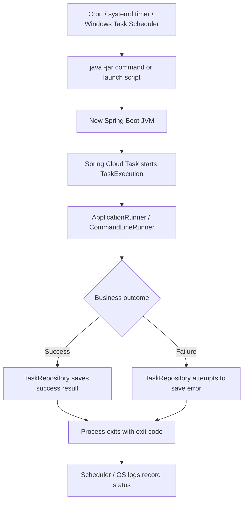
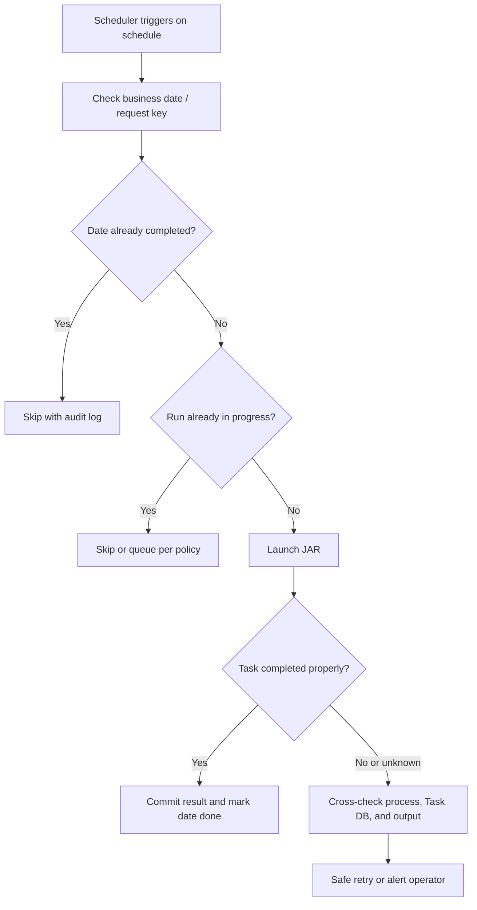

# Launching a JAR with Cron or an OS Scheduler

## Lesson Objectives

In **SPRING_CLOUD_TASK (Spring Cloud Task)**, a Spring Boot application can perform a **finite** unit of work and then exit: generating a daily report, processing an input file, syncing with a partner, or running a Spring Batch Job. The framework creates and updates `TaskExecution` via `TaskRepository` to record start time, end time, exit code, and error details. However, Spring Cloud Task **does not decide on its own** what day or time the application should launch.

In the **Scheduling** chapter, this lesson shows how to run a Task JAR under **cron on Linux**, **systemd timers**, or **Windows Task Scheduler**. The focus is on scheduling properly, launching an independent JVM per run, handling environment variables, exit codes, and logs, and preventing duplicate business processing when the OS or an operator re-runs a task.

After this lesson, you will be able to:

- Distinguish an OS scheduler from `@Scheduled` inside a long-running application.
- Package and test-run a Spring Cloud Task JAR using `java -jar` before scheduling it.
- Write a safe launch script using absolute paths, least-privilege permissions, and environment variables.
- Configure cron and systemd timers on Linux, as well as scheduled tasks on Windows.
- Explain what happens when a machine shuts down, timezones drift, a job runs past the next scheduled trigger, or a process is killed.
- Use exit codes, OS logs, `TaskRepository`, and business outputs to verify whether a run truly succeeded.
- Design overlap prevention, retries, idempotency, and Spring Batch restarts suitable for operations.

## 1. Architecture: Scheduler Spawns the Process, Task Records Results

An OS scheduler issues a command at configured times. Typically, the command runs the **JAR as a standalone program**, rather than keeping a Java application running forever and scheduling internally.



In this diagram, there are separate observation sources:

| Source | Provides | Does Not Guarantee |
| --- | --- | --- |
| Cron/systemd/Task Scheduler | Expected trigger time, invoked command, process status, and logs if configured. | Does not know whether a report was generated accurately. |
| `TaskRepository` | `TaskExecution.executionId`, `startTime`, `endTime`, `exitCode`, and error messages when persisted. | Does not automatically know if a process died before `ApplicationContext` initialization. |
| Spring Batch `JobRepository` (if used) | `JobInstance`, `JobExecution`, `StepExecution`, checkpoints/restarts. | Does not decide whether cron runs catch-ups. |
| Business data | Reports, actual persisted record counts, published messages. | Does not automatically reflect full scheduler state. |

**Example:** cron invokes the Task at 02:00, but PostgreSQL is unreachable. The JVM may exit with an error before creating a `TaskExecution`; if you only inspect the Task database, you might mistakenly think no trigger occurred that day. Therefore, production systems must also monitor the **scheduler's** logs and status.

## 2. Why Not Just Use `@Scheduled`?

Spring Boot provides `@Scheduled`, which fits best when an application stays alive to run jobs **repeatedly inside the same JVM**. In Spring Cloud Task, a single execution usually lives only long enough to finish one unit of work and exit.

| Criterion | Cron/systemd/Windows Scheduler + JAR | `@Scheduled` Inside a Java App |
| --- | --- | --- |
| Lifecycle | Each trigger creates a new process/`ApplicationContext`. | One continuously running app fires repeated callbacks. |
| Spring Cloud Task metadata | One `TaskExecution` per normal process run. | Does not automatically create a new `TaskExecution` for **each callback**. |
| Severe JVM failure | Usually affects only the current run. | Can impact a long-lived scheduling service. |
| Deployment | Scheduler lives outside the JVM; changing schedules does not require repackaging the JAR. | Schedule may live in a long-running app's code or config. |
| Scaling | Can run across hosts, but requires coordination to prevent duplicate runs. | Multiple replicas may all fire callbacks without a distributed lock. |
| Observability | Must combine scheduler status and `TaskRepository`. | Must design tracking for each individual callback. |

**Design takeaway:** for a Spring Cloud Task JAR intended to run finitely, let cron or an external scheduler spawn **one process per run**. Do not simply add `@Scheduled` to the JAR and leave the process waiting indefinitely, as doing so violates the assumption that a Task has a bounded end.

## 3. Preparing a Standalone Launchable JAR

Before scheduling, the application must work reliably when executed manually with a `java -jar` command.

Example Spring Cloud Task application with a runner requiring a business date:

```java
package com.example.reports;

import java.time.LocalDate;
import java.util.List;
import org.slf4j.Logger;
import org.slf4j.LoggerFactory;
import org.springframework.boot.ApplicationRunner;
import org.springframework.boot.SpringApplication;
import org.springframework.boot.autoconfigure.SpringBootApplication;
import org.springframework.cloud.task.configuration.EnableTask;
import org.springframework.context.annotation.Bean;

@SpringBootApplication
@EnableTask
public class DailyReportTaskApplication {

    private static final Logger log =
            LoggerFactory.getLogger(DailyReportTaskApplication.class);

    public static void main(String[] args) {
        SpringApplication.run(DailyReportTaskApplication.class, args);
    }

    @Bean
    ApplicationRunner reportRunner() {
        return args -> {
            List<String> dates = args.getOptionValues("businessDate");
            if (dates == null || dates.size() != 1) {
                throw new IllegalArgumentException(
                        "--businessDate=yyyy-MM-dd is required");
            }

            LocalDate businessDate = LocalDate.parse(dates.get(0));
            log.info("Starting report for date {}", businessDate);

            // In a real project: call ReportService.generate(businessDate).
            // The service must have appropriate validation, transactions, and idempotency.
            log.info("Completed example for date {}", businessDate);
        };
    }
}
```

This example intentionally does not write files or update a business database: the two log lines merely illustrate the runner lifecycle. In a real project, reporting logic belongs in a dedicated service and must throw an exception if the work genuinely fails. Never swallow errors and let the JVM exit normally.

Ensure the project includes the Spring Cloud Task starter, compatible Spring Boot/Spring Cloud versions, a JDBC driver, and the matching metadata schema when using a durable `TaskRepository`. Production configuration can be declared as follows:

```yaml
# application-prod.yml
spring:
  application:
    name: daily-report-task
  main:
    web-application-type: none
  datasource:
    url: ${TASK_DB_URL}
    username: ${TASK_DB_USER}
    password: ${TASK_DB_PASSWORD}
  cloud:
    task:
      name: daily-report-task
      initialize-enabled: false
      closecontextEnabled: true
```

Here, `initialize-enabled: false` assumes the Task schema has already been migrated; `closecontextEnabled: true` closes the `ApplicationContext` after the Task lifecycle finishes according to Spring Cloud Task's documented behavior. Use environment variables or a secret manager rather than hardcoding passwords in YAML or passing them as command-line arguments, since Task arguments may be persisted in metadata.

Run manually before scheduling:

```bash
/usr/bin/java -version
/usr/bin/java -jar /opt/report-task/daily-report-task.jar \
  --spring.profiles.active=prod \
  --businessDate=2026-11-23
echo "exit=$?"
```

This is a Linux example; verify the exact Java and JAR paths on the target host. If this step fails, resolve dependencies, schema, environment variables, and runner issues **before** debugging cron.

## 4. Use a Launch Script Instead of Cramming Logic into Crontab

A small wrapper script helps control paths, environment variables, arguments, and exit codes for both cron and systemd.

Example `/opt/report-task/run-report.sh` on Linux:

```sh
#!/bin/sh
set -eu
umask 077

# Only source configuration files controlled by an administrator,
# never accept paths from untrusted users.
set -a
. /etc/report-task/report.env
set +a

# GNU date on Linux: previous calendar day in the host's timezone.
BUSINESS_DATE=$(/usr/bin/date -d 'yesterday' +%F)

# exec replaces the shell with the JVM to preserve exit codes and stop signals.
exec /usr/bin/java -jar /opt/report-task/daily-report-task.jar \
    --spring.profiles.active=prod \
    "--businessDate=$BUSINESS_DATE"
```

An environment configuration file `/etc/report-task/report.env` might contain:

```sh
TASK_DB_URL='jdbc:postgresql://db.internal:5432/taskmeta'
TASK_DB_USER='report_task'
TASK_DB_PASSWORD='read-from-your-secret-store'
```

These values are **illustrative**—in particular, the password is not a real secret. In production, prefer an appropriate secret manager; if you must use a file, grant minimal read permissions to the Task service account and never log its contents. Never commit secret files to Git or unencrypted backups.

Administrator preparation steps on the target host: create a dedicated service user, directories, permissions, environment file, and make the script executable. Verification example:

```bash
ls -l /opt/report-task/run-report.sh
ls -l /etc/report-task/report.env
test -r /etc/report-task/report.env
/opt/report-task/run-report.sh
```

Never use `chmod 777` or run every Task as `root` just to bypass permission errors. If the script fails with `Permission denied`, check owner, group, file mode, and directory traversal permissions. The script needs read access to the JAR, network/auth access to the DB, and write access to the target business directories.

### How Are Exit Codes Propagated?

Because the final line uses `exec /usr/bin/java ...`, the OS receives **the Java process's exit code**, rather than a misleading success code returned by the shell from a trailing command. If you omit `exec` and put `echo "done"` after Java, the shell can return `echo`'s exit code `0` even when Java failed.

Note that if the script fails before invoking Java (such as a missing env file), **no `TaskExecution` record may exist**. You must distinguish launcher script failures, JVM startup failures, and business errors.

### Choosing the Business Date for Backfills

`date -d 'yesterday'` is only a simple option for a Job running reliably every day. If the host is powered off for 3 days and the scheduler runs a **single** catch-up trigger, the script computes "yesterday relative to the catch-up date", rather than automatically processing all missed days.

Accurate backfilling requires a **queue of unprocessed dates** or a historical status table: each run receives an explicit `--businessDate`, marks completed dates, and queues only dates lacking results. When schedules span timezones, use an agreed business `ZoneId` instead of relying solely on the host's default timezone.

## 5. Scheduling with Cron on Linux

`cron` checks schedules periodically and executes registered commands. In a **user crontab** edited with `crontab -e`, each entry normally has **5 time fields** followed by the command:

```text
minute  hour  day-of-month  month  day-of-week  command
  0       2        *          *         *       /opt/report-task/run-report.sh
```

Common schedule examples:

| Cron Expression | Meaning |
| --- | --- |
| `0 2 * * *` | 02:00 daily, in the cron daemon's timezone. |
| `*/15 * * * *` | Every 15 minutes. |
| `30 1 * * 1-5` | 01:30 Monday through Friday. |
| `0 3 1 * *` | 03:00 on the first day of every month. |

**Important:** this is **5-field OS cron syntax**. Spring `@Scheduled(cron = "...")` typically uses 6-field syntax with seconds. Never copy cron expressions directly between the two systems without checking the parser.

Example user crontab:

```cron
SHELL=/bin/sh
PATH=/usr/bin:/bin
MAILTO=""

# Daily at 02:00; log directory and file must be writable.
0 2 * * * /opt/report-task/run-report.sh >> /var/log/report-task/daily.log 2>&1
```

- `>> ... 2>&1` redirects both stdout and stderr to the log file. Create the log directory, set permissions, and configure log rotation so the disk does not fill up.
- `MAILTO=""` typically suppresses cron's automatic emailing of job output. If you want failure alerts via email, configure an MTA and a dedicated alerting policy; do not rely solely on cron emails.
- `crontab -e` edits a **user crontab**, so it has **no username column**. By contrast, `/etc/crontab` and files in `/etc/cron.d/` on many Linux systems include an extra username column.
- Cron runs with a minimal environment and does not source interactive `.bashrc` profiles; use absolute paths and dedicated environment files.
- On common cron implementations, the `%` character in a crontab command has special meaning and must be escaped; keep expressions like `date +%F` **inside the script** as shown rather than directly in crontab.

Verify the installed schedule:

```bash
crontab -l
date
timedatectl status
```

Cron service log locations vary by distribution. Use `journalctl -u cron` or `journalctl -u crond` if logged via systemd, or check the appropriate syslog. Do not assume that merely seeing JAR output in a log file proves cron fired at the expected scheduled time.

## 6. Preventing Overlaps with `flock` (Single Host)

Cron **does not guarantee** that the 02:00 run has finished before the next trigger fires. If a Task occasionally runs longer than its interval, two JVMs could modify tables or files concurrently.

On a **single Linux host**, the `flock` utility can use a lock file to reject overlapping runs:

```cron
0 2 * * * /usr/bin/flock -n -E 75 /var/lib/report-task/locks/daily-report.lock /opt/report-task/run-report.sh >> /var/log/report-task/daily.log 2>&1
```

Here:

- `-n`: **non-blocking**—do not wait if another process holds the lock, implementing a *skip* policy.
- `-E 75`: on `flock` builds supporting this option (such as util-linux), returns exit code `75` on lock contention to distinguish it from business failure codes. Check `flock --help` on your target host.
- The lock file must reside in a directory where the service account can create/read/write files. Prepare and set permissions on `/var/lib/report-task/locks` beforehand.
- `flock` holds the lock until the command exits according to the utility's semantics; do not delete the lock file after each run.

**Core limitation:** a lock file on Host A **does not prevent** cron on Host B from running the same Task unless a properly designed shared locking mechanism is used. Across multiple hosts or replicas, use a single-leader scheduler, a durable distributed lock, or Spring Cloud Task's `spring.cloud.task.single-instance-enabled=true` with a properly configured shared JDBC lock repository. Regardless of locking, business logic still needs **idempotency**, because a run after a crash may reprocess previously completed work.

If `flock` rejects the run before Java starts, **no new `TaskExecution` is created** for the skipped trigger. Therefore, log and alert on skipped runs in the scheduler/wrapper logs outside `TaskRepository`.

## 7. Using Systemd Timers Instead of Cron on Linux

On Linux systems with `systemd`, a `.service` unit defines **what to run**, and a `.timer` unit defines **when to run**. This integrates cleanly with `journald` logging, service status inspection, execution timeouts, and boot-time schedule activation.

### 7.1. Oneshot Service Unit

Example `/etc/systemd/system/daily-report.service`:

```ini
[Unit]
Description=Daily Spring Cloud Task report
After=network-online.target
Wants=network-online.target

[Service]
Type=oneshot
User=reporttask
Group=reporttask
WorkingDirectory=/opt/report-task
ExecStart=/opt/report-task/run-report.sh
TimeoutStartSec=45min
StandardOutput=journal
StandardError=journal
NoNewPrivileges=true
```

`Type=oneshot` means the service completes when the command exits. `ExecStart` invokes the wrapper script, which uses `exec java -jar` to propagate the exit code. A successful run leaves the unit in an inactive state; this is **normal** for finite tasks. Do not set `RemainAfterExit=yes` if you expect the timer to trigger the service again the next day in the standard way.

`TimeoutStartSec=45min` is an illustrative limit: choose it based on a reasonable maximum duration. If systemd stops the process due to timeout, Task/Batch metadata may remain incomplete, so reconcile business results before retrying.

### 7.2. Timer Unit

Example `/etc/systemd/system/daily-report.timer`:

```ini
[Unit]
Description=Run daily report at 02:00

[Timer]
OnCalendar=*-*-* 02:00:00
Persistent=true
AccuracySec=1min
Unit=daily-report.service

[Install]
WantedBy=timers.target
```

`OnCalendar` uses systemd calendar syntax (different from 5-field cron expressions). `Persistent=true` stores the last trigger timestamp and can run a **single catch-up execution** when the timer is re-enabled after downtime if at least one trigger was missed. It **does not** replay individual runs for every single missed day; handling all missing days requires dedicated business logic or an orchestrator.

`AccuracySec=1min` allows a scheduling window around the target time. If stricter precision is required, tune and measure empirically rather than assuming exact second-level execution. `Persistent` applies to `OnCalendar` timers, not all timer types.

Basic management commands:

```bash
sudo systemctl daemon-reload
sudo systemctl enable --now daily-report.timer
systemctl list-timers --all
systemctl status daily-report.timer
systemd-analyze calendar '*-*-* 02:00:00'

# Run the service once as a smoke test without waiting until 02:00:
sudo systemctl start daily-report.service
systemctl status daily-report.service
journalctl -u daily-report.service --since today
```

These commands are **shown for learning** and have not been executed on your system. Administrative privileges are required to create unit files and enable timers. On some hosts, `systemd-analyze` behavior or flags may vary by systemd version; check your installed systemd version.

### 7.3. What If the Previous Service Run Is Still Active?

When a `.timer` triggers the **same `.service`** that is already active, systemd normally does not start a second concurrent instance of that same unit. However, this **only protects that unit on that host**: another command using a different unit name or another host can still run the JAR concurrently. If you use template units (`@.service`) for multiple distinct instances, you must manage per-instance concurrency and parameters yourself.

A failed service can be restarted according to `Restart=`; never enable automatic restarts without verifying idempotency and side effects. With `Type=oneshot`, `Restart=always` and `Restart=on-success` are invalid; retry configuration must match your systemd version's supported options.

## 8. Windows Task Scheduler

If the application runs on Windows Server or a workstation, **Task Scheduler** can schedule `java.exe -jar` or a PowerShell script. The same principles apply as on Linux: run under a service account, set the working directory, supply environment variables, and capture exit codes.

Example PowerShell script `C:\Apps\ReportTask\run-report.ps1`:

```powershell
$ErrorActionPreference = "Stop"

$java = "C:\Program Files\Java\jdk-21\bin\java.exe"
$jar  = "C:\Apps\ReportTask\daily-report-task.jar"
$day  = (Get-Date).Date.AddDays(-1).ToString("yyyy-MM-dd")

& $java -jar $jar "--spring.profiles.active=prod" "--businessDate=$day"
exit $LASTEXITCODE
```

`$LASTEXITCODE` holds the exit code from the native `java.exe` executable; `exit` ensures Task Scheduler observes that exact code. For PowerShell errors occurring before Java runs (such as a missing file), wrap the script in exception handling and exit with a non-zero code rather than relying on a stale `$LASTEXITCODE`. Paths to Java, the JAR, and arguments are illustrative and must match the real host.

In the Task Scheduler UI:

1. **Create Task** (not just Basic Task if full settings are needed). Name it `DailyReportTask` and select a least-privilege service account.
2. **Triggers:** daily at 02:00, considering host timezone and power settings.
3. **Actions:** Start a program = `powershell.exe`; Arguments = `-NoProfile -NonInteractive -File "C:\Apps\ReportTask\run-report.ps1"`; Start in = `C:\Apps\ReportTask`.
4. **Conditions:** configure AC power/network requirements and wake behavior.
5. **Settings:** configure max execution time, run-after-missed-schedule behavior, and what to do **if the task is already running**.
6. Test with a manual **Run**, then check `Last Run Result`, `History`, and application logs.

The **If the task is already running** policy offers four Windows-documented options:

| Policy | Behavior |
| --- | --- |
| `Do not start a new instance` (IgnoreNew) | Drops the new trigger if the task is already running. |
| `Run a new instance in parallel` | Allows two instances to run concurrently. |
| `Queue a new instance` | Waits for the active run to finish, then starts the new run. |
| `Stop the existing instance` | Terminates the active run before starting the new one. |

This is a **policy for one Scheduled Task on one host**; it does not stop a JAR launched manually from PowerShell, on another host, or under another scheduled task name. Choosing "Stop the existing instance" can cause data loss or leave Task metadata without an `END_TIME`, so use it with caution.

### Notes on Permissions on Windows

When configured to run "whether user is logged on or not", the script must not rely on mapped network drives from an interactive login session. Use absolute/UNC paths with proper permissions and store secrets in an appropriate secure store. Never pass passwords, tokens, or connection strings containing credentials on the command line, as they can be exposed in Task history and metadata.

## 9. Timezones, DST, and Missed Schedules

A schedule of "02:00 daily" is meaningless without specifying **02:00 in which timezone**.

| Issue | Consequence | Recommendation |
| --- | --- | --- |
| Cron host is in UTC, business logic uses `Asia/Ho_Chi_Minh` | Runs execute at the wrong Vietnam local time. | Standardize the scheduler timezone; verify with `date` and actual trigger logs. |
| DST timezone where 02:00 is skipped | A local wall-clock time may **not exist**, causing cron to skip. | Evaluate regional rules; when precision matters, schedule in UTC and anchor business dates explicitly. |
| Repeated local hour when clocks fall back | The same wall-clock time may fire **twice** in some cron daemons. | Use idempotency/unique keys rather than trusting the scheduler to fire strictly once. |
| Host powered off at scheduled time | The run is missed. | Use systemd `Persistent=true` or Windows missed-run settings where appropriate; still build backfills. |
| Host clock is wrong or unsynchronized | Timestamps and report data drift. | Enable time sync, log UTC timestamps alongside business timezone. |
| Catch-up runs on a later day | Script computes `yesterday` for **today**, not the missed date. | Pass explicit business dates from a queue or missing-dates tracking table. |

Some `cron` implementations support `CRON_TZ`, but not all `cron`/`crontab` distributions follow identical rules. For example, Debian cron has daemon-level timezone constraints; never just put `TZ=Asia/Ho_Chi_Minh` in a crontab and assume the trigger schedule will shift accordingly. Check your running cron's documentation and test a concrete trigger time.

If reports close according to business days in Vietnam, store `businessDate` independently of event `Instant`/timestamps; never derive `businessDate` solely from the UTC date. For production schedules, define explicit `[startInclusive, endExclusive)` data windows in the business timezone to avoid gaps during clock changes.

## 10. Exit Codes, Logs, and Metadata: Three Sources to Reconcile

When cron or Task Scheduler invokes a process, it sees the **OS exit code**. Spring Cloud Task records `TaskExecution.exitCode` if the framework initialized and the database is reachable. These values usually align, yet **can diverge** when an error happens too early, the process is killed, or final metadata persistence fails.

| Scenario | OS Exit Code / Logs | TaskRepository Record |
| --- | --- | --- |
| Runner succeeds | Typically `0` on normal process exit. | Has `START_TIME`, `END_TIME`, and corresponding `EXIT_CODE`. |
| Runner throws an unhandled exception | Typically non-zero. | Contains error details if the repository can persist them. |
| Cannot open JAR file | Java/shell reports an error. | **No `TaskExecution`** because the application never started. |
| Bad bean/DB stops `ApplicationContext` bootstrap | Startup error, process fails. | May have **no `TaskExecution`**. |
| OS kill or timeout | Exit code depends on signal and scheduler. | `END_TIME` may remain null. |
| Blocked by `flock` | Lock-contention code, e.g. `75` with `-E 75`. | No new Task record created because Java never launched. |
| Spring Batch Job `FAILED` without propagating error from runner | Task exit code may still be `0` depending on config. | Must cross-check `JobRepository`/`JobExecution` separately. |

Query Spring Cloud Task metadata for the default schema:

```sql
SELECT TASK_EXECUTION_ID,
       TASK_NAME,
       START_TIME,
       END_TIME,
       EXIT_CODE,
       EXIT_MESSAGE
FROM TASK_EXECUTION
WHERE TASK_NAME = 'daily-report-task'
ORDER BY TASK_EXECUTION_ID DESC;
```

Table and column names change if a custom schema or table prefix is configured. If using Spring Batch, also inspect `BATCH_JOB_EXECUTION` and `BATCH_STEP_EXECUTION`; when needed, use the `TaskBatchExecutionListener` integration to link `TaskExecution` with `JobExecution`.

**Never use `END_TIME IS NULL` alone to conclude a Task is currently running.** It can mean the run has not finished starting, is still running, could not write its final DB update, or was killed. Always cross-check against process and scheduler status.

## 11. Retries, Backfills, and Idempotency

The OS scheduler has no full awareness of business state. If a Task already generated a report file but crashed before updating final metadata, a retry could regenerate the file.

Distinguish three policies:

- **Skip:** drop a new trigger when an old run is still active or the business date is already complete. Decide whether missing a run is acceptable.
- **Queue/backfill:** track pending dates/intervals and execute one run per item until caught up, even after multi-day downtime.
- **Retry:** re-attempt a failed run with backoff and a max-attempt limit; distinguish transient errors from unrecoverable data errors.



Example business database using a date key to prevent two official reports for the same day:

```sql
CREATE TABLE daily_report (
    business_date DATE PRIMARY KEY,
    report_status VARCHAR(20) NOT NULL,
    output_location VARCHAR(500),
    updated_at TIMESTAMP NOT NULL DEFAULT CURRENT_TIMESTAMP
);

-- PostgreSQL example: claim step; subsequent processing requires
-- transactions and a timeout/lease mechanism in case of crashes.
INSERT INTO daily_report(business_date, report_status)
VALUES (DATE '2026-11-23', 'PROCESSING')
ON CONFLICT (business_date) DO NOTHING;
```

A unique key prevents **two concurrent `INSERT`s from succeeding** for the same date, but **does not automatically handle** a row stuck in `PROCESSING` after a process crash. You must define state transitions, leases/timeouts, retry ownership, and transition rules to `COMPLETED` based on verified business outcomes.

If the Job uses Spring Batch, you must also design identifying `JobParameters`, `JobInstance`, checkpoints, and restarts. Do not assume re-running for the same date is automatically a Batch restart: different identifying parameters create a new `JobInstance`, risking duplicate output.

## 12. Across Multiple Hosts or Containers

Cron, systemd timers, and Windows Task Scheduler manage jobs **local to their own host**. If configured identically on two servers, both will launch the Task at 02:00.

| Scenario | Approach |
| --- | --- |
| Small single Linux host, one nightly Task | Cron or systemd timer + wrapper script, logs, and file lock may suffice. |
| Multiple redundant hosts | Single active coordinator node, or a centralized scheduler / distributed lock. |
| Running on Kubernetes | Typically use Kubernetes CronJob or an orchestrator rather than running cron inside Pods. |
| Need execution history, governance, and multi-platform launches | Use an orchestration service / Spring Cloud Data Flow when appropriate. |
| Multiple dependent reports | Workflow engine / queue, rather than fragile time-offset crontabs. |

Spring Cloud Task provides `spring.cloud.task.single-instance-enabled=true` to limit concurrency to one active run per task name when JDBC locking is properly configured and shared across processes. This is an **additional safeguard**, not a replacement for idempotency; moreover, locking by task name can be too coarse if you want to run different business dates in parallel.

Do not embed a cron daemon **inside** a Task Pod designed to run finitely just to keep the Pod alive forever. That complicates lifecycle management and defeats the goal of one Task run per container launch.

## 13. Security and Production Operations

A schedule that worked on a laptop may fail on a server due to differences in service accounts, `PATH`, file permissions, timezones, networking, and secrets.

| Area to Check | Risk if Overlooked | Recommended Practice |
| --- | --- | --- |
| Service account | Running as root/admin or an under-privileged account. | Create a dedicated service account with least privilege. |
| Java/JAR path | Cron cannot locate `java` or the JAR. | Use absolute paths and verify executable JAR permissions. |
| Working directory | Relative paths write files to the wrong directory. | Use absolute paths or explicit `WorkingDirectory`/Start in settings. |
| Secrets | Passwords exposed via args, logs, or `TASK_EXECUTION_PARAMS`. | Use a secret manager or secured env file outside the repository. |
| Database schema | Task cannot persist `TaskExecution`. | Run versioned DDL migrations and grant required JDBC permissions. |
| Output files | Overwritten reports, full disks, or permission denied. | Write to authorized directories with atomic publish/rotation. |
| Timeouts | Hung processes hold locks or overlap with next run. | Enforce execution limits and alerts; verify before retrying. |
| Monitoring | Missed jobs or `flock` skips go unnoticed. | Track last success, expected schedule, and exit codes. |
| Correctness | Exit code `0` despite missing data. | Validate business invariants, record counts, and checksums. |

### Metrics Worth Monitoring

- Most recent scheduled time vs. **actual start time**.
- `lastSuccessfulBusinessDate`, distinct from `lastLaunchTime`.
- Counts of failures, overlap skips, retries, and overdue runs.
- Duration, OS exit code, `TaskExecution ID`, and `JobExecution ID` if using Batch.
- Records read/written, output locations or checksums, and database connection health.

Relying solely on a "Task ended" log line to declare success risks missing failures where an exception was swallowed or only half the business records were committed. Require **business result verification** before advancing the "completed date" metric.

## 14. Pre-Scheduling Test Matrix

| Scenario | How to Test in an Isolated Environment | Expected Outcome |
| --- | --- | --- |
| Manual execution | Run `java -jar` with a valid date. | Task processes work and writes `TaskExecution`. |
| Missing environment variable | Omit `TASK_DB_URL` or env file. | Clear error, non-zero exit code, scheduler log shows cause. |
| Missing JAR path | Point to a non-existent JAR in test. | No new `TaskExecution`; shell/OS logs error. |
| Invalid date | `--businessDate=2026-99-99`. | Runner rejects input without reporting false success. |
| Cron triggers on schedule | Use a short test cadence, then restore real schedule. | One process starts in expected timezone with timestamped logs. |
| Overlapping runs | Make runner sleep longer than test cadence. | `flock`/scheduler blocks or queues per policy. |
| Systemd missed run | Stop timer in test environment, then re-enable. | Verify `Persistent` runs catch-up per rules without replaying every missed slot. |
| Windows duplicate instance | Re-trigger task while first run is active. | Matches configured `MultipleInstancesPolicy`. |
| OS kill/timeout | Terminate process deliberately. | Metadata may lack `END_TIME`; monitoring detects stale run. |
| Re-run same date | Invoke twice with the same `businessDate`. | No duplicate official report; each Task run gets its own ID. |
| Spring Batch Step failure | Throw exception mid-chunk. | Cross-check `JobRepository`, `TaskRepository`, and OS exit code. |
| Host timezone mismatch | Simulate a different host timezone in test. | Detect shifted trigger time and business date. |

## 15. Capstone Exercise

**Scenario:** the `daily-report-task` system must generate the previous day's report at 02:00 daily. Your team has a Linux host running systemd and a Windows host for testing. Reports must not be duplicated when an operator runs the job manually or after downtime.

1. Build a Spring Cloud Task with an `ApplicationRunner` that reads `--businessDate`, fails on invalid input, and calls a mock service.
2. Package the executable JAR and run it manually, verifying exit code and the `TASK_EXECUTION` row.
3. Create `run-report.sh` using absolute paths and a service-account-managed env file; ensure the last line uses `exec java -jar`.
4. Register a user crontab running daily at 02:00; test with a short-interval schedule in a test environment, inspect logs, and remove the test entry afterward.
5. Add `flock -n`; deliberately slow down run A so run B is blocked. Verify that B has **no `TaskExecution`** because the JVM never started.
6. Replace cron with `daily-report.service` and `daily-report.timer` on the Linux test host; inspect `systemctl list-timers` and `journalctl`.
7. Test `Persistent=true` after missing multiple triggers; demonstrate why it cannot replace a queue for processing every missed date.
8. On Windows, run via a PowerShell script and Task Scheduler; change `MultipleInstancesPolicy` in a test environment to observe behavior.
9. Fix the business timezone, design a table with a unique `business_date` constraint, and test re-running the same date after an abrupt process kill.
10. If using Spring Batch, deliberately fail a Step and reconcile `JobExecution`, `TaskExecution`, and the process exit code.
11. Add a check comparing expected business dates against `lastSuccessfulBusinessDate` and trigger an alert if overdue.

**Completion criteria:** a schedule launches the finite JAR on time with least privilege, exit codes are preserved, logs and metadata are verifiable; duplicate reports are prevented during overlaps or retries; missed dates can be recovered reliably rather than trusting scheduler state alone.

## 16. References

- [Spring Cloud Task — Reference Guide](https://docs.spring.io/spring-cloud-task/reference/): finite Task model, lifecycle, and metadata repository.
- [Spring Cloud Task — Features](https://docs.spring.io/spring-cloud-task/reference/features.html): `TaskRepository`, exception/exit codes, and lifecycle options.
- [crontab(5) — Linux manual](https://man7.org/linux/man-pages/man5/crontab.5.html): five-field syntax, shell/environment, timezones, and DST.
- [Debian cron crontab(5)](https://manpages.debian.org/trixie/cron/crontab.5.en.html): differences between `TZ` and trigger times in a specific cron implementation.
- [systemd.timer(5)](https://www.freedesktop.org/software/systemd/man/latest/systemd.timer.html): `OnCalendar`, `Persistent`, `AccuracySec`, and service activation rules.
- [systemd.service(5)](https://www.freedesktop.org/software/systemd/man/latest/systemd.service.html): `Type=oneshot`, `ExecStart`, timeouts, and exit codes.
- [Windows Task Scheduler — MultipleInstances](https://learn.microsoft.com/en-us/windows/win32/taskschd/tasksettings-multipleinstances): four policies when an instance is already running.
- [Spring Batch — Reference](https://docs.spring.io/spring-batch/reference/): Job/Step execution, JobParameters, and restarts.

These examples are deployment templates for learning; verify behavior against your target OS, cron daemon, systemd/Windows version, Java runtime, and Spring Cloud Task release before deploying to production.

## Key Takeaways

- For finite Spring Cloud Tasks, **cron/systemd/Windows Scheduler spawns one `java -jar` process per run**, while the framework persists `TaskExecution` once the context initializes enough to write metadata.
- Use **absolute paths, least-privilege permissions, secure environment variables/secrets, and proper exit-code propagation**. A command that works in an interactive terminal does not automatically work under a scheduler.
- OS cron uses **5-field syntax**, which differs from Spring's `@Scheduled` cron expression. Always verify timezones and DST.
- `flock` prevents overlaps **only on the same host**; multi-host deployments require coordination or distributed locks. Business idempotency is required in all cases.
- Systemd's `Persistent=true` triggers a catch-up run but **does not automatically replay every missed trigger**; backfill explicitly by business date.
- **OS exit codes, `TaskRepository` metadata, and business results are three distinct perspectives**. When a Task fails to start or is killed, metadata may be incomplete or absent.
- Never retry blindly when the previous run's outcome is unknown. Cross-check scheduler logs, Task/Batch databases, and business outputs before re-running.
