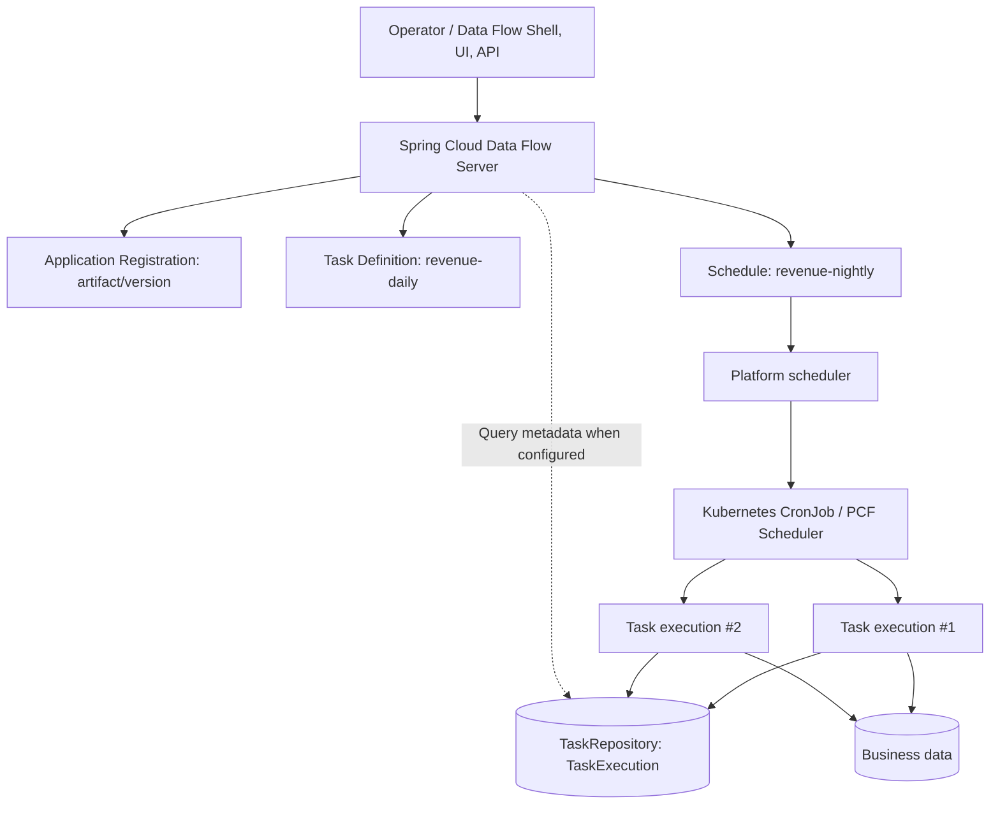
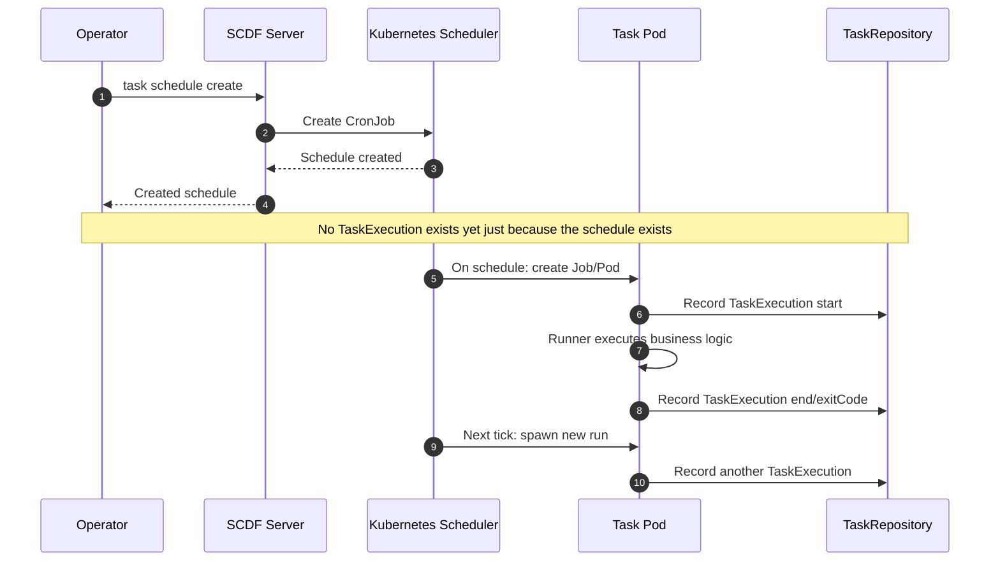

# Integrating a Scheduler via Data Flow When Supported by the Platform

## 1. Problem Statement: Running Spring Cloud Task on a Schedule While Tracking Every Execution

Spring Cloud Task fits applications with a **finite runtime**: transaction reconciliation, file ingestion, report export, purging expired data, or running a Spring Batch step. The application starts, processes, and exits; `TaskRepository` records `TaskExecution` so operations teams can inspect start time, end time, exit code, and error details.

However, **Spring Cloud Task is not a scheduler**. An `ApplicationRunner` does not know on its own that it should run at 02:00 every day. To run on a schedule, an external component must create a **new launch** of the application.

**Spring Cloud Data Flow (SCDF)** is one option when your deployment platform and Data Flow version **support scheduling**. SCDF lets you register task applications, define jobs, create cron schedules, manage existing schedules, and view execution history. Actual triggering is typically delegated to the **platform's scheduler**: for instance, a Kubernetes `CronJob` or a configured scheduler service on Cloud Foundry.

This lesson in the **Scheduling** chapter focuses on **integrating a scheduler through Data Flow when the platform supports it**, without assuming scheduling is built into every SCDF deployment.

After this lesson, you will be able to:

- Distinguish **task application**, **task definition**, **schedule**, and **each `TaskExecution`**.
- Verify the prerequisites for SCDF to schedule tasks on a platform.
- Create a schedule using SCDF Shell/UI with cron syntax appropriate for the environment.
- Understand how configuration, arguments, timezones, and secrets are passed to scheduled runs.
- Observe real-time progress, Task metadata, scheduler errors, and retry policies.
- Choose alternatives such as direct Kubernetes CronJobs or an external scheduler when SCDF does not support scheduling.

## 2. Where Does SCDF Sit Between Task and the Platform Scheduler?

In a typical design, there are **three responsibility boundaries**:

1. **Spring Cloud Task application:** business logic; persists lifecycle metadata into `TaskRepository` once it actually boots.
2. **Spring Cloud Data Flow:** stores application registrations and task definitions, handles requests to create/delete/list schedules, provides API/UI/Shell, and communicates with the task platform.
3. **Platform scheduler/deployer:** maintains schedules and spawns a process, Pod, or task instance at each trigger time.



**Creating a schedule does not mean the Task has run.** SCDF may register the schedule on the platform today, while the application will only launch at the next cron tick. Once the schedule is created, the platform scheduler handles periodic triggering; SCDF recording the schedule does not guarantee that each Pod will pull its image, bootstrap Spring Boot, or successfully write a `TaskExecution`.

For example, suppose you create the `revenue-nightly` schedule at 02:00. If the image does not exist or a Secret is missing, Kubernetes can still create a failing Job, while `TASK_EXECUTION` may have **no new record** because the JVM never initialized the Spring context.

## 3. Four Concepts Never to Confuse

| Concept | Example | Meaning |
| --- | --- | --- |
| **Application registration** | `revenue-app` pointing to artifact `revenue-report:1.0.0` | Tells SCDF which application and artifact can be launched |
| **Task definition** | `revenue-daily` | Defines a job based on a registered task application |
| **Schedule** | `revenue-nightly`, cron `0 2 * * *` | Rule defining **when** the platform launches the task definition |
| **Task execution** | `executionId=731` | **An actual run** recorded by Spring Cloud Task in the repository |

A task definition can have **multiple schedules**, such as a daily schedule and a staging test schedule. A schedule produces **multiple executions** over time. Each normal Spring Cloud Task launch creates a `TaskExecution` with a unique ID while keeping a stable business task name.

### 3.1. Having Spring Cloud Task Does Not Require SCDF

A JAR annotated with `@EnableTask` can still run via `java -jar`, a Kubernetes Job, or another orchestrator **without SCDF**. SCDF merely adds an external management and platform-integration layer.

Conversely, creating a task definition in SCDF **does not turn a long-running program into a finite task**. The registered application must genuinely finish its work and exit. If an unnecessary web server, background thread, or internal scheduler stays active, the Pod may keep running and fail to report the expected completion status.

## 4. Before Creating a Schedule: Confirm Actual Platform Support

SCDF 2.x documentation describes scheduling through the platform's **scheduler agent**. Not every deployment option ships with an integrated scheduler.

| Platform | How Scheduling Is Described in SCDF Docs | Conditions to Verify |
| --- | --- | --- |
| **Kubernetes** | SCDF creates a `CronJob`; the Kubernetes controller creates `Job`/Pods on schedule | Compatible SCDF/K8s deployer; RBAC to create and manage CronJob/Job; valid namespace, image, secrets |
| **Cloud Foundry** | Integrates with the platform's scheduler service, such as PCF Scheduler on supported systems | Scheduler service available, properly provisioned/bound; configured permissions and endpoints |
| **Local deployer** | **No out-of-the-box scheduling** in SCDF guides | Use an external scheduler or custom solution; do not assume schedule commands will work |

**The condition "when supported by the platform" is mandatory.** Service names, availability, and configuration details depend on the SCDF version, deployer, cluster policies, and services provided by your operations team. Before deploying, check the documentation for your **exact version** rather than copying configuration verbatim from another platform.

### 4.1. Enabling Required SCDF Features

Per SCDF 2.x documentation, the two **Data Flow Server** properties that enable task and schedule management are:

```yaml
spring:
  cloud:
    dataflow:
      features:
        tasks-enabled: true
        schedules-enabled: true
```

These belong in the **SCDF Server configuration**, **not the Task's `application.yml`**. In documented versions, scheduling features may be disabled by default.

Enabling the properties is only the first step: you also need a deployer that supports scheduling and platform access permissions. If SCDF runs locally without a backing scheduler, setting `schedules-enabled` alone does not conjure up a cron service.

### 4.2. Infrastructure Checklist Before Hands-On Practice

- SCDF Server, dashboard/Shell, or REST API is accessible with appropriate permissions.
- A corresponding platform account, such as `default` on Kubernetes, is registered with SCDF.
- The platform scheduler supports creating, listing, and deleting schedules; RBAC/service accounts have the necessary permissions.
- The Task artifact is built and **pullable/runnable by the platform**.
- Spring Cloud Task and the metadata database have the matching schema; all runs requiring unified history point to a shared durable store.
- Secrets, database URLs, network policies, quotas, and required resources are provisioned for **the scheduled Pods/processes**, not just for SCDF Server.
- Timezone, overlap policy, retry policy, and execution time limits have been decided.

## 5. Preparing a Finite Spring Cloud Task for SCDF to Launch

We will use a `daily-revenue-report` example that generates a revenue report. The application resolves a business date, calls the reporting service, and exits. This lesson uses Java 17+ and Spring Boot's familiar `ApplicationRunner` API, requiring a compatible Spring Cloud Task dependency.

### 5.1. Task Application

```java
import java.time.Clock;
import java.time.LocalDate;
import java.time.ZoneId;
import java.util.List;

import org.springframework.boot.ApplicationRunner;
import org.springframework.boot.SpringApplication;
import org.springframework.boot.autoconfigure.SpringBootApplication;
import org.springframework.cloud.task.configuration.EnableTask;
import org.springframework.context.annotation.Bean;

@SpringBootApplication
@EnableTask
public class RevenueReportTaskApplication {

    public static void main(String[] args) {
        SpringApplication.run(RevenueReportTaskApplication.class, args);
    }

    @Bean
    Clock businessClock() {
        return Clock.system(ZoneId.of("Asia/Ho_Chi_Minh"));
    }

    @Bean
    ApplicationRunner revenueRunner(Clock businessClock) {
        return args -> {
            List<String> dates = args.getOptionValues("businessDate");

            LocalDate businessDate;
            if (dates == null) {
                // Simple approach: yesterday in the business timezone.
                businessDate = LocalDate.now(businessClock).minusDays(1);
            } else if (dates.size() == 1) {
                businessDate = LocalDate.parse(dates.get(0));
            } else {
                throw new IllegalArgumentException(
                    "Only one --businessDate=yyyy-MM-dd is allowed");
            }

            System.out.println("Revenue report for date " + businessDate);

            // TODO: read data sources, reconcile, and persist the actual report.
            // Wait for completion; throw an exception if the work fails requirements.
        };
    }
}
```

**Business note:** defaulting to "yesterday" is only an illustration for a steady daily schedule. When backfilling, running late, or re-running an older schedule, `LocalDate.now().minusDays(1)` **is not necessarily the date that needs processing**. In production, maintain a per-period **work ledger** or pass a date resolved by the orchestrator, and ensure missed periods can be processed.

If `--businessDate` is supplied, that date acts as an explicit input suitable for manual runs and reconciliation. Never use `TaskExecution.executionId` as a business key to determine whether a reporting period has finished.

### 5.2. Task `application.yml`

```yaml
spring:
  application:
    name: revenue-report-worker
  main:
    web-application-type: none
  cloud:
    task:
      name: daily-revenue-report
  datasource:
    url: ${TASK_DB_URL}
    username: ${TASK_DB_USER}
    password: ${TASK_DB_PASSWORD}
```

The application needs `spring-cloud-starter-task`, a JDBC driver, and Spring Cloud Task metadata tables matching its version and database. `TaskRepository` persists executions after the JVM closes. The name `daily-revenue-report` lets you query history by **task type**, rather than per individual scheduler trigger.

**On Kubernetes:** if the Task container cannot resolve `TASK_DB_URL`/`TASK_DB_USER`/`TASK_DB_PASSWORD` from a Secret or ConfigMap, the application may fail to write metadata. Never pass passwords directly via command-line arguments or store them inside a schedule definition.

## 6. Registering the Application and Creating a Task Definition in Data Flow

SCDF must know the **application artifact** before it can create a schedule. In SCDF Shell, the workflow typically consists of:

1. Registering an application with `type=task`.
2. Creating a task definition referencing the registered application.
3. Testing a manual launch before creating a schedule.

### 6.1. Registering the Artifact

Example on a platform supporting Docker images:

```text
dataflow:> app register --name revenue-app --type task --uri docker://registry.example.internal/team/revenue-report:1.0.0
```

The image URI is only an **example**, not a real artifact. The registry must host a valid image matching the target architecture, and the platform needs pull permissions. The application registration name (`revenue-app`) is what **SCDF** uses to reference the artifact and can differ from `spring.cloud.task.name` inside the program.

### 6.2. Creating a Task Definition

```text
dataflow:> task create --name revenue-daily --definition "revenue-app"
```

`revenue-daily` is the **task definition name in SCDF**. It does not create a `TaskExecution` by itself; it is a saved definition telling subsequent launch/schedule commands which artifact to run.

### 6.3. Testing a Manual Launch

```text
dataflow:> task launch revenue-daily --arguments "--businessDate=2026-11-23"
dataflow:> task execution list
```

`task launch` triggers an on-demand run; `task execution list` inspects metadata when repositories are configured properly.

**Do not schedule immediately without testing a manual launch first.** If the artifact cannot be pulled, the container lacks environment variables, the database schema is wrong, or the application fails to exit, creating a cron schedule turns a one-time failure into a recurring failure loop.

## 7. Creating a Schedule with SCDF Shell on Kubernetes

Example: create a schedule running at **02:00 daily in the platform scheduler's timezone** using Kubernetes five-field cron syntax. Assume SCDF already has a platform account named `default` pointing to the proper cluster and namespace.

```text
dataflow:> task schedule create --name revenue-nightly --definitionName revenue-daily --expression "0 2 * * *" --platform default
```

Parameter breakdown:

| Option | Example Value | Explanation |
| --- | --- | --- |
| `--name` | `revenue-nightly` | Schedule name, used to manage or delete the schedule |
| `--definitionName` | `revenue-daily` | Existing task definition in SCDF |
| `--expression` | `0 2 * * *` | Cron expression in the platform scheduler's format (here, Kubernetes) |
| `--platform` | `default` | Target platform account configured in SCDF |

When creation succeeds, SCDF instructs the platform scheduler to establish the schedule—typically a `CronJob` on Kubernetes. **Creating a schedule does not immediately trigger a test run.** Wait for the next tick or run `task launch` to validate beforehand.

### 7.1. Listing and Deleting Schedules

```text
dataflow:> task schedule list --platform default
dataflow:> task execution list
```

When the schedule is no longer needed:

```text
dataflow:> task schedule destroy --name revenue-nightly --platform default
```

`destroy` deletes the **schedule for future runs**; it **does not guarantee terminating currently running processes** or deleting `TaskExecution` history. Different SCDF versions may have slightly different options and UI screens; check the Shell help command for your exact version.

### 7.2. Supplying Arguments and Properties per Schedule

In supported SCDF versions, the schedule command accepts `--arguments` and `--properties`, for example:

```text
dataflow:> task schedule create --name revenue-nightly --definitionName revenue-daily --expression "0 2 * * *" --platform default --arguments "--reportType=revenue"
```

`--reportType=revenue` is a **static argument** passed to the Task application. This is only an example assuming the runner actually handles `reportType`; in the Java code in Section 5, that parameter is not yet read.

For deployment properties, SCDF uses conventions such as `app.<app-name>.<property>` and `deployer.<app-name>.<property>` in applicable versions. **Actual property keys must match the deployer**, and Secret/resource mappings should be verified on the resulting Pod/Job. Avoid copying a Kubernetes-specific key onto Cloud Foundry expecting the same effect.

## 8. Cron and Timezones: Where Subtle Bugs Arise

**Platform scheduler cron syntax does not necessarily match Spring's `@Scheduled`.**

| Environment | Syntax to Verify | Interpretation |
| --- | --- | --- |
| Kubernetes `CronJob` | Usually **5 fields**: minute, hour, day-of-month, month, day-of-week | `0 2 * * *` is 02:00 in the timezone used by the CronJob/controller |
| Cloud Foundry scheduler | Depends on service/version; SCDF docs show Quartz-like syntax examples | Do not copy Kubernetes cron verbatim if the scheduler parses differently |
| Spring `@Scheduled` | Spring supports its own format, commonly **6 fields** (with seconds) and a `zone` attribute | Triggers a **method inside a living JVM**, not an SCDF schedule |
| Host cron | Depends on OS/daemon | Check host timezone and downtime catch-up behavior |

### 8.1. Example: 02:00 Schedule in Vietnam

If the Kubernetes scheduler interprets `0 2 * * *` in UTC, the job runs at **09:00 AM Vietnam time** rather than 02:00. Conversely, to run at 02:00 in `Asia/Ho_Chi_Minh`, the equivalent non-DST UTC cron is `0 19 * * *` on the **previous UTC day**.

A cleaner solution, if your Kubernetes and deployer versions support it, is configuring the **CronJob's timezone** explicitly and inspecting the generated manifest. Modern Kubernetes provides `spec.timeZone`; whether SCDF forwards this setting to the CronJob **depends on the version and platform adapter**. Never assume that simply putting `Asia/Ho_Chi_Minh` in the application's `application.yml` changes the CronJob's timezone.

In DST-observing regions, clock transitions can skip a tick or shift its interpretation. Design around **business periods**, not merely each Pod's wall-clock time.

### 8.2. "Exactly 02:00" Does Not Mean the Process Starts at 02:00:00

The scheduler issues the launch request at the computed tick; the Job/Pod still takes time to wait for quota, pull images, and bootstrap the JVM. Consequently, `TaskExecution.startTime` may be **later than the cron timestamp**. Never infer the target business period solely from the minutes or seconds of `startTime`.

## 9. Schedule Lifecycle Differs from Task Lifecycle



An important operational point documented by SCDF: **existing schedules do not automatically update in a continuous-deployment fashion** simply because you change the version or properties of a task definition. The platform-managed schedule retains the configuration captured at creation time.

If you bump `revenue-app` from `1.0.0` to `1.1.0`, **the existing CronJob will not automatically pick up the new version**. Inspect which artifact/properties the schedule currently references, then plan to update or **destroy and recreate the schedule** with tested values. Perform production updates carefully to avoid double-running or skipping a run.

## 10. Observing Outcomes Across Three Places

A schedule may **already exist** with zero runs, or the platform may have **created a Job** before the application could record a `TaskExecution`. Therefore, observe across three layers.

### 10.1. Data Flow: Task Definitions, Schedules, Executions

In SCDF Shell:

```text
dataflow:> task schedule list --platform default
dataflow:> task execution list
```

The UI usually provides corresponding Tasks, Schedules, and Task Executions views, though exact names and routes vary by version. When a shared repository is properly configured, Task Executions lists runs persisted by the application into metadata.

### 10.2. Kubernetes: CronJob, Job, and Pod

Example commands to inspect the target deployment namespace:

```bash
kubectl get cronjobs -n task-workloads
kubectl get jobs -n task-workloads
kubectl get pods -n task-workloads
kubectl describe cronjob revenue-nightly -n task-workloads
```

Actual resource names may be normalized or suffixed by the deployer. These commands are illustrative; if SCDF's `default` platform account targets a different namespace, inspect the **actual namespace**.

When a schedule appears not to run, inspect CronJob events, Job status, reasons Pods failed to start (`ImagePullBackOff`, `CreateContainerConfigError`, insufficient quota/RBAC), container logs, exit codes, and restart counts.

### 10.3. TaskRepository: Spring Cloud Task Results

In the standard Spring Cloud Task JDBC schema:

```sql
SELECT TASK_EXECUTION_ID,
       TASK_NAME,
       START_TIME,
       END_TIME,
       EXIT_CODE,
       EXIT_MESSAGE,
       ERROR_MESSAGE
FROM TASK_EXECUTION
WHERE TASK_NAME = 'daily-revenue-report'
ORDER BY TASK_EXECUTION_ID DESC;
```

Verify table/column names against your actual schema and version. `TaskExplorer` also supports querying via the Java API. If `TASK_EXECUTION` has no new record:

- It does not automatically mean the CronJob failed to run; its trigger time may not have arrived yet.
- The platform may have created a Job whose Pod failed before Spring Boot built its context.
- The application may point to the **wrong datasource** or lack the Task schema.
- SCDF and the Task may be querying **two different repositories**.

**`TaskExecution.exitCode=0` does not by itself prove the report numbers are accurate.** Inspect data committed to the business store and run independent reconciliation checks.

## 11. Retries, Failures, and Recovery Across Layers

There are at least three sources of retries to distinguish:

| Layer | Example | Consequence |
| --- | --- | --- |
| Inside the runner | HTTP client/Spring Retry re-calling an API | Multiple **attempts**, usually still **one `TaskExecution`** |
| Platform Job | Kubernetes Job backoff creating a new Pod on failure | Can create **a new `TaskExecution` per process attempt** if bootstrap succeeds |
| Next schedule tick | CronJob firing the next day | A different scheduled period, typically with its own `TaskExecution` |

Never configure unbounded retries across all three layers. If an API client retries `4` times and the platform spawns `3` Pods, a single period could trigger `12` service calls—not counting subsequent schedule ticks.

**Classify failures:** malformed input data is rarely worth retrying as-is; `503`/timeouts may be retried with bounds if idempotent; permission errors require fixing Secrets/roles rather than blind retries.

If the task runs a Spring Batch job, `JobRepository` tracks `JobExecution`/`StepExecution` and checkpoints separately. Integration configuration can propagate `BatchStatus.FAILED` to the Spring Cloud Task outcome; if a Batch job fails while the runner still returns normally, the platform may see a success exit code. Always test status propagation across Batch, Task, and OS process layers.

### 11.1. Losing Repository Connectivity at Shutdown

A task might **already finish writing the report** yet fail to update `END_TIME` due to a database disconnect. If the scheduler retries based on the process exit code, it risks generating the report twice. Use a stable **idempotency key**, such as `(reportType, businessDate)`, unique constraints/upserts, and a status reconciliation workflow.

## 12. Preventing Overlaps and Handling Missed Schedules

A 02:00 schedule may encounter a job running past 24 hours, node power loss, scheduler downtime, or backfill needs.

### 12.1. Concurrency Policies

In Kubernetes CronJob, common `concurrencyPolicy` options are:

| Policy | Meaning | Considerations |
| --- | --- | --- |
| `Allow` | Allows multiple Jobs from consecutive ticks to run concurrently | Requires data protection against duplicate processing and load limits |
| `Forbid` | Skips launching a new Job if the previous Job is still running | Can skip ticks; requires a mechanism to detect unprocessed periods |
| `Replace` | Replaces the currently active Job with a new Job | Dangerous for side-effecting workloads; requires safe shutdown/recovery |

This policy belongs to the **platform CronJob**, not `spring.cloud.task.name`. If SCDF does not expose this field via scheduler properties in your version, use a deployment/customization approach supported by your platform; **never invent `spring.cloud.task.*` properties** expecting them to control a CronJob.

### 12.2. Missed Periods, Backfills, and Time Limits

Kubernetes provides options such as `startingDeadlineSeconds` and `activeDeadlineSeconds` at different resource levels; define policies for missed ticks and runaway Jobs. Never confuse the **deadline to start a scheduled Job** with the **maximum runtime allowed for a single Job**.

For daily reporting:

1. Store `businessDate` and period status in a business table.
2. Mark `COMPLETED` only after output data has been verified.
3. Before generating results, check whether the period is already complete or currently being processed.
4. Provide a backfill path for missed dates, passing the target date **explicitly**.
5. Use locks or unique constraints to prevent two Pods from writing the same period concurrently.

Do not let every 09:00 run after an outage blindly process `LocalDate.now().minusDays(1)` when **multiple days** are actually missing. The scheduler decides **when to launch**, while the ledger decides **which data period needs completion**.

## 13. Arguments, Properties, Secrets, and Artifact Versions

### 13.1. Static Schedule Arguments

SCDF lets you configure arguments when creating a schedule. These are typically passed to every scheduled launch. For instance, `--reportType=revenue` can remain constant across ticks, whereas `--businessDate=2026-11-23` **must not be hardcoded** in a daily recurring schedule.

If computing dates at runtime, you can use a `Clock` in the business timezone as shown, but you still need a separate backfill path. A more resilient pattern is having the schedule simply wake a worker, which claims an **unprocessed period** from a database/work ledger and locks it transactionally.

### 13.2. App Properties and Deployment Properties

In SCDF versions supporting these conventions:

- `app.<application-name>.<key>`: property passed to the application.
- `deployer.<application-name>.<key>`: property intended for the platform deployer.
- Scheduler properties use the scheduler namespace, such as `spring.cloud.scheduler.cron.expression` in internal APIs.

Exact keys depend on the **API, Shell, platform account, and version**. Shell `--expression` is often cleaner than passing raw cron keys directly in many examples. Never copy a Secret, volume, or RBAC property written for Kubernetes onto Cloud Foundry.

### 13.3. Never Put Secrets in Schedules

Passwords and tokens can leak into SCDF task properties, shell history, logs, process args, or `TASK_EXECUTION_PARAMS`. Use Kubernetes Secrets, service bindings, or platform secret mechanisms, granting least privilege to the Task. Ensure secrets are mounted on **each scheduled process/Pod**, not just on SCDF Server.

### 13.4. Updating Artifacts and Versions Safely

An existing schedule may keep using the old artifact and properties. Before rolling out a new version:

1. Register and **manually test-launch** the new artifact.
2. Check which version the active schedule references and how your scheduler handles updates.
3. Choose a rollout window so two schedules do not run the same period simultaneously.
4. Update or recreate the schedule using your platform's supported method.
5. Observe at least one new scheduled run and compare logs/versions.

Never blindly modify or destroy a schedule at the exact moment the scheduler is spawning a Job.

## 14. Alternatives When SCDF Does Not Support Scheduling

SCDF is **not mandatory** to operate Spring Cloud Task. If your local environment or platform/deployer lacks an integrated scheduler, an external tool can **launch the Task** on schedule.

### 14.1. Direct Kubernetes CronJob

If the application is already containerized and running on Kubernetes, you can manage the CronJob via manifests/IaC instead of going through SCDF.

**Illustrative** example, assuming Kubernetes supports `timeZone` and the referenced Secret already exists:

```yaml
apiVersion: batch/v1
kind: CronJob
metadata:
  name: revenue-report-nightly
spec:
  schedule: "0 2 * * *"
  timeZone: "Asia/Ho_Chi_Minh"
  concurrencyPolicy: Forbid
  successfulJobsHistoryLimit: 3
  failedJobsHistoryLimit: 3
  jobTemplate:
    spec:
      backoffLimit: 1
      activeDeadlineSeconds: 3600
      template:
        spec:
          restartPolicy: Never
          containers:
            - name: revenue-report
              image: registry.example.internal/team/revenue-report:1.0.0
              envFrom:
                - secretRef:
                    name: revenue-task-db
```

Verify image pull secrets, service accounts, namespaces, quotas, security contexts, and database schemas in your real environment. Kubernetes `timeZone` support depends on cluster version/features; **never assume every cluster supports it**.

This manifest is an **alternative approach**, meaning Data Flow will not automatically know about an externally created CronJob. To view Task metadata in SCDF/UI, ensure compatible datasource and registration/observation wiring; otherwise use the Kubernetes dashboard and query `TaskRepository` directly.

### 14.2. Orchestration Outside Kubernetes

- **Cron on Linux:** invokes `java -jar` or a script/container CLI; requires managing secrets, logs, locks, and retries yourself.
- **Quartz or a custom scheduler app:** sends SCDF REST API `task launch` requests, or invokes an appropriate `TaskLauncher` if supported by the platform.
- **Other workflow orchestrators:** spawn Task processes via API/job runners, track outputs, and enforce step ordering.

Do not rely solely on `@Scheduled` inside a **finite Spring Cloud Task application** expecting it to stay alive forever waiting for triggers. If an app must stay running indefinitely waiting for cron ticks, it no longer fits the standard short-lived Task model.

## 15. Troubleshooting Layer by Layer

| Symptom | Where to Check First | How to Isolate |
| --- | --- | --- |
| `task schedule create` missing or rejected | SCDF version, feature flags, API permissions, scheduler support | Verify `tasks-enabled`/`schedules-enabled` and platform account |
| Schedule creation fails on Kubernetes | Deployer, namespace, RBAC, CronJob API | Inspect SCDF Server errors and service account permissions |
| Schedule exists but no Job appears | CronJob status, cron expression, timezone, suspend/deadline | Run `kubectl describe cronjob` and check controller events |
| Job exists but no Pod runs | Quota, image/secret, service account, pod scheduling | Inspect `kubectl get/describe jobs,pods` |
| Pod starts then fails before runner | Spring config, datasource, schema, classpath | Check container logs; `TaskExecution` may not exist yet |
| No new row in `TaskRepository` | Wrong database, bootstrap error, scheduler did not fire | Cross-check platform Job/Pod and repository URL |
| `TaskExecution.exitCode=0` yet report is missing | Logic bug, skipped work, swallowed exception | Verify output data and Batch `JobExecution` |
| Two runs for the same `businessDate` | Pod retry, overlapping schedules, parallel manual run | Enforce business keys/idempotency and concurrency limits |
| Schedule still runs old image | Schedule does not auto-update when definition changes | Inspect manifest/version and update/recreate schedule |
| Task killed mid-processing | Deadline, OOM, node eviction, or Job cancellation | Check Pod/Job status and run business recovery |
| Runs at 09:00 instead of 02:00 Vietnam time | Cron interpreted in UTC | Verify scheduler/platform timezone |

Never draw conclusions from a single layer. A row in SCDF **Schedules** proves the schedule was declared; an existing `CronJob` proves the platform holds the schedule; a `Job`/Pod proves a launch occurred; a `TaskExecution` with `END_TIME` proves the framework recorded completion; and business data proves the work actually achieved its goal.

## 16. Deployment Scenario: Daily 02:00 Report

Suppose the requirement is: compute **yesterday's** revenue at **02:00 Vietnam time**, at most one active task at a time, with support for backfilling missed days.

### Design

- **Task artifact:** `revenue-report:1.0.0` containing a synchronous runner that exits after writing the report.
- **SCDF task definition:** `revenue-daily` using application registration `revenue-app`.
- **SCDF schedule:** `revenue-nightly` configured with platform-appropriate cron/namespace/timezone.
- **TaskRepository:** durable PostgreSQL instance shared across all observable runs.
- **Business data:** ledger table keyed by `businessDate` with a unique constraint and status column so re-runs do not produce duplicate reports.
- **Safeguards:** timeouts, bounded retries, appropriate concurrency policy; alerts when a reporting period is missing or fails.

### Test Steps

1. Confirm SCDF has a scheduler for the target platform and scheduling permissions are enabled.
2. Build and register the Task artifact; test `task launch revenue-daily` with an explicit `--businessDate`.
3. Verify the Job/Pod, logs, `TaskExecution`, and generated report.
4. Create the schedule with the appropriate cron expression; verify the **actual timezone** in platform config.
5. After the first tick, reconcile one Job/Pod against one `TaskExecution` and the reporting period status.
6. Inject a simulated failure in a test run to verify retries/alerts do not loop indefinitely.
7. Simulate a missed schedule and use the **backfill** path to process the exact missing date.
8. Trigger two parallel runs for the same date to verify the unique constraint/lock prevents duplicate data.
9. Test upgrading the artifact, inspect which version the schedule points to, and follow the proper update procedure.
10. Delete the test schedule; confirm **no future ticks occur**, while historical data remains intact for auditing.

## 17. Pre-Production Schedule Checklist

- [ ] The SCDF platform/deployer **genuinely supports scheduling**; never assume local deployer includes cron.
- [ ] Proper feature flags are enabled on **SCDF Server**, along with platform accounts and RBAC.
- [ ] The Task artifact has a finite lifecycle and holds no unnecessary HTTP server or worker threads open.
- [ ] The Task application uses a durable `TaskRepository` with a version-matched metadata schema.
- [ ] Manual launch has been tested and outputs verified before creating a schedule.
- [ ] Cron syntax and timezone have been verified on the **platform**, not solely inside the application.
- [ ] Schedule arguments do not inadvertently hardcode a single business date across every tick.
- [ ] A backfill policy exists for missed or delayed periods.
- [ ] Secrets, `imagePullSecrets`, network access, and DB permissions are available to actual worker Pods/processes.
- [ ] Concurrency policy, deadlines, and retry budgets are defined.
- [ ] Business operations use a per-period idempotency key rather than `executionId`.
- [ ] SCDF Schedules, platform Jobs/Pods, and `TaskExecution` are all monitored.
- [ ] Alerts exist for bootstrap failures, Batch failures, long-running Tasks, bad outputs, or missed ticks.
- [ ] When updating artifacts/versions, schedules are updated or recreated via a controlled procedure.

## 18. Self-Check Questions

**Question 1.** Why doesn't adding the `spring-cloud-starter-task` dependency make an application run automatically at 02:00 every day?

**Question 2.** Distinguish application registration, task definition, schedule, and `TaskExecution` using the `revenue-daily` example.

**Question 3.** Why is a successful `task schedule create` command not enough to confirm a record exists in `TASK_EXECUTION`?

**Question 4.** On a Kubernetes platform using UTC, what time in Vietnam does cron `0 2 * * *` correspond to? What must be done to meet a 02:00 Vietnam-time schedule?

**Question 5.** A schedule keeps launching an old image after you update the task definition version. What could be the cause?

**Question 6.** Is `concurrencyPolicy: Forbid` sufficient to guarantee every reporting day gets processed? Why or why not?

**Question 7.** If a CronJob creates a Pod but no `TaskExecution` appears, which sources should you inspect?

**Question 8.** In a system using Spring Batch, why might `BatchStatus.FAILED` need to be propagated to the Task's exit code?

**Answer hints:** (1) Task tracks execution lifecycle and needs an external scheduler to launch it; (2) registered artifact → defined job → schedule trigger → concrete run; (3) the next tick may not have fired yet or the Pod failed before bootstrap; (4) 09:00 Vietnam time if cron runs in UTC—configure supported timezone or adjust and verify the schedule; (5) existing schedules do not auto-update artifacts/properties; (6) it may skip a tick while the previous Job is still running, requiring a ledger/backfill; (7) SCDF, CronJob/Job/Pod, logs, database URL/schema; (8) so the scheduler does not treat a failed Batch job as a successful Task.

## 19. Summary

**Spring Cloud Data Flow integrates scheduling only when supported by the platform scheduler and deployment version.** In the model described by SCDF documentation, Kubernetes uses `CronJob`, Cloud Foundry requires an equivalent scheduler service, and the local deployer has no built-in scheduling. SCDF manages task definitions and schedules; the platform triggers executions; Spring Cloud Task records metadata for **each application that actually runs** into `TaskRepository`.

A safe scheduling solution is more than a cron expression. You must verify **artifacts, timezones, platform permissions, secrets, datasources, concurrency, timeouts, retries, and idempotency**, distinguish scheduler failures from bootstrap and business errors, and provide a backfill path so no data period is missed. When SCDF is not a fit, you can use Kubernetes CronJobs directly or another orchestrator while preserving the same finite Spring Cloud Task model.

**Official references (verify against your exact version):**

- [Spring Cloud Data Flow — Batch Job Scheduling](https://dataflow.spring.io/docs/feature-guides/batch/scheduling/)
- [Spring Cloud Data Flow — Multi-Platform Task Scheduling](https://dataflow.spring.io/docs/recipes/multi-platform-deployment/multi-platform-task/)
- [Spring Cloud Data Flow — Architecture, Short-Lived Applications](https://dataflow.spring.io/docs/concepts/architecture/)
- [Spring Cloud Data Flow — Reference Guide, Scheduling Tasks](https://docs.spring.io/spring-cloud-dataflow/docs/2.11.3/reference/htmlsingle/)
- [Spring Cloud Task — Task lifecycle and TaskRepository](https://docs.spring.io/spring-cloud-task/reference/features.html)
- [Kubernetes — CronJob concept](https://kubernetes.io/docs/concepts/workloads/controllers/cron-jobs/)
