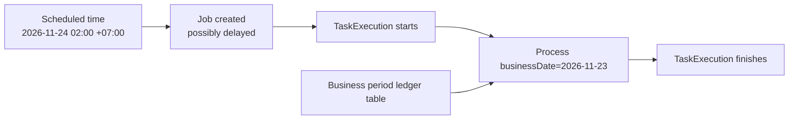

# Timezones, Missed Schedules, and Backfill Policies

## 1. Why Scheduling Is Not Simply Setting a Cron Expression

**Spring Cloud Task** helps you build Spring Boot applications with a finite runtime: they start, accept arguments, process a job, record `TaskExecution` via `TaskRepository`, and exit. A Task can run on a schedule, on demand, or under an external orchestrator. **Spring Cloud Task does not provide a full distributed scheduler on its own**: launching runs at the right time is typically handled by cron, Kubernetes CronJob, Spring Cloud Data Flow, or a dedicated scheduler.

For example, suppose a system must reconcile the **previous day's** data every day at **02:00 Vietnam time**. If the Kubernetes controller experiences an outage right at 02:00 and recovers at 04:20, the critical questions are:

- Should a delayed Job be created for the 02:00 schedule?
- If it runs at 04:20, **which date's** data must the Task process?
- If three consecutive days were missed, should all three be backfilled or only the latest one?
- If yesterday's run has not finished yet, should the new run be created?
- How do we prevent duplicate processing or corrupt data during backfills?

A cron expression alone does not answer any of these questions. You must design **timezones**, **data-period conventions**, **late-start limits**, **backfill policies**, **concurrency coordination**, and **idempotency** together.

After this lesson, you will be able to:

1. Distinguish scheduled time, Job creation time, Task start time, and the target data date/window.
2. Configure explicit timezones for Kubernetes CronJob and Spring `@Scheduled`.
3. Understand the impact of DST, five-field vs. six-field cron syntax, and system clocks.
4. Analyze `startingDeadlineSeconds`, `concurrencyPolicy`, `suspend`, and CronJob limitations.
5. Choose among **skip**, **latest-only**, **bounded catch-up**, **sequential backfill**, or **manual reconciliation** policies.
6. Build a period-tracking ledger in the database using business keys, leases, and safe replay mechanisms.
7. Investigate missed schedules even when `TaskRepository` has no record of a run at all.

## 2. Four Timestamps and One Business Identifier

### 2.1. Do Not Mix Up Time Concepts

| Concept | Example | What Is It Used For? |
| --- | --- | --- |
| **Scheduled time** | 02:00 on Nov 24 in `Asia/Ho_Chi_Minh` | The time the schedule was supposed to trigger |
| **Job creation time** | 02:01 on Nov 24 | When the scheduler/deployer actually created the Job |
| **Task start time** | 02:03 on Nov 24 | When the Spring Cloud Task process started and recorded itself |
| **Completion time** | 02:09 on Nov 24 | When the Task finished or persisted final results |
| **Business date/window** | Date `2026-11-23` | The data slice the Task must process |

A schedule triggered on `2026-11-24` at 02:00 **does not necessarily process data for November 24**. When business rules require the previous day, the target is `2026-11-23`.

The right mental model:



**Job creation time** is not when the process starts, and `START_TIME` in `TASK_EXECUTION` is not the scheduled time. If the scheduler **never creates a Job**, there may be no `TaskExecution` at all to inspect. Therefore, the system needs an additional source of truth recording **which periods were supposed to run**.

### 2.2. Store Timestamps in UTC, Interpret Schedules with IANA Timezones

For event timestamps and logs, store or exchange values as `Instant`/UTC (with offsets where needed). For local wall-clock schedules, use **IANA** timezone IDs such as:

- `Asia/Ho_Chi_Minh` for Vietnam local time.
- `Etc/UTC` for strict UTC schedules.
- `Europe/Berlin` for Berlin time, which observes DST transitions.
- `America/New_York` for New York time, which observes DST transitions.

Do not confuse `+07:00` with `Asia/Ho_Chi_Minh`: an offset is a fixed displacement at a point in time, whereas a `ZoneId` encapsulates a region's full time rules. Some regions shift offsets during the year or across history. Using `ZoneId` names makes schedule rules unambiguous.

**Three independent timezone settings** can coexist:

1. The timezone **the scheduler uses to interpret cron**.
2. The timezone **of the JVM/process**, used by local-time APIs and logs.
3. The **business timezone**, used to determine data dates and windows.

Setting CronJob `timeZone` **does not set** the JVM timezone; setting `TZ` on a container **does not alter** the Kubernetes scheduler's timezone. Specify each layer explicitly.

## 3. Cron Has No Single Universal Syntax Across Platforms

| Platform | Typical Format | Example for 02:00 Daily | How Timezone Is Configured |
| --- | --- | --- | --- |
| Common Linux `cron` | 5 fields: minute, hour, day, month, weekday | `0 2 * * *` | Daemon config / `CRON_TZ` if supported by implementation |
| Kubernetes CronJob | 5 fields | `0 2 * * *` | `spec.timeZone` |
| Spring `@Scheduled(cron=...)` | 6 fields, **including seconds** | `0 0 2 * * *` | `zone` attribute |
| Quartz / certain platforms | Custom cron syntax with seconds and `?` | Check backend documentation | Depends on scheduler/plugin |

Same intent, **different syntax**:

```yaml
# Kubernetes CronJob: 5 fields
schedule: "0 2 * * *"
timeZone: "Asia/Ho_Chi_Minh"
```

```java
// Spring Framework @Scheduled: 6 fields
@Scheduled(cron = "0 0 2 * * *", zone = "Asia/Ho_Chi_Minh")
public void triggerDaily() {
    // Trigger logic, not a self-scheduling finite Task.
}
```

Do not copy `0 2 * * *` from Kubernetes into `@Scheduled` expecting Spring to parse it identically. Likewise, never embed `CRON_TZ=...` or `TZ=...` inside Kubernetes `spec.schedule`: Kubernetes docs state that syntax is **unsupported**; use `spec.timeZone` instead.

## 4. Timezones and DST: A Day Is Not Always 24 Hours

### 4.1. Wall-Clock Schedules Differ from Fixed Intervals

Consider two requirements:

- **"Run at 02:30 every day in local time."** This is a *wall-clock* schedule. In a DST timezone, 02:30 may not exist or may happen twice on transition days.
- **"Run exactly every 24 hours."** This is an *elapsed-duration* interval and will not always land at the same local hour across DST transitions.

For daily business schedules, most cases target **local calendar days**: a day's data ends when the local clock crosses midnight into the next day. In that case, never compute the boundary with `start.plus(Duration.ofHours(24))` across all timezones.

### 4.2. European DST Example

`Europe/Berlin` observes summer/winter clock transitions. In 2026:

- Early morning on **2026-03-29**, local `02:30` **does not exist** during the spring-forward gap.
- Early morning on **2026-10-25**, local `02:30` **has two valid offsets** during the fall-back overlap.

When a scheduler evaluates a cron expression hitting a gap or overlap, **verify the exact behavior on your scheduler version and timezone database**. Never assume every tool shifts 02:30 to 03:30 or guarantees "strictly once per day" across DST.

Java can inspect timezone rules using `ZoneRules`:

```java
import java.time.LocalDateTime;
import java.time.ZoneId;

ZoneId berlin = ZoneId.of("Europe/Berlin");

LocalDateTime springGap =
        LocalDateTime.of(2026, 3, 29, 2, 30);
LocalDateTime autumnOverlap =
        LocalDateTime.of(2026, 10, 25, 2, 30);

System.out.println(
        berlin.getRules().getValidOffsets(springGap).size()); // 0
System.out.println(
        berlin.getRules().getValidOffsets(autumnOverlap).size()); // 2
```

An offset count of `0` means the local time does not exist; `1` means a normal local time; `2` means a repeated hour. This detects **ambiguity**, rather than simulating every scheduler's behavior.

`Asia/Ho_Chi_Minh` does not currently observe DST, so a 02:00 daily schedule there avoids these transitions. However, when supporting multiple countries or international datasets, you must check DST in **the customer's timezone**.

### 4.3. Computing Data Windows Using Local Day Boundaries

When processing data by `businessDate`, compute the **half-open** interval `[start, end)` and convert to `Instant`:

```java
import java.time.Instant;
import java.time.LocalDate;
import java.time.ZoneId;

record TimeWindow(Instant startInclusive, Instant endExclusive) {
    static TimeWindow forBusinessDate(
            LocalDate date, ZoneId businessZone) {
        Instant start =
                date.atStartOfDay(businessZone).toInstant();
        Instant end =
                date.plusDays(1).atStartOfDay(businessZone).toInstant();
        return new TimeWindow(start, end);
    }
}
```

SQL example:

```sql
SELECT *
FROM orders
WHERE created_at >= :startInclusive
  AND created_at < :endExclusive;
```

`:startInclusive` and `:endExclusive` are named parameters bound as `timestamp`/`timestamptz` per your driver. Half-open intervals prevent processing boundary records twice. Across DST transitions, the span between the two `Instant` values can be **23 or 25 hours**, which is exact when business semantics follow **local calendar days**.

## 5. Who Schedules a Spring Cloud Task?

### 5.1. Finite Tasks vs. Long-Running Schedulers

A Spring Cloud Task `ApplicationRunner` finishes its work and returns. It should not exit and expect `@Scheduled` to wake the same process up tomorrow. `@Scheduled` requires a **living scheduler application**.

Deployment options:

| Option | Strengths | Limitations to Manage |
| --- | --- | --- |
| OS Cron | Simple on a single host | Host failures, daemon timezone, failover, and missed schedules |
| Kubernetes CronJob | Creates Jobs/Pods on cron; supports timezone, deadlines, concurrency policy | Does not guarantee once-per-period execution; no full business backfill |
| Spring Cloud Data Flow Scheduler | Manages schedules tied to Task definitions/APIs; delegates to platform scheduler | Syntax and behavior differ between Kubernetes and Cloud Foundry; verify release |
| Spring `@Scheduled` in a long-lived service | Easy to write in Java, supports `zone` | Multiple replicas can fire duplicates; downtime misses require separate recovery |
| Dedicated workflow scheduler | Tracks data periods, retries, backfills, dependencies | Additional infrastructure and operational overhead |

**Principle:** The scheduler is responsible for *requesting execution*, while Spring Cloud Task is responsible for *running and recording the execution*. The two layers connect via `TaskLauncher`, Kubernetes Jobs, Data Flow, or JAR invocation.

### 5.2. Spring `@Scheduled` Example for a Launcher Application

If you use a **long-running service** to launch Tasks on a schedule, do not place `@Scheduled` inside the finite Task itself:

```java
import java.time.LocalDate;
import java.time.ZoneId;
import org.springframework.scheduling.annotation.EnableScheduling;
import org.springframework.scheduling.annotation.Scheduled;
import org.springframework.stereotype.Component;

@Component
public class DailyTaskTrigger {
    private static final ZoneId BUSINESS_ZONE =
            ZoneId.of("Asia/Ho_Chi_Minh");

    private final DailyLaunchService launchService;

    public DailyTaskTrigger(DailyLaunchService launchService) {
        this.launchService = launchService;
    }

    @Scheduled(cron = "0 0 2 * * *", zone = "Asia/Ho_Chi_Minh")
    public void trigger() {
        LocalDate businessDate =
                LocalDate.now(BUSINESS_ZONE).minusDays(1);
        launchService.requestIfAbsent("orders", businessDate);
    }
}

// Place @EnableScheduling in the LAUNCHER application's configuration.
```

`DailyLaunchService` is a **custom application service** that checks schedules, records the target period, and invokes the launcher. This pattern only computes `businessDate` accurately for **on-time triggers**; if the launcher is down for two days, `@Scheduled` does not replay the missed calls. A separate period `reconciliation` process is needed. With multiple launcher replicas, use leader election, locking, or database claims so both do not launch simultaneously.

## 6. Kubernetes CronJob: Three Settings Governing Missed Schedules

### 6.1. Illustrative Manifest

Example of a Task running daily at 02:00 Vietnam time:

```yaml
apiVersion: batch/v1
kind: CronJob
metadata:
  name: orders-reconcile-daily
  namespace: batch-jobs
spec:
  schedule: "0 2 * * *"
  timeZone: "Asia/Ho_Chi_Minh"
  startingDeadlineSeconds: 1800
  concurrencyPolicy: Forbid
  suspend: false
  successfulJobsHistoryLimit: 3
  failedJobsHistoryLimit: 3
  jobTemplate:
    spec:
      backoffLimit: 0
      activeDeadlineSeconds: 5400
      template:
        spec:
          restartPolicy: Never
          serviceAccountName: orders-task-runner
          containers:
            - name: orders-task
              image: registry.example.com/platform/orders-task:1.4.2
              args:
                - "--source=orders"
              env:
                - name: BUSINESS_ZONE
                  value: "Asia/Ho_Chi_Minh"
                - name: TASK_DB_PASSWORD
                  valueFrom:
                    secretKeyRef:
                      name: orders-task-db
                      key: password
              resources:
                requests:
                  cpu: "250m"
                  memory: "256Mi"
                limits:
                  memory: "768Mi"
```

This template is **incomplete for production**: you must supply JDBC URL/username, permissions, namespace, Secrets, registry details, and appropriate resource limits. The image must have an entrypoint forwarding `args` to the application. CronJob `spec.timeZone` has been stable in Kubernetes since **v1.27**; verify your actual cluster version before applying.

**Business warning:** The manifest only passes `--source=orders` without a data date. If the Task computes "yesterday" based on **when the Pod actually starts**, a schedule delayed past midnight can process the **wrong period**. For backfills, pass `--business-date` explicitly or extract a **reliable scheduled timestamp** through a controlled launch layer.

### 6.2. `startingDeadlineSeconds` Is the Late-Start Window

`spec.startingDeadlineSeconds` is the maximum number of **seconds** after a scheduled trigger time within which the controller is allowed to **create the corresponding Job**.

With `startingDeadlineSeconds: 1800`:

- Scheduled for 02:00, controller recovers at 02:10: creating the Job is **within the 30-minute deadline**, subject to actual state and controller rules.
- Controller recovers at 03:00: the 02:00 trigger is **past the deadline** and will not be created late based on this setting.
- If omitted: there is no configured start deadline; the controller still applies its own missed-schedule limits and semantics.

`startingDeadlineSeconds` does **not** cap Pod **execution duration**. That is the role of `activeDeadlineSeconds` on `Job`. Nor does it tell the Task to catch up on all missed business days.

Kubernetes docs warn that setting `startingDeadlineSeconds` too short (e.g., **under 10 seconds**) can cause Jobs not to be created due to the CronJob controller's polling interval. Do not configure tiny values expecting "exact second-level accuracy".

### 6.3. `concurrencyPolicy`: `Allow`, `Forbid`, and `Replace`

| Policy | When a New Tick Arrives While an Old Job Runs | Risks and Implications |
| --- | --- | --- |
| `Allow` (default) | Allows concurrent overlapping Jobs | Requires independent data slices or idempotency/locks |
| `Forbid` | Skips creating the new Job at that tick; deadline rules may allow a late start once the old Job finishes | Prevents overlap within the **same CronJob**, but can cause skipped periods |
| `Replace` | Terminates the old Job and replaces it with the new Job | Can interrupt partially committed work; requires safe checkpoints/restarts |

`Forbid` **only coordinates Jobs belonging to the same CronJob**. A manual Job or another CronJob can still touch the same data. `Replace` does not roll back outbound HTTP calls or already-committed transactions from the terminated Job.

Example: the Nov 23 Job runs until 02:20 on Nov 24, while the Nov 24 schedule should fire at 02:00. `Forbid` prevents the 02:00 run from launching on time. If `startingDeadlineSeconds` still permits it when the old Job ends, the controller **may** launch the Job late; otherwise the period is skipped. For data where missed periods are unacceptable, use an external detector/backfill mechanism.

### 6.4. `suspend` and Resuming Schedules

`spec.suspend: true` stops creating **new Jobs**, without terminating Jobs already in progress. Triggers falling due while suspended count as missed schedules.

According to current Kubernetes documentation, changing `suspend: true` to `false` without `startingDeadlineSeconds` may cause the controller to create **one Job for the most recent missed schedule**, **not** a Job for every period missed during suspension. When a deadline is set, missed triggers are evaluated against the valid start window.

**Never un-suspend a CronJob after extended maintenance assuming all missed periods will automatically backfill.** Reconcile your data-period ledger and plan backfills deliberately.

### 6.5. Over 100 Missed Times Does Not Mean Full Backfill

Kubernetes tracks missed scheduled times with a documented threshold of **more than 100**. Current Kubernetes guides describe a `TooManyMissedTimes` warning where the controller may only schedule **one Job for the most recent scheduled time**, without automatically re-creating older ones. Some older version docs described creating zero Jobs past the threshold, so verify the controller behavior on your **actual cluster version**.

Setting `startingDeadlineSeconds` changes the window the controller uses to count missed schedules, yet **does not turn CronJob into a guaranteed multi-period backfill engine**.

### 6.6. Scheduled Timestamp in Kubernetes v1.32+

Since Kubernetes **v1.32**, Jobs created by a CronJob carry the annotation:

```text
batch.kubernetes.io/cronjob-scheduled-timestamp
```

Its value is the **expected** scheduled timestamp in RFC3339 format. This separates when the Job was supposed to be created from when the controller actually created it. However, the annotation **does not automatically become part of Spring Boot's `ApplicationArguments`**; if the Task needs it, a launcher/wrapper component or controlled injection mechanism must read and pass it properly.

Never assume a Pod automatically has a `SCHEDULED_AT` environment variable unless you built that delivery path.

## 7. Missed Schedules: Know Exactly Which Layer Missed

| Scenario | Job/Pod Exists? | TaskExecution Exists? | Data Impacted? | Where to Inspect |
| --- | --- | --- | --- | --- |
| CronJob controller did not create Job | Usually no | No | Nothing from the missed run | CronJob events, expected schedule, ledger |
| `Forbid` blocked Job due to old Job | Not at scheduled time for that period | No | Old job may still be running | `concurrencyPolicy`, active Jobs, deadline |
| CronJob has `suspend=true` | No new Job created | No | Nothing new | `spec.suspend`, pause history |
| Job created but Pod stays Pending | Job exists; Pod Pending | Usually no | Business logic has not run | Quotas, node scheduling, PVCs, image pull |
| Pod started but app crashed early | Yes | Maybe not | Usually none, not guaranteed | Logs, datasource/schema |
| Runner failed after partial commits | Yes | Usually yes if repository works | May have partial commits | `TaskExecution`, business DB, logs |
| Pod killed before writing final status | Yes | May lack `END_TIME` | May have partial commits | Job/Pod exit status, checkpoints, DB |
| Task reported success on wrong date | Yes | May record success | **Yes** | `argv`, business window, actual output |

A missing Job and a created Job that failed are **not the same failure mode**. The system must distinguish a **schedule gap** (a period that should have spawned a Job but never did) from an **execution failure** (an execution started and failed).

### 7.1. Which Latencies Should Be Measured?

```text
scheduled_at  -> job_created_at -> task_started_at -> completed_at
                |                 |                   |
           launch lag         startup lag         runtime
```

- **Launch lag** = `job_created_at - scheduled_at`.
- **Startup lag** = `task_started_at - job_created_at`.
- **Runtime** = `completed_at - task_started_at`.
- **Business backlog age** = current time minus the due time of the oldest incomplete data period.

A Job starting on time yet processing the wrong date is not a success; conversely, a Task producing accurate data with huge launch lag can still breach data-freshness SLAs.

## 8. Backfill Policies and When to Choose Each

| Policy | Behavior After Missing Three Periods | Best Fit | Risks |
| --- | --- | --- | --- |
| **Skip** | Ignores all three, waits for the next scheduled tick | Ephemeral caches, reports not needing full history | Data gaps |
| **Latest only** | Runs only the newest valid period | Current-state snapshots, cache warmers | Historical periods missing |
| **Bounded catch-up** | Backfills periods within a window, e.g., 48 hours | Near-complete datasets with staleness limits | Older periods need manual handling |
| **Sequential backfill** | Replays periods oldest-to-newest one by one | Balances, cumulative reports, period-dependent data | Slow if backlog is large |
| **Bounded parallel backfill** | Backfills independent periods with a worker limit | Partitioned independent reports | DB/API contention, quota exhaustion |
| **Manual approval** | Lists missing periods and waits for sign-off | Financial or high-risk operations | Slower recovery |

**Spring Cloud Task has no built-in policy choosing these for you.** They are business and operational design decisions.

### 8.1. Policy Examples by Task Type

- **Cache refresh every 5 minutes:** after missing 12 runs, running once for the latest state is usually enough without replaying 12 stale snapshots.
- **Daily payment reconciliation:** every `businessDate` must have its own output; backfill sequentially or under business constraints without skipping days.
- **End-of-day inventory report:** if reliable end-of-day snapshots exist, generate one report per day even if the job backfills late.
- **Marketing notifications:** backfilling multiple days at once could spam recipients; enforce a staleness cutoff and require manual approval.

### 8.2. Backfilling Is Not Simply "Re-Running the Same Command"

```bash
# Unsafe for backfilling older dates if code always computes LocalDate.now().minusDays(1)
java -jar orders-task.jar --source=orders

# Explicit input, controllable and reconcilable
java -jar orders-task.jar --source=orders --business-date=2026-11-22
java -jar orders-task.jar --source=orders --business-date=2026-11-23
```

In a backfill-capable model, **`businessDate` must be an explicit, durable business parameter** passed into the Task. Re-running the same date creates a **new `TaskExecution`** while operating on the **same business key** and preventing duplicate writes.

## 9. Defining an Explicit Business Window Inside the Task

### 9.1. Parse `businessDate` Instead of Inferring from Execution Time

`ApplicationArguments` lets Spring Boot read `--business-date`:

```java
import java.time.LocalDate;
import java.time.ZoneId;
import java.util.List;
import org.springframework.boot.ApplicationArguments;
import org.springframework.boot.ApplicationRunner;
import org.springframework.context.annotation.Bean;
import org.springframework.context.annotation.Configuration;

@Configuration
public class DailyOrdersTaskConfiguration {
    private static final ZoneId BUSINESS_ZONE =
            ZoneId.of("Asia/Ho_Chi_Minh");

    @Bean
    ApplicationRunner dailyOrdersRunner(
            DailyOrdersService service) {
        return args -> {
            String source = single(args, "source");
            LocalDate date = LocalDate.parse(
                    single(args, "business-date"));

            TimeWindow window =
                    TimeWindow.forBusinessDate(date, BUSINESS_ZONE);
            service.processDate(source, date,
                    window.startInclusive(), window.endExclusive());
        };
    }

    private static String single(
            ApplicationArguments args, String name) {
        List<String> values = args.getOptionValues(name);
        if (values == null || values.size() != 1
                || values.get(0).isBlank()) {
            throw new IllegalArgumentException(
                    "Exactly one --" + name + "=<value> is required");
        }
        return values.get(0);
    }
}
```

`DailyOrdersService` is a project-defined business bean; `TimeWindow` is the record from Section 4.3. The snippet assumes `LocalDate.parse` receives ISO `yyyy-MM-dd` format and throws if invalid. In production, add date-range validation (not too far in the past or future), caller authorization, and rules for amending closed accounting periods.

**Key point:** Never call `LocalDate.now()` inside the Task to re-derive the target when `--business-date` is provided. Otherwise delayed starts or next-day retries could silently target the wrong period.

### 9.2. When Is a "Yesterday" Default Acceptable?

You can allow manual runs **only in learning exercises** to default to `LocalDate.now(BUSINESS_ZONE).minusDays(1)` when no date is passed. In production schedules that may backfill, that default risks picking the wrong date if a process starts past midnight or the scheduler stops for days.

A better approach: have **the scheduler or coordinator** resolve `businessDate` at planning time, persist it in the request/ledger, and pass that exact value to every retry for the same period.

## 10. A Period-Tracking Ledger Is Needed to Detect Missing Days

### 10.1. Why Is `TaskRepository` Not Enough?

`TaskRepository` records metadata only for **Task runs that actually started**. If the 02:00 schedule is completely missed and no Pod ever starts, there is usually **no `TaskExecution`** for that trigger.

Therefore, detecting all missing days requires a separate record of **which periods are expected to produce results**. This can be:

- An application **schedule ledger** table.
- A processing-request table keyed by business period, e.g., `(source, business_date)`.
- An orchestrator's dataset/period ledger.
- Comparing expected period calendars against business output tables to find gaps.

A small ledger table provides both auditability and accurate backfill targeting.

### 10.2. Illustrative PostgreSQL Schema

```sql
CREATE TABLE scheduled_work (
    task_name VARCHAR(100) NOT NULL,
    source_name VARCHAR(80) NOT NULL,
    business_date DATE NOT NULL,
    status VARCHAR(16) NOT NULL DEFAULT 'PENDING',
    attempts INTEGER NOT NULL DEFAULT 0,
    owner_version BIGINT NOT NULL DEFAULT 0,
    claimed_by VARCHAR(100),
    lease_until TIMESTAMPTZ,
    finished_at TIMESTAMPTZ,
    last_error VARCHAR(500),
    updated_at TIMESTAMPTZ NOT NULL DEFAULT CURRENT_TIMESTAMP,
    CONSTRAINT pk_scheduled_work
        PRIMARY KEY (task_name, source_name, business_date),
    CONSTRAINT chk_scheduled_work_status
        CHECK (status IN ('PENDING', 'RUNNING',
                         'FAILED', 'COMPLETED'))
);
```

The primary key guarantees **one ledger row per data period**, not just one `TaskExecution`: multiple run attempts can target the same period. `owner_version` and leases illustrate ownership control; they are **not automatically created by Spring Cloud Task**.

If your business has multiple tenants, regions, or report types, include every **true work-identifying dimension** in the key; never use a single global `business_date` when multiple independent sources exist.

### 10.3. Registering Expected Periods Before Launch

Example:

```sql
INSERT INTO scheduled_work (
    task_name, source_name, business_date
)
VALUES ('orders-daily', 'marketplace', DATE '2026-11-23')
ON CONFLICT (task_name, source_name, business_date)
DO NOTHING;
```

When an API or scheduler receives duplicate requests, the unique constraint prevents creating two ledger rows for the same period. Still, **two processes could attempt to claim the same row simultaneously**; the next section shows conditional state updates and business-write protection.

## 11. Claiming, Leasing, and Fencing During Backfills

### 11.1. Claiming Ownership Atomically

PostgreSQL example with named parameters using `NamedParameterJdbcTemplate` or equivalent:

```sql
UPDATE scheduled_work
SET status = 'RUNNING',
    claimed_by = :workerId,
    owner_version = owner_version + 1,
    lease_until = CURRENT_TIMESTAMP + INTERVAL '30 minutes',
    attempts = attempts + 1,
    updated_at = CURRENT_TIMESTAMP
WHERE task_name = :taskName
  AND source_name = :source
  AND business_date = :businessDate
  AND (
      status IN ('PENDING', 'FAILED')
      OR (status = 'RUNNING'
          AND lease_until < CURRENT_TIMESTAMP)
  )
RETURNING owner_version;
```

If no row is returned, the caller **must not** proceed as if it owns the period. Inspect whether the period is already `COMPLETED` or still leased by another worker.

**Do not treat 30 minutes as a universal TTL for every Task.** If a Task can run longer, implement lease renewal and halt business effects if ownership is lost. An expired lease **does not automatically kill** the old worker; a new worker may take over while the old worker is still running.

### 11.2. Completing Only If Ownership Still Matches

```sql
UPDATE scheduled_work
SET status = 'COMPLETED',
    finished_at = CURRENT_TIMESTAMP,
    lease_until = NULL,
    updated_at = CURRENT_TIMESTAMP
WHERE task_name = :taskName
  AND source_name = :source
  AND business_date = :businessDate
  AND claimed_by = :workerId
  AND owner_version = :ownerVersion
  AND status = 'RUNNING';
```

If `UPDATE` affects `0` rows, do not log "success" at the ledger level: the worker may have lost ownership or the row state changed. Investigate the cause.

**Important:** These two SQL statements only protect **ledger state**. To genuinely prevent an expired worker from writing data after losing its lease, sensitive business writes must also check `owner_version`/fencing tokens in the same transaction or enforce locks/idempotency at the target store. An HTTP call or email already sent by an old worker cannot be rolled back merely by bumping an owner counter.

### 11.3. Never Ignore Uncertain States

If a worker disappears while `status='RUNNING'`, reconcile carefully:

1. Is the old worker still alive on any Pod or host?
2. Which work has committed, and which remains incomplete?
3. Has the lease expired, and is takeover safe?
4. Do re-writes use idempotency keys and checkpoints?
5. Has any external system received a message or receipt not yet recorded in the DB?

Never manually flip `RUNNING → COMPLETED` just to silence an alert. Ledger updates must reflect **verified business outcomes**, not wishful thinking.

## 12. Finding Missing Dates and Executing Backfills

### 12.1. Generating the List of Pending Dates

Suppose after maintenance you need to check November 20–23, 2026. In PostgreSQL:

```sql
SELECT d::date AS business_date,
       sw.status
FROM generate_series(
        DATE '2026-11-20',
        DATE '2026-11-23',
        INTERVAL '1 day'
     ) AS d
LEFT JOIN scheduled_work AS sw
       ON sw.task_name = 'orders-daily'
      AND sw.source_name = 'marketplace'
      AND sw.business_date = d::date
WHERE sw.business_date IS NULL
   OR sw.status <> 'COMPLETED'
ORDER BY business_date;
```

This returns both **dates missing a row entirely** and dates whose row is not yet `COMPLETED`. Remember that `RUNNING` does not automatically mean failed; verify whether a worker is still alive before enqueueing a backfill.

For domains with holidays, trading calendars, or skipped days, generate the **expected dates** from a business calendar rather than every calendar day.

### 12.2. Sequential Backfill When Earlier Days Affect Later Days

For example, when **Nov 21, 22, then 23** must run in order:

```bash
java -jar orders-task.jar --source=marketplace --business-date=2026-11-21
java -jar orders-task.jar --source=marketplace --business-date=2026-11-22
java -jar orders-task.jar --source=marketplace --business-date=2026-11-23
```

These commands illustrate sequential execution; they **do not automatically wait** if submitted concurrently or via an asynchronous `TaskLauncher`. A real coordinator must wait for verified `COMPLETED` business status for each day before launching the next whenever dependencies exist.

Parallel backfills work when periods are independent, provided you cap concurrent Jobs, DB connections, I/O, and external API rates, prioritizing live schedules over large backfills.

### 12.3. Backfill Guardrails

Example policy:

```text
Schedule: 02:00 Asia/Ho_Chi_Minh daily
Target: local date prior to the scheduled timestamp
Max catch-up age: 7 days
Max parallel backfills: 2
Retry per businessDate: up to 3 attempts, with backoff
After 7 days: move to manual review queue
Each period must have a checksum/record count and COMPLETED status
```

This is an **operations-defined business policy**, not a built-in Spring Cloud Task or Kubernetes setting. It must be implemented via your scheduler/coordinator, ledger, and Task logic.

### 12.4. When "Latest Only" Is Enough

A latest-only policy generally fits only when the task produces a **current-state snapshot** and older intervals need not be reconstructed. For example, refreshing a product cache after a 3-hour outage needs only one fresh snapshot rather than replaying 36 missed 5-minute ticks.

By contrast, a job **computing deltas** from period to period cannot simply skip intermediate periods unless it can recompute cleanly from a full source snapshot.

## 13. Spring Cloud Data Flow Scheduler and Timezones

Spring Cloud Data Flow documentation describes attaching schedules to Task definitions. Scheduling is executed by the **underlying platform**: CronJobs on Kubernetes, or the corresponding scheduler service on Cloud Foundry.

In **Spring Cloud Data Flow Shell**, for example:

```text
dataflow:> task schedule create --definitionName ordersDaily --name ordersDaily2AM --expression '0 2 * * *'
```

That expression illustrates **five-field Kubernetes cron** syntax. On Cloud Foundry/Quartz, syntax can differ; never copy expressions blindly across platforms. SCDF docs also note that scheduling must be enabled and **existing schedules do not necessarily auto-update artifacts or properties** when the Task definition changes later.

### 13.1. Verify the Timezone on the Actual Scheduler

When SCDF targets Kubernetes:

- Inspect the **generated CronJob resource** to verify whether `spec.timeZone` is set properly.
- If your SCDF/deployer version does not forward the timezone as expected, manage any patches/config through a reproducible deployment pipeline rather than manual hotfixes that vanish on redeployment.
- Never assume SCDF Server's timezone, the Task JVM's timezone, and the CronJob's timezone match.

On Cloud Foundry or other schedulers, consult **that specific scheduler's timezone documentation**. Spring Cloud Task still just receives a launch; missed/catch-up behavior depends on the platform and your application design.

### 13.2. Schedules and Jobs May Run Old Versions After Upgrades

An existing schedule may keep using the original artifact version or deployment properties depending on how the platform stores schedules. When upgrading a Task with date-handling changes, **review existing schedules**, re-test, and update or recreate them through your rollout process rather than editing the Task definition alone and assuming future scheduled runs updated automatically.

## 14. Spring Batch: Backfills Must Not Break Restart Rules

When a Spring Cloud Task embeds a Spring Batch Job, two extra state layers apply:

| Layer | Identifier | On Re-Run |
| --- | --- | --- |
| Spring Cloud Task | `TaskExecutionId` | Each JAR invocation can create a new ID |
| Spring Batch | `JobInstance` by Job name + identifying `JobParameters` | Keep business IDs identical to **restart the same `JobInstance`** after a failure |
| Business | `(source, businessDate)` or similar key | Must prevent duplicate writes even across Task/Job retries |

For example, Job `dailyOrdersJob` with identifying parameters:

```text
source=marketplace
businessDate=2026-11-23
```

If Nov 23's Job fails (`FAILED`) and needs a **restart**, preserve the same identifying parameters per Spring Batch rules. Never inject a fresh timestamp as an identifying parameter just to bypass a "JobInstance already exists" error; doing so creates a **new `JobInstance`**, starts over from scratch, and risks duplicates.

When business rules intentionally require **recomputing** an already-`COMPLETED` date, define explicit revision/backfill version parameters and overwrite/adjustment rules. "Restarting a failed Job" and "recomputing a completed period" are two distinct operations.

`TaskRepository` and `JobRepository` are not responsible for predicting days the scheduler never invoked; a period ledger or workflow controller is still required to guarantee no day is lost.

## 15. Observing Schedules and Diagnosing Missing Data

### 15.1. Inspecting CronJob and Jobs/Pods

In a cluster where you have permissions:

```bash
kubectl -n batch-jobs get cronjob orders-reconcile-daily
kubectl -n batch-jobs describe cronjob orders-reconcile-daily
kubectl -n batch-jobs get jobs
kubectl -n batch-jobs get pods
kubectl -n batch-jobs get events --sort-by=.lastTimestamp
```

Inspect `LAST SCHEDULE`, `ACTIVE`, `SUSPEND`, Job status, and events for missed schedules or Pod creation errors. Never conclude data is intact solely from `LAST SCHEDULE`: a Job may have started yet failed or processed the wrong `businessDate`.

On Kubernetes v1.32+, inspect the annotation on Jobs created by the CronJob:

```bash
kubectl -n batch-jobs get job <job-name> -o yaml
```

Replace `<job-name>` with the real Job name. Check `batch.kubernetes.io/cronjob-scheduled-timestamp` to compare the **scheduled** time with `metadata.creationTimestamp`. This annotation is absent on older versions, manually created Jobs, or unsupported controllers; do not treat its absence alone as an error.

### 15.2. Querying `TaskRepository`

```sql
SELECT TASK_EXECUTION_ID,
       TASK_NAME,
       START_TIME,
       END_TIME,
       EXIT_CODE,
       ERROR_MESSAGE
FROM TASK_EXECUTION
WHERE TASK_NAME = 'orders-daily'
ORDER BY TASK_EXECUTION_ID DESC
LIMIT 30;
```

This PostgreSQL query illustrates the default schema; adjust task name and schema as needed. `TASK_EXECUTION` data only proves **which Task runs recorded themselves**. Never rely on it as a complete list of every time the schedule should have fired.

### 15.3. Querying the Data-Period Ledger

```sql
SELECT source_name,
       business_date,
       status,
       attempts,
       claimed_by,
       lease_until,
       finished_at
FROM scheduled_work
WHERE task_name = 'orders-daily'
ORDER BY business_date DESC;
```

Declare a date complete only when `status='COMPLETED'` matches verified business checks. If the ledger shows `COMPLETED` while record counts mismatch, run a controlled correction and recomputation workflow rather than trusting application status blindly.

### 15.4. Metrics and Alerts

| Metric | Suggested Definition | Why Needed |
| --- | --- | --- |
| `schedule_expected_total` | Number of periods expected | Detect missed schedules |
| `schedule_created_total` | Number of Jobs actually created | Spot controller/deployer gaps |
| `schedule_launch_lag_seconds` | Delay from scheduled time to Job creation | Detect late schedule starts |
| `task_start_lag_seconds` | Delay from Job creation to Task start | Detect Pending Pods / slow image pulls |
| `business_period_backlog` | Number of periods not yet `COMPLETED` | Measure backlog size |
| `oldest_unfinished_period_age` | Age of oldest missing period | Catch SLA breaches |
| `task_execution_failed_total` | Count of failed executions by cause | Separate runtime errors from missed schedules |
| `backfill_attempt_total` | Count of backfill/retry attempts | Detect infinite backfill loops |

These are **suggested application metrics**, not built-in metrics emitted automatically by Spring Cloud Task or Kubernetes. Combine Kubernetes events/metrics, Spring Boot Actuator/Micrometer, the DB ledger, and scheduler logs to build an effective dashboard.

## 16. Runbook: Handling Missed Schedules After an Incident

**Step 1 — Establish the expected schedule.** Document Task name, schedule expression, IANA timezone, incident start/end window, obligated business dates, and completion deadlines.

**Step 2 — Reconcile every layer.** Inspect CronJob/scheduler events, Jobs/Pods, `TaskRepository`, `JobRepository` (if using Batch), and business data tables. Classify each missing period:

- No Job created for the period.
- Job created, but Pod failed to start.
- Task ran and failed.
- Task recorded success, yet data is wrong or missing.
- Task/Job is still running or outcome is unknown.

**Step 3 — Stop blind retries.** If an old process might still be running, do not launch a new Job for the same business key until verifying ownership and partial commits.

**Step 4 — Compile the missing period list.** Use the ledger and business calendar; derive `businessDate` from the **expected period**, never from the operator's current clock.

**Step 5 — Select the policy.** Apply skip / latest-only / bounded catch-up / sequential / manual according to rules, recording rationale and approvals if required.

**Step 6 — Size resources.** Enforce `maxConcurrent`, DB pool limits, API quotas, retry/backoff, and timeouts so backfills do not starve live online traffic.

**Step 7 — Launch with explicit identifiers.** Every Job must receive an explicit `--business-date=...`; log source, date, artifact version, launch ID, and `TaskExecution` outcome.

**Step 8 — Reconcile outputs.** Verify record counts, checksums/control totals, and external side effects; mark `COMPLETED` only when business criteria pass.

**Step 9 — Restore normal scheduling.** Un-suspend or resume the CronJob/scheduler once the backlog is clear; ensure backfill Jobs and recurring scheduled Jobs cannot contend on the same work key.

**Step 10 — Prevent recurrence.** Add alerts for missed periods, timezone governance, ledger tracking, and runbook drills—testing suspend, resume, and timeouts before the next rollout.

## 17. Common Pitfalls

| Symptom | Common Root Cause | Resolution |
| --- | --- | --- |
| CronJob fires at wrong hour | Missing `timeZone`, unexpected controller timezone | Set explicit IANA zone; check cluster version |
| Spring `@Scheduled` never fires | Task app already exited, missing `@EnableScheduling`, or service stopped | Separate long-lived scheduler from finite Task |
| Cron runs in UTC instead of Vietnam time | Confused controller timezone with JVM timezone | Set `spec.timeZone` and business zone independently |
| Missed Job leaves no `TaskExecution` | Controller didn't create Job / `suspend` / `Forbid` | Check events and expected periods, not just `TaskRepository` |
| Un-suspending CronJob misses intermediate days | Controller catches up only the latest trigger per policy | Backfill from a ledger; never expect CronJob to replay all periods |
| Backfill Task processes the wrong date | Uses `LocalDate.now().minusDays(1)` during late run | Pass explicit `--business-date` for the expected period |
| Two Jobs run for the same day | Overlapping schedules, controller quirks, manual launch | Idempotency, claim/lease, concurrency limits |
| `Forbid` drops the next day's period | Previous Job ran past the next trigger | Detect gaps via ledger and backfill safely |
| `Replace` corrupts partial results | Old Job killed mid-transaction or mid-side-effect | Add checkpoints; avoid `Replace` for non-recoverable work |
| Backfills overload the database | Spawning hundreds of Jobs at once | Bound concurrency, apply backoff, prioritize runs |
| DST makes 02:30 vanish | Timezone daylight-saving jump | Test DST; pick safe hours or handle gap rules |
| Spring Batch restarts from scratch | Injecting fresh identifying `JobParameters` on retry | Restart the same `JobInstance` with proper metadata |
| Task metadata shows success yet numbers are wrong | Runner ignored date/business validation | Reconcile `businessDate`, row counts, and control totals |

## 18. Test Plan

| Experiment | How to Test in an Isolated Environment | What to Prove |
| --- | --- | --- |
| Cron and timezone | Run `0 2 * * *` in `Asia/Ho_Chi_Minh` | Expected trigger aligns with 02:00 in business zone |
| 5-field vs. 6-field cron | Compare Kubernetes with Spring `@Scheduled` | No cross-platform syntax mistakes |
| Slow controller | Simulate delayed Job creation within deadline | Job starts late according to policy |
| Past deadline | Delay longer than `startingDeadlineSeconds` | Gap is detected via the ledger |
| `Forbid` | Let Job A run across Job B's tick | Job B is skipped or delayed per deadline without losing track |
| `suspend` then resume | Pause across multiple scheduled ticks | Do not assume all missed periods auto-replay |
| Worker crash | Terminate process after partial commits | Ledger/TaskRepository shows ambiguous state; retry does not duplicate |
| DST gap/overlap | Test `Europe/Berlin` on transition dates | Rules handle missing and repeated local hours |
| Three-day backfill | Create three missing `businessDate` entries | All run per policy with exact date windows |
| Parallel backfill | Run two coordinators on the same period | Claim/locking prevents concurrent duplicate processing |
| Retry limits | Trigger transient vs. invalid-input errors | Transient errors retry boundedly; bad input stops |
| Spring Batch restart | Fail a Job mid-chunk | Preserves identifying `JobParameters` and checkpoints |

Never break production schedules, kill production Pods, or edit metadata tables directly to run experiments. Failure drills require **isolated databases/namespaces** and independent recovery.

## 19. Applied Exercises

**Exercise 1 — Distinguishing timestamps.** A CronJob is scheduled for 02:00 on 2026-11-24 Vietnam time, but the Pod starts at 04:20. Identify the scheduled time, startup lag, and `businessDate` if processing the previous day. Explain why `LocalDate.now()` should not be used in the Task.

**Exercise 2 — Comparing cron syntax.** Write a daily 02:00 expression for Kubernetes CronJob and Spring `@Scheduled`. Show how to set `Asia/Ho_Chi_Minh` and explain why the two expressions have different field counts.

**Exercise 3 — Missed schedules.** The controller is down for 90 minutes with `startingDeadlineSeconds=1800`. Determine late-creation behavior under the policy and propose a ledger design so missed periods are still detected.

**Exercise 4 — `Forbid` and `Replace`.** A report takes 3 hours while the schedule fires hourly. Compare `Allow`, `Forbid`, and `Replace`, and pick a policy for a system that must retain complete reports for every hour.

**Exercise 5 — DST.** With `Europe/Berlin` and a daily 02:30 schedule, analyze 2026-03-29 and 2026-10-25. Propose how to guarantee **exactly one report per `businessDate`** despite ambiguous cron wall-clock times.

**Exercise 6 — Ledger.** Design a table keyed by `(source_name, business_date)` and write an upsert SQL statement that avoids duplicate periods. Extend it with `owner_version` to prevent an expired worker from marking `COMPLETED` after losing ownership.

**Exercise 7 — Backfill.** After an outage, Nov 21–23 lack outputs. Design both a sequential backfill policy and a `parallel=2` policy, explaining the preconditions for safe parallelism.

**Exercise 8 — Spring Batch.** Job `dailyOrdersJob` fails mid-chunk for Nov 22. Contrast restarting the same `JobInstance` with creating a new `JobInstance`. Explain the risk of adding a random `run.id` during retries.

**Exercise 9 — Runbook.** The dashboard shows no `TaskExecution` for Nov 23. List in order the sources to inspect to distinguish a missed schedule from a Job created by Kubernetes that failed before `TaskRepository` initialized.

**Exercise 10 — SLO design.** Define a metric for data readiness before 06:00 Vietnam time, a backlog threshold, and an alert for overdue periods. Explain why "CronJob created Job on time" is insufficient.

## 20. Principles to Remember

1. **Spring Cloud Task runs finite jobs; an external scheduler decides when to launch them.**
2. **Scheduled time, Job creation time, Task start time, and `businessDate` are distinct concepts.**
3. **Set explicit IANA timezones** on the scheduler and define a separate business timezone; never assume container and CronJob timezones match.
4. **DST can make a local hour vanish or repeat twice**; design explicit business rules and test them.
5. **`startingDeadlineSeconds` limits late Job creation, not multi-period backfills** or Task execution time.
6. **`concurrencyPolicy: Forbid` can cause missed schedules**, while `Replace` can interrupt partially processed work; evaluate both alongside idempotency.
7. **No `TaskExecution` exists for a trigger that never spawned a process.** Detecting every missing day requires an expected-period ledger or equivalent audit source.
8. **Backfills require explicit `businessDate` arguments**, controlled retries, concurrency caps, and output reconciliation.
9. **`TaskRepository`, `JobRepository`, the scheduler, and the business database** each have separate responsibilities; combine them when investigating.
10. **A period is complete only after meeting its business contract**, not merely when the process returns exit code `0`.

## References

- [Kubernetes — CronJob](https://kubernetes.io/docs/concepts/workloads/controllers/cron-jobs/): `timeZone`, `startingDeadlineSeconds`, `concurrencyPolicy`, `suspend`, missed schedules, and scheduling limits.
- [Kubernetes — CronJob API](https://kubernetes.io/docs/reference/kubernetes-api/batch/cron-job-v1/): exact `spec` field definitions and data types.
- [Kubernetes — Well-Known Labels and Annotations](https://kubernetes.io/docs/reference/labels-annotations-taints/): `batch.kubernetes.io/cronjob-scheduled-timestamp` for tracing scheduled times.
- [Kubernetes — Job](https://kubernetes.io/docs/concepts/workloads/controllers/job/): `backoffLimit`, `activeDeadlineSeconds`, and Job/Pod status.
- [Spring Framework — Task Execution and Scheduling](https://docs.spring.io/spring-framework/reference/integration/scheduling.html): `@Scheduled`, `@EnableScheduling`, six-field cron, and `zone`.
- [Spring Cloud Data Flow — Scheduling Tasks](https://docs.spring.io/spring-cloud-dataflow/docs/current/reference/htmlsingle/#_scheduling_tasks): creating schedules for Task definitions and backend differences.
- [Spring Cloud Task — Reference](https://docs.spring.io/spring-cloud-task/reference/): `TaskRepository`, `TaskExecution`, finite task lifecycle.
- [Spring Batch — Job](https://docs.spring.io/spring-batch/reference/job.html): `JobInstance`, `JobParameters`, and restarts.
- [Java SE — ZoneId](https://docs.oracle.com/en/java/javase/21/docs/api/java.base/java/time/ZoneId.html): IANA time zones.
- [Java SE — LocalDate](https://docs.oracle.com/en/java/javase/21/docs/api/java.base/java/time/LocalDate.html): representing business dates independently of timestamps.
