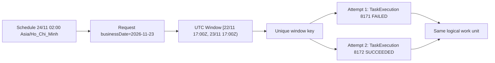
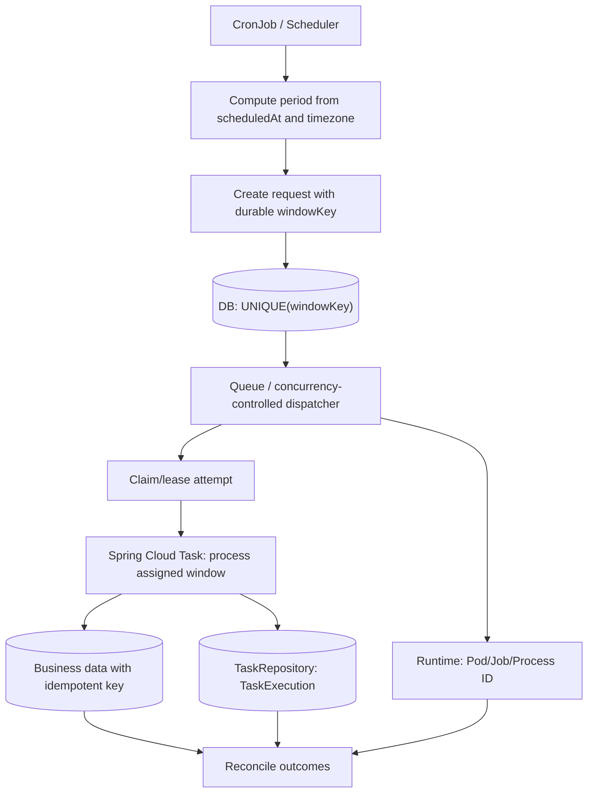
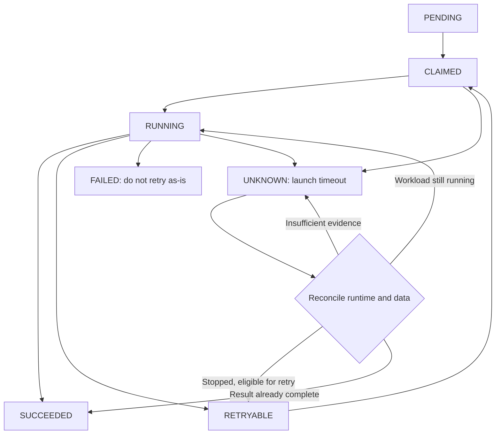

# Identifying Data Windows and Preventing Duplicate Scheduled Processing

## 1. Problem Statement: Running on Schedule Is Not Enough to Process the Right Data

In the **Scheduling** chapter of **Spring Cloud Task**, we build a Spring Boot application with a finite runtime, launched by a scheduler or API to process data by day, hour, or reconciliation period. Spring Cloud Task records **the application execution** in `TaskRepository`, yet a schedule cannot answer by itself: "Which **exact dataset** does this run process?" or "If two requests arrive at the same time, will data be written twice?"

Consider a `daily-settlement` job running every day at 02:00 to settle the **previous business day**. On November 24, 2026, the system is expected to process November 23's data. However:

- The scheduler resends a trigger because it did not receive an ACK.
- The container starts slowly and runs at 02:15 instead of 02:00.
- An operator clicks **Run now** while the previous task has not finished.
- A run fails near the end, and the scheduler retries hours later or on the following day.
- After an infrastructure outage, operations wants to backfill multiple missed days.

If the code merely grabs `LocalDate.now().minusDays(1)` whenever the process boots, a retry crossing midnight can process a **different data date**. Without deduplication keys, two runs for the same day can generate duplicate reports, issue duplicate payouts, insert duplicate orders, or send duplicate notifications.

**Core solution:** separate **when the scheduler triggers**, **the assigned data window**, **the unique business request**, **each Task run attempt**, and **result acceptance criteria**.

After this lesson, you will be able to:

1. Define half-open data windows `[startInclusive, endExclusive)` and compute them accurately in the business timezone.
2. Create stable work keys so retrying the same period never mutates into a different job.
3. Use unique constraints, conditional claim/leases, and idempotent writers to prevent duplicate processing.
4. Distinguish data-window keys from `TaskExecutionId`, `externalExecutionId`, and Spring Batch `JobInstance`.
5. Design schedulers, backfills, late-arrival handling, timeouts, and hung-process checks.
6. Reconcile business outcomes, Task metadata, and scheduler state before deciding to retry.

> **Principle:** Spring Cloud Task stores **execution metadata**; it does not guarantee "a day is processed only once". Deduplication must be designed at the request/orchestration layer and the business-data write layer.

## 2. Five Timestamps and Identifiers to Keep Separate

| Concept | Meaning | Example |
| --- | --- | --- |
| `scheduledAt` | Time the schedule was **supposed** to run | 2026-11-24 02:00 Vietnam time |
| `startedAt` | Time the process actually started | 2026-11-24 02:15 Vietnam time |
| `businessDate` | Label of the business period to process | `2026-11-23` |
| `windowStart` / `windowEnd` | Two timestamps bounding the **dataset** | `[2026-11-22T17:00:00Z, 2026-11-23T17:00:00Z)` |
| `attemptId` / `TaskExecutionId` | Identifier of **one execution attempt** | `attempt-2` / `TASK_EXECUTION_ID=8172` |

In `Asia/Ho_Chi_Minh` (UTC+07), business date 2026-11-23 corresponds to the UTC span from **Nov 22 at 17:00Z to Nov 23 at 17:00Z**. Whether the run starts at 02:00 or 02:15 the next morning, it must process the **exact same interval** when assigned the same `businessDate`.



**A retry does not create a new business window.** It creates a new *attempt* for the **same request and same dataset**. When business rules intentionally require reprocessing changed data, adopt an explicit reprocess policy with a source version or revision rather than silently shifting the window.

## 3. Half-Open Windows `[start, end)` and Non-Overlapping Boundaries

A half-open window:

- **Includes** every event with timestamp `>= startInclusive`.
- **Excludes** every event with timestamp `>= endExclusive`.

For two adjacent windows:

```text
W1 = [2026-11-22T17:00Z, 2026-11-23T17:00Z)
W2 = [2026-11-23T17:00Z, 2026-11-24T17:00Z)
```

An event at exactly `2026-11-23T17:00Z` **belongs solely to W2**. There is no need for `23:59:59.999` hacks, which easily break with microsecond or nanosecond database columns.

PostgreSQL query example, assuming `occurred_at` is a business timestamp of type `TIMESTAMPTZ`:

```sql
SELECT event_id, tenant_id, occurred_at, amount
FROM payment_event
WHERE tenant_id = :tenantId
  AND occurred_at >= :windowStartUtc
  AND occurred_at < :windowEndUtc
ORDER BY occurred_at, event_id;
```

`:tenantId`, `:windowStartUtc`, and `:windowEndUtc` are named parameters bound via JDBC abstractions, never string-concatenated into SQL. Always pass normalized **UTC instants** so the database never interprets timestamp strings using an unintended session timezone.

### Common Mistakes to Avoid

| Approach | Risk | Use Instead |
| --- | --- | --- |
| `BETWEEN start AND end` | `BETWEEN` is inclusive at both ends; boundary events get processed twice | `>= start AND < end` |
| `end = 23:59:59.999` | Drops events with sub-millisecond precision | `endExclusive = start of next day` |
| Reading current time inside each worker | Delayed workers or next-day retries compute a different window | Pass the pre-resolved window from the request |
| Using UTC calendar dates for local-time business rules | Misclassifies events near midnight | Resolve business `ZoneId` first, then convert bounds to `Instant` |
| Slicing by timestamp while source mutates during read | Late arrivals or updates shift the dataset | Immutable snapshot/input version and late-arrival policy |

## 4. Computing Business-Day Windows with `java.time`

Never assume **one calendar day = 24 fixed hours** across all timezones. Daylight saving time (DST) regions have 23-hour and 25-hour days. Java provides `LocalDate`, `ZoneId`, `ZonedDateTime`, and `Instant` to compute calendar-accurate bounds.

Java 17 example:

```java
import java.time.Instant;
import java.time.LocalDate;
import java.time.ZoneId;

public record DailyWindow(
        LocalDate businessDate,
        String zoneId,
        Instant startInclusive,
        Instant endExclusive) {

    public static DailyWindow of(
            LocalDate businessDate, ZoneId zone) {
        Instant start = businessDate.atStartOfDay(zone).toInstant();
        Instant end = businessDate.plusDays(1)
                .atStartOfDay(zone)
                .toInstant();
        return new DailyWindow(
                businessDate, zone.getId(), start, end);
    }
}
```

Usage:

```java
DailyWindow window = DailyWindow.of(
        LocalDate.parse("2026-11-23"),
        ZoneId.of("Asia/Ho_Chi_Minh"));

System.out.println(window.startInclusive());
// 2026-11-22T17:00:00Z

System.out.println(window.endExclusive());
// 2026-11-23T17:00:00Z
```

`Instant` represents an absolute point in time, ideal for `TIMESTAMPTZ` columns and event queries. Persist `businessDate` and `zoneId` alongside audit records to explain **why** those two UTC instants were selected.

### Timezones and DST

In `Europe/Paris`, `2026-03-29` transitions to summer time, so the interval from that day's start to the next day's start spans **23 hours**, not 24. Using `start.plus(Duration.ofHours(24))` would slice one hour out of the next calendar day. On `2026-10-25`, the fall-back day spans **25 hours**.

| Period Definition | Best For | Watch Out For |
| --- | --- | --- |
| `LocalDate` + `ZoneId` → start of day & next day | Local calendar business days | DST transitions and consistent timezone policies |
| Two fixed `Instant` bounds | Event-time/UTC windows or shift schedules | Persisting the exact boundary pair |
| `Duration.ofHours(24)` | True *rolling 24-hour* windows | **Does not** substitute for calendar days under DST |
| `LocalDateTime` without timezone | Local wall-clock labels | Insufficient to pinpoint an `Instant` during repeated DST hours |

For multi-tenant applications, a tenant's timezone must come from trusted configuration or the domain model—never let a client change `zoneId` on an old request during a retry. If a tenant's calendar rules change in the future, store the **resolved UTC window** on the request itself rather than relying solely on the timezone name.

## 5. The Work Key (`windowKey`) Must Stay Stable Across All Attempts

A **logical work key** should include every dimension distinguishing valid datasets:

```text
windowKey = (
    tenantId,
    taskKey,
    windowStartUtc,
    windowEndUtc,
    inputVersion
)
```

Where:

- `tenantId` isolates the entity being processed.
- `taskKey` distinguishes the job type, e.g., `daily-settlement` vs. `daily-report`.
- The `windowStartUtc`/`windowEndUtc` pair pins the event interval.
- `inputVersion` (or snapshot ID) is included only when meaningful to business rules: a new source version can represent an authorized *reprocess*.

Never put any of the following into the **work key** if they change across retries:

- `TASK_EXECUTION_ID` assigned by Spring Cloud Task.
- Spring Batch `JobExecutionId`, Pod UID, or container ID.
- JVM startup timestamp or per-attempt random UUIDs.
- Retry counters or randomly generated deployment names.

Store those in an **attempt/audit table** instead of replacing the stable key.

### Distinguishing Retry from Reprocess

| Request | Window Key | Expected Behavior |
| --- | --- | --- |
| Scheduler sends trigger twice for the same day/version | **Identical** | Single logical request; no duplicate business job created |
| Retrying a timed-out task | **Identical** | Start a new attempt only after confirming the prior attempt has no active side effects |
| Backfilling a missed day | **Different** because `windowStart`/`windowEnd` differ | Create one logical request per missing window |
| Re-running an old date due to corrected source `snapshot-v2` | **Different** if `inputVersion` is in the key | Intentionally create an audited revision/reprocess |
| Caller resends the same day with a different payload under the same key | **Conflict** | Reject with conflict / require an explicit reprocess workflow |

**No single key fits every business.** If business rules allow only one outcome per tenant/day regardless of input versions, exclude `inputVersion` from the unique key and track revisions in a child table. Define what "the same unit of work" means before writing constraints.

## 6. Architecture from Schedule to Assigned Work Unit



**The scheduler should only dispatch work**, never equate a launch API ACK with "processed". Once the request is durably persisted, the scheduler gets a `requestId` for future tracking. The Java process is launched with the **explicit window** or a `requestId` to load the window from the database.

### Window-Resolution Time Matters More Than Launch Time

An ideal scheduler computes the request from the **scheduled time `scheduledAt`**:

```text
scheduledAt (local): 2026-11-24 02:00
businessDate:         2026-11-23
window:               [2026-11-22T17:00Z, 2026-11-23T17:00Z)
```

Then it stores the UTC boundary pair in the request. If the container starts late or retries the next day, it still reads the exact stored boundaries.

For a CronJob invoking a JAR directly without an orchestration layer, explicitly design **how `scheduledAt` is derived**; never rely implicitly on the Pod's current clock when reproducibility matters. A wrapper or scheduling service can register the window request before launching the task, while manual/backfill runs must pass explicit period arguments.

## 7. Database Guards Against Registering the Same Window Twice

To prevent races across multiple schedulers or API instances, use a **database unique constraint**, not just a pre-check `SELECT`.

**Application-managed** PostgreSQL example (not the standard Spring Cloud Task schema):

```sql
CREATE TABLE scheduled_window_run (
    run_id UUID PRIMARY KEY,
    tenant_id VARCHAR(80) NOT NULL,
    task_key VARCHAR(100) NOT NULL,
    window_start_utc TIMESTAMPTZ NOT NULL,
    window_end_utc TIMESTAMPTZ NOT NULL,
    input_version VARCHAR(100) NOT NULL,
    business_date DATE NOT NULL,
    timezone_id VARCHAR(80) NOT NULL,
    state VARCHAR(24) NOT NULL
        CHECK (state IN (
            'PENDING', 'CLAIMED', 'RUNNING',
            'RETRYABLE', 'SUCCEEDED', 'FAILED', 'UNKNOWN'
        )),
    attempt_count INTEGER NOT NULL DEFAULT 0
        CHECK (attempt_count >= 0),
    lease_token UUID,
    lease_until TIMESTAMPTZ,
    task_execution_id BIGINT,
    platform_execution_id VARCHAR(240),
    created_at TIMESTAMPTZ NOT NULL DEFAULT now(),
    updated_at TIMESTAMPTZ NOT NULL DEFAULT now(),
    completed_at TIMESTAMPTZ,
    CHECK (window_start_utc < window_end_utc),
    CONSTRAINT uq_scheduled_window
        UNIQUE (
            tenant_id, task_key, window_start_utc,
            window_end_utc, input_version
        )
);
```

`task_execution_id` and `platform_execution_id` help cross-reference the **latest attempt** when available; in practice, maintain a **separate attempt table** so retry history is never overwritten. Do not create a foreign key to `TASK_EXECUTION` if the Task Repository lives in a separate database.

### Inserting One Work Unit Even Under Concurrent Triggers

```sql
INSERT INTO scheduled_window_run (
    run_id, tenant_id, task_key,
    window_start_utc, window_end_utc, input_version,
    business_date, timezone_id, state
) VALUES (
    :runId, :tenantId, :taskKey,
    :windowStartUtc, :windowEndUtc, :inputVersion,
    :businessDate, :timezoneId, 'PENDING'
)
ON CONFLICT (
    tenant_id, task_key, window_start_utc,
    window_end_utc, input_version
) DO NOTHING;
```

When a scheduler submits the same key a second time, the DB **inserts no duplicate row**. Afterward, the application queries the existing row and verifies that key attributes (payload/scope) match; if the key was reused for a non-equivalent request, **raise a conflict** instead of silently ignoring it.

All `:parameter` placeholders must be bound via a JDBC library supporting named parameters. The database constraint is the **race arbitrator**, while the client/scheduler handles duplicate inserts by returning the existing request ID.

**Never call the launcher before persisting the key:** two processes could already be spawned before the database catches the duplicate. Register the window in a short transaction first, and let only the owning dispatcher perform the launch.

## 8. Conditional Claiming, Leases, and Indeterminate States

Even with a single row in the request table, **two dispatchers could still pick the same row** if both read `PENDING` and call the launcher. Use an atomic claim update:

```sql
UPDATE scheduled_window_run
SET state = 'CLAIMED',
    lease_token = :leaseToken,
    lease_until = now() + INTERVAL '15 minutes',
    attempt_count = attempt_count + 1,
    updated_at = now()
WHERE run_id = :runId
  AND state IN ('PENDING', 'RETRYABLE')
RETURNING run_id, attempt_count, lease_token;
```

In PostgreSQL, only one dispatcher wins the state transition for a given row under appropriate transaction isolation. Any dispatcher receiving no `RETURNING` row **must not launch**. Terminal `FAILED` or `SUCCEEDED` jobs do not reopen automatically; reprocessing must go through a dedicated policy.

### A Lease Does Not Prove the Worker Stopped

If `lease_until` expires, the dispatcher may have crashed, yet **the worker it spawned may still be running**. Never blindly run `WHERE lease_until < now()` and launch a duplicate right away. Instead:

1. Transition ambiguous runs to `UNKNOWN` / pending reconciliation per policy.
2. Inspect the runtime using correlation ID, Pod UID, or platform execution ID.
3. Reconcile `TaskRepository`, business outputs, and heartbeats.
4. Reopen to `RETRYABLE` only with sufficient evidence that the old worker cannot continue or that the writer enforces strong deduplication.

`lease_token` guards against a **stale dispatcher** overwriting state: completion updates must match the issued token. Still, the token only protects metadata rows if checked properly; it **does not stop an old worker from calling an external API**. Controlling external side effects requires fencing/idempotency at the target system.

### Illustrative State Machine



This is an **application-designed state model**, not a built-in Spring Cloud Task enum. State transitions must be guarded by transactions, authorization, state/lease conditions, and retry rules. If `TaskRepository` or a broker fails, never mark `SUCCEEDED` solely from a message or ACK.

## 9. Example Spring Cloud Task Receiving an Explicit Window

The application below receives `business-date`, `tenant-id`, and `input-version` from a validated orchestrator. It **never derives the date from `LocalDate.now()`**. Java 17 example:

```java
package com.example.scheduling;

import java.time.LocalDate;
import java.time.ZoneId;
import java.util.List;
import org.slf4j.Logger;
import org.slf4j.LoggerFactory;
import org.springframework.boot.ApplicationRunner;
import org.springframework.boot.SpringApplication;
import org.springframework.boot.autoconfigure.SpringBootApplication;
import org.springframework.cloud.task.configuration.EnableTask;
import org.springframework.context.annotation.Bean;

@SpringBootApplication
@EnableTask
public class WindowedTaskApplication {
    private static final Logger log =
            LoggerFactory.getLogger(WindowedTaskApplication.class);

    public static void main(String[] args) {
        SpringApplication.run(WindowedTaskApplication.class, args);
    }

    @Bean
    ApplicationRunner runWindow(WindowProcessor processor) {
        return args -> {
            String dateString = required(args.getOptionValues("business-date"));
            String tenant = required(args.getOptionValues("tenant-id"));
            String version = required(args.getOptionValues("input-version"));

            LocalDate date = LocalDate.parse(dateString);
            DailyWindow window = DailyWindow.of(
                    date, ZoneId.of("Asia/Ho_Chi_Minh"));

            log.info("tenant={}, businessDate={}, start={}, end={}, version={}",
                    tenant, date, window.startInclusive(),
                    window.endExclusive(), version);

            processor.process(
                    tenant, version,
                    window.startInclusive(), window.endExclusive());
        };
    }

    private static String required(List<String> values) {
        if (values == null || values.size() != 1
                || values.get(0).isBlank()) {
            throw new IllegalArgumentException(
                    "Missing or invalid parameter");
        }
        return values.get(0);
    }
}
```

`DailyWindow` is the record from Section 4. `WindowProcessor` is the **business service to implement**; this snippet is an application skeleton omitting connection pools, schemas, transactions, claiming, and real output handling. The service interface can look like:

```java
import java.time.Instant;

public interface WindowProcessor {
    void process(
            String tenantId, String inputVersion,
            Instant startInclusive, Instant endExclusive);
}
```

The `WindowProcessor` implementation must enforce **idempotency per write unit**, and may also verify locks/leases before processing if required by the deployment topology. **Do not trust CLI arguments blindly** if the process can be invoked from an untrusted environment; validate tenant/scope at the orchestration and database layers.

Example invocations for the **same period** across initial attempt and retry:

```bash
java -jar windowed-task.jar \
  --tenant-id=tenant-a \
  --business-date=2026-11-23 \
  --input-version=snapshot-v1

# After orchestrator confirms retry is permitted:
java -jar windowed-task.jar \
  --tenant-id=tenant-a \
  --business-date=2026-11-23 \
  --input-version=snapshot-v1
```

The two launches create **two distinct `TaskExecution` records**, yet operate on the **same window and business key**. Direct `java -jar` invocations bypassing the orchestrator/claim flow are **not automatically deduplicated**; that is why `UNIQUE` constraints in the request store and an idempotent writer remain essential.

## 10. `TaskExecution` ID and `externalExecutionId` Are Not Window Keys

Spring Cloud Task generates `TaskExecution` metadata when the JVM runs. Each retry receives a new internal ID, for example:

| Window | Request ID | Attempt | `TASK_EXECUTION_ID` | Outcome |
| --- | --- | --- | --- | --- |
| Nov 23, snapshot-v1 | `req-481` | 1 | `8171` | Timeout error |
| Nov 23, snapshot-v1 | `req-481` | 2 | `8172` | Completed |

`TASK_EXECUTION_ID` traces **a specific Task run**. `spring.cloud.task.external-execution-id` can record an ID supplied by the scheduler or platform, such as a Pod UID. Both can change per attempt and **must not be used as the business-window key**.

When detailed auditing is needed, create a `scheduled_window_attempt` table storing `run_id`, `attempt_no`, `task_execution_id`, `external_execution_id`, `started_at`, `ended_at`, and `exit_code`. Ensure correlation IDs flow through the launcher and logs so records can be linked even when one side lacks metadata.

### Never Infer from Metadata That a Run Is Still Alive

A populated `START_TIME` with `END_TIME IS NULL` can mean the JVM is still running, **or that it was killed** before the repository recorded completion. Likewise, `EXIT_CODE=0` does not prove all business outputs were written. Before re-issuing the same window, reconcile runtime state, logs, and output tables.

## 11. Output Deduplication: Idempotent Writers and Transactions

A unique constraint on the window table prevents **duplicate request registration**, yet does not stop duplicate side effects if a worker retries after a partial commit.

Example summary table keyed by tenant/date/version:

```sql
CREATE TABLE daily_settlement (
    tenant_id VARCHAR(80) NOT NULL,
    business_date DATE NOT NULL,
    input_version VARCHAR(100) NOT NULL,
    total_amount NUMERIC(20, 2) NOT NULL,
    event_count BIGINT NOT NULL,
    PRIMARY KEY (tenant_id, business_date, input_version)
);
```

Once window data is complete inside an appropriate transaction, the writer can persist results under the unique key:

```sql
INSERT INTO daily_settlement (
    tenant_id, business_date, input_version,
    total_amount, event_count
) VALUES (
    :tenantId, :businessDate, :inputVersion,
    :totalAmount, :eventCount
)
ON CONFLICT (tenant_id, business_date, input_version)
DO UPDATE SET
    total_amount = EXCLUDED.total_amount,
    event_count = EXCLUDED.event_count;
```

**Warning:** Upsert is only safe when the same key always produces the exact same deterministic outcome (or has an explicit versioning/revision policy). If two attempts run concurrently against differing source data, **last writer wins** can mask discrepancies. Use immutable input snapshots, fencing/version checks, or proper transactions/locks, and store checksums for investigation.

### Avoid Uncontrolled Incremental Accumulation

Suppose on retry of the same window the code executes:

```sql
UPDATE daily_ledger
SET total_amount = total_amount + :windowAmount
WHERE tenant_id = :tenantId;
```

Every retry would **add the amount again**. Instead, store fixed per-window results and apply them to the ledger in a transaction backed by a **unique operation key** / journal entry table, adding to the balance only when that entry has not yet been applied. Never rely on `TaskExecution.EXIT_CODE=0` to guarantee an entry was posted only once.

### External System Side Effects

If the task sends emails, transfers funds, or publishes messages, `TaskRepository`'s transaction does not span external systems. A worker may succeed externally and then lose database connectivity before saving status, risking a duplicate send on retry.

Common solutions include:

- **Idempotency keys** at the receiving API, stable across `tenant + operation + windowKey`.
- **Transactional outbox:** write outbound events to the DB in the same transaction as business results; a separate publisher emits them and consumers deduplicate.
- **Inbox/deduplication:** the receiver records a unique processing key and rejects duplicates.
- **Compensation:** compensating actions when side effects cannot roll back.

Never promise cross-service exactly-once delivery solely from Spring Cloud Task's transaction or because the scheduler triggers once.

## 12. Processing with Spring Batch: Preserve `JobInstance` for the Same Window

If a Spring Cloud Task invokes Spring Batch, an additional rule applies:

```text
JobInstance = jobName + identifying JobParameters
```

For example, each window is identified by tenant, the two UTC bounds, and input version:

```java
JobParameters params = new JobParametersBuilder()
        .addString("tenantId", tenantId, true)
        .addString("windowStartUtc", window.startInclusive().toString(), true)
        .addString("windowEndUtc", window.endExclusive().toString(), true)
        .addString("inputVersion", inputVersion, true)
        .toJobParameters();
```

This builds parameters using standard Spring Batch 5.x APIs, assuming the variables are resolved at the orchestration layer and `JobParameters`/`JobParametersBuilder` are imported. When changing Batch versions, verify the API against your actual dependency.

On a valid retry:

- Spring Cloud Task may create a **new `TaskExecution`**.
- Spring Batch receives the **same identifying `JobParameters`** and locates the **existing `JobInstance`**.
- If the previous run was `FAILED`/`STOPPED` and the job is restartable, Batch creates a **new `JobExecution`** for that same instance and resumes from configured checkpoints.
- If the `JobInstance` is already `COMPLETED`, Batch normally rejects re-running the same instance; verify the completed outcome before treating that as a system error.

**Never append `run.id=timestamp` or `taskExecutionId` as an identifying parameter on every retry**, because doing so creates a new `JobInstance` and forfeits the prior instance's checkpoints and restart state. When legitimately reprocessing a different snapshot version, submit an intentional reprocess request and account for previously written outputs.

To verify job completion, inspect `JobRepository`/`JobExplorer` and `BatchStatus`; `TaskRepository` only records **the application run**. With asynchronous launchers, never allow the Task to exit with success before the Batch job reaches its contractual terminal state.

## 13. Schedulers and Kubernetes CronJob: Schedules Do Not Replace Idempotency

Spring Cloud Task **does not schedule cron jobs on its own**. The application is invoked by an external scheduler such as Kubernetes CronJob, Spring Scheduler, a queue system, or an orchestration service.

A CronJob can be configured in Vietnam time:

```yaml
apiVersion: batch/v1
kind: CronJob
metadata:
  name: daily-settlement
spec:
  schedule: "0 2 * * *"
  timeZone: "Asia/Ho_Chi_Minh"
  concurrencyPolicy: Forbid
  startingDeadlineSeconds: 3600
  jobTemplate:
    spec:
      template:
        spec:
          restartPolicy: Never
          containers:
            - name: settlement
              image: registry.example.com/settlement-task:1.4.2
```

This manifest **illustrates only the schedule and concurrency mechanism**; it omits window arguments, Secrets, resource requests/limits, RBAC, image digests, and database connectivity. `timeZone` requires a Kubernetes version supporting that field. Verify cluster policies and timezones in your real environment before applying.

### What Does `concurrencyPolicy: Forbid` Actually Protect?

It prevents Jobs created by **the same CronJob** from overlapping within Kubernetes's control scope. It does **not**:

- Prevent an API or another CronJob from launching the same business work.
- Prove data for the same window was processed exactly once.
- Prevent duplicate execution during controller/network glitches or manual operator runs.
- Replace unique keys in the work table and an idempotent writer.

`startingDeadlineSeconds` governs missed schedule starts, not deduplication. For systems where missed windows must be recovered, implement independent **reconciliation/backfill** rather than expecting CronJob to replay every delayed period automatically.

**Crucially:** the sample CronJob configuration does not automatically pass the `businessDate` corresponding to `scheduledAt` into the JAR. A wrapper or orchestration service must build a fixed window request from the scheduled time, or the app's date-resolution logic must be hardened to withstand late starts and retries. Hardcoding `--business-date=2026-11-23` in a daily template causes every subsequent run to reprocess **that single date**.

### `@Scheduled` in Spring Boot?

`@Scheduled` is a mechanism for **invoking methods repeatedly inside a living application**, whereas a finite Spring Cloud Task normally boots, runs, and exits. Keeping a JVM alive indefinitely for an internal cron loop creates a long-running scheduler service rather than a finite per-run Task process. Never conflate the two models when configuring lifecycle and `TaskRepository`.

## 14. Late-Arriving Data, Watermarks, and Backfills

An **event-time** window may still receive records after `endExclusive` due to network delays, queue lag, or slow upstream sources. You must define when a period is considered ready to "close".

Example:

- The Nov 23 window in `Asia/Ho_Chi_Minh` ends at Nov 24 00:00 local time.
- The scheduler runs reconciliation at Nov 24 02:00, providing a **2-hour grace delay**.
- Some events may still arrive after 02:00; the system must decide whether to ignore them, record adjustments, reopen the period, or trigger a reprocess revision.

| Policy | Advantage | Risks / Controls |
| --- | --- | --- |
| Fixed 2-hour delay | Easy to understand and operate | Does not guarantee every source arrived on time |
| Source watermarks | Reflects actual upstream progress | Requires monitoring watermarks and handling stalled sources |
| Immutable per-period snapshots | Retries read the exact same dataset | Requires managing snapshot versions and retention |
| Revision-based reprocessing | Supports correcting late data | Requires revision keys, audits, and overwrite/adjustment rules |

**Late arrival is not duplicate processing.** An event whose `occurred_at` falls inside a closed window yet arrives after the report finished is a **completeness** issue. Running the same window request twice is a **duplicate-processing** issue. Both must be designed together, yet they have distinct solutions.

### Backfilling After an Outage

Suppose the system is down for three days. A reconciliation service can:

1. Enumerate all periods **expected to exist** according to the business calendar and timezone.
2. Diff against `scheduled_window_run` by window key.
3. Insert missing `PENDING` rows via `INSERT ... ON CONFLICT DO NOTHING`.
4. Choose backfill ordering (oldest-first, or by tenant/priority).
5. Share queues, quotas, and claiming logic; never flood the platform with all backfills at once.
6. Verify business metrics and Task metadata before marking qualified windows `SUCCEEDED`.

When backfills create missing rows, preserve the timezone/window rules **applicable to that historical period**, rather than blindly applying current rules if a tenant later changed timezones or settlement cutoffs.

## 15. Handling Failure and Duplicate Scenarios

| Scenario | Risk | Recommended Action |
| --- | --- | --- |
| Scheduler sends the same trigger twice | Two Tasks process the same window | Unique window key; single dispatcher claim for the request ID |
| Client/API retries after timeout | Unknown whether previous launch succeeded | Mark `UNKNOWN`; look up workload via correlation ID before relaunching |
| Task crashes after committing data | Retry duplicates side effects | Idempotent writer, outbox, business reconciliation |
| JVM killed, `END_TIME` is null | Looks still running or never started | Inspect Pod/process, `JobRepository`, and actual data |
| Lease expires while worker still runs | Two workers write concurrently | Reconcile runtime; enforce fencing tokens/idempotency at target |
| Batch `JobInstance` is already `COMPLETED` | Retry with same params gets rejected | Verify completed outcome; never force a new instance |
| Input snapshot changes between attempts | Results under same key are non-reproducible | Immutable input versions, checksums/manifests |
| Two different tenants share the same period | Overly broad lock blocks another tenant | Include tenant in business key and concurrency policy |
| One tenant triggers two different dates concurrently | Contention on ordered business state | Lock per tenant/series if business rules require ordering |
| Timestamps stored with wrong timezone | Drops or double-counts boundary events | Store UTC instants, retain zone ID, test DST |
| Many backfill periods run simultaneously | Overloads DB/broker | Cap concurrency, rate, pools, and retry budgets |
| Task `EXIT_CODE=0` yet report is missing data | False "success" | Verify business criteria and watermarks rather than exit code alone |

### Does `single-instance-enabled` Solve All of This?

Spring Cloud Task provides `spring.cloud.task.single-instance-enabled` to prevent **multiple instances with the same task name from running concurrently** when the required lock/repository is configured. However, it **does not prevent sequential re-execution of the same business window**, nor does it model a `tenant + window` key.

If a `daily-settlement` task serves many independent tenants, locking globally by task name can needlessly throttle concurrency. Enforce business-driven policies instead: unique window keys, per-tenant/period locks, and scheduler/deployer resource limits.

## 16. Observing and Reconciling with SQL

### 16.1. Listing Incomplete Windows

```sql
SELECT tenant_id, task_key, business_date, timezone_id,
       window_start_utc, window_end_utc,
       input_version, state, attempt_count, lease_until
FROM scheduled_window_run
WHERE state <> 'SUCCEEDED'
ORDER BY business_date, tenant_id;
```

The `state` column here is **defined by the orchestration system**, not an official Spring Cloud Task status. Rows in `UNKNOWN` or with expired leases must be reconciled before retrying.

### 16.2. `TaskExecution` History

```sql
SELECT TASK_EXECUTION_ID, TASK_NAME, START_TIME, END_TIME,
       EXIT_CODE, EXTERNAL_EXECUTION_ID
FROM TASK_EXECUTION
WHERE TASK_NAME = 'daily-settlement'
ORDER BY TASK_EXECUTION_ID DESC
LIMIT 50;
```

Do not join directly on `business_date` if the Task Repository does not store it in the standard schema. Persist correlation from `run_id`/`attempt_no` to `task_execution_id` or `external_execution_id` in your attempt/audit table, and query using those exact IDs. When using Spring Batch, also inspect `JobExecution`/`StepExecution` in `JobRepository`.

### 16.3. What Should a Dashboard Display?

| Layer | Data Source | Signals to Track |
| --- | --- | --- |
| Schedule | Scheduler | `scheduledAt`, trigger lag, missed periods |
| Window | `scheduled_window_run` | Which periods are `SUCCEEDED`, `RETRYABLE`, `UNKNOWN`, attempt counts |
| Task | `TaskRepository` | `TASK_EXECUTION_ID`, start/end, exit code, errors |
| Batch (if used) | `JobRepository` | `JobInstance`, `JobExecution`, checkpoints/`StepStatus` |
| Runtime | Kubernetes/Deployer | Pod/Job ID, CPU/RAM, OOM/kills, timeouts |
| Business | Domain DB / external systems | Event counts, totals, duplicate/completeness checks |

The dashboard should never report "success" solely because `TaskExecution.EXIT_CODE=0`. Business outputs may be incomplete if a worker swallowed errors, source data arrived late, or asynchronous steps remain unfinished.

## 17. Testing Workflow from One Schedule to Multiple Retries

Practice in a test environment with a PostgreSQL metadata database and simulated scheduler:

1. **Test window boundaries:** insert two events with timestamps just before and exactly at `endExclusive`; verify no event belongs to both days.
2. **Verify timezone math:** create the `2026-11-23` window in `Asia/Ho_Chi_Minh` and compare against expected UTC instants.
3. **Test DST:** compute the `2026-03-29` window in `Europe/Paris`; verify the 23-hour duration.
4. **Simulate duplicate triggers:** have two clients/dispatchers register the same key concurrently; verify only one `scheduled_window_run` row exists.
5. **Test claim race:** have two dispatchers update the same `run_id`; verify only one receives `RETURNING` and launches.
6. **Kill worker after commit:** commit partial/full business writes, then kill the process; verify retries do not duplicate records or ledger entries.
7. **Indeterminate timeout:** simulate the platform creating a Pod while the response drops; the dispatcher must reconcile before spawning a new attempt.
8. **Backfill:** skip three days and run schedule reconciliation; verify three distinct windows are created without duplicating existing ones.
9. **Late arrivals:** inject an old event after the window reached `SUCCEEDED`; test snapshot/reprocess revision policies and verify audit trails.
10. **Spring Batch:** force a `FAILED` `JobExecution`, restart with the same identifying `JobParameters`, and cross-check against the new `TaskExecution`.

### Self-Check Questions

1. If a task scheduled for 02:00 on Nov 24 actually starts at 03:30, which timestamp should determine the business period?
2. Why is `[start,end)` better than `BETWEEN` or `23:59:59.999`?
3. Why is `LocalDate.atStartOfDay(zone)` better than `start.plus(24 hours)` for calendar days under DST?
4. A retried window gets a new `TASK_EXECUTION_ID`. Why must it still keep **the same window key**?
5. A unique constraint prevents two identical requests, yet is it enough to prevent two dispatchers from both calling launch?
6. Does an expired lease prove the worker has stopped? What else must be checked?
7. If a writer increments a ledger balance on every retry, what happens when a window runs twice?
8. What problem does `single-instance-enabled` solve, and why does it not replace per-tenant/date idempotency?
9. When Spring Batch restarts, should identifying `JobParameters` stay the same or change?
10. When source data arrives late after a report completes, how should you distinguish **late arrival** from **duplicate launch**?
11. Why should a worker not compute `businessDate` from `LocalDate.now()` in a system with delayed retries?
12. When `TaskRepository` has no `END_TIME`, why is it premature to open a new attempt right away?

## 18. References

- [Spring Cloud Task — Features and Task Repository](https://docs.spring.io/spring-cloud-task/reference/features.html).
- [Spring Cloud Task — Batch Integration](https://docs.spring.io/spring-cloud-task/reference/batch.html).
- [Spring Batch — Configuring a Job and Restartability](https://docs.spring.io/spring-batch/reference/job/configuring-job.html).
- [Spring Batch — Chunk-Oriented Processing and Restart](https://docs.spring.io/spring-batch/reference/step/chunk-oriented-processing/restart.html).
- [Kubernetes — CronJob, Concurrency Policies, and Scheduling](https://kubernetes.io/docs/concepts/workloads/controllers/cron-jobs/).
- [Java API — LocalDate](https://docs.oracle.com/en/java/javase/17/docs/api/java.base/java/time/LocalDate.html), [ZoneId](https://docs.oracle.com/en/java/javase/17/docs/api/java.base/java/time/ZoneId.html), [Instant](https://docs.oracle.com/en/java/javase/17/docs/api/java.base/java/time/Instant.html).

**Key Takeaway:** To process scheduled workloads **without missing periods or duplicating data**, define a half-open `[startInclusive,endExclusive)` window in the business timezone, store the UTC bounds and a **stable window key** in a unique-constrained request store. Retries may create a new `TaskExecution`, but they never change the logical work unit. Combine atomic claiming, reconciliation on ambiguous launches, idempotent writers, and cross-verification across `TaskRepository`/`JobRepository` and business data. **The schedule is merely the start signal; the window key and processing contract guarantee correctness.**
