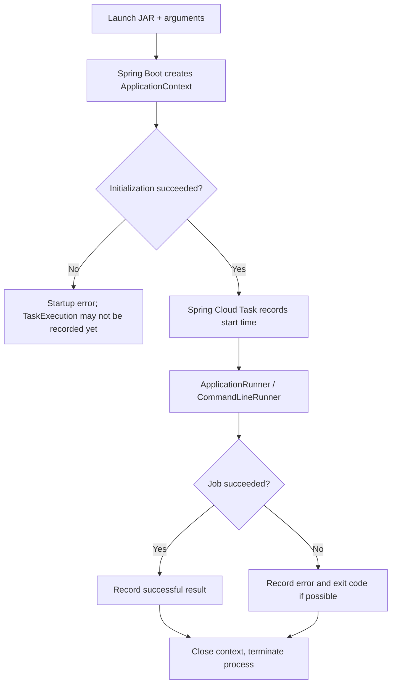

# Foundational Knowledge of Spring Boot, JDBC, and Transactions

## 1. Why Are These Three Foundations Needed When Learning Spring Cloud Task?

**Spring Cloud Task** helps build Spring Boot applications with a **finite runtime**: start up, perform a job, record the result, and then terminate. Examples include syncing orders nightly, exporting on-demand reports, validating data before warehouse ingestion, or running a processing step in a larger workflow.

To write and operate this type of application, you need to understand three components with distinct roles:

| Component | Responsibility | Significance for Spring Cloud Task |
| --- | --- | --- |
| **Spring Boot** | Creates and configures the application, manages beans, accepts command-line arguments, and controls the process lifecycle | Serves as the runtime foundation for finite-lived jobs |
| **JDBC / Spring JDBC** | Opens connections, sends SQL statements, and reads data from relational databases | Executes business queries and enables persisting task metadata |
| **Transaction Management** | Defines commit/rollback boundaries across multiple data operations | Keeps data consistent when the job succeeds, fails, or is rerun |
| **Spring Cloud Task** | Tracks a single execution via `TaskRepository` and `TaskExecution` | Records start/end timestamps, status, exit code, and error details |

**Expected outcomes:** After this lesson, you will be able to explain the lifecycle of a one-shot Spring Boot application; configure a `DataSource`; use `JdbcTemplate` safely with parameters; place `@Transactional` in the right location; and distinguish business transactions from Spring Cloud Task execution records.

## 2. Spring Boot: From Long-Running Web Applications to Finite Processes

### 2.1. Essential Spring Boot Concepts

- **`@SpringBootApplication`** combines Spring configuration, auto-configuration, and package-based component scanning. Place the main application class in a parent package of your services so they are discovered.
- **IoC container / `ApplicationContext`** creates and manages the application's objects (beans).
- **Dependency injection** passes required beans into constructors, helping decouple job logic from manually instantiating connections or services.
- **Auto-configuration** configures common components (such as `DataSource` and `JdbcTemplate`) based on available libraries and properties. Appropriate drivers, dependencies, and configuration are required.
- **Externalized configuration** reads settings from `application.yml`, environment variables, startup arguments, etc., so a single build can run across multiple environments.

In a web application, the process usually stays alive to accept HTTP requests. For a one-shot task, business execution typically lives inside an `ApplicationRunner` or `CommandLineRunner`, and the process needs a way to exit after finishing.

### 2.2. Executing Work with a Runner

`ApplicationRunner` receives `ApplicationArguments`, which helps distinguish `--key=value` options from regular non-option arguments. `CommandLineRunner` receives `String... args` and is suitable when you only need the raw string array.

```java
import org.springframework.boot.ApplicationArguments;
import org.springframework.boot.ApplicationRunner;
import org.springframework.boot.SpringApplication;
import org.springframework.boot.autoconfigure.SpringBootApplication;
import org.springframework.cloud.task.configuration.EnableTask;
import org.springframework.context.annotation.Bean;

@SpringBootApplication
@EnableTask
public class TaskApplication {

    public static void main(String[] args) {
        SpringApplication.run(TaskApplication.class, args);
    }

    @Bean
    ApplicationRunner showArguments() {
        return args -> {
            String mode = args.containsOption("mode")
                    ? args.getOptionValues("mode").get(0)
                    : "preview";
            System.out.println("Run mode: " + mode);
        };
    }
}
```

Running the program with `--mode=import` will print `Run mode: import`. This example illustrates a default value; for required arguments or arguments that may be passed empty, you must check the value list before accessing its first element (covered in section 5).

When using Spring Cloud Task, `@EnableTask` or the starter's auto-configuration sets up the task infrastructure according to the version in use. In terms of lifecycle, once the `ApplicationContext` starts successfully, Spring Cloud Task records the start event **before** the Runners execute; after they complete or if a caught startup failure occurs, it updates the execution result. If the Spring context fails to initialize, a `TaskExecution` record might **not yet exist** to observe the error.



**Note:** Finishing a Runner does not automatically guarantee that the JVM stops if non-daemon threads or components keeping the process alive remain. For task applications, you typically configure `spring.main.web-application-type=none` and `spring.cloud.task.closecontextEnabled=true` to close the context after completion. An orchestrator such as cron or a Kubernetes Job is responsible for relaunching on schedule; a single Spring Cloud Task run is not a scheduler by itself.

## 3. JDBC and How Spring Boot Connects to Databases

### 3.1. From Raw JDBC to `JdbcTemplate`

**JDBC** is the Java API for obtaining a `Connection`, preparing a `PreparedStatement`, executing SQL, and reading a `ResultSet`. Working directly with raw JDBC requires developers to carefully close resources, convert data, and handle exceptions.

Spring JDBC provides `JdbcTemplate` and `NamedParameterJdbcTemplate` to eliminate most of this boilerplate. These objects obtain connections through a `DataSource`; when an active Spring transaction exists, JDBC operations participate in that transaction.

Example:

```java
import java.util.List;
import org.springframework.jdbc.core.JdbcTemplate;
import org.springframework.stereotype.Repository;

@Repository
public class OrderReader {
    private final JdbcTemplate jdbc;

    public OrderReader(JdbcTemplate jdbc) {
        this.jdbc = jdbc;
    }

    public List<Long> findPendingIds() {
        return jdbc.query(
            "SELECT id FROM orders WHERE state = ? ORDER BY id",
            (rs, rowNum) -> rs.getLong("id"),
            "PENDING"
        );
    }
}
```

The `?` placeholder is a parameter bound using the prepared statement mechanism. **Never concatenate user input strings into SQL** because it easily leads to SQL injection and escaping bugs. For queries with many named parameters, you can use `NamedParameterJdbcTemplate` and `:orderId`.

Some key operations to know:

| API | Usage |
| --- | --- |
| `update(sql, args...)` | `INSERT`, `UPDATE`, `DELETE`; returns the number of affected rows |
| `query(sql, rowMapper, args...)` | Reads multiple rows and maps them to objects |
| `queryForObject(...)` | Expects exactly one row; must handle zero-row or multiple-row cases |
| `batchUpdate(...)` | Sends a batch of parameterized operations; useful when processing many records |

`JdbcTemplate` translates data access errors into Spring's `DataAccessException` hierarchy, making consistent error handling and rollback straightforward.

### 3.2. `DataSource`, Drivers, and Connection Pools

`DataSource` is the provider of JDBC connections. In a Spring Boot application, configuring `spring.datasource.*` along with an appropriate driver lets the system auto-create a `DataSource`; `spring-boot-starter-jdbc` typically brings HikariCP onto the classpath to manage the connection pool.

Example configuration for a **persistent PostgreSQL** database:

```yaml
spring:
  application:
    name: order-processor-task
  main:
    web-application-type: none
  datasource:
    url: ${TASK_DB_URL:jdbc:postgresql://localhost:5432/taskdb}
    username: ${TASK_DB_USER:task_user}
    password: ${TASK_DB_PASSWORD}
    hikari:
      maximum-pool-size: 5
  cloud:
    task:
      closecontextEnabled: true
      initialize-enabled: false
```

Here, `TASK_DB_PASSWORD` must be supplied from the environment or a secrets management system. Setting `initialize-enabled: false` is **the choice for environments where the Spring Cloud Task metadata tables have already been created** using DDL/migrations matching the exact version. If the `TASK_*` tables have not been created yet, this setting will cause errors when the task tries to record its results.

To use the PostgreSQL example, a Maven project managing compatible Spring Boot and Spring Cloud versions needs the corresponding dependencies (do not pick a Spring Cloud version independently of Boot):

```xml
<dependencies>
    <dependency>
        <groupId>org.springframework.cloud</groupId>
        <artifactId>spring-cloud-starter-task</artifactId>
    </dependency>
    <dependency>
        <groupId>org.springframework.boot</groupId>
        <artifactId>spring-boot-starter-jdbc</artifactId>
    </dependency>
    <dependency>
        <groupId>org.postgresql</groupId>
        <artifactId>postgresql</artifactId>
        <scope>runtime</scope>
    </dependency>
</dependencies>
```

During early experimentation, an in-memory H2 database lets you run quickly, but in-memory data is **lost when the process exits**. You should not use an in-memory database to store long-term execution history. For production, prepare a dedicated database, a least-privilege account, a schema migration policy, and reliable connectivity.

### 3.3. Two Types of Data in a Task Application

An application may write both:

1. **Business data**, such as order statuses and processing history, managed by the application's own SQL statements.
2. **Execution metadata**, such as `TASK_EXECUTION` and `TASK_EXECUTION_PARAMS`, managed by Spring Cloud Task's `TaskRepository`.

With a **single** `DataSource`, Spring Cloud Task can use that same connection source for metadata. If there are multiple `DataSource` instances, you must explicitly specify the data source and transaction manager for the task repository via a configuration mechanism such as `TaskConfigurer`, while selecting the right transaction manager for business logic.

Having both types of data in the same database **does not mean** the entire task lifecycle is wrapped in a single transaction: start metadata is typically written before the Runner executes, while business transactions live in the services invoked inside the Runner.

## 4. Transactions: Protecting Correctness When Work Fails

### 4.1. Commit, Rollback, and ACID

A **transaction** groups data operations that must succeed together into a single unit. If everything is valid, the system **commits** to save the changes; if an error occurs according to the rollback rules, the system **rolls back** uncommitted changes.

| ACID Property | Direct Meaning |
| --- | --- |
| **Atomicity** | Either all changes in the transaction are saved, or none of them are |
| **Consistency** | Each valid transaction preserves data constraints, such as foreign keys and unique constraints |
| **Isolation** | Concurrent transactions observe each other's changes according to the chosen isolation level |
| **Durability** | Once committed, data is guaranteed by the database engine to be persisted according to its mechanisms |

Suppose that when transitioning an order to `PROCESSED`, the program also inserts an `ORDER_PROCESSED` event. If updating the order succeeds but inserting the event fails, omitting a transaction can leave the data in an inconsistent state.

### 4.2. `@Transactional` and the Transaction Manager

Spring manages JDBC transactions through a `PlatformTransactionManager` matching the `DataSource` (such as `JdbcTransactionManager`). With standard JDBC setup, Spring Boot can auto-configure the necessary transaction infrastructure.

`@Transactional` marks a method that requires a transaction boundary. Under common default settings:

- `Propagation.REQUIRED`: joins an existing transaction; if none exists, creates a new one.
- Isolation uses the database management system's default value unless declared otherwise.
- When a `RuntimeException` or `Error` escapes the method, Spring rolls back; **checked exceptions** do not trigger rollback by default unless `rollbackFor` or an appropriate global rule is configured.
- When the method finishes normally and is not marked rollback-only, the transaction manager commits.

```java
import org.springframework.stereotype.Service;
import org.springframework.transaction.annotation.Transactional;

@Service
public class OrderProcessingService {
    private final org.springframework.jdbc.core.JdbcTemplate jdbc;

    public OrderProcessingService(
            org.springframework.jdbc.core.JdbcTemplate jdbc) {
        this.jdbc = jdbc;
    }

    @Transactional
    public boolean process(long orderId) {
        int changed = jdbc.update(
            "UPDATE orders SET state = ? WHERE id = ? AND state = ?",
            "PROCESSED", orderId, "PENDING"
        );
        if (changed == 0) {
            return false; // Already processed or order not found
        }

        jdbc.update(
            "INSERT INTO order_events (order_id, event_type) VALUES (?, ?)",
            orderId, "ORDER_PROCESSED"
        );
        return true;
    }
}
```

If the `INSERT` statement throws a runtime exception (for example, a data constraint violation), the preceding `UPDATE` is also rolled back. If `UPDATE` returns 0, the transaction finishes normally without any business change; the application must decide whether that counts as a **valid skip** or an **error to report**.

**Common pitfall:** The default `@Transactional` mechanism is proxy-based. When a method within the same bean calls `this.process(...)` directly, the call may bypass the proxy and fail to apply the transaction as expected. Place processing logic in a `@Service` injected into the Runner or another bean and invoke it through that bean. Avoid swallowing exceptions and returning normally if you want a rollback; if controlled exception handling is needed, explicitly mark the transaction for rollback or rethrow an appropriate exception.

### 4.3. Choosing an Appropriately Sized Transaction Scope

| Scope | Consequence | When to Use |
| --- | --- | --- |
| One order / one unit of work | Each unit commits or rolls back independently | Many small items where processing should continue after a single-unit error |
| An entire list of thousands of orders | The transaction holds locks and connections for a long time, causing a large rollback on a late failure | Only when strict all-or-nothing semantics are required and batch size is small |
| `Propagation.REQUIRES_NEW` | Suspends the current transaction and opens a separate one; requires sufficient connections | Cases with an explicit independent-commit requirement; do not overuse |

For tasks processing many rows, `@Transactional` is usually placed on the method **processing a single unit**, which is invoked in a loop from the Runner. If you need transaction boundaries controlled directly within imperative code, you can use `TransactionTemplate`. Database transactions do not automatically cover HTTP calls, emails, or messages sent to external systems; design idempotency or an outbox pattern when those side effects are involved.

## 5. Complete Example: Processing Orders with Spring Cloud Task

We will build a task that accepts an `orderId`, transitions a pending order to the processed state, and records an event. The example uses **PostgreSQL**, Spring JDBC, and per-order transactions. The goal is to clearly see how the layers coordinate without depending on Spring Batch.

### 5.1. Preparing Business Tables

Run the following SQL on the configured `taskdb` database:

```sql
CREATE TABLE orders (
    id BIGINT PRIMARY KEY,
    state VARCHAR(20) NOT NULL
);

CREATE TABLE order_events (
    id BIGINT GENERATED ALWAYS AS IDENTITY PRIMARY KEY,
    order_id BIGINT NOT NULL REFERENCES orders(id),
    event_type VARCHAR(40) NOT NULL,
    created_at TIMESTAMPTZ NOT NULL DEFAULT CURRENT_TIMESTAMP,
    CONSTRAINT uq_order_event UNIQUE (order_id, event_type)
);

INSERT INTO orders (id, state) VALUES (101, 'PENDING');
```

The unique constraint on `(order_id, event_type)` helps prevent duplicate event writes for the same business key. In real-world systems, choose idempotency keys based on the semantics of each task type; not every event occurs only once per order.

In addition to these two tables, you must create **Spring Cloud Task's own set of tables** using the DDL script matching your database and Spring Cloud Task version before running with `initialize-enabled: false`. Do not use the two `CREATE TABLE` statements above as a substitute for those metadata tables.

### 5.2. Receiving Input and Calling the Service via Spring

Replace the illustrative Runner bean from section 2 with the following bean in `TaskApplication`, keeping the `OrderProcessingService` from section 4:

```java
import java.util.List;
import org.springframework.boot.ApplicationRunner;
import org.springframework.context.annotation.Bean;

@Bean
ApplicationRunner processOrder(OrderProcessingService service) {
    return args -> {
        List<String> values = args.getOptionValues("orderId");
        if (values == null || values.size() != 1 || values.get(0).isBlank()) {
            throw new IllegalArgumentException(
                "Exactly one --orderId=<integer> must be provided"
            );
        }

        long orderId = Long.parseLong(values.get(0));
        boolean changed = service.process(orderId);
        System.out.printf("orderId=%d, processed=%s%n", orderId, changed);
    };
}
```

This is a **bean declaration method** inside the `TaskApplication` class (not a standalone Java file). Keep only one business Runner for this example to avoid running two jobs in the same execution. If you intentionally have multiple Runners, you must control their ordering and interactions; each Spring Cloud Task run does not automatically create a separate `TaskExecution` per Runner.

### 5.3. Launching and Verifying

After building the JAR, set the database connection environment variables and run:

```bash
java -jar target/order-processor-task.jar --orderId=101
```

The JAR name here is an **example**; use the actual name of your build artifact. The `--orderId=101` syntax is a Spring Boot option passed to `ApplicationArguments`.

Expected results in the database:

```sql
SELECT id, state FROM orders WHERE id = 101;
SELECT order_id, event_type, created_at
FROM order_events WHERE order_id = 101;

-- Spring Cloud Task metadata (column names depend on the corresponding schema):
SELECT TASK_EXECUTION_ID, TASK_NAME, START_TIME, END_TIME, EXIT_CODE
FROM TASK_EXECUTION
ORDER BY TASK_EXECUTION_ID DESC;
```

On the first run, the order transitions `PENDING → PROCESSED` and one event is recorded. When rerun with `--orderId=101`, the `state = 'PENDING'` condition causes `UPDATE` to return 0 and avoids inserting a duplicate event. **Each launch is still a separate Task execution**, with its own metadata record if the lifecycle is persisted successfully.

Testing rollback: intentionally trigger a unique constraint violation during the event insert within the same transaction or cause the `INSERT` to throw `DataAccessException`, then verify that the order status is not partially updated. Use isolated test data and restore it before rerunning.

## 6. Understanding Task Outcomes vs. Transaction Outcomes

`TaskRepository` stores **lifecycle metadata**; `TaskExecution` represents **a single run**, typically including execution ID, task name, start/end timestamps, exit code, arguments, and error information. It is not a place that automatically stores all of your business output data.

| Scenario | Business Data | Task Metadata |
| --- | --- | --- |
| Runner finishes, transaction commits | Changes saved | Typically records successful completion, exit code 0 |
| Runtime exception escapes `@Transactional` and Runner | In-progress transaction rolls back | Framework attempts to update failure result, exit code, and error details |
| Method returns `false` without throwing | May have no changes | Runner is still considered completed normally unless failure is signaled |
| Context fails before initialization completes | Business logic may not have run | Task record may not have been created yet |
| Process killed abruptly or database connection lost | Uncommitted transaction is typically rolled back by the DB; earlier committed operations remain | Record may remain without an end time or fail to persist the final outcome |

From this, three principles emerge:

1. **Transactions govern the atomicity of business changes**, not how the orchestrator perceives the overall task.
2. **Exceptions and exit codes** must accurately reflect job outcomes: if a critical error is caught and only logged, the Runner may finish normally and the Task will be recorded as successful.
3. **Idempotency** must be designed at the business level: because a task may be rerun after a timeout, network error, or scheduler retry. A single transaction does not prevent duplicate records across separate committed executions.

In production, metadata is also used for lookup, monitoring, and reconciliation. Never pass passwords, tokens, or sensitive data via command-line arguments because the argument list may be persisted to the repository; use a secrets manager or appropriate environment variables instead.

## 7. Common Configuration Errors

| Symptom | Possible Cause | What to Check |
| --- | --- | --- |
| Cannot create `DataSource` | Missing JDBC driver, wrong URL, missing environment variables | Check dependencies, `spring.datasource.url`, credentials, and connectivity |
| Table `TASK_EXECUTION` / `TASK_SEQ` not found | Spring Cloud Task tables not initialized | Apply metadata DDL matching your version/DB; review `initialize-enabled` |
| Metadata disappears after process exits | Using in-memory H2 | Use PostgreSQL or a persistent DB for execution history |
| `@Transactional` does not roll back | Self-invocation within the same bean, swallowed exception, or checked exception | Invoke via an injected service; check exception type and `rollbackFor` |
| Task reports success even though job failed | Error caught without rethrowing, or business convention not mapped to failure | Define critical errors clearly; preserve failure signals for the Runner |
| Task hangs or runs slowly | Transaction too long, table/row locks, pool exhaustion | Shrink unit of work, inspect locks/timeouts and pool size |
| Multiple `DataSource`s write metadata to wrong DB | Task repository and transaction manager not explicitly configured | Review `TaskConfigurer`, `DataSource` beans, and transaction managers |

## 8. Practice Exercises and Self-Assessment Criteria

**Exercise A — Lifecycle:** Describe the sequence of `ApplicationContext` initialization, recording the start of `TaskExecution`, executing the Runner, recording the result, and closing the context. Explain why a very early configuration error might not appear in `TASK_EXECUTION`.

**Exercise B — JDBC:** Write a query returning the list of `PENDING` orders using bound parameters instead of SQL string concatenation; explain how `JdbcTemplate` obtains connections from `DataSource`.

**Exercise C — Rollback:** Intentionally trigger an error when inserting into `order_events` and verify that `orders.state` remains `PENDING`. Then remove `@Transactional` in a test environment and compare the data to understand why transactions are necessary.

**Exercise D — Rerunning:** Run with the same `--orderId=101` twice, demonstrating that the number of business events does not increase on the second run while the repository records a new `TaskExecution` for the successful run.

You have mastered the fundamentals when you can clearly distinguish: **a Boot process**, **a Spring Cloud Task execution**, **one or more business transactions**, and **one or more job retries**. These four scopes are related, yet distinct.

## References

- [Spring Cloud Task — Getting Started](https://docs.spring.io/spring-cloud-task/reference/getting-started.html): building your first Task application, Runners, and auto-configuration.
- [Spring Cloud Task — Features](https://docs.spring.io/spring-cloud-task/reference/features.html): lifecycle, `TaskRepository`, `TaskExecution`, and `DataSource` configuration.
- [Spring Boot — SQL Databases](https://docs.spring.io/spring-boot/reference/data/sql.html): `DataSource`, connection pools, `JdbcTemplate`.
- [Spring Framework — Using @Transactional](https://docs.spring.io/spring-framework/reference/data-access/transaction/declarative/annotations.html): proxies, propagation, and default rollback rules.
- [Spring Framework — Programmatic Transaction Management](https://docs.spring.io/spring-framework/reference/data-access/transaction/programmatic.html): using `TransactionTemplate`.
