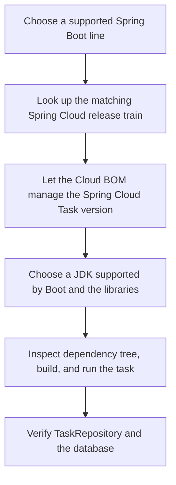

# Choosing Compatible Java, Spring Boot, and Spring Cloud Versions

## Lesson Objectives

A **Spring Cloud Task** application typically runs for a finite period of time: receives a request, processes data, records the outcome, and terminates the process. For example, an accounting system might launch an invoice reconciliation task every night. Spring Cloud Task manages the lifecycle and persists execution details via `TaskRepository`, making it possible to know which task ran, when it started and ended, and whether it succeeded or failed.

To achieve reliable behavior, Java, Spring Boot, and Spring Cloud versions cannot be chosen in isolation. After this lesson, you will be able to:

- Distinguish **JDK**, **Spring Boot**, **Spring Cloud release train**, and **Spring Cloud Task** versions.
- Select a compatible combination from official release documentation while taking support status into account.
- Configure Maven using the Spring Boot parent and Spring Cloud BOM to avoid library version mismatches.
- Inspect an actual configuration, identify compatibility errors, and prepare safe upgrades.

## 1. Four Version Layers to Check

| Component | Role in a Task Application | How the Version Is Determined |
| --- | --- | --- |
| **Java/JDK** | Compiles and runs the short-lived JVM process | `java -version`, `mvn -version`, `java.version`, or Java toolchain |
| **Spring Boot** | Initializes the application, configures `DataSource`, manages `ApplicationRunner`/`CommandLineRunner` lifecycle, packages the JAR | Spring Boot parent/BOM or build plugin |
| **Spring Cloud release train** | Coordinated set of versions for Spring Cloud projects | BOM `org.springframework.cloud:spring-cloud-dependencies` |
| **Spring Cloud Task** | Provides `TaskRepository`, tracks `TaskExecution`, and integrates with the process lifecycle | Library managed by the Spring Cloud BOM, typically added via `spring-cloud-starter-task` |

A **Spring Cloud release train** is a coordinated release bundle, such as `2026.0.0`. It does **not** mean the Spring Cloud Task library version is also `2026.0.0`: in this release train, Task is at version `5.1.0`. Similarly, Spring Boot `4.2.0` is Boot's own version, and Java `21` is the language/runtime version. Never use these numbers interchangeably.

You can visualize the selection order as follows:



This relationship matters for Tasks because an application may **compile cleanly** yet fail at runtime with `NoSuchMethodError`, missing classes, or auto-configuration errors. In a scheduled environment, an error occurring at midnight can cause a data processing window to be missed.

## 2. Reference Compatibility Table

**Reference date: November 24, 2026.** Patch releases and support status change over time; when creating a project or upgrading, verify against the [official Spring Cloud page](https://spring.io/projects/spring-cloud), [release announcements](https://spring.io/blog), and [Spring Boot system requirements](https://docs.spring.io/spring-boot/system-requirements.html).

| Spring Boot | Spring Cloud release train | Spring Cloud Task managed by train | Usage Assessment |
| --- | --- | --- | --- |
| **4.2.0** | **2026.0.0** (Paddington) | **5.1.0** | New GA combination, suitable for starting new projects and integration testing |
| **4.1.x** | **2025.1.x** (Oakwood), from `2025.1.2` upward | **5.0.x** line | Option for projects already on Boot 4.1; choose an appropriate service release, `2025.1.5` as of this date |
| **4.0.x** | **2025.1.x** (Oakwood) | **5.0.x** line | Compatible; prefer a recent service release in the train, such as `2025.1.5` |
| **3.5.x** | **2025.0.x** (Northfields) | **3.3.x** line | Legacy systems; this train has reached end of OSS support per the Spring Cloud page |
| **3.4.x** | **2024.0.x** (Moorgate) | **3.2.x** line | Reference for maintaining/upgrading legacy systems; end of OSS support |

Key points to read accurately from the table:

1. **Boot 4.2.0 pairs with Cloud 2026.0.0** per the GA announcement on November 20, 2026. Do not assume Cloud `2025.1.x` also supports Boot 4.2 just because both share major version `4`.
2. **Boot 4.1.x pairs with Cloud 2025.1.2 and later**, because Boot 4.1 support was added in `2025.1.2`; release `2025.1.5`, announced on November 20, 2026, supports both Boot 4.0.x and 4.1.x.
3. **Boot 3.5.x is not automatically compatible with Cloud 2025.1.x**. The fact that Cloud 2025.1 supports Boot 4 does not mean it also supports Boot 3.
4. The Task version in the table indicates the **library line** selected by the BOM. Do not manually pin `5.0.0`, `5.1.0`, or an arbitrary patch version if your project's BOM already resolves another version.

### Which Java Version Should You Choose?

Spring Boot **4.2.0** documentation requires **Java 17 or higher** and announces compatibility up to **Java 27**. Spring Cloud Task documentation also states a minimum threshold of Java 17. This is the **framework's minimum requirement**, not a guarantee that every JDBC driver, library, build plugin, and container image in your application supports that entire Java range.

For hands-on practice, **Java 21 (LTS)** is an easy choice to standardize across developer machines, CI, and runtime environments. **Java 25 (LTS)** is also an option worth considering once all tooling and dependencies have been verified. Choose Java 17 when specific environment or library constraints require it; do not upgrade the JDK simply for a higher version number while skipping testing.

Check two commonly confused pieces of information:

```bash
java -version      # Java used by the current java command
mvn -version       # Java that Maven is actually using
```

For example, a machine may have JDK 21 installed while Maven still runs on JDK 17 due to a misconfigured `JAVA_HOME`; compiling with one JDK and deploying to an older runtime can cause `UnsupportedClassVersionError`. If using Maven Toolchains, configure the appropriate JDK for the compilation step as well; always verify both the JDK inside the container image and the scheduled task runtime environment.

## 3. Process for Choosing Versions in a Project

**Scenario:** A team needs to build a transaction aggregation task that runs on demand and nightly, storing history in PostgreSQL so operations can investigate failures.

1. **Determine the Boot line:** For a new project as of this documentation baseline, you can start with Boot `4.2.0`; if the product already uses Boot `4.1.x`, keep that line while adding the Task to narrow the scope of change.
2. **Look up the matching Spring Cloud train:** Boot `4.2.0` → Cloud `2026.0.0`; Boot `4.1.x` → Cloud `2025.1.x` from `2025.1.2` upward (e.g., `2025.1.5`). Read the official documentation before locking version numbers.
3. **Choose the JDK:** Use Java 21 for the example; cross-check requirements for Boot, the PostgreSQL driver, build plugins, and deployment images.
4. **Let the BOM manage Task:** Declare `spring-cloud-starter-task` **without setting `<version>` directly**. The Boot parent manages core libraries, and the Cloud BOM manages Cloud libraries.
5. **Verify with a real application:** Package the JAR, run a successful execution and an intentional failure; verify the process exits properly and `TaskExecution` metadata is persisted durably.

When operational requirements prioritize stability, a team may choose Boot `4.1.x` with Cloud `2025.1.5` to preserve the existing ecosystem, then plan a later migration to Boot `4.2.x`/Cloud `2026.0.x`. That is a decision based on project compatibility—there is no rule requiring every system to adopt the newest GA release on day one.

## 4. Configuring Maven with the Right Version Set

The following example uses **Java 21 + Spring Boot 4.2.0 + Spring Cloud 2026.0.0**. H2 is solely for testing the Task lifecycle on a local machine.

```xml
<?xml version="1.0" encoding="UTF-8"?>
<project xmlns="http://maven.apache.org/POM/4.0.0"
         xmlns:xsi="http://www.w3.org/2001/XMLSchema-instance"
         xsi:schemaLocation="http://maven.apache.org/POM/4.0.0
                             https://maven.apache.org/xsd/maven-4.0.0.xsd">
    <modelVersion>4.0.0</modelVersion>

    <parent>
        <groupId>org.springframework.boot</groupId>
        <artifactId>spring-boot-starter-parent</artifactId>
        <version>4.2.0</version>
        <relativePath/>
    </parent>

    <groupId>com.example</groupId>
    <artifactId>reconciliation-task</artifactId>
    <version>0.0.1-SNAPSHOT</version>

    <properties>
        <java.version>21</java.version>
        <spring-cloud.version>2026.0.0</spring-cloud.version>
    </properties>

    <dependencyManagement>
        <dependencies>
            <dependency>
                <groupId>org.springframework.cloud</groupId>
                <artifactId>spring-cloud-dependencies</artifactId>
                <version>${spring-cloud.version}</version>
                <type>pom</type>
                <scope>import</scope>
            </dependency>
        </dependencies>
    </dependencyManagement>

    <dependencies>
        <dependency>
            <groupId>org.springframework.cloud</groupId>
            <artifactId>spring-cloud-starter-task</artifactId>
        </dependency>
        <dependency>
            <groupId>com.h2database</groupId>
            <artifactId>h2</artifactId>
            <scope>runtime</scope>
        </dependency>
    </dependencies>

    <build>
        <plugins>
            <plugin>
                <groupId>org.springframework.boot</groupId>
                <artifactId>spring-boot-maven-plugin</artifactId>
            </plugin>
        </plugins>
    </build>
</project>
```

Role of the three version lines:

- `<version>4.2.0</version>` in the **Boot parent** selects the Spring Boot platform and manages plugins and Boot-owned dependency versions.
- `<spring-cloud.version>2026.0.0</spring-cloud.version>` selects the **BOM release train**, not the version of any individual Cloud library.
- `<java.version>21</java.version>` selects the bytecode/compilation level configured by the Boot parent; the actual runtime must also be able to run that bytecode.

If using **Gradle (Groovy DSL)**, the same principle applies: one Boot version, one matching Cloud BOM, and no manual pinning of the Task starter version:

```groovy
plugins {
    id 'java'
    id 'org.springframework.boot' version '4.2.0'
    id 'io.spring.dependency-management' version '1.1.7'
}

repositories { mavenCentral() }

java {
    toolchain { languageVersion = JavaLanguageVersion.of(21) }
}

dependencyManagement {
    imports {
        mavenBom 'org.springframework.cloud:spring-cloud-dependencies:2026.0.0'
    }
}

dependencies {
    implementation 'org.springframework.cloud:spring-cloud-starter-task'
    runtimeOnly 'com.h2database:h2'
}
```

According to Boot 4.2.0 system requirements, use Maven **3.6.3 or later** or Gradle **8.14+ in the 8.x line / 9.x line**. For real projects, use Maven Wrapper (`mvnw`) or Gradle Wrapper (`gradlew`) so the team and CI consistently run the tested build tool version.

## 5. Running a Short-Lived Task Experiment

In `src/main/java/com/example/ReconciliationTaskApplication.java`, create a minimal application:

```java
package com.example;

import java.time.LocalDate;
import org.springframework.boot.ApplicationRunner;
import org.springframework.boot.SpringApplication;
import org.springframework.boot.autoconfigure.SpringBootApplication;
import org.springframework.context.annotation.Bean;

@SpringBootApplication
public class ReconciliationTaskApplication {
    public static void main(String[] args) {
        SpringApplication.run(ReconciliationTaskApplication.class, args);
    }

    @Bean
    ApplicationRunner reconcile() {
        return args -> {
            var values = args.getOptionValues("date");
            if (values == null || values.size() != 1) {
                throw new IllegalArgumentException("Parameter --date=YYYY-MM-DD is required");
            }
            LocalDate date = LocalDate.parse(values.get(0));
            System.out.println("Reconciled data for date " + date);
        };
    }
}
```

The Spring Cloud Task starter auto-configures the Task tracking infrastructure, including `TaskRepository` and lifecycle listeners. `ApplicationRunner` contains the job with a clear start and end. Adding the starter does not turn the application into an HTTP server; explicitly disable web mode so the process terminates once the runner finishes.

`src/main/resources/application.yml` file for testing:

```yaml
spring:
  application:
    name: reconciliation-task
  main:
    web-application-type: none
  datasource:
    url: jdbc:h2:mem:taskdb;DB_CLOSE_DELAY=-1
    username: sa
    password: ""
logging:
  level:
    org.springframework.cloud.task: DEBUG
```

Run after installing the proper JDK and Maven:

```bash
./mvnw -version
./mvnw clean package
java -jar target/reconciliation-task-0.0.1-SNAPSHOT.jar --date=2026-11-23
```

On Windows, use `mvnw.cmd` instead of `./mvnw`. When successful, the runner prints the processed date; `DEBUG`-level logs may show the task being created and `TaskExecution` updated with completion status. Try passing `--date=invalid-date` to observe the failure path and non-zero exit code, then check how the invoking system reports the failure.

**Limitation of the H2 example:** the `jdbc:h2:mem:...` database resides in process memory. When the JVM exits, task history is no longer available to query on subsequent runs. In a real environment, use PostgreSQL/MySQL or another relational database supported by Spring Cloud Task, point `DataSource` to a database that exists independently of the task, and manage the schema via a migration process. Never hardcode credentials in source code; use deployment environment secrets. The example above illustrates **compatibility and the Task recording mechanism**; the `TaskRepository` configuration lesson will dive deeper into durable storage.

## 6. Checking and Diagnosing During Upgrades

### Inspecting the Active Configuration

Before putting a task into CI or a schedule, cross-check **four sources**: the versions in the build file, the resolved dependency tree, the actual runtime JDK, and the framework versions shown in startup logs.

```bash
java -version
./mvnw -version
./mvnw dependency:tree -Dincludes=org.springframework.cloud
./mvnw help:effective-pom
```

The output should show the single selected Boot line, Spring Cloud Task managed by the **matching Cloud BOM**, and no older Cloud libraries pulled in unexpectedly by transitive dependencies. With `help:effective-pom`, verify that `dependencyManagement` was imported as expected. During testing, enable Spring Cloud Commons' compatibility verification mechanism if supported by your version:

```yaml
spring:
  cloud:
    compatibility-verifier:
      enabled: true
```

**Note:** this property is an extra check for the Boot/Cloud pairing; it does **not** replace the official compatibility matrix or integration testing. Do not disable the verifier or manually alter `compatible-boot-versions` just to bypass an incompatibility error.

### Symptom and Troubleshooting Table

| Symptom | Common Cause | How to Check and Resolve |
| --- | --- | --- |
| `UnsupportedClassVersionError` when running the JAR | Runtime Java is older than the compiled bytecode target | Compare runtime `java -version` with `java.version`/toolchain; align JDKs or compile to a supported target |
| `NoSuchMethodError`, `ClassNotFoundException`, bean initialization failure after upgrading Boot | Spring/Cloud/Task library line mismatch or dependency override | Inspect `dependency:tree`, remove individual Task/Cloud version pins, select the BOM matching Boot |
| Application reports Spring Boot is incompatible with the release train | Boot/Cloud pair is outside the supported matrix | Switch to a supported release pair; do not treat disabling the check as a solution |
| Database connection failure or missing `TASK_EXECUTION` table | Wrong `DataSource`, schema not initialized, insufficient DB privileges | Check JDBC URL, privileges, driver, and version-matched Task schema migration |
| Run finishes but no history exists for the next run | In-memory H2 or ephemeral DB deleted along with the container | Use a persistent DB independent of the JVM; verify by querying after the process exits |
| Container keeps running after processing finishes | Embedded web server, non-daemon background thread, or unreleased resources | Set `spring.main.web-application-type=none`; inspect active threads and application lifecycle |

### Pre-Production Update Checklist

- [ ] Look up the exact Boot ↔ Cloud matrix for the target deployment version and check its support lifecycle.
- [ ] Verify Java versions across the build machine, CI, container image, and task execution environment.
- [ ] Use Boot dependency management alongside the Cloud BOM; audit any version overrides.
- [ ] Test a successful run, a failed run, and the process exit codes.
- [ ] Verify `TaskExecution` records are persisted to a durable DB and remain readable after the task exits.
- [ ] When combining with Spring Batch, also verify the Batch version managed by Boot and the Job/Step metadata schema; upgrade schemas per each project's documentation.
- [ ] Test the actual schedule or trigger mechanism, DB connection permissions, timeout handling, and retries before going to production.

## 7. Scenario Exercises

**Scenario A.** A new project uses Java 21 and Spring Boot 4.2.0, and the team plans to declare Cloud `2025.1.5` because it is a service release with a higher patch number than `2026.0.0`. Does this make sense?

**Suggested answer:** No. Patch numbers from different release trains are not used to compare compatibility. Cloud `2025.1.5` announces support for Boot 4.0.x/4.1.x, whereas Boot 4.2.0 pairs with Cloud `2026.0.0`. Choose based on the release matrix rather than patch numbers.

**Scenario B.** A task runs with Boot 4.1.x, Cloud 2025.1.5, JDK 21, and in-memory H2; it completes successfully, yet the next day's dashboard shows no history. Is this a compatibility issue or a storage issue?

**Suggested answer:** Check storage first: in-memory H2 loses data when the JVM exits, so it cannot serve as long-term task history storage. Use a persistent RDBMS and initialize the Task schema properly; there is no need to change the Boot/Cloud pairing because of this symptom.

**Scenario C.** When upgrading from Boot 3.5/Cloud 2025.0 to Boot 4.2/Cloud 2026.0, what should you verify beyond changing those two numbers in the POM?

**Suggested answer:** Verify the JDK/runtime, breaking API changes across major versions, libraries compatible with Boot 4, Spring Batch if used, the JDBC driver, Task/Batch schemas, the dependency tree, exit codes on task failure, and execution history readability. Perform the upgrade incrementally with regression testing.

## Official Documentation

The resources below help re-verify version numbers as the ecosystem publishes new releases:

1. [Spring Cloud – Release Train / Boot Compatibility](https://spring.io/projects/spring-cloud) — compatibility table and support status.
2. [Spring Cloud 2026.0.0 (Paddington), November 20, 2026](https://spring.io/blog/2026/11/20/spring-cloud-2026-0-0-has-been-released/) — confirms Boot 4.2.0 and Spring Cloud Task 5.1.0 in the train.
3. [Spring Cloud 2025.1.5 (Oakwood), November 20, 2026](https://spring.io/blog/2026/11/20/spring-cloud-2025-1-5-has-been-released/) — confirms support for Boot 4.0.x/4.1.x.
4. [Spring Boot – System Requirements](https://docs.spring.io/spring-boot/system-requirements.html) — Java and build tool requirements per Boot line.
5. [Spring Cloud Task – Getting Started](https://docs.spring.io/spring-cloud-task/reference/getting-started.html) — `ApplicationRunner`, `TaskRepository`, and the task database.
6. [Spring Cloud Commons – Compatibility Verification](https://docs.spring.io/spring-cloud-commons/reference/spring-cloud-commons/common-abstractions.html) — how to enable the Boot/Cloud pairing check.

**Rule of thumb:** choose **Spring Boot first**, look up the **compatible Spring Cloud release train**, let the **BOM manage Spring Cloud Task**, and then confirm the **JDK and dependency ecosystem** with a real run that persists its results.
