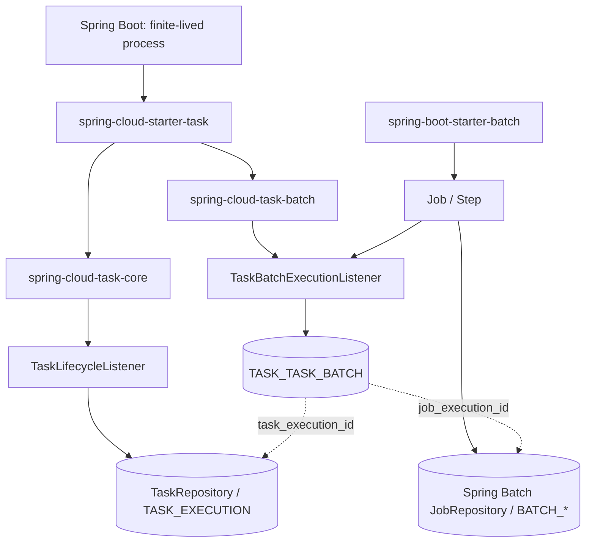

# The `spring-cloud-starter-task` and `spring-cloud-task-batch` Components

## Learning Objectives

After this lesson, you will be able to:

- Distinguish **Spring Cloud Task** (tracking a finite-lived application execution) from **Spring Batch** (organizing and operating a `Job` composed of multiple `Step`s).
- Explain what infrastructure `spring-cloud-starter-task` initializes and what capabilities `spring-cloud-task-batch` adds.
- Choose the appropriate dependencies for a standalone task or a task running Spring Batch, avoiding unnecessary duplicate declarations.
- Configure a database to store Task history, Batch history, and the link between the two types of runs.
- Diagnose cases where a Batch Job fails while the Task process still reports an exit code of `0`.

> **Scope:** This article belongs to the **Environment** chapter of the **SPRING_CLOUD_TASK** module. Spring Cloud Task supports building Spring Boot applications that run for a finite duration, persisting execution state and task outcomes to a database. View the components below as infrastructure for running applications on demand or via an external scheduler, with optional integration with Spring Batch.

## 1. Why Are Two Components Needed?

Consider a nightly payment reconciliation application:

1. A Kubernetes CronJob or orchestrator launches a Java process.
2. The application reads data, reconciles it, and exits.
3. Operations needs to know **which run**, **when it started/ended**, **what the exit code was**, and **whether any errors occurred**.
4. If reconciliation involves multiple steps or millions of records, operations also needs to know **which Job** and **which Step** failed, and whether its state is restartable.

Spring Cloud Task addresses step 3 through `TaskExecution` and `TaskRepository`. Spring Batch addresses step 4 through `Job`, `Step`, `JobExecution`, `StepExecution`, and `JobRepository`. The `spring-cloud-task-batch` library acts as the bridge that traces a `JobExecution` back to the exact `TaskExecution` that launched it.

**A Task does not necessarily contain a Spring Batch Job.** For instance, an `ApplicationRunner` that calls an API and exits can be tracked using Spring Cloud Task alone. Conversely, a Spring Batch Job can run without Spring Cloud Task, though in that case there is no Task-lifecycle metadata linkage provided by Spring Cloud Task.

## 2. Component Map

| Component | Primary Role | When Is It Needed? |
| --- | --- | --- |
| `spring-cloud-starter-task` | Starter bundling the libraries and auto-configuration needed for a Spring Cloud Task in a Spring Boot application. | Standard starting point for a Task application. |
| `spring-cloud-task-core` | Provides `TaskExecution`, `TaskRepository`, `TaskExplorer`, lifecycle listeners, and Task configuration. | Core foundation pulled in by the starter. |
| `spring-cloud-task-batch` | Integrates Task metadata with Spring Batch Jobs, notably via `TaskBatchExecutionListener`. | When a Task application contains and executes a Spring Batch `Job`. |
| `spring-boot-starter-batch` | Brings Spring Batch and Spring Boot Batch integration into the application, including appropriate Job launching mechanisms. | When you truly need `Job`, `Step`, readers, processors, writers, and retry/restart. |
| JDBC driver and `DataSource` | Connects to durable storage for execution history. | Required in real environments, especially to retain history across process terminations. |
| `TaskRepository` / `TaskExplorer` | Writes and queries Task execution history. | Managed by the Task layer. |
| Spring Batch `JobRepository` | Writes and queries Job/Step status, Job parameters, and restart metadata. | Managed by Spring Batch; distinct purpose from `TaskRepository`. |

### Relationship Between Libraries

`spring-cloud-starter-task` typically already declares dependencies on both `spring-cloud-task-core` **and** `spring-cloud-task-batch` (for example, in the POM of the Spring Cloud Task 5.0.x line). Therefore, when using the starter, **you do not necessarily need to declare `spring-cloud-task-batch` a second time**. Always inspect the actual dependency tree of your release, as dependency sets can change across versions.

Having `spring-cloud-task-batch` on the classpath **does not create a Batch Job by itself**. To run Batch processing, the application still requires the Spring Batch library and a configured `Job` bean. Similarly, the presence of Stream libraries in the dependency tree does not mean the application automatically emits events to a broker; that feature requires corresponding configuration and components.



The diagram illustrates the **logical relationship**: the Task side records an application run, the Batch side records Job/Step runs, and the integration listener records the link between them. It does not mean `spring-cloud-task-batch` is the engine that executes each Step.

## 3. Choosing the Right Dependencies

| Need | Main Dependencies | Explanation |
| --- | --- | --- |
| Execute a task via `ApplicationRunner` or `CommandLineRunner` | `spring-cloud-starter-task` and an appropriate database driver | A Spring Batch `Job` is not required. |
| Multi-step processing requiring Spring Batch restart/retry/checkpointing | `spring-cloud-starter-task` + `spring-boot-starter-batch` + driver | The Task starter usually already brings `spring-cloud-task-batch` onto the classpath; an actual `Job` is needed to trigger the linkage. |
| Manage modules manually without the starter | `spring-cloud-task-core`, plus `spring-cloud-task-batch` if using Batch | Requires manually managing all dependencies, auto-configuration, and version compatibility. |
| Spring Batch only, without Task lifecycle tracking | `spring-boot-starter-batch` | No `TASK_EXECUTION` metadata managed by Spring Cloud Task. |

### Maven Example for a Task Application Running Batch

Add the following dependencies to the Spring Boot project's `pom.xml`:

```xml
<dependencies>
    <dependency>
        <groupId>org.springframework.cloud</groupId>
        <artifactId>spring-cloud-starter-task</artifactId>
    </dependency>

    <dependency>
        <groupId>org.springframework.boot</groupId>
        <artifactId>spring-boot-starter-batch</artifactId>
    </dependency>

    <dependency>
        <groupId>org.postgresql</groupId>
        <artifactId>postgresql</artifactId>
        <scope>runtime</scope>
    </dependency>
</dependencies>
```

This example assumes the project already includes the Spring Boot parent/BOM and a **compatible Spring Cloud release-train BOM**; the dependencies are version-managed, so explicit version numbers are omitted above. If using Maven without having declared the Spring Cloud BOM yet, `dependencyManagement` should look like:

```xml
<dependencyManagement>
    <dependencies>
        <dependency>
            <groupId>org.springframework.cloud</groupId>
            <artifactId>spring-cloud-dependencies</artifactId>
            <version>${spring-cloud.version}</version>
            <type>pom</type>
            <scope>import</scope>
        </dependency>
    </dependencies>
</dependencyManagement>
```

The `spring-cloud.version` value must match the release train **compatible** with the Spring Boot version your project uses (which can be checked via Spring Initializr or the official compatibility matrix). Never pick a standalone `spring-cloud-task-batch` version merely because it is the newest.

Use one of these two commands to verify that `spring-cloud-task-batch` is genuinely on the classpath:

```bash
./mvnw dependency:tree -Dincludes=org.springframework.cloud
```

```bash
./gradlew dependencies --configuration runtimeClasspath
```

If the dependency tree already includes `spring-cloud-task-batch` through `spring-cloud-starter-task`, adding the same artifact directly usually only clutters the POM; Maven will reconcile it to a single version via dependency management.

## 4. Task Lifecycle and Where Metadata Is Stored

For a Task application whose Spring context initializes successfully, the typical sequence is:

1. Spring Boot initializes `ApplicationContext`, `DataSource`, and Task beans.
2. Spring Cloud Task infrastructure creates a `TaskExecution` and records the start time in `TaskRepository`.
3. Spring Boot executes `ApplicationRunner`/`CommandLineRunner` beans, or the application's Batch Job launcher mechanism.
4. Once the runners finish, the Task updates the result, end time, and error information in the repository.
5. The process closes the context and exits when no components remain to keep the application alive.

Note: **If the Spring context fails before the Task is initialized**, no `TASK_EXECUTION` row may exist at all. Therefore, querying the repository does not replace startup logs and process-status monitoring.

Key tables:

| Table | Contents |
| --- | --- |
| `TASK_EXECUTION` | Each Task execution: execution ID, Task name, timestamps, exit code, error message. |
| `TASK_EXECUTION_PARAMS` | Arguments associated with the Task execution. |
| `TASK_TASK_BATCH` | `TASK_EXECUTION_ID` and `JOB_EXECUTION_ID` keys linking a Task run to a Batch Job execution. |
| `BATCH_JOB_INSTANCE`, `BATCH_JOB_EXECUTION` | Logical identity of a Job and each individual Job run in Spring Batch. |
| `BATCH_STEP_EXECUTION` and other Batch tables | Step statistics and status/metadata used for processing or restarts. |

By default, Task tables carry the `TASK_` prefix and Batch tables carry the `BATCH_` prefix. If you customize prefixes, adjust the sample SQL queries below accordingly.

**The two repositories have distinct responsibilities.** `TaskRepository` records Task process history; `JobRepository` manages Batch Job metadata and semantics. `TASK_TASK_BATCH` merely links the two runs—it **does not merge the two repositories** and does not automatically guarantee exactly-once business semantics for either the Task or the Job.

## 5. Example A: Simple Task Without Spring Batch

This is a one-shot application: it accepts a day parameter and prints task information. In real systems, replace the print statement with idempotent business logic and proper logging.

```java
import org.springframework.boot.ApplicationArguments;
import org.springframework.boot.ApplicationRunner;
import org.springframework.boot.SpringApplication;
import org.springframework.boot.autoconfigure.SpringBootApplication;
import org.springframework.cloud.task.configuration.EnableTask;
import org.springframework.context.annotation.Bean;

@SpringBootApplication
@EnableTask
public class DailyCleanupTaskApplication {

    public static void main(String[] args) {
        SpringApplication.run(DailyCleanupTaskApplication.class, args);
    }

    @Bean
    ApplicationRunner cleanupRunner() {
        return (ApplicationArguments args) -> {
            String day = args.containsOption("day")
                    ? args.getOptionValues("day").get(0)
                    : "today";
            System.out.println("Cleaning data for " + day);
            // Call business service; throw an exception when processing fails.
        };
    }
}
```

Run:

```bash
java -jar daily-cleanup.jar --day=2026-11-24
```

If the Task has a configured JDBC `DataSource`, Spring Cloud Task records the run in the database. If only an in-memory development store is used, metadata vanishes once the process stops; therefore, never use an in-memory store for operational history.

Key takeaway: **`spring-cloud-task-batch` does not turn this example into a Spring Batch Job**. Without a `Job` bean, there is no corresponding `JobExecution` to link.

## 6. Example B: Task with a Spring Batch Job

Starting from the Task application above, add `spring-boot-starter-batch` and define a Job containing a Tasklet-based Step. You can use a separate application to run this example; do not keep an extra `ApplicationRunner` performing the same business work if you do not want duplicate execution.

```java
import org.springframework.boot.SpringApplication;
import org.springframework.boot.autoconfigure.SpringBootApplication;
import org.springframework.cloud.task.configuration.EnableTask;

@SpringBootApplication
@EnableTask
public class DailyBillingApplication {
    public static void main(String[] args) {
        SpringApplication.run(DailyBillingApplication.class, args);
    }
}
```

```java
import org.springframework.batch.core.Job;
import org.springframework.batch.core.Step;
import org.springframework.batch.core.job.builder.JobBuilder;
import org.springframework.batch.core.repository.JobRepository;
import org.springframework.batch.core.step.builder.StepBuilder;
import org.springframework.batch.repeat.RepeatStatus;
import org.springframework.context.annotation.Bean;
import org.springframework.context.annotation.Configuration;
import org.springframework.transaction.PlatformTransactionManager;

@Configuration
public class DailyBillingJobConfig {

    @Bean
    Step billingStep(JobRepository jobRepository,
                     PlatformTransactionManager transactionManager) {
        return new StepBuilder("billingStep", jobRepository)
                .tasklet((contribution, chunkContext) -> {
                    System.out.println("Closing daily billing...");
                    // Real processing may invoke services, reader/writer, etc.
                    return RepeatStatus.FINISHED;
                }, transactionManager)
                .build();
    }

    @Bean
    Job dailyBillingJob(JobRepository jobRepository, Step billingStep) {
        return new JobBuilder("dailyBillingJob", jobRepository)
                .start(billingStep)
                .build();
    }
}
```

The `JobBuilder`/`StepBuilder` API shown above follows Spring Batch 5/6 configuration style; verify compatibility with your Spring Boot/Spring Batch version. With Spring Boot auto-configuration, a `Job` bean is typically launched automatically at startup; if the application has multiple Jobs, select one explicitly with `spring.batch.job.name`. In this example, **do not add `@EnableBatchProcessing`** because that annotation can disable parts of Spring Boot's Batch auto-configuration that we rely on.

When executed successfully:

1. `TaskLifecycleListener` records a `TaskExecution` for the `DailyBillingApplication` process.
2. Spring Batch runs `dailyBillingJob` and records `JobExecution`/`StepExecution`.
3. If `spring-cloud-task-batch` is on the classpath and the integration listener is enabled, `TaskBatchExecutionListener` links the `JobExecution` to the `TaskExecution`.
4. The `TASK_TASK_BATCH` table stores the key pair pointing from the Task execution to the Job execution.

For a Task that runs **multiple Batch Jobs**, a single `TaskExecution` can be linked to multiple `JobExecution` records. This is an execution-history relationship and does not imply that all Jobs must share the same success/failure status.

## 7. Database and Schema Configuration

The `application.yml` example below shows a PostgreSQL deployment configuration **after the schema has already been created** via migrations:

```yaml
spring:
  application:
    name: daily-billing-task
  main:
    web-application-type: none
  datasource:
    url: jdbc:postgresql://localhost:5432/taskdb
    username: ${DB_USER}
    password: ${DB_PASSWORD}
  cloud:
    task:
      initialize-enabled: false
      closecontext-enabled: true
      batch:
        fail-on-job-failure: true
  batch:
    job:
      name: dailyBillingJob
      enabled: true
    jdbc:
      initialize-schema: never
```

Notable settings:

- `spring.application.name` sets the application name and is typically used as the Task name in metadata.
- `spring.datasource.*` defines the `DataSource` used to persist metadata. The example uses **one** PostgreSQL DataSource for both Task and Batch; if the application uses multiple DataSources, configure the repositories separately using each component's configuration mechanism (e.g., `TaskConfigurer`).
- `spring.cloud.task.initialize-enabled=false` instructs Spring Cloud Task not to auto-create Task tables at startup because the database schema is managed by migrations. In a learning environment, auto-initialization may be enabled depending on database capabilities and permissions.
- `spring.batch.jdbc.initialize-schema=never` prevents Spring Boot from auto-creating Batch metadata tables; when experimenting with an embedded database, the initialization mode may differ.
- `spring.cloud.task.closecontext-enabled=true` helps close the context once runners finish, especially when other components would otherwise keep the application running.
- `spring.cloud.task.batch.fail-on-job-failure=true` propagates Batch Job failure into the Task outcome/exit code so external systems detect the failure.

In production, create and upgrade **both the Task schema and the Batch schema** using version-matched migrations, grant least-privilege SQL permissions, and keep metadata tables in a persistent database. Do not use in-memory H2 if you need to inspect the history of exited processes.

### Querying from Task to Batch Job

With default table prefixes:

```sql
SELECT
    t.TASK_EXECUTION_ID,
    t.TASK_NAME,
    t.START_TIME,
    t.END_TIME,
    t.EXIT_CODE,
    x.JOB_EXECUTION_ID,
    j.STATUS AS JOB_STATUS,
    j.EXIT_CODE AS JOB_EXIT_CODE
FROM TASK_EXECUTION t
LEFT JOIN TASK_TASK_BATCH x
    ON x.TASK_EXECUTION_ID = t.TASK_EXECUTION_ID
LEFT JOIN BATCH_JOB_EXECUTION j
    ON j.JOB_EXECUTION_ID = x.JOB_EXECUTION_ID
ORDER BY t.TASK_EXECUTION_ID DESC;
```

The query result shows that a Task may have no linked Job (`JOB_EXECUTION_ID` is `NULL`), or one or more Job runs. When investigating, also query `BATCH_STEP_EXECUTION` by `JOB_EXECUTION_ID` to locate the failing Step. Avoid concluding that a Job ran merely because a `TASK_EXECUTION` row exists: the Task could have executed other logic or failed before the Batch Job started.

## 8. Why Can Batch Be FAILED While the Task Exit Code Is 0?

Batch status and process exit code are **two separate signal layers**:

- `JobExecution.status=FAILED` describes the Job status recorded by Spring Batch.
- `TaskExecution.exitCode` describes the Task execution outcome at the Spring Boot application level.
- The **OS/container process exit code** is the signal orchestrators usually inspect to decide success, retry, or alerting.

If a Batch Job fails but the Job launcher completes without propagating an error to the application layer, the Task may still record exit code `0` under default behavior. When the orchestrator must detect the failure, set:

```properties
spring.cloud.task.batch.fail-on-job-failure=true
```

This property instructs the Batch integration mechanism to inspect Job failures and produce a non-zero exit code for the Task where supported. Do not rely solely on a "Job FAILED" log line: verify `BATCH_JOB_EXECUTION.STATUS`, `TASK_EXECUTION.EXIT_CODE`, **and** the actual process exit code for your deployed framework version.

If you launch Jobs manually via `JobLauncher`, write a custom runner, or design asynchronous execution, you must inspect `JobExecution` yourself, propagate errors, and ensure the runner does not complete before the actual work finishes. The property above is no substitute for proper control-flow and error-handling design.

## 9. Parameters, Scheduling, and Reruns

**Task parameters** are process arguments such as `--day=2026-11-24`, readable from `ApplicationArguments`. Spring Batch **JobParameters** identify a `JobInstance` and determine which Jobs can be restarted; they are not strictly identical to Task parameters. When using the automatic Job launcher, how command-line arguments map to JobParameters depends on the Spring Boot/Spring Batch version and Job launcher configuration; test this in your actual project.

For a Job already marked `COMPLETED`, rerunning with the same set of *identifying JobParameters* may be rejected by Spring Batch because that `JobInstance` has already finished. Clearly define the business key (reconciliation date, data batch), retry semantics, and when a new `JobInstance` should be created. Do not inject random parameters merely to bypass Batch's duplicate-run protection.

Spring Cloud Task monitors a **finite-lived** application; it does not act as a cron scheduler by itself. Common ways to run it include on-demand `java -jar` invocations, Kubernetes `Job`/`CronJob`, enterprise schedulers, or orchestration platforms. Each trigger should spawn a new Task process with time bounds, an explicit exit code, and a concurrency/deduplication strategy when business rules require it.

If two concurrent runs with the same Task name must be prevented, investigate Spring Cloud Task's `spring.cloud.task.single-instance-enabled` feature along with its required dependencies and lock tables. Never assume that using `TaskRepository` alone automatically blocks overlapping runs.

## 10. Common Errors and Troubleshooting Checks

| Symptom | Causes to Check | Resolution |
| --- | --- | --- |
| `TASK_EXECUTION` exists, no `TASK_TASK_BATCH` | No `Job` actually ran; `spring-cloud-task-batch` missing on runtime classpath; integration listener disabled or unconfigured. | Check dependency tree, `Job` bean, logs, and `spring.cloud.task.batch.listener.enabled`. |
| `BATCH_JOB_EXECUTION` exists, no `TASK_EXECUTION` | Job ran outside the Task application or the Task failed to boot. | Verify `spring-cloud-starter-task`, `@EnableTask`, startup logs, and `TaskRepository` connectivity. |
| Task startup fails due to missing tables | Schema mismatch; auto-init disabled without running migrations; wrong DB/schema/table prefix. | Check `TASK_*` and `BATCH_*` tables, permissions, and migrations. |
| Job `FAILED` but scheduler reports success | Task or process exit code remained `0`. | Enable `spring.cloud.task.batch.fail-on-job-failure=true` and test an intentional Job failure. |
| Job does not run after adding dependency | No `Job` bean defined, `spring.batch.job.enabled=false`, wrong Job selected, or custom Batch config overrides auto-configuration. | Check `Job` beans, `spring.batch.job.name`, and Batch logs. |
| Job rerun rejected | Same `JobInstance` already completed or identifying parameters unchanged. | Design clear JobParameters and apply business-driven restart/rerun rules. |
| Task does not terminate | Embedded web server, non-daemon background thread, scheduler, or non-returning runner. | Use `spring.main.web-application-type=none` when appropriate; manage threads and close context properly. |
| Metadata disappears after exit | Using in-memory database/store or lacking persistent storage. | Configure a durable `DataSource`, backups, and retention. |

### Pre-Operations Checklist

1. Version compatibility: Spring Boot, Spring Batch, Spring Cloud release train, JDBC driver, and schemas.
2. Correct dependencies: Task starter; Batch starter when using Jobs; verify integration module on runtime classpath.
3. Correct initialization: `@EnableTask`, explicit `Job` selection if multiple Jobs exist, without accidentally disabling Batch auto-configuration.
4. Correct persistence: migrations for `TASK_*` and `BATCH_*` tables; DB permissions, backups, monitoring, and metadata retention.
5. Accurate outcome signals: test Job success/failure, verify Task/process exit codes and container logs.
6. Operational safety: input parameters, sensitive data in logs/metadata, idempotency, timeouts, retries, and duplicate-run prevention.

## 11. Practice Exercises

**Exercise 1 — Observing a Standalone Task:** Create an `ApplicationRunner` accepting `--day`, run it twice with two different values, and use SQL to check the number of `TASK_EXECUTION` records. Explain why no `TASK_TASK_BATCH` link appears when no Job is defined.

**Exercise 2 — Adding Batch:** Create `dailyBillingJob` with one Step that logs output; run it successfully, then inspect `TASK_EXECUTION`, `BATCH_JOB_EXECUTION`, and `TASK_TASK_BATCH`. Use the query in section 7 to prove which Job belongs to which Task.

**Exercise 3 — Testing Failure:** Have the Tasklet throw an exception, then compare `JobExecution.status`, `TaskExecution.exitCode`, and the process exit code before and after enabling `spring.cloud.task.batch.fail-on-job-failure=true`. Explain the impact on a Kubernetes Job/CronJob that uses exit codes to determine success.

**Exercise 4 — Inspecting the Environment:** Use the dependency tree to prove whether `spring-cloud-task-batch` is already included by the starter; explain why versions should be managed via the BOM and how to prevent automatic schema initialization in production.

## Key Takeaways

- **`spring-cloud-starter-task`** provides the environment for a finite-lived Spring Boot process to be managed as a Task and persist lifecycle metadata.
- **`spring-cloud-task-batch`** provides the bridge for tracking Spring Batch Jobs running inside a Task, primarily via `TaskBatchExecutionListener` and the `TASK_TASK_BATCH` join table.
- **`spring-boot-starter-batch`** is the dependency actually used to bring Spring Batch into an application; the Task–Batch integration library does not replace Job/Step/restart capabilities.
- Proper operations require verifying **both Task history, Batch history, a persistent database, and the process exit code**.

## References

- [Spring Cloud Task — Getting started](https://docs.spring.io/spring-cloud-task/reference/getting-started.html)
- [Spring Cloud Task — Features and TaskRepository](https://docs.spring.io/spring-cloud-task/reference/features.html)
- [Spring Cloud Task — Batch integration](https://docs.spring.io/spring-cloud-task/reference/batch.html)
- [Spring Cloud Task — Task repository schema](https://docs.spring.io/spring-cloud-task/docs/current/reference/html/appendix-task-repository-schema.html)
- [Spring Boot — Spring Batch](https://docs.spring.io/spring-boot/reference/io/spring-batch.html)
- [Spring Batch — TaskletStep](https://docs.spring.io/spring-batch/reference/step/tasklet.html)
